# OpenSchool ERP — System Architecture

**Authoritative Technical Architecture Reference**

| Aspect | Detail |
|--------|--------|
| **Document ID** | OPS-ARCH-001 |
| **Status** | Approved |
| **Version** | 1.0.0 |
| **Date** | 2026-07-20 |
| **Author** | Platform Architecture Team |
| **Review Cycle** | Quarterly |

---

## Document Status

| Status | Description |
|--------|-------------|
| **Draft** | Under active development |
| **Review** | Under architecture review |
| **Approved** | Approved for implementation |
| **Frozen** | Locked for current version |
| **Deprecated** | Pending replacement |

**Current Status:** Approved (Refined)

---

## Table of Contents

1. [Executive Summary](#1-executive-summary)
2. [Architecture Principles](#2-architecture-principles)
3. [System Overview](#3-system-overview)
4. [C4 Architecture](#4-c4-architecture)
5. [Request Lifecycle](#5-request-lifecycle)
6. [Authentication Architecture](#6-authentication-architecture)
7. [Multi-Tenant Architecture](#7-multitenant-architecture)
8. [Domain Interaction](#8-domain-interaction)
9. [Data Architecture Overview](#9-data-architecture-overview)
10. [Failure Philosophy](#10-failure-philosophy)
11. [Event Architecture](#11-event-architecture)
12. [Background Processing](#12-background-processing)
13. [Request Correlation Architecture](#13-request-correlation-architecture)
14. [Notification Architecture](#14-notification-architecture)
15. [File Storage Architecture](#15-file-storage-architecture)
16. [Business Workflow Sequence Diagrams](#16-business-workflow-sequence-diagrams)
17. [Module Dependency Rules](#17-module-dependency-rules)
18. [Security Architecture](#18-security-architecture)
19. [Caching Strategy](#19-caching-strategy)
20. [Performance Strategy](#20-performance-strategy)
21. [Deployment Architecture](#21-deployment-architecture)
22. [Observability Architecture](#22-observability-architecture)
23. [Disaster Recovery](#23-disaster-recovery)
24. [Future Architecture](#24-future-architecture)
25. [Architectural Metrics](#25-architectural-metrics)
26. [Architecture Decision Records](#26-architecture-decision-records)
27. [Platform Extension Points](#27-platform-extension-points)
28. [Architecture Review Checklist](#28-architecture-review-checklist)
29. [Architecture Risk Register](#29-architecture-risk-register)
30. [Appendices](#30-appendices)
31. [Revision History](#31-revision-history)

---

## 1. Executive Summary

OpenSchool ERP is a multi-tenant SaaS platform serving educational institutions across the Middle East and Africa. It provides comprehensive management capabilities spanning 10 bounded domains: Identity & Access, Institution Management, People, Academic Management, Finance, Communication, Operations, Documents & Learning, Reporting & Analytics, and Platform Administration.

### 1.1 Architecture at a Glance

| Aspect | Approach |
|--------|----------|
| **Architecture style** | Modular Monolith |
| **Domain model** | Domain-Driven Design with bounded contexts |
| **Communication** | Synchronous (REST API) + Asynchronous (Event-driven) |
| **Data** | Single shared PostgreSQL database with domain-scoped schemas |
| **Multi-tenancy** | Application-level isolation (no RLS) |
| **Frontend** | Flutter mobile app + Next.js admin dashboard |
| **Deployment** | Docker containers on a single host (V1); Kubernetes-ready |
| **Event bus** | EventEmitter2 in-process (V1); BullMQ/Redis anticipated for V2 |

### 1.2 Key Architectural Decisions

| Decision | Rationale |
|----------|-----------|
| Modular monolith over microservices | Simpler deployment; sufficient for V1 scale; easier debugging; single transaction boundary |
| EventEmitter2 over external message broker | In-process speed; no infrastructure overhead; adequate for V1 event volume |
| Shared database over database-per-domain | Simplifies cross-domain queries; single backup strategy; adequate for V1 data volume |
| Application-level tenant isolation over RLS | Simpler implementation; Prisma compatibility; sufficient for V1 tenant count |
| REST API-first | Predictable contracts; Swagger documentation; wide client compatibility |
| Domain events for cross-domain communication | Decoupled domains; async processing; eventual consistency model |

### 1.3 Scope

This document covers:

- Complete system architecture from infrastructure to application layer
- Request lifecycle through all processing stages
- Authentication, authorization, and multi-tenant isolation
- Domain communication patterns and event flows
- Data architecture across PostgreSQL, Redis, and object storage
- Background processing and notification delivery
- Security, caching, performance, and deployment
- Disaster recovery and operational architecture

This document does not cover:

- Business rules (defined in domain engineering specifications)
- API contracts (defined in 04 API Style Guide)
- Code implementation patterns (defined in 05 Development Standards)
- Operational procedures (defined in 06 DevOps & Deployment Standards)

---

## 2. Architecture Principles

### 2.1 Core Principles

| Principle | Description | Implementation |
|-----------|-------------|----------------|
| **Modular Monolith** | System is a single deployable unit composed of independent domain modules | NestJS modules; each domain owns controllers, services, repositories |
| **Domain-Driven Design** | Bounded contexts define domain boundaries; cross-domain communication via events only | 10 domain modules; each with its own aggregates and persistence |
| **Clean Architecture** | Domain logic is independent of infrastructure; dependencies point inward | Controllers → Services → Repositories; no business logic in controllers |
| **API-First** | Every capability exposed through documented REST API | Swagger decorators; OpenAPI 3.1 spec; contract testing |
| **Event-Driven** | Cross-domain communication uses domain events; consumers are idempotent | EventEmitter2 (V1); versioned event envelopes; eventId deduplication |
| **Multi-Tenant SaaS** | Every query scoped to tenant; application-level isolation | tenantId in every query; JWT contains tenantId; Guards enforce isolation |
| **Security by Default** | Authentication, authorization, and tenant isolation enforced at every layer | JWT validation; permission guards; tenant guards; input validation |
| **Configuration over Customization** | Academic policies and business rules are record-configurable | No code changes for policy changes; database-driven configuration |

### 2.2 Architectural Constraints

| Constraint | Impact | Mitigation |
|------------|--------|-----------|
| Single PostgreSQL database | All domains share one database | Domain-scoped queries; no cross-domain joins |
| In-process event bus (V1) | Events lost on process crash | Events published after commit; future BullMQ migration |
| Single deployment unit | Scaling all domains together | Modular design enables future extraction |
| Application-level tenant isolation | No database-level isolation enforcement | Guard-based enforcement; comprehensive testing |

### 2.3 Quality Attributes

| Attribute | Target | Strategy |
|-----------|--------|----------|
| **Availability** | 99.9% | Health checks; auto-restart; backup strategy |
| **Performance** | p95 < 500ms API response | Caching; pagination; query optimization |
| **Scalability** | 100 concurrent users per tenant | Horizontal scaling; connection pooling |
| **Security** | OWASP Top 10 compliance | Input validation; authentication; tenant isolation |
| **Maintainability** | Clear domain boundaries | DDD; modular monolith; ADRs |
| **Extensibility** | New domains without breaking existing | Event-driven; configuration over code |
| **Testability** | 80% unit test coverage | DI; interface boundaries; test pyramids |

---

## 3. System Overview

### 3.1 Platform Summary

OpenSchool ERP is a comprehensive educational institution management platform. It serves students, teachers, administrators, parents, and platform operators across multiple countries and languages.

| Aspect | Detail |
|--------|--------|
| **Users** | Students, Teachers, Administrators, Parents, Platform Operators |
| **Institutions** | Schools, Universities, Training Centers |
| **Tenants** | One or more institutions per tenant |
| **Domains** | 10 bounded contexts |
| **Events** | 99 cross-domain events |
| **API endpoints** | ~150+ REST endpoints |
| **Languages** | Arabic, English, French (extensible) |

### 3.2 Domain Map

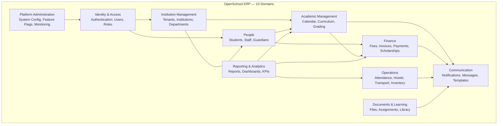

### 3.3 Bounded Context Map

| Domain | Bounded Context | Core Aggregates | Primary Events |
|--------|----------------|-----------------|----------------|
| Identity & Access | User, Role, Permission | User, Role, Permission, Session | UserCreated, UserUpdated, RoleAssigned |
| Institution Management | Tenant, Institution | Tenant, Institution, Department, AcademicYear, Term | TenantProvisioned, TermOpened, TermClosed |
| People | Student, Staff, Guardian | Student, Staff, Guardian, Relationship | StudentEnrolled, StaffHired, StudentTransferred |
| Academic Management | Curriculum, Grading | Curriculum, Subject, Class, Enrollment, Result | ResultPublished, ReportCardGenerated |
| Finance | Billing, Payment | FeeStructure, Invoice, Payment, Scholarship, Refund | InvoiceGenerated, PaymentConfirmed, RefundProcessed |
| Communication | Notification, Message | NotificationTemplate, Notification, Campaign | NotificationSent, CampaignCompleted |
| Operations | Attendance, Facility | Attendance, HostelAllocation, TransportRoute, InventoryItem, MaintenanceRequest | AttendanceRecorded, MaintenanceCompleted |
| Documents & Learning | File, Assignment | Document, Assignment, Submission, LibraryBook, BookLoan | DocumentUploaded, BookBorrowed, BookReturned |
| Reporting & Analytics | Report, Dashboard | Report, Dashboard, KPI, Alert, Trend | ReportGenerated, KpiThresholdBreached |
| Platform Administration | System, Audit | SystemConfig, FeatureFlag, AuditLog, PlatformAdmin | SystemConfigUpdated, ModuleActivated |

---

## 4. C4 Architecture

### 4.1 Level 1 — System Context Diagram

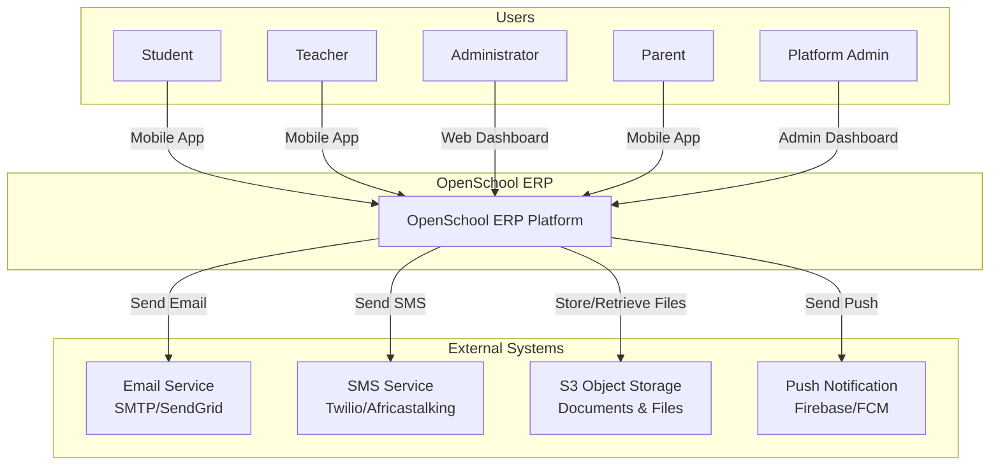

**Key interactions:**

| Actor | Interface | Protocol | Description |
|-------|-----------|----------|-------------|
| Student | Flutter Mobile App | HTTPS/REST | View grades, submit assignments, check attendance |
| Teacher | Flutter Mobile App | HTTPS/REST | Manage classes, record grades, take attendance |
| Administrator | Next.js Web Dashboard | HTTPS/REST | Institution management, reporting, configuration |
| Parent | Flutter Mobile App | HTTPS/REST | View child progress, pay fees, receive notifications |
| Platform Admin | Admin Dashboard | HTTPS/REST | Tenant provisioning, system monitoring, feature flags |

### 4.2 Level 2 — Container Diagram

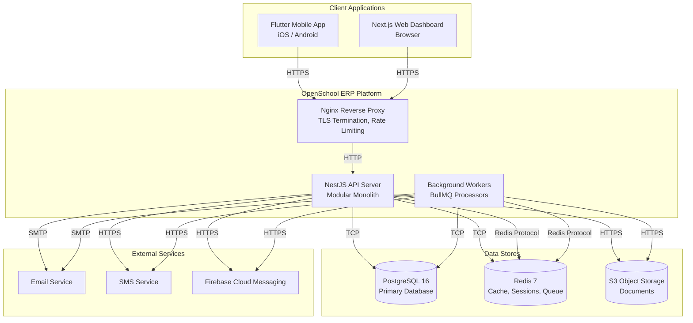

**Container responsibilities:**

| Container | Technology | Responsibility |
|-----------|-----------|---------------|
| Flutter Mobile App | Flutter/Dart | Student, Teacher, Parent mobile interfaces |
| Next.js Web Dashboard | Next.js/React | Administrator web interface |
| Nginx Reverse Proxy | Nginx | TLS termination, rate limiting, static serving |
| NestJS API Server | Node.js/NestJS | All API processing, business logic, event publishing |
| Background Workers | Node.js/BullMQ | Async job processing, notifications, reports |
| PostgreSQL | PostgreSQL 16 | Primary data store for all domains |
| Redis | Redis 7 | Caching, sessions, job queue, pub/sub |
| S3 Object Storage | S3-compatible | Document and file storage |

### 4.3 Level 3 — Backend Component Diagram

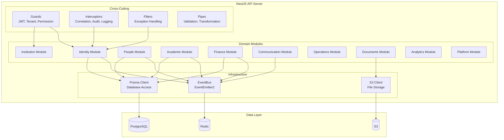

### 4.4 Level 3 — Frontend Component Diagram (Flutter)

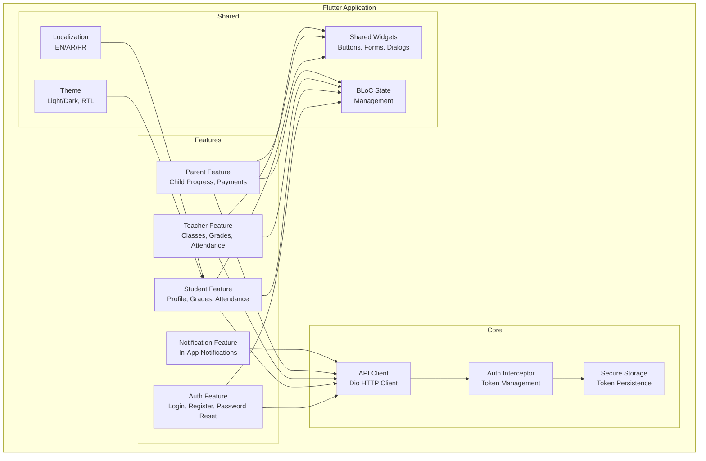

---

## 5. Request Lifecycle

### 5.1 Overview

Every HTTP request follows a predictable pipeline through the system:

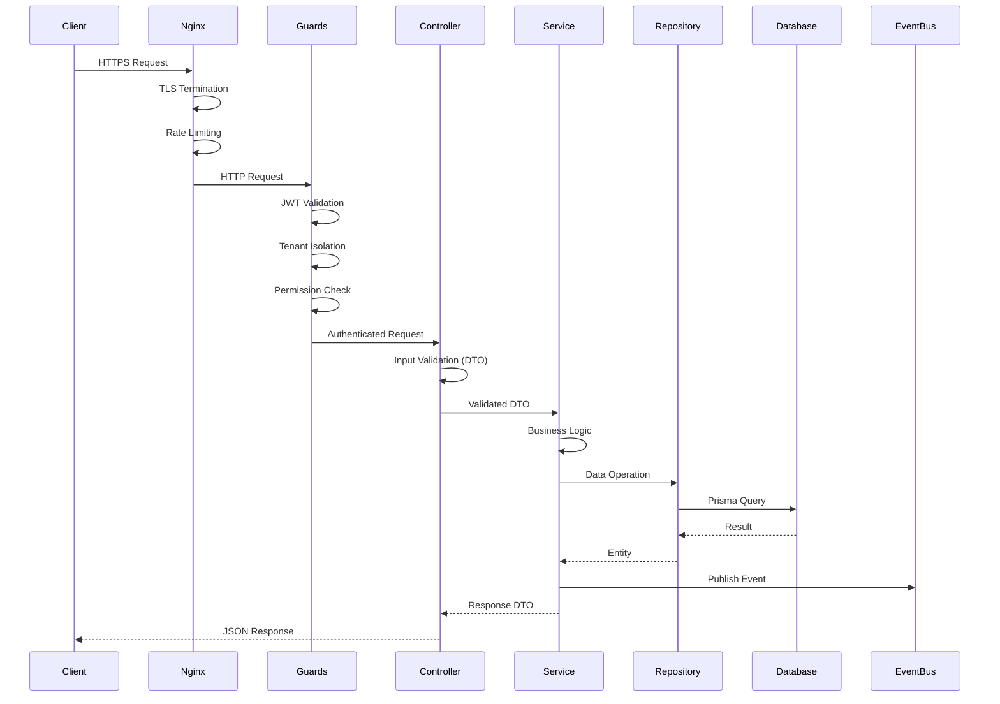

### 5.2 Pipeline Stages

| Stage | Layer | Component | Responsibility |
|-------|-------|-----------|---------------|
| 1. Receive | Infrastructure | Nginx | TLS termination, rate limiting, request buffering |
| 2. Authenticate | Middleware | JwtAuthGuard | Validate JWT token; extract user identity |
| 3. Tenant Scope | Middleware | TenantGuard | Validate tenant context; enforce tenant isolation |
| 4. Authorize | Middleware | PermissionGuard | Check user permissions for this operation |
| 5. Validate | Controller | ValidationPipe | Validate request body against DTO schema |
| 6. Execute | Service | Domain Service | Execute business logic; enforce business rules |
| 7. Persist | Repository | Prisma Repository | Query or mutate database |
| 8. Publish | EventBus | EventEmitter2 | Publish domain events after commit |
| 9. Respond | Controller | Response Transform | Transform entity to response DTO |
| 10. Log | Interceptor | Audit Interceptor | Log request for audit trail |

### 5.3 Error Handling Pipeline

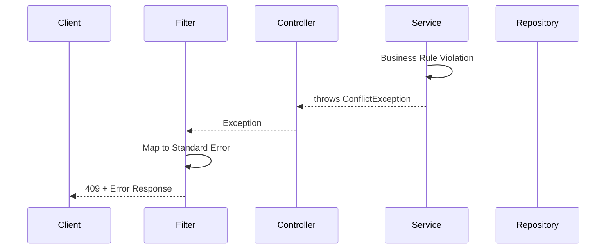

| Exception | HTTP Status | Example |
|-----------|------------|---------|
| `BadRequestException` | 400 | Validation error, malformed request |
| `UnauthorizedException` | 401 | Missing or invalid token |
| `ForbiddenException` | 403 | Insufficient permissions |
| `NotFoundException` | 404 | Resource does not exist |
| `ConflictException` | 409 | Version mismatch, duplicate entry |
| `UnprocessableEntityException` | 422 | Business rule violation |
| `TooManyRequestsException` | 429 | Rate limit exceeded |
| Unknown exception | 500 | Unexpected server error |

### 5.4 Request Correlation

Every request is assigned a correlation ID for distributed tracing:

```
Client sends: X-Correlation-ID: {uuid}
    ↓
Nginx passes: X-Correlation-ID header
    ↓
CorrelationIdInterceptor: attaches to request context
    ↓
All log entries include: correlationId
    ↓
All events include: correlationId
    ↓
Response includes: X-Correlation-ID header
```

---

## 6. Authentication Architecture

### 6.1 Authentication Flow

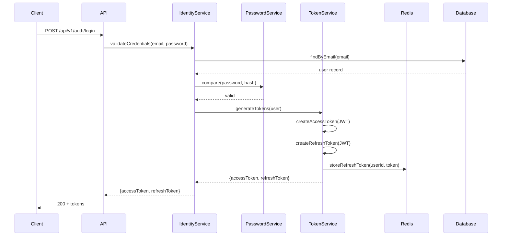

### 6.2 JWT Token Structure

**Access Token (short-lived, 1 hour):**

```json
{
  "sub": "550e8400-e29b-41d4-a716-446655440000",
  "tenantId": "550e8400-e29b-41d4-a716-446655440001",
  "institutionId": "550e8400-e29b-41d4-a716-446655440002",
  "roles": ["TEACHER"],
  "permissions": ["students:read", "grades:write"],
  "iat": 1721481600,
  "exp": 1721485200
}
```

**Refresh Token (long-lived, 7 days):**

```json
{
  "sub": "550e8400-e29b-41d4-a716-446655440000",
  "type": "refresh",
  "iat": 1721481600,
  "exp": 1722086400
}
```

### 6.3 Token Validation Pipeline

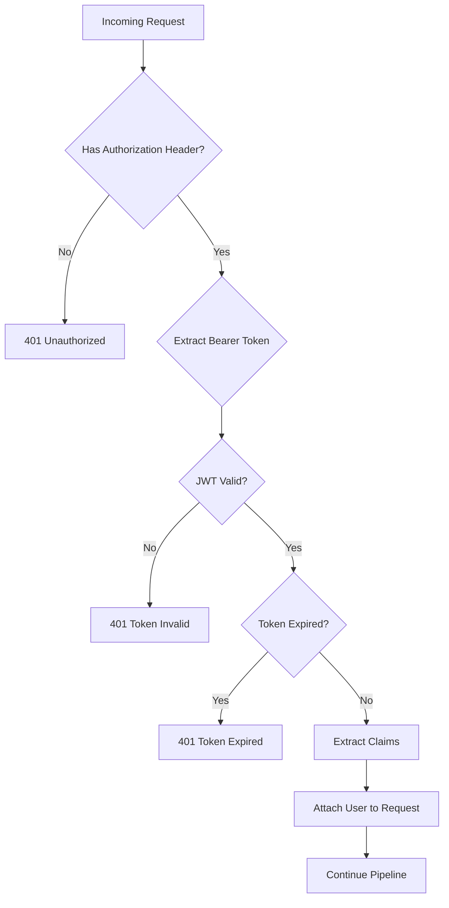

### 6.4 Refresh Token Flow

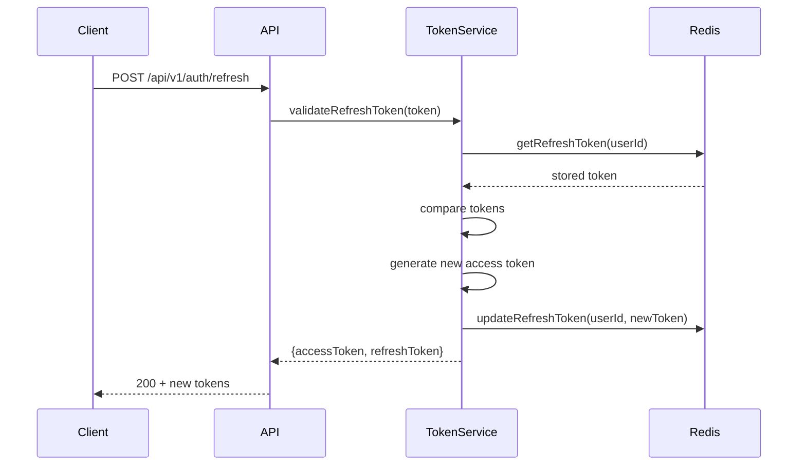

### 6.5 Password Reset Flow

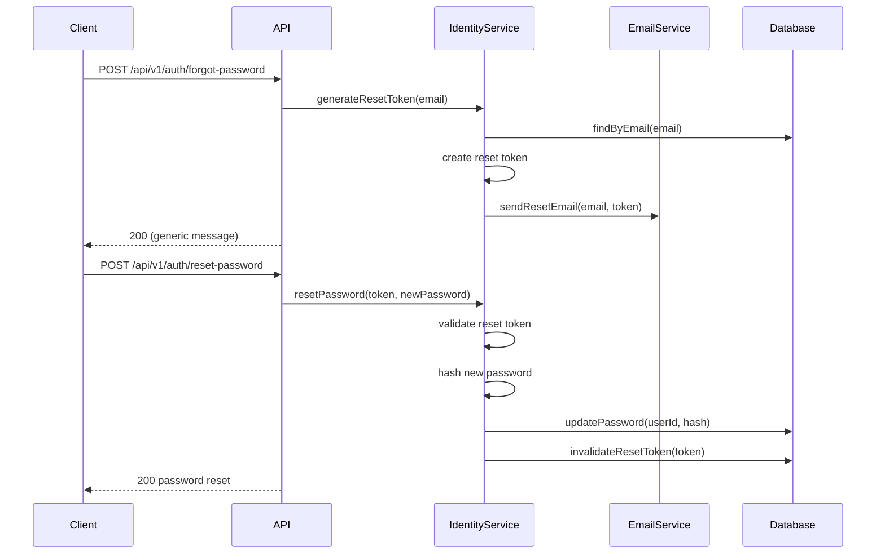

### 6.6 Authorization Pipeline

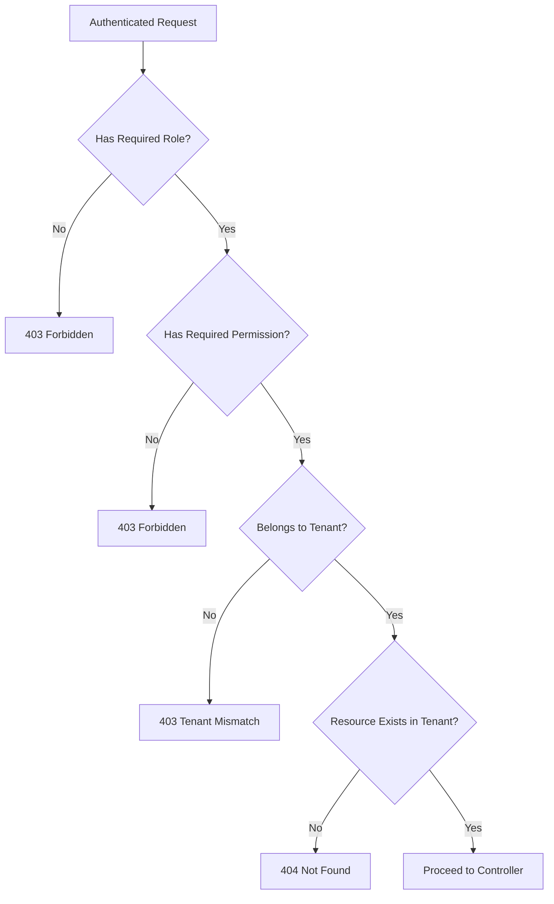

---

## 7. Multi-Tenant Architecture

### 7.1 Tenant Isolation Model

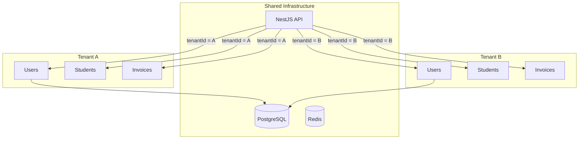

**Isolation mechanism:**

| Layer | Enforcement |
|-------|-------------|
| JWT | `tenantId` embedded in token claims |
| API Gateway | `X-Tenant-ID` header validated against token |
| Service Layer | Every query includes `WHERE tenantId = ?` |
| Repository Layer | Tenant guard ensures all queries are scoped |
| Event Layer | Events carry `tenantId`; consumers validate |

### 7.2 Institution Isolation

Within a tenant, institutions provide additional scoping:

```
Tenant (Organization)
├── Institution A (School 1)
│   ├── Students
│   ├── Teachers
│   └── Classes
├── Institution B (School 2)
│   ├── Students
│   ├── Teachers
│   └── Classes
└── Shared Services
    ├── Platform Admin
    └── Cross-Institution Reports
```

| Rule | Description |
|------|-------------|
| Default scoping | All data scoped to institution unless explicitly cross-institution |
| Platform admins | May operate across institutions within a tenant |
| Tenant admins | May manage all institutions within a tenant |
| Institution admins | May only manage their own institution |

### 7.3 Tenant Provisioning

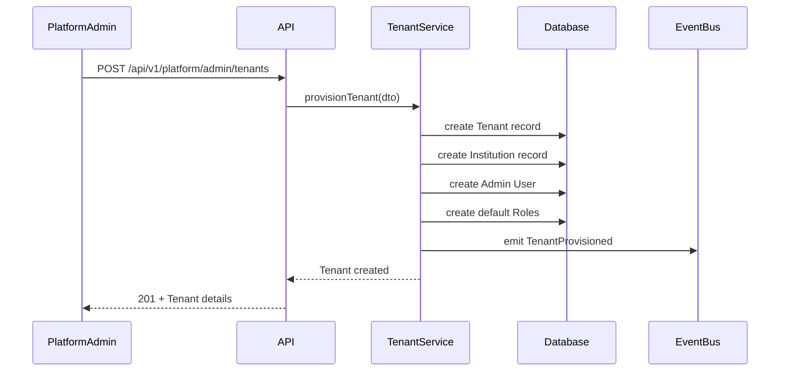

### 7.4 Cross-Tenant Restrictions

| Action | Allowed |
|--------|---------|
| Query data from another tenant | Never |
| Publish events to another tenant | Never |
| Access another tenant's files | Never |
| Share users across tenants | Never |
| Aggregate data across tenants | Platform admin only, with authorization |

---

## 8. Domain Interaction

### 8.1 Synchronous Interactions

Domains interact synchronously only through their own services. Cross-domain synchronous access uses application-level FK guards:

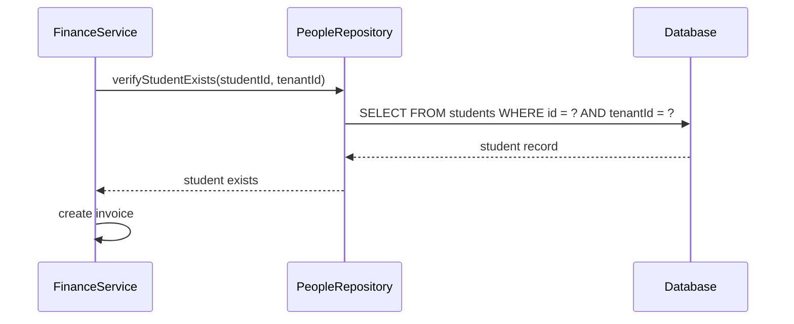

**Rules:**

| Rule | Description |
|------|-------------|
| Application guard | Verify referenced entity exists before operation |
| Tenant scope | Verify referenced entity belongs to same tenant |
| Authorization | Verify actor is authorized for both source and target entities |
| No cross-domain DB joins | Never join tables across domain boundaries |

### 8.2 Asynchronous Interactions (Events)

Cross-domain communication uses domain events:

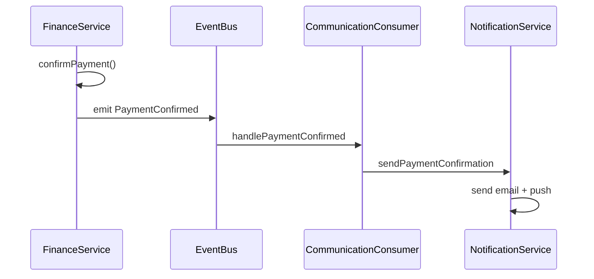

**Event flow rules:**

| Rule | Description |
|------|-------------|
| After commit | Events published after transaction commit |
| One-way | Events are fire-and-forget; publisher does not wait |
| Idempotent consumers | Consumers handle duplicate events safely |
| Tenant-scoped | Events carry `tenantId`; consumers validate |

### 8.3 Domain Dependency Matrix

| Domain | Depends On | Events Published |
|--------|-----------|-----------------|
| Identity & Access | — | UserCreated, UserUpdated, RoleAssigned |
| Institution Management | Identity | TenantProvisioned, TermOpened, TermClosed |
| People | Identity, Institution | StudentEnrolled, StaffHired, StudentTransferred |
| Academic Management | People, Institution | ResultPublished, ReportCardGenerated |
| Finance | People, Academic | InvoiceGenerated, PaymentConfirmed, RefundProcessed |
| Communication | All (consumes events from all) | NotificationSent, CampaignCompleted |
| Operations | People, Academic | AttendanceRecorded, MaintenanceCompleted |
| Documents & Learning | People, Academic | DocumentUploaded, BookBorrowed |
| Reporting & Analytics | All (consumes events from all) | ReportGenerated, KpiThresholdBreached |
| Platform Administration | Identity | SystemConfigUpdated, ModuleActivated |

### 8.4 Saga Pattern (Choreography)

Complex cross-domain workflows use choreography sagas:

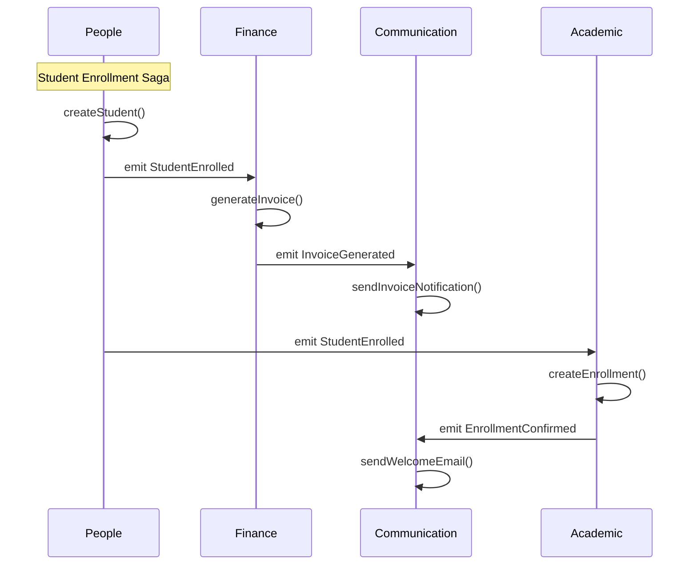

**Saga compensation:**

| Failure | Compensation |
|---------|-------------|
| Invoice generation fails | Log error; manual retry |
| Notification fails | Queue for retry; no rollback |
| Enrollment fails | Reject student enrollment |
| Email fails | Queue for retry; no rollback |

---

## 9. Data Architecture Overview

### 9.1 Data Stores

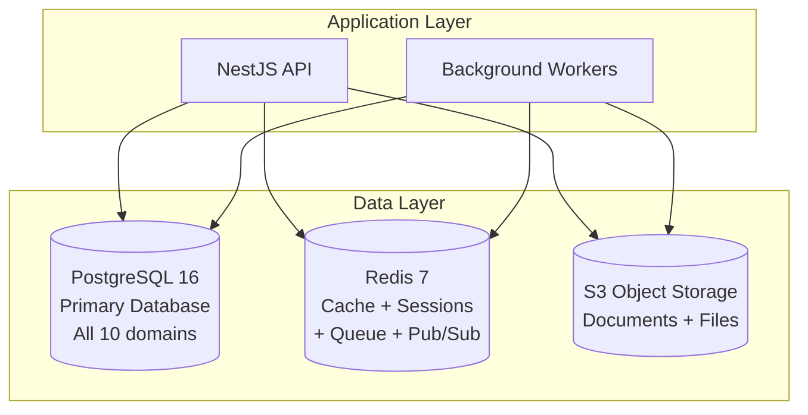

### 9.2 PostgreSQL Architecture

| Property | Value |
|----------|-------|
| Version | PostgreSQL 16+ |
| Schema strategy | Shared database; domain-scoped queries |
| ORM | Prisma 6.12+ |
| Schema files | One `.prisma` file per domain; merged at build time |
| Connection pool | Prisma connection pooling (default: 10 connections) |
## 10. Failure Philosophy

The platform follows explicit architectural principles for handling failures at every layer. These principles ensure system resilience, data consistency, and operational observability.

### 10.1 Failure Handling Principles

| Principle | Description | Implementation |
|-----------|-------------|----------------|
| **Fail Fast** | Detect and report errors as early as possible in the request pipeline | Input validation at controller boundary; business rule validation at service entry; parameter checks at repository level |
| **Graceful Degradation** | When a non-critical component fails, the system continues operating with reduced functionality | Notification delivery failure does not block core operations; cache miss falls back to database query |
| **Retry with Backoff** | Transient failures are retried with increasing delays to avoid overwhelming failing services | Exponential backoff: 5s → 30s → 5min → 15min; configurable max retries per job type |
| **Circuit Breaker** | When a dependency fails repeatedly, stop calling it temporarily to prevent cascading failure | Circuit opens after 5 consecutive failures; half-open after 30 seconds; full recovery after 3 successful calls |
| **Timeouts** | Every external call has a defined maximum wait time | Database queries: 30s; HTTP calls to external services: 10s; Redis operations: 5s; S3 operations: 30s |
| **Bulkhead Isolation** | Isolate components so a failure in one does not cascade to others | Separate connection pools per domain; separate BullMQ queues per job type; worker process isolation |
| **Backpressure** | When the system is overloaded, apply controlled pressure rather than accepting all requests | Rate limiting at Nginx (100 req/min per user); queue depth limits; connection pool limits |
| **Idempotent Operations** | Operations can be safely retried without side effects | eventId deduplication; payment reference uniqueness; optimistic locking on updates |
| **Event Replay** | Failed event consumers can replay events from the dead letter queue | DLQ retention: 72 hours; manual replay capability; event versioning for compatibility |
| **Dead Letter Queues** | Events that cannot be processed after max retries are moved to DLQ for investigation | DLQ per event type; monitoring alert on DLQ growth; admin dashboard for DLQ inspection |
| **Recovery Principles** | The system should recover automatically where possible and provide clear remediation guidance | Auto-restart on container failure; database connection retry; health check endpoints for orchestration |

### 10.2 Failure Handling by Layer

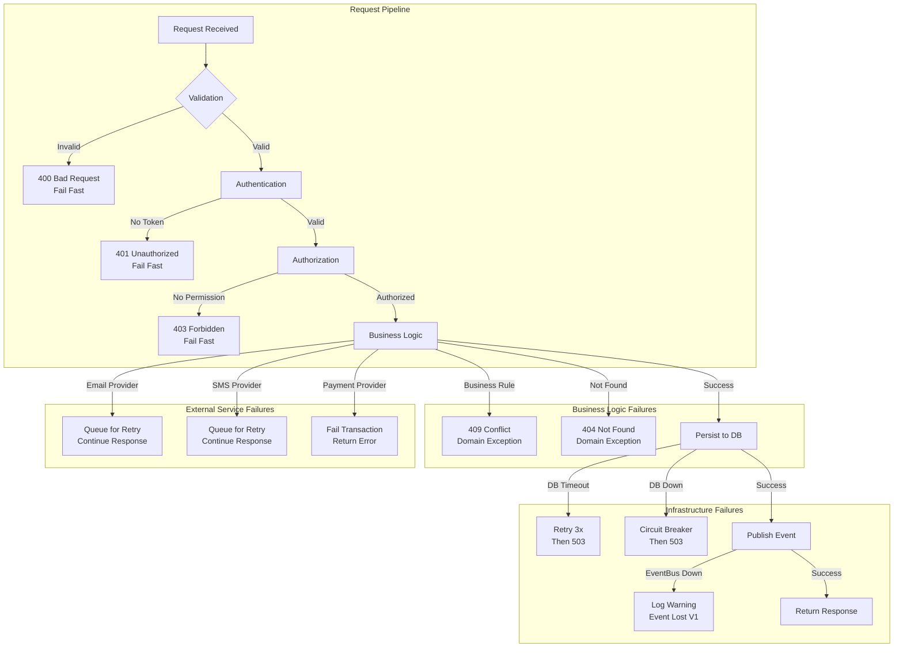

### 10.3 Retry Strategy by Component

| Component | Max Retries | Backoff | Timeout | Circuit Breaker |
|-----------|------------|---------|---------|----------------|
| Database queries | 3 | Exponential (1s → 5s → 15s) | 30s | Yes (5 failures → 30s open) |
| Redis operations | 3 | Exponential (100ms → 500ms → 2s) | 5s | Yes (5 failures → 15s open) |
| Email delivery | 3 | Exponential (5s → 30s → 5min) | 30s | Yes (3 failures → 5min open) |
| SMS delivery | 3 | Exponential (5s → 30s → 5min) | 60s | Yes (3 failures → 5min open) |
| Push notifications | 3 | Exponential (5s → 30s → 5min) | 10s | Yes (3 failures → 5min open) |
| S3 operations | 3 | Exponential (1s → 5s → 15s) | 30s | Yes (5 failures → 30s open) |
| Payment verification | 1 | Linear (5s) | 10s | No (fail transaction) |

### 10.4 Event-Driven Failure Handling

The platform's event-driven architecture requires special failure handling considerations:

| Concern | V1 Approach (EventEmitter2) | V2 Approach (BullMQ) |
|---------|---------------------------|---------------------|
| Event loss on crash | Events published after commit; may lose in-flight events | Persistent queue; events survive restart |
| Consumer failure | Synchronous; failure affects publisher | Independent workers; failure isolated |
| Dead letter queue | Not available | DLQ per event type; admin monitoring |
| Event ordering | Guaranteed within single process | FIFO queues per aggregate |
| Idempotent consumers | eventId deduplication; 24h TTL | eventId deduplication; persistent dedup store |

---

| Backup | Daily full + continuous WAL archiving |

**Domain schema organization:**

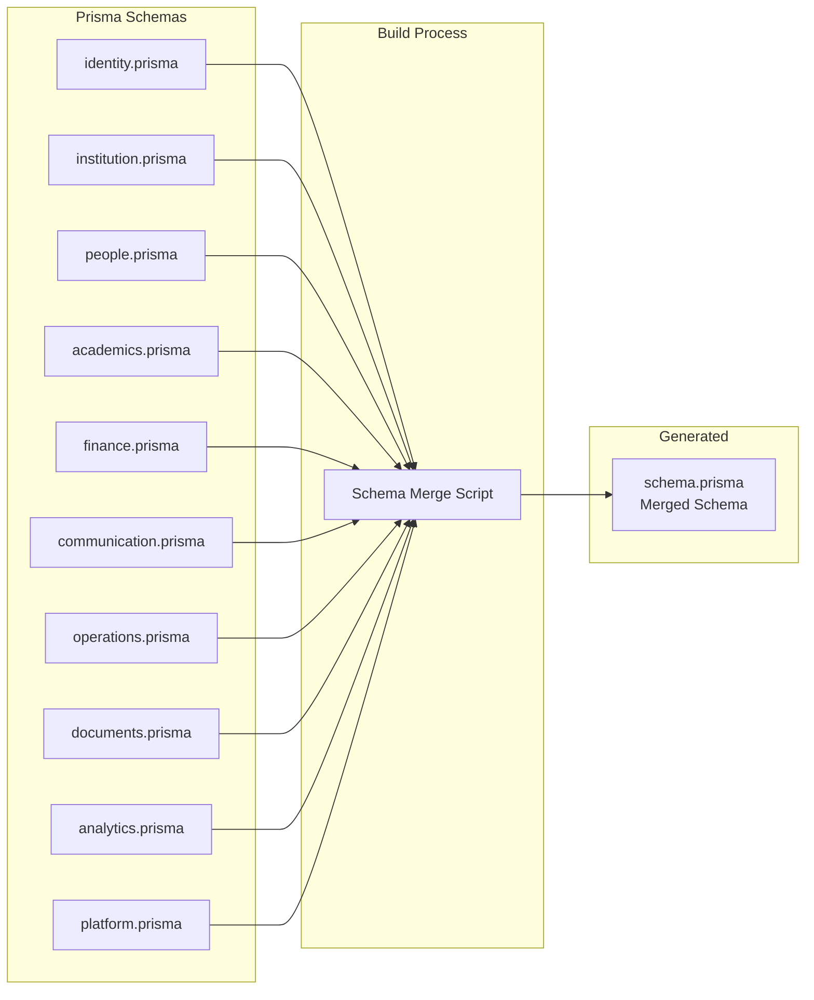

### 10.3 Redis Architecture

| Usage | Purpose | TTL |
|-------|---------|-----|
| Session store | Refresh token storage | 7 days |
| Cache | Frequently accessed data | 5–60 minutes |
| Queue | BullMQ job queue | N/A (persistent) |
| Pub/Sub | Event bus (future V2) | N/A |
| Idempotency | Deduplication keys | 24 hours |

### 10.4 Object Storage (S3)

| Usage | Description |
|-------|-------------|
| Document storage | Student documents, reports, certificates |
| File uploads | User-uploaded files (images, PDFs) |
| Static assets | Application assets, templates |
| Backups | Database backup storage |

**Storage structure:**

```
s3://openschool-{env}/
├── tenants/
│   ├── {tenant-id}/
│   │   ├── students/
│   │   │   ├── {student-id}/
│   │   │   │   ├── documents/
│   │   │   │   └── photos/
│   │   ├── staff/
│   │   ├── invoices/
│   │   └── reports/
├── templates/
└── backups/
```

---

## 11. Event Architecture

### 11.1 Event Flow Overview

```mermaid
graph LR
    subgraph "Publishers"
        IDENTITY[Identity<br/>Domain]
        PEOPLE[People<br/>Domain]
        ACADEMIC[Academic<br/>Domain]
        FINANCE[Finance<br/>Domain]
        OPS[Operations<br/>Domain]
        DOC[Documents<br/>Domain]
    end

    subgraph "Event Bus"
        EB[EventEmitter2<br/>In-Process]
    end

    subgraph "Consumers"
        COMM[Communication<br/>Domain]
        ANA[Reporting<br/>Domain]
        PLAT[Platform<br/>Domain]
    end

    IDENTITY --> EB
    PEOPLE --> EB
    ACADEMIC --> EB
    FINANCE --> EB
    OPS --> EB
    DOC --> EB

    EB --> COMM
    EB --> ANA
    EB --> PLAT
```

### 11.2 Event Envelope

Every event carries a standard envelope:

```json
{
  "eventId": "550e8400-e29b-41d4-a716-446655440000",
  "eventName": "finance.PaymentConfirmed",
  "eventVersion": 1,
  "schemaVersion": "1.0.0",
  "occurredAt": "2026-07-20T10:00:00Z",
  "correlationId": "660e8400-e29b-41d4-a716-446655440001",
  "causationId": null,
  "tenantId": "770e8400-e29b-41d4-a716-446655440002",
  "institutionId": "880e8400-e29b-41d4-a716-446655440003",
  "aggregateId": "990e8400-e29b-41d4-a716-446655440004",
  "aggregateType": "Payment",
  "sourceDomain": "finance",
  "actorId": "aa0e8400-e29b-41d4-a716-446655440005",
  "payload": {
    "paymentId": "...",
    "amount": 500.00,
    "currency": "USD",
    "studentId": "..."
  }
}
```

### 11.3 Event Publishing Flow

```mermaid
sequenceDiagram
    participant Service
    participant Database
    participant EventBus
    participant Consumer1
    participant Consumer2

    Service->>Database: BEGIN TRANSACTION
    Service->>Database: Business operations
    Service->>Database: COMMIT
    Service->>EventBus: emit(event)
    EventBus->>Consumer1: handleEvent(event)
    EventBus->>Consumer2: handleEvent(event)
    Consumer1-->>EventBus: processed
    Consumer2-->>EventBus: processed
```

**Publishing rules:**

| Rule | Description |
|------|-------------|
| After commit | Events published only after successful commit |
| Synchronous (V1) | EventEmitter2 is synchronous; consumers run in same process |
| Full envelope | Complete event envelope with all required fields |
| One event per change | One event per state change; not per batch |
| Failure isolation | Event publishing failure does not affect the transaction |

### 11.4 Consumer Processing

```mermaid
sequenceDiagram
    participant EventBus
    participant Consumer
    participant IdempotencyStore
    participant Service

    EventBus->>Consumer: handleEvent(event)
    Consumer->>IdempotencyStore: check(eventId)
    alt Already processed
        IdempotencyStore-->>Consumer: duplicate
        Consumer-->>EventBus: skip
    else New event
        IdempotencyStore-->>Consumer: new
        Consumer->>Consumer: process(event)
        Consumer->>Service: execute business logic
        Consumer->>IdempotencyStore: store(eventId, TTL: 72h)
        Consumer-->>EventBus: processed
    end
```

### 11.5 Dead Letter Queue

```mermaid
graph TD
    A[Event Received] --> B{Processing}
    B -->|Success| C[Store eventId]
    B -->|Failure| D{Retry Count}
    D -->|< 3| E[Retry with Backoff]
    E --> B
    D -->|= 3| F[Move to Dead Letter Queue]
    F --> G[Alert Platform Admin]
    G --> H[Manual Investigation]
    H -->|Fix + Replay| B
```

### 11.6 Event Catalogue Summary

| Domain | Events Published | Events Consumed | Most Active Consumer |
|--------|-----------------|-----------------|---------------------|
| Identity & Access | 3 | 0 | — |
| Institution Management | 3 | 1 | — |
| People | 5 | 2 | Communication |
| Academic Management | 8 | 3 | Communication |
| Finance | 12 | 3 | Communication |
| Communication | 4 | ~52 (all domains) | — (primary consumer) |
| Operations | 8 | 3 | Communication |
| Documents & Learning | 6 | 2 | Communication |
| Reporting & Analytics | 2 | ~20 (all domains) | — (analytics consumer) |
| Platform Administration | 3 | 0 | — |
| **Total** | **54 published** | **~99 consumed** | — |

*See 03 Platform Event Catalogue for complete event catalogue.*

---

## 12. Background Processing

### 12.1 Queue Architecture

```mermaid
graph TB
    subgraph "API Server"
        API[NestJS API]
    end

    subgraph "Redis"
        QUEUE[BullMQ Queue]
    end

    subgraph "Background Workers"
        W1[Notification Worker]
        W2[Email Worker]
        W3[Report Worker]
        W4[File Worker]
        W5[Scheduled Worker]
    end

    subgraph "External Services"
        SMTP[Email Service]
        SMS[SMS Service]
        FCM[Push Notifications]
        S3[S3 Storage]
    end

    API -->|Enqueue jobs| QUEUE
    QUEUE --> W1
    QUEUE --> W2
    QUEUE --> W3
    QUEUE --> W4
    QUEUE --> W5

    W1 --> SMTP
    W1 --> SMS
    W1 --> FCM
    W2 --> SMTP
    W3 --> S3
    W4 --> S3
```

### 12.2 Job Types

| Job Type | Queue | Worker | Description |
|----------|-------|--------|-------------|
| Email delivery | email | EmailWorker | Send email notifications |
| SMS delivery | sms | SMSWorker | Send SMS notifications |
| Push notifications | push | PushWorker | Send mobile push notifications |
| Report generation | report | ReportWorker | Generate PDF/Excel reports |
| File processing | file | FileWorker | Process uploaded files |
| Scheduled tasks | scheduled | ScheduledWorker | Cron-based periodic tasks |
| Data export | export | ExportWorker | Generate data exports |
| Analytics computation | analytics | AnalyticsWorker | Compute analytics metrics |

### 12.3 Job Processing Flow

```mermaid
sequenceDiagram
    participant API
    participant Queue
## 13. Request Correlation Architecture

### 13.1 Correlation ID Lifecycle

Every request to the platform is assigned a unique correlation ID that propagates through all processing stages. This enables end-to-end tracing across services, domains, and infrastructure.

```mermaid
sequenceDiagram
    participant Client as Client
    participant Nginx as Nginx (Reverse Proxy)
    participant Interceptor as CorrelationIdInterceptor
    participant Controller as Domain Controller
    participant Service as Domain Service
    participant EventBus as EventBus (EventEmitter2)
    participant Queue as BullMQ Queue
    participant Worker as Background Worker
    participant External as External Provider
    participant Logger as Structured Logger
    participant Tracer as Distributed Tracer
    participant Audit as Audit Log

    Client->>Nginx: Request (X-Correlation-ID: uuid-v4)
    Nginx->>Nginx: Pass or generate correlation ID
    Nginx->>Interceptor: HTTP Request + correlation ID

    Interceptor->>Interceptor: Attach to AsyncLocalStorage
    Interceptor->>Logger: Set correlationId context
    Interceptor->>Controller: Request proceeds

    Controller->>Service: Execute business logic
    Service->>Service: Log operations with correlationId
    Service->>EventBus: Publish event (correlationId in envelope)
    EventBus->>Logger: Log event emission with correlationId
    EventBus->>Tracer: Record trace span with correlationId

    Service-->>Controller: Response
    Controller->>Audit: Log audit entry with correlationId
    Controller-->>Client: Response (X-Correlation-ID: same uuid)

    Note over EventBus,Worker: Async event processing

    EventBus->>Queue: Enqueue job (correlationId preserved)
    Queue->>Worker: Dequeue job
    Worker->>Worker: Log processing with correlationId
    Worker->>External: Call external provider with correlationId
    External-->>Worker: Response
    Worker->>Logger: Log completion with correlationId
    Worker->>Tracer: Complete trace span
```

### 13.2 Correlation ID Propagation Points

| Stage | Component | Propagation Method |
|-------|-----------|-------------------|
| Client → Nginx | HTTP Header | `X-Correlation-ID` request header |
| Nginx → API | HTTP Header | Pass-through or generate new UUID |
| API → Interceptor | AsyncLocalStorage | Stored in request context via `CorrelationIdInterceptor` |
| Interceptor → Services | AsyncLocalStorage | Accessible anywhere in the request tree |
| Service → Events | Event Envelope | `correlationId` field in event payload |
| Events → Queue Jobs | Job Data | `correlationId` in job payload |
| Queue Jobs → Workers | Job Data | Extracted and set in worker context |
| Workers → External | HTTP Header | `X-Correlation-ID` header to external APIs |
| All → Logs | Log Context | `correlationId` in every structured log entry |
| All → Tracing | Trace Span | `correlationId` as trace identifier |
| All → Audit | Audit Record | `correlationId` in audit log entries |

### 13.3 Correlation ID Format

| Property | Value |
|----------|-------|
| Format | UUID v4 |
| Header name | `X-Correlation-ID` |
| Generation | Client-provided or server-generated |
| Length | 36 characters (including hyphens) |
| Example | `550e8400-e29b-41d4-a716-446655440000` |

### 13.4 Why Correlation IDs Matter

| Benefit | Description |
|---------|-------------|
| **Debugging** | Trace a single request across all layers; identify failure points |
| **Auditing** | Link all actions in a workflow to a single originating request |
| **Observability** | Correlate metrics, logs, and traces for a complete picture |
| **Event correlation** | Link domain events back to the request that triggered them |
| **Queue debugging** | Trace async jobs back to their originating request |
| **Support** | Users provide correlation ID; support team traces the full flow |

---

    participant Worker
    participant Service
    participant External

    API->>Queue: addJob(type, data)
    Queue-->>API: jobId
    Queue->>Worker: processJob(job)
    Worker->>Worker: validate job data
    Worker->>Service: execute business logic
    Service->>External: call external service
    External-->>Service: response
    Service-->>Worker: result
    Worker->>Worker: update job status
    Worker-->>Queue: completed
```

### 13.4 Retry Strategy

| Attempt | Delay | Description |
|---------|-------|-------------|
| 1st retry | 5 seconds | Immediate retry after transient failure |
| 2nd retry | 30 seconds | Short backoff for temporary issues |
| 3rd retry | 5 minutes | Medium backoff for persistent issues |
| Final attempt | 15 minutes | Long backoff before DLQ |
| After 3 failures | DLQ | Moved to dead letter queue |

### 13.5 Scheduled Jobs

| Schedule | Job | Description |
|----------|-----|-------------|
| Daily 02:00 | Backup job | Trigger database backup |
| Daily 06:00 | Report distribution | Send scheduled reports |
| Every 5 minutes | Overdue invoice check | Check for overdue invoices |
| Hourly | Cache cleanup | Expire stale cache entries |
| Weekly Sunday 03:00 | Database maintenance | Vacuum, analyze, reindex |

---

## 14. Notification Architecture

### 14.1 Notification Channels

```mermaid
graph TB
    subgraph "Notification Domain"
        ORCHESTRATOR[Notification Orchestrator]
        TEMPLATE[Template Engine]
        PREFERENCE[Preference Manager]
    end

    subgraph "Channels"
        EMAIL[Email Channel<br/>SMTP/SendGrid]
        SMS_CH[SMS Channel<br/>Twilio/Africastalking]
        PUSH_CH[Push Channel<br/>Firebase FCM]
        IN_APP[In-App Channel<br/>WebSocket/SSE]
    end

    subgraph "External Services"
        SMTP_SVC[Email Service]
        SMS_SVC[SMS Service]
        FCM_SVC[Firebase]
    end

    ORCHESTRATOR --> TEMPLATE
    ORCHESTRATOR --> PREFERENCE
    ORCHESTRATOR --> EMAIL
    ORCHESTRATOR --> SMS_CH
    ORCHESTRATOR --> PUSH_CH
    ORCHESTRATOR --> IN_APP

    EMAIL --> SMTP_SVC
    SMS_CH --> SMS_SVC
    PUSH_CH --> FCM_SVC
```

### 14.2 Notification Flow

```mermaid
sequenceDiagram
    participant EventBus
    participant NotifService
    participant TemplateEngine
    participant PrefManager
    participant EmailWorker
    participant SMSWorker
    participant PushWorker

    EventBus->>NotifService: handleDomainEvent(event)
    NotifService->>TemplateEngine: render(templateId, data)
    TemplateEngine-->>NotifService: rendered message
    NotifService->>PrefManager: getPreferences(userId)
    PrefManager-->>NotifService: channel preferences

    alt Email preferred
        NotifService->>EmailWorker: sendEmail(emailData)
    end
    alt SMS preferred
        NotifService->>SMSWorker: sendSMS(smsData)
    end
    alt Push enabled
        NotifService->>PushWorker: sendPush(pushData)
    end

    NotifService->>NotifService: store in-app notification
```

### 14.3 Notification Preferences

| Channel | Default | Configurable |
|---------|---------|-------------|
| Email | Enabled | Per notification type |
| SMS | Disabled | Per notification type |
| Push | Enabled | Per notification type |
| In-App | Enabled | Always on |

---

## 15. File Storage Architecture

### 15.1 Upload Flow

```mermaid
sequenceDiagram
    participant Client
    participant API
    participant ValidationService
    participant VirusScanner
    participant StorageService
    participant S3

    Client->>API: POST /api/v1/documents/files (multipart)
    API->>ValidationService: validateFile(file)
    ValidationService->>ValidationService: check MIME type
    ValidationService->>ValidationService: check file size
    ValidationService-->>API: valid
    API->>VirusScanner: scan(file)
    VirusScanner-->>API: clean
    API->>StorageService: upload(file, metadata)
    StorageService->>S3: putObject(key, file)
    S3-->>StorageService: success
    StorageService-->>API: file metadata
    API-->>Client: 201 + file metadata
```

### 15.2 Storage Structure

```
S3 Bucket: openschool-{environment}
├── tenants/
│   └── {tenant-id}/
│       ├── students/
│       │   └── {student-id}/
│       │       ├── documents/     # Student documents
│       │       └── photos/        # Student photos
│       ├── staff/
│       │   └── {staff-id}/
│       │       └── documents/
│       ├── invoices/              # Generated invoices
│       ├── reports/               # Generated reports
│       └── uploads/               # General uploads
├── templates/                     # Email/notification templates
├── backups/                       # Database backups
└── system/                        # System assets
```

### 15.3 File Access

| Operation | Mechanism |
|-----------|-----------|
| Upload | Direct to API (multipart) |
| Download | Pre-signed URL (1 hour expiry) |
| List | API endpoint with pagination |
| Delete | Soft delete via API |

### 15.4 File Limits

| Limit | Value |
## 16. Business Workflow Sequence Diagrams

The following sequence diagrams illustrate complete end-to-end workflows across multiple domains, services, and infrastructure components.

### 16.1 Student Enrollment Workflow

```mermaid
sequenceDiagram
    participant Client as Client (Web/Mobile)
    participant API as API Gateway
    participant PeopleService as People Service
    participant AcademicService as Academic Service
    participant FinanceService as Finance Service
    participant Database as PostgreSQL
    participant EventBus as EventEmitter2
    participant CommunicationDomain as Communication Domain

    Client->>API: POST /api/v1/enrollments
    API->>API: JWT Validation + Tenant Guard
    API->>PeopleService: createStudent(studentDto)
    PeopleService->>Database: INSERT student
    Database-->>PeopleService: student record
    PeopleService->>EventBus: emit StudentCreated
    EventBus->>CommunicationDomain: handleStudentCreated
    CommunicationDomain->>CommunicationDomain: queue welcome notification

    API->>AcademicService: createEnrollment(enrollmentDto)
    AcademicService->>Database: SELECT class (verify capacity)
    AcademicService->>Database: INSERT enrollment
    AcademicService->>Database: UPDATE class (increment count)
    AcademicService->>EventBus: emit StudentEnrolled
    EventBus->>FinanceService: handleStudentEnrolled
    FinanceService->>FinanceService: generate initial invoice
    FinanceService->>Database: INSERT invoice
    FinanceService->>EventBus: emit InvoiceGenerated
    EventBus->>CommunicationDomain: handleInvoiceGenerated
    CommunicationDomain->>CommunicationDomain: queue invoice notification

    AcademicService-->>API: enrollment created
    API-->>Client: 201 + enrollment details
```

### 16.2 Fee Payment Workflow

```mermaid
sequenceDiagram
    participant Client as Client (Web/Mobile)
    participant API as API Gateway
    participant FinanceService as Finance Service
    participant PaymentProvider as Payment Provider (Stripe/Paystack)
    participant Database as PostgreSQL
    participant EventBus as EventEmitter2
    participant CommunicationDomain as Communication Domain

    Client->>API: POST /api/v1/payments
    API->>API: JWT Validation + Tenant Guard
    API->>FinanceService: initiatePayment(paymentDto)
    FinanceService->>Database: INSERT payment (status: PENDING)
    FinanceService->>PaymentProvider: initializePayment(amount, reference)
    PaymentProvider-->>FinanceService: payment URL / reference
    FinanceService-->>API: payment reference + redirect URL
    API-->>Client: 200 + payment reference

    Note over Client,PaymentProvider: User completes payment on provider page

    PaymentProvider->>FinanceService: POST /webhooks/payment (callback)
    FinanceService->>PaymentProvider: verifyPayment(reference)
    PaymentProvider-->>FinanceService: payment verified
    FinanceService->>Database: UPDATE payment (status: COMPLETED)
    FinanceService->>Database: UPDATE invoice (status: PAID)
    FinanceService->>EventBus: emit PaymentConfirmed
    EventBus->>CommunicationDomain: handlePaymentConfirmed
    CommunicationDomain->>CommunicationDomain: queue payment receipt
    FinanceService-->>Client: webhook acknowledged
```

### 16.3 Result Publication Workflow

```mermaid
sequenceDiagram
    participant Teacher as Teacher (Mobile)
    participant API as API Gateway
    participant AcademicService as Academic Service
    participant GradingService as Grading Service
    participant Database as PostgreSQL
    participant EventBus as EventEmitter2
## 17. Module Dependency Rules

Domain modules communicate through well-defined interfaces. These rules prevent cyclic dependencies, enforce bounded context isolation, and ensure maintainability.

### 17.1 Dependency Direction

```mermaid
graph TD
    subgraph "Core Infrastructure"
        SHARED[Shared Kernel<br/>Types, Utilities, Guards]
    end

    subgraph "Domain Modules"
        IDENTITY[Identity & Access]
        INSTITUTION[Institution Mgmt]
        PEOPLE[People]
        ACADEMIC[Academic Mgmt]
        FINANCE[Finance]
        COMM[Communication]
        OPS[Operations]
        DOCS[Documents & Learning]
        ANALYTICS[Reporting & Analytics]
        PLATFORM[Platform Admin]
    end

    SHARED --> IDENTITY
    SHARED --> INSTITUTION
    SHARED --> PEOPLE
    SHARED --> ACADEMIC
    SHARED --> FINANCE
    SHARED --> COMM
    SHARED --> OPS
    SHARED --> DOCS
    SHARED --> ANALYTICS
    SHARED --> PLATFORM

    IDENTITY --> PEOPLE
    IDENTITY --> INSTITUTION
    INSTITUTION --> PEOPLE
    PEOPLE --> ACADEMIC
    PEOPLE --> FINANCE
    ACADEMIC --> FINANCE
    FINANCE --> COMM
    OPS --> COMM
    DOCS --> COMM
    ACADEMIC --> ANALYTICS
    FINANCE --> ANALYTICS
    OPS --> ANALYTICS
```

### 17.2 Dependency Rules

| Rule | Description | Example |
|------|-------------|---------|
| **Allowed: Shared → Domain** | All domains may depend on the shared kernel | `FinanceService` uses `AuditLogger` from shared |
| **Allowed: Upstream → Downstream** | Domains may depend on domains listed as their downstream dependencies | `FinanceService` depends on `PeopleRepository` to verify student exists |
| **Restricted: Cross-domain repository access** | Must use application-level FK guard; never join across domain tables | Finance queries `students` table via `PeopleRepository` with tenant scope |
| **Forbidden: Cyclic dependencies** | Domain A → Domain B → Domain A is never allowed | `Finance` cannot depend on `Communication` if `Communication` depends on `Finance` |
| **Forbidden: Domain → Event bus internals** | Domains publish events but do not directly subscribe to other domain internal events | Use the shared `EventBus` interface, not internal event emitters |
| **Forbidden: Direct DB access across domains** | Never query another domain's tables directly through Prisma | Use the domain's repository or service as an intermediary |

### 17.3 Communication Patterns

| Pattern | When to Use | Mechanism |
|---------|------------|-----------|
| **Synchronous (Service Call)** | When the caller needs an immediate response and the operation is within the same transaction boundary | Direct service/repository method call |
| **Asynchronous (Domain Event)** | When the caller does not need an immediate response; eventual consistency is acceptable | EventEmitter2 domain event |
| **API Call (External)** | When communicating with external systems or future microservices | HTTP/REST client |

### 17.4 Dependency Validation

| Validation | Tool | Frequency |
|------------|------|-----------|
| Circular dependency detection | ESLint `import/no-cycle` | Every commit (CI) |
| Module boundary enforcement | Custom ESLint rules | Every commit (CI) |
| Dependency graph visualization | `madge --circular` | Weekly review |
| Cross-domain import check | Custom lint rule | Every commit (CI) |

---

    participant CommunicationDomain as Communication Domain
    participant AnalyticsDomain as Analytics Domain

    Teacher->>API: POST /api/v1/grades (batch)
    API->>API: JWT Validation + Permission Guard (grades:write)
    API->>AcademicService: submitGrades(gradeBatch)
    AcademicService->>GradingService: calculateGrades(gradeBatch)
    GradingService->>GradingService: apply grading rubric
    GradingService->>Database: INSERT/UPDATE grades
    GradingService-->>AcademicService: grades saved

    AcademicService->>Database: INSERT result record
    AcademicService->>EventBus: emit ResultPublished
    EventBus->>CommunicationDomain: handleResultPublished
    CommunicationDomain->>CommunicationDomain: queue result notification to parents
    EventBus->>AnalyticsDomain: handleResultPublished
    AnalyticsDomain->>AnalyticsDomain: update analytics cache

    AcademicService-->>API: results published
    API-->>Teacher: 200 + published results
```

### 17.4 Notification Delivery Workflow

```mermaid
sequenceDiagram
    participant EventBus as EventEmitter2
    participant NotifService as Notification Service
    participant TemplateEngine as Template Engine
    participant PrefManager as Preference Manager
    participant Queue as BullMQ Queue
    participant EmailWorker as Email Worker
    participant SMSWorker as SMS Worker
    participant PushWorker as Push Worker

    EventBus->>NotifService: handleDomainEvent(event)
    NotifService->>NotifService: determine notification type
    NotifService->>TemplateEngine: render(templateId, event.data)
    TemplateEngine-->>NotifService: rendered message (subject, body)

    NotifService->>PrefManager: getPreferences(userId)
    PrefManager-->>NotifService: channel preferences

    alt Email channel enabled
        NotifService->>Queue: addJob('email', emailPayload)
        Queue->>EmailWorker: process job
        EmailWorker->>EmailWorker: call SMTP/SendGrid
        EmailWorker-->>Queue: job completed
    end

    alt SMS channel enabled
        NotifService->>Queue: addJob('sms', smsPayload)
        Queue->>SMSWorker: process job
        SMSWorker->>SMSWorker: call Twilio/Africastalking
        SMSWorker-->>Queue: job completed
    end

    alt Push channel enabled
        NotifService->>Queue: addJob('push', pushPayload)
        Queue->>PushWorker: process job
        PushWorker->>PushWorker: call Firebase FCM
        PushWorker-->>Queue: job completed
    end

    NotifService->>NotifService: store in-app notification
    NotifService-->>EventBus: notification processed
```

### 17.5 User Authentication Workflow

```mermaid
sequenceDiagram
    participant Client as Client (Mobile/Web)
    participant API as API Gateway
    participant IdentityService as Identity Service
    participant PasswordService as Password Service
    participant TokenService as Token Service
    participant Redis as Redis
    participant Database as PostgreSQL
    participant AuditLog as Audit Log

    Client->>API: POST /api/v1/auth/login {email, password}
    API->>API: Rate limit check (10 req/min)
    API->>IdentityService: validateCredentials(email, password)
    IdentityService->>Database: findByEmail(email)
    Database-->>IdentityService: user record (with hash)

    IdentityService->>PasswordService: compare(password, hash)
    PasswordService-->>IdentityService: valid

    IdentityService->>TokenService: generateTokens(user)
    TokenService->>TokenService: createAccessToken (1hr expiry)
    TokenService->>TokenService: createRefreshToken (7 day expiry)
    TokenService->>Redis: storeRefreshToken(userId, token, TTL: 7d)
    TokenService-->>IdentityService: {accessToken, refreshToken}

    IdentityService->>AuditLog: log LOGIN_SUCCESS event
    IdentityService-->>API: tokens
    API-->>Client: 200 + {accessToken, refreshToken}

    Note over Client,API: Subsequent requests

    Client->>API: GET /api/v1/students (Bearer token)
    API->>API: JwtAuthGuard validates token
    API->>API: TenantGuard validates tenantId
    API->>API: PermissionGuard checks students:read
    API->>API: Process request normally
    API-->>Client: 200 + data
```

---

|-------|-------|
| Maximum file size | 50MB |
| Allowed MIME types | PDF, DOC, DOCX, XLS, XLSX, JPG, PNG, GIF, CSV, TXT |
| Virus scan | Required for all uploads |
| Naming | Sanitized; no path separators |

---

## 18. Security Architecture

### 18.1 Security Layers

```mermaid
graph TB
    subgraph "Security Architecture"
        subgraph "Network Layer"
            TLS[TLS Termination<br/>Nginx]
            RATE[Rate Limiting<br/>Nginx]
            CORS[CORS Policy<br/>Nginx]
        end

        subgraph "Application Layer"
            AUTH[Authentication<br/>JWT Validation]
            TENANT[Tenant Isolation<br/>Tenant Guard]
            PERM[Authorization<br/>Permission Guard]
            VALID[Input Validation<br/>DTO + Pipe]
        end

        subgraph "Data Layer"
            ENCRYPT[Encryption at Rest<br/>AES-256]
            MASK[PII Masking<br/>Logs]
            AUDIT[Audit Trail<br/>Append-Only Log]
        end

        subgraph "Infrastructure Layer"
            SECRET[Secrets Management<br/>Environment Variables]
            DOCKER[Docker Security<br/>Non-root, Minimal]
            SCAN[Security Scanning<br/>npm audit, Trivy]
        end
    end

    TLS --> AUTH
    RATE --> AUTH
    CORS --> AUTH
    AUTH --> TENANT
    TENANT --> PERM
    PERM --> VALID
    VALID --> ENCRYPT
```

### 18.2 Authentication Security

| Measure | Implementation |
|---------|---------------|
| Password hashing | bcrypt with salt rounds ≥ 12 |
| JWT signing | HS256 with minimum 32-character secret |
| Token expiry | Access: 1 hour; Refresh: 7 days |
| Refresh rotation | New refresh token on every use |
| MFA | TOTP-based (V2); SMS OTP (V2) |
| Account lockout | 5 failed attempts → 15-minute lockout |

### 18.3 Authorization Security

| Measure | Implementation |
|---------|---------------|
| RBAC | Role-based access control with granular permissions |
| Permission granularity | `{domain}:{action}` format (e.g., `students:read`) |
| Default deny | No access unless explicitly granted |
| Least privilege | Minimum required permissions per role |
| Admin separation | Platform admin, tenant admin, institution admin |

### 18.4 Data Security

| Measure | Implementation |
|---------|---------------|
| Encryption at rest | AES-256-GCM for sensitive fields |
| Encryption in transit | TLS 1.3 for all communications |
| PII protection | PII fields encrypted; masked in logs |
| Data classification | Critical, Sensitive, Internal, Public |
| Backup encryption | All backups encrypted with separate keys |

### 18.5 API Security

| Measure | Implementation |
|---------|---------------|
| Rate limiting | 100 req/min per user; 10 req/min for public endpoints |
| Request size limit | 1MB maximum body |
| Input validation | DTO validation + business rule validation |
| SQL injection prevention | Prisma parameterized queries |
| XSS prevention | Output encoding; Content-Security-Policy |
| CSRF protection | SameSite cookies; CSRF tokens |
| Security headers | X-Content-Type-Options, X-Frame-Options, etc. |

### 18.6 Audit Architecture

```mermaid
graph LR
    A[User Action] --> B[API Request]
    B --> C[Audit Interceptor]
    C --> D[Audit Log Entry]
    D --> E[(Audit Table)]

    E --> F[Platform Admin Dashboard]
    E --> G[Compliance Reports]
    E --> H[Incident Investigation]
```

**Audit log entry:**

```json
{
  "timestamp": "2026-07-20T10:00:00Z",
  "action": "CREATE",
  "resource": "Student",
  "resourceId": "...",
  "userId": "...",
  "tenantId": "...",
  "institutionId": "...",
  "ipAddress": "192.168.1.1",
  "userAgent": "Mozilla/5.0...",
  "correlationId": "...",
  "changes": { "firstName": "John", "lastName": "Doe" }
}
```

---

## 19. Caching Strategy

### 19.1 Cache Layers

```mermaid
graph TB
    subgraph "Client"
        BROWSER[Browser Cache<br/>HTTP Cache Headers]
        APP[App Cache<br/>Local Storage]
    end

    subgraph "Server"
        CDN[CDN/Edge<br/>Static Assets]
        REDIS_CACHE[Redis Cache<br/>Query Results]
        PG_CACHE[PostgreSQL<br/>Buffer Cache]
    end

    BROWSER --> CDN
    APP --> REDIS_CACHE
    REDIS_CACHE --> PG_CACHE
```

### 19.2 Cache Strategy by Data Type

| Data Type | Cache Location | TTL | Invalidation |
|-----------|---------------|-----|-------------|
| Reference data | Redis | 1 hour | On update |
| User session | Redis | 7 days | On logout |
| API responses (GET) | Redis | 5 minutes | On mutation |
| Static assets | CDN | 24 hours | On deploy |
| Session tokens | Redis | 7 days | On expiry |
| Feature flags | Redis | 1 hour | On change |
| Academic year | Redis | 1 hour | On term change |
| Fee structures | Redis | 30 minutes | On update |

### 19.3 Cache Invalidation

| Trigger | Invalidation |
|---------|-------------|
| Entity update | Invalidate entity cache + related caches |
| Entity delete | Invalidate entity cache + list caches |
| Term change | Invalidate academic year + enrollment caches |
| Configuration change | Invalidate feature flag + config caches |

### 19.4 Read Models

Reporting & Analytics domain uses read models for optimized queries:

```mermaid
graph LR
    subgraph "Write Path"
        API --> PG[(PostgreSQL)]
    end

    subgraph "Read Path"
        ANA[Analytics Service] --> REDIS_READ[(Redis Cache)]
        ANA --> PG_READ[(PostgreSQL<br/>Read Replica)]
    end

    PG -->|CDC/Events| ANA
```

---

## 20. Performance Strategy

### 20.1 Performance Targets

| Metric | Target | Measurement |
|--------|--------|-------------|
| API response time (p50) | < 100ms | Application monitoring |
| API response time (p95) | < 500ms | Application monitoring |
| API response time (p99) | < 1000ms | Application monitoring |
| Database query time (p95) | < 100ms | Query monitoring |
| Page load time (mobile) | < 3s | RUM monitoring |
| Time to interactive | < 5s | RUM monitoring |

### 20.2 Scaling Strategy

```mermaid
graph TB
    subgraph "V1 (Current)"
        LB[Load Balancer]
        API1[NestJS Instance 1]
        API2[NestJS Instance 2]
        PG1[(PostgreSQL Primary)]
        REDIS1[(Redis)]
    end

    subgraph "V2 (Future)"
        LB2[Load Balancer]
        K8S[Kubernetes Cluster]
        API_N[NestJS Instances × N]
        PG2[(PostgreSQL Primary)]
        PG_R[(Read Replica)]
        REDIS2[(Redis Cluster)]
    end

    LB --> API1
    LB --> API2
    API1 --> PG1
    API2 --> PG1
    API1 --> REDIS1
    API2 --> REDIS1
```

### 20.3 Optimization Strategies

| Strategy | Implementation |
|----------|---------------|
| Connection pooling | Prisma connection pool (10 connections) |
| Query optimization | Indexed queries; avoid N+1; use select |
| Pagination | All list endpoints paginated (max 100) |
| Caching | Redis for frequently accessed data |
| Async processing | Background jobs for non-critical operations |
| Compression | Gzip for responses > 1KB |
| Lazy loading | Frontend lazy loads off-screen content |

---

## 21. Deployment Architecture

### 21.1 V1 Deployment Diagram

```mermaid
graph TB
    subgraph "Internet"
        USER[Users]
    end

    subgraph "Edge"
        DNS[DNS<br/>Cloudflare]
        CDN2[CDN<br/>Static Assets]
    end

    subgraph "Server"
        NGINX[Nginx<br/>Reverse Proxy<br/>TLS + Rate Limiting]
        subgraph "Docker Compose"
            API[Backend API<br/>NestJS]
            WORKER[Worker<br/>BullMQ]
            PG[PostgreSQL 16]
            REDIS[Redis 7]
        end
    end

    subgraph "Cloud Storage"
        S3[S3 Object Storage]
    end

    subgraph "CI/CD"
        GH[GitHub Actions]
        REGISTRY[Docker Registry]
    end

    USER --> DNS
    DNS --> NGINX
    CDN2 --> NGINX
    NGINX --> API
    API --> PG
    API --> REDIS
    API --> S3
    WORKER --> PG
    WORKER --> REDIS
    WORKER --> S3
    GH --> REGISTRY
    REGISTRY --> API
```

### 21.2 Container Configuration

| Container | CPU | Memory | Replicas |
|-----------|-----|--------|----------|
| Backend API | 1.0 core | 1GB | 2 |
| Background Worker | 0.5 core | 512MB | 1 |
| PostgreSQL | 2.0 cores | 4GB | 1 |
| Redis | 0.5 core | 512MB | 1 |
| Nginx | 0.25 core | 256MB | 1 |

### 21.3 Network Architecture

```mermaid
graph TB
    subgraph "Public Network"
        CLIENT[Client Apps]
    end

    subgraph "DMZ"
        NGINX[Nginx<br/>Port 80/443]
    end

    subgraph "Application Network"
        API[API Server<br/>Port 3000]
        WORKER[Worker<br/>Port 3001]
    end

    subgraph "Data Network"
        PG[(PostgreSQL<br/>Port 5432)]
        REDIS[(Redis<br/>Port 6379)]
    end

    CLIENT -->|HTTPS| NGINX
    NGINX -->|HTTP| API
    API -->|TCP| PG
    API -->|TCP| REDIS
    WORKER -->|TCP| PG
    WORKER -->|TCP| REDIS
```

---

## 22. Observability Architecture

### 22.1 Three Pillars

```mermaid
graph TB
    subgraph "Observability"
        subgraph "Logs"
            STRUCTURED[Structured Logs<br/>JSON Format]
            LOKI[Loki/ELK<br/>Log Aggregation]
        end

        subgraph "Metrics"
            PROM[Prometheus<br/>Metrics Collection]
            GRAFANA[Grafana<br/>Dashboards]
        end

        subgraph "Traces"
            JAEGER[Jaeger<br/>Distributed Tracing]
        end
    end

    subgraph "Applications"
        API_O[API Server]
        WORKER_O[Worker]
        PG_O[PostgreSQL]
        REDIS_O[Redis]
    end

    API_O --> STRUCTURED
    API_O --> PROM
    API_O --> JAEGER
    WORKER_O --> STRUCTURED
    WORKER_O --> PROM
    STRUCTURED --> LOKI
    PROM --> GRAFANA
```

### 22.2 Logging Standards

| Level | When to Use | Example |
|-------|------------|---------|
| ERROR | Unhandled exception, system failure | Database connection lost |
| WARN | Recoverable issue, degraded state | Slow query > 2 seconds |
| INFO | Business events, state changes | Student enrolled, payment received |
| DEBUG | Development troubleshooting | Request parameters, SQL query |

**Structured log format:**

```json
{
  "timestamp": "2026-07-20T10:00:00Z",
  "level": "INFO",
  "context": "StudentsService",
  "message": "Student enrolled",
  "studentId": "...",
  "classId": "...",
  "tenantId": "...",
  "correlationId": "...",
  "duration": 45
}
```

### 22.3 Key Metrics

| Category | Metrics |
|----------|---------|
| Request | Rate, latency (p50/p95/p99), error rate |
| Database | Query time, connection count, lock wait |
| Memory | Usage, garbage collection frequency |
| Business | Active users, enrollments, payments |

### 22.4 Alerting Rules

| Severity | Condition | Response |
|----------|-----------|----------|
| Critical | API error rate > 5% for 5 min | Page on-call |
| High | API response time p95 > 2s for 10 min | Notify team |
| Medium | Disk usage > 80% | Investigate |
| Low | Background job queue > 100 | Monitor |

---

## 23. Disaster Recovery

### 23.1 Recovery Targets

| Metric | V1 Target | Description |
|--------|-----------|-------------|
| RPO (Recovery Point Objective) | 1 hour | Maximum data loss |
| RTO (Recovery Time Objective) | 4 hours | Maximum downtime |

### 23.2 Backup Strategy

| Data | Method | Frequency | Retention |
|------|--------|-----------|-----------|
| PostgreSQL | pg_dump full | Daily 02:00 | 30 days |
| PostgreSQL WAL | WAL archiving | Continuous | 7 days |
| Redis | RDB snapshot | Every 6 hours | 48 hours |
| S3 Files | Cross-region replication | Real-time | Permanent |
| Configuration | Git repository | On change | Permanent |

### 23.3 Recovery Procedures

```mermaid
graph TD
    A[Disaster Detected] --> B[Assess Severity]
    B --> C{Data Loss?}
    C -->|Yes| D[Restore from Backup]
    C -->|No| E[Restore Service]
    D --> F[Restore PostgreSQL]
    F --> G[Restore Redis]
    G --> E
    E --> H[Verify Service]
    H --> I[Post-Incident Review]
```

### 23.4 Backup Verification

| Test | Frequency | Description |
|------|-----------|-------------|
| Restore test | Monthly | Full restore to staging |
| Integrity check | Weekly | Verify backup file integrity |
| WAL replay | Daily | Verify WAL archive consistency |

---

## 24. Future Architecture

### 24.1 V2 Evolution Path

```mermaid
graph TB
    subgraph "V1 (Current)"
        MM[Modular Monolith]
        EE[EventEmitter2]
        DC[Docker Compose]
    end

    subgraph "V2 (Future)"
        MS[Microservices<br/>per Domain]
        MB[Message Broker<br/>BullMQ + Redis]
        K8S[Kubernetes]
        OBS[Full Observability<br/>Jaeger + Grafana]
    end

    subgraph "V3 (Enterprise)"
        MULTI_REGION[Multi-Region]
        CQRS[CQRS + Event Sourcing]
        GRAPH[GraphQL Federation]
    end

    MM --> MS
    EE --> MB
    DC --> K8S
    MS --> MULTI_REGION
    MB --> CQRS
```

### 24.2 Migration Triggers

| Trigger | Action |
|---------|--------|
| Team size > 10 | Consider service extraction |
| Deployment frequency > 10/day | Migrate to Kubernetes |
| Event volume > 10,000/sec | Migrate to BullMQ + Redis |
| Data > 1TB | Add read replicas |
## 25. Architectural Metrics

The following measurable targets serve as architectural objectives. They are not hard SLAs but rather guideposts for architectural health and operational excellence.

### 25.1 API Response Time Targets

| Percentile | Target | Measurement | Action Threshold |
|------------|--------|-------------|------------------|
| p50 | < 100ms | Application APM | Investigate at > 150ms |
| p95 | < 500ms | Application APM | Investigate at > 750ms |
| p99 | < 1000ms | Application APM | Investigate at > 1500ms |

### 25.2 Database Performance Targets

| Metric | Target | Measurement | Action Threshold |
|--------|--------|-------------|------------------|
| Average query time | < 50ms | pg_stat_statements | Investigate at > 100ms |
| Slow query ratio | < 1% | Queries > 200ms / total | Investigate at > 3% |
| Connection pool utilization | < 70% | Prisma metrics | Scale at > 80% |
| Lock wait time | < 10ms | pg_locks monitoring | Investigate at > 50ms |
| Database size growth | < 10GB/month | pg_database | Review schema at > 15GB |

### 25.3 Cache Performance Targets

| Metric | Target | Measurement | Action Threshold |
|--------|--------|-------------|------------------|
| Cache hit ratio | > 85% | Redis INFO stats | Investigate at < 75% |
| Cache miss latency | < 200ms | Redis latency monitoring | Investigate at > 500ms |
| Cache eviction rate | < 5% | Redis INFO stats | Increase memory at > 10% |

### 25.4 Queue Processing Targets

| Metric | Target | Measurement | Action Threshold |
|--------|--------|-------------|------------------|
| Job processing latency (p95) | < 5 seconds | BullMQ metrics | Scale workers at > 10s |
| Job failure rate | < 1% | BullMQ failed jobs | Investigate at > 3% |
| Queue depth (steady state) | < 50 jobs | BullMQ dashboard | Scale at > 200 |
| Dead letter queue growth | 0/day | DLQ monitoring | Investigate any growth |

### 25.5 HTTP Request Limits

| Limit | Value | Description |
|-------|-------|-------------|
| Maximum request body size | 1MB | Enforced by Nginx and NestJS |
| Maximum file upload size | 50MB | Enforced by file upload middleware |
| Maximum URL length | 2048 characters | Browser and proxy limit |
| Maximum header size | 8KB | Nginx client_header_buffer_size |
| Maximum query string length | 1024 characters | Application validation |

### 25.6 Event Architecture Limits

| Limit | Value | Description |
|-------|-------|-------------|
| Maximum event payload size | 256KB | Recommended maximum per event |
| Event retention (DLQ) | 72 hours | Dead letter queue retention |
| Idempotency key TTL | 24 hours | Deduplication window |
| Maximum retry attempts | 3 | Per-event retry limit |
| Event replay window | 24 hours | Maximum event replay period |

### 25.7 Background Job Targets

| Metric | Target | Description |
|--------|--------|-------------|
| Email delivery time | < 30 seconds | From enqueue to send |
| SMS delivery time | < 60 seconds | From enqueue to send |
| Report generation time | < 60 seconds | For standard reports |
| File processing time | < 120 seconds | For standard file operations |
| Scheduled job execution | < 30 seconds | For cron-based jobs |

### 25.8 Availability Targets

| Metric | Target | Measurement |
|--------|--------|-------------|
| System uptime | 99.9% (8.76h downtime/year) | Health check monitoring |
| Deployment downtime | < 30 seconds | Zero-downtime deployment |
| Recovery time objective (RTO) | < 4 hours | Time to restore service |
| Recovery point objective (RPO) | < 1 hour | Maximum data loss |

---

| Users > 100,000 | Consider multi-region |

### 25.3 Planned Enhancements

| Enhancement | Phase | Description |
|-------------|-------|-------------|
| GraphQL API | V2 | Federation for complex queries |
| Real-time dashboard | V2 | WebSocket-based live analytics |
| Mobile offline | V2 | Local data sync for mobile |
| AI integration | V3 | Predictive analytics, auto-grading |
| Multi-region | V3 | Geographic distribution |

---

## 26. Architecture Decision Records

### 26.4 Production Deployment Topology

The production environment follows a multi-tier architecture with defense-in-depth security.

```mermaid
graph TB
    subgraph "Internet"
        USERS[Users<br/>Mobile + Web]
    end

    subgraph "Edge Layer"
        DNS[Cloudflare DNS<br/>DDoS Protection]
        CDN3[Cloudflare CDN<br/>Static Assets]
        WAF[Cloudflare WAF<br/>Web Application Firewall]
    end

    subgraph "DMZ"
        LB[Load Balancer<br/>Nginx / Cloudflare]
    end

    subgraph "Application Tier"
        API1[NestJS Instance 1]
        API2[NestJS Instance 2]
        API3[NestJS Instance 3]
        WORKER1[Worker Instance 1]
        WORKER2[Worker Instance 2]
    end

    subgraph "Data Tier"
        PG_M[(PostgreSQL Primary)]
        PG_R[(PostgreSQL Replica<br/>Read-Only)]
        REDIS_M[(Redis Primary<br/>Cache + Queue)]
        REDIS_R[(Redis Replica<br/>Failover)]
    end

    subgraph "Storage Tier"
        S33[S3 Object Storage<br/>Documents + Files]
    end

    subgraph "Observability"
        PROM[Prometheus<br/>Metrics]
        GRAF[Grafana<br/>Dashboards]
        ALERT[AlertManager<br/>PagerDuty]
    end

    USERS --> DNS
    DNS --> CDN3
    CDN3 --> WAF
    WAF --> LB
    LB --> API1
    LB --> API2
    LB --> API3
    API1 --> PG_M
    API2 --> PG_M
    API3 --> PG_M
    PG_M --> PG_R
    API1 --> REDIS_M
    API2 --> REDIS_M
    API3 --> REDIS_M
    REDIS_M --> REDIS_R
    API1 --> S33
    WORKER1 --> PG_M
    WORKER1 --> REDIS_M
    WORKER1 --> S33
    WORKER2 --> PG_M
    WORKER2 --> REDIS_M
    WORKER2 --> S33
    API1 --> PROM
    API2 --> PROM
    WORKER1 --> PROM
    PROM --> GRAF
    PROM --> ALERT
```

**Production component specifications:**

| Component | Specification | Replicas | Notes |
|-----------|--------------|----------|-------|
| Cloudflare | DNS + CDN + WAF | Managed | DDoS protection, SSL termination |
| Nginx (or Cloudflare LB) | Reverse proxy | 2 | TLS termination, rate limiting, load balancing |
| NestJS API | 2 vCPU / 4GB RAM | 3 | Horizontal scaling; zero-downtime deploys |
| Background Worker | 2 vCPU / 2GB RAM | 2 | Queue consumers; independent scaling |
| PostgreSQL | 4 vCPU / 16GB RAM | 1 primary + 1 replica | Streaming replication; daily backups |
| Redis | 2 vCPU / 4GB RAM | 1 primary + 1 replica | Sentinel for automatic failover |
| S3 | Managed object storage | Multi-AZ | Versioning enabled; lifecycle policies |
| Prometheus | Managed or 1 vCPU / 2GB | 1 | Metrics collection and alerting |
| Grafana | Managed or 1 vCPU / 1GB | 1 | Dashboards and visualization |

### 26.5 High Availability Strategy

| Component | V1 Strategy | V2 Strategy |
|-----------|------------|------------|
| API Server | Multiple instances behind LB | Kubernetes HPA |
| PostgreSQL | Single instance + daily backups | Primary-replica + automated failover |
| Redis | Single instance + RDB snapshots | Redis Sentinel cluster |
| Background Workers | 2 instances with queue partitioning | Kubernetes scaling |
| File Storage | S3 (99.999999999% durability) | Multi-region replication |
| DNS | Cloudflare (global edge network) | Multi-provider DNS |

### 26.6 Zero-Downtime Deployment

```mermaid
graph LR
    subgraph "Blue-Green Deployment"
        LB2[Load Balancer]
        BLUE[Blue Instance<br/>Current Version]
        GREEN[Green Instance<br/>New Version]
    end

    LB2 --> BLUE

    step1[1. Deploy Green] --> step2[2. Health Check Green]
    step2 --> step3[3. Switch Traffic to Green]
    step3 --> step4[4. Monitor Green]
    step4 --> step5[5. Keep Blue as Rollback]
```

**Deployment procedure:**

| Step | Action | Rollback |
|------|--------|----------|
| 1 | Build new Docker image | — |
| 2 | Deploy new container alongside existing | — |
| 3 | Run health check on new container | Remove new container |
| 4 | Switch Nginx upstream to new container | Switch back to old container |
| 5 | Monitor for 5 minutes | Rollback if errors spike |
| 6 | Remove old container | Redeploy old container |

---

### ADR-001: Modular Monolith over Microservices

- **Status:** Accepted
- **Context:** Single team of < 5 developers
- **Decision:** Start with modular monolith
- **Consequences:** Simpler deployment, lower operational cost, easy refactoring

### ADR-002: PostgreSQL as Primary Database

- **Status:** Accepted
- **Context:** Need for relational data, ACID compliance, complex queries
- **Decision:** PostgreSQL 16
- **Consequences:** Mature ecosystem, JSON support, excellent performance

### ADR-003: EventEmitter2 for In-Process Events

- **Status:** Accepted
- **Context:** V1 needs simple event system
- **Decision:** EventEmitter2 for in-process events
- **Consequences:** Zero infrastructure, synchronous, easy to debug

### ADR-004: Multi-Tenant via Tenant ID Column

- **Status:** Accepted
- **Context:** Need for data isolation without separate databases
- **Decision:** Tenant ID column on all tables
- **Consequences:** Simple implementation, shared schema, lower cost

### ADR-005: JWT for Authentication

- **Status:** Accepted
- **Context:** Stateless authentication for REST API
- **Decision:** JWT with refresh tokens
- **Consequences:** Stateless, scalable, standard approach

### ADR-006: Prisma as ORM

- **Status:** Accepted
- **Context:** Type-safe database access for TypeScript
- **Decision:** Prisma ORM
- **Consequences:** Excellent DX, auto-generated types, migration tooling

### ADR-007: Next.js App Router

- **Status:** Accepted
- **Context:** Modern React framework for web dashboard
- **Decision:** Next.js 15+ with App Router
- **Consequences:** Server components, streaming, optimized builds

### ADR-008: Docker Compose for V1

- **Status:** Accepted
- **Context:** Single server deployment for V1
## 27. Platform Extension Points

The platform is designed for extensibility through well-defined provider interfaces. New providers can be integrated without modifying core domain modules.

### 27.1 Provider Extension Model

```mermaid
graph TB
    subgraph "Core Platform"
        DOMAIN[Domain Service]
        INTERFACE[Provider Interface]
    end

    subgraph "Payment Providers"
        STRIPE[Stripe]
        PAYSTACK[Paystack]
        FLUTTERWAVE[Flutterwave]
    end

    subgraph "SMS Providers"
        TWILIO[Twilio]
        AFRICASTALKING[Africastalking]
    end

    subgraph "Email Providers"
        SENDGRID[SendGrid]
        AWS_SES[AWS SES]
    end

    subgraph "Storage Providers"
        AWS_S3[AWS S3]
        MINIO[MinIO]
    end

    DOMAIN --> INTERFACE
    INTERFACE --> STRIPE
    INTERFACE --> PAYSTACK
    INTERFACE --> FLUTTERWAVE
    INTERFACE --> TWILIO
    INTERFACE --> AFRICASTALKING
    INTERFACE --> SENDGRID
    INTERFACE --> AWS_SES
    INTERFACE --> AWS_S3
    INTERFACE --> MINIO
```

### 27.2 Supported Extension Points

| Extension Point | Interface | Description | V1 Providers |
|----------------|-----------|-------------|-------------|
| Payment Provider | `PaymentProvider` | Process refunds, verify payments | Stripe, Paystack |
| SMS Provider | `SmsProvider` | Send SMS notifications | Twilio, Africastalking |
| Email Provider | `EmailProvider` | Send email notifications | SendGrid, SMTP |
| Storage Provider | `StorageProvider` | Store and retrieve files | AWS S3, MinIO |
| Authentication Provider | `AuthProvider` | External identity providers | Local (JWT) |
| Notification Provider | `NotificationProvider` | Multi-channel delivery | In-App, Email, SMS |
| Reporting Engine | `ReportingEngine` | Generate reports | PDF, Excel |
| AI Services | `AiService` | AI-powered features | (V2) |
| Smart Campus | `SmartCampusIntegration` | IoT and campus systems | (V3) |

### 27.3 Provider Integration Pattern

```typescript
// Example: Payment Provider Interface
interface PaymentProvider {
  name: string;
  initializePayment(dto: InitializePaymentDto): Promise<PaymentInitResult>;
  verifyPayment(reference: string): Promise<PaymentVerificationResult>;
  processRefund(refundDto: ProcessRefundDto): Promise<RefundResult>;
}

// Provider registration via NestJS dependency injection
@Module({
  providers: [
    {
      provide: 'PAYMENT_PROVIDER',
      useClass: process.env.PAYMENT_PROVIDER === 'paystack'
        ? PaystackProvider
        : StripeProvider,
    },
  ],
})
export class FinanceModule {}
```

### 27.4 Adding a New Provider

| Step | Description |
|------|-------------|
| 1. Define interface | Create provider interface in `shared/interfaces/` |
| 2. Implement provider | Create provider class implementing the interface |
| 3. Register provider | Add to NestJS dependency injection with token |
| 4. Add configuration | Add environment variables for provider credentials |
| 5. Write tests | Unit tests for provider; integration tests for domain |
| 6. Update documentation | Update API Style Guide and DevOps Standards |

### 27.5 Configuration Model

Each provider is configured via environment variables:

```
# Payment Provider
PAYMENT_PROVIDER=stripe|paystack|flutterwave
STRIPE_SECRET_KEY=sk_live_...
STRIPE_WEBHOOK_SECRET=whsec_...
PAYSTACK_SECRET_KEY=sk_live_...

# SMS Provider
SMS_PROVIDER=twilio|africastalking
TWILIO_ACCOUNT_SID=AC...
TWILIO_AUTH_TOKEN=...
TWILIO_FROM_NUMBER=+1...

# Email Provider
EMAIL_PROVIDER=sendgrid|ses
SENDGRID_API_KEY=SG...
EMAIL_FROM=noreply@openschool.com

# Storage Provider
STORAGE_PROVIDER=s3|minio
S3_BUCKET=openschool-production
S3_REGION=us-east-1
AWS_ACCESS_KEY_ID=...
AWS_SECRET_ACCESS_KEY=...
```

---

- **Decision:** Docker Compose
- **Consequences:** Simple deployment, easy local development, low overhead

### ADR-009: S3-Compatible Object Storage

- **Status:** Accepted
- **Context:** Need for file storage
- **Decision:** S3-compatible storage (AWS S3 or MinIO)
- **Consequences:** Standard API, scalable, cost-effective

### ADR-010: BullMQ for Background Jobs

- **Status:** Accepted
- **Context:** Need for async job processing
- **Decision:** BullMQ with Redis
- **Consequences:** Reliable, retry support, dashboard available

---

## 28. Architecture Review Checklist

### Pre-Implementation Review

| Check | Item | Status |
|-------|------|--------|
| □ | Domain boundaries defined | |
| □ | Data model reviewed | |
| □ | API contracts defined | |
| □ | Event contracts defined | |
| □ | Security review completed | |
| □ | Performance targets set | |
| □ | Testing strategy defined | |
| □ | Deployment plan documented | |

### Implementation Review

| Check | Item | Status |
|-------|------|--------|
| □ | Code follows standards | |
| □ | Tests passing (> 80% coverage) | |
| □ | Documentation updated | |
| □ | Security scan clean | |
| □ | Performance benchmarks met | |
| □ | Audit trail implemented | |
| □ | Error handling complete | |
| □ | Monitoring configured | |

---

## 29. Architecture Risk Register

This section identifies major architectural risks, their potential impact, mitigation strategies, and monitoring indicators.

### 29.1 Risk Register

| # | Risk | Category | Probability | Impact | Mitigation | Monitoring | Future Improvement |
|---|------|----------|-------------|--------|------------|------------|-------------------|
| R1 | Database connection pool exhaustion under peak load | Data Layer | Medium | High | Connection pooling via Prisma; pool size monitoring; query timeouts | `pg_stat_activity` count; connection pool utilization metrics | Read replicas; connection pooler (PgBouncer) |
| R2 | PostgreSQL single point of failure | Data Layer | Low | Critical | Daily full backups + WAL archiving; automated restart; health checks | Database uptime monitoring; backup verification | Streaming replication; automated failover |
| R3 | Redis cache failure causing cache miss storm | Cache Layer | Medium | Medium | Graceful degradation to database queries; circuit breaker on Redis | Redis connection health; cache hit ratio monitoring | Redis Sentinel; multi-tier caching |
| R4 | BullMQ queue congestion from spike in event volume | Processing Layer | Medium | Medium | Queue depth monitoring; rate limiting on producers; dead letter queue | Queue depth; job processing latency; DLQ count | Horizontal worker scaling; queue partitioning |
| R5 | External email provider outage (SendGrid/SMTP) | External Services | Medium | Low | Fallback to secondary provider; queue emails for retry; in-app notification fallback | Email delivery rate; bounce rate; provider status pages | Multi-provider abstraction; local SMTP relay |
| R6 | External SMS provider outage (Twilio/Africastalking) | External Services | Medium | Low | Queue SMS for retry; fallback to alternative provider; in-app notification | SMS delivery rate; provider status pages | Multi-provider abstraction; carrier diversity |
| R7 | S3 object storage unavailability | Storage Layer | Low | High | Local file cache for recent uploads; retry with exponential backoff | S3 API latency; error rate | Multi-region S3; local NAS fallback |
| R8 | Authentication service failure (JWT validation) | Security Layer | Low | Critical | Token validation is stateless (no service call); Redis session cache | Auth failure rate; token validation latency | Emergency bypass mode; token cache |
| R9 | High traffic during enrollment/registration periods | Traffic | High | Medium | Auto-scaling API instances; queue-based async processing; rate limiting | Request rate; response time p95; queue depth | Kubernetes HPA; CDN for static assets |
| R10 | Container host server failure | Infrastructure | Low | Critical | Docker health checks with auto-restart; daily backups; documented recovery | Server uptime; container health status | Multi-server deployment; container orchestration |
| R11 | Database schema migration failure during deployment | Deployment | Medium | High | Migration dry-run in CI; backward-compatible migrations; rollback scripts | Migration success/failure rate; deployment frequency | Blue-green deployments; schema versioning |
| R12 | Event ordering violations in EventEmitter2 | Event Layer | Medium | Medium | Idempotent consumers; eventId deduplication; event versioning | Event processing errors; duplicate event count | BullMQ with ordered queues; event sourcing |
| R13 | Cross-tenant data leakage through shared database | Security | Low | Critical | Tenant guard on every query; comprehensive integration testing; audit logging | Audit log anomalies; unauthorized access attempts | Row-level security; database-per-tenant option |
| R14 | Memory leak in long-running NestJS processes | Performance | Medium | Medium | Memory monitoring; container resource limits; graceful restart | Memory usage over time; garbage collection frequency | Cluster mode; memory profiling |
| R15 | Log storage exhaustion from high-volume structured logging | Operations | Medium | Low | Log rotation; log level configuration; structured log compression | Disk usage; log volume rate | Centralized logging (Loki/ELK); log archival |

### 29.2 Risk Classification

| Severity | Definition | Response Time |
|----------|-----------|---------------|
| Critical | System down; data loss risk; security breach | Immediate (< 15 minutes) |
| High | Major feature degraded; no workaround available | < 1 hour |
| Medium | Feature partially degraded; workaround exists | < 4 hours |
| Low | Minor issue; minimal user impact | < 24 hours |

### 29.3 Incident Response Flow

```mermaid
graph TD
    A[Alert Triggered] --> B{Severity Assessment}
    B -->|Critical| C[Immediate Response<br/>Page On-Call]
    B -->|High| D[Urgent Response<br/>Notify Team]
    B -->|Medium| E[Standard Response<br/>Ticket Created]
    B -->|Low| F[Low Priority<br/>Backlog]
    C --> G[Investigate & Mitigate]
    D --> G
    E --> G
    G --> H{Resolved?}
    H -->|Yes| I[Post-Incident Review]
    H -->|No| J{Escalate}
    J --> G
    I --> K[Update Risk Register]
    I --> L[Improve Monitoring]
```

---

## 30. Appendices

### Appendix A: Technology Stack

| Layer | Technology | Version |
|-------|-----------|---------|
| Backend | NestJS | 11.x |
| ORM | Prisma | 6.x |
| Database | PostgreSQL | 16.x |
| Cache | Redis | 7.x |
| Queue | BullMQ | 5.x |
| Frontend | Next.js | 15.x |
| UI | shadcn/ui | Latest |
| Mobile | Flutter | 3.x |
| Container | Docker | Latest |
| CI/CD | GitHub Actions | Latest |

### Appendix B: Directory Structure

```
openschool/
├── apps/
│   ├── api/                    # NestJS backend
│   │   ├── src/
│   │   │   ├── modules/
│   │   │   │   ├── identity/   # Identity & Access domain
│   │   │   │   ├── institution/
│   │   │   │   ├── people/
│   │   │   │   ├── academic/
│   │   │   │   ├── finance/
│   │   │   │   ├── communication/
│   │   │   │   ├── operations/
│   │   │   │   ├── documents/
│   │   │   │   ├── reporting/
│   │   │   │   └── platform/
│   │   │   ├── shared/
│   │   │   ├── common/
│   │   │   └── main.ts
│   │   └── prisma/
│   │       └── schema.prisma
│   ├── web/                    # Next.js frontend
│   │   └── src/
│   │       ├── app/
│   │       ├── components/
│   │       ├── hooks/
│   │       └── lib/
│   └── mobile/                 # Flutter app
│       └── lib/
├── packages/
│   ├── shared/                 # Shared types, utilities
│   └── ui/                     # Shared UI components
├── docker-compose.yml
├── .github/
│   └── workflows/
└── docs/
    ├── engineering/
    └── product/
```

---

## 31. Revision History

| Version | Date | Author | Changes |
|---------|------|--------|---------|
| 1.0.0 | 2026-07-20 | Platform Architect | Initial architecture document |
| | | | Core architectural decisions |
| | | | System overview and C4 diagrams |
| | | | Request lifecycle and authentication |
| | | | Multi-tenant architecture |
| | | | Domain interaction model |
| | | | Data architecture overview |
| | | | Event architecture |
| | | | Background processing |
| | | | Notification architecture |
| | | | File storage architecture |
| | | | Security architecture |
| | | | Caching strategy |
| | | | Performance strategy |
| | | | Deployment architecture |
| | | | Observability architecture |
| | | | Disaster recovery |
| | | | Future architecture |
| | | | Architecture decision records |
| | | | Review checklist |

---

*Document Version: 1.0.0 | Last Updated: 2026-07-20 | Status: ACTIVE*