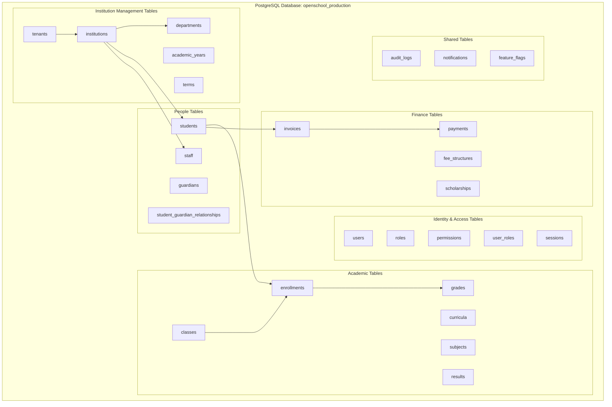
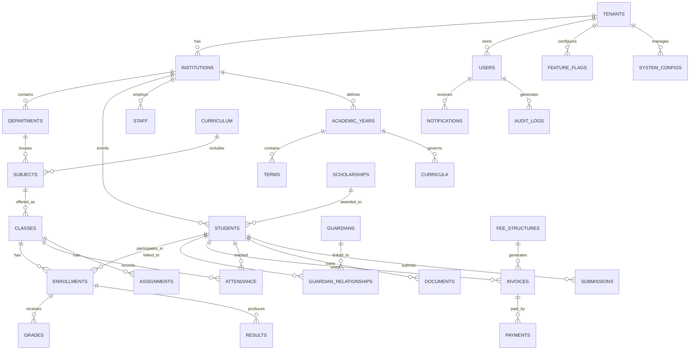
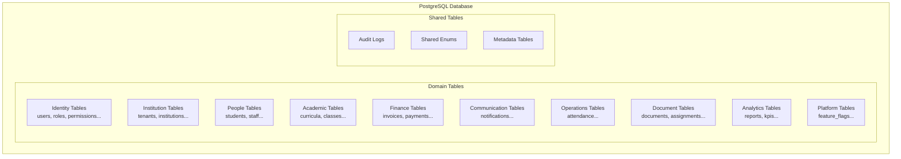
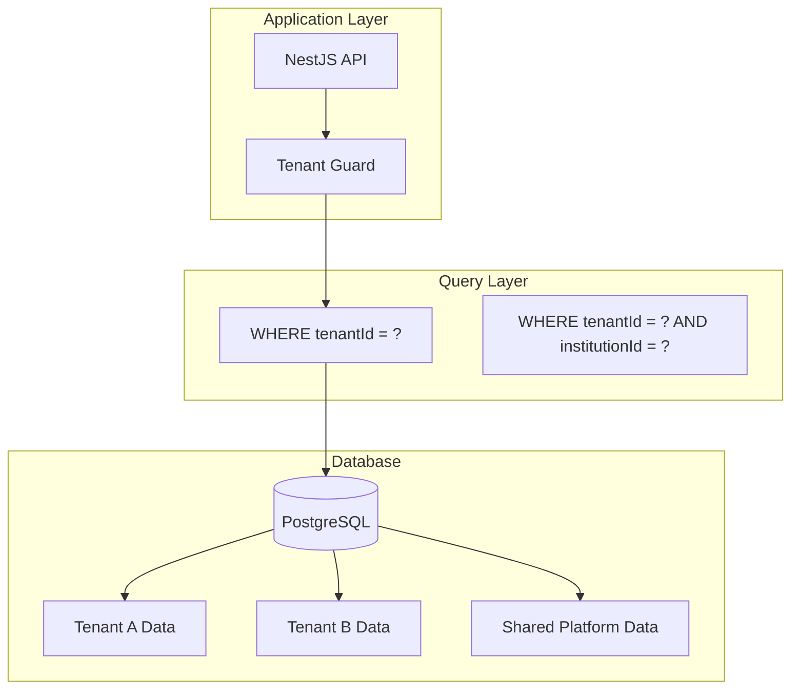
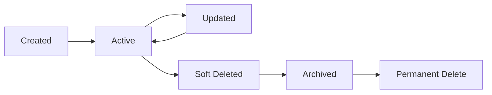
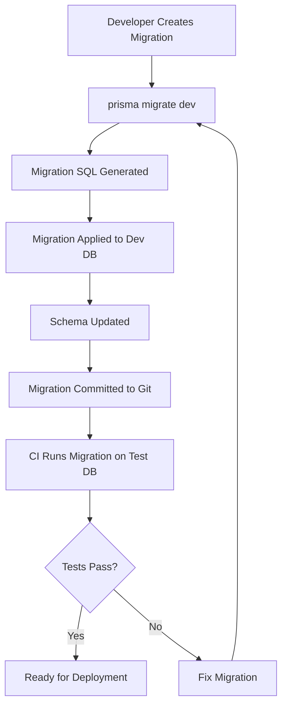
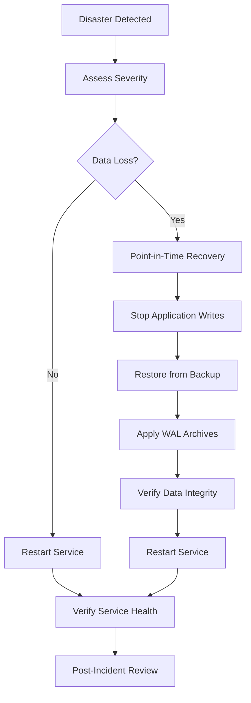
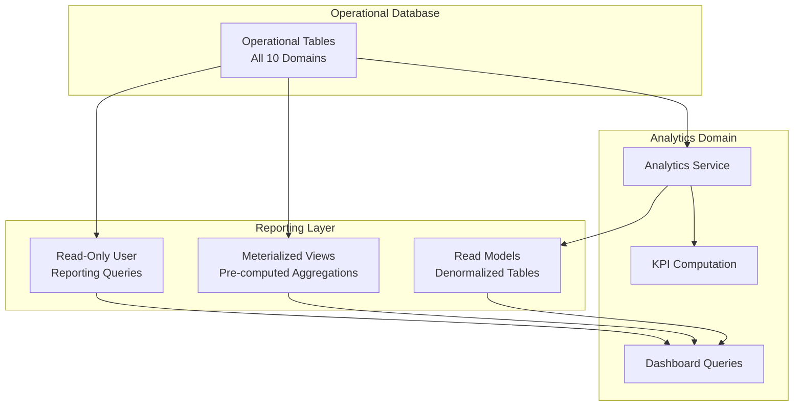

# OpenSchool ERP — Database Architecture

**Authoritative Database Architecture Reference**

| Aspect | Detail |
|--------|--------|
| **Document ID** | OPS-ARCH-002 |
| **Status** | Draft |
| **Version** | 1.0.0 |
| **Date** | 2026-07-21 |
| **Author** | Platform Architecture Team |
| **Review Cycle** | Quarterly |

---

## Document Status

| Status | Description |
|--------|-------------|
| **Draft** | Under active development |
| **Review** | Under architecture review |
| **Approved** | Approved for implementation |
| **Frozen** | Locked for current version |
| **Deprecated** | Pending replacement |

**Current Status:** Draft

---

## Table of Contents

1. [Executive Summary](#1-executive-summary)
2. [Database Principles](#2-database-principles)
3. [PostgreSQL Architecture](#3-postgresql-architecture)
4. [Master Data Model](#4-master-data-model)
5. [Master ER Diagram](#5-master-er-diagram)
6. [Schema Organization](#6-schema-organization)
7. [Tenant Isolation](#7-tenant-isolation)
8. [Key Management](#8-key-management)
9. [Indexing Strategy](#9-indexing-strategy)
10. [Constraints](#10-constraints)
11. [Transactions](#11-transactions)
12. [Performance Architecture](#12-performance-architecture)
13. [Data Lifecycle](#13-data-lifecycle)
14. [Migration Strategy](#14-migration-strategy)
15. [Backup & Recovery](#15-backup--recovery)
16. [Database Security](#16-database-security)
17. [Scalability Strategy](#17-scalability-strategy)
18. [Reporting & Analytics](#18-reporting--analytics)
19. [Operational Maintenance](#19-operational-maintenance)
20. [Architecture Decision Records](#20-architecture-decision-records)
21. [Database Review Checklist](#21-database-review-checklist)
22. [Revision History](#22-revision-history)

---

## 1. Executive Summary

OpenSchool ERP is a multi-tenant SaaS platform serving educational institutions across the Middle East and Africa. The platform manages data for 10 bounded domains: Identity & Access, Institution Management, People, Academic Management, Finance, Communication, Operations, Documents & Learning, Reporting & Analytics, and Platform Administration.

This document defines the authoritative database architecture for the entire platform. It describes how PostgreSQL is organized, how domains own and share data, how tenant isolation is enforced at the database level, and how the data layer scales from V1 through future growth.

### 1.1 Database at a Glance

| Aspect | Approach |
|--------|----------|
| **Database engine** | PostgreSQL 16+ |
| **Schema strategy** | Shared database; domain-scoped logical separation |
| **Multi-tenancy** | Application-level tenant ID column on all domain tables |
| **ORM** | Prisma 6.x with auto-generated migrations |
| **Primary key strategy** | UUID v4 (application-generated) |
| **Soft delete** | `deletedAt` timestamp column; filtered queries |
| **Audit trail** | Append-only audit log table per domain |
| **Connection pooling** | Prisma connection pool (default: 10 connections) |
| **Backup** | Daily full + continuous WAL archiving |
| **Replication** | Single primary (V1); primary-replica (V2) |

### 1.2 Scope

This document covers:

- Complete database architecture from logical design to physical deployment
- Schema organization and domain data ownership
- Tenant isolation and security boundaries
- Indexing, constraints, and transaction management
- Migration strategy and deployment sequencing
- Backup, recovery, and disaster recovery
- Performance architecture and scalability planning
- Reporting and analytics data access patterns

This document does not cover:

- Individual domain data models (defined in domain engineering specifications)
- API contracts (defined in 04 API Style Guide)
- Application code patterns (defined in 05 Development Standards)
- Operational procedures (defined in 06 DevOps & Deployment Standards)

---

## 2. Database Principles

### 2.1 Core Principles

| Principle | Description | Implementation |
|-----------|-------------|----------------|
| **Relational-First** | Prefer relational modeling over document or key-value storage; leverage PostgreSQL's full capabilities | Normalized tables; proper foreign keys; JOIN-based queries |
| **Data Integrity** | Enforce data integrity at the database level, not just application level | Foreign keys; unique constraints; check constraints; NOT NULL |
| **Normalization** | Normalize to 3NF by default; denormalize only with documented justification | Standard normalization; controlled denormalization for read performance |
| **Domain Ownership** | Each domain owns its tables; cross-domain access through defined interfaces only | Domain-scoped repositories; no cross-domain JOINs |
| **Multi-Tenant Isolation** | Every query scoped to tenant; application-level enforcement | `tenantId` column on all domain tables; Guard enforcement |
| **Performance** | Design for read-heavy workloads; optimize common query patterns | Strategic indexing; connection pooling; query optimization |
| **Auditability** | Track all data changes for compliance and debugging | Append-only audit logs; `createdAt`/`updatedAt` timestamps |
| **Scalability** | Design for vertical scaling in V1; horizontal scaling readiness in V2 | Connection pooling; read replicas; partitioning readiness |
| **Backward Compatibility** | Migrations must be backward compatible; no destructive changes without migration path | Additive migrations; column renames via alias; data migration scripts |
| **Idempotency** | All migrations and data operations must be idempotent where possible | Safe up/down migrations; deterministic seed data |

### 2.2 Architectural Constraints

| Constraint | Impact | Mitigation |
|------------|--------|-----------|
| Single PostgreSQL instance (V1) | All domains share one database | Domain-scoped queries; no cross-domain JOINs |
| Application-level tenant isolation | No database-level enforcement (no RLS) | Comprehensive Guard testing; audit logging |
| Shared schema | All domain tables in one schema | Logical separation via naming conventions and queries |
| Prisma as sole ORM | Limited raw SQL flexibility | Prisma raw queries for complex analytics; view models |

### 2.3 Data Classification

| Classification | Description | Examples | Protection |
|---------------|-------------|----------|------------|
| **Critical** | Data whose loss would be catastrophic | User credentials, financial records, student PII | Encryption at rest; backup verification; access controls |
| **Sensitive** | Personal or regulated data | Names, contacts, grades, medical info | PII masking in logs; encrypted fields; audit logging |
| **Internal** | Operational data not for external distribution | System configs, feature flags, internal reports | Standard access controls |
| **Public** | Data that can be shared openly | Institution names, public announcements | No special protection required |

---


---

## 3. PostgreSQL Architecture

### 3.1 Database Engine

| Property | Value |
|----------|-------|
| **Engine** | PostgreSQL 16+ |
| **License** | PostgreSQL License (open source) |
| **Character encoding** | UTF-8 |
| **Collation** | en_US.UTF-8 (or locale-appropriate) |
| **Timezone** | UTC (all timestamps stored as UTC) |
| **Schema strategy** | Single shared schema with domain-scoped tables |
| **Extension** | `uuid-ossp` for UUID generation |

### 3.2 Logical Structure



### 3.3 Physical Deployment

| Aspect | V1 Configuration | V2 Configuration |
|--------|-----------------|-----------------|
| Instance | Single PostgreSQL container | Managed PostgreSQL service |
| CPU | 2 vCPU | 4+ vCPU |
| Memory | 4GB RAM | 16GB+ RAM |
| Storage | 50GB SSD | 200GB+ SSD |
| Connections | 100 max | 500+ max |
| Replication | None | Primary-replica |
| Backup | Daily full + WAL | Streaming replication + WAL |

### 3.4 Connection Pooling

| Setting | Value | Description |
|---------|-------|-------------|
| Pool type | Prisma connection pool | Built-in to Prisma |
| Pool size (V1) | 10 connections | Sufficient for V1 load |
| Pool size (V2) | 50 connections | Scaled for multi-instance |
| Connection timeout | 5 seconds | Maximum wait for connection |
| Idle timeout | 10 minutes | Close idle connections |
| Max lifetime | 30 minutes | Recycle connections |

### 3.5 Transaction Management

| Property | Value |
|----------|-------|
| Default isolation level | READ COMMITTED |
| Explicit transactions | Used for multi-table operations |
| Transaction scope | Service layer (not controller, not repository) |
| Commit strategy | Commit after all operations succeed |
| Rollback strategy | Automatic on exception; manual for business rules |

---

## 4. Master Data Model

### 4.1 Domain Overview

The platform data model is organized into 10 bounded domains. Each domain owns its tables and communicates with other domains through well-defined interfaces.

| Domain | Core Aggregates | Table Count | Ownership |
|--------|----------------|-------------|-----------|
| Identity & Access | User, Role, Permission, Session | ~6 tables | Authentication and authorization |
| Institution Management | Tenant, Institution, Department, AcademicYear, Term | ~6 tables | Organizational structure |
| People | Student, Staff, Guardian, Relationship | ~5 tables | People management |
| Academic Management | Curriculum, Subject, Class, Enrollment, Grade, Result | ~7 tables | Academic operations |
| Finance | FeeStructure, Invoice, Payment, Scholarship, Refund | ~7 tables | Financial operations |
| Communication | NotificationTemplate, Notification, Campaign | ~4 tables | Messaging and notifications |
| Operations | Attendance, HostelAllocation, TransportRoute, InventoryItem | ~6 tables | Daily operations |
| Documents & Learning | Document, Assignment, Submission, LibraryBook, BookLoan | ~6 tables | Content and assignments |
| Reporting & Analytics | Report, Dashboard, KPI, Alert | ~5 tables | Analytics and reporting |
| Platform Administration | SystemConfig, FeatureFlag, AuditLog | ~4 tables | System management |

### 4.2 Cross-Domain Relationships

| Source Domain | Target Domain | Relationship | Type |
|--------------|---------------|-------------|------|
| Identity & Access | People | User ↔ Staff/Student | One-to-one (external FK) |
| Institution Management | People | Institution → Students/Staff | One-to-many |
| Institution Management | Academic | Institution → Curricula/Classes | One-to-many |
| People | Academic | Student → Enrollments | One-to-many |
| People | Finance | Student → Invoices | One-to-many |
| Academic | Finance | Enrollment → Fee Application | One-to-many |
| Finance | Communication | Payment → Receipt Notification | Event-driven |
| Operations | Communication | Attendance → Absence Notification | Event-driven |
| All domains | Reporting | Domain data → Analytics | Event-driven (read models) |

### 4.3 Data Flow Patterns

| Pattern | Description | Example |
|---------|-------------|---------|
| **Direct FK** | Source domain holds FK to target domain entity | `invoices.studentId` → `students.id` |
| **Event-driven** | Source domain publishes event; target domain reacts | `PaymentConfirmed` → Communication sends receipt |
| **Shared reference** | Both domains reference a shared lookup table | `academic_years` referenced by Academic and Finance |
| **Denormalized read** | Reporting domain maintains its own read model | `reporting.student_summaries` built from events |

---

## 5. Master ER Diagram

### 5.1 Platform-Wide Entity Relationship Diagram



### 5.2 Relationship Summary

| Source | Relationship | Target | Cardinality | Implementation |
|--------|-------------|--------|-------------|----------------|
| Tenant | has | Institution | 1:N | `institutions.tenantId` |
| Tenant | owns | User | 1:N | `users.tenantId` |
| Institution | enrolls | Student | 1:N | `students.institutionId` |
| Institution | employs | Staff | 1:N | `staff.institutionId` |
| AcademicYear | contains | Term | 1:N | `terms.academicYearId` |
| Curriculum | includes | Subject | 1:N | `subjects.curriculumId` |
| Subject | offered_as | Class | 1:N | `classes.subjectId` |
| Class | has | Enrollment | 1:N | `enrollments.classId` |
| Student | participates_in | Enrollment | 1:N | `enrollments.studentId` |
| Enrollment | receives | Grade | 1:N | `grades.enrollmentId` |
| Student | billed | Invoice | 1:N | `invoices.studentId` |
| FeeStructure | generates | Invoice | 1:N | `invoices.feeStructureId` |
| Invoice | paid_by | Payment | 1:N | `payments.invoiceId` |
| Student | linked_to | Guardian | M:N | `student_guardian_relationships` |
| Class | has | Assignment | 1:N | `assignments.classId` |
| Student | submits | Submission | 1:N | `submissions.studentId` |

---


---

## 6. Schema Organization

### 6.1 Schema Strategy

The platform uses a **single shared database** with **domain-scoped logical separation**. All 10 domains share one PostgreSQL database. Domain isolation is achieved through naming conventions, application-level queries, and tenant ID filtering.



### 6.2 Naming Conventions

| Convention | Rule | Example |
|-----------|------|---------|
| Table names | Plural, snake_case, domain prefix optional | `students`, `academic_years`, `fee_structures` |
| Column names | Singular, snake_case | `studentId`, `createdAt`, `deletedAt` |
| Primary key | Always `id` (UUID) | `id UUID PRIMARY KEY` |
| Foreign key | `{referenced_table_singular}Id` | `studentId`, `classId` |
| Tenant column | Always `tenantId` | `tenantId UUID NOT NULL` |
| Institution column | `institutionId` where applicable | `institutionId UUID` |
| Timestamps | `createdAt`, `updatedAt`, `deletedAt` | Standard audit columns |
| Enums | UPPER_SNAKE_CASE in Prisma | `STUDENT`, `TEACHER`, `PENDING` |

### 6.3 Domain Table Ownership

| Domain | Tables | Naming Pattern |
|--------|--------|---------------|
| Identity & Access | users, roles, permissions, user_roles, sessions | Direct names |
| Institution Management | tenants, institutions, departments, academic_years, terms | Direct names |
| People | students, staff, guardians, student_guardian_relationships | Direct names |
| Academic Management | curricula, subjects, classes, enrollments, grades, results | Direct names |
| Finance | fee_structures, invoices, payments, scholarships, refunds | Direct names |
| Communication | notification_templates, notifications, campaigns | Direct names |
| Operations | attendance, hostel_allocations, transport_routes, inventory_items, maintenance_requests | Direct names |
| Documents & Learning | documents, assignments, submissions, library_books, book_loans | Direct names |
| Reporting & Analytics | reports, dashboards, kpis, alerts, trends | Direct names |
| Platform Administration | system_configs, feature_flags, audit_logs, platform_admins | Direct names |

### 6.4 Shared Lookup Tables

Some tables are shared across domains and owned by the Platform Administration domain:

| Table | Purpose | Consumers |
|-------|---------|-----------|
| `tenants` | Tenant registry | All domains (via tenantId) |
| `academic_years` | Academic year definitions | Academic, Finance, Operations |
| `terms` | Term/semester definitions | Academic, Finance |
| `fee_structures` | Fee structure definitions | Finance, Academic |
| `notification_templates` | Message templates | Communication |
| `feature_flags` | Feature toggles | All domains |

### 6.5 Shared Enums

Prisma enums shared across domains:

| Enum | Values | Used By |
|------|--------|---------|
| `UserRole` | PLATFORM_ADMIN, TENANT_ADMIN, INSTITUTION_ADMIN, TEACHER, STUDENT, PARENT, STAFF | Identity |
| `Gender` | MALE, FEMALE, OTHER | People |
| `EnrollmentStatus` | ACTIVE, COMPLETED, TRANSFERRED, WITHDRAWN | Academic |
| `InvoiceStatus` | DRAFT, PENDING, PAID, PARTIALLY_PAID, OVERDUE, CANCELLED | Finance |
| `PaymentStatus` | PENDING, COMPLETED, FAILED, REFUNDED | Finance |
| `NotificationStatus` | PENDING, SENT, DELIVERED, FAILED | Communication |
| `AttendanceStatus` | PRESENT, ABSENT, LATE, EXCUSED | Operations |

---

## 7. Tenant Isolation

### 7.1 Isolation Model



### 7.2 Tenant Ownership

| Table Type | Tenant Column | Description |
|-----------|---------------|-------------|
| Domain tables | `tenantId UUID NOT NULL` | All domain-specific data is tenant-scoped |
| Platform tables | `tenantId UUID` (nullable) | Platform-level data may be tenant-specific or global |
| Shared references | None | `tenants` table itself; global lookup data |

### 7.3 Isolation Enforcement

| Layer | Mechanism | Description |
|-------|-----------|-------------|
| JWT | `tenantId` in token | Tenant ID embedded in access token |
| API Gateway | `X-Tenant-ID` header | Validated against JWT claims |
| Tenant Guard | NestJS Guard | Intercepts every request; attaches tenant context |
| Service Layer | Query filtering | Every query includes `WHERE tenantId = ?` |
| Repository Layer | Tenant-scoped queries | Repository methods accept tenant context |
| Event Layer | `tenantId` in events | Events carry tenant context for consumers |

### 7.4 Isolation Guarantees

| Guarantee | Implementation |
|-----------|---------------|
| No cross-tenant queries | Tenant Guard blocks queries without tenant context |
| No cross-tenant writes | Service layer validates tenant scope before writes |
| No cross-tenant events | Events carry `tenantId`; consumers validate scope |
| No cross-tenant files | S3 paths include `tenantId` prefix |
| Audit trail | All mutations logged with tenant context |

### 7.5 Platform-Level Tables

| Table | Tenant Scope | Description |
|-------|-------------|-------------|
| `tenants` | Global | Tenant registry; not tenant-scoped |
| `feature_flags` | Tenant-specific or global | Feature toggles per tenant |
| `system_configs` | Tenant-specific or global | Configuration per tenant |
| `audit_logs` | Tenant-specific | Audit trail per tenant |

---

## 8. Key Management

### 8.1 Primary Keys

| Strategy | Implementation | Rationale |
|----------|---------------|-----------|
| **UUID v4** | Application-generated; stored as `UUID` type | Globally unique; no coordination needed; safe for distributed systems |
| **Column name** | Always `id` | Consistent across all tables |
| **Type** | `UUID` (PostgreSQL native) | Native type; efficient indexing |

```sql
-- Standard primary key definition
id UUID PRIMARY KEY DEFAULT gen_random_uuid()
```

### 8.2 Foreign Keys

| Rule | Description |
|------|-------------|
| Naming | `{referenced_table_singular}Id` (e.g., `studentId`, `classId`) |
| Type | Always `UUID` matching the referenced primary key |
| Nullable | Non-nullable for required relationships; nullable for optional |
| Cascade | `ON DELETE RESTRICT` by default; `ON DELETE SET NULL` for optional |

```sql
-- Standard foreign key definition
studentId UUID NOT NULL REFERENCES students(id) ON DELETE RESTRICT
```

### 8.3 Composite Keys

| Use Case | Columns | Description |
|----------|---------|-------------|
| User roles | `userId` + `roleId` | Many-to-many user-role assignment |
| Student guardian | `studentId` + `guardianId` | Many-to-many student-guardian relationship |
| Enrollment | `studentId` + `classId` + `academicYearId` | Unique enrollment per student per class per year |

### 8.4 Natural Keys

| Entity | Natural Key | Usage |
|--------|------------|-------|
| User | `email` (per tenant) | Unique login identifier |
| Tenant | `slug` | URL-friendly identifier |
| Academic Year | `tenantId` + `startYear` | Unique year per tenant |
| Fee Structure | `tenantId` + `name` + `academicYearId` | Unique fee definition |

---

## 9. Indexing Strategy

### 9.1 Indexing Principles

| Principle | Description |
|-----------|-------------|
| **Index foreign keys** | Every foreign key column must have an index |
| **Index tenant ID** | Every tenant-scoped table must index `tenantId` |
| **Index frequent queries** | Index columns used in WHERE, JOIN, ORDER BY |
| **Avoid over-indexing** | Each index adds write overhead; balance read/write needs |
| **Use composite indexes** | For queries filtering on multiple columns |
| **Partial indexes** | For queries filtering on status (e.g., active records) |

### 9.2 Standard Indexes

| Index Type | Pattern | Example |
|-----------|---------|---------|
| **Primary key** | Automatic (UUID) | `id` column |
| **Foreign key** | Single column | `studentId`, `classId`, `tenantId` |
| **Tenant + entity** | Composite | `(tenantId, id)` |
| **Unique** | Business rule | `(tenantId, email)` on users |
| **Composite** | Multi-column query | `(tenantId, institutionId, status)` |
| **Partial** | Filtered | `WHERE deletedAt IS NULL` |
| **Full-text** | Search | GIN index on name columns |

### 9.3 Index Naming Convention

| Type | Pattern | Example |
|------|---------|---------|
| Primary | `pk_{table}` | `pk_students` |
| Foreign key | `fk_{table}_{column}` | `fk_enrollments_studentId` |
| Unique | `uq_{table}_{columns}` | `uq_users_tenantId_email` |
| Composite | `idx_{table}_{columns}` | `idx_enrollments_tenantId_classId` |
| Partial | `idx_{table}_{column}_partial` | `idx_students_active` |

### 9.4 Required Indexes by Domain

| Domain | Table | Index | Type |
|--------|-------|-------|------|
| Identity | users | `(tenantId, email)` | Unique |
| Identity | user_roles | `(userId)` + `(roleId)` | Foreign key |
| People | students | `(tenantId, institutionId)` | Composite |
| People | students | `(tenantId, status)` | Partial |
| Academic | enrollments | `(tenantId, studentId)` | Composite |
| Academic | enrollments | `(tenantId, classId)` | Composite |
| Academic | grades | `(enrollmentId)` | Foreign key |
| Finance | invoices | `(tenantId, studentId)` | Composite |
| Finance | invoices | `(tenantId, status)` | Partial |
| Finance | payments | `(invoiceId)` | Foreign key |
| Operations | attendance | `(tenantId, classId, date)` | Composite |
| Communication | notifications | `(tenantId, userId)` | Composite |
| Communication | notifications | `(tenantId, status)` | Partial |

---


---

## 10. Constraints

### 10.1 Constraint Types

| Type | Purpose | Implementation |
|------|---------|---------------|
| **Primary Key** | Uniquely identify each row | `id UUID PRIMARY KEY` |
| **Foreign Key** | Enforce referential integrity | `REFERENCES table(id) ON DELETE action` |
| **Unique** | Enforce business uniqueness | `UNIQUE (tenantId, email)` |
| **Not Null** | Require mandatory values | `NOT NULL` on required columns |
| **Check** | Enforce domain rules | `CHECK (amount > 0)` |
| **Default** | Provide sensible defaults | `DEFAULT gen_random_uuid()` |

### 10.2 Foreign Key Cascade Behavior

| Scenario | Cascade Action | Rationale |
|----------|---------------|-----------|
| Required relationship | `ON DELETE RESTRICT` | Prevent deletion of referenced entity |
| Optional relationship | `ON DELETE SET NULL` | Allow deletion; nullify reference |
| Dependent data | `ON DELETE CASCADE` | Rare; used only for truly dependent data (e.g., audit logs) |
| Cross-domain reference | `ON DELETE RESTRICT` | Never cascade across domain boundaries |

### 10.3 Standard Check Constraints

| Table | Constraint | Rule |
|-------|-----------|------|
| payments | `check_payment_amount` | `amount > 0` |
| invoices | `check_invoice_amount` | `totalAmount > 0` |
| grades | `check_grade_value` | `score >= 0 AND score <= 100` |
| attendance | `check_attendance_date` | `date <= CURRENT_DATE` |
| academic_years | `check_year_range` | `endYear >= startYear` |
| terms | `check_term_dates` | `endDate > startDate` |

### 10.4 Unique Constraints

| Table | Columns | Description |
|-------|---------|-------------|
| users | `(tenantId, email)` | One email per tenant |
| students | `(tenantId, studentNumber)` | Unique student number per tenant |
| academic_years | `(tenantId, startYear)` | One academic year per start year |
| terms | `(academicYearId, name)` | One term per name per year |
| fee_structures | `(tenantId, name, academicYearId)` | Unique fee name per year |
| classes | `(tenantId, subjectId, name, academicYearId)` | Unique class name |

---

## 11. Transactions

### 11.1 Transaction Boundaries

| Scope | Description | Example |
|-------|-------------|---------|
| **Service method** | One transaction per service method | `EnrollmentService.createEnrollment()` |
| **Multi-table operation** | All related writes in one transaction | Create student + enrollment + invoice |
| **Event publishing** | Events published AFTER commit | Transaction commits → events emitted |
| **No cross-service transactions** | Each service manages its own transactions | Finance and Academic transactions are independent |

### 11.2 ACID Principles

| Principle | Implementation |
|-----------|---------------|
| **Atomicity** | All operations in a transaction succeed or all roll back |
| **Consistency** | Database constraints ensure data validity after each transaction |
| **Isolation** | READ COMMITTED isolation level; prevents dirty reads |
| **Durability** | PostgreSQL WAL ensures committed data survives crashes |

### 11.3 Isolation Level

| Property | Value |
|----------|-------|
| Level | READ COMMITTED (PostgreSQL default) |
| Dirty reads | Prevented |
| Non-repeatable reads | Possible (acceptable for V1) |
| Phantom reads | Possible (acceptable for V1) |
| Rationale | Best balance of consistency and performance for V1 scale |

### 11.4 Optimistic Concurrency

| Mechanism | Implementation |
|-----------|---------------|
| Version column | `updatedAt` used as version token |
| Conflict detection | Compare `updatedAt` before update |
| Conflict response | Return 409 Conflict with current version |
| Retry strategy | Client retries with fresh data |

```typescript
// Optimistic locking pattern
async updateStudent(id: string, dto: UpdateStudentDto, tenantId: string) {
  const current = await this.prisma.student.findFirst({
    where: { id, tenantId },
    select: { updatedAt: true },
  });

  const updated = await this.prisma.student.updateMany({
    where: { id, tenantId, updatedAt: current.updatedAt },
    data: dto,
  });

  if (updated.count === 0) {
    throw new ConflictException('Student has been modified by another user');
  }
}
```

### 11.5 Concurrency Strategy

| Operation | Strategy |
|-----------|----------|
| Read operations | No locking; READ COMMITTED sufficient |
| Single-row write | Optimistic locking via `updatedAt` |
| Batch writes | Single transaction; no concurrent batch writes |
| Counter operations | Use `UPDATE ... SET count = count + 1` (atomic) |
| Sequence generation | UUID v4 (no sequence contention) |

---

## 12. Performance Architecture

### 12.1 Query Optimization

| Strategy | Description |
|----------|-------------|
| **Indexed queries** | All WHERE clauses on indexed columns |
| **JOIN optimization** | Prefer JOINs over subqueries for related data |
| **Pagination** | Cursor-based or offset-based pagination on all list endpoints |
| **Select only needed** | Use Prisma `select` to fetch only required columns |
| **Avoid N+1** | Use Prisma `include` for related data; avoid loops with individual queries |
| **Batch operations** | Use `createMany` / `updateMany` for bulk operations |

### 12.2 Read-Heavy Workload Optimization

| Pattern | Implementation |
|---------|---------------|
| Caching | Redis cache for frequently accessed data (TTL: 5-60 minutes) |
| Read replicas | PostgreSQL replica for read queries (V2) |
| Materialized views | Pre-computed aggregations for reporting |
| Connection pooling | Prisma connection pool to limit concurrent connections |

### 12.3 Write-Heavy Workload Optimization

| Pattern | Implementation |
|---------|---------------|
| Batch inserts | `createMany` for bulk data entry |
| Async writes | Background jobs for non-critical writes |
| Bulk updates | `updateMany` with targeted WHERE clauses |
| Queue-based | BullMQ for write-heavy operations (notifications, events) |

### 12.4 Pagination Strategy

| Type | Implementation | Use Case |
|------|---------------|----------|
| Offset-based | `SKIP take` in Prisma | Simple lists; admin dashboards |
| Cursor-based | `cursor` + `take` in Prisma | Infinite scroll; mobile feeds |
| Keyset | `WHERE id > lastId ORDER BY id LIMIT N` | Large datasets; streaming |

### 12.5 Large Dataset Handling

| Scenario | Strategy |
|----------|----------|
| Tables > 1M rows | Add composite indexes; consider partitioning |
| Full-text search | PostgreSQL GIN indexes; tsvector columns |
| Aggregation queries | Materialized views; background refresh |
| Export operations | Streaming queries; background job processing |
| Archive data | Move to archive tables; maintain current data only |

---

## 13. Data Lifecycle

### 13.1 Lifecycle States



### 13.2 Lifecycle Policies

| State | Description | Implementation |
|-------|-------------|---------------|
| **Created** | Initial record creation | `createdAt` timestamp; audit log entry |
| **Active** | Normal operational state | Standard queries; full access |
| **Updated** | Record modified | `updatedAt` timestamp; audit log with changes |
| **Soft Deleted** | Marked as deleted; retained | `deletedAt` timestamp; filtered from default queries |
| **Archived** | Moved to archive storage | Data migration to archive tables; compressed |
| **Permanent Delete** | Physically removed | GDPR compliance; data removal requests |

### 13.3 Soft Delete Policy

| Rule | Description |
|------|-------------|
| Default behavior | All domain tables use soft delete |
| Implementation | `deletedAt TIMESTAMP` column; NULL = active |
| Query filtering | All queries include `WHERE deletedAt IS NULL` |
| Restoration | Soft-deleted records can be restored by setting `deletedAt = NULL` |
| Permanent delete | Reserved for GDPR/data removal requests; requires admin approval |

### 13.4 Archival Strategy

| Data Type | Retention | Archive After | Archive Location |
|-----------|-----------|---------------|------------------|
| Audit logs | 7 years | 1 year | Archive table |
| Financial records | 10 years | 2 years | Archive table |
| Student records | 10 years after graduation | 2 years after graduation | Archive table |
| Notifications | 90 days | 30 days | Deleted |
| Session data | 7 days | 7 days | Expired (Redis TTL) |
| File metadata | Permanent | Never | Retained |

### 13.5 Data Retention Compliance

| Regulation | Requirement | Implementation |
|-----------|-------------|---------------|
| GDPR | Right to erasure | Soft delete + permanent delete workflow |
| COPPA | Parental consent for minors | Age verification; parental consent records |
| Local education laws | Record retention | Configurable retention per tenant |
| Financial regulations | Audit trail preservation | Append-only audit logs; no deletion |

---

## 14. Migration Strategy

### 14.1 Migration Approach

| Aspect | Approach |
|--------|----------|
| Tool | Prisma Migrate |
| File format | SQL migration files |
| Naming | Timestamp-based (`20260721_tenant_add_column`) |
| Versioning | Linear migration history |
| Rollback | Manual down migrations; no auto-rollback |

### 14.2 Migration Flow



### 14.3 Migration Rules

| Rule | Description |
|------|-------------|
| **Additive only** | New tables, columns, and indexes (no destructive changes) |
| **Backward compatible** | Application code must work with both old and new schema |
| **Column renames** | Add new column → migrate data → drop old column (3 steps) |
| **Table renames** | Create new → migrate data → drop old (3 steps) |
| **No data loss** | Migrations must never delete data without explicit approval |
| **Idempotent** | Migrations must be safe to re-run |
| **Tested** | Every migration tested against copy of production data |

### 14.4 Deployment Sequencing

| Phase | Action |
|-------|--------|
| 1. Pre-deployment | Run `prisma migrate deploy` on staging |
| 2. Validation | Verify schema matches expected state |
| 3. Application deploy | Deploy new application code |
| 4. Post-deployment | Verify migrations applied; run smoke tests |
| 5. Rollback (if needed) | Deploy previous application version; revert migration manually |

### 14.5 Migration Validation

| Check | Tool | Description |
|-------|------|-------------|
| Schema drift | `prisma migrate diff` | Detect drift between expected and actual schema |
| Data integrity | Custom scripts | Verify referential integrity after migration |
| Performance | Query plan analysis | Ensure migrations don't break query performance |
| Rollback | Manual test | Verify rollback procedure works |

---


---

## 15. Backup & Recovery

### 15.1 Backup Strategy

| Backup Type | Method | Frequency | Retention | Purpose |
|-------------|--------|-----------|-----------|---------|
| Full backup | pg_dump | Daily 02:00 UTC | 30 days | Complete database snapshot |
| WAL archiving | archive_command | Continuous | 7 days | Point-in-time recovery |
| Logical backup | pg_dumpall | Weekly Sunday 03:00 | 90 days | Global objects (roles, tablespaces) |
| Configuration backup | Git | On change | Permanent | Schema and migration files |

### 15.2 Recovery Targets

| Metric | Target | Description |
|--------|--------|-------------|
| **RPO** | 1 hour | Maximum data loss window |
| **RTO** | 4 hours | Maximum time to restore service |

### 15.3 Recovery Procedures



### 15.4 Backup Verification

| Test | Frequency | Description |
|------|-----------|-------------|
| Restore test | Monthly | Full restore to staging environment |
| Integrity check | Weekly | Verify backup file checksums |
| WAL replay | Daily | Verify WAL archive consistency |
| Recovery drill | Quarterly | Full disaster recovery drill |

---

## 16. Database Security

### 16.1 Access Control

| Principle | Implementation |
|-----------|---------------|
| Least privilege | Database user has only required permissions |
| Role-based access | Separate roles for application, admin, and backup |
| No shared accounts | Individual database users for each service |
| Password policy | Strong passwords; rotated quarterly |

### 16.2 Database Roles

| Role | Permissions | Usage |
|------|------------|-------|
| `openschool_app` | SELECT, INSERT, UPDATE, DELETE on all tables | Application read/write |
| `openschool_readonly` | SELECT only | Reporting and analytics |
| `openschool_admin` | Full DDL + DML | Migration and administration |
| `openschool_backup` | SELECT + pg_dump | Backup operations |

### 16.3 Encryption

| Layer | Implementation |
|-------|---------------|
| At rest | AES-256 encryption (managed disk encryption) |
| In transit | TLS 1.3 for all database connections |
| Sensitive fields | Application-level encryption for PII (future) |
| Backups | Encrypted with separate key |

### 16.4 Sensitive Data Handling

| Data Type | Protection |
|-----------|-----------|
| Passwords | bcrypt hashed (never stored in plain text) |
| Email addresses | Stored as-is; masked in logs |
| Student names | Stored as-is; masked in non-production environments |
| Financial data | Stored as-is; encrypted in backups |
| Session tokens | Stored as-is; short TTL; Redis only |

### 16.5 Audit Logging

| Aspect | Implementation |
|--------|---------------|
| Scope | All INSERT, UPDATE, DELETE operations on domain tables |
| Storage | Append-only `audit_logs` table |
| Fields | userId, tenantId, action, entity, entityId, changes, timestamp |
| Retention | 7 years minimum |
| Access | Platform admin only |

---

## 17. Scalability Strategy

### 17.1 Vertical Scaling (V1)

| Aspect | Strategy |
|--------|----------|
| CPU | Scale from 2 to 4 to 8 vCPU |
| Memory | Scale from 4GB to 16GB to 64GB |
| Storage | Scale from 50GB to 200GB to 1TB |
| Connections | Scale from 100 to 500 to 2000 |

### 17.2 Horizontal Scaling (V2)

| Aspect | Strategy |
|--------|----------|
| Read replicas | PostgreSQL streaming replication for read queries |
| Connection pooling | PgBouncer for connection management |
| Application scaling | Multiple NestJS instances behind load balancer |
| Worker scaling | Multiple BullMQ worker instances |

### 17.3 Partitioning Strategy (V3)

| Table | Partition Key | Strategy |
|-------|--------------|----------|
| audit_logs | `createdAt` | Range partitioning by month |
| notifications | `createdAt` | Range partitioning by month |
| attendance | `date` | Range partitioning by month |
| grades | `academicYearId` | List partitioning by year |

### 17.4 Multi-Region Readiness (V3)

| Aspect | Strategy |
|--------|----------|
| Primary region | Writes go to primary region |
| Read replicas | Read replicas in secondary regions |
| CDN | Static assets served from edge |
| Conflict resolution | Last-write-wins with timestamp |

---

## 18. Reporting & Analytics

### 18.1 Reporting Data Access

| Pattern | Description | Implementation |
|---------|-------------|---------------|
| **Direct queries** | Simple reports query operational tables | Standard Prisma queries with read-only user |
| **Materialized views** | Pre-computed aggregations for complex reports | PostgreSQL materialized views; refreshed periodically |
| **Read models** | Denormalized tables for analytics | Reporting domain maintains its own read models |
| **Event sourcing** | Analytics domain consumes domain events | Events populate analytics tables asynchronously |

### 18.2 Reporting Architecture



### 18.3 Materialized Views

| View | Purpose | Refresh |
|------|---------|---------|
| `mv_student_enrollment_summary` | Enrollment counts by class/institution | Daily |
| `mv_fee_collection_summary` | Payment totals by period/institution | Hourly |
| `mv_attendance_summary` | Attendance rates by class/period | Daily |
| `mv_grade_distribution` | Grade distributions by subject/class | After result publication |

### 18.4 Reporting Performance

| Strategy | Description |
|----------|-------------|
| Read-only user | Reporting queries use a separate read-only database user |
| Connection isolation | Reporting queries use a separate connection pool |
| Query timeouts | Reporting queries have 30-second timeout |
| Pagination | All reporting endpoints paginated (max 1000 rows) |
| Caching | Report results cached in Redis (TTL: 15 minutes) |

---


---

## 19. Operational Maintenance

### 19.1 Vacuuming

| Aspect | Configuration |
|--------|--------------|
| Autovacuum | Enabled (PostgreSQL default) |
| Vacuum threshold | 50 modified rows |
| Vacuum scale factor | 0.1 (10% of table) |
| Analyze threshold | 50 modified rows |
| Analyze scale factor | 0.05 (5% of table) |
| Log verbosity | Minimal (only manual vacuum) |

### 19.2 Index Maintenance

| Task | Frequency | Description |
|------|-----------|-------------|
| Index bloat check | Monthly | Monitor index size vs. row count |
| Reindex | As needed | Reindex bloated indexes during maintenance window |
| Unused index detection | Monthly | Identify and remove unused indexes |
| Index usage statistics | Weekly | Review `pg_stat_user_indexes` |

### 19.3 Statistics Updates

| Aspect | Configuration |
|--------|--------------|
| Auto-analyze | Enabled (via autovacuum) |
| Manual analyze | After bulk data operations |
| Statistics target | Default (100) for most columns |
| Extended statistics | Use for correlated columns |

### 19.4 Monitoring

| Metric | Tool | Alert Threshold |
|--------|------|----------------|
| Connection count | pg_stat_activity | > 80% of max |
| Query duration | pg_stat_statements | > 5 seconds |
| Table bloat | pg_stat_user_tables | > 20% dead tuples |
| Disk usage | OS monitoring | > 80% |
| Replication lag | pg_stat_replication | > 30 seconds |
| Cache hit ratio | pg_stat_database | < 95% |

### 19.5 Capacity Planning

| Metric | Measurement | Action Trigger |
|--------|------------|----------------|
| Database size | `pg_database_size()` | > 80% of allocated storage |
| Table growth rate | Monthly delta | > 10GB/month growth |
| Connection usage | `pg_stat_activity` count | > 80% of max_connections |
| Query performance | `pg_stat_statements` | p95 > 1 second |

---

## 20. Architecture Decision Records

### ADR-001: PostgreSQL Selection

- **Status:** Accepted
- **Context:** Need for relational database with ACID compliance, complex queries, JSON support
- **Decision:** PostgreSQL 16+
- **Consequences:** Mature ecosystem; excellent performance; strong community; open source

### ADR-002: Shared Database Strategy

- **Status:** Accepted
- **Context:** V1 scale (< 100 tenants); single team; simpler operations
- **Decision:** Single PostgreSQL database for all domains
- **Consequences:** Simplified backup; single connection pool; easier cross-domain queries; trade-off of isolation

### ADR-003: Application-Level Tenant Isolation

- **Status:** Accepted
- **Context:** Prisma compatibility; V1 tenant count; simpler implementation
- **Decision:** Application-level tenant ID column (no RLS)
- **Consequences:** Faster development; Prisma compatible; requires comprehensive testing

### ADR-004: UUID Primary Keys

- **Status:** Accepted
- **Context:** Need for globally unique identifiers; distributed system readiness
- **Decision:** UUID v4 for all primary keys
- **Consequences:** No sequence contention; safe for distributed systems; slightly larger index size

### ADR-005: Prisma Migrations

- **Status:** Accepted
- **Context:** Prisma as ORM; need for schema versioning
- **Decision:** Prisma Migrate for all schema changes
- **Consequences:** Type-safe migrations; auto-generated SQL; integration with Prisma Client

### ADR-006: Soft Delete Policy

- **Status:** Accepted
- **Context:** Need for data recovery; audit requirements; GDPR compliance
- **Decision:** Soft delete via `deletedAt` column on all domain tables
- **Consequences:** Data retention; audit trail; requires filtered queries; storage overhead

### ADR-007: READ COMMITTED Isolation

- **Status:** Accepted
- **Context:** V1 scale; read-heavy workload; performance requirements
- **Decision:** READ COMMITTED isolation level (PostgreSQL default)
- **Consequences:** Best performance; prevents dirty reads; acceptable for V1 scale

### ADR-008: Materialized Views for Reporting

- **Status:** Accepted
- **Context:** Complex reporting queries; performance requirements
- **Decision:** Materialized views for pre-computed aggregations
- **Consequences:** Faster report queries; requires refresh mechanism; stale data acceptable

### ADR-009: Audit Log Table per Domain

- **Status:** Accepted
- **Context:** Compliance requirements; debugging; audit trail
- **Decision:** Append-only audit_logs table with tenant scoping
- **Consequences:** Complete change history; append-only (no updates/deletes); storage growth

### ADR-010: Connection Pooling via Prisma

- **Status:** Accepted
- **Context:** V1 single-instance deployment; simpler configuration
- **Decision:** Prisma built-in connection pool
- **Consequences:** No external dependency; sufficient for V1; upgrade to PgBouncer for V2

---

## 21. Database Review Checklist

### Schema Review

| Check | Item | Status |
|-------|------|--------|
| □ | All tables have `id` (UUID) primary key | |
| □ | All domain tables have `tenantId` column | |
| □ | All tables have `createdAt`, `updatedAt` timestamps | |
| □ | All domain tables have `deletedAt` for soft delete | |
| □ | All foreign keys have proper indexes | |
| □ | All unique constraints documented | |
| □ | All check constraints documented | |
| □ | Naming conventions followed | |

### Performance Review

| Check | Item | Status |
|-------|------|--------|
| □ | All frequently queried columns indexed | |
| □ | Composite indexes for multi-column queries | |
| □ | No N+1 query patterns | |
| □ | Pagination implemented on all list endpoints | |
| □ | Large tables have appropriate partitioning strategy | |
| □ | Query performance tested with production-like data | |

### Security Review

| Check | Item | Status |
|-------|------|--------|
| □ | Tenant isolation enforced in all queries | |
| □ | No cross-tenant data access possible | |
| □ | Sensitive data identified and protected | |
| □ | Database user follows least-privilege principle | |
| □ | Audit logging implemented for all mutations | |
| □ | Backup encryption configured | |

### Migration Review

| Check | Item | Status |
|-------|------|--------|
| □ | Migration is backward compatible | |
| □ | Migration tested on copy of production data | |
| □ | Rollback procedure documented | |
| □ | No data loss in migration | |
| □ | Migration is idempotent | |
| □ | Schema drift checked | |

### Scalability Review

| Check | Item | Status |
|-------|------|--------|
| □ | Vertical scaling path documented | |
| □ | Read replica readiness considered | |
| □ | Connection pool sizing appropriate | |
| □ | Large dataset handling strategy defined | |
| □ | Archival strategy defined | |

---

## 22. Revision History

| Version | Date | Author | Changes |
|---------|------|--------|---------|
| 1.0.0 | 2026-07-21 | Platform Architect | Initial database architecture document |
| | | | Database principles and PostgreSQL architecture |
| | | | Master data model and ER diagram |
| | | | Schema organization and tenant isolation |
| | | | Key management and indexing strategy |
| | | | Constraints and transaction management |
| | | | Performance architecture |
| | | | Data lifecycle and migration strategy |
| | | | Backup, recovery, and security |
| | | | Scalability and reporting architecture |
| | | | Operational maintenance and ADRs |
| | | | Review checklist |

---

*Document Version: 1.0.0 | Last Updated: 2026-07-21 | Status: DRAFT*
