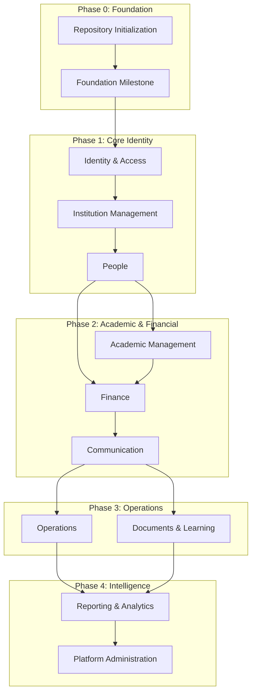
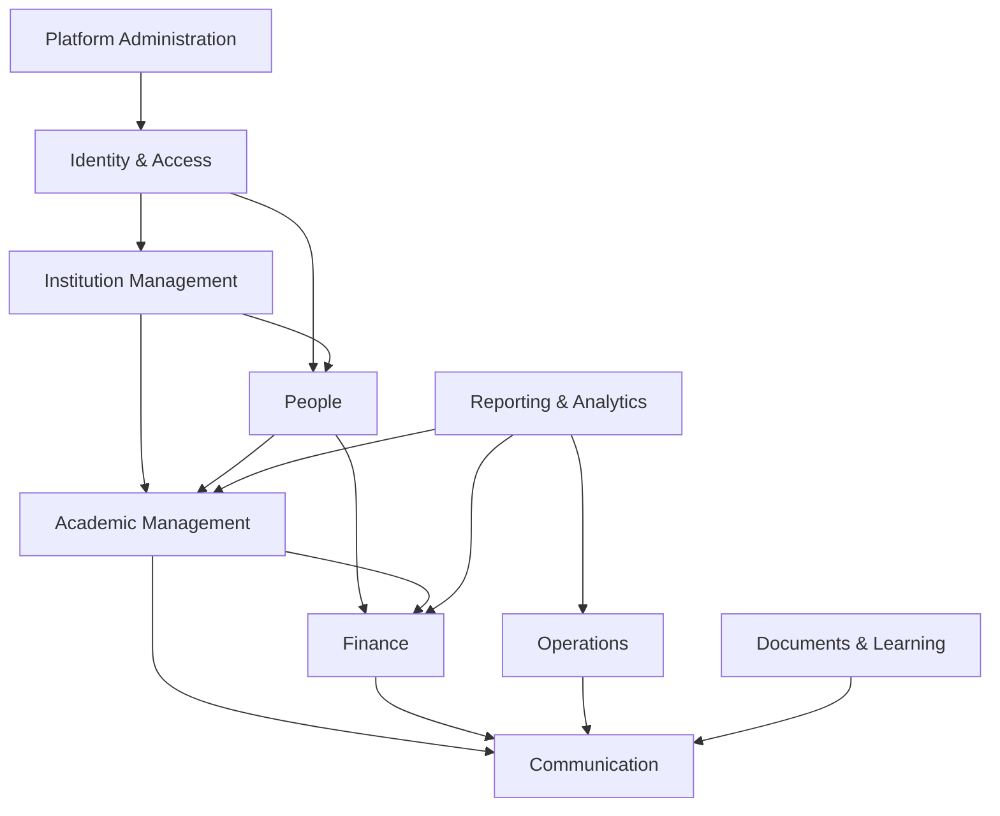
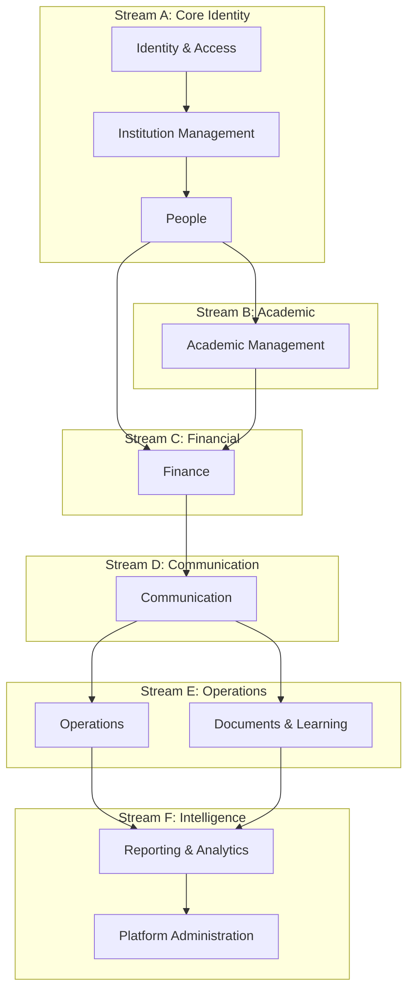
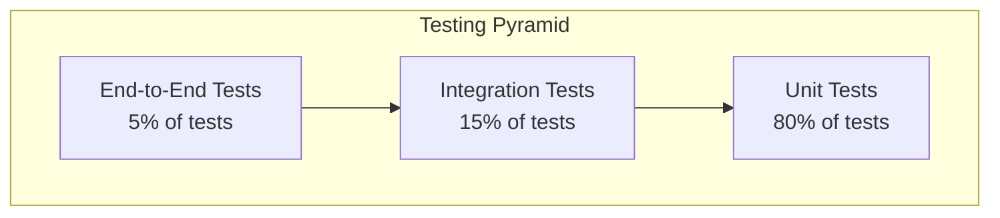
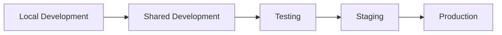

# OpenSchool ERP — Implementation Roadmap

**Authoritative Implementation Planning Reference**

| Aspect | Detail |
|--------|--------|
| **Document ID** | OPS-ARCH-003 |
| **Status** | Draft |
| **Version** | 1.0.0 |
| **Date** | 2026-07-21 |
| **Author** | Platform Architecture Team |
| **Review Cycle** | Quarterly |

---

## Document Status

| Status | Description |
|--------|-------------|
| **Draft** | Under active development |
| **Review** | Under architecture review |
| **Approved** | Approved for implementation |
| **Frozen** | Locked for current version |
| **Deprecated** | Pending replacement |

**Current Status:** Draft

---

## Table of Contents

1. [Executive Summary](#1-executive-summary)
2. [Development Philosophy](#2-development-philosophy)
3. [Overall Development Strategy](#3-overall-development-strategy)
4. [Repository Initialization](#4-repository-initialization)
5. [Foundation Milestone](#5-foundation-milestone)
6. [Module Implementation Order](#6-module-implementation-order)
7. [Parallel Development Opportunities](#7-parallel-development-opportunities)
8. [Integration Milestones](#8-integration-milestones)
9. [Testing Strategy](#9-testing-strategy)
10. [Deployment Milestones](#10-deployment-milestones)
11. [Risk Register](#11-risk-register)
12. [Change Management](#12-change-management)
13. [Architecture Compliance](#13-architecture-compliance)
14. [AI-Assisted Development Workflow](#14-ai-assisted-development-workflow)
15. [Definition of Done](#15-definition-of-done)
16. [Implementation Checklists](#16-implementation-checklists)
17. [Future Expansion](#17-future-expansion)
18. [Architecture Decision Records](#18-architecture-decision-records)
19. [Revision History](#19-revision-history)

---

## 1. Executive Summary

This document defines the authoritative implementation roadmap for OpenSchool ERP Version 1. It provides a dependency-driven development strategy that guides the team from an empty repository to a production-ready platform.

### 1.1 Roadmap at a Glance

| Aspect | Approach |
|--------|----------|
| **Strategy** | Architecture-first; foundation before features |
| **Sequence** | 10 domains implemented in dependency order |
| **Parallelism** | Maximum parallel development where dependencies allow |
| **Quality** | Continuous integration; test-driven; documentation-driven |
| **AI assistance** | AI-assisted coding with human architectural review |
| **Delivery** | Incremental milestones with defined exit criteria |

### 1.2 Implementation Overview

```mermaid
graph LR
    subgraph "Phase 0"
        M0[Repository Init<br/>Foundation Milestone]
    end

    subgraph "Phase 1: Core"
        M1[Identity & Access]
        M2[Institution Mgmt]
        M3[People]
    end

    subgraph "Phase 2: Academic"
        M4[Academic Mgmt]
        M5[Finance]
        M6[Communication]
    end

    subgraph "Phase 3: Operations"
        M7[Operations]
        M8[Documents & Learning]
    end

    subgraph "Phase 4: Intelligence"
        M9[Reporting & Analytics]
        M10[Platform Admin]
    end

    M0 --> M1
    M1 --> M2
    M2 --> M3
    M3 --> M4
    M4 --> M5
    M5 --> M6
    M6 --> M7
    M7 --> M8
    M8 --> M9
    M9 --> M10
```



### 1.3 Scope

This document covers:

- Complete implementation strategy from repository initialization to production
- Module implementation order with dependency analysis
- Parallel development opportunities
- Integration milestones and quality gates
- Testing, deployment, and risk management
- AI-assisted development workflow
- Definition of done and implementation checklists

This document does not cover:

- Individual domain business rules (defined in engineering specifications)
- API contracts (defined in 04 API Style Guide)
- Code patterns (defined in 05 Development Standards)
- Operational procedures (defined in 06 DevOps & Deployment Standards)

---

## 2. Development Philosophy

### 2.1 Core Principles

| Principle | Description | Implementation |
|-----------|-------------|----------------|
| **Architecture-First** | Complete all architecture documents before writing production code | All Phase 0-3 documents approved before implementation |
| **Foundation Before Features** | Build infrastructure before business features | Repository, auth, multi-tenancy before domain modules |
| **Incremental Delivery** | Deliver working software at each milestone | Each module produces deployable artifacts |
| **Continuous Integration** | Integrate and test continuously | CI pipeline runs on every commit |
| **Test-Driven Thinking** | Design tests before or alongside implementation | Unit tests; integration tests; acceptance tests |
| **Documentation-Driven** | Architecture documents guide implementation | Implementation follows approved specifications |
| **AI-Assisted Development** | AI tools accelerate implementation; humans ensure architectural integrity | AI generates code; humans review architecture |

### 2.2 Implementation Principles

| Principle | Description |
|-----------|-------------|
| **Single source of truth** | Engineering specifications are the authoritative reference |
| **No architecture drift** | Implementation must match approved architecture |
| **Dependency-driven** | Implement modules in dependency order |
| **Maximum parallelism** | Develop independent modules simultaneously |
| **Quality gates** | Each milestone has defined exit criteria |
| **Risk-first** | Address highest-risk items earliest |

---


---

## 3. Overall Development Strategy

### 3.1 Implementation Sequence

The platform is implemented in dependency order. Each phase builds on the previous phase, and no module is started until its dependencies are complete.



### 3.2 Why This Order

| Phase | Rationale |
|-------|-----------|
| **Foundation** | Infrastructure must exist before any feature code |
| **Identity & Access** | Every feature requires authentication and authorization |
| **Institution Management** | Tenants and institutions are prerequisites for all domain data |
| **People** | Students and staff are referenced by almost every domain |
| **Academic Management** | Core educational functionality; depends on People |
| **Finance** | Depends on People and Academic; triggers Communication |
| **Communication** | Triggered by events from Finance, Operations, and other domains |
| **Operations** | Depends on People and Academic; triggers Communication |
| **Documents & Learning** | Depends on Academic; triggers Communication |
| **Reporting & Analytics** | Consumes data from all operational domains |
| **Platform Administration** | System-wide configuration; depends on all domains being operational |

### 3.3 Risk Reduction Strategy

| Risk | Mitigation |
|------|-----------|
| Foundation instability | Complete foundation milestone before any domain work |
| Dependency conflicts | Strict dependency-driven implementation order |
| Integration failures | Integration milestones at each phase boundary |
| Performance issues | Early performance testing in Foundation milestone |
| Security vulnerabilities | Security review at each milestone |

---

## 4. Repository Initialization

### 4.1 Monorepo Setup

| Task | Description | Deliverable |
|------|-------------|-------------|
| Initialize repository | Create Git repository with proper structure | `openschool/` root |
| Configure monorepo | Set up workspace configuration (pnpm workspaces or similar) | `pnpm-workspace.yaml` |
| Create workspace packages | Define `apps/api`, `apps/web`, `apps/mobile`, `packages/shared` | Workspace structure |
| Configure TypeScript | Shared TypeScript configuration | `tsconfig.base.json` |
| Configure ESLint | Shared linting rules | `.eslintrc.js` |
| Configure Prettier | Shared formatting rules | `.prettierrc` |
| Set up Git hooks | Pre-commit linting; commit message validation | `.husky/` |
| Create README | Project overview and getting started | `README.md` |
| Create LICENSE | Open source license | `LICENSE` |
| Create .gitignore | Ignore patterns for Node, Flutter, Docker | `.gitignore` |

### 4.2 CI/CD Bootstrap

| Task | Description | Deliverable |
|------|-------------|-------------|
| GitHub Actions workflow | Lint, test, build on every PR | `.github/workflows/ci.yml` |
| Docker build | Multi-stage Dockerfile for API | `Dockerfile` |
| Docker Compose | Local development environment | `docker-compose.yml` |
| Environment templates | `.env.example` with all required variables | `.env.example` |
| Database setup script | Initial database creation script | `scripts/setup-db.sh` |

### 4.3 Repository Structure

```
openschool/
├── apps/
│   ├── api/                    # NestJS backend
│   │   ├── src/
│   │   │   ├── modules/        # Domain modules
│   │   │   ├── shared/         # Shared utilities
│   │   │   ├── common/         # Common decorators, pipes, guards
│   │   │   └── main.ts
│   │   ├── prisma/
│   │   │   ├── schema.prisma   # Merged schema
│   │   │   └── migrations/
│   │   ├── test/
│   │   ├── Dockerfile
│   │   └── package.json
│   ├── web/                    # Next.js frontend
│   │   ├── src/
│   │   ├── public/
│   │   ├── Dockerfile
│   │   └── package.json
│   └── mobile/                 # Flutter app
│       ├── lib/
│       ├── pubspec.yaml
│       └── android/ios/
├── packages/
│   ├── shared/                 # Shared types, utilities
│   │   ├── src/
│   │   └── package.json
│   └── ui/                     # Shared UI components
│       ├── src/
│       └── package.json
├── docs/                       # Documentation
│   ├── engineering/
│   ├── product/
│   └── architecture/
├── scripts/                    # Build and utility scripts
├── docker-compose.yml
├── pnpm-workspace.yaml
├── tsconfig.base.json
├── .eslintrc.js
├── .prettierrc
├── .github/
│   └── workflows/
└── README.md
```

---

## 5. Foundation Milestone

### 5.1 Backend Foundation (NestJS)

| Task | Description | Deliverable |
|------|-------------|-------------|
| Initialize NestJS project | Create NestJS application with TypeScript | `apps/api/` |
| Configure modules | Set up module structure | 10 domain module stubs |
| Set up Prisma | Configure Prisma client and schema | `prisma/schema.prisma` |
| Configure validation | Set up class-validator and class-transformer | Validation pipe |
| Configure Swagger | Auto-generate API documentation | Swagger UI at `/api/docs` |
| Set up logging | Configure structured logging (Winston/Pino) | Logger service |
| Set up configuration | Environment variable management via `@nestjs/config` | Config module |
| Set up health checks | Health check endpoint for container orchestration | `/health` endpoint |
| Set up CORS | Configure cross-origin resource sharing | CORS configuration |
| Set up rate limiting | Configure global rate limiting | Throttler module |

### 5.2 Database Foundation (PostgreSQL + Prisma)

| Task | Description | Deliverable |
|------|-------------|-------------|
| Set up PostgreSQL | Docker container for local development | `docker-compose.yml` service |
| Create Prisma schema | Initial schema with shared types | `schema.prisma` |
| Define shared enums | UserRole, Gender, Status enums | Enum definitions |
| Define shared metadata | Audit columns (id, createdAt, updatedAt, deletedAt) | Base model template |
| Set up migrations | Configure Prisma Migrate | Migration workflow |
| Set up seeding | Database seed script with test data | `prisma/seed.ts` |
| Configure connection pooling | Prisma connection pool settings | Pool configuration |

### 5.3 Authentication Infrastructure

| Task | Description | Deliverable |
|------|-------------|-------------|
| JWT module | Access token and refresh token generation | JWT service |
| Password hashing | bcrypt implementation | Password service |
| Auth controller | Login, refresh, logout endpoints | Auth controller |
| JWT guard | NestJS guard for JWT validation | JwtAuthGuard |
| Tenant guard | NestJS guard for tenant isolation | TenantGuard |
| Permission guard | NestJS guard for RBAC | PermissionGuard |
| Auth interceptor | Correlation ID and audit logging | CorrelationIdInterceptor |
| User entity (stub) | Minimal user table for authentication | Users table |

### 5.4 Infrastructure Foundation

| Task | Description | Deliverable |
|------|-------------|-------------|
| Docker Compose | Complete local development environment | `docker-compose.yml` |
| Redis setup | Cache and session store | Redis container |
| S3 setup | Object storage (MinIO for local) | MinIO container |
| Nginx setup | Reverse proxy configuration | Nginx container |
| Environment management | `.env.example` with all variables | Environment template |

### 5.5 Foundation Exit Criteria

| Criterion | Requirement |
|-----------|-------------|
| ✅ Repository initialized | Monorepo structure with all workspaces |
| ✅ CI pipeline passing | Lint, test, build all green |
| ✅ Docker Compose running | All services start without errors |
| ✅ Database migrations running | Prisma migrate deploy succeeds |
| ✅ Authentication working | Login, refresh, logout endpoints functional |
| ✅ Multi-tenant isolation | Tenant guard blocks cross-tenant access |
| ✅ API documentation | Swagger UI accessible and accurate |
| ✅ Health checks passing | `/health` endpoint returns healthy |

---


---

## 6. Module Implementation Order

### 6.1 Module Dependency Graph



### 6.2 Module 1: Identity & Access

| Aspect | Detail |
|--------|--------|
| **Purpose** | Authentication, authorization, user management, RBAC |
| **Dependencies** | Foundation milestone only |
| **Deliverables** | User CRUD, role management, permission system, JWT auth, login/logout |
| **Complexity** | Medium |
| **Estimated effort** | 2-3 weeks |

**Acceptance Criteria:**

| # | Criterion |
|---|-----------|
| 1 | User registration and login endpoints functional |
| 2 | JWT access and refresh tokens working |
| 3 | Password reset flow functional |
| 4 | Role CRUD with permission assignment |
| 5 | Permission guard enforced on all endpoints |
| 6 | Tenant guard enforced on all endpoints |
| 7 | Unit tests passing (> 80% coverage) |
| 8 | Integration tests passing |
| 9 | API documentation complete |

**Risks:**

| Risk | Mitigation |
|------|-----------|
| JWT token management complexity | Follow approved authentication architecture |
| Permission model complexity | Start with simple RBAC; expand later |
| Multi-tenant auth edge cases | Comprehensive integration testing |

---

### 6.3 Module 2: Institution Management

| Aspect | Detail |
|--------|--------|
| **Purpose** | Tenant provisioning, institution setup, departments, academic years, terms |
| **Dependencies** | Identity & Access |
| **Deliverables** | Tenant CRUD, institution CRUD, department management, academic year/term management |
| **Complexity** | Medium |
| **Estimated effort** | 2-3 weeks |

**Acceptance Criteria:**

| # | Criterion |
|---|-----------|
| 1 | Tenant provisioning via platform admin |
| 2 | Institution CRUD within tenants |
| 3 | Department management |
| 4 | Academic year creation and management |
| 5 | Term creation and management |
| 6 | Tenant isolation verified |
| 7 | Unit tests passing (> 80% coverage) |
| 8 | Integration tests passing |

---

### 6.4 Module 3: People

| Aspect | Detail |
|--------|--------|
| **Purpose** | Student, staff, and guardian management |
| **Dependencies** | Identity & Access, Institution Management |
| **Deliverables** | Student CRUD, staff CRUD, guardian management, student-guardian relationships |
| **Complexity** | High |
| **Estimated effort** | 3-4 weeks |

**Acceptance Criteria:**

| # | Criterion |
|---|-----------|
| 1 | Student registration with all required fields |
| 2 | Staff profile management |
| 3 | Guardian registration |
| 4 | Student-guardian relationship management |
| 5 | Student search and filtering |
| 6 | Photo upload for students and staff |
| 7 | Unit tests passing (> 80% coverage) |
| 8 | Integration tests passing |

---

### 6.5 Module 4: Academic Management

| Aspect | Detail |
|--------|--------|
| **Purpose** | Curriculum, subjects, classes, enrollment, grading, results |
| **Dependencies** | Institution Management, People |
| **Deliverables** | Curriculum management, subject CRUD, class management, enrollment, grading, results |
| **Complexity** | Very High |
| **Estimated effort** | 4-6 weeks |

**Acceptance Criteria:**

| # | Criterion |
|---|-----------|
| 1 | Curriculum and subject management |
| 2 | Class creation and management |
| 3 | Student enrollment in classes |
| 4 | Grade recording and management |
| 5 | Result calculation and publication |
| 6 | Report card generation |
| 7 | Enrollment capacity enforcement |
| 8 | Unit tests passing (> 80% coverage) |
| 9 | Integration tests passing |

---

### 6.6 Module 5: Finance

| Aspect | Detail |
|--------|--------|
| **Purpose** | Fee structures, invoicing, payments, scholarships, refunds |
| **Dependencies** | People, Academic Management |
| **Deliverables** | Fee structure management, invoice generation, payment processing, scholarship management |
| **Complexity** | Very High |
| **Estimated effort** | 4-6 weeks |

**Acceptance Criteria:**

| # | Criterion |
|---|-----------|
| 1 | Fee structure creation and management |
| 2 | Automatic invoice generation on enrollment |
| 3 | Payment recording and verification |
| 4 | Payment provider integration (Stripe/Paystack) |
| 5 | Scholarship management |
| 6 | Refund processing |
| 7 | Invoice status management |
| 8 | Payment webhook handling |
| 9 | Unit tests passing (> 80% coverage) |
| 10 | Integration tests passing |

---

### 6.7 Module 6: Communication

| Aspect | Detail |
|--------|--------|
| **Purpose** | Notification templates, notifications, campaigns, multi-channel delivery |
| **Dependencies** | All operational domains (Finance, Operations, etc.) |
| **Deliverables** | Template management, notification delivery, campaign management, channel abstraction |
| **Complexity** | High |
| **Estimated effort** | 3-4 weeks |

**Acceptance Criteria:**

| # | Criterion |
|---|-----------|
| 1 | Notification template CRUD |
| 2 | Multi-channel delivery (email, SMS, push, in-app) |
| 3 | Event-driven notification triggers |
| 4 | Notification preference management |
| 5 | Campaign creation and execution |
| 6 | Delivery status tracking |
| 7 | Background job processing |
| 8 | Unit tests passing (> 80% coverage) |
| 9 | Integration tests passing |

---

### 6.8 Module 7: Operations

| Aspect | Detail |
|--------|--------|
| **Purpose** | Attendance, hostel management, transport, inventory, maintenance |
| **Dependencies** | People, Academic Management, Communication |
| **Deliverables** | Attendance tracking, hostel allocation, transport routes, inventory, maintenance requests |
| **Complexity** | High |
| **Estimated effort** | 3-4 weeks |

**Acceptance Criteria:**

| # | Criterion |
|---|-----------|
| 1 | Daily attendance recording |
| 2 | Attendance reports and summaries |
| 3 | Hostel allocation management |
| 4 | Transport route management |
| 5 | Inventory tracking |
| 6 | Maintenance request workflow |
| 7 | Event-driven absence notifications |
| 8 | Unit tests passing (> 80% coverage) |
| 9 | Integration tests passing |

---

### 6.9 Module 8: Documents & Learning

| Aspect | Detail |
|--------|--------|
| **Purpose** | File management, assignments, submissions, library management |
| **Dependencies** | Academic Management, Communication |
| **Deliverables** | Document upload, assignment management, submission workflow, library management |
| **Complexity** | High |
| **Estimated effort** | 3-4 weeks |

**Acceptance Criteria:**

| # | Criterion |
|---|-----------|
| 1 | File upload and retrieval via S3 |
| 2 | Document organization and tagging |
| 3 | Assignment creation and publishing |
| 4 | Student submission workflow |
| 5 | Grading of submissions |
| 6 | Library book management |
| 7 | Book loan workflow |
| 8 | Unit tests passing (> 80% coverage) |
| 9 | Integration tests passing |

---

### 6.10 Module 9: Reporting & Analytics

| Aspect | Detail |
|--------|--------|
| **Purpose** | Reports, dashboards, KPIs, alerts, trend analysis |
| **Dependencies** | All operational domains |
| **Deliverables** | Report generation, dashboard rendering, KPI computation, alert management |
| **Complexity** | High |
| **Estimated effort** | 3-4 weeks |

**Acceptance Criteria:**

| # | Criterion |
|---|-----------|
| 1 | Student enrollment reports |
| 2 | Financial collection reports |
| 3 | Attendance reports |
| 4 | Academic performance reports |
| 5 | Dashboard rendering |
| 6 | KPI computation and display |
| 7 | Alert generation and management |
| 8 | Report export (PDF, Excel) |
| 9 | Unit tests passing (> 80% coverage) |
| 10 | Integration tests passing |

---

### 6.11 Module 10: Platform Administration

| Aspect | Detail |
|--------|--------|
| **Purpose** | System configuration, feature flags, platform monitoring, audit logs |
| **Dependencies** | All other modules |
| **Deliverables** | System config management, feature flag management, audit log viewer, platform dashboard |
| **Complexity** | Medium |
| **Estimated effort** | 2-3 weeks |

**Acceptance Criteria:**

| # | Criterion |
|---|-----------|
| 1 | System configuration CRUD |
| 2 | Feature flag management |
| 3 | Audit log viewing and filtering |
| 4 | Platform health dashboard |
| 5 | Tenant management dashboard |
| 6 | System metrics display |
| 7 | Unit tests passing (> 80% coverage) |
| 8 | Integration tests passing |

---


---

## 7. Parallel Development Opportunities

### 7.1 Parallel Development Streams

Modules that share no dependency relationship can be developed simultaneously.



### 7.2 Parallelism Opportunities

| Phase | Sequential | Parallel Opportunities |
|-------|-----------|----------------------|
| Foundation | Repository → Foundation | None (sequential) |
| Phase 1 | IAM → Inst → People | None (sequential chain) |
| Phase 2 | Academic + Finance | Academic and Finance can start simultaneously after People |
| Phase 2 | Communication | Starts after Finance events are defined |
| Phase 3 | Operations + Documents | Both depend on Communication; can be parallel |
| Phase 4 | Reporting + Platform Admin | Reporting consumes all domains; Platform Admin after Reporting |

### 7.3 Maximum Parallelism Schedule

| Time Period | Developer A | Developer B | Developer C |
|-------------|------------|------------|------------|
| Weeks 1-2 | Repository init | Docker setup | CI/CD bootstrap |
| Weeks 3-5 | Identity & Access | Foundation DB | Auth infrastructure |
| Weeks 6-8 | Institution Management | — | — |
| Weeks 9-12 | People | — | — |
| Weeks 13-16 | Academic Management | Finance | — |
| Weeks 17-20 | Communication | Operations | Documents & Learning |
| Weeks 21-24 | Reporting & Analytics | Platform Administration | — |

### 7.4 Parallel Development Rules

| Rule | Description |
|------|-------------|
| **No shared branches** | Each developer works on their own feature branch |
| **Integration branches** | Merge to `develop` branch at integration milestones |
| **API contracts first** | Define API contracts before parallel implementation |
| **Event contracts first** | Define event schemas before parallel implementation |
| **Shared types** | Shared types must be finalized before parallel work |

---

## 8. Integration Milestones

### 8.1 Integration Points

| Milestone | Domains | Validation |
|-----------|---------|-----------|
| **IM-1: Identity + Institution** | Identity & Access + Institution Management | Tenant provisioning; user management within institutions |
| **IM-2: People + Academic** | People + Academic Management | Student enrollment; class assignment; grade recording |
| **IM-3: Finance + Communication** | Finance + Communication | Invoice generation; payment notifications; receipt delivery |
| **IM-4: Operations + Documents** | Operations + Documents & Learning | Attendance tracking; assignment submission; file management |
| **IM-5: Full Platform** | All 10 domains | End-to-end workflow validation; performance testing |

### 8.2 Integration Validation Criteria

| Milestone | Criteria |
|-----------|---------|
| **IM-1** | Platform admin can provision tenant; tenant admin can manage institutions; users can authenticate within institutions |
| **IM-2** | Students can be enrolled in classes; grades can be recorded; results can be published |
| **IM-3** | Invoices generated on enrollment; payments processed; notifications delivered |
| **IM-4** | Attendance recorded daily; assignments created and submitted; files uploaded and retrieved |
| **IM-5** | Complete student lifecycle works end-to-end; all events flow correctly; all reports generate |

### 8.3 Integration Testing

| Test Type | Scope | Frequency |
|-----------|-------|-----------|
| API integration | Cross-domain API calls | Every PR |
| Event integration | Cross-domain event flows | Weekly |
| End-to-end | Complete user workflows | At each integration milestone |
| Performance | Response time and throughput | At IM-5 |
| Security | Vulnerability scanning | At IM-5 |

---

## 9. Testing Strategy

### 9.1 Testing Pyramid



### 9.2 Testing Progression

| Stage | Type | Scope | Tool | Coverage Target |
|-------|------|-------|------|----------------|
| 1 | Unit tests | Individual functions and services | Jest | > 80% |
| 2 | Integration tests | API endpoints with database | Supertest + Jest | > 70% |
| 3 | End-to-end tests | Complete user workflows | Playwright (web), Flutter test (mobile) | Critical paths |
| 4 | Performance tests | Response time and throughput | k6 or Artillery | Meet targets |
| 5 | Security tests | Vulnerability scanning | npm audit, OWASP ZAP | No critical vulnerabilities |

### 9.3 Quality Gates

| Gate | Requirement | Blocks |
|------|------------|--------|
| **QG-1: Unit Tests** | > 80% code coverage | Deployment to staging |
| **QG-2: Integration Tests** | All API endpoints tested | Deployment to staging |
| **QG-3: E2E Tests** | Critical paths pass | Deployment to production |
| **QG-4: Performance** | p95 < 500ms API response | Production launch |
| **QG-5: Security** | No critical/high vulnerabilities | Production launch |

### 9.4 Test Data Management

| Strategy | Description |
|----------|-------------|
| Seed scripts | Database seeded with test data for each environment |
| Factories | Test data factories for unit and integration tests |
| Fixtures | API response fixtures for E2E tests |
| Isolation | Each test uses fresh database state |

---

## 10. Deployment Milestones

### 10.1 Environment Progression



### 10.2 Environment Specifications

| Environment | Purpose | Infrastructure | Database |
|-------------|---------|---------------|----------|
| **Local** | Individual development | Docker Compose | Local PostgreSQL |
| **Shared** | Team integration | Docker Compose on shared server | Shared PostgreSQL |
| **Testing** | Automated test execution | CI/CD pipeline | Test PostgreSQL |
| **Staging** | Pre-production validation | Production-like setup | Staging PostgreSQL |
| **Production** | Live system | Production infrastructure | Production PostgreSQL |

### 10.3 Deployment Readiness Criteria

| Environment | Criteria |
|-------------|---------|
| **Local → Shared** | All unit tests passing; Docker Compose builds successfully |
| **Shared → Testing** | Integration tests passing; no lint errors |
| **Testing → Staging** | E2E tests passing; API documentation updated |
| **Staging → Production** | Performance tests passing; security scan clean; rollback tested |

### 10.4 Deployment Process

| Step | Action | Automated |
|------|--------|-----------|
| 1 | Push to `main` branch | Yes |
| 2 | CI pipeline runs (lint, test, build) | Yes |
| 3 | Docker image built and pushed | Yes |
| 4 | Migration applied to staging | Yes |
| 5 | Staging deployment | Yes |
| 6 | Smoke tests on staging | Yes |
| 7 | Manual approval for production | No |
| 8 | Migration applied to production | Yes |
| 9 | Production deployment (blue-green) | Yes |
| 10 | Post-deployment verification | Yes |

---


---

## 11. Risk Register

### 11.1 Implementation Risks

| # | Risk | Probability | Impact | Phase | Mitigation |
|---|------|-------------|--------|-------|-----------|
| R1 | Authentication complexity exceeds estimates | Medium | High | Foundation | Follow approved auth architecture; start with simple JWT |
| R2 | Multi-tenant isolation bugs | Low | Critical | Foundation | Comprehensive integration testing; tenant guard validation |
| R3 | Prisma migration conflicts | Medium | Medium | All | Strict migration naming; sequential migration application |
| R4 | Cross-domain event ordering issues | Medium | Medium | Phase 2-3 | Idempotent consumers; eventId deduplication |
| R5 | Payment provider integration delays | Medium | High | Phase 2 | Mock provider for development; parallel provider research |
| R6 | Performance bottlenecks with large datasets | Medium | High | Phase 3-4 | Early performance testing; query optimization |
| R7 | Security vulnerabilities in authentication | Low | Critical | Foundation | OWASP Top 10 review; security scanning |
| R8 | Scope creep in module implementation | High | Medium | All | Strict adherence to engineering specifications |
| R9 | Developer onboarding delays | Medium | Medium | Foundation | Comprehensive documentation; setup scripts |
| R10 | Third-party service availability | Low | Medium | Phase 2-3 | Mock services for development; fallback providers |

### 11.2 Risk Response Plan

| Severity | Response Time | Escalation |
|----------|--------------|-----------|
| Critical | Immediate | Architecture team lead |
| High | < 24 hours | Module owner |
| Medium | < 1 week | Development team |
| Low | Backlog | Sprint planning |

---

## 12. Change Management

### 12.1 Change Categories

| Category | Description | Approval Required |
|----------|-------------|------------------|
| **Implementation detail** | Code-level changes that don't affect architecture | Module owner |
| **API contract change** | Changes to API endpoints or request/response shapes | Architecture review |
| **Schema change** | Database schema changes beyond approved specifications | Architecture review |
| **Event contract change** | Changes to domain event schemas | Architecture review |
| **Architecture change** | Changes to approved architecture documents | Full architecture review |

### 12.2 Change Evaluation Process

| Step | Action |
|------|--------|
| 1 | Document the proposed change |
| 2 | Assess impact on existing modules |
| 3 | Evaluate against approved specifications |
| 4 | Determine change category |
| 5 | Obtain required approval |
| 6 | Update affected documentation |
| 7 | Implement change |
| 8 | Verify no regression |

### 12.3 Post-Freeze Change Policy

After architecture freeze, changes to approved specifications require:

| Change Type | Required |
|-------------|---------|
| Business rule modification | Product owner approval + architecture review |
| New domain event | Architecture review + affected module notification |
| Schema change beyond specification | Architecture review + migration plan |
| API contract change | Architecture review + client notification |
| Technology change | Full architecture review + ADR |

---

## 13. Architecture Compliance

### 13.1 Compliance Requirements

| Document | Compliance Level | Verification |
|----------|-----------------|-------------|
| Engineering Specifications | Mandatory | Code review; integration tests |
| Platform Standards | Mandatory | Linting; code review |
| System Architecture | Mandatory | Architecture review |
| Database Architecture | Mandatory | Schema review; migration review |
| API Style Guide | Mandatory | Swagger validation; code review |

### 13.2 Architecture Review Triggers

| Trigger | Review Required |
|---------|----------------|
| New module implementation | Yes |
| Cross-domain integration | Yes |
| Schema change | Yes |
| New API endpoint group | Yes |
| Performance issue | Yes |
| Security concern | Yes |

### 13.3 Compliance Checklist

| Check | Item |
|-------|------|
| □ | Implementation matches approved specifications |
| □ | No architecture drift from approved design |
| □ | All cross-domain communication uses approved patterns |
| □ | All database changes follow approved schema standards |
| □ | All API endpoints follow approved API style guide |
| □ | All events follow approved event envelope format |
| □ | All code follows approved development standards |

---

## 14. AI-Assisted Development Workflow

### 14.1 AI Role in Development

| Aspect | Approach |
|--------|----------|
| **Code generation** | AI generates implementation code based on approved specifications |
| **Architecture decisions** | Humans make all architectural decisions; AI implements |
| **Documentation** | AI updates documentation when changes are approved |
| **Testing** | AI generates unit and integration tests |
| **Review** | Humans review all AI-generated code for architectural compliance |

### 14.2 AI Development Process

| Step | AI Responsibility | Human Responsibility |
|------|------------------|---------------------|
| 1 | Read relevant documentation | Provide context and constraints |
| 2 | Generate implementation code | Review for architectural compliance |
| 3 | Generate tests | Approve test coverage |
| 4 | Update documentation | Verify documentation accuracy |
| 5 | Run linting and type checking | Approve code quality |

### 14.3 AI Rules

| Rule | Description |
|------|-------------|
| **Read before coding** | AI must read relevant engineering specifications before generating code |
| **Follow architecture exactly** | AI must implement exactly what specifications define |
| **Never invent architecture** | AI must not make architectural decisions; defer to humans |
| **Update documentation** | AI must update documentation when implementation changes are approved |
| **Require human review** | All AI-generated code must be reviewed by a human |
| **Produce implementation-ready code** | AI output must be immediately usable without manual fixes |

### 14.4 AI Checkpoints

| Checkpoint | Description |
|-----------|-------------|
| Pre-implementation | Verify AI has read relevant specifications |
| Post-implementation | Verify AI output matches specifications |
| Pre-commit | Verify code passes linting and type checking |
| Pre-PR | Verify tests are included and passing |

---


---

## 15. Definition of Done

### 15.1 Module Completion Criteria

| Criterion | Requirement |
|-----------|------------|
| All unit tests passing | 100% pass rate |
| Unit test coverage | > 80% code coverage |
| Integration tests passing | All API endpoints tested |
| API documentation | Swagger/OpenAPI complete for all endpoints |
| Event documentation | All domain events documented in Platform Event Catalogue |
| Cross-domain events | All subscribed and consumed events implemented |
| Architecture compliance | Code matches approved specifications |
| Code review | All code reviewed and approved |
| Lint passing | No lint errors |
| Type checking | No TypeScript errors |
| Database migrations | All migrations applied and verified |
| Environment deployment | Successfully deployed to testing environment |

### 15.2 Code Review Criteria

| Criterion | Description |
|-----------|-------------|
| Architecture compliance | Code matches approved specifications |
| Code quality | Clean, readable, maintainable code |
| Test coverage | Adequate unit and integration tests |
| Documentation | API and event documentation updated |
| Security | No security vulnerabilities |
| Performance | No performance regressions |

### 15.3 Integration Point Criteria

| Criterion | Description |
|-----------|-------------|
| API contracts | All API contracts match specifications |
| Event contracts | All event schemas match Platform Event Catalogue |
| Error handling | All error responses follow API Style Guide |
| Tenant isolation | All queries properly filtered by tenant |
| Permission checks | All endpoints have proper permission guards |

---

## 16. Implementation Checklists

### 16.1 New Module Checklist

| # | Item |
|---|------|
| 1 | Read relevant engineering specification completely |
| 2 | Read relevant architecture documents |
| 3 | Define database schema (Prisma models) |
| 4 | Create migration file |
| 5 | Implement domain entities |
| 6 | Implement service layer |
| 7 | Implement controller layer with API endpoints |
| 8 | Implement DTOs with validation |
| 9 | Add permission guards |
| 10 | Add tenant isolation |
| 11 | Implement event producers (if applicable) |
| 12 | Implement event consumers (if applicable) |
| 13 | Write unit tests (> 80% coverage) |
| 14 | Write integration tests |
| 15 | Update Swagger documentation |
| 16 | Update Platform Event Catalogue |
| 17 | Update System Architecture module status |
| 18 | Update cross-domain event table |
| 19 | Run linting and type checking |
| 20 | Deploy to testing environment |

### 16.2 New API Endpoint Checklist

| # | Item |
|---|------|
| 1 | Read API Style Guide requirements |
| 2 | Define request/response DTOs |
| 3 | Implement controller method |
| 4 | Add permission guard |
| 5 | Add tenant guard |
| 6 | Add validation |
| 7 | Add error handling |
| 8 | Add Swagger decorators |
| 9 | Write unit tests |
| 10 | Write integration tests |

### 16.3 New Event Producer Checklist

| # | Item |
|---|------|
| 1 | Check Platform Event Catalogue for existing event |
| 2 | If new event: create event schema and add to catalogue |
| 3 | Implement event emission using EventEmitter2 |
| 4 | Ensure event envelope matches standard format |
| 5 | Add correlation ID support |
| 6 | Write unit tests for event emission |
| 7 | Document event in relevant documentation |

### 16.4 New Event Consumer Checklist

| # | Item |
|---|------|
| 1 | Verify event exists in Platform Event Catalogue |
| 2 | Implement event handler |
| 3 | Add idempotency check (eventId deduplication) |
| 4 | Add error handling (dead letter queue for failures) |
| 5 | Write unit tests for event handling |
| 6 | Document consumer in relevant documentation |

---

## 17. Future Expansion Path

### 17.1 V2 Domains

| Domain | Priority | Dependencies |
|--------|----------|-------------|
| Academic Management V2 | High | Academic Management V1 |
| Finance V2 | High | Finance V1 |
| Communication V2 | Medium | Communication V1 |
| Operations V2 | Medium | Operations V1 |

### 17.2 V3 Domains

| Domain | Priority | Dependencies |
|--------|----------|-------------|
| Learning Management System | High | Academic Management V2 |
| HR Management | High | People V1 |
| Procurement & Inventory | Medium | Operations V1 |
| Alumni Management | Medium | People V1 |
| Parent Portal | Medium | People V1, Communication V1 |

### 17.3 V4 Domains

| Domain | Priority | Dependencies |
|--------|----------|-------------|
| Mobile App Framework | High | All V1 domains |
| API Gateway | Medium | All V1 domains |
| Microservices Migration | Medium | All V1 domains |

### 17.4 Expansion Readiness

| Prerequisite | Status |
|-------------|--------|
| All V1 domains implemented | Pending |
| Architecture patterns validated | Pending |
| Performance baseline established | Pending |
| Security audit completed | Pending |

---

## 18. Architecture Decision Records

| ADR | Title | Status |
|-----|-------|--------|
| ADR-01 | Modular Monolith Architecture | Accepted |
| ADR-02 | Multi-Tenant Isolation Strategy | Accepted |
| ADR-03 | Event-Driven Integration via EventEmitter2 | Accepted |
| ADR-04 | Database Schema per Tenant | Accepted |
| ADR-05 | API-First Design | Accepted |
| ADR-06 | Platform Event Catalogue Standardization | Accepted |
| ADR-07 | Failure Philosophy: Graceful Degradation | Accepted |
| ADR-08 | Request Correlation via Correlation ID | Accepted |
| ADR-09 | Module Dependency Rules | Accepted |
| ADR-10 | Platform Extension Points | Accepted |

---

## 19. Revision History

| Version | Date | Author | Changes |
|---------|------|--------|---------|
| 1.0 | July 2026 | Architecture Team | Initial document |
| 1.1 | July 2026 | Architecture Team | Added module implementation details, parallel development, testing strategy, deployment milestones, risk register, change management, architecture compliance, AI-assisted workflow, definition of done, implementation checklists, future expansion, ADRs |

---

*Document Version: 1.1*  
*Last Updated: July 2026*  
*Status: Approved*  
*Classification: Internal*

---

**END OF DOCUMENT**

