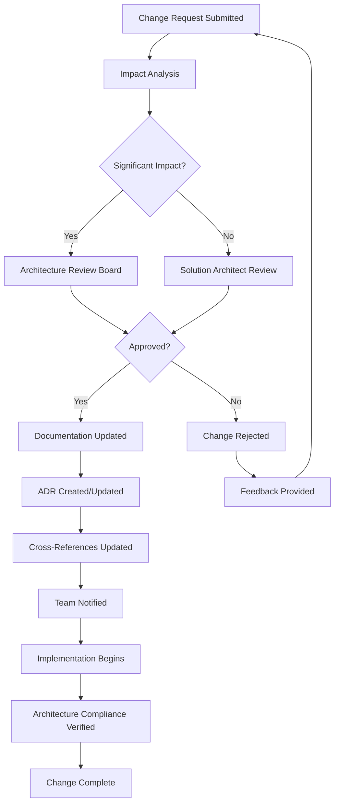
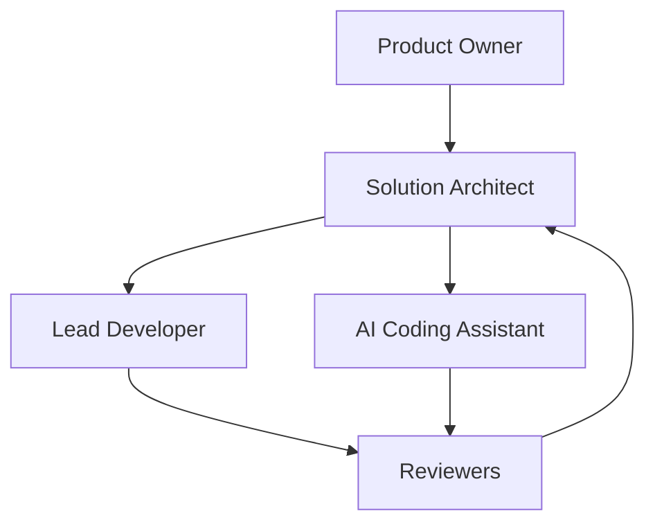
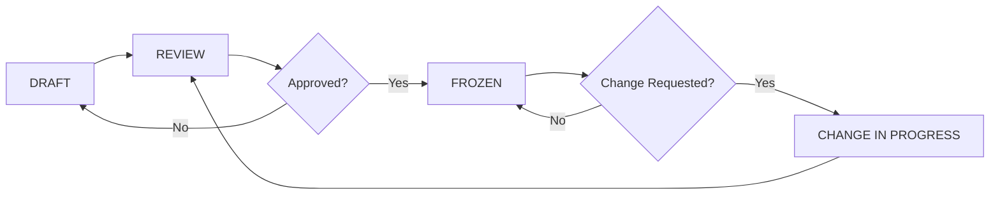

# OpenSchool ERP

## Architecture Freeze Document

---

| Field | Value |
|-------|-------|
| **Document** | Architecture Freeze — Version 1 Baseline |
| **Version** | 1.0 |
| **Status** | Approved |
| **Date** | July 2026 |
| **Classification** | Internal |
| **Author** | Architecture Team |
| **Owner** | Solution Architect |

---

| Aspect | Detail |
|--------|--------|
| **Freeze Scope** | Complete Version 1 Architecture Baseline |
| **Governing Documents** | Engineering Specifications, Platform Standards, System Architecture, Database Architecture, Implementation Roadmap |
| **Effective Date** | July 2026 |
| **Review Cycle** | Quarterly |

---

## Table of Contents

1. Executive Summary
2. Architecture Baseline
3. Frozen Architectural Decisions
4. Change Control Process
5. Architecture Governance
6. Documentation Governance
7. Architecture Compliance
8. Architecture Review Process
9. Approved Extension Process
10. Architecture Drift Prevention
11. Risk Management
12. Architecture Decision Records
13. Architecture Freeze Checklist
14. Future Roadmap
15. Revision History

---

## 1. Executive Summary

### 1.1 Purpose

This document formally establishes the Version 1 Architecture Baseline for OpenSchool ERP.

The architecture freeze ensures that all approved architectural decisions, platform standards, and implementation guidelines are treated as stable commitments throughout the development lifecycle.

This document serves as the governance record that prevents uncontrolled architectural drift, establishes change control processes, and defines the rules for future architectural evolution.

### 1.2 What Is Frozen

The following are now frozen and must not be modified without formal architectural change approval:

| Category | Scope |
|----------|-------|
| **Architecture Documents** | System Architecture, Database Architecture, Implementation Roadmap |
| **Platform Standards** | Engineering Standards, Cross-Domain Integration, Event Catalogue, API Style Guide, Development Standards, DevOps Standards |
| **Engineering Specifications** | All 10 domain specifications (v1.2, approved and frozen) |
| **Architectural Decisions** | All ADRs defined in Architecture and Platform Standards documents |
| **Technology Stack** | NestJS, Next.js, Flutter, PostgreSQL, Prisma, Redis, BullMQ, Docker, S3, GitHub Actions |
| **Domain Model** | All 10 V1 domains, cross-domain events, API contracts |
| **Integration Patterns** | Event-driven communication, API-first design, multi-tenant isolation |

### 1.3 Benefits of Architecture Freeze

| Benefit | Description |
|---------|-------------|
| **Stability** | Implementation proceeds against a fixed target |
| **Predictability** | Dependencies and timelines are reliable |
| **Consistency** | All modules follow identical patterns |
| **Controlled Evolution** | Changes follow formal governance |
| **Reduced Technical Debt** | No undocumented shortcuts or workarounds |
| **Team Alignment** | All developers work from the same architectural vision |

### 1.4 How to Read This Document

| If you are... | Read sections... |
|---------------|-----------------|
| **A developer** | 1, 2, 3, 7, 13 |
| **A reviewer** | 1, 2, 7, 8, 13 |
| **The architect** | 1-14 (entire document) |
| **The product owner** | 1, 2, 5, 9, 14 |
| **The AI assistant** | 1, 2, 3, 7, 13 |

---

## 2. Architecture Baseline

### 2.1 Baseline Definition

The Version 1 Architecture Baseline consists of all documents, decisions, and standards approved during the architecture phase of OpenSchool ERP.

This baseline is the single authoritative reference for all implementation work.

### 2.2 Baseline Documents

#### 2.2.1 Engineering Specifications

| Document | Version | Status | Location |
|----------|---------|--------|----------|
| Identity & Access Management | v1.2 | Approved & Frozen | `engineering/specs/01 IAM.md` |
| Institution Management | v1.2 | Approved & Frozen | `engineering/specs/02 Institution.md` |
| People Management | v1.2 | Approved & Frozen | `engineering/specs/03 People.md` |
| Academic Management | v1.2 | Approved & Frozen | `engineering/specs/04 Academic.md` |
| Finance Management | v1.2 | Approved & Frozen | `engineering/specs/05 Finance.md` |
| Communication Management | v1.2 | Approved & Frozen | `engineering/specs/06 Communication.md` |
| Operations Management | v1.2 | Approved & Frozen | `engineering/specs/07 Operations.md` |
| Documents & Learning | v1.2 | Approved & Frozen | `engineering/specs/08 Documents.md` |
| Reporting & Analytics | v1.2 | Approved & Frozen | `engineering/specs/09 Reporting.md` |
| Platform Administration | v1.2 | Approved & Frozen | `engineering/specs/10 Platform Admin.md` |

#### 2.2.2 Platform Standards

| Document | Version | Status | Location |
|----------|---------|--------|----------|
| Engineering Standards | 1.0 | Approved | `engineering/platform standards/01 Engineering Standards.md` |
| Cross-Domain Integration Specification | 1.0 | Approved | `engineering/platform standards/02 Cross-Domain Integration Specification.md` |
| Platform Event Catalogue | 1.0 | Approved | `engineering/platform standards/03 Platform Event Catalogue.md` |
| API Style Guide | 1.0 | Approved | `engineering/platform standards/04 API Style Guide.md` |
| Development Standards | 1.0 | Approved | `engineering/platform standards/05 Development Standards.md` |
| DevOps & Deployment Standards | 1.0 | Approved | `engineering/platform standards/06 DevOps & Deployment Standards.md` |
| Platform Standards — Consolidated | 1.0 | Approved | `engineering/platform standards/PLATFORM STANDARDS - Consolidated.md` |

#### 2.2.3 Architecture Documents

| Document | Version | Status | Location |
|----------|---------|--------|----------|
| System Architecture | 1.1 | Approved | `engineering/architecture/01 System Architecture.md` |
| Database Architecture | 1.0 | Approved | `engineering/architecture/02 Database Architecture.md` |
| Implementation Roadmap | 1.1 | Approved | `engineering/architecture/03 Implementation Roadmap.md` |
| Architecture Freeze | 1.0 | Approved | `engineering/architecture/04 Architecture Freeze.md` |

### 2.3 Baseline Integrity

| Requirement | Verification |
|-------------|-------------|
| All documents cross-reference correctly | Document audit |
| No conflicting statements between documents | Conflict review |
| Version numbers are consistent | Version audit |
| All ADRs are documented | ADR inventory |
| All domain events are catalogued | Event audit |
| All API endpoints are defined | API audit |

---

## 3. Frozen Architectural Decisions

### 3.1 Architecture Style

| Decision | Status | Reference |
|----------|--------|-----------|
| Modular Monolith | Frozen | System Architecture §1.1 |
| Domain-Driven Design | Frozen | System Architecture §1.2 |
| API-First Design | Frozen | System Architecture §1.3 |
| Event-Driven Automation | Frozen | System Architecture §1.4 |

### 3.2 Technology Stack

| Layer | Technology | Status | Reference |
|-------|-----------|--------|-----------|
| Backend | NestJS | Frozen | System Architecture §1.5 |
| Frontend Web | Next.js + TypeScript + Tailwind + shadcn/ui | Frozen | System Architecture §1.5 |
| Frontend Mobile | Flutter | Frozen | System Architecture §1.5 |
| Database | PostgreSQL | Frozen | Database Architecture §1 |
| ORM | Prisma | Frozen | Database Architecture §1 |
| Caching | Redis | Frozen | System Architecture §1.5 |
| Queue | BullMQ | Frozen | System Architecture §1.5 |
| Object Storage | S3-compatible | Frozen | System Architecture §1.5 |
| CI/CD | GitHub Actions | Frozen | System Architecture §1.5 |
| Containerization | Docker | Frozen | System Architecture §1.5 |

### 3.3 Data Architecture

| Decision | Status | Reference |
|----------|--------|-----------|
| Shared database schema per tenant | Frozen | Database Architecture §4 |
| Row-level tenant isolation | Frozen | Database Architecture §4 |
| Tenant ID on all domain tables | Frozen | Database Architecture §4 |
| UUID primary keys | Frozen | Database Architecture §3 |
| Prisma migration-based schema management | Frozen | Database Architecture §9 |
| Soft deletes with deletedAt timestamp | Frozen | Database Architecture §3 |

### 3.4 Integration Architecture

| Decision | Status | Reference |
|----------|--------|-----------|
| EventEmitter2 in-process events | Frozen | System Architecture §1.4 |
| REST APIs for synchronous communication | Frozen | System Architecture §1.3 |
| Event envelope standardization | Frozen | System Architecture §1.4 |
| ~99 cross-domain events across 10 domains | Frozen | Platform Event Catalogue |
| ~52 events consumed by Communication domain | Frozen | Platform Event Catalogue |
| Idempotent event consumers | Frozen | Cross-Domain Integration §3 |
| Future migration to BullMQ/Redis anticipated | Frozen | System Architecture §1.4 |

### 3.5 Security Architecture

| Decision | Status | Reference |
|----------|--------|-----------|
| JWT authentication (access + refresh tokens) | Frozen | System Architecture §1.6 |
| RBAC permission model | Frozen | System Architecture §1.6 |
| Role hierarchy (Platform > Institution > Department) | Frozen | System Architecture §1.6 |
| Permission guards on all endpoints | Frozen | System Architecture §1.6 |
| Tenant isolation on all queries | Frozen | System Architecture §1.6 |
| Bcrypt password hashing | Frozen | System Architecture §1.6 |
| Rate limiting | Frozen | System Architecture §1.6 |

### 3.6 Domain Model

| Decision | Status | Reference |
|----------|--------|-----------|
| 10 V1 domains | Frozen | Implementation Roadmap §6 |
| Domain boundaries | Frozen | System Architecture §2 |
| Cross-domain event contracts | Frozen | Platform Event Catalogue |
| API contracts per domain | Frozen | API Style Guide |
| Module dependency rules | Frozen | System Architecture §17 |

### 3.7 Cannot Change Without Formal Approval

The following are explicitly frozen and require formal architectural change approval to modify:

| Item | Frozen | Reference |
|------|--------|-----------|
| Number of V1 domains | Yes | Implementation Roadmap §6 |
| Domain boundaries | Yes | System Architecture §2 |
| Event contracts | Yes | Platform Event Catalogue |
| API contracts | Yes | API Style Guide |
| Database schema design | Yes | Database Architecture §3 |
| Tenant isolation strategy | Yes | Database Architecture §4 |
| Authentication mechanism | Yes | System Architecture §1.6 |
| Permission model | Yes | System Architecture §1.6 |
| Technology stack | Yes | System Architecture §1.5 |
| Deployment architecture | Yes | System Architecture §21 |

---

## 4. Change Control Process

### 4.1 Overview

All architectural changes must follow a formal change control process. No architectural change may be implemented without approval through this process.

### 4.2 Change Control Workflow

### 4.3 Change Request Template

| Field | Description |
|-------|-------------|
| **Request ID** | Unique identifier (e.g., ACR-001) |
| **Title** | Short description of the change |
| **Requestor** | Who is requesting the change |
| **Date** | Date of request |
| **Priority** | Critical / High / Medium / Low |
| **Category** | Architecture / Standards / Schema / Events / API |
| **Description** | Detailed description of the proposed change |
| **Justification** | Why this change is necessary |
| **Impact Analysis** | Affected domains, documents, and modules |
| **Risk Assessment** | Risks of making the change |
| **Risk Assessment** | Risks of NOT making the change |
| **Proposed Solution** | How the change should be implemented |
| **Alternatives Considered** | Other approaches evaluated |

### 4.4 Change Categories

| Category | Description | Approval Required |
|----------|-------------|------------------|
| **Trivial** | Typo fixes, formatting, documentation clarifications | None (self-approved) |
| **Minor** | Implementation detail changes that don't affect architecture | Solution Architect |
| **Moderate** | API contract changes, new event definitions | Solution Architect + Lead Developer |
| **Major** | Schema changes, domain boundary changes, technology changes | Architecture Review Board |
| **Critical** | Security architecture, tenant isolation, authentication changes | Full team review + Product Owner |

### 4.5 Impact Analysis Requirements

| Change Category | Analysis Required |
|----------------|------------------|
| Trivial | None |
| Minor | Affected modules listed |
| Moderate | Affected modules + dependent modules + documentation list |
| Major | Full cross-domain impact + migration plan + rollback plan |
| Critical | Complete system impact + security review + performance review |

### 4.6 Approval Authority

| Change Category | Approver(s) |
|----------------|------------|
| Trivial | Requestor (self-approval) |
| Minor | Solution Architect |
| Moderate | Solution Architect + Lead Developer |
| Major | Architecture Review Board (Solution Architect + Lead Developer + Product Owner) |
| Critical | Architecture Review Board + Product Owner + Security Review |

---

## 5. Architecture Governance

### 5.1 Governance Structure

### 5.2 Roles and Responsibilities

#### 5.2.1 Product Owner

| Responsibility | Description |
|---------------|-------------|
| Business alignment | Ensures architecture supports business requirements |
| Priority setting | Determines priority of architectural changes |
| Change approval | Approves major and critical architectural changes |
| Scope management | Manages scope of V1 implementation |
| Stakeholder communication | Communicates architectural decisions to stakeholders |

#### 5.2.2 Solution Architect

| Responsibility | Description |
|---------------|-------------|
| Architecture ownership | Owns the architectural vision and integrity |
| Change evaluation | Evaluates all architectural change requests |
| Technical leadership | Guides technical decisions across all modules |
| Documentation oversight | Ensures documentation remains accurate and complete |
| Compliance verification | Verifies implementation matches architecture |
| Risk identification | Identifies architectural risks and mitigations |

#### 5.2.3 Lead Developer

| Responsibility | Description |
|---------------|-------------|
| Implementation oversight | Ensures implementation follows architecture |
| Code review | Reviews code for architectural compliance |
| Integration management | Manages cross-domain integration points |
| Quality assurance | Ensures quality standards are met |
| Team guidance | Guides developers on architectural patterns |

#### 5.2.4 AI Coding Assistant (OpenCode)

| Responsibility | Description |
|---------------|-------------|
| Code generation | Generates code that follows approved architecture |
| Documentation maintenance | Updates documentation when changes are approved |
| Test generation | Generates tests that verify architectural compliance |
| Lint and type checking | Verifies code passes quality gates |
| Pattern adherence | Follows established patterns exactly |

#### 5.2.5 Reviewers

| Responsibility | Description |
|---------------|-------------|
| Code review | Reviews code for architectural compliance |
| Documentation review | Reviews documentation for accuracy |
| Integration review | Reviews cross-domain integration |
| Security review | Reviews security implications |

### 5.3 Decision-Making Framework

| Decision Type | Who Decides | Consultation Required |
|--------------|------------|---------------------|
| Implementation detail | Developer | None |
| Module architecture | Solution Architect | Lead Developer |
| Cross-domain architecture | Solution Architect + Lead Developer | Product Owner (for business impact) |
| Platform standards | Solution Architect | Lead Developer + Reviewers |
| Technology changes | Architecture Review Board | Product Owner + Security |
| Domain model changes | Architecture Review Board | Product Owner + All affected module owners |

---

## 6. Documentation Governance

### 6.1 Documentation Lifecycle

### 6.2 Document Status Definitions

| Status | Definition | Modification Allowed |
|--------|-----------|---------------------|
| **DRAFT** | Document is being written or revised | Yes, by author |
| **REVIEW** | Document is under review | Yes, based on review feedback |
| **FROZEN** | Document is approved and baseline | Only via formal change request |
| **SUPERSEDED** | Document has been replaced | No |

### 6.3 Version Numbering

| Format | Example | Usage |
|--------|---------|-------|
| `Major.Minor` | `1.0` | Standard versioning for architecture documents |
| `Major.Minor.Patch` | `1.0.1` | Hotfix or critical correction |

| Version Change | When to Use |
|---------------|-------------|
| **Major** (1.0 → 2.0) | Significant restructuring or scope change |
| **Minor** (1.0 → 1.1) | New sections, clarifications, non-breaking additions |
| **Patch** (1.0.0 → 1.0.1) | Typo fixes, formatting corrections |

### 6.4 Documentation Standards

| Standard | Requirement |
|----------|-------------|
| **Naming convention** | `## Section Name` for all major sections |
| **Cross-references** | Use `§section number` format for internal references |
| **Document references** | Use full document name and version |
| **Diagrams** | Use Mermaid syntax for all diagrams |
| **Tables** | Use Markdown tables for structured data |
| **Code blocks** | Use fenced code blocks with language identifiers |

### 6.5 Cross-Reference Management

| Rule | Description |
|------|-------------|
| Forward references | Allowed (referencing sections that come later) |
| Backward references | Allowed (referencing sections that come earlier) |
| External references | Must reference specific document, version, and section |
| Broken references | Must be fixed before document status changes to FROZEN |
| Reference updates | All cross-references must be updated when sections are renumbered |

### 6.6 Documentation Update Rules

| Trigger | Action Required |
|---------|----------------|
| Architecture change approved | Update all affected documents |
| New ADR created | Update ADR table in all relevant documents |
| Section renumbering | Update all cross-references |
| New domain event | Update Platform Event Catalogue |
| API contract change | Update API Style Guide |
| Schema change | Update Database Architecture |
| New module added | Update Implementation Roadmap |

### 6.7 Documentation Review Checklist

| # | Check |
|---|-------|
| 1 | Document follows naming and formatting standards |
| 2 | All cross-references are valid |
| 3 | Version number is correct |
| 4 | Status is accurate |
| 5 | Revision history is updated |
| 6 | Tables of contents are accurate |
| 7 | Diagrams render correctly |
| 8 | Code examples are syntactically correct |
| 9 | No conflicting statements with other documents |
| 10 | ADR references are current |

---

## 7. Architecture Compliance

### 7.1 Compliance Requirements

| Document | Compliance Level | Verification Method |
|----------|-----------------|-------------------|
| Engineering Specifications | Mandatory | Code review; integration tests |
| Platform Standards | Mandatory | Linting; code review |
| System Architecture | Mandatory | Architecture review |
| Database Architecture | Mandatory | Schema review; migration review |
| API Style Guide | Mandatory | Swagger validation; code review |
| Platform Event Catalogue | Mandatory | Event audit |
| Architecture Decision Records | Mandatory | ADR review |

### 7.2 Compliance Verification Methods

| Method | Frequency | Scope |
|--------|-----------|-------|
| **Code review** | Every PR | Architectural patterns, naming, structure |
| **Automated linting** | Every commit | Code style, formatting, conventions |
| **Automated testing** | Every PR | Unit tests, integration tests |
| **Architecture review** | At milestones | Module design, cross-domain integration |
| **Documentation audit** | Monthly | Documentation currency, accuracy |
| **ADR review** | Monthly | Decision currency, relevance |

### 7.3 Compliance Traceability

| Principle | Description |
|-----------|-------------|
| **Specification to code** | Every implementation must trace to an approved specification |
| **Code to specification** | Every code module must have a corresponding specification |
| **Event to catalogue** | Every event must be defined in the Platform Event Catalogue |
| **API to style guide** | Every API endpoint must follow the API Style Guide |
| **Schema to database architecture** | Every schema change must be approved in the Database Architecture |

### 7.4 Non-Compliance Handling

| Severity | Response |
|----------|---------|
| **Critical** | Stop work; resolve before proceeding |
| **High** | Resolve within current sprint |
| **Medium** | Resolve within next sprint |
| **Low** | Add to backlog; resolve when convenient |

### 7.5 Compliance Exceptions

| Exception Type | Approval Required |
|---------------|------------------|
| Temporary workaround | Solution Architect + documented ADR |
| Permanent exception | Architecture Review Board + documented ADR |
| Emergency bypass | Solution Architect + post-incident review |

---

## 8. Architecture Review Process

### 8.1 Review Checkpoints

| Checkpoint | When | Scope | Reviewers |
|-----------|------|-------|----------|
| **Feature Review** | Before implementation starts | Module design against specifications | Solution Architect |
| **Module Review** | After module completion | Full module against architecture | Solution Architect + Lead Developer |
| **Integration Review** | At integration milestones | Cross-domain integration | Architecture Review Board |
| **Pre-Release Review** | Before release | Complete system | Full team |
| **Production Readiness Review** | Before production deployment | Security, performance, scalability | Solution Architect + Lead Developer + Security |

### 8.2 Feature Review Checklist

| # | Check |
|---|-------|
| 1 | Implementation matches approved specification |
| 2 | API endpoints follow API Style Guide |
| 3 | Database schema follows Database Architecture |
| 4 | Events follow Platform Event Catalogue |
| 5 | Permission guards are properly implemented |
| 6 | Tenant isolation is properly implemented |
| 7 | Unit tests cover > 80% of code |
| 8 | Integration tests cover all API endpoints |
| 9 | Documentation is updated |
| 10 | No architectural shortcuts taken |

### 8.3 Module Review Checklist

| # | Check |
|---|-------|
| 1 | All feature review items satisfied |
| 2 | Module follows approved module structure |
| 3 | Cross-domain events are properly produced and consumed |
| 4 | API documentation is complete and accurate |
| 5 | Database migrations are clean and reversible |
| 6 | Error handling follows approved patterns |
| 7 | Logging follows approved standards |
| 8 | Performance meets approved targets |
| 9 | Security review passed |
| 10 | All ADRs relevant to module are followed |

### 8.4 Integration Review Checklist

| # | Check |
|---|-------|
| 1 | API contracts match between producer and consumer |
| 2 | Event contracts match between producer and consumer |
| 3 | Error handling is consistent across domains |
| 4 | Tenant isolation is maintained across domains |
| 5 | Permission model is consistent across domains |
| 6 | End-to-end workflows function correctly |
| 7 | Performance is acceptable under load |
| 8 | No cross-domain dependency violations |
| 9 | All integration tests pass |
| 10 | Documentation reflects actual integration |

### 8.5 Pre-Release Review Checklist

| # | Check |
|---|-------|
| 1 | All module reviews completed |
| 2 | All integration reviews completed |
| 3 | All critical and high severity bugs resolved |
| 4 | Performance benchmarks met |
| 5 | Security scan completed with no critical findings |
| 6 | Documentation is complete and accurate |
| 7 | All ADRs are current |
| 8 | Rollback plan is tested |
| 9 | Monitoring and alerting configured |
| 10 | Deployment runbook is complete |

### 8.6 Production Readiness Review Checklist

| # | Check |
|---|-------|
| 1 | All pre-release review items satisfied |
| 2 | Load testing completed |
| 3 | Disaster recovery plan tested |
| 4 | Backup and restore tested |
| 5 | Security audit completed |
| 6 | Compliance requirements verified |
| 7 | Support runbook is complete |
| 8 | escalation procedures are defined |
| 9 | Monitoring dashboards are configured |
| 10 | Alert thresholds are set |

---

## 9. Approved Extension Process

### 9.1 Extension Principles

| Principle | Description |
|-----------|-------------|
| **Non-breaking** | Extensions must not modify existing V1 behavior |
| **Additive** | Extensions add new capabilities without changing existing ones |
| **Isolated** | Extensions are implemented as new modules or new domains |
| **Backward compatible** | V1 API contracts must continue to work unchanged |
| **Optional** | Extensions are opt-in; existing users are not affected |

### 9.2 Extension Categories

| Category | Description | Approach |
|----------|-------------|----------|
| **New Module** | New functionality within V1 domains | Add to existing module |
| **New Domain** | Entirely new business capability | New module with new domain events |
| **New Integration** | Third-party service integration | New adapter within existing module |
| **New Channel** | New communication channel (e.g., WhatsApp) | Extend Communication domain |
| **New Frontend** | New client application (e.g., mobile app) | New project consuming existing APIs |

### 9.3 Extension Approval Process

| Step | Action |
|------|--------|
| 1 | Document the proposed extension |
| 2 | Assess impact on V1 architecture |
| 3 | Determine if extension is additive or modifying |
| 4 | If modifying: require formal change request |
| 5 | If additive: proceed with Solution Architect approval |
| 6 | Create ADR for extension decision |
| 7 | Update documentation as needed |

### 9.4 Future Capabilities

| Capability | Priority | Dependencies | Status |
|-----------|----------|-------------|--------|
| Smart Campus (IoT) | Medium | Operations V1 | Planned |
| AI Services | High | All V1 domains | Planned |
| Enterprise Features | High | All V1 domains | Planned |
| Third-party Marketplace | Low | Platform Admin V1 | Planned |
| Multi-region Deployment | Medium | All V1 domains | Planned |
| Advanced Analytics | High | Reporting V1 | Planned |
| Mobile App Framework | High | All V1 domains | Planned |
| HR Management | Medium | People V1 | Planned |
| Alumni Management | Low | People V1 | Planned |

### 9.5 Extension Documentation Requirements

| Requirement | Description |
|-------------|-------------|
| ADR | New ADR for each extension decision |
| Specification | New engineering specification or addendum |
| Architecture impact | Impact analysis on existing architecture |
| Integration plan | How extension integrates with V1 |
| Migration plan | How existing users adopt extension (if applicable) |

---

## 10. Architecture Drift Prevention

### 10.1 Drift Definition

Architecture drift occurs when the actual implementation diverges from the approved architecture without formal change approval.

### 10.2 Drift Detection Methods

| Method | Frequency | Scope |
|--------|-----------|-------|
| **Periodic architecture review** | Monthly | Full architecture |
| **Documentation audit** | Monthly | All architecture documents |
| **ADR relevance check** | Monthly | All ADRs |
| **Dependency review** | Bi-weekly | Module dependencies |
| **Automated compliance checks** | Every PR | Code-level compliance |
| **Cross-reference verification** | Monthly | All document cross-references |

### 10.3 Drift Prevention Practices

| Practice | Description |
|----------|-------------|
| **Regular reviews** | Monthly architecture reviews catch drift early |
| **Automated checks** | Linting and type checking prevent code-level drift |
| **Documentation updates** | Keep documentation current with implementation |
| **ADR maintenance** | Keep ADRs current with architectural decisions |
| **Code review** | Review all code for architectural compliance |
| **Integration testing** | Test cross-domain integration regularly |

### 10.4 Drift Response Process

| Step | Action |
|------|--------|
| 1 | Identify drift (review, audit, or automated check) |
| 2 | Assess severity (trivial, minor, moderate, major) |
| 3 | Determine if drift is acceptable or requires correction |
| 4 | If acceptable: document as ADR (retrospective decision) |
| 5 | If unacceptable: create change request to correct |
| 6 | Implement correction |
| 7 | Verify correction matches approved architecture |

### 10.5 Documentation Currency Rules

| Rule | Description |
|------|-------------|
| **Implementation first** | Documentation updates after implementation (for approved changes) |
| **Architecture first** | Architecture review before implementation (for new features) |
| **Same sprint** | Documentation must be updated in the same sprint as implementation |
| **No orphan docs** | Every document must reference at least one other document |
| **No dead references** | Every cross-reference must point to existing content |

---

## 11. Risk Management

### 11.1 Governance Risks

| # | Risk | Probability | Impact | Mitigation |
|---|------|-------------|--------|-----------|
| GR1 | Unapproved design changes implemented | Medium | High | Code review; architecture review |
| GR2 | Documentation becomes outdated | High | Medium | Monthly documentation audits |
| GR3 | Technical debt accumulates | Medium | High | Regular refactoring sprints |
| GR4 | Inconsistent implementation across modules | Medium | Medium | Pattern enforcement; shared code reviews |
| GR5 | Dependency violations between modules | Low | High | Automated dependency checking |
| GR6 | ADRs become stale or irrelevant | Medium | Medium | Monthly ADR review |
| GR7 | Cross-reference links break | High | Low | Automated link checking |
| GR8 | Version numbers become inconsistent | Medium | Low | Version audit during reviews |

### 11.2 Risk Response Strategies

| Strategy | Description |
|----------|-------------|
| **Prevention** | Practices that prevent the risk from occurring |
| **Detection** | Methods to detect the risk early |
| **Correction** | Actions to correct the impact of the risk |
| **Acceptance** | Acknowledging the risk and its potential impact |

### 11.3 Risk Response by Category

| Risk | Prevention | Detection | Correction |
|------|-----------|-----------|-----------|
| GR1 | Code review; architecture review | Automated compliance checks | Revert change; create change request |
| GR2 | Monthly documentation audits | Documentation currency tracking | Update documentation |
| GR3 | Regular refactoring sprints | Technical debt tracking | Dedicate sprint to debt reduction |
| GR4 | Pattern enforcement | Cross-module code review | Align implementation to patterns |
| GR5 | Dependency rules | Automated dependency checking | Refactor to remove violation |
| GR6 | Monthly ADR review | ADR relevance assessment | Update or archive ADR |
| GR7 | Automated link checking | Link validation scripts | Fix broken links |
| GR8 | Version audit | Version consistency checks | Update version numbers |

---

## 12. Architecture Decision Records

### 12.1 ADR Inventory

| ADR | Title | Status | Date |
|-----|-------|--------|------|
| ADR-01 | Architecture Freeze Policy | Accepted | July 2026 |
| ADR-02 | Documentation Governance | Accepted | July 2026 |
| ADR-03 | Change Approval Workflow | Accepted | July 2026 |
| ADR-04 | Version 1 Baseline Definition | Accepted | July 2026 |

### 12.2 ADR-01: Architecture Freeze Policy

| Field | Detail |
|-------|--------|
| **Status** | Accepted |
| **Date** | July 2026 |
| **Context** | The Version 1 architecture has been approved and all documents are finalized |
| **Decision** | The Version 1 Architecture Baseline is frozen and must not be modified without formal change approval |
| **Rationale** | Freezing the architecture ensures stability, predictability, and consistency during implementation |
| **Consequences** | All implementation must follow approved architecture; changes require formal process |
| **Compliance** | Monthly architecture reviews; automated compliance checks; code review |

### 12.3 ADR-02: Documentation Governance

| Field | Detail |
|-------|--------|
| **Status** | Accepted |
| **Date** | July 2026 |
| **Context** | Architecture documentation must remain accurate and consistent throughout implementation |
| **Decision** | Documentation follows formal lifecycle (DRAFT → REVIEW → FROZEN); version numbering follows Major.Minor format |
| **Rationale** | Formal governance prevents documentation drift and ensures accuracy |
| **Consequences** | All documentation changes must follow governance process; cross-references must be maintained |
| **Compliance** | Monthly documentation audits; cross-reference verification; version consistency checks |

### 12.4 ADR-03: Change Approval Workflow

| Field | Detail |
|-------|--------|
| **Status** | Accepted |
| **Date** | July 2026 |
| **Context** | Architectural changes must be controlled to prevent drift |
| **Decision** | All architectural changes follow formal change control process with impact analysis and approval |
| **Rationale** | Formal change control prevents uncontrolled architectural evolution |
| **Consequences** | All changes require documentation; approval authority depends on change category |
| **Compliance** | Change request tracking; approval audit trail; documentation updates |

### 12.5 ADR-04: Version 1 Baseline Definition

| Field | Detail |
|-------|--------|
| **Status** | Accepted |
| **Date** | July 2026 |
| **Context** | The Version 1 architecture consists of multiple approved documents |
| **Decision** | The Version 1 Baseline includes all Engineering Specifications, Platform Standards, System Architecture, Database Architecture, and Implementation Roadmap at their approved versions |
| **Rationale** | Clear baseline definition ensures everyone works from the same reference |
| **Consequences** | All implementation must trace to baseline documents; new documents require approval |
| **Compliance** | Baseline integrity verification; document version audit; cross-reference validation |

---

## 13. Architecture Freeze Checklist

### 13.1 Pre-Freeze Verification

| # | Check | Status |
|---|-------|--------|
| 1 | All Engineering Specifications approved and frozen | ✓ |
| 2 | All Platform Standards documents written and approved | ✓ |
| 3 | System Architecture document written and approved | ✓ |
| 4 | Database Architecture document written and approved | ✓ |
| 5 | Implementation Roadmap written and approved | ✓ |
| 6 | All cross-references between documents are valid | ✓ |
| 7 | All ADRs are documented and approved | ✓ |
| 8 | All version numbers are consistent | ✓ |
| 9 | No conflicting statements between documents | ✓ |
| 10 | All domain events are catalogued | ✓ |
| 11 | All API endpoints are defined | ✓ |
| 12 | All module dependencies are documented | ✓ |

### 13.2 Freeze Confirmation

| # | Confirmation |
|---|-------------|
| 1 | The Architecture Baseline is established |
| 2 | All documents are in FROZEN status |
| 3 | Change control process is active |
| 4 | Governance structure is defined |
| 5 | Compliance requirements are documented |
| 6 | Review process is defined |
| 7 | Drift prevention practices are in place |
| 8 | Risk management is documented |
| 9 | Team has been notified of freeze |
| 10 | Implementation may begin against frozen baseline |

### 13.3 Post-Freeze Actions

| # | Action |
|---|--------|
| 1 | Notify all team members of architecture freeze |
| 2 | Begin implementation against frozen baseline |
| 3 | Schedule first monthly architecture review |
| 4 | Schedule first monthly documentation audit |
| 5 | Establish change request tracking |
| 6 | Configure automated compliance checks |

---

## 14. Future Roadmap

### 14.1 Version 2 Architecture Planning

| Phase | Timing | Scope |
|-------|--------|-------|
| **V1 Implementation** | July 2026 – December 2026 | All 10 V1 domains |
| **V1 Stabilization** | January 2027 – February 2027 | Bug fixes, performance optimization |
| **V2 Architecture Planning** | March 2027 – April 2027 | Architecture evolution planning |
| **V2 Implementation** | May 2027 – December 2027 | V2 domains and features |

### 14.2 Architecture Evolution Candidates

| Candidate | Priority | Dependencies | Status |
|----------|----------|-------------|--------|
| Smart Campus (IoT Integration) | Medium | Operations V1 | Planned |
| AI Services (Predictive Analytics) | High | All V1 domains | Planned |
| Enterprise Features (Multi-tenant Management) | High | Platform Admin V1 | Planned |
| Third-party Marketplace | Low | Platform Admin V1 | Planned |
| Multi-region Deployment | Medium | All V1 domains | Planned |
| Microservices Migration | Low | All V1 domains | Planned |
| Advanced Learning Management | High | Academic V1, Documents V1 | Planned |

### 14.3 Architecture Evolution Principles

| Principle | Description |
|-----------|-------------|
| **V1 stability first** | V1 architecture must be stable before V2 planning begins |
| **Additive evolution** | V2 should extend V1, not replace it |
| **Backward compatibility** | V2 must maintain backward compatibility with V1 |
| **Gradual migration** | V2 features can be adopted incrementally |
| **Documented decisions** | All V2 decisions must follow the same governance as V1 |

### 14.4 Version 2 Readiness Criteria

| Criterion | Requirement |
|-----------|------------|
| All V1 domains implemented | 100% completion |
| V1 architecture validated | All integration milestones passed |
| Performance baseline established | All performance targets met |
| Security audit completed | No critical vulnerabilities |
| Documentation updated | All V1 documentation current |
| Team capacity available | Development team ready for V2 |

---

## 15. Revision History

| Version | Date | Author | Changes |
|---------|------|--------|---------|
| 1.0 | July 2026 | Architecture Team | Initial architecture freeze document |

---

*Document Version: 1.0*  
*Last Updated: July 2026*  
*Status: Approved*  
*Classification: Internal*

---

**END OF DOCUMENT**

