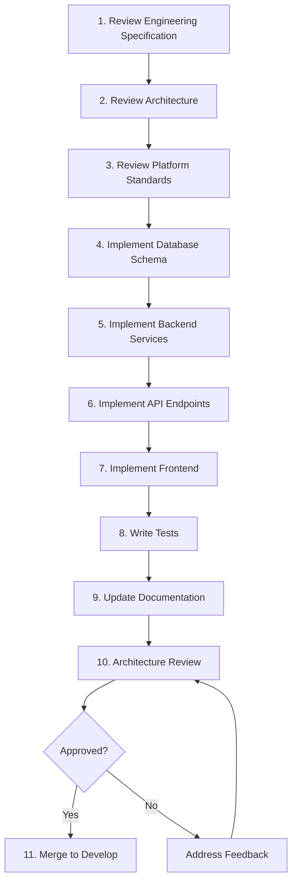
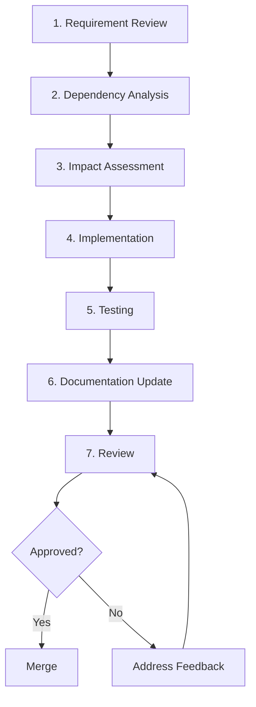
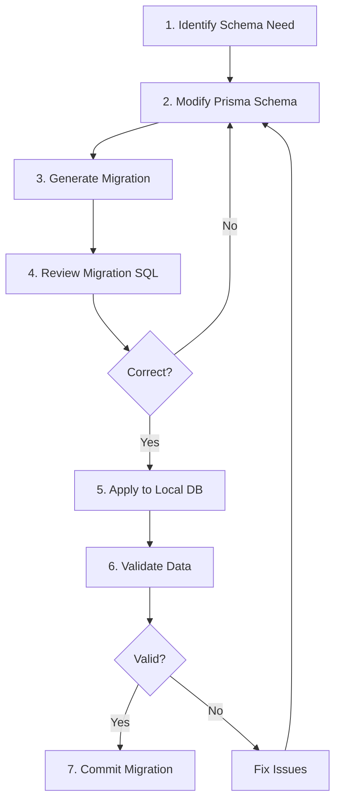
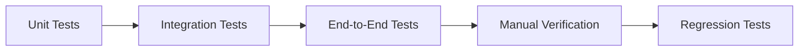
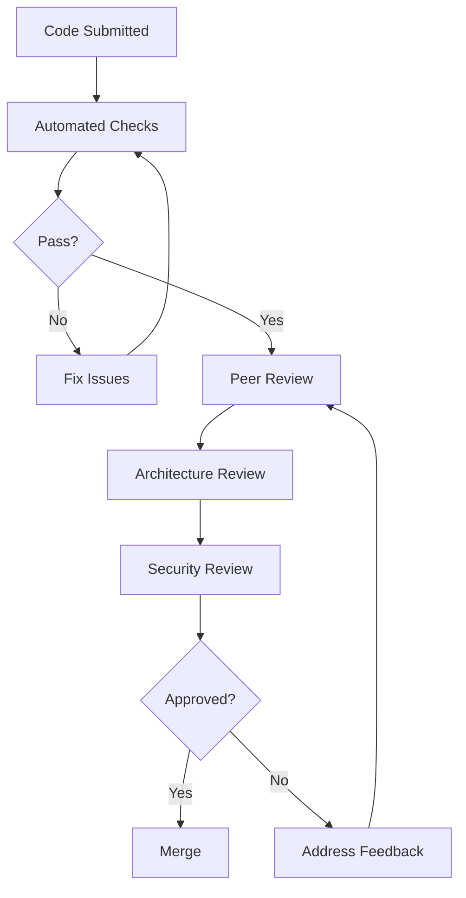
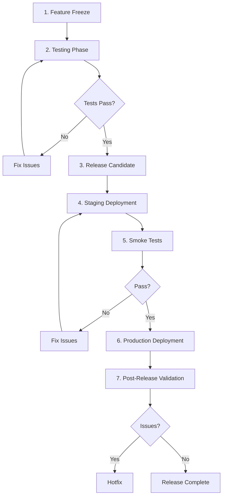
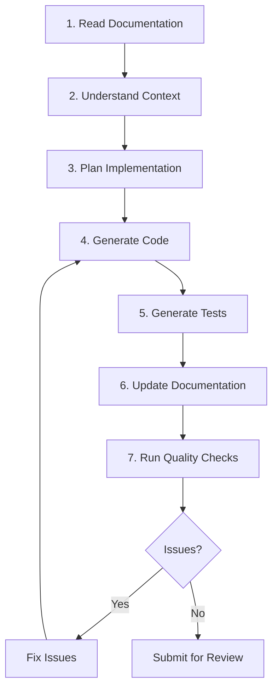

# OpenSchool ERP

## Implementation Playbook

---

| Field | Value |
|-------|-------|
| **Document** | Implementation Playbook — Operational Handbook |
| **Version** | 1.0 |
| **Status** | Approved |
| **Date** | July 2026 |
| **Classification** | Internal |
| **Author** | Architecture Team |
| **Owner** | Solution Architect |

---

| Aspect | Detail |
|--------|--------|
| **Purpose** | Step-by-step implementation workflow for all developers and AI assistants |
| **Scope** | Complete development lifecycle from module setup to production release |
| **Governing Documents** | Engineering Specifications, Platform Standards, System Architecture, Database Architecture, Implementation Roadmap, Architecture Freeze |

---

## Table of Contents

1. Development Philosophy
2. Repository Workflow
3. Module Implementation Workflow
4. Feature Implementation Workflow
5. Database Change Workflow
6. API Development Workflow
7. Domain Event Workflow
8. Frontend Workflow
9. Testing Workflow
10. Documentation Workflow
11. Code Review Workflow
12. Release Workflow
13. AI-Assisted Development Workflow
14. Definition of Done
15. Developer Checklists
16. Common Pitfalls
17. Continuous Improvement

---

## 1. Development Philosophy

### 1.1 Core Principles

| Principle | Description |
|-----------|-------------|
| **Documentation-first** | Read all relevant documentation before writing any code |
| **Architecture-first** | Implementation follows approved architecture; never the reverse |
| **Incremental delivery** | Deliver working software in small, reviewable increments |
| **Continuous testing** | Every code change includes corresponding tests |
| **Continuous documentation** | Documentation updates happen in the same commit as code changes |
| **Small, reviewable changes** | Break work into focused commits that are easy to review |
| **Maintainability over speed** | Clean, maintainable code is more valuable than fast delivery |

### 1.2 Development Values

| Value | Description |
|-------|-------------|
| **Traceability** | Every implementation decision traces to an approved specification |
| **Consistency** | All modules follow identical patterns and conventions |
| **Quality** | Quality is built in, not inspected in later |
| **Transparency** | All work is visible through documentation and code review |
| **Sustainability** | Code is written to be maintained, not just to work |

### 1.3 What This Playbook Is Not

| This Playbook Is | This Playbook Is Not |
|-----------------|---------------------|
| A step-by-step workflow guide | A replacement for engineering specifications |
| An operational handbook | A substitute for architecture documents |
| A daily reference for developers | A design document |
| A guide for AI coding assistants | A specification of business rules |

---

## 2. Repository Workflow

### 2.1 Branch Strategy

```mermaid
gitgraph
    commit id: "init"
    branch develop
    checkout develop
    commit id: "foundation"
    branch feature/iam-users
    checkout feature/iam-users
    commit id: "user model"
    commit id: "user service"
    checkout develop
    merge feature/iam-users
    branch feature/iam-auth
    checkout feature/iam-auth
    commit id: "auth service"
    checkout develop
    merge feature/iam-auth
    checkout main
    merge develop tag: "v0.1.0"
```

### 2.2 Branch Naming Conventions

| Branch Type | Pattern | Example |
|-------------|---------|---------|
| Feature | `feature/<module>/<description>` | `feature/iam-user-management` |
| Bug fix | `bugfix/<module>/<description>` | `bugfix/finance-invoice-calculation` |
| Hotfix | `hotfix/<description>` | `hotfix/auth-token-expiry` |
| Release | `release/<version>` | `release/v0.1.0` |
| Documentation | `docs/<description>` | `docs/api-style-guide-update` |

### 2.3 Commit Conventions

| Type | Description | Example |
|------|-------------|---------|
| `feat` | New feature | `feat(iam): add user registration endpoint` |
| `fix` | Bug fix | `fix(finance): correct invoice calculation` |
| `docs` | Documentation | `docs(api): update swagger for user endpoints` |
| `test` | Tests | `test(people): add student service unit tests` |
| `refactor` | Code refactoring | `refactor(academic): extract grade service` |
| `chore` | Maintenance | `chore: update dependencies` |
| `style` | Code style | `style: fix linting errors` |
| `perf` | Performance | `perf(reports): optimize enrollment query` |
| `ci` | CI/CD | `ci: add integration test workflow` |

### 2.4 Commit Rules

| Rule | Description |
|------|-------------|
| **Atomic commits** | Each commit contains one logical change |
| **Descriptive messages** | Commit messages explain what and why |
| **No secrets** | Never commit secrets, keys, or credentials |
| **No generated files** | Never commit node_modules, .env, or build artifacts |
| **Tests included** | Every feature commit includes corresponding tests |
| **Documentation updated** | Every feature commit includes documentation updates |

### 2.5 Pull Request Process

| Step | Action |
|------|--------|
| 1 | Create PR from feature branch to develop |
| 2 | Fill in PR template (description, changes, testing) |
| 3 | Link related issues or specifications |
| 4 | Request review from module owner |
| 5 | Address review feedback |
| 6 | CI pipeline must pass |
| 7 | Approved by at least one reviewer |
| 8 | Squash merge to develop |

### 2.6 Merge Strategy

| Branch | Target | Strategy | Reason |
|--------|--------|----------|--------|
| feature/* | develop | Squash merge | Clean history |
| develop | main | Merge commit | Preserve branch history |
| hotfix/* | main + develop | Cherry-pick | Minimal changes |
| release/* | main | Merge commit | Preserve release history |

---

## 3. Module Implementation Workflow

### 3.1 Module Implementation Flow



### 3.2 Step 1: Review Engineering Specification

| Action | Description |
|--------|-------------|
| Read specification completely | Understand all business rules and requirements |
| Note data models | Identify entities, relationships, and constraints |
| Note API requirements | Identify endpoints, request/response shapes |
| Note event requirements | Identify events to produce and consume |
| Note integration points | Identify cross-domain dependencies |
| Identify questions | Document any ambiguities or missing information |

### 3.3 Step 2: Review Architecture

| Action | Description |
|--------|-------------|
| Read System Architecture | Understand module placement and dependencies |
| Read Database Architecture | Understand schema patterns and tenant isolation |
| Read Platform Event Catalogue | Understand event contracts |
| Read API Style Guide | Understand API conventions |
| Review existing modules | Understand established patterns |

### 3.4 Step 3: Review Platform Standards

| Action | Description |
|--------|-------------|
| Read Engineering Standards | Understand naming conventions |
| Read Development Standards | Understand code organization |
| Read Cross-Domain Integration | Understand integration patterns |
| Read DevOps Standards | Understand deployment requirements |

### 3.5 Step 4: Implement Database Schema

| Action | Description |
|--------|-------------|
| Define Prisma models | Create models following Database Architecture |
| Add tenant isolation | Ensure tenantId on all domain tables |
| Create migration | Generate Prisma migration file |
| Review migration | Verify schema changes are correct |
| Test migration | Apply to local database and verify |

### 3.6 Step 5: Implement Backend Services

| Action | Description |
|--------|-------------|
| Create module structure | Follow established module pattern |
| Implement entities | Create entity classes following patterns |
| Implement services | Create service classes with business logic |
| Implement repositories | Create repository classes for data access |
| Add dependency injection | Wire up NestJS dependency injection |

### 3.7 Step 6: Implement API Endpoints

| Action | Description |
|--------|-------------|
| Create DTOs | Define request and response DTOs |
| Implement controllers | Create controller with endpoints |
| Add validation | Add class-validator decorators |
| Add permission guards | Add @RequirePermission decorators |
| Add tenant guard | Add @RequireTenant decorator |
| Add Swagger decorators | Document API endpoints |

### 3.8 Step 7: Implement Frontend

| Action | Description |
|--------|-------------|
| Create screens | Build UI screens for the module |
| Build components | Create reusable UI components |
| Connect APIs | Integrate with backend API endpoints |
| Add state management | Implement state management |
| Add error handling | Handle loading, error, and empty states |
| Ensure responsiveness | Test on multiple screen sizes |

### 3.9 Step 8: Write Tests

| Action | Description |
|--------|-------------|
| Write unit tests | Test individual functions and services |
| Write integration tests | Test API endpoints with database |
| Write E2E tests | Test critical user workflows |
| Verify coverage | Ensure > 80% code coverage |
| Run all tests | Ensure all tests pass |

### 3.10 Step 9: Update Documentation

| Action | Description |
|--------|-------------|
| Update API documentation | Ensure Swagger is complete |
| Update event documentation | Update Platform Event Catalogue if events changed |
| Update Architecture module status | Update System Architecture module status |
| Update Implementation Roadmap | Update module progress |
| Create ADR if needed | Document any architectural decisions |

### 3.11 Step 10: Architecture Review

| Action | Description |
|--------|-------------|
| Self-review | Review code against specifications |
| Peer review | Request code review from team |
| Architecture review | Verify compliance with architecture |
| Address feedback | Fix any issues identified |

### 3.12 Step 11: Merge

| Action | Description |
|--------|-------------|
| Resolve conflicts | Resolve any merge conflicts |
| Ensure CI passes | All tests and linting pass |
| Squash merge | Merge to develop branch |
| Delete feature branch | Clean up merged branch |


---

## 4. Feature Implementation Workflow

### 4.1 Feature Lifecycle



### 4.2 Step 1: Requirement Review

| Action | Description |
|--------|-------------|
| Read the requirement | Understand what is being asked |
| Identify the domain | Determine which module(s) are affected |
| Check specifications | Verify requirement is in approved specifications |
| Identify scope | Determine if this is a new feature or modification |
| Flag ambiguities | Document any unclear requirements |

### 4.3 Step 2: Dependency Analysis

| Action | Description |
|--------|-------------|
| Identify affected modules | List all modules that will be impacted |
| Check cross-domain events | Verify event contracts are defined |
| Check API contracts | Verify API contracts are defined |
| Check database dependencies | Verify schema changes are feasible |
| Identify integration points | Map all integration touchpoints |

### 4.4 Step 3: Impact Assessment

| Impact Area | Assessment Questions |
|-------------|---------------------|
| **Database** | Are schema changes needed? Will migrations affect existing data? |
| **API** | Are new endpoints needed? Do existing endpoints change? |
| **Events** | Are new events needed? Do existing events change? |
| **Frontend** | Are new screens needed? Do existing screens change? |
| **Testing** | What tests need to be added or modified? |
| **Documentation** | What documentation needs to be updated? |

### 4.5 Step 4: Implementation

| Action | Description |
|--------|-------------|
| Follow module workflow | Use Section 3 workflow for implementation |
| Small commits | Break work into focused, reviewable commits |
| Tests included | Write tests alongside implementation |
| Documentation updated | Update documentation in the same commit |

### 4.6 Step 5: Testing

| Test Type | Scope | Verification |
|-----------|-------|-------------|
| Unit tests | Individual functions | Run locally; verify coverage |
| Integration tests | API endpoints | Run against test database |
| E2E tests | User workflows | Run against test environment |
| Manual testing | Critical paths | Verify manually if needed |

### 4.7 Step 6: Documentation Update

| Documentation | When to Update |
|---------------|---------------|
| API documentation | When API endpoints are added or changed |
| Platform Event Catalogue | When events are added or changed |
| ADRs | When architectural decisions are made |
| Changelog | When features are completed |
| Engineering specification | When implementation reveals specification gaps |

### 4.8 Step 7: Review

| Review Type | Reviewer | Focus |
|-------------|---------|-------|
| Code review | Peer developer | Code quality, patterns |
| Architecture review | Solution Architect | Architectural compliance |
| Security review | Security-focused reviewer | Security implications |
| Documentation review | Technical writer | Documentation accuracy |

---

## 5. Database Change Workflow

### 5.1 Database Change Process



### 5.2 Step 1: Identify Schema Need

| Check | Description |
|-------|-------------|
| Specification check | Is the schema change required by an approved specification? |
| Architecture check | Does the change follow Database Architecture patterns? |
| Impact check | Will the change affect other modules or domains? |
| Performance check | Will the change impact query performance? |

### 5.3 Step 2: Modify Prisma Schema

| Rule | Description |
|------|-------------|
| Follow naming conventions | Use camelCase for fields, PascalCase for models |
| Add tenant isolation | Ensure tenantId on all domain tables |
| Add timestamps | Include createdAt, updatedAt on all models |
| Add soft delete | Include deletedAt for optional soft delete |
| Add relations | Define proper foreign key relationships |
| Add indexes | Add indexes for frequently queried fields |

### 5.4 Step 3: Generate Migration

```bash
# Generate migration
npx prisma migrate dev --name <migration_name>

# Migration naming convention
# <description>_<timestamp>
# Example: add-student-enrollment-table_20260721
```

### 5.5 Step 4: Review Migration SQL

| Check | Description |
|-------|-------------|
| SQL correctness | Verify generated SQL matches intended changes |
| Index strategy | Verify indexes are appropriate |
| Constraint validation | Verify constraints are correct |
| Rollback plan | Ensure migration can be rolled back if needed |
| Data impact | Verify no unintended data loss |

### 5.6 Step 5: Apply to Local Database

| Action | Description |
|--------|-------------|
| Run migration | Apply migration to local database |
| Verify schema | Check that schema matches expectations |
| Verify data | Ensure existing data is intact |
| Test queries | Run key queries to verify functionality |

### 5.7 Step 6: Validate Data

| Validation | Description |
|-----------|-------------|
| Existing data | Verify all existing data is intact |
| New constraints | Verify new constraints are enforced |
| New indexes | Verify new indexes are created |
| Relations | Verify foreign key relationships work |
| Queries | Verify all key queries still work |

### 5.8 Step 7: Commit Migration

| Action | Description |
|--------|-------------|
| Commit migration file | Include migration SQL file |
| Commit schema changes | Include updated Prisma schema |
| Commit seed data | Update seed data if needed |
| Update documentation | Update Database Architecture if needed |

---

## 6. API Development Workflow

### 6.1 API Endpoint Creation Process

| Step | Action | Files |
|------|--------|-------|
| 1 | Define DTO | Create request/response DTO classes |
| 2 | Implement service | Create service method with business logic |
| 3 | Implement controller | Create controller with endpoint |
| 4 | Add validation | Add class-validator decorators to DTO |
| 5 | Add authorization | Add @RequirePermission decorator |
| 6 | Add tenant guard | Add @RequireTenant decorator |
| 7 | Add Swagger | Add ApiOperation, ApiResponse decorators |
| 8 | Write tests | Add unit and integration tests |

### 6.2 API Endpoint Template

```typescript
// Controller endpoint pattern
@Post()
@RequirePermission('student.create')
@RequireTenant()
@ApiOperation({ summary: 'Create a new student' })
@ApiResponse({ status: 201, description: 'Student created' })
async create(@Body() dto: CreateStudentDto): Promise<StudentDto> {
  return this.studentService.create(dto);
}
```

### 6.3 DTO Design Rules

| Rule | Description |
|------|-------------|
| Separate DTOs | Use separate DTOs for request and response |
| Validation decorators | Add @IsString, @IsNumber, etc. to all fields |
| Optional fields | Use @IsOptional for non-required fields |
| Nested objects | Use @ValidateNested for complex objects |
| Array fields | Use @IsArray and @ValidateNested for arrays |
| Swagger types | Add @ApiProperty with type information |

### 6.4 API Response Standards

| Response | Format |
|----------|--------|
| Success (single) | `{ data: EntityDto }` |
| Success (list) | `{ data: EntityDto[], meta: { total, page, limit } }` |
| Error | `{ error: { code, message, details? } }` |
| Validation error | `{ error: { code: 'VALIDATION_ERROR', message: '...', details: FieldError[] } }` |

### 6.5 API Testing

| Test Type | Scope | Tool |
|-----------|-------|------|
| Unit test | Service method | Jest |
| Integration test | API endpoint | Supertest |
| E2E test | Complete workflow | Supertest |

---

## 7. Domain Event Workflow

### 7.1 Event Definition Process

| Step | Action |
|------|--------|
| 1 | Check Platform Event Catalogue for existing event |
| 2 | If new event: define event schema |
| 3 | Register event in Platform Event Catalogue |
| 4 | Implement event producer |
| 5 | Implement event consumer |
| 6 | Write tests for event flow |
| 7 | Update documentation |

### 7.2 Event Schema Definition

```typescript
// Event envelope pattern
interface StudentEnrolledEvent {
  eventId: string;
  eventName: 'student.enrolled';
  eventVersion: '1.0';
  schemaVersion: '1.0';
  occurredAt: Date;
  correlationId: string;
  causationId: string;
  tenantId: string;
  institutionId: string;
  aggregateId: string;
  aggregateType: 'Student';
  sourceDomain: 'People';
  actorId: string;
  payload: {
    studentId: string;
    enrollmentId: string;
    classId: string;
    termId: string;
  };
}
```

### 7.3 Event Producer Implementation

```typescript
// Event producer pattern
async enrollStudent(dto: EnrollStudentDto): Promise<Enrollment> {
  const enrollment = await this.enrollmentRepository.create(dto);
  
  // Emit event
  this.eventEmitter.emit('student.enrolled', {
    eventId: uuid(),
    eventName: 'student.enrolled',
    eventVersion: '1.0',
    schemaVersion: '1.0',
    occurredAt: new Date(),
    correlationId: uuid(),
    causationId: uuid(),
    tenantId: this.tenantId,
    institutionId: dto.institutionId,
    aggregateId: enrollment.id,
    aggregateType: 'Student',
    sourceDomain: 'People',
    actorId: this.currentUserId,
    payload: {
      studentId: dto.studentId,
      enrollmentId: enrollment.id,
      classId: dto.classId,
      termId: dto.termId,
    },
  });
  
  return enrollment;
}
```

### 7.4 Event Consumer Implementation

```typescript
// Event consumer pattern
@OnEvent('student.enrolled')
async handleStudentEnrolled(event: StudentEnrolledEvent) {
  // Idempotency check
  const existing = await this.processedEventRepository.findOne({
    where: { eventId: event.eventId },
  });
  if (existing) return;
  
  try {
    // Process event
    await this.notificationService.sendEnrollmentNotification(event);
    
    // Mark as processed
    await this.processedEventRepository.create({
      eventId: event.eventId,
      eventName: event.eventName,
      processedAt: new Date(),
    });
  } catch (error) {
    // Log error; do not throw
    this.logger.error('Failed to process student.enrolled', error);
    // Add to dead letter queue for retry
    await this.deadLetterQueue.add(event);
  }
}
```

### 7.5 Event Documentation

| Documentation | When to Update |
|---------------|---------------|
| Platform Event Catalogue | When events are added or changed |
| Module documentation | When event producers or consumers are added |
| ADRs | When event architectural decisions are made |


---

## 8. Frontend Workflow

### 8.1 Screen Creation Process

| Step | Action |
|------|--------|
| 1 | Review UI/UX requirements from specification |
| 2 | Create screen component following project patterns |
| 3 | Build reusable UI components |
| 4 | Connect to backend API |
| 5 | Add state management |
| 6 | Add loading, error, and empty states |
| 7 | Test responsiveness |
| 8 | Test accessibility |

### 8.2 Component Structure

| Component Type | Pattern |
|---------------|---------|
| Screen component | Page-level component with layout and routing |
| Feature component | Feature-specific component with business logic |
| UI component | Reusable, presentational component |
| Layout component | Page layout and navigation components |

### 8.3 State Management Rules

| Rule | Description |
|------|-------------|
| Server state | Use React Query for server state management |
| Client state | Use React Context or Zustand for client state |
| Form state | Use React Hook Form for form management |
| URL state | Use query params for filter and pagination state |

### 8.4 Loading States

| State | Implementation |
|-------|---------------|
| Initial load | Show skeleton or spinner |
| Refetching | Show subtle loading indicator |
| Submitting | Show loading state on button |
| Optimistic update | Update UI immediately, revert on error |

### 8.5 Error Handling

| Error Type | Handling |
|-----------|---------|
| Network error | Show retry button |
| Validation error | Show inline field errors |
| Permission error | Show access denied message |
| Not found | Show not found page |
| Server error | Show generic error with retry |

### 8.6 Responsive Design

| Breakpoint | Width | Layout |
|-----------|-------|--------|
| Mobile | < 640px | Single column, stacked |
| Tablet | 640-1024px | Two columns, collapsed sidebar |
| Desktop | > 1024px | Full layout with sidebar |

### 8.7 Accessibility Requirements

| Requirement | Implementation |
|-------------|---------------|
| Keyboard navigation | All interactive elements focusable |
| Screen reader | Proper ARIA labels and roles |
| Color contrast | WCAG AA contrast ratios |
| Form labels | All inputs have associated labels |
| Error messages | Errors announced to screen readers |

---

## 9. Testing Workflow

### 9.1 Test Order



### 9.2 Unit Tests

| Aspect | Requirement |
|--------|------------|
| Scope | Individual functions, services, repositories |
| Coverage | > 80% code coverage |
| Isolation | No external dependencies (database, network) |
| Speed | Each test < 100ms |
| Naming | `<function> should <expected behavior> when <condition>` |

### 9.3 Integration Tests

| Aspect | Requirement |
|--------|------------|
| Scope | API endpoints with database |
| Coverage | All API endpoints |
| Environment | Test database |
| Speed | Each test < 1s |
| Naming | `POST /endpoint should <expected behavior>` |

### 9.4 End-to-End Tests

| Aspect | Requirement |
|--------|------------|
| Scope | Complete user workflows |
| Coverage | Critical paths only |
| Environment | Full test environment |
| Speed | Each test < 10s |
| Tool | Supertest (API), Playwright (web) |

### 9.5 Test Quality Standards

| Standard | Description |
|----------|-------------|
| AAA pattern | Arrange, Act, Assert |
| Single assertion | One logical assertion per test |
| Descriptive names | Test names describe the scenario |
| Independent | Tests do not depend on each other |
| Repeatable | Tests produce same result every run |
| Fast | Tests run quickly |

### 9.6 Test Verification Commands

```bash
# Run all tests
npm run test

# Run unit tests only
npm run test:unit

# Run integration tests only
npm run test:integration

# Run tests with coverage
npm run test:cov

# Run linting
npm run lint

# Run type checking
npm run typecheck
```

---

## 10. Documentation Workflow

### 10.1 Documentation Update Triggers

| Trigger | Documentation to Update |
|---------|----------------------|
| New API endpoint | Swagger documentation |
| New domain event | Platform Event Catalogue |
| New module | System Architecture, Implementation Roadmap |
| Schema change | Database Architecture |
| Architectural decision | ADR |
| New feature | Engineering Specification |
| Configuration change | DevOps Standards |

### 10.2 Documentation Update Process

| Step | Action |
|------|--------|
| 1 | Identify affected documentation |
| 2 | Read existing documentation |
| 3 | Make targeted updates |
| 4 | Verify cross-references |
| 5 | Update version number |
| 6 | Update revision history |
| 7 | Commit with code changes |

### 10.3 Documentation Standards

| Standard | Description |
|----------|-------------|
| Same commit | Documentation updates in same commit as code |
| Cross-references | Use `§section` format for internal references |
| Diagrams | Use Mermaid syntax for all diagrams |
| Tables | Use Markdown tables for structured data |
| Code examples | Use fenced code blocks with language |

---

## 11. Code Review Workflow

### 11.1 Review Stages



### 11.2 Automated Checks

| Check | Tool | Requirement |
|-------|------|-------------|
| Linting | ESLint | No errors |
| Type checking | TypeScript | No type errors |
| Unit tests | Jest | All tests pass |
| Coverage | Jest | > 80% coverage |
| Build | Webpack/Next.js | Build succeeds |

### 11.3 Peer Review Checklist

| # | Check |
|---|-------|
| 1 | Code follows project patterns |
| 2 | Code is clean and readable |
| 3 | No unnecessary complexity |
| 4 | Proper error handling |
| 5 | Tests are included |
| 6 | Documentation is updated |
| 7 | No hardcoded values |
| 8 | Proper logging |

### 11.4 Architecture Review Checklist

| # | Check |
|---|-------|
| 1 | Implementation matches specifications |
| 2 | Module boundaries are respected |
| 3 | Cross-domain communication uses approved patterns |
| 4 | Database schema follows Database Architecture |
| 5 | API endpoints follow API Style Guide |
| 6 | Events follow Platform Event Catalogue |
| 7 | No architectural shortcuts |

### 11.5 Security Review Checklist

| # | Check |
|---|-------|
| 1 | Input validation is present |
| 2 | SQL injection is prevented |
| 3 | XSS is prevented |
| 4 | Authentication is enforced |
| 5 | Authorization is enforced |
| 6 | Sensitive data is protected |
| 7 | No secrets in code |

### 11.6 Review Feedback Process

| Step | Action |
|------|--------|
| 1 | Reviewer leaves comments |
| 2 | Developer addresses each comment |
| 3 | Developer responds to comments |
| 4 | Reviewer verifies fixes |
| 5 | Approval granted |


---

## 12. Release Workflow

### 12.1 Release Lifecycle



### 12.2 Step 1: Feature Freeze

| Action | Description |
|--------|-------------|
| Feature freeze | No new features added to release |
| Bug fixes only | Only critical bugs fixed |
| Documentation complete | All documentation updated |
| Tests complete | All tests passing |

### 12.3 Step 2: Testing Phase

| Test Type | Scope | Pass Criteria |
|-----------|-------|---------------|
| Unit tests | All modules | 100% pass |
| Integration tests | All API endpoints | 100% pass |
| E2E tests | Critical workflows | 100% pass |
| Performance tests | Key endpoints | Meet targets |
| Security scan | Full application | No critical/high |

### 12.4 Step 3: Release Candidate

| Action | Description |
|--------|-------------|
| Create release branch | `release/v<version>` |
| Update version numbers | All package.json, application version |
| Update changelog | Document all changes |
| Create release notes | User-facing release notes |

### 12.5 Step 4: Staging Deployment

| Action | Description |
|--------|-------------|
| Deploy to staging | Deploy release candidate to staging |
| Run smoke tests | Verify critical functionality |
| Performance test | Verify performance targets |
| Security scan | Verify no new vulnerabilities |

### 12.6 Step 5: Production Deployment

| Action | Description |
|--------|-------------|
| Database backup | Backup production database |
| Run migrations | Apply database migrations |
| Deploy application | Blue-green deployment |
| Smoke tests | Verify critical functionality |
| Monitor | Watch for errors and performance |

### 12.7 Step 6: Post-Release Validation

| Action | Description |
|--------|-------------|
| Monitor errors | Watch error rates |
| Monitor performance | Watch response times |
| Monitor logs | Watch for warnings |
| User feedback | Collect user feedback |

---

## 13. AI-Assisted Development Workflow

### 13.1 AI Role Definition

| Aspect | AI Responsibility | Human Responsibility |
|--------|------------------|---------------------|
| Code generation | Generate implementation code | Review for correctness |
| Test generation | Generate test code | Verify coverage and quality |
| Documentation | Update documentation | Verify accuracy |
| Architecture | Follow approved architecture | Make architectural decisions |
| Review | Flag uncertainties | Make final decisions |

### 13.2 AI Development Process



### 13.3 AI Rules

| Rule | Description |
|------|-------------|
| **Read before coding** | Always read relevant specifications before generating code |
| **Follow architecture exactly** | Implement exactly what specifications define |
| **Never invent architecture** | Do not make architectural decisions; defer to humans |
| **Never bypass standards** | Follow all Platform Standards without exception |
| **Never modify frozen documents** | Do not modify approved documents without change request |
| **Traceable implementation** | Every implementation decision traces to a specification |
| **Small, reviewable changes** | Produce focused commits that are easy to review |
| **Flag uncertainties** | Ask when unsure rather than making assumptions |

### 13.4 Good AI Practices

| Practice | Description |
|----------|-------------|
| ✅ Read specification first | Always read the relevant engineering specification before coding |
| ✅ Follow established patterns | Use patterns from existing modules |
| ✅ Include tests | Generate tests alongside implementation |
| ✅ Update documentation | Update relevant documentation in the same commit |
| ✅ Run quality checks | Run linting and type checking before submitting |
| ✅ Ask when unsure | Flag architectural uncertainties for human review |

### 13.5 Bad AI Practices

| Practice | Description |
|----------|-------------|
| ❌ Skip documentation | Implement without reading specifications |
| ❌ Invent patterns | Create new patterns not established in the codebase |
| ❌ Skip tests | Implement without generating tests |
| ❌ Ignore standards | Bypass established coding standards |
| ❌ Modify frozen docs | Change approved documents without approval |
| ❌ Make assumptions | Proceed without clarifying uncertainties |

### 13.6 AI Checkpoints

| Checkpoint | Description |
|-----------|-------------|
| Pre-implementation | Verify AI has read relevant specifications |
| Post-implementation | Verify AI output matches specifications |
| Pre-commit | Verify code passes linting and type checking |
| Pre-PR | Verify tests are included and passing |

---

## 14. Definition of Done

### 14.1 Platform-Wide Definition of Done

| Category | Criterion |
|----------|-----------|
| **Implementation** | Feature is implemented according to approved specifications |
| **Implementation** | Code follows established patterns and conventions |
| **Implementation** | No architectural shortcuts or workarounds |
| **Testing** | Unit tests written with > 80% coverage |
| **Testing** | Integration tests written for all API endpoints |
| **Testing** | All tests passing |
| **Documentation** | API documentation updated (Swagger) |
| **Documentation** | Event documentation updated (Platform Event Catalogue) |
| **Documentation** | Architecture documentation updated (if applicable) |
| **Security** | Input validation present |
| **Security** | Authorization enforced |
| **Security** | No secrets in code |
| **Performance** | Response times meet targets |
| **Performance** | No N+1 queries |
| **Performance** | Proper database indexes |
| **Architecture** | Module boundaries respected |
| **Architecture** | Cross-domain communication uses approved patterns |
| **Architecture** | Tenant isolation verified |
| **Review** | Code reviewed and approved |
| **Review** | Architecture reviewed and approved |
| **Review** | Documentation reviewed and approved |

### 14.2 Module Completion Criteria

| Criterion | Requirement |
|-----------|------------|
| All features implemented | 100% of specification features |
| All tests passing | 100% test pass rate |
| Test coverage > 80% | Code coverage threshold met |
| API documentation complete | All endpoints documented |
| Event documentation complete | All events documented |
| Architecture compliance verified | Code matches specifications |
| Code review approved | All code reviewed |
| Linting passing | No lint errors |
| Type checking passing | No TypeScript errors |
| Deployed to testing | Successfully deployed |

---

## 15. Developer Checklists

### 15.1 New Module Checklist

| # | Item |
|---|------|
| 1 | Read relevant engineering specification completely |
| 2 | Read relevant architecture documents |
| 3 | Read relevant platform standards |
| 4 | Define database schema (Prisma models) |
| 5 | Create migration file |
| 6 | Implement domain entities |
| 7 | Implement service layer |
| 8 | Implement controller layer with API endpoints |
| 9 | Implement DTOs with validation |
| 10 | Add permission guards |
| 11 | Add tenant isolation |
| 12 | Implement event producers (if applicable) |
| 13 | Implement event consumers (if applicable) |
| 14 | Write unit tests (> 80% coverage) |
| 15 | Write integration tests |
| 16 | Update Swagger documentation |
| 17 | Update Platform Event Catalogue |
| 18 | Update System Architecture module status |
| 19 | Run linting and type checking |
| 20 | Deploy to testing environment |

### 15.2 New Feature Checklist

| # | Item |
|---|------|
| 1 | Read requirement from specification |
| 2 | Identify affected modules |
| 3 | Check cross-domain event contracts |
| 4 | Check API contracts |
| 5 | Implement feature |
| 6 | Write tests |
| 7 | Update documentation |
| 8 | Request code review |
| 9 | Address review feedback |
| 10 | Merge |

### 15.3 New Entity Checklist

| # | Item |
|---|------|
| 1 | Define Prisma model with all fields |
| 2 | Add tenantId for tenant isolation |
| 3 | Add timestamps (createdAt, updatedAt) |
| 4 | Add soft delete (deletedAt) if needed |
| 5 | Add indexes for frequently queried fields |
| 6 | Add foreign key relationships |
| 7 | Create migration file |
| 8 | Test migration on local database |
| 9 | Commit migration |

### 15.4 New API Endpoint Checklist

| # | Item |
|---|------|
| 1 | Define request DTO with validation |
| 2 | Define response DTO |
| 3 | Implement service method |
| 4 | Implement controller endpoint |
| 5 | Add @RequirePermission decorator |
| 6 | Add @RequireTenant decorator |
| 7 | Add Swagger decorators |
| 8 | Write unit test |
| 9 | Write integration test |
| 10 | Update Swagger documentation |

### 15.5 New Event Checklist

| # | Item |
|---|------|
| 1 | Check Platform Event Catalogue for existing event |
| 2 | If new event: define event schema |
| 3 | Register event in Platform Event Catalogue |
| 4 | Implement event producer |
| 5 | Implement event consumer |
| 6 | Add idempotency check |
| 7 | Add error handling |
| 8 | Write tests |
| 9 | Update documentation |

### 15.6 Production Readiness Checklist

| # | Item |
|---|------|
| 1 | All features implemented |
| 2 | All tests passing |
| 3 | Test coverage > 80% |
| 4 | API documentation complete |
| 5 | Event documentation complete |
| 6 | Security review passed |
| 7 | Performance tests passed |
| 8 | Database migrations tested |
| 9 | Rollback plan documented |
| 10 | Monitoring configured |
| 11 | Alerting configured |
| 12 | Logging configured |
| 13 | Deployment runbook complete |
| 14 | Code review approved |
| 15 | Architecture review approved |

---

## 16. Common Pitfalls

### 16.1 Architectural Drift

| Pitfall | Description | Prevention |
|---------|-------------|-----------|
| **Skipping architecture review** | Implementing without verifying architectural compliance | Always review architecture before implementation |
| **Improper module boundaries** | Implementing cross-module logic | Follow module dependency rules |
| **Bypassing tenant isolation** | Forgetting tenantId in queries | Always include tenant guard |
| **Ignoring event contracts** | Implementing events not in catalogue | Check Platform Event Catalogue first |

### 16.2 Code Quality

| Pitfall | Description | Prevention |
|---------|-------------|-----------|
| **Duplicate logic** | Copying code instead of reusing | Extract shared logic to common modules |
| **Tight coupling** | Modules depending on implementation details | Use interfaces and dependency injection |
| **Missing tests** | Implementing without tests | Write tests alongside implementation |
| **Incomplete documentation** | Implementing without updating docs | Update documentation in same commit |

### 16.3 Process Violations

| Pitfall | Description | Prevention |
|---------|-------------|-----------|
| **Ignoring ADRs** | Not following architectural decisions | Review ADRs before implementation |
| **Skipping reviews** | Merging without code review | Enforce review requirements |
| **Large PRs** | Submitting huge changes for review | Break work into small, focused PRs |
| **Late documentation** | Documenting after implementation | Update docs in same commit |

### 16.4 Performance

| Pitfall | Description | Prevention |
|---------|-------------|-----------|
| **N+1 queries** | Missing eager loading | Use Prisma include for relations |
| **Missing indexes** | Queries without proper indexes | Add indexes for frequently queried fields |
| **Unbounded queries** | Queries without pagination | Always paginate list queries |
| **Synchronous operations** | Blocking operations in request cycle | Use background jobs for heavy operations |

---

## 17. Continuous Improvement

### 17.1 Feedback Mechanisms

| Mechanism | Description |
|-----------|-------------|
| **Retrospectives** | Regular team retrospectives |
| **Code reviews** | Learning through review feedback |
| **Architecture reviews** | Identifying improvement opportunities |
| **Documentation audits** | Finding documentation gaps |
| **Performance monitoring** | Identifying performance issues |

### 17.2 Documentation Updates

| Update Type | Process |
|-------------|---------|
| **Clarification** | Update documentation for clarity |
| **Pattern addition** | Add new patterns to standards |
| **Checklist update** | Update checklists based on experience |
| **ADR creation** | Document new architectural decisions |

### 17.3 Process Improvements

| Improvement | Process |
|-------------|---------|
| **Workflow optimization** | Identify and remove bottlenecks |
| **Tool improvements** | Add or update development tools |
| **Automation** | Automate repetitive tasks |
| **Training** | Share knowledge and best practices |

### 17.4 Architecture Freeze Compliance

| Rule | Description |
|------|-------------|
| **No unauthorized changes** | All architecture changes follow change control |
| **Documented decisions** | All improvements are documented as ADRs |
| **Reviewed changes** | All changes are reviewed before implementation |
| **Version control** | All changes are versioned and tracked |

---

## Revision History

| Version | Date | Author | Changes |
|---------|------|--------|---------|
| 1.0 | July 2026 | Architecture Team | Initial implementation playbook |

---

*Document Version: 1.0*  
*Last Updated: July 2026*  
*Status: Approved*  
*Classification: Internal*

---

**END OF DOCUMENT**

