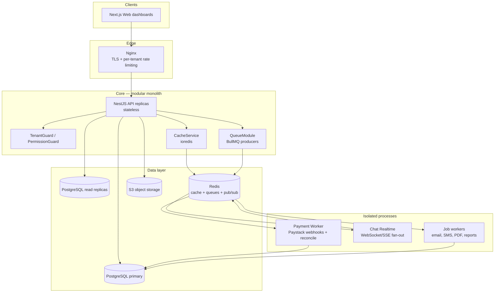
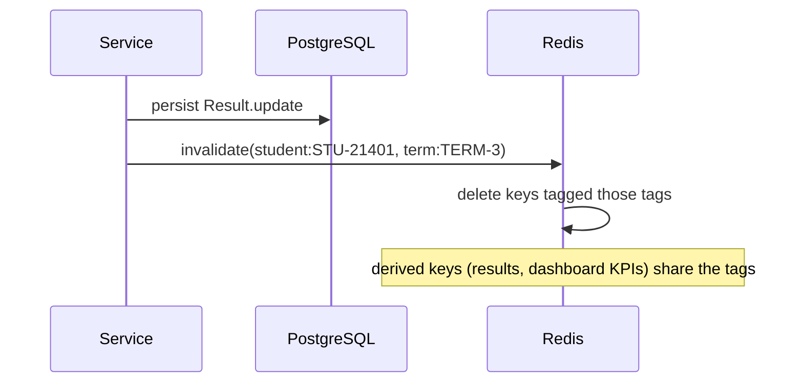
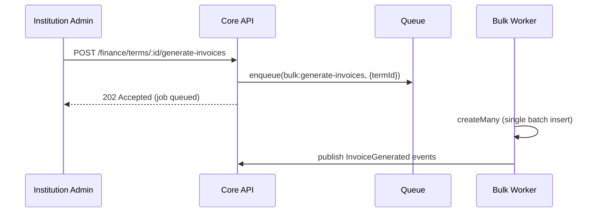
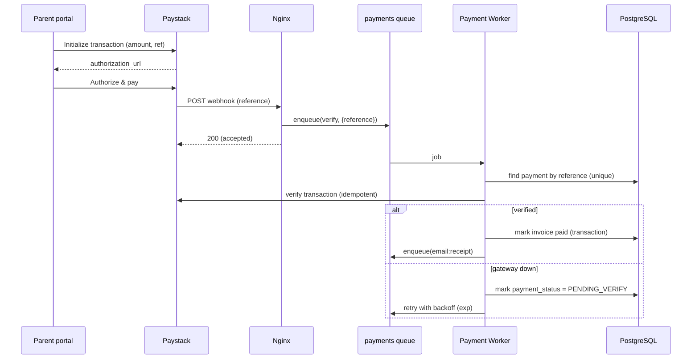

# OpenSchool ERP — Throughput & Performance Architecture

**Authoritative Performance and Scaling Reference**

| Aspect | Detail |
|--------|--------|
| **Document ID** | OPS-ARCH-006 |
| **Status** | Review |
| **Version** | 1.0.0 |
| **Date** | 2026-09-08 |
| **Author** | Platform Architecture Team |
| **Review Cycle** | Quarterly |

---

## Current Status: Review

| Status | Description |
|--------|-------------|
| **Draft** | Under active development |
| **Review** | Under architecture review |
| **Approved** | Approved for implementation |
| **Frozen** | Locked for current version |
| **Deprecated** | Pending replacement |

---

## Table of Contents

1. [Purpose](#1-purpose)
2. [Performance Objectives](#2-performance-objectives)
3. [Why Not Microservices](#3-why-not-microservices)
4. [Architecture Overview](#4-architecture-overview)
5. [Isolation of Hot Paths](#5-isolation-of-hot-paths)
6. [Cache-First Read Layer](#6-cache-first-read-layer)
7. [Database Concurrency Design](#7-database-concurrency-design)
8. [Asynchronous Processing](#8-asynchronous-processing)
9. [Rate Limiting](#9-rate-limiting)
10. [Autoscaling & Thresholds](#10-autoscaling--thresholds)
11. [Payment Webhook Flow](#11-payment-webhook-flow)
12. [Failure Isolation](#12-failure-isolation)
13. [Observability](#13-observability)
14. [Architecture Decision Records](#14-architecture-decision-records)
15. [Revision History](#15-revision-history)

---

## 1. Purpose

This document is an **additive specification** over the frozen V1 baseline defined by `01 System Architecture.md` (OPS-ARCH-001) and `02 Database Architecture.md` (OPS-ARCH-002). It does not change frozen decisions; it details how the frozen modular monolith meets the platform's high-concurrency and low-latency goals.

The design addresses two explicit requirements:

| Requirement | Design Response |
|-------------|-----------------|
| Quality-of-service during request bursts (fee season) | Horizontal scaling of a stateless app tier, cache-first reads, per-tenant isolation, queue-everything-async |
| A payments failure must not take the rest of the platform down | Isolated payment worker; external gateway holds funds; queued reconciliation |

These requirements are met **within** the frozen modular-monolith baseline by extracting only the processes whose load/uptime profile differs (payment processing, realtime chat).

---

## 2. Performance Objectives

| Metric | Target | Strategy |
|--------|--------|----------|
| Read latency | p95 < 150ms | Redis cache-first; read replicas; composite indexes |
| Write latency | p95 < 300ms | Synchronous only for critical writes; everything else queued |
| Spare capacity | Handle 10× baseline burst (fee season) | Autoscaling + queues + per-tenant limits |
| Availability | 99.9% | Isolated hot paths; health checks; auto-restart |
| Payment verification | Never slow the portal | Webhook → queue → worker, isolated process |

---

## 3. Why Not Microservices

The frozen baseline is a **modular monolith** (ADR-01). This section documents why that decision stands even under high-throughput requirements.

| Concern | Monolith + modular answer |
|---------|---------------------------|
| Payments outage | Payments run on an **isolated worker process**; the core never processes webhooks synchronously |
| Many concurrent requests | Solved by **scaling, not splitting**: stateless horizontal replicas, cache, connection pooling |
| One team / velocity | A single deployable unit; one transaction boundary; no network hops between domains |
| Failure blast radius | **Process-level isolation** for the 2–3 genuinely different workloads; rest stay in-process |

The decision is reversible: modular boundaries (domain folders with explicit interfaces) are the extraction seams. If chat traffic skews beyond the core, the chat service is already isolated and can scale alone.

Microservices would introduce distributed transactions, network failure modes, and N deployables — none of which reduce latency under load. They move the bottleneck around; they do not remove it.

---

## 4. Architecture Overview



---

## 5. Isolation of Hot Paths

Three processes are **separated from the core** even though the system is a modular monolith. This is process-level (not service-level) decomposition: the same NestJS codebase, different entrypoints and scaling units.

| Process | Why isolated | Scaling unit |
|---------|--------------|--------------|
| **Payment Worker** | Webhook bursts + gateway outages must not affect portal latency or availability | Dedicated worker fleet |
| **Chat Realtime** | Long-lived sockets have a different concurrency profile than request/response | Dedicated socket fleet |
| **Job Workers** | Async work (PDF, email, bulk invoicing) must never block request handlers | Wave-scalable queues |

Build-wise this is two extra entrypoints (`src/workers/`) reading the same domain modules. Runtime-wise they are separate CPU/memory pools with separate autoscaling policies.

---

## 6. Cache-First Read Layer

Reads dominate (dashboards, results, timetables, fee balances). The cache-first layer makes the database a last resort for hot reads.

### 6.1 Cache Tiers

| Tier | Technology | Cached content | Hit latency |
|------|-----------|----------------|-------------|
| Edge/CDN | Nginx caching | Static assets, notices, school site | ~10ms |
| API cache | Redis | Dashboards, results, balances, timetables | ~5ms |
| Hot entities | Redis | Student, class, invoice records | ~5ms |

### 6.2 Tag-Based Invalidation

Never "flush everything" on a write. Every cache entry carries **tags** (e.g. `student:{id}`, `term:{id}`, `class:{id}`). A write invalidates exactly the affected tags:



| Rule | Description |
|------|-------------|
| Read-through | Cache miss → query DB → populate with tags + TTL |
| Write-invalidate | Mutations delete tagged keys; next read repopulates |
| TTL ceiling | 5–60 minutes as a safety net; never rely on TTL for correctness |

### 6.3 Granularity

| Cacheable | TTL | Invalidated by |
|-----------|-----|----------------|
| Fee balance per student | 5 min | Payment confirmed, invoice created |
| Results per student/term | 15 min | Result published |
| Timetable per class | 30 min | Timetable change |
| Dashboard KPIs | 5 min | Any write in scope |
| Static reference (fees, hostel list) | 60 min | Reference change |

---

## 7. Database Concurrency Design

### 7.1 Connection Pooling

Postgres collapses at a few hundred concurrent connections. PgBouncer + Prisma pooling keeps thousands of app connections mapped to a small real pool.

| Component | Purpose |
|-----------|---------|
| **PgBouncer** | Transaction-mode pooling in front of the primary |
| **Prisma connection pool** | App-side multiplexing (default 10/core × replicas) |
| **Read replicas** | Report-card, analytics, and dashboard reads off the primary |

### 7.2 Read/Write Split

| Query type | Target |
|-----------|--------|
| Mutations (writes) | Primary |
| Hot reads (results, balances, KPIs) | Cache (Redis) |
| Analytics/report reads | Read replicas |
| Dashboard reads | Cache first, replicas second |

### 7.3 Indexing Hot Paths

| Path | Index |
|------|-------|
| Payments | `(studentId, termId)`, `(invoiceId)`, `(reference)` unique |
| Results | `(studentId, termId)`, `(classId, subjectId)` |
| Attendance | `(classId, date)`, `(studentId)` |
| Chat | `(threadId, updatedAt)` |
| All domain tables | `(tenantId)` + FK columns per OPS-ARCH-002 §9 |

### 7.4 Precomputed Aggregates

Computing 12,000 term averages on-the-fly is slow. Store derived values:

| Derived value | Where |
|---------------|-------|
| Term average / class position | Stored on `Result` record at publish time |
| Fee collection rate | Materialized view refreshed hourly |
| Attendance % per class | Materialized view refreshed daily |

---

## 8. Asynchronous Processing

### 8.1 Rule

> No synchronous heavy work in request handlers. Any job that is not needed for the HTTP response is queued and processed by a worker.

### 8.2 Queues

| Queue | Jobs | Consumer |
|-------|------|----------|
| `payments` | Webhook verification, reconciliation | Payment Worker |
| `email` | Credentials, receipts, notices | Email worker |
| `sms` | Fee reminders, alerts | SMS worker |
| `reports` | PDF report cards, exports | Report worker |
| `bulk` | Term fee-invoice generation, bulk import | Bulk worker |
| `chat` | Unread counts, push fan-out | Chat worker |

### 8.3 Queue Semantics

| Property | Value |
|----------|-------|
| Transport | BullMQ (Redis) |
| Retry | Exponential backoff 5s → 30s → 5min → 15min |
| Max attempts | 3 (+ DLQ) |
| Dead letter | Per-queue DLQ; admin inspection; replay 72h window |
| Idempotency | `jobId` dedup; payment `reference` unique constraint |
| Priority | Payments > email > sms > reports > bulk |

### 8.4 Batch, Not Per-Click

Fee-season invoice generation is a single **bulk job** per term, not N API calls:



---

## 9. Rate Limiting

Two layers protect the platform from bursts, per the frozen rate-limiting requirement (System Architecture §1.6).

### 9.1 Edge Layer (Nginx)

| Rule | Value |
|------|-------|
| Anonymous | 100 req/min/IP |
| Authenticated | 500 req/min/user |
| Payment endpoints | 30 req/min/user |
| Burst size | 20 requests (nodelay) |

### 9.2 Core Layer (per-tenant guard)

A Redis-backed rate limiter keyed by **tenantId** so one school's flood cannot degrade another tenant:

| Rule | Default | Configurable |
|------|---------|--------------|
| Requests per tenant | 100 req/s | yes |
| Window | 1 second (sliding) | yes |
| Burst | 200 | yes |
| Response on over-limit | 429 + `Retry-After` | yes |

```mermaid
flowchart TD
    A[Request] --> B{Tenant in JWT/header?}
    B -->|No| C[401]
    B -->|Yes| D{INCR tenant:{id}:{epoch}-window}
    D --> E{count > limit?}
    E -->|Yes| F[429 Retry-After]
    E -->|No| G[TL reset on key TTL = window]
    G --> H[Proceed to guards]
```

---

## 10. Autoscaling & Thresholds

### 10.1 Scaling Profile

| Service | Autoscale on | Min | Max |
|---------|-------------|-----|-----|
| API replicas | CPU > 60% | 2 | 10 |
| Payment Worker | Queue depth > 1000 | 1 | 4 |
| Chat Realtime | Concurrent sockets > 5k | 1 | 4 |
| Job workers | Queue depth | 1 | 6 |

### 10.2 Scaling-Trigger Metrics

| Metric | Alert | Action |
|--------|-------|--------|
| API p95 latency | > 250ms for 5 min | Add replicas |
| Queue depth | > 1,000 pending | Add workers |
| DB connections | > 80% of pool | Investigate; tune pool |
| Replica lag | > 30s | Re-check query routing |

### 10.3 Latency Budgets

| Operation | Budget |
|-----------|--------|
| Read (cached) | p95 < 50ms |
| Read (DB) | p95 < 150ms |
| Write (sync, critical) | p95 < 300ms |
| Queued job visible in UI | < 2s |

---

## 11. Payment Webhook Flow

The payment path is designed so a gateway outage or a webhook burst **cannot** take down the platform.



| Failure | Behavior |
|---------|----------|
| Paystack down | Parent retries at Paystack; portal unaffected |
| Payment Worker down | Webhooks queue in Redis; resume on recovery |
| Core API down | Payments still authorized at Paystack; reconciled when core returns |
| Webhook burst | Nginx rate limits + queue; verification async |

Key guarantees:

| Guarantee | Mechanism |
|-----------|-----------|
| No double-charge | `reference` unique constraint; webhook idempotency |
| No uncredited payment | Verification retry with backoff + DLQ + manual replay |
| Isolation | Webhook handler only enqueues; never touches the DB directly |

---

## 12. Failure Isolation

Per the frozen failure philosophy (OPS-ARCH-001 §10), plus the throughput-specific additions:

| Failure | Isolation mechanism |
|---------|---------------------|
| Cache (Redis) down | Read-through to DB; circuit breaker on cache writes |
| Queue down | Jobs fail loudly to DLQ; requests still served |
| One worker type stuck | Per-queue worker pools; DLQ per queue |
| Payment storm | Isolated process + edge rate limit + queue backpressure |
| DB primary down | Read replicas keep dashboards alive; writes rejected fast (503) |

| Component | Timeout | Circuit breaker |
|-----------|---------|-----------------|
| PostgreSQL | 30s | 5 failures → 30s open |
| Redis | 5s | 5 failures → 15s open |
| Paystack HTTP | 10s | fail transaction → queue retry |
| S3 | 30s | 5 failures → 30s open |

---

## 13. Observability

Built on OPS-ARCH-001 correlation-ID architecture, adding throughput signals:

| Signal | Instrumentation |
|--------|-----------------|
| Request latency p50/p95/p99 | Per route, per tenant (Prometheus) |
| Cache hit ratio | Per cache tier |
| Queue depth & age | Per queue |
| DB pool utilization | Per pool |
| Etc. throughput | Requests/sec, errors/sec |

| Alert | Threshold |
|-------|-----------|
| High latency | API p95 > 250ms @ 5min |
| Queue backlog | Age of oldest job > 60s |
| Cache miss spike | Hit ratio < 80% |
| 5xx rate | > 1% @ 5min |
| Tenant over-limit | 429 rate > 5% of tenant traffic |

---

## 14. Architecture Decision Records

| ADR | Title | Status | Reference |
|-----|-------|--------|-----------|
| ADR-011 | Keep modular monolith for V1 throughput | Accepted | §3 |
| ADR-012 | Isolate payment worker as a separate process | Accepted | §5, §11 |
| ADR-013 | Isolate chat realtime as a separate process | Accepted | §5 |
| ADR-014 | Cache-first reads with tag-based invalidation | Accepted | §6 |
| ADR-015 | Per-tenant Redis rate limiting in core layer | Accepted | §9 |
| ADR-016 | Queue-everything-async; batch not per-click | Accepted | §8 |

### ADR-011: Keep modular monolith for V1 throughput

- **Context:** High-concurrency requirement; risk of payments outage affecting the platform.
- **Decision:** Remain a modular monolith; scale the app tier horizontally; extract only genuinely different workloads.
- **Consequences:** Single transaction boundary; simple deploys; hot paths isolated as processes; microservice seams preserved for V2.

### ADR-012: Isolate payment worker

- **Context:** Payment webhooks burst at fee season; gateway outages must not affect portal.
- **Decision:** Webhook handler enqueues only; a dedicated worker process verifies and reconciles.
- **Consequences:** Portal latency decoupled from gateway; queued reconciliation; DLQ protects against loss.

---

## 15. Revision History

| Version | Date | Author | Changes |
|---------|------|--------|---------|
| 1.0.0 | 2026-09-08 | Platform Architecture Team | Initial throughput and performance architecture document |

---

*Document Version: 1.0.0*  
*Last Updated: 2026-09-08*  
*Status: Review*  
*Classification: Internal*

---

**END OF DOCUMENT**