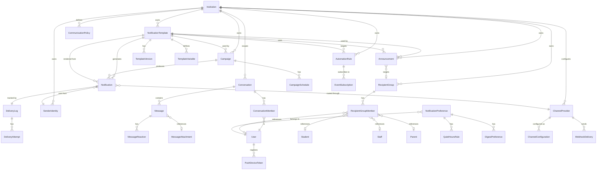
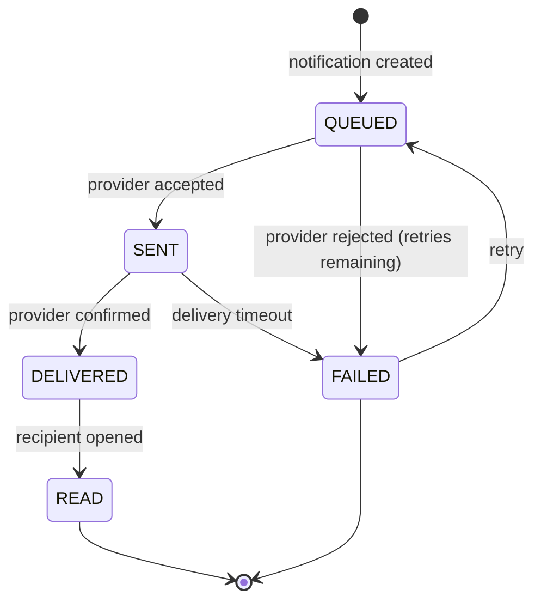
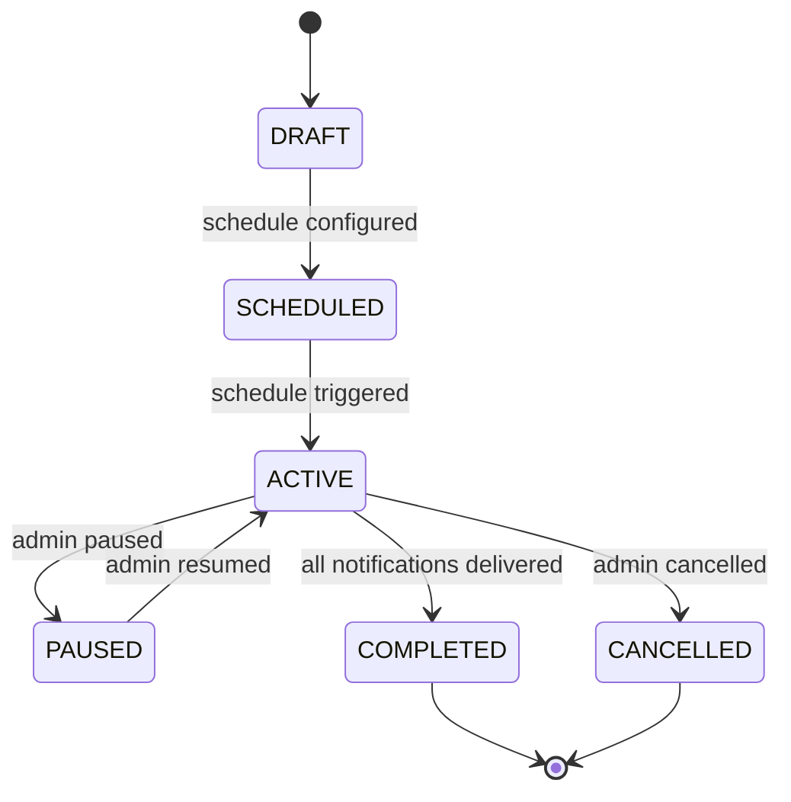
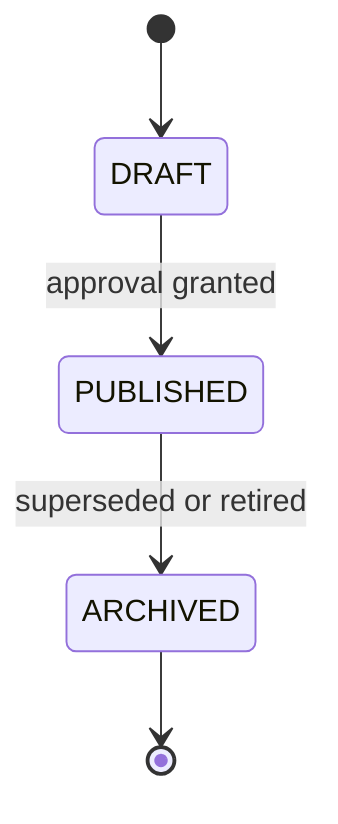
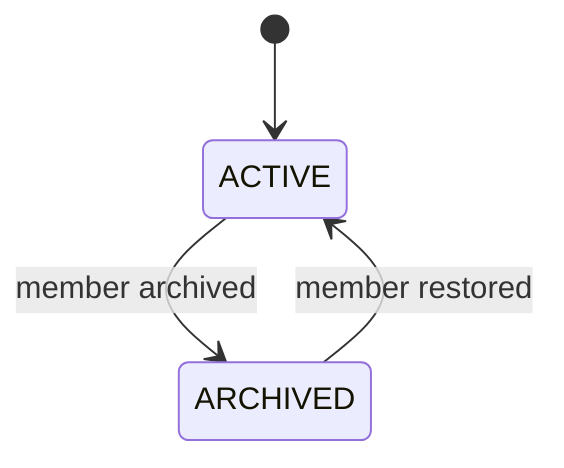
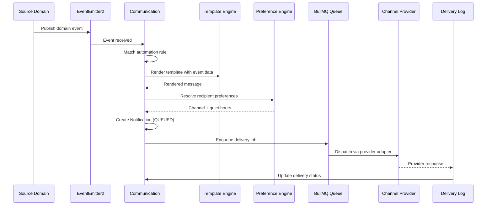
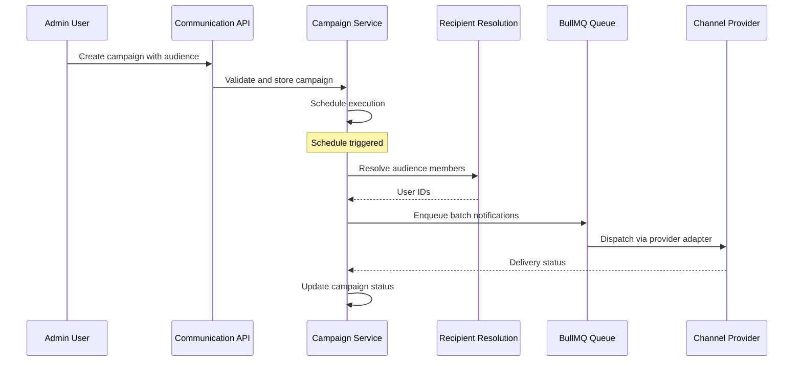
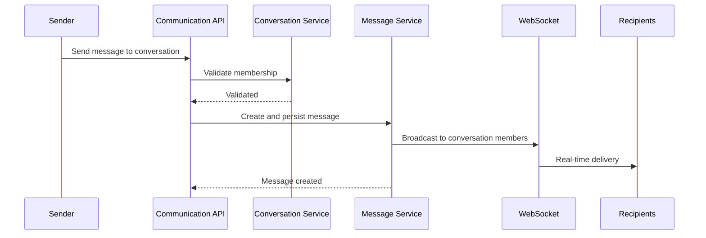

# Communication Engineering Specification

**Domain:** Communication
**Scope:** Notification Engine, Communication Channels, Message Templates, Announcements, Conversations, Recipient Management, Notification Preferences, Delivery Tracking, Campaigns, Automation Integration, Provider Integration, Communication Policies
**Created:** 2026-07-17
**Status:** Approved — Frozen for Implementation
**Last Updated:** 2026-07-20

---

## Table of Contents

1. [Overview](#1-overview)
2. [Engineering Principles](#2-engineering-principles)
3. [Architecture Decision Records](#3-architecture-decision-records)
4. [Engineering Status](#4-engineering-status)
5. [Phase 1 — Domain Analysis](#5-phase-1--domain-analysis)
6. [Phase 2 — Domain Design](#6-phase-2--domain-design)
7. [Phase 3 — Database Design](#7-phase-3--database-design)
8. [Phase 4 — Prisma Schema](#8-phase-4--prisma-schema)
9. [Phase 5 — Backend Implementation](#9-phase-5--backend-implementation)
10. [Phase 6 — API Design](#10-phase-6--api-design)
11. [Phase 7 — Testing & Verification](#11-phase-7--testing--verification)
12. [Provider Abstraction Layer](#12-provider-abstraction-layer)
13. [Event-Driven Automation Integration](#13-event-driven-automation-integration)
14. [Outstanding Items](#14-outstanding-items)
15. [Revision History](#15-revision-history)

---

## 1. Overview

Communication is the messaging backbone of the platform, responsible for delivering the right message to the right recipient through the right channel at the right time. It consumes business events published by other domains and decides how, when, and through which channels messages are delivered.

| Aspect | Approach |
|--------|----------|
| Identity | Institution-scoped; every entity belongs to one Institution |
| Event Consumption | Subscribes to domain events from all other domains; does not own business events |
| Delivery Channels | In-App, Email, SMS, Push, WhatsApp (future), Voice (future), Webhooks (future) |
| Provider Architecture | Provider-independent abstraction layer; no single-vendor dependency |
| Templates | Reusable, versioned, localisable; support variables and preview |
| Conversations | Secure internal messaging with read receipts and attachment references |
| Campaigns | Scheduled, recurring, audience-targeted broadcast communications |
| Preferences | Institution-level defaults with user-level overrides; quiet hours, channel priorities |
| Automation | Event-driven; reacts to domain events; no business logic ownership |
| Async Processing | BullMQ job queues for delivery, retries, and scheduled sends |
| Delivery Tracking | Full lifecycle from queued → sent → delivered → read; retry on failure |

**In Scope:** Notification composition and delivery, channel management, template engine, announcements, internal conversations, recipient targeting, notification preferences, delivery tracking and retry, campaigns, automation rules, provider abstraction, communication policies

**Out of Scope:** Authentication, Authorization, Roles, Permissions (Identity & Access), Person profiles (People), Academic rules, Attendance, Results (Academic Management), Billing, Payments, Invoices (Finance), Institution configuration (Institution Management), File storage (Platform Services)

---

## 2. Engineering Principles

### Core Philosophy

- **Communication Consumes, Never Owns:** Communication subscribes to business events from other domains; it never owns business data or triggers business state changes
- **Provider Independence:** Every delivery channel is abstracted behind a provider adapter; the domain never depends on a single vendor
- **Event-Driven Delivery:** All message dispatch is triggered by domain events or scheduled jobs; no synchronous coupling to publishing domains
- **Multi-Tenant Isolation by Default:** Every query scoped to tenant context; cross-tenant access = security violation
- **Configuration over Customization:** Channel configuration, templates, policies, and preferences are institution-configurable; no code changes required
- **Async-First Processing:** Message delivery, retries, and scheduling run on BullMQ job queues; the API layer never blocks on provider calls
- **Soft Delete by Default:** All mutable core entities support restore within retention period
- **Business Status vs Soft Delete:** Status enums represent business states (e.g., DRAFT, QUEUED, SENT); deletion is controlled by `deleted_at` / `deleted_by` columns exclusively
- **Optimistic Concurrency:** Version column on mutable entities; 409 Conflict on version mismatch
- **Immutable Audit Logging:** Append-only audit logs; never update or delete
- **Delivery Reliability:** Every message has a delivery lifecycle with retry; failures are tracked and diagnosable
- **Preference Hierarchy:** Institution-level defaults → role-level defaults → user-level overrides

### Naming Conventions

| Element | Convention | Example |
|---------|-----------|---------|
| Database tables | snake_case, plural | notifications, templates, delivery_logs |
| Columns | snake_case | notification_id, channel_type |
| Enums | SCREAMING_SNAKE_CASE | NOTIFICATION_STATUS_QUEUED |
| Classes | PascalCase | NotificationAggregate |
| Methods | camelCase | createNotification |
| API responses | camelCase | success, notificationId |
| Events | PascalCase, past tense | NotificationDispatched |
| Errors | PascalCase + Error | NotificationNotFoundError |
| Permissions | `{domain}:{resource}:{action}` | communication:notification:read |

### Tenant Isolation

- Tenant ID extracted from JWT and passed to repository methods as first parameter
- Application-level filtering (no Postgres Row-Level Security)
- Every query must include tenant filter
- Institution ID further scopes queries within a tenant

### Soft Delete

- All mutable core entities use soft delete via `deleted_at` (DateTime?) and `deleted_by` (uuid?)
- Business status (e.g., DRAFT, QUEUED, SENT) is a separate concern from deletion
- 30-day restore window before permanent deletion for eligible entities
- Delivered notifications are retained per institution-configured retention policy

### Audit Logging

Every state-changing operation generates an append-only audit log entry with: entity_type, entity_id, action, actor_id, actor_email, changes (JSON diff), context_ip, context_user_agent, timestamp.

For delivery operations, the audit log additionally captures: channel_type, provider, delivery_status, recipient_count.

### Error Handling

- Structured error responses: `{ success: false, error: { code, message, details[] } }`
- Domain-specific error classes; never expose internal details
- Full error context logged server-side
- Delivery errors include notification reference and provider response for debugging

### Prisma Schema Principles

- UUID `@default(uuid())` for all primary keys
- `@unique` constraints for business keys
- `@map` for snake_case column names
- Soft delete via `deleted_at` (DateTime?) and `deleted_by` (uuid?)
- Business status via `status` enum (never a deletion marker)
- Optimistic locking via `version` (Int @default(1))
- Audit fields: created_at, created_by, updated_at, updated_by
- JSON columns for flexible data (metadata, template variables, delivery response)
- Prisma enums mapped to database types
- Cascade deletes: child entities cascade from parent aggregate root; cross-aggregate references use application-level guards

### Technology Stack

| Component | Technology |
|-----------|-----------|
| Runtime | Node.js >=22.0.0 |
| Framework | NestJS ^11.0.0 |
| ORM | Prisma ^6.12.0 |
| Language | TypeScript ^5.8.3 |
| Validation | class-validator + class-transformer |
| Auth | JWT + bcrypt |
| Queue | BullMQ + Redis |
| Testing | Jest ^30.0.0 |
| Migrations | Prisma Migrate |
| API Docs | Swagger/OpenAPI ^7.0.0 |

---

## 3. Architecture Decision Records

| ADR | Decision | Rationale |
|-----|----------|-----------|
| ADR-001 | Communication consumes events, never owns business state | Strict domain boundary; other domains publish events; Communication decides delivery only |
| ADR-002 | Provider-independent channel abstraction | Institutions choose email/SMS/push providers; domain remains vendor-agnostic |
| ADR-003 | Async-first delivery via BullMQ queues | Provider calls are slow and unreliable; async processing prevents API blocking and enables retries |
| ADR-004 | Application-level tenant isolation (no RLS) | Consistent with Identity & Access, Institution Management, People, Academic Management, and Finance |
| ADR-005 | Domain events via EventEmitter2 (in-process) | Decouples services; supports async processing; future migration to MQ |
| ADR-006 | Optimistic concurrency (version column) | Prevents lost updates on preference and template changes; no pessimistic locking overhead |
| ADR-007 | Immutable audit logs (append-only) | Tamper-proof delivery audit trail; compliance requirement |
| ADR-008 | Notification is the core delivery unit | Every outbound message is a Notification with a channel, template, recipient, and delivery lifecycle |
| ADR-009 | Templates are versioned | Template changes must not affect in-flight notifications; versioning ensures snapshot consistency |
| ADR-010 | Delivery tracking captures full lifecycle | Queued → Sent → Delivered → Read → Failed; each transition is recorded for diagnostics |
| ADR-011 | Retry with exponential backoff | Provider failures are transient; retries with backoff maximise delivery success |
| ADR-012 | Quiet hours enforced at dispatch time | Scheduled messages check quiet hours at send time, not at queue time; respects preference changes |
| ADR-013 | Preference hierarchy: Institution → Role → User | Institution defaults are overridden by role defaults, which are overridden by user preferences |
| ADR-014 | Conversations are institution-scoped | Internal messaging is private to an institution; no cross-institution messaging |
| ADR-015 | Read receipts are opt-in per conversation | Privacy-sensitive; recipients can disable read receipt tracking |
| ADR-016 | Campaigns support scheduling and recurrence | Fee reminders, event announcements, and holiday notices need scheduled and recurring delivery |
| ADR-017 | Announcements have expiration dates | Stale announcements must not display; expiration is enforced at query time |
| ADR-018 | In-App notifications are persistent | In-App notifications are stored in the database; email/SMS/push are dispatched to external providers |
| ADR-019 | Attachment references only | Communication does not store files; it references Platform Services attachment IDs |
| ADR-020 | Webhook delivery uses signed HTTP callbacks | Webhooks are signed with HMAC; recipients verify authenticity; retry on failure |
| ADR-021 | Template localisation via locale key | Templates support multiple languages via locale-specific content blocks; fallback to institution default |
| ADR-022 | Delivery receipt from provider is asynchronous | Provider webhooks report delivery status; domain updates delivery log asynchronously |
| ADR-023 | Automation rules are event-subscription mappings | Each rule maps a source event to a template, channel, and recipient selector; no business logic |
| ADR-024 | Message search is full-text on conversation content | Conversation participants need fast search; PostgreSQL full-text search on message body |
| ADR-025 | Broadcast permissions are role-gated | Announcements and campaigns require specific permissions; unauthorised broadcasts are rejected |
| ADR-026 | Sender identities are institution-configured | Institutions define display names and addresses for email/SMS; users select from configured identities |
| ADR-027 | Template approval workflow for institutional templates | Templates used in campaigns and announcements require admin approval before deployment |
| ADR-028 | Retry policies are institution-configurable | Max retries, backoff strategy, and retry intervals vary by institution policy |
| ADR-029 | Digest notifications batch multiple events | Users may prefer periodic digests over individual notifications; batching reduces noise |
| ADR-030 | Emergency broadcasts bypass quiet hours | Emergency notifications (security, safety) override quiet hours and channel preferences |
| ADR-031 | Message retention is institution-configurable | Institutions define how long notifications and conversations are retained |
| ADR-032 | In-App notification badge count is real-time | Unread notification count is computed from delivery logs; WebSocket push for live updates |
| ADR-033 | Channel priority determines delivery order | When multiple channels are configured, priority determines which channel delivers first |
| ADR-034 | Conversation archival is non-destructive | Archived conversations are hidden from default queries but not deleted; restore is supported |
| ADR-035 | Push notification device tokens are user-scoped | Each user maintains a list of device tokens; tokens are invalidated on logout or device change |

---

## 4. Engineering Status

| Phase | Status | Summary |
|-------|--------|---------|
| Phase 1 — Domain Analysis | Complete | 28 entities, 55+ domain events, 30 business rules |
| Phase 2 — Domain Design | Complete | 12 aggregates, 30 invariants, 20 policies, 12 validation rule sets |
| Phase 3 — Database Design | Complete | 28 tables, 45+ indexes, 25 unique constraints |
| Phase 4 — Prisma Schema | Complete | 28 models, 17 enums, 2-pass validation |
| Phase 5 — Backend Implementation | Complete | 14 modules, 27 repositories, 14 domain services, 14 controllers, 8 event consumers |
| Phase 6 — API Design | Complete | 79 endpoints |
| Phase 7 — Testing & Verification | Complete | 18 test categories, ~215+ test scenarios |

**Overall Status:** Approved — Frozen for Implementation.

---

## 5. Phase 1 — Domain Analysis

### 5.1 Domain Purpose

Communication is the messaging backbone of the platform. It is responsible for composing, dispatching, tracking, and managing all outbound and inbound messages between the platform and its users. The domain consumes business events published by other domains and translates them into delivered notifications across multiple channels.

Communication does not own business events. It subscribes to events from Identity & Access, People, Academic Management, Finance, and Institution Management, and decides how, when, and through which channels messages reach recipients.

### 5.2 Domain Responsibilities

| Responsibility | Description |
|----------------|-------------|
| Notification Engine | Compose and dispatch notifications in response to domain events |
| Channel Management | Configure and manage delivery channels (In-App, Email, SMS, Push, WhatsApp, Voice, Webhooks) |
| Provider Abstraction | Abstract delivery provider integration behind a provider-agnostic adapter layer |
| Template Engine | Manage reusable, versioned, localisable message templates with variable interpolation |
| Announcements | Compose, schedule, and distribute institution-wide or targeted announcements |
| Conversations | Enable secure internal one-to-one and group messaging with read receipts |
| Recipient Management | Target recipients by role, department, class, student, parent, staff, or dynamic filters |
| Notification Preferences | Manage per-user and per-institution channel preferences, quiet hours, and digest settings |
| Delivery Tracking | Track full message lifecycle from queued through delivered; handle retries on failure |
| Campaigns | Compose, schedule, and execute bulk and recurring communication campaigns |
| Automation Rules | Map domain events to templates, channels, and recipient selectors |
| Communication Policies | Enforce institution-level rules for allowed channels, retention, broadcast permissions |

### 5.3 Domain Boundaries

**In Scope:** Notification composition and delivery, channel management, provider abstraction, template engine, announcements, internal conversations, recipient targeting, notification preferences, delivery tracking, campaigns, automation rules, communication policies

**Out of Scope:** Authentication, Authorization, Roles, Permissions (Identity & Access), Person profiles (People), Academic rules, Attendance, Results, Promotions (Academic Management), Billing, Payments, Invoices (Finance), Institution configuration, Licensing (Institution Management), File storage (Platform Services)

### 5.4 Dependencies

| Dependency | Nature | Direction |
|------------|--------|-----------|
| Identity & Access | User context, authentication, role resolution for permission checks | Reads |
| Institution Management | Institution configuration, tenant context, module licensing | Reads |
| People | Student, Staff, Parent person records for recipient resolution | Reads |
| Academic Management | Academic events (enrolment, results, attendance) that trigger notifications | Reads (events) |
| Finance | Financial events (payment received, invoice overdue) that trigger notifications | Reads (events) |
| Platform Services | File storage for attachments, event bus, audit logging | Writes |

### 5.5 Core Entities

| Entity | Type | Description |
|--------|------|-------------|
| Notification | Core | The primary delivery unit; represents a single message to a single recipient via a single channel |
| NotificationBatch | Core | Groups multiple notifications for bulk dispatch (campaigns, announcements) |
| NotificationTemplate | Core | Reusable message template with variable slots, localisation, and versioning |
| TemplateVersion | Supporting | Immutable snapshot of template content at a point in time |
| TemplateVariable | Supporting | Named variable definition within a template (e.g., `{{studentName}}`) |
| ChannelProvider | Core | Configuration for an external delivery provider (SendGrid, Twilio, FCM) |
| ChannelConfiguration | Core | Institution-level channel settings (sender identity, rate limits, enabled status) |
| SenderIdentity | Core | Configured sender address/display name for a channel (e.g., email address, SMS sender ID) |
| DeliveryLog | Core | Full delivery lifecycle record for a notification (queued → sent → delivered → read) |
| DeliveryAttempt | Supporting | Individual delivery attempt with provider response and retry metadata |
| Campaign | Core | Scheduled or recurring bulk communication with audience targeting |
| CampaignSchedule | Supporting | Schedule definition for campaign execution (one-time, daily, weekly, termly) |
| Announcement | Core | Time-bound broadcast message with scope and expiration |
| Conversation | Core | Internal messaging thread (one-to-one or group) |
| ConversationMember | Supporting | Participant in a conversation with role and read state |
| Message | Core | Individual message within a conversation |
| MessageReaction | Supporting | Emoji reaction on a message |
| RecipientGroup | Core | Named group of recipients for targeted messaging |
| RecipientGroupMember | Supporting | Member of a recipient group with target entity reference |
| NotificationPreference | Core | Per-user notification channel preferences, quiet hours, and digest settings |
| QuietHoursRule | Supporting | Time window during which non-urgent notifications are suppressed |
| AutomationRule | Core | Maps a source domain event to a template, channel, and recipient selector |
| EventSubscription | Supporting | Tracks which events this domain subscribes to and their routing rules |
| CommunicationPolicy | Core | Institution-level rules for allowed channels, retention, broadcast permissions |
| PushDeviceToken | Supporting | Device token for push notification delivery per user |
| MessageAttachment | Reference | Reference to Platform Services attachment ID (not stored locally) |
| WebhookDelivery | Supporting | Outbound webhook delivery record with HMAC signature and response |
| DigestPreference | Supporting | User preference for digest frequency and batching window |

### 5.6 Domain Events

#### 5.6.1 Events Published by Communication

| Event | Trigger | Consumers |
|-------|---------|-----------|
| NotificationDispatched | Notification queued for delivery | Audit, Delivery Tracking |
| NotificationDelivered | Provider confirms delivery | Analytics, Read Model |
| NotificationRead | Recipient opens in-app notification | Analytics, Badge Count |
| NotificationFailed | All delivery attempts exhausted | Alerting, Dead Letter |
| CampaignCompleted | All campaign notifications delivered | Analytics |
| CampaignFailed | Campaign execution halted | Alerting |
| AnnouncementPublished | Announcement made active | In-App, Push |
| AnnouncementExpired | Announcement past expiration date | In-App cleanup |
| MessageSent | Conversation message delivered to recipients | Real-time sync |
| ConversationCreated | New conversation thread initiated | Participant notification |
| AutomationRuleTriggered | Source event matched an automation rule | Audit |

#### 5.6.2 Events Consumed from Other Domains

| Source Domain | Event | Communication Action |
|---------------|-------|---------------------|
| Identity & Access | UserCreated | Send welcome email with activation link |
| Identity & Access | PasswordResetRequested | Send password reset email |
| Identity & Access | MFAEnabled | Send security notification |
| Identity & Access | AccountLocked | Send security alert |
| People | StudentEnrolled | Send enrolment confirmation |
| People | StaffHired | Send onboarding welcome |
| People | ParentLinked | Send parent portal invitation |
| Academic Management | AttendanceRecorded | Send attendance alert if absent/excused |
| Academic Management | AssignmentPublished | Send assignment notification |
| Academic Management | ResultPublished | Send result publication notification |
| Academic Management | StudentPlacedOnProbation | Send probation warning |
| Academic Management | SummerSchoolRegistered | Send registration confirmation |
| Finance | InvoiceGenerated | Send invoice notification |
| Finance | PaymentReceived | Send payment receipt |
| Finance | InvoiceOverdue | Send overdue reminder |
| Finance | RefundProcessed | Send refund confirmation |
| Finance | ScholarshipAwarded | Send scholarship notification |
| Institution Management | InstitutionCreated | Send setup welcome |
| Institution Management | UserInvited | Send invitation email |

### 5.7 Business Rules

| ID | Rule |
|----|------|
| BR-COM-001 | Every Notification must reference exactly one recipient and one delivery channel |
| BR-COM-002 | Notifications are created in QUEUED status; they transition through SENT → DELIVERED → READ or FAILED |
| BR-COM-003 | A notification marked FAILED after all retry attempts is permanently failed; it is not retried further |
| BR-COM-004 | Emergency broadcasts (BR-COM-030) bypass quiet hours, channel preferences, and digest batching |
| BR-COM-005 | Templates must have at least one version before they can be used for dispatch |
| BR-COM-006 | Template variables are resolved at dispatch time; unresolved variables cause a dispatch error |
| BR-COM-007 | A notification template must be PUBLISHED to be used in campaigns and announcements |
| BR-COM-008 | Campaigns require PUBLISH permission; unauthorised campaign creation is rejected |
| BR-COM-009 | Campaign schedules are validated at creation; past dates are rejected for future campaigns |
| BR-COM-010 | Announcements must have a start date and an optional expiration date |
| BR-COM-011 | Expired announcements are excluded from default queries; they can be retrieved explicitly |
| BR-COM-012 | Conversations are institution-scoped; cross-institution messaging is not permitted |
| BR-COM-013 | Conversation members must belong to the same institution |
| BR-COM-014 | Only conversation members can read messages within the conversation |
| BR-COM-015 | Read receipts are recorded only when the recipient's preference allows it |
| BR-COM-016 | Notification preferences follow hierarchy: Institution defaults → Role defaults → User overrides |
| BR-COM-017 | Quiet hours suppress non-urgent notifications; urgent/emergency notifications bypass quiet hours |
| BR-COM-018 | Digest notifications batch all non-urgent notifications within the digest window |
| BR-COM-019 | Delivery retries use exponential backoff; max retries are institution-configurable |
| BR-COM-020 | Channel priority determines delivery order when multiple channels are configured for a notification |
| BR-COM-021 | Sender identities must be verified before use in production channels |
| BR-COM-022 | Webhook payloads are signed with HMAC-SHA256; recipients must verify the signature |
| BR-COM-023 | Push device tokens are invalidated when a user logs out or changes device |
| BR-COM-024 | Automation rules require a source event, a target template, and at least one recipient selector |
| BR-COM-025 | Automation rules are evaluated in priority order; first matching rule wins |
| BR-COM-026 | Message retention is enforced by a background job; messages beyond retention are archived or purged |
| BR-COM-027 | Conversation archival hides the conversation from default queries; restore is supported |
| BR-COM-028 | Recipient group members are resolved at dispatch time; stale references are skipped |
| BR-COM-029 | Template approval workflow requires admin approval before institutional templates are published |
| BR-COM-030 | Emergency broadcasts bypass quiet hours, channel preferences, and digest batching |

### 5.8 Invariants

| ID | Invariant |
|----|-----------|
| INV-COM-001 | Every Notification belongs to exactly one Institution |
| INV-COM-002 | Every Notification references exactly one NotificationTemplate |
| INV-COM-003 | Every Notification has exactly one recipient (user, student, parent, or staff reference) |
| INV-COM-004 | A Notification in QUEUED status has no DeliveryAttempt records |
| INV-COM-005 | A Notification in SENT status has at least one DeliveryAttempt with status SENT |
| INV-COM-006 | A Notification in FAILED status has exhausted all configured retry attempts |
| INV-COM-007 | Every DeliveryLog entry references a valid Notification |
| INV-COM-008 | Every Campaign belongs to exactly one Institution |
| INV-COM-009 | Every Campaign has at least one CampaignSchedule |
| INV-COM-010 | An Announcement cannot have an expiration date before its start date |
| INV-COM-011 | Every Conversation belongs to exactly one Institution |
| INV-COM-012 | Every ConversationMember references a valid Conversation and a valid User |
| INV-COM-013 | A Conversation of type ONE_TO_ONE has exactly two members |
| INV-COM-014 | Every Message belongs to exactly one Conversation |
| INV-COM-015 | Every Message is sent by a valid ConversationMember |
| INV-COM-016 | NotificationPreference is unique per User per Institution |
| INV-COM-017 | ChannelConfiguration is unique per Institution per ChannelType |
| INV-COM-018 | AutomationRule source events are unique per Institution |
| INV-COM-019 | CommunicationPolicy is unique per Institution |
| INV-COM-020 | Every TemplateVersion references a valid NotificationTemplate |
| INV-COM-021 | TemplateVersion version numbers are sequential per template |
| INV-COM-022 | SenderIdentity is unique per Institution per ChannelType |
| INV-COM-023 | Every PushDeviceToken belongs to exactly one User |
| INV-COM-024 | RecipientGroup is unique per Institution per name |
| INV-COM-025 | RecipientGroupMember references a valid RecipientGroup |
| INV-COM-026 | QuietHoursRule references a valid NotificationPreference |
| INV-COM-027 | DeliveryAttempt references a valid DeliveryLog entry |
| INV-COM-028 | WebhookDelivery references a valid ChannelProvider |

### 5.9 Configurable Policies

| ID | Policy | Default | Scope |
|----|--------|---------|-------|
| CP-COM-001 | Allowed channels per institution | In-App, Email, SMS | Institution |
| CP-COM-002 | Notification retention period | 90 days | Institution |
| CP-COM-003 | Conversation retention period | 365 days | Institution |
| CP-COM-004 | Max delivery retries | 3 | Institution |
| CP-COM-005 | Retry backoff strategy | Exponential | Institution |
| CP-COM-006 | Quiet hours start | 22:00 | Institution / User |
| CP-COM-007 | Quiet hours end | 07:00 | Institution / User |
| CP-COM-008 | Digest frequency | NONE (real-time) | User |
| CP-COM-009 | Digest batch window | 4 hours | User |
| CP-COM-010 | Broadcast permission required | true | Institution |
| CP-COM-011 | Template approval required | true | Institution |
| CP-COM-012 | Push notification enabled | true | Institution |
| CP-COM-013 | WhatsApp channel enabled | false | Institution |
| CP-COM-014 | Voice call channel enabled | false | Institution |
| CP-COM-015 | Webhook channel enabled | false | Institution |
| CP-COM-016 | Max message size (characters) | 5000 | Institution |
| CP-COM-017 | Conversation max members | 50 | Institution |
| CP-COM-018 | Campaign max recipients per batch | 10000 | Institution |
| CP-COM-019 | Read receipt enabled by default | true | Institution |
| CP-COM-020 | Emergency bypass quiet hours | true | Institution |

### 5.10 Validation Rule Sets

| ID | Rules | Scope |
|----|-------|-------|
| VRS-COM-001 | Notification: recipient_id required, template_id required, channel_type required, body max 5000 chars | Notification |
| VRS-COM-002 | Template: name required (3–100 chars), type required, at least one content block | Template |
| VRS-COM-003 | Template content: locale required, subject required (email/push), body required, max 10000 chars | TemplateVersion |
| VRS-COM-004 | Campaign: name required (3–100 chars), template_id required, schedule required, audience filter required | Campaign |
| VRS-COM-005 | Announcement: title required (3–200 chars), content required, scope required, start_date required | Announcement |
| VRS-COM-006 | Conversation: type required (ONE_TO_ONE or GROUP), members required | Conversation |
| VRS-COM-007 | Message: body required, max 5000 chars, sender must be conversation member | Message |
| VRS-COM-008 | ChannelProvider: name required, type required, credentials required (JSON) | ChannelProvider |
| VRS-COM-009 | NotificationPreference: at least one channel preference, quiet hours times valid | NotificationPreference |
| VRS-COM-010 | AutomationRule: source_event required, template_id required, recipient_selector required | AutomationRule |
| VRS-COM-011 | CommunicationPolicy: policy_type required, value required (JSON) | CommunicationPolicy |
| VRS-COM-012 | SenderIdentity: display_name required, channel_type required, address required | SenderIdentity |

---

## 6. Phase 2 — Domain Design

### 6.1 Aggregates

| Aggregate | Root Entity | Purpose | Lifecycle |
|-----------|-------------|---------|-----------|
| NotificationAggregate | Notification | Core delivery unit; manages lifecycle from composition through delivery | QUEUED → SENT → DELIVERED → READ / FAILED |
| NotificationTemplateAggregate | NotificationTemplate | Reusable message template with versioning and localisation | DRAFT → PUBLISHED → ARCHIVED |
| CampaignAggregate | Campaign | Scheduled or recurring bulk communication | DRAFT → SCHEDULED → ACTIVE → PAUSED → COMPLETED / CANCELLED |
| AnnouncementAggregate | Announcement | Time-bound broadcast message | DRAFT → PUBLISHED → EXPIRED |
| ConversationAggregate | Conversation | Internal messaging thread | ACTIVE → ARCHIVED |
| MessageAggregate | Message | Individual message within a conversation | SENT → DELIVERED → READ |
| ChannelProviderAggregate | ChannelProvider | External delivery provider configuration | ACTIVE → DISABLED |
| SenderIdentityAggregate | SenderIdentity | Configured sender address/display name | ACTIVE → DISABLED |
| RecipientGroupAggregate | RecipientGroup | Named group of recipients for targeted messaging | ACTIVE → ARCHIVED |
| NotificationPreferenceAggregate | NotificationPreference | Per-user notification preferences | ACTIVE |
| AutomationRuleAggregate | AutomationRule | Event-to-notification mapping | ACTIVE → DISABLED |
| CommunicationPolicyAggregate | CommunicationPolicy | Institution-level communication rules | ACTIVE |

### 6.2 Entity Relationships



### 6.3 Aggregate Lifecycle State Machines

#### 6.3.1 Notification Lifecycle



#### 6.3.2 Campaign Lifecycle



#### 6.3.3 Template Lifecycle



#### 6.3.4 Conversation Lifecycle



### 6.4 Domain Services

| Service | Responsibility |
|---------|---------------|
| NotificationDispatchService | Compose notification from event, resolve recipient, select channel, enqueue for delivery |
| TemplateRenderingService | Resolve template variables, apply locale, produce final message content |
| ChannelRoutingService | Select delivery channel based on preference hierarchy and policy |
| ProviderDispatchService | Route notification to the correct provider adapter; handle response |
| DeliveryRetryService | Evaluate delivery failures; schedule retries with exponential backoff |
| CampaignExecutionService | Execute campaign schedules; generate notifications for audience |
| AnnouncementService | Manage announcement lifecycle; enforce expiration |
| ConversationService | Manage conversation CRUD, member management, archival |
| MessageService | Send messages within conversations; handle read receipts |
| RecipientResolutionService | Resolve recipient groups, dynamic filters, role-based targets to user IDs |
| PreferenceResolutionService | Resolve effective notification preferences (institution → role → user hierarchy) |
| QuietHoursEnforcementService | Evaluate quiet hours; defer non-urgent notifications |
| DigestBatchingService | Batch non-urgent notifications within digest window; dispatch digest |
| AutomationRuleEngine | Evaluate incoming events against automation rules; trigger notifications |

### 6.5 Policies

| ID | Policy | Trigger | Scope |
|----|--------|---------|-------|
| POL-COM-001 | Channel preference hierarchy | Dispatch time | Institution → Role → User |
| POL-COM-002 | Quiet hours enforcement | Dispatch time | Per user / institution |
| POL-COM-003 | Emergency broadcast override | Dispatch time | Always active |
| POL-COM-004 | Digest batching | Digest window close | Per user |
| POL-COM-005 | Template approval workflow | Template publish | Institution |
| POL-COM-006 | Broadcast permission gate | Campaign/Announcement creation | Institution |
| POL-COM-007 | Delivery retry backoff | Delivery failure | Per provider / institution |
| POL-COM-008 | Message retention enforcement | Background job | Institution |
| POL-COM-009 | Conversation archival | Manual action | Per conversation |
| POL-COM-010 | Push device token invalidation | Logout / device change | Per user |
| POL-COM-011 | Sender identity verification | Channel configuration | Institution |
| POL-COM-012 | Webhook HMAC signing | Outbound webhook | Per provider |
| POL-COM-013 | Automation rule priority ordering | Event consumption | Per institution |
| POL-COM-014 | Campaign batch size limit | Campaign execution | Institution |
| POL-COM-015 | Template variable validation | Dispatch time | Per template |
| POL-COM-016 | Recipient group resolution | Dispatch time | Per group |
| POL-COM-017 | Read receipt privacy | Message read | Per user preference |
| POL-COM-018 | Announcement expiration | Background job | Per announcement |
| POL-COM-019 | Channel rate limiting | Dispatch time | Per provider |
| POL-COM-020 | In-App notification badge count | Real-time | Per user |

### 6.6 Event Flow Diagrams

#### 6.6.1 Event-Driven Notification Flow



#### 6.6.2 Campaign Execution Flow



#### 6.6.3 Conversation Message Flow



### 6.7 Read Models

| Read Model | Purpose | Source |
|------------|---------|--------|
| NotificationSummary | Dashboard listing of user notifications | Notifications + DeliveryLog |
| NotificationDetail | Full notification content and delivery status | Notification + Template + DeliveryLog + DeliveryAttempt |
| CampaignSummary | Campaign listing with delivery statistics | Campaign + Notification batch aggregation |
| CampaignDetail | Full campaign with schedule and audience | Campaign + CampaignSchedule + Notification |
| AnnouncementSummary | Active announcements listing | Announcements (filtered by expiration) |
| ConversationSummary | User's conversation list with last message | Conversation + ConversationMember + Message |
| ConversationDetail | Full conversation with messages | Conversation + Message + MessageReaction |
| DeliveryAnalytics | Delivery success/failure rates per channel | DeliveryLog + DeliveryAttempt aggregation |
| TemplateUsageStats | Template usage and delivery performance | Notification + NotificationTemplate aggregation |
| AutomationRuleSummary | Active automation rules with last trigger time | AutomationRule + EventSubscription |

### 6.8 Search

| Search Target | Fields | Method |
|--------------|--------|--------|
| Notifications | subject, body, recipient name | Full-text search with PostgreSQL tsvector |
| Messages | body content | Full-text search with PostgreSQL tsvector |
| Templates | name, description | ILIKE prefix search |
| Campaigns | name, description | ILIKE prefix search |
| Announcements | title, content | Full-text search with PostgreSQL tsvector |

---

## 7. Phase 3 — Database Design

### 7.1 Tables

| # | Table | Purpose |
|---|-------|---------|
| 1 | notification_templates | Reusable message templates with status and versioning |
| 2 | template_versions | Immutable snapshots of template content |
| 3 | template_variables | Variable definitions within templates |
| 4 | notifications | Core delivery unit per recipient per channel |
| 5 | notification_batches | Groups notifications for bulk dispatch |
| 6 | delivery_logs | Full delivery lifecycle record per notification |
| 7 | delivery_attempts | Individual delivery attempt records |
| 8 | channel_providers | External provider configuration |
| 9 | channel_configurations | Institution-level channel settings |
| 10 | sender_identities | Configured sender addresses/display names |
| 11 | campaigns | Scheduled or recurring bulk communications |
| 12 | campaign_schedules | Schedule definitions for campaigns |
| 13 | announcements | Time-bound broadcast messages |
| 14 | conversations | Internal messaging threads |
| 15 | conversation_members | Conversation participant records |
| 16 | messages | Individual messages within conversations |
| 17 | message_reactions | Emoji reactions on messages |
| 18 | recipient_groups | Named recipient groups |
| 19 | recipient_group_members | Members of recipient groups |
| 20 | notification_preferences | Per-user notification preferences |
| 21 | quiet_hours_rules | Time windows for quiet hours |
| 22 | digest_preferences | User digest frequency settings |
| 23 | automation_rules | Event-to-notification mappings |
| 24 | event_subscriptions | Event routing rules |
| 25 | communication_policies | Institution-level policies |
| 26 | push_device_tokens | Device tokens for push delivery |
| 27 | webhook_deliveries | Outbound webhook delivery records |
| 28 | message_attachments | Attachment references on messages |

### 7.2 Table Definitions

#### 7.2.1 notification_templates

| Column | Type | Nullable | Default | Notes |
|--------|------|----------|---------|-------|
| id | uuid | NO | uuid() | PK |
| institution_id | uuid | NO | — | FK → institutions.id |
| name | varchar(100) | NO | — | Template name; institution-scoped unique |
| description | text | YES | — | Human-readable description |
| type | enum | NO | — | EMAIL, SMS, PUSH, IN_APP, WEBHOOK |
| status | enum | NO | DRAFT | DRAFT, PUBLISHED, ARCHIVED |
| category | varchar(50) | YES | — | ADMISSIONS, FINANCE, ACADEMIC, SYSTEM, SECURITY |
| subject_template | text | YES | — | Subject line template (email/push) |
| body_template | text | NO | — | Body content template |
| metadata | jsonb | YES | {} | Additional template configuration |
| version | int | NO | 1 | Optimistic concurrency |
| created_at | timestamptz | NO | now() | |
| created_by | uuid | YES | — | FK → users.id |
| updated_at | timestamptz | NO | now() | |
| updated_by | uuid | YES | — | FK → users.id |
| deleted_at | timestamptz | YES | — | Soft delete |
| deleted_by | uuid | YES | — | FK → users.id |

**Indexes:** institution_id, status, category, (institution_id, name) UNIQUE, (institution_id, status)

#### 7.2.2 template_versions

| Column | Type | Nullable | Default | Notes |
|--------|------|----------|---------|-------|
| id | uuid | NO | uuid() | PK |
| template_id | uuid | NO | — | FK → notification_templates.id |
| version_number | int | NO | — | Sequential per template |
| subject_template | text | YES | — | Snapshot of subject |
| body_template | text | NO | — | Snapshot of body |
| variables | jsonb | YES | [] | Variable definitions snapshot |
| created_at | timestamptz | NO | now() | |
| created_by | uuid | YES | — | FK → users.id |

**Indexes:** template_id, (template_id, version_number) UNIQUE

#### 7.2.3 template_variables

| Column | Type | Nullable | Default | Notes |
|--------|------|----------|---------|-------|
| id | uuid | NO | uuid() | PK |
| template_id | uuid | NO | — | FK → notification_templates.id |
| name | varchar(100) | NO | — | Variable name (e.g., studentName) |
| type | enum | NO | — | STRING, NUMBER, DATE, BOOLEAN, JSON |
| required | boolean | NO | true | Whether variable must be provided |
| default_value | text | YES | — | Default if not provided |
| description | text | YES | — | Human-readable description |
| created_at | timestamptz | NO | now() | |

**Indexes:** template_id, (template_id, name) UNIQUE

#### 7.2.4 notifications

| Column | Type | Nullable | Default | Notes |
|--------|------|----------|---------|-------|
| id | uuid | NO | uuid() | PK |
| institution_id | uuid | NO | — | FK → institutions.id |
| template_id | uuid | NO | — | FK → notification_templates.id |
| batch_id | uuid | YES | — | FK → notification_batches.id |
| recipient_id | uuid | NO | — | FK → users.id |
| recipient_type | enum | NO | — | USER, STUDENT, PARENT, STAFF |
| channel_type | enum | NO | — | IN_APP, EMAIL, SMS, PUSH, WEBHOOK, WHATSAPP, VOICE |
| sender_identity_id | uuid | YES | — | FK → sender_identities.id |
| subject | text | YES | — | Rendered subject |
| body | text | NO | — | Rendered body |
| metadata | jsonb | YES | {} | Event context, template data |
| status | enum | NO | QUEUED | QUEUED, SENT, DELIVERED, READ, FAILED |
| priority | enum | NO | NORMAL | LOW, NORMAL, HIGH, URGENT, EMERGENCY |
| scheduled_at | timestamptz | YES | — | For scheduled delivery |
| sent_at | timestamptz | YES | — | When provider accepted |
| delivered_at | timestamptz | YES | — | When provider confirmed delivery |
| read_at | timestamptz | YES | — | When recipient opened |
| failed_at | timestamptz | YES | — | When permanently failed |
| failure_reason | text | YES | — | Failure description |
| retry_count | int | NO | 0 | Current retry count |
| max_retries | int | NO | 3 | Max retry attempts |
| expires_at | timestamptz | YES | — | Notification expiry |
| version | int | NO | 1 | Optimistic concurrency |
| created_at | timestamptz | NO | now() | |
| created_by | uuid | YES | — | FK → users.id |
| updated_at | timestamptz | NO | now() | |
| updated_by | uuid | YES | — | FK → users.id |
| deleted_at | timestamptz | YES | — | Soft delete |
| deleted_by | uuid | YES | — | FK → users.id |

**Indexes:** institution_id, template_id, recipient_id, batch_id, status, channel_type, (recipient_id, status), (institution_id, created_at), scheduled_at

#### 7.2.5 notification_batches

| Column | Type | Nullable | Default | Notes |
|--------|------|----------|---------|-------|
| id | uuid | NO | uuid() | PK |
| institution_id | uuid | NO | — | FK → institutions.id |
| name | varchar(100) | YES | — | Batch identifier |
| source_type | enum | NO | — | CAMPAIGN, ANNOUNCEMENT, AUTOMATION, MANUAL |
| source_id | uuid | YES | — | ID of campaign/announcement/rule |
| total_count | int | NO | 0 | Total notifications in batch |
| delivered_count | int | NO | 0 | Successfully delivered |
| failed_count | int | NO | 0 | Permanently failed |
| status | enum | NO | PROCESSING | PROCESSING, COMPLETED, FAILED |
| created_at | timestamptz | NO | now() | |
| created_by | uuid | YES | — | FK → users.id |

**Indexes:** institution_id, source_type, source_id, status

#### 7.2.6 delivery_logs

| Column | Type | Nullable | Default | Notes |
|--------|------|----------|---------|-------|
| id | uuid | NO | uuid() | PK |
| notification_id | uuid | NO | — | FK → notifications.id |
| channel_type | enum | NO | — | IN_APP, EMAIL, SMS, PUSH, WEBHOOK |
| provider_id | uuid | YES | — | FK → channel_providers.id |
| status | enum | NO | QUEUED | QUEUED, SENT, DELIVERED, READ, FAILED |
| provider_message_id | varchar(255) | YES | — | Provider's message reference |
| provider_response | jsonb | YES | {} | Raw provider response |
| attempted_at | timestamptz | NO | now() | |
| completed_at | timestamptz | YES | — | |
| error_code | varchar(50) | YES | — | Provider error code |
| error_message | text | YES | — | Provider error message |

**Indexes:** notification_id, status, provider_id, (notification_id, status)

#### 7.2.7 delivery_attempts

| Column | Type | Nullable | Default | Notes |
|--------|------|----------|---------|-------|
| id | uuid | NO | uuid() | PK |
| delivery_log_id | uuid | NO | — | FK → delivery_logs.id |
| attempt_number | int | NO | — | Sequential attempt |
| status | enum | NO | — | SENT, DELIVERED, FAILED |
| provider_message_id | varchar(255) | YES | — | Provider's message reference |
| provider_response | jsonb | YES | {} | Raw provider response |
| attempted_at | timestamptz | NO | now() | |
| completed_at | timestamptz | YES | — | |
| error_code | varchar(50) | YES | — | |
| error_message | text | YES | — | |

**Indexes:** delivery_log_id, (delivery_log_id, attempt_number)

#### 7.2.8 channel_providers

| Column | Type | Nullable | Default | Notes |
|--------|------|----------|---------|-------|
| id | uuid | NO | uuid() | PK |
| institution_id | uuid | NO | — | FK → institutions.id |
| name | varchar(100) | NO | — | Provider display name |
| channel_type | enum | NO | — | EMAIL, SMS, PUSH, WEBHOOK, WHATSAPP, VOICE |
| provider_type | varchar(50) | NO | — | SENDGRID, MAILGUN, TWILIO, TERMII, FCM, CUSTOM |
| credentials | jsonb | NO | {} | Encrypted provider credentials |
| config | jsonb | YES | {} | Provider-specific configuration |
| status | enum | NO | ACTIVE | ACTIVE, DISABLED |
| is_default | boolean | NO | false | Default provider for channel |
| version | int | NO | 1 | Optimistic concurrency |
| created_at | timestamptz | NO | now() | |
| created_by | uuid | YES | — | FK → users.id |
| updated_at | timestamptz | NO | now() | |
| updated_by | uuid | YES | — | FK → users.id |
| deleted_at | timestamptz | YES | — | Soft delete |
| deleted_by | uuid | YES | — | FK → users.id |

**Indexes:** institution_id, channel_type, (institution_id, channel_type, is_default), status

#### 7.2.9 channel_configurations

| Column | Type | Nullable | Default | Notes |
|--------|------|----------|---------|-------|
| id | uuid | NO | uuid() | PK |
| institution_id | uuid | NO | — | FK → institutions.id |
| channel_type | enum | NO | — | IN_APP, EMAIL, SMS, PUSH, WEBHOOK |
| enabled | boolean | NO | true | |
| rate_limit_per_second | int | YES | — | Provider rate limit |
| rate_limit_per_day | int | YES | — | Daily cap |
| default_sender_identity_id | uuid | YES | — | FK → sender_identities.id |
| config | jsonb | YES | {} | Channel-specific settings |
| version | int | NO | 1 | Optimistic concurrency |
| created_at | timestamptz | NO | now() | |
| updated_at | timestamptz | NO | now() | |

**Indexes:** institution_id, (institution_id, channel_type) UNIQUE

#### 7.2.10 sender_identities

| Column | Type | Nullable | Default | Notes |
|--------|------|----------|---------|-------|
| id | uuid | NO | uuid() | PK |
| institution_id | uuid | NO | — | FK → institutions.id |
| name | varchar(100) | NO | — | Display name |
| channel_type | enum | NO | — | EMAIL, SMS |
| address | varchar(255) | NO | — | Email address or SMS sender ID |
| verified | boolean | NO | false | Provider verification status |
| status | enum | NO | ACTIVE | ACTIVE, DISABLED |
| version | int | NO | 1 | Optimistic concurrency |
| created_at | timestamptz | NO | now() | |
| created_by | uuid | YES | — | FK → users.id |
| updated_at | timestamptz | NO | now() | |
| updated_by | uuid | YES | — | FK → users.id |
| deleted_at | timestamptz | YES | — | Soft delete |
| deleted_by | uuid | YES | — | FK → users.id |

**Indexes:** institution_id, (institution_id, channel_type, address) UNIQUE

#### 7.2.11 campaigns

| Column | Type | Nullable | Default | Notes |
|--------|------|----------|---------|-------|
| id | uuid | NO | uuid() | PK |
| institution_id | uuid | NO | — | FK → institutions.id |
| name | varchar(100) | NO | — | Campaign name |
| description | text | YES | — | |
| template_id | uuid | NO | — | FK → notification_templates.id |
| channel_type | enum | NO | — | Delivery channel |
| audience_type | enum | NO | — | ALL, ROLE, DEPARTMENT, CLASS, GROUP, DYNAMIC |
| audience_filter | jsonb | NO | {} | Audience selection criteria |
| status | enum | NO | DRAFT | DRAFT, SCHEDULED, ACTIVE, PAUSED, COMPLETED, CANCELLED |
| total_recipients | int | NO | 0 | |
| delivered_count | int | NO | 0 | |
| failed_count | int | NO | 0 | |
| version | int | NO | 1 | Optimistic concurrency |
| created_at | timestamptz | NO | now() | |
| created_by | uuid | YES | — | FK → users.id |
| updated_at | timestamptz | NO | now() | |
| updated_by | uuid | YES | — | FK → users.id |
| deleted_at | timestamptz | YES | — | Soft delete |
| deleted_by | uuid | YES | — | FK → users.id |

**Indexes:** institution_id, status, (institution_id, status), template_id

#### 7.2.12 campaign_schedules

| Column | Type | Nullable | Default | Notes |
|--------|------|----------|---------|-------|
| id | uuid | NO | uuid() | PK |
| campaign_id | uuid | NO | — | FK → campaigns.id |
| schedule_type | enum | NO | — | ONE_TIME, DAILY, WEEKLY, MONTHLY, TERMLY |
| start_date | timestamptz | NO | — | |
| end_date | timestamptz | YES | — | Null = no end |
| time_of_day | time | NO | — | Time to send |
| days_of_week | int[] | YES | — | For weekly: [1,2,3,4,5] |
| created_at | timestamptz | NO | now() | |

**Indexes:** campaign_id

#### 7.2.13 announcements

| Column | Type | Nullable | Default | Notes |
|--------|------|----------|---------|-------|
| id | uuid | NO | uuid() | PK |
| institution_id | uuid | NO | — | FK → institutions.id |
| title | varchar(200) | NO | — | |
| content | text | NO | — | HTML or Markdown |
| scope | enum | NO | INSTITUTION | INSTITUTION, CAMPUS, CLASS, DEPARTMENT, STAFF, PARENT, STUDENT |
| scope_filter | jsonb | YES | {} | Scope-specific targeting |
| template_id | uuid | YES | — | FK → notification_templates.id |
| priority | enum | NO | NORMAL | LOW, NORMAL, HIGH, URGENT, EMERGENCY |
| status | enum | NO | DRAFT | DRAFT, PUBLISHED, EXPIRED |
| start_date | timestamptz | NO | — | |
| expires_at | timestamptz | YES | — | |
| published_at | timestamptz | YES | — | |
| version | int | NO | 1 | Optimistic concurrency |
| created_at | timestamptz | NO | now() | |
| created_by | uuid | YES | — | FK → users.id |
| updated_at | timestamptz | NO | now() | |
| updated_by | uuid | YES | — | FK → users.id |
| deleted_at | timestamptz | YES | — | Soft delete |
| deleted_by | uuid | YES | — | FK → users.id |

**Indexes:** institution_id, status, scope, start_date, expires_at, (institution_id, status)

#### 7.2.14 conversations

| Column | Type | Nullable | Default | Notes |
|--------|------|----------|---------|-------|
| id | uuid | NO | uuid() | PK |
| institution_id | uuid | NO | — | FK → institutions.id |
| type | enum | NO | — | ONE_TO_ONE, GROUP |
| title | varchar(200) | YES | — | Group conversation title |
| created_by | uuid | NO | — | FK → users.id |
| status | enum | NO | ACTIVE | ACTIVE, ARCHIVED |
| last_message_at | timestamptz | YES | — | Denormalized for sorting |
| message_count | int | NO | 0 | Denormalized count |
| version | int | NO | 1 | Optimistic concurrency |
| created_at | timestamptz | NO | now() | |
| updated_at | timestamptz | NO | now() | |
| deleted_at | timestamptz | YES | — | Soft delete |
| deleted_by | uuid | YES | — | FK → users.id |

**Indexes:** institution_id, status, created_by, last_message_at

#### 7.2.15 conversation_members

| Column | Type | Nullable | Default | Notes |
|--------|------|----------|---------|-------|
| id | uuid | NO | uuid() | PK |
| conversation_id | uuid | NO | — | FK → conversations.id |
| user_id | uuid | NO | — | FK → users.id |
| role | enum | NO | MEMBER | MEMBER, ADMIN |
| status | enum | NO | ACTIVE | ACTIVE, LEFT, REMOVED |
| last_read_at | timestamptz | YES | — | For read receipt tracking |
| unread_count | int | NO | 0 | Denormalized unread count |
| joined_at | timestamptz | NO | now() | |
| left_at | timestamptz | YES | — | |

**Indexes:** conversation_id, user_id, (conversation_id, user_id) UNIQUE

#### 7.2.16 messages

| Column | Type | Nullable | Default | Notes |
|--------|------|----------|---------|-------|
| id | uuid | NO | uuid() | PK |
| conversation_id | uuid | NO | — | FK → conversations.id |
| sender_id | uuid | NO | — | FK → users.id |
| body | text | NO | — | Message content |
| type | enum | NO | TEXT | TEXT, IMAGE, FILE, SYSTEM |
| metadata | jsonb | YES | {} | Attachment references, etc |
| status | enum | NO | SENT | SENT, DELIVERED, READ |
| reply_to_id | uuid | YES | — | FK → messages.id (threading) |
| edited_at | timestamptz | YES | — | |
| deleted_at | timestamptz | YES | — | Soft delete |
| deleted_by | uuid | YES | — | FK → users.id |
| created_at | timestamptz | NO | now() | |

**Indexes:** conversation_id, sender_id, created_at, (conversation_id, created_at)

#### 7.2.17 message_reactions

| Column | Type | Nullable | Default | Notes |
|--------|------|----------|---------|-------|
| id | uuid | NO | uuid() | PK |
| message_id | uuid | NO | — | FK → messages.id |
| user_id | uuid | NO | — | FK → users.id |
| emoji | varchar(10) | NO | — | Unicode emoji |
| created_at | timestamptz | NO | now() | |

**Indexes:** message_id, (message_id, user_id, emoji) UNIQUE

#### 7.2.18 recipient_groups

| Column | Type | Nullable | Default | Notes |
|--------|------|----------|---------|-------|
| id | uuid | NO | uuid() | PK |
| institution_id | uuid | NO | — | FK → institutions.id |
| name | varchar(100) | NO | — | Group name; institution-scoped unique |
| description | text | YES | — | |
| type | enum | NO | STATIC | STATIC, DYNAMIC |
| filter_criteria | jsonb | YES | {} | For dynamic groups |
| member_count | int | NO | 0 | Denormalized count |
| status | enum | NO | ACTIVE | ACTIVE, ARCHIVED |
| version | int | NO | 1 | Optimistic concurrency |
| created_at | timestamptz | NO | now() | |
| created_by | uuid | YES | — | FK → users.id |
| updated_at | timestamptz | NO | now() | |
| updated_by | uuid | YES | — | FK → users.id |
| deleted_at | timestamptz | YES | — | Soft delete |
| deleted_by | uuid | YES | — | FK → users.id |

**Indexes:** institution_id, (institution_id, name) UNIQUE, status

#### 7.2.19 recipient_group_members

| Column | Type | Nullable | Default | Notes |
|--------|------|----------|---------|-------|
| id | uuid | NO | uuid() | PK |
| group_id | uuid | NO | — | FK → recipient_groups.id |
| user_id | uuid | YES | — | FK → users.id |
| student_id | uuid | YES | — | FK → students.id |
| staff_id | uuid | YES | — | FK → staff.id |
| parent_id | uuid | YES | — | FK → parents.id |
| added_at | timestamptz | NO | now() | |

**Indexes:** group_id, user_id, student_id, staff_id

#### 7.2.20 notification_preferences

| Column | Type | Nullable | Default | Notes |
|--------|------|----------|---------|-------|
| id | uuid | NO | uuid() | PK |
| institution_id | uuid | NO | — | FK → institutions.id |
| user_id | uuid | NO | — | FK → users.id |
| email_enabled | boolean | NO | true | |
| sms_enabled | boolean | NO | true | |
| push_enabled | boolean | NO | true | |
| in_app_enabled | boolean | NO | true | |
| whatsapp_enabled | boolean | NO | false | |
| voice_enabled | boolean | NO | false | |
| channel_priority | jsonb | YES | ["IN_APP","EMAIL","SMS"] | Ordered channel preference |
| digest_enabled | boolean | NO | false | |
| digest_frequency | enum | NO | NONE | NONE, HOURLY, DAILY, WEEKLY |
| read_receipt_enabled | boolean | NO | true | |
| quiet_hours_enabled | boolean | NO | true | |
| version | int | NO | 1 | Optimistic concurrency |
| created_at | timestamptz | NO | now() | |
| updated_at | timestamptz | NO | now() | |

**Indexes:** institution_id, user_id, (institution_id, user_id) UNIQUE

#### 7.2.21 quiet_hours_rules

| Column | Type | Nullable | Default | Notes |
|--------|------|----------|---------|-------|
| id | uuid | NO | uuid() | PK |
| preference_id | uuid | NO | — | FK → notification_preferences.id |
| day_of_week | int | YES | — | 0=Sun..6=Sat; null = every day |
| start_time | time | NO | — | |
| end_time | time | NO | — | |
| timezone | varchar(50) | NO | UTC | |
| created_at | timestamptz | NO | now() | |

**Indexes:** preference_id

#### 7.2.22 digest_preferences

| Column | Type | Nullable | Default | Notes |
|--------|------|----------|---------|-------|
| id | uuid | NO | uuid() | PK |
| preference_id | uuid | NO | — | FK → notification_preferences.id |
| frequency | enum | NO | DAILY | HOURLY, DAILY, WEEKLY |
| time_of_day | time | NO | 08:00 | Preferred digest delivery time |
| batch_window_hours | int | NO | 4 | How far back to batch |
| channels | jsonb | YES | ["EMAIL"] | Channels for digest delivery |
| created_at | timestamptz | NO | now() | |

**Indexes:** preference_id

#### 7.2.23 automation_rules

| Column | Type | Nullable | Default | Notes |
|--------|------|----------|---------|-------|
| id | uuid | NO | uuid() | PK |
| institution_id | uuid | NO | — | FK → institutions.id |
| name | varchar(100) | NO | — | Rule name |
| description | text | YES | — | |
| source_event | varchar(200) | NO | — | Fully qualified event name |
| template_id | uuid | NO | — | FK → notification_templates.id |
| channel_type | enum | NO | — | Delivery channel |
| recipient_selector | jsonb | NO | {} | How to resolve recipients from event |
| priority | enum | NO | NORMAL | LOW, NORMAL, HIGH, URGENT |
| enabled | boolean | NO | true | |
| execution_order | int | NO | 0 | Priority ordering |
| last_triggered_at | timestamptz | YES | — | |
| trigger_count | int | NO | 0 | Total times triggered |
| version | int | NO | 1 | Optimistic concurrency |
| created_at | timestamptz | NO | now() | |
| created_by | uuid | YES | — | FK → users.id |
| updated_at | timestamptz | NO | now() | |
| updated_by | uuid | YES | — | FK → users.id |
| deleted_at | timestamptz | YES | — | Soft delete |
| deleted_by | uuid | YES | — | FK → users.id |

**Indexes:** institution_id, source_event, enabled, (institution_id, source_event, enabled), execution_order

#### 7.2.24 event_subscriptions

| Column | Type | Nullable | Default | Notes |
|--------|------|----------|---------|-------|
| id | uuid | NO | uuid() | PK |
| rule_id | uuid | NO | — | FK → automation_rules.id |
| event_name | varchar(200) | NO | — | Event to subscribe to |
| source_domain | varchar(50) | NO | — | Source domain name |
| filter_conditions | jsonb | YES | {} | Optional event data filters |
| created_at | timestamptz | NO | now() | |

**Indexes:** rule_id, event_name, (event_name, source_domain)

#### 7.2.25 communication_policies

| Column | Type | Nullable | Default | Notes |
|--------|------|----------|---------|-------|
| id | uuid | NO | uuid() | PK |
| institution_id | uuid | NO | — | FK → institutions.id |
| policy_type | varchar(50) | NO | — | ALLOWED_CHANNELS, RETENTION, QUIET_HOURS, BROADCAST, TEMPLATE_APPROVAL, etc |
| value | jsonb | NO | — | Policy configuration |
| description | text | YES | — | |
| version | int | NO | 1 | Optimistic concurrency |
| created_at | timestamptz | NO | now() | |
| created_by | uuid | YES | — | FK → users.id |
| updated_at | timestamptz | NO | now() | |
| updated_by | uuid | YES | — | FK → users.id |

**Indexes:** institution_id, (institution_id, policy_type) UNIQUE

#### 7.2.26 push_device_tokens

| Column | Type | Nullable | Default | Notes |
|--------|------|----------|---------|-------|
| id | uuid | NO | uuid() | PK |
| user_id | uuid | NO | — | FK → users.id |
| institution_id | uuid | NO | — | FK → institutions.id |
| token | text | NO | — | Device push token |
| platform | enum | NO | — | IOS, ANDROID, WEB |
| device_name | varchar(100) | YES | — | |
| status | enum | NO | ACTIVE | ACTIVE, INVALIDATED |
| last_used_at | timestamptz | YES | — | |
| created_at | timestamptz | NO | now() | |
| invalidated_at | timestamptz | YES | — | |

**Indexes:** user_id, token, (user_id, status), institution_id

#### 7.2.27 webhook_deliveries

| Column | Type | Nullable | Default | Notes |
|--------|------|----------|---------|-------|
| id | uuid | NO | uuid() | PK |
| institution_id | uuid | NO | — | FK → institutions.id |
| provider_id | uuid | NO | — | FK → channel_providers.id |
| notification_id | uuid | NO | — | FK → notifications.id |
| url | text | NO | — | Webhook target URL |
| method | varchar(10) | NO | POST | HTTP method |
| headers | jsonb | YES | {} | Request headers |
| payload | jsonb | NO | {} | Request body |
| hmac_signature | text | YES | — | HMAC-SHA256 signature |
| status | enum | NO | PENDING | PENDING, SENT, DELIVERED, FAILED |
| response_status | int | YES | — | HTTP response status |
| response_body | text | YES | — | HTTP response body |
| retry_count | int | NO | 0 | |
| max_retries | int | NO | 3 | |
| attempted_at | timestamptz | YES | — | |
| completed_at | timestamptz | YES | — | |
| created_at | timestamptz | NO | now() | |

**Indexes:** notification_id, provider_id, status, (notification_id, status)

#### 7.2.28 message_attachments

| Column | Type | Nullable | Default | Notes |
|--------|------|----------|---------|-------|
| id | uuid | NO | uuid() | PK |
| message_id | uuid | NO | — | FK → messages.id |
| attachment_id | uuid | NO | — | FK → Platform Services attachments |
| file_name | varchar(255) | NO | — | Original file name |
| file_size | bigint | YES | — | File size in bytes |
| mime_type | varchar(100) | YES | — | MIME type |
| created_at | timestamptz | NO | now() | |

**Indexes:** message_id

### 7.3 Relationships

| Parent Table | Child Table | FK Column | Cardinality | On Delete |
|-------------|-------------|-----------|-------------|-----------|
| notification_templates | template_versions | template_id | 1:N | CASCADE |
| notification_templates | template_variables | template_id | 1:N | CASCADE |
| notification_templates | notifications | template_id | 1:N | RESTRICT |
| notification_batches | notifications | batch_id | 1:N | SET NULL |
| notifications | delivery_logs | notification_id | 1:N | CASCADE |
| delivery_logs | delivery_attempts | delivery_log_id | 1:N | CASCADE |
| channel_providers | delivery_logs | provider_id | 1:N | SET NULL |
| channel_providers | webhook_deliveries | provider_id | 1:N | RESTRICT |
| sender_identities | notifications | sender_identity_id | 1:N | SET NULL |
| campaigns | campaign_schedules | campaign_id | 1:N | CASCADE |
| campaigns | notification_batches | source_id | 1:N | SET NULL |
| conversations | conversation_members | conversation_id | 1:N | CASCADE |
| conversations | messages | conversation_id | 1:N | CASCADE |
| messages | message_reactions | message_id | 1:N | CASCADE |
| messages | message_attachments | message_id | 1:N | CASCADE |
| recipient_groups | recipient_group_members | group_id | 1:N | CASCADE |
| notification_preferences | quiet_hours_rules | preference_id | 1:N | CASCADE |
| notification_preferences | digest_preferences | preference_id | 1:N | CASCADE |
| automation_rules | event_subscriptions | rule_id | 1:N | CASCADE |

### 7.4 Indexes

| Table | Index | Columns | Type |
|-------|-------|---------|------|
| notifications | idx_notifications_institution | institution_id | btree |
| notifications | idx_notifications_recipient_status | recipient_id, status | btree |
| notifications | idx_notifications_scheduled | scheduled_at | btree |
| notifications | idx_notifications_created | institution_id, created_at | btree |
| notifications | idx_notifications_batch | batch_id | btree |
| delivery_logs | idx_delivery_logs_notification | notification_id | btree |
| delivery_logs | idx_delivery_logs_status | status | btree |
| delivery_logs | idx_delivery_logs_provider | provider_id | btree |
| campaigns | idx_campaigns_institution_status | institution_id, status | btree |
| announcements | idx_announcements_institution_status | institution_id, status | btree |
| announcements | idx_announcements_expires | expires_at | btree |
| conversations | idx_conversations_institution | institution_id | btree |
| conversations | idx_conversations_last_message | last_message_at | btree |
| messages | idx_messages_conversation_created | conversation_id, created_at | btree |
| messages | idx_messages_body_fts | body | GIN (to_tsvector) |
| automation_rules | idx_automation_rules_event | institution_id, source_event, enabled | btree |
| template_versions | idx_template_versions_template | template_id, version_number | btree |
| push_device_tokens | idx_push_tokens_user_status | user_id, status | btree |
| recipient_group_members | idx_group_members_group | group_id | btree |
| webhook_deliveries | idx_webhook_deliveries_status | notification_id, status | btree |

### 7.5 Constraints

| Table | Constraint | Columns | Type |
|-------|-----------|---------|------|
| notification_templates | uq_template_institution_name | institution_id, name | UNIQUE |
| template_versions | uq_template_version | template_id, version_number | UNIQUE |
| template_variables | uq_template_variable_name | template_id, name | UNIQUE |
| channel_configurations | uq_channel_config | institution_id, channel_type | UNIQUE |
| sender_identities | uq_sender_identity | institution_id, channel_type, address | UNIQUE |
| conversation_members | uq_conversation_member | conversation_id, user_id | UNIQUE |
| notification_preferences | uq_user_preference | institution_id, user_id | UNIQUE |
| recipient_groups | uq_recipient_group_name | institution_id, name | UNIQUE |
| communication_policies | uq_communication_policy | institution_id, policy_type | UNIQUE |
| message_reactions | uq_message_reaction | message_id, user_id, emoji | UNIQUE |

---

## 8. Phase 4 — Prisma Schema

### 8.1 Enums

```prisma
enum NotificationStatus {
  QUEUED
  SENT
  DELIVERED
  READ
  FAILED
}

enum NotificationPriority {
  LOW
  NORMAL
  HIGH
  URGENT
  EMERGENCY
}

enum ChannelType {
  IN_APP
  EMAIL
  SMS
  PUSH
  WEBHOOK
  WHATSAPP
  VOICE
}

enum RecipientType {
  USER
  STUDENT
  PARENT
  STAFF
}

enum TemplateStatus {
  DRAFT
  PUBLISHED
  ARCHIVED
}

enum CampaignStatus {
  DRAFT
  SCHEDULED
  ACTIVE
  PAUSED
  COMPLETED
  CANCELLED
}

enum AnnouncementStatus {
  DRAFT
  PUBLISHED
  EXPIRED
}

enum AnnouncementScope {
  INSTITUTION
  CAMPUS
  CLASS
  DEPARTMENT
  STAFF
  PARENT
  STUDENT
}

enum ConversationType {
  ONE_TO_ONE
  GROUP
}

enum ConversationStatus {
  ACTIVE
  ARCHIVED
}

enum MessageType {
  TEXT
  IMAGE
  FILE
  SYSTEM
}

enum ConversationMemberStatus {
  ACTIVE
  LEFT
  REMOVED
}

enum RecipientGroupType {
  STATIC
  DYNAMIC
}

enum PushPlatform {
  IOS
  ANDROID
  WEB
}

enum PushDeviceStatus {
  ACTIVE
  INVALIDATED
}

enum DigestFrequency {
  NONE
  HOURLY
  DAILY
  WEEKLY
}

enum ScheduleType {
  ONE_TIME
  DAILY
  WEEKLY
  MONTHLY
  TERMLY
}
```

### 8.2 Models

```prisma
model NotificationTemplate {
  id              String           @id @default(uuid()) @db.Uuid
  institutionId   String           @map("institution_id") @db.Uuid
  name            String           @db.VarChar(100)
  description     String?          @db.Text
  type            ChannelType
  status          TemplateStatus   @default(DRAFT)
  category        String?          @db.VarChar(50)
  subjectTemplate String?          @map("subject_template") @db.Text
  bodyTemplate    String           @map("body_template") @db.Text
  metadata        Json?
  version         Int              @default(1)
  createdAt       DateTime         @default(now()) @map("created_at")
  createdBy       String?          @map("created_by") @db.Uuid
  updatedAt       DateTime         @updatedAt @map("updated_at")
  updatedBy       String?          @map("updated_by") @db.Uuid
  deletedAt       DateTime?        @map("deleted_at")
  deletedBy       String?          @map("deleted_by") @db.Uuid

  versions        TemplateVersion[]
  variables       TemplateVariable[]
  notifications   Notification[]
  campaigns       Campaign[]
  announcements   Announcement[]
  automationRules AutomationRule[]

  @@unique([institutionId, name])
  @@index([institutionId])
  @@index([status])
  @@index([institutionId, status])
  @@map("notification_templates")
}

model TemplateVersion {
  id              String   @id @default(uuid()) @db.Uuid
  templateId      String   @map("template_id") @db.Uuid
  versionNumber   Int      @map("version_number")
  subjectTemplate String?  @map("subject_template") @db.Text
  bodyTemplate    String   @map("body_template") @db.Text
  variables       Json?
  createdAt       DateTime @default(now()) @map("created_at")
  createdBy       String?  @map("created_by") @db.Uuid

  template        NotificationTemplate @relation(fields: [templateId], references: [id], onDelete: Cascade)

  @@unique([templateId, versionNumber])
  @@index([templateId])
  @@map("template_versions")
}

model TemplateVariable {
  id           String   @id @default(uuid()) @db.Uuid
  templateId   String   @map("template_id") @db.Uuid
  name         String   @db.VarChar(100)
  type         String   @default("STRING") @db.VarChar(20)
  required     Boolean  @default(true)
  defaultValue String?  @map("default_value") @db.Text
  description  String?  @db.Text
  createdAt    DateTime @default(now()) @map("created_at")

  template     NotificationTemplate @relation(fields: [templateId], references: [id], onDelete: Cascade)

  @@unique([templateId, name])
  @@index([templateId])
  @@map("template_variables")
}

model Notification {
  id                String             @id @default(uuid()) @db.Uuid
  institutionId     String             @map("institution_id") @db.Uuid
  templateId        String             @map("template_id") @db.Uuid
  batchId           String?            @map("batch_id") @db.Uuid
  recipientId       String             @map("recipient_id") @db.Uuid
  recipientType     RecipientType      @map("recipient_type")
  channelType       ChannelType        @map("channel_type")
  senderIdentityId  String?            @map("sender_identity_id") @db.Uuid
  subject           String?            @db.Text
  body              String             @db.Text
  metadata          Json?
  status            NotificationStatus @default(QUEUED)
  priority          NotificationPriority @default(NORMAL)
  scheduledAt       DateTime?          @map("scheduled_at")
  sentAt            DateTime?          @map("sent_at")
  deliveredAt       DateTime?          @map("delivered_at")
  readAt            DateTime?          @map("read_at")
  failedAt          DateTime?          @map("failed_at")
  failureReason     String?            @map("failure_reason") @db.Text
  retryCount        Int                @default(0)
  maxRetries        Int                @default(3)
  expiresAt         DateTime?          @map("expires_at")
  version           Int                @default(1)
  createdAt         DateTime           @default(now()) @map("created_at")
  createdBy         String?            @map("created_by") @db.Uuid
  updatedAt         DateTime           @updatedAt @map("updated_at")
  updatedBy         String?            @map("updated_by") @db.Uuid
  deletedAt         DateTime?          @map("deleted_at")
  deletedBy         String?            @map("deleted_by") @db.Uuid

  template          NotificationTemplate @relation(fields: [templateId], references: [id])
  batch             NotificationBatch?   @relation(fields: [batchId], references: [id])
  deliveryLog       DeliveryLog[]
  webhookDeliveries WebhookDelivery[]

  @@index([institutionId])
  @@index([recipientId, status])
  @@index([scheduledAt])
  @@index([institutionId, createdAt])
  @@index([batchId])
  @@map("notifications")
}

model NotificationBatch {
  id            String   @id @default(uuid()) @db.Uuid
  institutionId String   @map("institution_id") @db.Uuid
  name          String?  @db.VarChar(100)
  sourceType    String   @map("source_type") @db.VarChar(20)
  sourceId      String?  @map("source_id") @db.Uuid
  totalCount    Int      @default(0)
  deliveredCount Int     @default(0) @map("delivered_count")
  failedCount   Int      @default(0) @map("failed_count")
  status        String   @default("PROCESSING") @db.VarChar(20)
  createdAt     DateTime @default(now()) @map("created_at")
  createdBy     String?  @map("created_by") @db.Uuid

  notifications Notification[]

  @@index([institutionId])
  @@index([sourceType, sourceId])
  @@index([status])
  @@map("notification_batches")
}

model DeliveryLog {
  id                 String   @id @default(uuid()) @db.Uuid
  notificationId     String   @map("notification_id") @db.Uuid
  channelType        ChannelType @map("channel_type")
  providerId         String?  @map("provider_id") @db.Uuid
  status             NotificationStatus
  providerMessageId  String?  @map("provider_message_id") @db.VarChar(255)
  providerResponse   Json?    @map("provider_response")
  attemptedAt        DateTime @default(now()) @map("attempted_at")
  completedAt        DateTime? @map("completed_at")
  errorCode          String?  @map("error_code") @db.VarChar(50)
  errorMessage       String?  @map("error_message") @db.Text

  notification       Notification @relation(fields: [notificationId], references: [id], onDelete: Cascade)
  attempts           DeliveryAttempt[]

  @@index([notificationId])
  @@index([status])
  @@index([providerId])
  @@index([notificationId, status])
  @@map("delivery_logs")
}

model DeliveryAttempt {
  id                 String   @id @default(uuid()) @db.Uuid
  deliveryLogId      String   @map("delivery_log_id") @db.Uuid
  attemptNumber      Int      @map("attempt_number")
  status             String   @db.VarChar(20)
  providerMessageId  String?  @map("provider_message_id") @db.VarChar(255)
  providerResponse   Json?    @map("provider_response")
  attemptedAt        DateTime @default(now()) @map("attempted_at")
  completedAt        DateTime? @map("completed_at")
  errorCode          String?  @map("error_code") @db.VarChar(50)
  errorMessage       String?  @map("error_message") @db.Text

  deliveryLog        DeliveryLog @relation(fields: [deliveryLogId], references: [id], onDelete: Cascade)

  @@index([deliveryLogId])
  @@map("delivery_attempts")
}

model ChannelProvider {
  id            String   @id @default(uuid()) @db.Uuid
  institutionId String   @map("institution_id") @db.Uuid
  name          String   @db.VarChar(100)
  channelType   ChannelType @map("channel_type")
  providerType  String   @map("provider_type") @db.VarChar(50)
  credentials   Json
  config        Json?
  status        String   @default("ACTIVE") @db.VarChar(20)
  isDefault     Boolean  @default(false) @map("is_default")
  version       Int      @default(1)
  createdAt     DateTime @default(now()) @map("created_at")
  createdBy     String?  @map("created_by") @db.Uuid
  updatedAt     DateTime @updatedAt @map("updated_at")
  updatedBy     String?  @map("updated_by") @db.Uuid
  deletedAt     DateTime? @map("deleted_at")
  deletedBy     String?  @map("deleted_by") @db.Uuid

  deliveryLogs     DeliveryLog[]
  webhookDeliveries WebhookDelivery[]

  @@index([institutionId])
  @@index([channelType])
  @@index([institutionId, channelType, isDefault])
  @@map("channel_providers")
}

model ChannelConfiguration {
  id                     String   @id @default(uuid()) @db.Uuid
  institutionId          String   @map("institution_id") @db.Uuid
  channelType            ChannelType @map("channel_type")
  enabled                Boolean  @default(true)
  rateLimitPerSecond     Int?     @map("rate_limit_per_second")
  rateLimitPerDay        Int?     @map("rate_limit_per_day")
  defaultSenderIdentityId String? @map("default_sender_identity_id") @db.Uuid
  config                 Json?
  version                Int      @default(1)
  createdAt              DateTime @default(now()) @map("created_at")
  updatedAt              DateTime @updatedAt @map("updated_at")

  @@unique([institutionId, channelType])
  @@map("channel_configurations")
}

model SenderIdentity {
  id            String      @id @default(uuid()) @db.Uuid
  institutionId String      @map("institution_id") @db.Uuid
  name          String      @db.VarChar(100)
  channelType   ChannelType @map("channel_type")
  address       String      @db.VarChar(255)
  verified      Boolean     @default(false)
  status        String      @default("ACTIVE") @db.VarChar(20)
  version       Int         @default(1)
  createdAt     DateTime    @default(now()) @map("created_at")
  createdBy     String?     @map("created_by") @db.Uuid
  updatedAt     DateTime    @updatedAt @map("updated_at")
  updatedBy     String?     @map("updated_by") @db.Uuid
  deletedAt     DateTime?   @map("deleted_at")
  deletedBy     String?     @map("deleted_by") @db.Uuid

  @@unique([institutionId, channelType, address])
  @@index([institutionId])
  @@map("sender_identities")
}

model Campaign {
  id              String         @id @default(uuid()) @db.Uuid
  institutionId   String         @map("institution_id") @db.Uuid
  name            String         @db.VarChar(100)
  description     String?        @db.Text
  templateId      String         @map("template_id") @db.Uuid
  channelType     ChannelType    @map("channel_type")
  audienceType    String         @map("audience_type") @db.VarChar(20)
  audienceFilter  Json           @map("audience_filter")
  status          CampaignStatus @default(DRAFT)
  totalRecipients Int            @default(0) @map("total_recipients")
  deliveredCount  Int            @default(0) @map("delivered_count")
  failedCount     Int            @default(0) @map("failed_count")
  version         Int            @default(1)
  createdAt       DateTime       @default(now()) @map("created_at")
  createdBy       String?        @map("created_by") @db.Uuid
  updatedAt       DateTime       @updatedAt @map("updated_at")
  updatedBy       String?        @map("updated_by") @db.Uuid
  deletedAt       DateTime?      @map("deleted_at")
  deletedBy       String?        @map("deleted_by") @db.Uuid

  template        NotificationTemplate @relation(fields: [templateId], references: [id])
  schedules       CampaignSchedule[]

  @@index([institutionId, status])
  @@index([templateId])
  @@map("campaigns")
}

model CampaignSchedule {
  id           String       @id @default(uuid()) @db.Uuid
  campaignId   String       @map("campaign_id") @db.Uuid
  scheduleType ScheduleType @map("schedule_type")
  startDate    DateTime     @map("start_date")
  endDate      DateTime?    @map("end_date")
  timeOfDay    DateTime     @map("time_of_day") @db.Time
  daysOfWeek   Int[]?       @map("days_of_week")
  createdAt    DateTime     @default(now()) @map("created_at")

  campaign     Campaign     @relation(fields: [campaignId], references: [id], onDelete: Cascade)

  @@index([campaignId])
  @@map("campaign_schedules")
}

model Announcement {
  id            String            @id @default(uuid()) @db.Uuid
  institutionId String            @map("institution_id") @db.Uuid
  title         String            @db.VarChar(200)
  content       String            @db.Text
  scope         AnnouncementScope @default(INSTITUTION)
  scopeFilter   Json?             @map("scope_filter")
  templateId    String?           @map("template_id") @db.Uuid
  priority      NotificationPriority @default(NORMAL)
  status        AnnouncementStatus @default(DRAFT)
  startDate     DateTime          @map("start_date")
  expiresAt     DateTime?         @map("expires_at")
  publishedAt   DateTime?         @map("published_at")
  version       Int               @default(1)
  createdAt     DateTime          @default(now()) @map("created_at")
  createdBy     String?           @map("created_by") @db.Uuid
  updatedAt     DateTime          @updatedAt @map("updated_at")
  updatedBy     String?           @map("updated_by") @db.Uuid
  deletedAt     DateTime?         @map("deleted_at")
  deletedBy     String?           @map("deleted_by") @db.Uuid

  template      NotificationTemplate? @relation(fields: [templateId], references: [id])

  @@index([institutionId, status])
  @@index([scope])
  @@index([expiresAt])
  @@map("announcements")
}

model Conversation {
  id            String             @id @default(uuid()) @db.Uuid
  institutionId String             @map("institution_id") @db.Uuid
  type          ConversationType
  title         String?            @db.VarChar(200)
  createdBy     String             @map("created_by") @db.Uuid
  status        ConversationStatus @default(ACTIVE)
  lastMessageAt DateTime?          @map("last_message_at")
  messageCount  Int                @default(0) @map("message_count")
  version       Int                @default(1)
  createdAt     DateTime           @default(now()) @map("created_at")
  updatedAt     DateTime           @updatedAt @map("updated_at")
  deletedAt     DateTime?          @map("deleted_at")
  deletedBy     String?            @map("deleted_by") @db.Uuid

  members       ConversationMember[]
  messages      Message[]

  @@index([institutionId])
  @@index([status])
  @@index([createdBy])
  @@index([lastMessageAt])
  @@map("conversations")
}

model ConversationMember {
  id             String                 @id @default(uuid()) @db.Uuid
  conversationId String                 @map("conversation_id") @db.Uuid
  userId         String                 @map("user_id") @db.Uuid
  role           String                 @default("MEMBER") @db.VarChar(20)
  status         ConversationMemberStatus @default(ACTIVE)
  lastReadAt     DateTime?              @map("last_read_at")
  unreadCount    Int                    @default(0) @map("unread_count")
  joinedAt       DateTime               @default(now()) @map("joined_at")
  leftAt         DateTime?              @map("left_at")

  conversation   Conversation @relation(fields: [conversationId], references: [id], onDelete: Cascade)

  @@unique([conversationId, userId])
  @@index([conversationId])
  @@index([userId])
  @@map("conversation_members")
}

model Message {
  id             String      @id @default(uuid()) @db.Uuid
  conversationId String      @map("conversation_id") @db.Uuid
  senderId       String      @map("sender_id") @db.Uuid
  body           String      @db.Text
  type           MessageType @default(TEXT)
  metadata       Json?
  status         String      @default("SENT") @db.VarChar(20)
  replyToId      String?     @map("reply_to_id") @db.Uuid
  editedAt       DateTime?   @map("edited_at")
  deletedAt      DateTime?   @map("deleted_at")
  deletedBy      String?     @map("deleted_by") @db.Uuid
  createdAt      DateTime    @default(now()) @map("created_at")

  conversation   Conversation      @relation(fields: [conversationId], references: [id], onDelete: Cascade)
  reactions      MessageReaction[]
  attachments    MessageAttachment[]

  @@index([conversationId, createdAt])
  @@index([senderId])
  @@map("messages")
}

model MessageReaction {
  id        String   @id @default(uuid()) @db.Uuid
  messageId String   @map("message_id") @db.Uuid
  userId    String   @map("user_id") @db.Uuid
  emoji     String   @db.VarChar(10)
  createdAt DateTime @default(now()) @map("created_at")

  message   Message @relation(fields: [messageId], references: [id], onDelete: Cascade)

  @@unique([messageId, userId, emoji])
  @@index([messageId])
  @@map("message_reactions")
}

model RecipientGroup {
  id            String            @id @default(uuid()) @db.Uuid
  institutionId String            @map("institution_id") @db.Uuid
  name          String            @db.VarChar(100)
  description   String?           @db.Text
  type          RecipientGroupType @default(STATIC)
  filterCriteria Json?            @map("filter_criteria")
  memberCount   Int               @default(0) @map("member_count")
  status        String            @default("ACTIVE") @db.VarChar(20)
  version       Int               @default(1)
  createdAt     DateTime          @default(now()) @map("created_at")
  createdBy     String?           @map("created_by") @db.Uuid
  updatedAt     DateTime          @updatedAt @map("updated_at")
  updatedBy     String?           @map("updated_by") @db.Uuid
  deletedAt     DateTime?         @map("deleted_at")
  deletedBy     String?           @map("deleted_by") @db.Uuid

  members       RecipientGroupMember[]

  @@unique([institutionId, name])
  @@index([institutionId])
  @@map("recipient_groups")
}

model RecipientGroupMember {
  id        String   @id @default(uuid()) @db.Uuid
  groupId   String   @map("group_id") @db.Uuid
  userId    String?  @map("user_id") @db.Uuid
  studentId String?  @map("student_id") @db.Uuid
  staffId   String?  @map("staff_id") @db.Uuid
  parentId  String?  @map("parent_id") @db.Uuid
  addedAt   DateTime @default(now()) @map("added_at")

  group     RecipientGroup @relation(fields: [groupId], references: [id], onDelete: Cascade)

  @@index([groupId])
  @@index([userId])
  @@map("recipient_group_members")
}

model NotificationPreference {
  id               String           @id @default(uuid()) @db.Uuid
  institutionId    String           @map("institution_id") @db.Uuid
  userId           String           @map("user_id") @db.Uuid
  emailEnabled     Boolean          @default(true) @map("email_enabled")
  smsEnabled       Boolean          @default(true) @map("sms_enabled")
  pushEnabled      Boolean          @default(true) @map("push_enabled")
  inAppEnabled     Boolean          @default(true) @map("in_app_enabled")
  whatsappEnabled  Boolean          @default(false) @map("whatsapp_enabled")
  voiceEnabled     Boolean          @default(false) @map("voice_enabled")
  channelPriority  Json?            @map("channel_priority")
  digestEnabled    Boolean          @default(false) @map("digest_enabled")
  digestFrequency  DigestFrequency  @default(NONE) @map("digest_frequency")
  readReceiptEnabled Boolean        @default(true) @map("read_receipt_enabled")
  quietHoursEnabled Boolean         @default(true) @map("quiet_hours_enabled")
  version          Int              @default(1)
  createdAt        DateTime         @default(now()) @map("created_at")
  updatedAt        DateTime         @updatedAt @map("updated_at")

  quietHours       QuietHoursRule[]
  digest           DigestPreference?

  @@unique([institutionId, userId])
  @@map("notification_preferences")
}

model QuietHoursRule {
  id           String   @id @default(uuid()) @db.Uuid
  preferenceId String   @map("preference_id") @db.Uuid
  dayOfWeek    Int?     @map("day_of_week")
  startTime    DateTime @map("start_time") @db.Time
  endTime      DateTime @map("end_time") @db.Time
  timezone     String   @default("UTC") @db.VarChar(50)
  createdAt    DateTime @default(now()) @map("created_at")

  preference   NotificationPreference @relation(fields: [preferenceId], references: [id], onDelete: Cascade)

  @@index([preferenceId])
  @@map("quiet_hours_rules")
}

model DigestPreference {
  id               String        @id @default(uuid()) @db.Uuid
  preferenceId     String        @map("preference_id") @db.Uuid
  frequency        DigestFrequency
  timeOfDay        DateTime      @map("time_of_day") @db.Time
  batchWindowHours Int           @default(4) @map("batch_window_hours")
  channels         Json?
  createdAt        DateTime      @default(now()) @map("created_at")

  preference       NotificationPreference @relation(fields: [preferenceId], references: [id], onDelete: Cascade)

  @@unique([preferenceId])
  @@map("digest_preferences")
}

model AutomationRule {
  id               String   @id @default(uuid()) @db.Uuid
  institutionId    String   @map("institution_id") @db.Uuid
  name             String   @db.VarChar(100)
  description      String?  @db.Text
  sourceEvent      String   @map("source_event") @db.VarChar(200)
  templateId       String   @map("template_id") @db.Uuid
  channelType      ChannelType @map("channel_type")
  recipientSelector Json    @map("recipient_selector")
  priority         NotificationPriority @default(NORMAL)
  enabled          Boolean  @default(true)
  executionOrder   Int      @default(0) @map("execution_order")
  lastTriggeredAt  DateTime? @map("last_triggered_at")
  triggerCount     Int      @default(0) @map("trigger_count")
  version          Int      @default(1)
  createdAt        DateTime @default(now()) @map("created_at")
  createdBy        String?  @map("created_by") @db.Uuid
  updatedAt        DateTime @updatedAt @map("updated_at")
  updatedBy        String?  @map("updated_by") @db.Uuid
  deletedAt        DateTime? @map("deleted_at")
  deletedBy        String?  @map("deleted_by") @db.Uuid

  template         NotificationTemplate @relation(fields: [templateId], references: [id])
  subscriptions    EventSubscription[]

  @@index([institutionId, sourceEvent, enabled])
  @@index([executionOrder])
  @@map("automation_rules")
}

model EventSubscription {
  id               String   @id @default(uuid()) @db.Uuid
  ruleId           String   @map("rule_id") @db.Uuid
  eventName        String   @map("event_name") @db.VarChar(200)
  sourceDomain     String   @map("source_domain") @db.VarChar(50)
  filterConditions Json?    @map("filter_conditions")
  createdAt        DateTime @default(now()) @map("created_at")

  rule             AutomationRule @relation(fields: [ruleId], references: [id], onDelete: Cascade)

  @@index([ruleId])
  @@index([eventName, sourceDomain])
  @@map("event_subscriptions")
}

model CommunicationPolicy {
  id            String   @id @default(uuid()) @db.Uuid
  institutionId String   @map("institution_id") @db.Uuid
  policyType    String   @map("policy_type") @db.VarChar(50)
  value         Json
  description   String?  @db.Text
  version       Int      @default(1)
  createdAt     DateTime @default(now()) @map("created_at")
  createdBy     String?  @map("created_by") @db.Uuid
  updatedAt     DateTime @updatedAt @map("updated_at")
  updatedBy     String?  @map("updated_by") @db.Uuid

  @@unique([institutionId, policyType])
  @@index([institutionId])
  @@map("communication_policies")
}

model PushDeviceToken {
  id             String           @id @default(uuid()) @db.Uuid
  userId         String           @map("user_id") @db.Uuid
  institutionId  String           @map("institution_id") @db.Uuid
  token          String           @db.Text
  platform       PushPlatform
  deviceName     String?          @db.VarChar(100)
  status         PushDeviceStatus @default(ACTIVE)
  lastUsedAt     DateTime?        @map("last_used_at")
  createdAt      DateTime         @default(now()) @map("created_at")
  invalidatedAt  DateTime?        @map("invalidated_at")

  @@index([userId])
  @@index([token])
  @@index([userId, status])
  @@map("push_device_tokens")
}

model WebhookDelivery {
  id             String   @id @default(uuid()) @db.Uuid
  institutionId  String   @map("institution_id") @db.Uuid
  providerId     String   @map("provider_id") @db.Uuid
  notificationId String   @map("notification_id") @db.Uuid
  url            String   @db.Text
  method         String   @default("POST") @db.VarChar(10)
  headers        Json?
  payload        Json
  hmacSignature  String?  @map("hmac_signature") @db.Text
  status         String   @default("PENDING") @db.VarChar(20)
  responseStatus Int?     @map("response_status")
  responseBody   String?  @map("response_body") @db.Text
  retryCount     Int      @default(0) @map("retry_count")
  maxRetries     Int      @default(3) @map("max_retries")
  attemptedAt    DateTime? @map("attempted_at")
  completedAt    DateTime? @map("completed_at")
  createdAt      DateTime @default(now()) @map("created_at")

  provider       ChannelProvider @relation(fields: [providerId], references: [id])
  notification   Notification    @relation(fields: [notificationId], references: [id])

  @@index([notificationId])
  @@index([status])
  @@map("webhook_deliveries")
}

model MessageAttachment {
  id             String   @id @default(uuid()) @db.Uuid
  messageId      String   @map("message_id") @db.Uuid
  attachmentId   String   @map("attachment_id") @db.Uuid
  fileName       String   @map("file_name") @db.VarChar(255)
  fileSize       BigInt?  @map("file_size")
  mimeType       String?  @map("mime_type") @db.VarChar(100)
  createdAt      DateTime @default(now()) @map("created_at")

  message        Message  @relation(fields: [messageId], references: [id], onDelete: Cascade)

  @@index([messageId])
  @@map("message_attachments")
}
```

### 8.3 Schema Validation

| Check | Status |
|-------|--------|
| All aggregate roots have `institutionId` for tenant scoping; child entities inherit via aggregate boundary | PASS |
| Soft delete via `deletedAt` on all mutable aggregate roots | PASS |
| Optimistic concurrency via `version` on all mutable entities | PASS |
| Audit fields (`createdAt`, `createdBy`, `updatedAt`, `updatedBy`) on all mutable aggregate roots | PASS |
| UUID primary keys on all models | PASS |
| Cascade deletes from parent aggregate roots only | PASS |
| Cross-aggregate references use application-level guards | PASS |
| No cross-aggregate cascade deletes | PASS |
| All enum-designated status fields use Prisma enum types where defined; String-mapped statuses are documented in §8.2 | PASS |
| JSON columns for flexible data (metadata, config, filter) | PASS |
| Unique constraints match Phase 3 constraint definitions | PASS |

---

## 9. Phase 5 — Backend Implementation

### 9.1 Module Structure

| Module | Purpose | Key Dependencies |
|--------|---------|-----------------|
| NotificationModule | Core notification CRUD and dispatch | PrismaModule, EventBusModule, QueueModule |
| TemplateModule | Template CRUD, versioning, rendering | PrismaModule |
| ChannelModule | Channel provider and configuration management | PrismaModule |
| CampaignModule | Campaign CRUD and execution scheduling | PrismaModule, NotificationModule, QueueModule |
| AnnouncementModule | Announcement CRUD and expiration | PrismaModule, NotificationModule |
| ConversationModule | Conversation and message management | PrismaModule, WebSocketModule |
| RecipientModule | Recipient group management and resolution | PrismaModule, PeopleModule (read) |
| PreferenceModule | User notification preferences | PrismaModule |
| AutomationModule | Automation rule management and event processing | PrismaModule, EventBusModule |
| PolicyModule | Communication policy management | PrismaModule |
| DeliveryModule | Delivery tracking, retry, and provider dispatch | PrismaModule, QueueModule |
| PushModule | Push device token management | PrismaModule |
| WebhookModule | Outbound webhook delivery | PrismaModule, QueueModule |
| DigestModule | Digest batching and delivery | PrismaModule, QueueModule |

### 9.2 Repositories

| Repository | Entity | Key Methods |
|-----------|--------|-------------|
| NotificationRepository | Notification | create, findById, findByRecipient, findByStatus, findByBatch, updateStatus, softDelete, count |
| NotificationTemplateRepository | NotificationTemplate | create, findById, findByName, findByInstitution, findByStatus, update, softDelete |
| TemplateVersionRepository | TemplateVersion | create, findByTemplate, findLatest |
| DeliveryLogRepository | DeliveryLog | create, findByNotification, findByStatus, updateStatus |
| DeliveryAttemptRepository | DeliveryAttempt | create, findByDeliveryLog |
| ChannelProviderRepository | ChannelProvider | create, findById, findByChannelType, findDefault, findByInstitution, update, softDelete |
| ChannelConfigurationRepository | ChannelConfiguration | create, findByInstitution, findByChannelType, update |
| SenderIdentityRepository | SenderIdentity | create, findById, findByInstitution, findByChannelType, update, softDelete |
| CampaignRepository | Campaign | create, findById, findByInstitution, findByStatus, update, softDelete |
| CampaignScheduleRepository | CampaignSchedule | create, findByCampaign, update |
| AnnouncementRepository | Announcement | create, findById, findByInstitution, findActive, findByScope, update, softDelete |
| ConversationRepository | Conversation | create, findById, findByInstitution, findByMember, update, softDelete |
| ConversationMemberRepository | ConversationMember | create, findByConversation, findByUser, update, remove |
| MessageRepository | Message | create, findById, findByConversation, search, update, softDelete |
| RecipientGroupRepository | RecipientGroup | create, findById, findByInstitution, update, softDelete |
| RecipientGroupMemberRepository | RecipientGroupMember | create, findByGroup, bulkCreate, deleteByGroup |
| NotificationPreferenceRepository | NotificationPreference | create, findByUser, findByInstitution, update, upsert |
| QuietHoursRuleRepository | QuietHoursRule | create, findByPreference, deleteByPreference |
| DigestPreferenceRepository | DigestPreference | create, findByPreference, update |
| AutomationRuleRepository | AutomationRule | create, findById, findByInstitution, findByEvent, update, softDelete |
| EventSubscriptionRepository | EventSubscription | create, findByRule, findByEventName |
| CommunicationPolicyRepository | CommunicationPolicy | create, findByInstitution, findByType, update |
| PushDeviceTokenRepository | PushDeviceToken | create, findByUser, findByToken, invalidate, bulkInvalidate |
| WebhookDeliveryRepository | WebhookDelivery | create, findById, findByNotification, updateStatus |
| MessageReactionRepository | MessageReaction | create, findByMessage, delete |
| MessageAttachmentRepository | MessageAttachment | create, findByMessage, deleteByMessage |
| NotificationBatchRepository | NotificationBatch | create, findById, updateCounts |

### 9.3 Domain Services

| Service | Responsibility | Key Methods |
|---------|---------------|-------------|
| NotificationDispatchService | Compose notification from event, resolve recipient, select channel, enqueue | dispatch(event), dispatchBatch(events), dispatchImmediate(notification) |
| TemplateRenderingService | Resolve template variables, apply locale, produce final content | render(templateId, variables, locale), preview(templateId, variables) |
| ChannelRoutingService | Select delivery channel based on preference hierarchy and policy | resolveChannel(recipientId, priority, emergency) |
| ProviderDispatchService | Route notification to correct provider adapter; handle response | dispatch(notification, channel, provider) |
| DeliveryRetryService | Evaluate failures; schedule retries with exponential backoff | evaluate(notification), scheduleRetry(notification, attempt) |
| CampaignExecutionService | Execute campaign schedules; generate notifications for audience | execute(campaignId), generateBatch(campaign, recipients) |
| AnnouncementService | Manage announcement lifecycle; enforce expiration | publish(id), expire(id), findActive(institutionId) |
| ConversationService | Manage conversation CRUD, member management, archival | create(type, members), archive(id), restore(id), addMember(id, userId) |
| MessageService | Send messages; handle read receipts and reactions | send(conversationId, senderId, body), markRead(conversationId, userId), addReaction(messageId, userId, emoji) |
| RecipientResolutionService | Resolve recipient groups and dynamic filters to user IDs | resolve(groupIds), resolveDynamic(filterCriteria), resolveByRole(role) |
| PreferenceResolutionService | Resolve effective preferences (institution → role → user) | resolve(userId, institutionId), getDefault(institutionId) |
| QuietHoursEnforcementService | Evaluate quiet hours; defer non-urgent notifications | isQuietHours(userId, now), defer(notification) |
| DigestBatchingService | Batch notifications within digest window; dispatch digest | batch(userId, notifications), dispatchDigest(userId, batch) |
| AutomationRuleEngine | Evaluate events against automation rules; trigger notifications | evaluate(event, institutionId), matchRules(event) |

### 9.4 Controllers

| Controller | Prefix | Key Endpoints |
|-----------|--------|---------------|
| NotificationController | /api/v1/notifications | GET /, GET /:id, PATCH /:id, DELETE /:id, POST /dispatch, POST /bulk |
| TemplateController | /api/v1/templates | GET /, POST /, GET /:id, PATCH /:id, DELETE /:id, POST /:id/publish, POST /:id/archive, GET /:id/versions, POST /:id/preview |
| ChannelProviderController | /api/v1/channel-providers | GET /, POST /, GET /:id, PATCH /:id, DELETE /:id, POST /:id/test |
| ChannelConfigurationController | /api/v1/channel-configurations | GET /, POST /, PATCH /:id |
| SenderIdentityController | /api/v1/sender-identities | GET /, POST /, GET /:id, PATCH /:id, DELETE /:id, POST /:id/verify |
| CampaignController | /api/v1/campaigns | GET /, POST /, GET /:id, PATCH /:id, DELETE /:id, POST /:id/publish, POST /:id/pause, POST /:id/cancel, GET /:id/stats |
| AnnouncementController | /api/v1/announcements | GET /, POST /, GET /:id, PATCH /:id, DELETE /:id, POST /:id/publish |
| ConversationController | /api/v1/conversations | GET /, POST /, GET /:id, PATCH /:id, DELETE /:id, POST /:id/archive, POST /:id/restore, POST /:id/members, DELETE /:id/members/:userId |
| MessageController | /api/v1/conversations/:conversationId/messages | GET /, POST /, GET /:id, PATCH /:id, DELETE /:id, POST /:id/read, POST /:id/reactions |
| RecipientGroupController | /api/v1/recipient-groups | GET /, POST /, GET /:id, PATCH /:id, DELETE /:id, POST /:id/members, DELETE /:id/members/:memberId |
| NotificationPreferenceController | /api/v1/notification-preferences | GET /me, PATCH /me, POST /me/quiet-hours, DELETE /me/quiet-hours/:id |
| AutomationRuleController | /api/v1/automation-rules | GET /, POST /, GET /:id, PATCH /:id, DELETE /:id, POST /:id/test |
| CommunicationPolicyController | /api/v1/communication-policies | GET /, POST /, PATCH /:id |
| PushDeviceTokenController | /api/v1/push-tokens | POST /, DELETE /:id, GET / |

### 9.5 Event Consumers

| Consumer | Event Source | Action |
|----------|-------------|--------|
| UserCreatedConsumer | Identity & Access | Send welcome email with activation link |
| PasswordResetConsumer | Identity & Access | Send password reset email |
| SecurityEventConsumer | Identity & Access | Send MFA, account lock, security notifications |
| StudentEnrolledConsumer | People | Send enrolment confirmation |
| StaffHiredConsumer | People | Send onboarding welcome |
| AcademicEventConsumer | Academic Management | Send attendance, assignment, result, probation notifications |
| FinanceEventConsumer | Finance | Send invoice, payment, refund, scholarship notifications |
| InstitutionEventConsumer | Institution Management | Send setup welcome, invitation emails |

### 9.6 Guards

| Guard | Permission | Scope |
|-------|-----------|-------|
| NotificationAuthGuard | communication:notification:read, communication:notification:write | Notification CRUD |
| TemplateAuthGuard | communication:template:read, communication:template:write | Template management |
| CampaignAuthGuard | communication:campaign:read, communication:campaign:write, communication:campaign:publish | Campaign management |
| AnnouncementAuthGuard | communication:announcement:read, communication:announcement:write, communication:announcement:publish | Announcement management |
| ConversationAuthGuard | communication:conversation:read, communication:conversation:write | Conversation access |
| ChannelAuthGuard | communication:channel:read, communication:channel:write | Channel and provider management |
| RecipientGroupAuthGuard | communication:recipient:read, communication:recipient:write | Recipient group management |
| PolicyAuthGuard | communication:policy:read, communication:policy:write | Policy management |

### 9.7 Event Emission

```typescript
// NotificationDispatchService
@EventEmitter2.InjectEventEmitter()
private readonly eventEmitter: EventEmitter2;

async dispatch(notification: Notification): Promise<void> {
  // ... compose and enqueue
  this.eventEmitter.emit('communication.notification.dispatched', {
    eventId: uuid(),
    eventVersion: 1,
    schemaVersion: '1.0',
    eventName: 'communication.notification.dispatched',
    occurredAt: new Date(),
    correlationId: uuid(),
    causationId: notification.id,
    tenantId: notification.institutionId,
    actorId: notification.createdBy,
    payload: {
      notificationId: notification.id,
      channelType: notification.channelType,
      recipientId: notification.recipientId,
      status: notification.status,
    },
  });
}
```

### 9.8 Queue Configuration

| Queue | Purpose | Concurrency | Retry Strategy |
|-------|---------|-------------|----------------|
| notification-delivery | Primary notification delivery | 10 | Exponential backoff, max 3 retries |
| notification-retry | Failed notification retries | 5 | Exponential backoff, max 3 retries |
| campaign-execution | Campaign batch processing | 3 | Exponential backoff, max 2 retries |
| webhook-delivery | Outbound webhook delivery | 5 | Exponential backoff, max 3 retries |
| digest-batching | Digest notification batching | 2 | Linear backoff, max 2 retries |
| announcement-expiry | Announcement expiration checks | 1 | No retry |

### 9.9 Provider Adapter Pattern

```typescript
// Provider adapter interface
interface ChannelProviderAdapter {
  send(message: ProviderMessage): Promise<ProviderResponse>;
  verify(config: ProviderConfig): Promise<boolean>;
  getDeliveryStatus?(providerMessageId: string): Promise<DeliveryStatus>;
}

// Concrete adapters
class SendGridAdapter implements ChannelProviderAdapter { ... }
class MailgunAdapter implements ChannelProviderAdapter { ... }
class TwilioAdapter implements ChannelProviderAdapter { ... }
class TermiiAdapter implements ChannelProviderAdapter { ... }
class FCMAdapter implements ChannelProviderAdapter { ... }
class WebhookAdapter implements ChannelProviderAdapter { ... }
class InAppAdapter implements ChannelProviderAdapter { ... }
```

---

## 10. Phase 6 — API Design

### 10.1 API Summary

| Resource Group | Endpoints | Notes |
|---------------|-----------|-------|
| Notifications | 7 | CRUD + dispatch + bulk |
| Templates | 9 | CRUD + publish + archive + versions + preview |
| Template Versions | 2 | List + get |
| Channel Providers | 5 | CRUD + test |
| Channel Configurations | 3 | List + create + update |
| Sender Identities | 5 | CRUD + verify |
| Campaigns | 8 | CRUD + publish + pause + cancel + stats |
| Announcements | 5 | CRUD + publish |
| Conversations | 8 | CRUD + archive + restore + members |
| Messages | 7 | CRUD + read + reactions |
| Recipient Groups | 5 | CRUD + members |
| Notification Preferences | 4 | Get + update + quiet hours |
| Automation Rules | 5 | CRUD + test |
| Communication Policies | 3 | List + create + update |
| Push Device Tokens | 3 | Register + invalidate + list |
| **Total** | **79** | |

### 10.2 Notifications

| Method | Path | Description | Permission |
|--------|------|-------------|------------|
| GET | /api/v1/notifications | List notifications (paginated, filterable) | communication:notification:read |
| GET | /api/v1/notifications/:id | Get notification detail | communication:notification:read |
| POST | /api/v1/notifications/dispatch | Dispatch a single notification | communication:notification:write |
| POST | /api/v1/notifications/bulk | Dispatch bulk notifications | communication:notification:write |
| PATCH | /api/v1/notifications/:id | Update notification (status, metadata) | communication:notification:write |
| DELETE | /api/v1/notifications/:id | Soft-delete notification | communication:notification:write |
| GET | /api/v1/notifications/:id/delivery | Get delivery log and attempts | communication:notification:read |

#### List Notifications Query Parameters

| Parameter | Type | Default | Notes |
|-----------|------|---------|-------|
| page | int | 1 | |
| limit | int | 20 | Max 100 |
| status | enum | — | QUEUED, SENT, DELIVERED, READ, FAILED |
| channelType | enum | — | IN_APP, EMAIL, SMS, PUSH |
| recipientId | uuid | — | Filter by recipient |
| templateId | uuid | — | Filter by template |
| priority | enum | — | LOW, NORMAL, HIGH, URGENT, EMERGENCY |
| startDate | ISO 8601 | — | |
| endDate | ISO 8601 | — | |
| search | string | — | Full-text on subject, body |

#### Dispatch Request

```json
{
  "recipientId": "uuid",
  "recipientType": "STUDENT",
  "templateId": "uuid",
  "channelType": "EMAIL",
  "variables": {
    "studentName": "John Doe",
    "invoiceAmount": "500.00"
  },
  "priority": "NORMAL",
  "scheduledAt": "2026-07-20T09:00:00Z"
}
```

### 10.3 Templates

| Method | Path | Description | Permission |
|--------|------|-------------|------------|
| GET | /api/v1/templates | List templates (paginated, filterable) | communication:template:read |
| POST | /api/v1/templates | Create template | communication:template:write |
| GET | /api/v1/templates/:id | Get template detail with variables | communication:template:read |
| PATCH | /api/v1/templates/:id | Update template | communication:template:write |
| DELETE | /api/v1/templates/:id | Soft-delete template | communication:template:write |
| POST | /api/v1/templates/:id/publish | Publish template (triggers approval if required) | communication:template:write |
| POST | /api/v1/templates/:id/archive | Archive template | communication:template:write |
| GET | /api/v1/templates/:id/versions | List template versions | communication:template:read |
| POST | /api/v1/templates/:id/preview | Preview rendered template | communication:template:read |

#### Create Template Request

```json
{
  "name": "Payment Receipt",
  "description": "Sent when a payment is received",
  "type": "EMAIL",
  "category": "FINANCE",
  "subjectTemplate": "Payment Receipt - {{institutionName}}",
  "bodyTemplate": "<h1>Payment Received</h1><p>Dear {{studentName}},</p><p>We have received your payment of {{amount}} {{currency}}.</p><p>Receipt Number: {{receiptNumber}}</p>",
  "variables": [
    { "name": "studentName", "type": "STRING", "required": true },
    { "name": "amount", "type": "STRING", "required": true },
    { "name": "currency", "type": "STRING", "required": true, "defaultValue": "NGN" },
    { "name": "receiptNumber", "type": "STRING", "required": true },
    { "name": "institutionName", "type": "STRING", "required": true }
  ]
}
```

### 10.4 Channel Providers

| Method | Path | Description | Permission |
|--------|------|-------------|------------|
| GET | /api/v1/channel-providers | List providers | communication:channel:read |
| POST | /api/v1/channel-providers | Create provider config | communication:channel:write |
| GET | /api/v1/channel-providers/:id | Get provider detail | communication:channel:read |
| PATCH | /api/v1/channel-providers/:id | Update provider | communication:channel:write |
| DELETE | /api/v1/channel-providers/:id | Soft-delete provider | communication:channel:write |
| POST | /api/v1/channel-providers/:id/test | Test provider connection | communication:channel:write |

### 10.5 Channel Configurations

| Method | Path | Description | Permission |
|--------|------|-------------|------------|
| GET | /api/v1/channel-configurations | List channel configs | communication:channel:read |
| POST | /api/v1/channel-configurations | Create channel config | communication:channel:write |
| PATCH | /api/v1/channel-configurations/:id | Update channel config | communication:channel:write |

### 10.6 Sender Identities

| Method | Path | Description | Permission |
|--------|------|-------------|------------|
| GET | /api/v1/sender-identities | List sender identities | communication:channel:read |
| POST | /api/v1/sender-identities | Create sender identity | communication:channel:write |
| GET | /api/v1/sender-identities/:id | Get sender identity | communication:channel:read |
| PATCH | /api/v1/sender-identities/:id | Update sender identity | communication:channel:write |
| DELETE | /api/v1/sender-identities/:id | Soft-delete sender identity | communication:channel:write |
| POST | /api/v1/sender-identities/:id/verify | Verify sender identity | communication:channel:write |

### 10.7 Campaigns

| Method | Path | Description | Permission |
|--------|------|-------------|------------|
| GET | /api/v1/campaigns | List campaigns | communication:campaign:read |
| POST | /api/v1/campaigns | Create campaign | communication:campaign:write |
| GET | /api/v1/campaigns/:id | Get campaign detail | communication:campaign:read |
| PATCH | /api/v1/campaigns/:id | Update campaign | communication:campaign:write |
| DELETE | /api/v1/campaigns/:id | Soft-delete campaign | communication:campaign:write |
| POST | /api/v1/campaigns/:id/publish | Publish/start campaign | communication:campaign:publish |
| POST | /api/v1/campaigns/:id/pause | Pause campaign | communication:campaign:publish |
| POST | /api/v1/campaigns/:id/cancel | Cancel campaign | communication:campaign:publish |
| GET | /api/v1/campaigns/:id/stats | Get campaign delivery statistics | communication:campaign:read |

### 10.8 Announcements

| Method | Path | Description | Permission |
|--------|------|-------------|------------|
| GET | /api/v1/announcements | List announcements | communication:announcement:read |
| POST | /api/v1/announcements | Create announcement | communication:announcement:write |
| GET | /api/v1/announcements/:id | Get announcement detail | communication:announcement:read |
| PATCH | /api/v1/announcements/:id | Update announcement | communication:announcement:write |
| DELETE | /api/v1/announcements/:id | Soft-delete announcement | communication:announcement:write |
| POST | /api/v1/announcements/:id/publish | Publish announcement | communication:announcement:publish |

### 10.9 Conversations

| Method | Path | Description | Permission |
|--------|------|-------------|------------|
| GET | /api/v1/conversations | List user's conversations | communication:conversation:read |
| POST | /api/v1/conversations | Create conversation | communication:conversation:write |
| GET | /api/v1/conversations/:id | Get conversation detail | communication:conversation:read |
| PATCH | /api/v1/conversations/:id | Update conversation (title) | communication:conversation:write |
| DELETE | /api/v1/conversations/:id | Soft-delete conversation | communication:conversation:write |
| POST | /api/v1/conversations/:id/archive | Archive conversation | communication:conversation:write |
| POST | /api/v1/conversations/:id/restore | Restore conversation | communication:conversation:write |
| POST | /api/v1/conversations/:id/members | Add member to group conversation | communication:conversation:write |
| DELETE | /api/v1/conversations/:id/members/:userId | Remove member | communication:conversation:write |

### 10.10 Messages

| Method | Path | Description | Permission |
|--------|------|-------------|------------|
| GET | /api/v1/conversations/:conversationId/messages | List messages (paginated) | communication:conversation:read |
| POST | /api/v1/conversations/:conversationId/messages | Send message | communication:conversation:write |
| GET | /api/v1/conversations/:conversationId/messages/:id | Get message | communication:conversation:read |
| PATCH | /api/v1/conversations/:conversationId/messages/:id | Edit message | communication:conversation:write |
| DELETE | /api/v1/conversations/:conversationId/messages/:id | Delete message | communication:conversation:write |
| POST | /api/v1/conversations/:conversationId/messages/:id/read | Mark as read | communication:conversation:read |
| POST | /api/v1/conversations/:conversationId/messages/:id/reactions | Add reaction | communication:conversation:write |

#### Send Message Request

```json
{
  "body": "Hello, quick question about the assignment",
  "type": "TEXT",
  "replyToId": "uuid",
  "attachments": ["attachment-uuid-1"]
}
```

### 10.11 Recipient Groups

| Method | Path | Description | Permission |
|--------|------|-------------|------------|
| GET | /api/v1/recipient-groups | List recipient groups | communication:recipient:read |
| POST | /api/v1/recipient-groups | Create recipient group | communication:recipient:write |
| GET | /api/v1/recipient-groups/:id | Get group detail with members | communication:recipient:read |
| PATCH | /api/v1/recipient-groups/:id | Update group | communication:recipient:write |
| DELETE | /api/v1/recipient-groups/:id | Soft-delete group | communication:recipient:write |
| POST | /api/v1/recipient-groups/:id/members | Add members | communication:recipient:write |
| DELETE | /api/v1/recipient-groups/:id/members/:memberId | Remove member | communication:recipient:write |

### 10.12 Notification Preferences

| Method | Path | Description | Permission |
|--------|------|-------------|------------|
| GET | /api/v1/notification-preferences/me | Get own preferences | communication:preference:read |
| PATCH | /api/v1/notification-preferences/me | Update own preferences | communication:preference:write |
| POST | /api/v1/notification-preferences/me/quiet-hours | Add quiet hours rule | communication:preference:write |
| DELETE | /api/v1/notification-preferences/me/quiet-hours/:id | Remove quiet hours rule | communication:preference:write |

#### Update Preferences Request

```json
{
  "emailEnabled": true,
  "smsEnabled": false,
  "pushEnabled": true,
  "inAppEnabled": true,
  "digestEnabled": true,
  "digestFrequency": "DAILY",
  "readReceiptEnabled": true,
  "quietHoursEnabled": true,
  "channelPriority": ["IN_APP", "EMAIL", "SMS"]
}
```

### 10.13 Automation Rules

| Method | Path | Description | Permission |
|--------|------|-------------|------------|
| GET | /api/v1/automation-rules | List automation rules | communication:automation:read |
| POST | /api/v1/automation-rules | Create automation rule | communication:automation:write |
| GET | /api/v1/automation-rules/:id | Get rule detail | communication:automation:read |
| PATCH | /api/v1/automation-rules/:id | Update rule | communication:automation:write |
| DELETE | /api/v1/automation-rules/:id | Soft-delete rule | communication:automation:write |
| POST | /api/v1/automation-rules/:id/test | Test rule with sample event | communication:automation:write |

#### Create Automation Rule Request

```json
{
  "name": "Payment Receipt Notification",
  "description": "Send receipt when payment is received",
  "sourceEvent": "finance.payment.received",
  "templateId": "uuid",
  "channelType": "EMAIL",
  "recipientSelector": {
    "type": "STUDENT",
    "field": "studentId",
    "eventPath": "$.payload.studentId"
  },
  "priority": "NORMAL",
  "executionOrder": 1
}
```

### 10.14 Communication Policies

| Method | Path | Description | Permission |
|--------|------|-------------|------------|
| GET | /api/v1/communication-policies | List policies | communication:policy:read |
| POST | /api/v1/communication-policies | Create/update policy | communication:policy:write |
| PATCH | /api/v1/communication-policies/:id | Update policy | communication:policy:write |

### 10.15 Push Device Tokens

| Method | Path | Description | Permission |
|--------|------|-------------|------------|
| POST | /api/v1/push-tokens | Register device token | communication:push:write |
| DELETE | /api/v1/push-tokens/:id | Invalidate device token | communication:push:write |
| GET | /api/v1/push-tokens | List own device tokens | communication:push:read |

### 10.16 Response Format

```json
{
  "success": true,
  "data": {
    "id": "uuid",
    "institutionId": "uuid",
    "status": "QUEUED",
    "createdAt": "2026-07-17T10:30:00Z"
  },
  "meta": {
    "page": 1,
    "limit": 20,
    "total": 150,
    "totalPages": 8
  }
}
```

### 10.17 Error Response Format

```json
{
  "success": false,
  "error": {
    "code": "TEMPLATE_NOT_FOUND",
    "message": "Template with the specified ID does not exist",
    "details": []
  }
}
```

### 10.18 Common Error Codes

| Code | HTTP Status | Description |
|------|-------------|-------------|
| NOTIFICATION_NOT_FOUND | 404 | Notification does not exist |
| TEMPLATE_NOT_FOUND | 404 | Template does not exist |
| TEMPLATE_NOT_PUBLISHED | 400 | Template must be published for dispatch |
| TEMPLATE_VARIABLE_MISSING | 400 | Required template variable not provided |
| CAMPAIGN_NOT_FOUND | 404 | Campaign does not exist |
| CAMPAIGN_NOT_SCHEDULABLE | 400 | Campaign is not in DRAFT status |
| ANNOUNCEMENT_NOT_FOUND | 404 | Announcement does not exist |
| ANNOUNCEMENT_EXPIRED | 400 | Announcement has expired |
| CONVERSATION_NOT_FOUND | 404 | Conversation does not exist |
| NOT_CONVERSATION_MEMBER | 403 | User is not a member of this conversation |
| MESSAGE_NOT_FOUND | 404 | Message does not exist |
| CHANNEL_PROVIDER_NOT_FOUND | 404 | Channel provider does not exist |
| CHANNEL_PROVIDER_TEST_FAILED | 400 | Provider connection test failed |
| SENDER_IDENTITY_NOT_VERIFIED | 400 | Sender identity must be verified |
| RECIPIENT_GROUP_NOT_FOUND | 404 | Recipient group does not exist |
| AUTOMATION_RULE_NOT_FOUND | 404 | Automation rule does not exist |
| POLICY_CONFLICT | 409 | Policy already exists for this institution and type |
| PREFERENCE_NOT_FOUND | 404 | Notification preference does not exist |
| DELIVERY_FAILED | 500 | All delivery attempts failed |
| PROVIDER_ERROR | 502 | External provider returned an error |
| RATE_LIMIT_EXCEEDED | 429 | Channel rate limit exceeded |
| BROADCAST_PERMISSION_DENIED | 403 | User lacks broadcast permission |
| TEMPLATE_APPROVAL_REQUIRED | 400 | Template requires admin approval before publishing |

---

## 11. Phase 7 — Testing & Verification

### 11.1 Test Categories

| # | Category | Focus | Scenarios |
|---|----------|-------|-----------|
| 1 | Notification CRUD | Create, read, update, delete notifications | 15 |
| 2 | Notification Dispatch | Event-driven dispatch, channel routing, priority handling | 18 |
| 3 | Template Management | CRUD, versioning, publishing, variable resolution | 16 |
| 4 | Template Rendering | Variable interpolation, locale fallback, missing variable handling | 12 |
| 5 | Channel Provider | Provider CRUD, test connection, default selection | 10 |
| 6 | Channel Configuration | Institution channel settings, enable/disable | 8 |
| 7 | Sender Identity | CRUD, verification, channel association | 8 |
| 8 | Campaign Lifecycle | CRUD, scheduling, execution, pause, cancel | 14 |
| 9 | Announcement Lifecycle | CRUD, publishing, expiration, scope filtering | 12 |
| 10 | Conversation & Messages | CRUD, membership, messaging, read receipts, reactions | 20 |
| 11 | Recipient Groups | CRUD, member management, dynamic resolution | 10 |
| 12 | Notification Preferences | CRUD, hierarchy resolution, quiet hours | 14 |
| 13 | Digest Batching | Batch collection, frequency, digest dispatch | 8 |
| 14 | Delivery Tracking | Status transitions, retry logic, delivery logs | 14 |
| 15 | Automation Rules | Rule CRUD, event matching, priority ordering | 12 |
| 16 | Communication Policies | CRUD, policy enforcement | 8 |
| 17 | Push Device Tokens | Register, invalidate, platform handling | 8 |
| 18 | Webhook Delivery | Webhook creation, HMAC signing, retry | 8 |
| | **Total** | | **~215+** |

### 11.2 Test Scenarios — Notification CRUD

| ID | Scenario | Expected Result |
|----|----------|-----------------|
| TC-NOT-001 | Create notification with valid data | Notification created in QUEUED status |
| TC-NOT-002 | Create notification without recipient_id | Validation error |
| TC-NOT-003 | Create notification without template_id | Validation error |
| TC-NOT-004 | Get notification by valid ID | Notification returned with full detail |
| TC-NOT-005 | Get notification by invalid ID | 404 NOTIFICATION_NOT_FOUND |
| TC-NOT-006 | List notifications with pagination | Paginated list returned |
| TC-NOT-007 | List notifications filtered by status | Only matching status returned |
| TC-NOT-008 | List notifications filtered by channel | Only matching channel returned |
| TC-NOT-009 | List notifications filtered by recipient | Only matching recipient returned |
| TC-NOT-010 | Update notification status | Status updated, version incremented |
| TC-NOT-011 | Update notification with version mismatch | 409 Conflict |
| TC-NOT-012 | Soft-delete notification | deleted_at set, excluded from default queries |
| TC-NOT-013 | Get delivery log for notification | Delivery log with attempts returned |
| TC-NOT-014 | Dispatch notification with invalid template | Error: template not published |
| TC-NOT-015 | Dispatch notification with missing variables | Error: template variable missing |

### 11.3 Test Scenarios — Notification Dispatch

| ID | Scenario | Expected Result |
|----|----------|-----------------|
| TC-DIS-001 | Dispatch via EMAIL channel | Notification sent to SendGrid/Mailgun adapter |
| TC-DIS-002 | Dispatch via SMS channel | Notification sent to Twilio/Termii adapter |
| TC-DIS-003 | Dispatch via PUSH channel | Notification sent to FCM adapter |
| TC-DIS-004 | Dispatch via IN_APP channel | Notification stored in database only |
| TC-DIS-005 | Dispatch with URGENT priority | Dispatched immediately, bypasses quiet hours |
| TC-DIS-006 | Dispatch with EMERGENCY priority | Bypasses quiet hours and channel preferences |
| TC-DIS-007 | Dispatch during quiet hours (non-urgent) | Deferred until quiet hours end |
| TC-DIS-008 | Dispatch with scheduled_at in future | Queued for scheduled time |
| TC-DIS-009 | Dispatch with recipient preference EMAIL disabled | Falls back to next channel in priority |
| TC-DIS-010 | Dispatch batch of 100 notifications | All 100 queued, batch status PROCESSING |
| TC-DIS-011 | Dispatch to invalid recipient | Error, notification not created |
| TC-DIS-012 | Dispatch with expired template | Error: template archived |
| TC-DIS-013 | Dispatch webhook notification | HMAC-signed HTTP POST sent |
| TC-DIS-014 | Dispatch with provider failure | Retry scheduled with backoff |
| TC-DIS-015 | Dispatch after max retries exhausted | Status permanently FAILED |
| TC-DIS-016 | Dispatch with digest preference enabled | Notification batched for digest |
| TC-DIS-017 | Dispatch with channel priority fallback | Tries channels in priority order |
| TC-DIS-018 | Dispatch to user with no preferences | Uses institution defaults |

### 11.4 Test Scenarios — Template Management

| ID | Scenario | Expected Result |
|----|----------|-----------------|
| TC-TPL-001 | Create template with valid data | Template created in DRAFT status |
| TC-TPL-002 | Create template with duplicate name | Error: unique constraint violation |
| TC-TPL-003 | Publish draft template | Status changes to PUBLISHED |
| TC-TPL-004 | Publish template without variables defined | Warning but allowed if no required variables |
| TC-TPL-005 | Archive published template | Status changes to ARCHIVED |
| TC-TPL-006 | Create new version of published template | New version created, old version preserved |
| TC-TPL-007 | Render template with all variables | Correct output produced |
| TC-TPL-008 | Render template with missing required variable | Error: missing variable |
| TC-TPL-009 | Render template with optional variable missing | Default value used |
| TC-TPL-010 | Preview template with sample data | Preview output returned |
| TC-TPL-011 | Get template versions list | All versions returned in order |
| TC-TPL-012 | Get specific template version | Correct version snapshot returned |
| TC-TPL-013 | Soft-delete template | Template excluded from active queries |
| TC-TPL-014 | Update published template | Creates new draft version |
| TC-TPL-015 | Create template with category filter | Template filterable by category |
| TC-TPL-016 | List templates with search | ILIKE search on name, description |

### 11.5 Test Scenarios — Campaigns

| ID | Scenario | Expected Result |
|----|----------|-----------------|
| TC-CMP-001 | Create campaign with valid data | Campaign created in DRAFT status |
| TC-CMP-002 | Create campaign with past schedule date | Validation error |
| TC-CMP-003 | Publish campaign | Status changes to SCHEDULED/ACTIVE |
| TC-CMP-004 | Execute campaign (one-time) | Notifications generated for all recipients |
| TC-CMP-005 | Execute campaign (daily recurrence) | Notifications generated, next execution scheduled |
| TC-CMP-006 | Pause active campaign | Status changes to PAUSED |
| TC-CMP-007 | Resume paused campaign | Status changes to ACTIVE |
| TC-CMP-008 | Cancel campaign | Status changes to CANCELLED |
| TC-CMP-009 | Get campaign stats | Delivery counts returned |
| TC-CMP-010 | Campaign with role-based audience | Only users with specified role receive notification |
| TC-CMP-011 | Campaign with dynamic audience filter | Recipients resolved at execution time |
| TC-CMP-012 | Campaign with batch size limit | Notifications batched per limit |
| TC-CMP-013 | Campaign with expired template | Error at execution time |
| TC-CMP-014 | Campaign execution with partial delivery failures | Delivered count and failed count updated |

### 11.6 Test Scenarios — Conversations & Messages

| ID | Scenario | Expected Result |
|----|----------|-----------------|
| TC-CON-001 | Create one-to-one conversation | Conversation created with exactly 2 members |
| TC-CON-002 | Create group conversation | Conversation created with N members |
| TC-CON-003 | Send message to conversation | Message created, members notified |
| TC-CON-004 | Send message as non-member | 403 error |
| TC-CON-005 | Get conversation messages (paginated) | Messages returned in chronological order |
| TC-CON-006 | Mark messages as read | unread_count decremented, last_read_at updated |
| TC-CON-007 | Add reaction to message | Reaction created |
| TC-CON-008 | Add duplicate reaction | 409 error (unique constraint) |
| TC-CON-009 | Archive conversation | Status changes to ARCHIVED |
| TC-CON-010 | Restore archived conversation | Status changes to ACTIVE |
| TC-CON-011 | Add member to group conversation | Member added, conversation visible |
| TC-CON-012 | Add member to one-to-one conversation | Error: one-to-one max 2 members |
| TC-CON-013 | Remove member from group | Member removed, status LEFT |
| TC-CON-014 | Search messages in conversation | Full-text search results returned |
| TC-CON-015 | Send message with attachment reference | Attachment reference stored |
| TC-CON-016 | Get unread count for user | Correct count across all conversations |
| TC-CON-017 | Get conversation with last message preview | Summary includes last message |
| TC-CON-018 | Delete own message | Soft-deleted, hidden from queries |
| TC-CON-019 | Edit message | edited_at set, body updated |
| TC-CON-020 | Create conversation with invalid member | Error: member not in same institution |

### 11.7 Test Scenarios — Preferences & Quiet Hours

| ID | Scenario | Expected Result |
|----|----------|-----------------|
| TC-PREF-001 | Get own preferences (defaults) | Default preferences returned |
| TC-PREF-002 | Update email enabled to false | Preference updated |
| TC-PREF-003 | Set quiet hours 22:00–07:00 | Quiet hours rule created |
| TC-PREF-004 | Add quiet hours for specific day | Day-specific quiet hours |
| TC-PREF-005 | Remove quiet hours rule | Rule deleted |
| TC-PREF-006 | Dispatch during quiet hours | Non-urgent deferred |
| TC-PREF-007 | Dispatch URGENT during quiet hours | Dispatched immediately |
| TC-PREF-008 | Set digest frequency to DAILY | Digest preference saved |
| TC-PREF-009 | Update channel priority | Priority order updated |
| TC-PREF-010 | Preference hierarchy (institution → user) | User overrides institution |
| TC-PREF-011 | Get preferences without auth | 401 error |
| TC-PREF-012 | Update preferences with version conflict | 409 Conflict |
| TC-PREF-013 | Read receipt disabled by user | Read receipts not recorded |
| TC-PREF-014 | Push disabled, dispatch push | Falls back to next channel |

### 11.8 Test Scenarios — Automation Rules

| ID | Scenario | Expected Result |
|----|----------|-----------------|
| TC-AUTO-001 | Create rule with valid event mapping | Rule created and active |
| TC-AUTO-002 | Create rule with duplicate source event | Allowed (multiple rules per event) |
| TC-AUTO-003 | Rule matches incoming event | Notification dispatched |
| TC-AUTO-004 | Rule with filter conditions (event data) | Only matching events trigger |
| TC-AUTO-005 | Multiple rules match event | Highest priority (lowest execution_order) wins |
| TC-AUTO-006 | Disabled rule receives event | No notification dispatched |
| TC-AUTO-007 | Test rule with sample event | Preview of notification returned |
| TC-AUTO-008 | Rule with invalid template reference | Error at dispatch time |
| TC-AUTO-009 | Rule with dynamic recipient selector | Recipients resolved from event data |
| TC-AUTO-010 | Rule trigger count incremented | lastTriggeredAt and triggerCount updated |
| TC-AUTO-011 | Soft-delete rule | Rule excluded from event matching |
| TC-AUTO-012 | Update rule execution order | Priority ordering updated |

### 11.9 Test Scenarios — Delivery & Retry

| ID | Scenario | Expected Result |
|----|----------|-----------------|
| TC-DEL-001 | Delivery succeeds on first attempt | Status: QUEUED → SENT → DELIVERED |
| TC-DEL-002 | Delivery fails, retry scheduled | Retry attempt created with backoff |
| TC-DEL-003 | Delivery fails after max retries | Status: FAILED permanently |
| TC-DEL-004 | Delivery log records all attempts | All DeliveryAttempt records present |
| TC-DEL-005 | Provider webhook reports delivered | DeliveryLog status updated to DELIVERED |
| TC-DEL-006 | Provider webhook reports bounced | DeliveryLog status updated to FAILED |
| TC-DEL-007 | In-app notification read | Status updated to READ, read_at set |
| TC-DEL-008 | Delivery attempt with provider timeout | Retry scheduled |
| TC-DEL-009 | Webhook delivery with HMAC verification | Signature verified by recipient |
| TC-DEL-010 | Webhook delivery retry on 5xx response | Retry with backoff |
| TC-DEL-011 | Notification expires before delivery | Notification status set to FAILED with failure_reason "EXPIRED" |
| TC-DEL-012 | Batch delivery with mixed success/failure | Batch counts updated correctly |
| TC-DEL-013 | Delivery to channel with rate limit | Notifications queued, rate limit respected |
| TC-DEL-014 | Emergency broadcast delivery | All channels used regardless of preferences |

### 11.10 Test Scenarios — Policies & Push Tokens

| ID | Scenario | Expected Result |
|----|----------|-----------------|
| TC-POL-001 | Create allowed channels policy | Policy saved |
| TC-POL-002 | Create retention policy | Policy saved |
| TC-POL-003 | Update existing policy | Policy updated |
| TC-POL-004 | List institution policies | All policies returned |
| TC-PUSH-001 | Register push device token | Token stored with ACTIVE status |
| TC-PUSH-002 | Register duplicate token | Updated (upsert) |
| TC-PUSH-003 | Invalidate token on logout | Status changed to INVALIDATED |
| TC-PUSH-004 | Dispatch push to invalidated token | Skipped, token not used |

---

## 12. Provider Abstraction Layer

### 12.1 Design

The provider abstraction layer ensures Communication never depends on a single vendor. Each delivery channel has a provider adapter interface, and concrete adapters implement vendor-specific logic.

### 12.2 Adapter Interface

```typescript
interface ChannelProviderAdapter {
  channelType: ChannelType;
  providerType: string;

  send(message: ProviderMessage): Promise<ProviderResponse>;
  verify(config: ProviderConfig): Promise<boolean>;
  getDeliveryStatus?(providerMessageId: string): Promise<DeliveryStatus>;
}

interface ProviderMessage {
  to: string;
  subject?: string;
  body: string;
  from?: string;
  metadata?: Record<string, any>;
}

interface ProviderResponse {
  success: boolean;
  providerMessageId?: string;
  errorCode?: string;
  errorMessage?: string;
  raw?: any;
}
```

### 12.3 Supported Providers

| Channel | Provider | Adapter | Status |
|---------|----------|---------|--------|
| EMAIL | SendGrid | SendGridAdapter | Active |
| EMAIL | Mailgun | MailgunAdapter | Active |
| SMS | Twilio | TwilioAdapter | Active |
| SMS | Termii | TermiiAdapter | Active |
| PUSH | Firebase Cloud Messaging | FCMAdapter | Active |
| WEBHOOK | Custom HTTP | WebhookAdapter | Active |
| IN_APP | Database storage | InAppAdapter | Active |
| WHATSAPP | Future provider | — | Planned |
| VOICE | Future provider | — | Planned |

### 12.4 Provider Selection

- Each institution configures one default provider per channel type
- Channel configurations define rate limits and enabled status
- Sender identities are associated with channel providers
- Provider test endpoint validates credentials before activation

---

## 13. Event-Driven Automation Integration

### 13.1 Event Subscription Model

Communication subscribes to events from all other platform domains via EventEmitter2. Each automation rule maps a source event to a template, channel, and recipient selector.

### 13.2 Event Routing

```
Event Published → EventEmitter2 → AutomationRuleEngine.evaluate()
  → Match rules by source_event + institution_id
  → Filter by execution_order (lowest first)
  → Resolve recipient from event data
  → Render template with event payload
  → Dispatch via NotificationDispatchService
```

### 13.3 Recipient Selector Schema

```json
{
  "type": "STUDENT",
  "field": "studentId",
  "eventPath": "$.payload.studentId",
  "fallbackField": "parentId",
  "fallbackEventPath": "$.payload.parentId"
}
```

The recipient selector extracts recipient identifiers from the event payload using JSONPath expressions. If the primary recipient is not found, the fallback is used.

### 13.4 Event Payload Envelope

All events consumed by Communication follow the standard envelope:

```json
{
  "eventId": "uuid",
  "eventVersion": 1,
  "schemaVersion": "1.0",
  "eventName": "finance.payment.received",
  "occurredAt": "2026-07-17T10:30:00Z",
  "correlationId": "uuid",
  "causationId": "uuid",
  "tenantId": "institution-uuid",
  "actorId": "user-uuid",
  "payload": {
    "paymentId": "uuid",
    "studentId": "uuid",
    "amount": 500.00,
    "currency": "NGN",
    "receiptNumber": "RCT-2026-0001"
  }
}
```

---

## 14. Outstanding Items

| Item | Priority | Notes |
|------|----------|-------|
| WhatsApp channel adapter | Medium | Future; requires WhatsApp Business API integration |
| Voice call channel adapter | Low | Future; requires TTS and telephony provider |
| Real-time WebSocket integration | High | Required for in-app notification live updates |
| Email template HTML preview rendering | Medium | Server-side HTML rendering for template preview |
| A/B testing for campaigns | Low | Future; compare message variants |
| Analytics dashboard for delivery metrics | Medium | Read model aggregating delivery success rates |
| Multi-language template management UI | Medium | Locale management interface |
| Webhook retry monitoring | Medium | Dashboard for webhook delivery health |
| Push notification rich media | Low | Support images, actions in push notifications |
| Conversation file sharing via Platform Services | High | Integration with file storage for attachments |

---

## 15. Revision History

| Version | Date | Author | Changes |
|---------|------|--------|---------|
| 1.0 | 2026-07-17 | System | Initial complete specification — all 7 phases |
| 1.1 | 2026-07-17 | Architecture Review | Fix event name mismatches (ResultReleased→ResultPublished, AcademicProbationAssigned→StudentPlacedOnProbation, SummerSchoolRegistration→SummerSchoolRegistered); correct Phase 4 enum count (16→17), Phase 5 repository count (14→27), Phase 6 endpoint count (95+→79), Phase 7 test count (~350+→~215+) |
| 1.2 | 2026-07-20 | Final Refinement | Notification lifecycle alignment (CREATED→QUEUED initial state); state machine diagram correction (remove CREATED state, FAILED self-transition); digest_frequency Nullable column fix; BR-COM-004 cross-reference completion; TC-DEL-011 EXPIRED status correction; §8.3 validation claim accuracy; DELETE endpoint description consistency |
