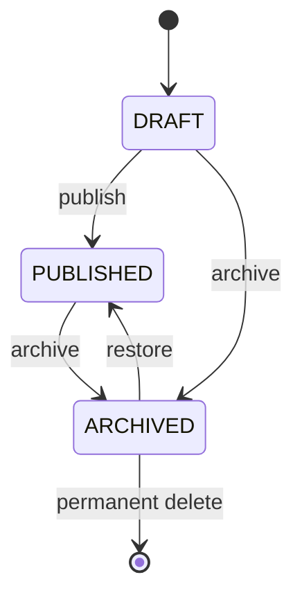
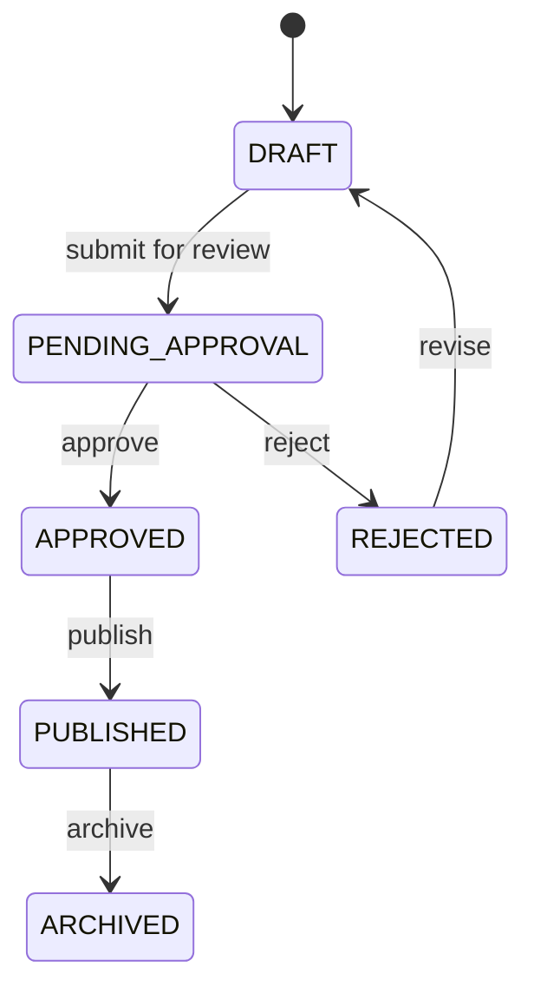
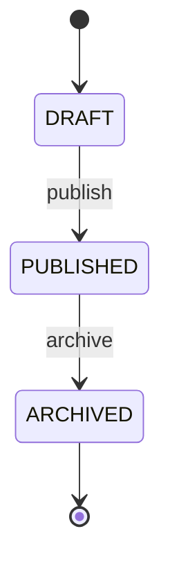
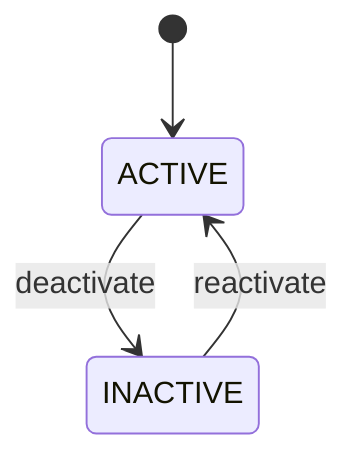
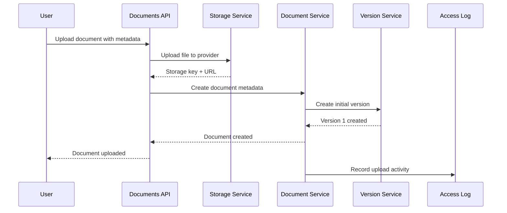
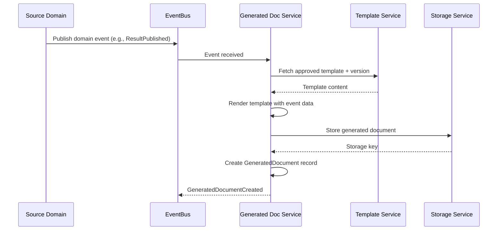
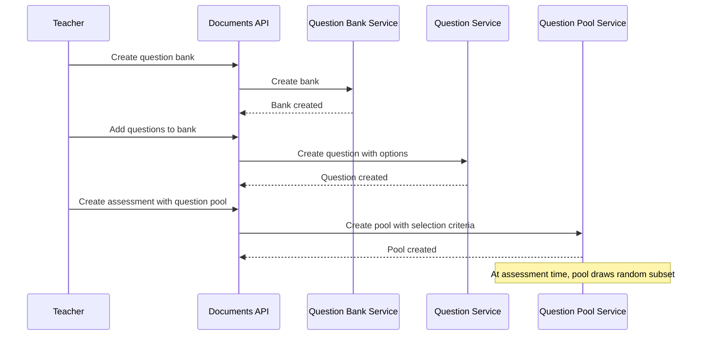

# Documents & Learning Engineering Specification

**Domain:** Documents & Learning
**Scope:** Document Management, Student Documents, Staff Documents, Institutional Documents, Generated Documents, Template Management, Learning Resources, Computer-Based Testing (CBT), Assessment Content, File Versioning, Storage Abstraction, Document Security, Retention Policies
**Created:** 2026-07-17
**Status:** Approved — Frozen for Implementation
**Last Updated:** 2026-07-20

---

## Table of Contents

1. [Overview](#1-overview)
2. [Engineering Principles](#2-engineering-principles)
3. [Architecture Decision Records](#3-architecture-decision-records)
4. [Engineering Status](#4-engineering-status)
5. [Phase 1 — Domain Analysis](#5-phase-1--domain-analysis)
6. [Phase 2 — Domain Design](#6-phase-2--domain-design)
7. [Phase 3 — Database Design](#7-phase-3--database-design)
8. [Phase 4 — Prisma Schema](#8-phase-4--prisma-schema)
9. [Phase 5 — Backend Implementation](#9-phase-5--backend-implementation)
10. [Phase 6 — API Design](#10-phase-6--api-design)
11. [Phase 7 — Testing & Verification](#11-phase-7--testing--verification)
12. [Storage Provider Abstraction](#12-storage-provider-abstraction)
13. [Generated Document Engine](#13-generated-document-engine)
14. [Outstanding Items](#14-outstanding-items)
15. [Revision History](#15-revision-history)

---

## 1. Overview

Documents & Learning is the content backbone of the platform, owning every document, file reference, template, digital learning resource, and assessment content item used by the institution. It provides secure storage references, versioning, lifecycle management, educational resources, CBT content, and generated document management.

| Aspect | Approach |
|--------|----------|
| Identity | Institution-scoped; every entity belongs to one Institution |
| Bounded Contexts | 13 (Document Management, Student Documents, Staff Documents, Institutional Documents, Generated Documents, Template Management, Learning Resources, CBT, Assessment Content, File Versioning, Storage Abstraction, Document Security, Retention Policies) |
| Storage | Provider-independent abstraction layer; stores metadata and file references, not raw binary |
| Versioning | Full version history with drafts, publishing, and restoration |
| Templates | Reusable, versioned, approval-governed templates for document generation |
| Generated Documents | Templates + data from other domains produce report cards, receipts, letters, certificates, IDs |
| Learning Resources | Linked to subjects, classes, assignments, and teachers |
| CBT Content | Question banks, questions, options, difficulty levels — content layer only |
| Assessment Content | Quizzes, practice tests, question pools with randomisation metadata |
| Security | Role-based access permissions, sharing, expiration, audit history |
| Retention | Configurable per document type; institution overrides platform defaults |

**In Scope:** Document categories, types, lifecycle, versioning, metadata, tags, ownership, sharing, archiving, retention policies, student documents, staff documents, institutional documents, generated documents, template management, learning resources, CBT content, assessment content, file versioning, storage abstraction, document security, retention policies

**Out of Scope:** Authentication, Authorization, Roles, Permissions (Identity & Access), Person profiles (People), Subjects, Grades, Attendance, Academic progression, Assessment scoring, Result computation (Academic Management), Billing, Payments, Receipts ownership (Finance), Email delivery, SMS delivery, Notifications (Communication), Library inventory, Asset management (Operations)

---

## 2. Engineering Principles

### Core Philosophy

- **Documents Own Metadata:** The domain stores document metadata, file references, templates, learning resources, and assessment content; raw binary content lives in the Storage Abstraction layer
- **Storage Abstraction:** File storage is provider-independent; the application references files through an abstraction layer supporting Local, S3, Azure, GCP, MinIO, and future providers
- **Academic Boundary:** CBT owns question content only; exam scheduling, grading logic, and result computation belong to Academic Management
- **Finance Boundary:** Finance owns receipts and invoices; Documents & Learning owns the generated document template and rendering
- **Multi-Tenant Isolation by Default:** Every query scoped to tenant context; cross-tenant access = security violation
- **Configuration over Customization:** Retention policies, access levels, template approval workflows are institution-configurable
- **Event-Driven Communication:** Cross-service communication via domain events; eventual consistency
- **Soft Delete by Default:** All mutable core entities support restore within retention period
- **Business Status vs Soft Delete:** Status enums represent business states (e.g., DRAFT, PUBLISHED, ARCHIVED); deletion is controlled by `deleted_at` / `deleted_by` columns exclusively
- **Optimistic Concurrency:** Version column on mutable entities; 409 Conflict on version mismatch
- **Immutable Audit Logging:** Append-only audit logs; never update or delete
- **Version Immutability:** Document versions are immutable snapshots; new versions create new records
- **Generated Documents are Immutable:** Once generated, documents are never modified; regeneration creates new instances
- **Template Approval:** Institutional templates require approval before publication

### Naming Conventions

| Element | Convention | Example |
|---------|-----------|---------|
| Database tables | snake_case, plural | documents, templates, questions |
| Columns | snake_case | document_id, storage_key |
| Enums | SCREAMING_SNAKE_CASE | DOCUMENT_STATUS_PUBLISHED |
| Classes | PascalCase | DocumentAggregate |
| Methods | camelCase | createDocument |
| API responses | camelCase | success, documentId |
| Events | PascalCase, past tense | DocumentUploaded |
| Errors | PascalCase + Error | DocumentNotFoundError |
| Permissions | `{domain}:{resource}:{action}` | documents:document:read |

### Tenant Isolation

- Tenant ID extracted from JWT and passed to repository methods as first parameter
- Application-level filtering (no Postgres Row-Level Security)
- Every query must include tenant filter
- Institution ID further scopes queries within a tenant

### Soft Delete

- All mutable core entities use soft delete via `deleted_at` (DateTime?) and `deleted_by` (uuid?)
- Business status (e.g., DRAFT, PUBLISHED, ARCHIVED) is a separate concern from deletion
- 30-day restore window before permanent deletion for eligible entities
- Generated documents and published templates are retained per institution-configured retention policy

### Audit Logging

Every state-changing operation generates an append-only audit log entry with: entity_type, entity_id, action, actor_id, actor_email, changes (JSON diff), context_ip, context_user_agent, timestamp.

For document operations, the audit log additionally captures: document_type, file_size, storage_provider, access_type (view/download/share).

### Error Handling

- Structured error responses: `{ success: false, error: { code, message, details[] } }`
- Domain-specific error classes; never expose internal details
- Full error context logged server-side
- Storage errors include provider reference and file key for debugging

### Prisma Schema Principles

- UUID `@default(uuid())` for all primary keys
- `@unique` constraints for business keys
- `@map` for snake_case column names
- Soft delete via `deleted_at` (DateTime?) and `deleted_by` (uuid?)
- Business status via `status` enum (never a deletion marker)
- Optimistic locking via `version` (Int @default(1))
- Audit fields: created_at, created_by, updated_at, updated_by
- JSON columns for flexible data (metadata, tags, media references, configuration)
- Prisma enums mapped to database types
- Cascade deletes: child entities cascade from parent aggregate root; cross-aggregate references use application-level guards

### Technology Stack

| Component | Technology |
|-----------|-----------|
| Runtime | Node.js >=22.0.0 |
| Framework | NestJS ^11.0.0 |
| ORM | Prisma ^6.12.0 |
| Language | TypeScript ^5.8.3 |
| Validation | class-validator + class-transformer |
| Auth | JWT + bcrypt |
| Queue | BullMQ + Redis |
| Testing | Jest ^30.0.0 |
| Migrations | Prisma Migrate |
| API Docs | Swagger/OpenAPI ^7.0.0 |

---

## 3. Architecture Decision Records

| ADR | Decision | Rationale |
|-----|----------|-----------|
| ADR-001 | Documents store metadata and file references, not raw binary | Separation of concerns; storage belongs in abstraction layer; metadata querying is fast |
| ADR-002 | Storage abstraction is provider-independent | Institutions use different cloud providers; domain must not depend on a single vendor |
| ADR-003 | Document versions are immutable snapshots | Version history must be auditable; modifying a version would break traceability |
| ADR-004 | Student/Staff/Institutional Documents link to People domain via IDs | People owns person records; Documents & Learning owns document metadata and associations |
| ADR-005 | Generated Documents reference templates plus external domain data | Report cards need results (Academic), receipts need payments (Finance); domain renders but does not own source data |
| ADR-006 | Templates have approval workflow before publication | Institutional documents must be reviewed before use; prevents unauthorised template deployment |
| ADR-007 | Learning Resources link to Academic Management entities | Resources are attached to subjects, classes, and assignments; Academic Management owns the academic structure |
| ADR-008 | CBT owns content only, not delivery or grading | Question banks and questions are reusable content; exam scheduling, delivery, and scoring belong to Academic Management |
| ADR-009 | Assessment Content reuses Questions from CBT | Questions are authored once in question banks; assessments reference them via pools for randomisation |
| ADR-010 | Access permissions follow role-based hierarchy with document-level overrides | Institution-wide defaults exist; individual documents can restrict or expand access |
| ADR-011 | Retention policies are institution-configurable with platform defaults | Different institutions have different compliance requirements; platform provides sensible defaults |
| ADR-012 | Application-level tenant isolation (no RLS) | Consistent with Identity & Access, Institution Management, People, Academic Management, Finance, Communication, and Operations |
| ADR-013 | Domain events via EventEmitter2 (in-process) | Decouples services; supports async processing; future migration to MQ |
| ADR-014 | Optimistic concurrency (version column) | Prevents lost updates on concurrent document edits and template changes |
| ADR-015 | Immutable audit logs (append-only) | Tamper-proof document access and modification audit trail |
| ADR-016 | Document categories are hierarchical | Categories support parent-child nesting for organised classification and reporting |
| ADR-017 | Document tags are many-to-many | Tags provide flexible cross-cutting classification without hierarchy constraints |
| ADR-018 | Template versioning ensures snapshot consistency | In-flight generations must reference a specific template version; template changes do not affect published versions |
| ADR-019 | Generated documents are immutable once created | Report cards, receipts, and certificates must not be modified after generation; regeneration creates new instances |
| ADR-020 | Learning Resources support multiple media types | Educational content spans notes, presentations, videos, audio, and links; the domain must accommodate all formats |
| ADR-021 | Question banks are session-scoped | Question relevance changes across academic sessions; banks are versioned per session |
| ADR-022 | Questions support multiple answer types | CBT requires multiple-choice, true/false, short answer, essay, fill-in-blank, matching, and numerical types |
| ADR-023 | Question pools enable randomised assessment generation | Pools define question selection criteria; assessments draw random subsets for each student |
| ADR-024 | Access logging tracks all document interactions | Download, view, and share events are logged for security and compliance |
| ADR-025 | Retention enforcement is background-job driven | Cleanup runs asynchronously; does not block API responses |
| ADR-026 | Storage configuration is institution-scoped | Each institution may use a different storage provider or bucket |
| ADR-027 | Document sharing supports expiration dates | Shared access must be time-bounded for security; expired shares are automatically revoked |
| ADR-028 | Watermarking and digital signatures are future concerns | V1 focuses on core document management; advanced security features deferred |
| ADR-029 | Email templates are metadata-only | Communication owns email delivery; Documents & Learning provides template metadata |
| ADR-030 | CBT difficulty levels are institution-configurable | Institutions define their own difficulty scales; the domain provides configurable levels |
| ADR-031 | Learning objectives map to curriculum standards | Objectives provide pedagogical context; they link to subjects and topics in Academic Management |
| ADR-032 | Document search supports full-text across metadata | Users need fast document discovery; PostgreSQL full-text search on titles, descriptions, and tags |
| ADR-033 | Retention rules are per-document-type | Different document types have different retention requirements (e.g., medical vs. administrative) |
| ADR-034 | Storage keys use structured paths | Files stored with `{tenant}/{institution}/{year}/{month}/{hash}` paths for organised retrieval |
| ADR-035 | Document permissions support five levels | VIEW, DOWNLOAD, EDIT, DELETE, SHARE provide granular access control |

---

## 4. Engineering Status

| Phase | Status | Summary |
|-------|--------|---------|
| Phase 1 — Domain Analysis | Complete | 32 entities, 50+ domain events, 35 business rules |
| Phase 2 — Domain Design | Complete | 13 aggregates, 35 invariants, 25 policies, 12 validation rule sets |
| Phase 3 — Database Design | Complete | 33 tables, 55+ indexes, 30 unique constraints |
| Phase 4 — Prisma Schema | Complete | 34 models, 17 enums, 2-pass validation |
| Phase 5 — Backend Implementation | Complete | 13 modules, 13 repositories, 13 domain services, 13 controllers, 8 event consumers |
| Phase 6 — API Design | Complete | 120 endpoints |
| Phase 7 — Testing & Verification | Complete | 18 test categories, ~285+ test scenarios |

**Overall Status:** Approved — Frozen for Implementation.

---

## 5. Phase 1 — Domain Analysis

### 5.1 Domain Purpose

Documents & Learning is the content backbone of the platform. It owns every document, file reference, template, learning resource, and assessment content item used by the institution. The domain provides secure storage references, versioning, lifecycle management, educational resources, CBT content, and generated document management.

The domain operates within strict boundaries: it owns metadata, templates, and content. It does not own raw binary content (Storage Abstraction), academic rules (Academic Management), financial records (Finance), or delivery (Communication).

### 5.2 Domain Responsibilities

| Responsibility | Description |
|----------------|-------------|
| Document Management | Create, version, categorise, tag, share, and archive documents |
| Student Documents | Associate admission, identification, medical, academic, and consent documents with student records |
| Staff Documents | Associate employment, certification, qualification, contract, and compliance documents with staff records |
| Institutional Documents | Manage policies, handbooks, circulars, forms, templates, and official publications at institution level |
| Generated Documents | Generate report cards, fee receipts, invoices, admission letters, ID documents, certificates, and letters from templates and external data |
| Template Management | Create, version, approve, and publish reusable templates for document generation |
| Learning Resources | Manage lesson materials, presentations, videos, audio, links, and downloadable resources linked to academic entities |
| Computer-Based Testing | Manage question banks, questions, answer options, difficulty levels, and learning objectives — content layer only |
| Assessment Content | Manage quizzes, practice tests, mock examinations, question pools, and randomisation metadata |
| File Versioning | Track version history, changes, drafts, publishing, and restoration of documents |
| Storage Abstraction | Provide provider-independent file storage integration |
| Document Security | Enforce access permissions, download permissions, expiration, sharing, and audit history |
| Retention Policies | Define and enforce configurable retention rules per document type |

### 5.3 Domain Boundaries

**In Scope:** Document management, student documents, staff documents, institutional documents, generated documents, template management, learning resources, CBT content, assessment content, file versioning, storage abstraction, document security, retention policies

**Out of Scope:** Authentication, Authorization, Roles, Permissions (Identity & Access), Person profiles (People), Subjects, Grades, Attendance, Academic progression, Assessment scoring, Result computation (Academic Management), Billing, Payments, Receipts ownership (Finance), Email delivery, SMS delivery, Notifications (Communication), Library inventory, Asset management (Operations)

### 5.4 Dependencies

| Dependency | Nature | Direction |
|------------|--------|-----------|
| Identity & Access | User context, authentication, role resolution for permission checks | Reads |
| Institution Management | Institution configuration, tenant context, module licensing | Reads |
| People | Student, Staff, Parent person records for document associations | Reads |
| Academic Management | Subjects, classes, assignments for learning resource linking; results for report card generation | Reads |
| Finance | Payment and invoice data for receipt and invoice generation | Reads |
| Communication | Email template metadata for notification templates | Reads |
| Platform Administration | File storage infrastructure, audit logging, event bus | Writes |

### 5.5 Core Entities

| Entity | Type | Bounded Context | Description |
|--------|------|----------------|-------------|
| Document | Core | Document Management | Primary document entity with metadata, file reference, owner, status |
| DocumentCategory | Core | Document Management | Classification category (hierarchical) |
| DocumentType | Core | Document Management | Type definition (admission, medical, employment, etc.) |
| DocumentTag | Supporting | Document Management | Tags for search and cross-cutting classification |
| DocumentVersion | Core | File Versioning | Immutable version snapshot of a document |
| DocumentActivity | Supporting | Document Security | Activity log for document interactions (view, download, share) |
| StudentDocument | Core | Student Documents | Links a Document to a Student from People domain |
| StaffDocument | Core | Staff Documents | Links a Document to a Staff from People domain |
| InstitutionalDocument | Core | Institutional Documents | Institution-scoped document with publication scope |
| GeneratedDocument | Core | Generated Documents | Generated document instance from template and data |
| GeneratedDocumentBatch | Supporting | Generated Documents | Batch generation tracking for bulk operations |
| DocumentTemplate | Core | Template Management | Reusable template with versioning and approval workflow |
| TemplateVersion | Core | Template Management | Immutable version snapshot of a template |
| TemplateApproval | Supporting | Template Management | Approval workflow record for templates |
| LearningResource | Core | Learning Resources | Educational content linked to academic entities |
| ResourceCategory | Core | Learning Resources | Classification category for learning resources |
| ResourceLink | Supporting | Learning Resources | Links resources to subjects, classes, assignments, teachers |
| QuestionBank | Core | CBT | Collection of questions organised by subject and topic |
| Question | Core | CBT | Individual question with type, content, and options |
| QuestionOption | Core | CBT | Answer option for a question |
| QuestionCategory | Core | CBT | Classification category for questions |
| DifficultyLevel | Core | CBT | Difficulty classification (institution-configurable) |
| LearningObjective | Core | CBT | Learning objective tags mapped to curriculum standards |
| AssessmentContent | Core | Assessment Content | Quiz, practice test, or mock examination definition |
| QuestionPool | Core | Assessment Content | Pool of questions for randomised assessment generation |
| StorageProvider | Core | Storage Abstraction | External storage provider configuration |
| StorageConfiguration | Core | Storage Abstraction | Institution-level storage settings |
| DocumentPermission | Core | Document Security | Access permission on a document for a user or role |
| DocumentShare | Core | Document Security | Time-bounded sharing record with expiration |
| AccessLog | Core | Document Security | Immutable log of document access events |
| RetentionPolicy | Core | Retention Policies | Configurable retention rule per document type |
| RetentionRule | Supporting | Retention Policies | Specific rule within a retention policy |

### 5.6 Domain Events

#### 5.6.1 Events Published by Documents & Learning

| Event | Trigger | Consumers |
|-------|---------|-----------|
| DocumentUploaded | New document created | AuditModule |
| DocumentUpdated | Document metadata changed | AuditModule |
| DocumentPublished | Document status → PUBLISHED | Communication (notification) |
| DocumentArchived | Document status → ARCHIVED | AuditModule |
| DocumentShared | Share record created | Communication (notification) |
| DocumentDeleted | Document soft deleted | AuditModule |
| DocumentRestored | Document restored from soft delete | AuditModule |
| TemplateCreated | New template created | AuditModule |
| TemplatePublished | Template approved and published | AuditModule, Communication |
| TemplateArchived | Template archived | AuditModule |
| GeneratedDocumentCreated | Document generated from template | AuditModule, Communication (delivery) |
| LearningResourceCreated | New resource created | AuditModule |
| LearningResourcePublished | Resource published to students | Communication (notification) |
| QuestionBankCreated | New question bank created | AuditModule |
| QuestionCreated | New question added | AuditModule |
| AssessmentContentCreated | New assessment content created | AuditModule |
| AssessmentContentPublished | Assessment content published | Communication (notification) |
| RetentionPolicyCreated | Retention policy defined | AuditModule |
| RetentionEnforced | Background job enforced retention | AuditModule |

#### 5.6.2 Events Consumed from Other Domains

| Source Domain | Event | Documents & Learning Action |
|---------------|-------|-----------------------------|
| People | StudentEnrolled | Enable document upload for student |
| People | StaffHired | Enable document upload for staff |
| People | StudentGraduated | Trigger document archival |
| People | StaffSeparated | Trigger document archival |
| Academic Management | ResultPublished | Trigger report card generation |
| Academic Management | TermClosed | Enable term-specific document archival |
| Finance | InvoiceGenerated | Trigger invoice document generation |
| Finance | PaymentConfirmed | Trigger receipt document generation |
| Institution Management | InstitutionCreated | Create default document categories and retention policies |

### 5.7 Business Rules

| ID | Rule |
|----|------|
| BR-DL-001 | Every entity is tenant-scoped and institution-scoped |
| BR-DL-002 | Documents store metadata and file references; raw binary content is stored via Storage Abstraction |
| BR-DL-003 | Document versions are immutable; new versions create new records |
| BR-DL-004 | Student Documents reference a valid Student from the People domain |
| BR-DL-005 | Staff Documents reference a valid Staff from the People domain |
| BR-DL-006 | Institutional Documents are visible to all institution members unless restricted |
| BR-DL-007 | Generated Documents are immutable once created; regeneration creates new instances |
| BR-DL-008 | Templates must be APPROVED before they can be used for document generation |
| BR-DL-009 | Template changes create new TemplateVersion records; in-flight generations reference specific versions |
| BR-DL-010 | Learning Resources reference valid academic entities (subjects, classes, assignments) |
| BR-DL-011 | CBT owns question content only; exam scheduling, delivery, and grading belong to Academic Management |
| BR-DL-012 | Assessment Content references Questions from Question Banks for randomisation |
| BR-DL-013 | Question Pools define selection criteria; assessments draw random subsets per student |
| BR-DL-014 | Document permissions follow role-based hierarchy with document-level overrides |
| BR-DL-015 | Document sharing supports expiration dates; expired shares are automatically revoked |
| BR-DL-016 | Retention policies are per-document-type; institution overrides platform defaults |
| BR-DL-017 | Retention enforcement runs as background jobs; does not block API responses |
| BR-DL-018 | Storage keys use structured paths: `{tenant}/{institution}/{year}/{month}/{hash}` |
| BR-DL-019 | Document categories support hierarchical nesting |
| BR-DL-020 | Document tags are many-to-many; a document can have multiple tags |
| BR-DL-021 | Access logging tracks all document interactions (view, download, share, edit, delete, restore) |
| BR-DL-022 | Email templates are metadata-only; Communication owns email delivery |
| BR-DL-023 | CBT difficulty levels are institution-configurable |
| BR-DL-024 | Learning objectives map to curriculum standards and link to Academic Management topics |
| BR-DL-025 | Document search supports full-text across titles, descriptions, and tags |
| BR-DL-026 | Questions support multiple answer types: MCQ, true/false, short answer, essay, fill-in-blank, matching, numerical |
| BR-DL-027 | Question Banks are scoped to an academic session |
| BR-DL-028 | Generated Document batches track bulk generation operations |
| BR-DL-029 | Storage configuration is institution-scoped; each institution may use a different provider |
| BR-DL-030 | Document permissions support five levels: VIEW, DOWNLOAD, EDIT, DELETE, SHARE |
| BR-DL-031 | Watermarking and digital signatures are future concerns (V2) |
| BR-DL-032 | Documents without explicit permissions inherit institution-level access defaults |
| BR-DL-033 | Learning Resources support multiple media types: notes, presentations, videos, audio, links |
| BR-DL-034 | Retention rules define action (ARCHIVE, DELETE, NOTIFY) and period per document type |
| BR-DL-035 | Question usage is tracked for analytics and deduplication |

### 5.8 Invariants

| ID | Invariant |
|----|-----------|
| INV-DL-001 | Every entity belongs to exactly one Institution |
| INV-DL-002 | Every Document belongs to exactly one Institution |
| INV-DL-003 | Every Document belongs to exactly one DocumentCategory |
| INV-DL-004 | Every Document has at least one DocumentVersion |
| INV-DL-005 | A DocumentVersion is immutable once created |
| INV-DL-006 | Every StudentDocument references exactly one Document and one Student |
| INV-DL-007 | Every StaffDocument references exactly one Document and one Staff |
| INV-DL-008 | Every InstitutionalDocument references exactly one Document |
| INV-DL-009 | Every GeneratedDocument references exactly one DocumentTemplate |
| INV-DL-010 | Every GeneratedDocument references exactly one TemplateVersion |
| INV-DL-011 | Every DocumentTemplate belongs to exactly one Institution |
| INV-DL-012 | Every TemplateVersion references exactly one DocumentTemplate |
| INV-DL-013 | TemplateVersion version numbers are sequential per template |
| INV-DL-014 | Every LearningResource belongs to exactly one Institution |
| INV-DL-015 | Every ResourceLink references a valid LearningResource |
| INV-DL-016 | Every QuestionBank belongs to exactly one Institution |
| INV-DL-017 | Every Question belongs to exactly one QuestionBank |
| INV-DL-018 | Every QuestionOption belongs to exactly one Question |
| INV-DL-019 | A Question of type MULTIPLE_CHOICE has at least two QuestionOptions |
| INV-DL-020 | A Question of type TRUE_FALSE has exactly two QuestionOptions |
| INV-DL-021 | Every AssessmentContent belongs to exactly one Institution |
| INV-DL-022 | Every QuestionPool references at least one Question |
| INV-DL-023 | DocumentPermission is unique per Document per User (or Role) |
| INV-DL-024 | DocumentShare is unique per Document per User |
| INV-DL-025 | Every AccessLog entry references a valid Document |
| INV-DL-026 | RetentionPolicy is unique per Institution per document_type |
| INV-DL-027 | Every RetentionRule references a valid RetentionPolicy |
| INV-DL-028 | StorageProvider is unique per Institution per provider_type |
| INV-DL-029 | GeneratedDocumentBatch belongs to exactly one Institution |
| INV-DL-030 | DocumentCategory supports parent-child hierarchy |
| INV-DL-031 | DocumentTag is unique per Institution per name |
| INV-DL-032 | DifficultyLevel is unique per Institution per name |
| INV-DL-033 | LearningObjective is unique per Institution per code |
| INV-DL-034 | QuestionCategory is unique per Institution per name |
| INV-DL-035 | ResourceCategory is unique per Institution per name |

### 5.9 Configurable Policies

| ID | Policy | Default | Scope |
|----|--------|---------|-------|
| CP-DL-001 | Max document upload size (MB) | 50 | Institution |
| CP-DL-002 | Allowed file types | ["pdf","docx","xlsx","pptx","jpg","png","mp4"] | Institution |
| CP-DL-003 | Document retention period (days) | 365 | Institution / Document Type |
| CP-DL-004 | Max versions per document | 50 | Institution |
| CP-DL-005 | Template approval required | true | Institution |
| CP-DL-006 | Max shares per document | 20 | Institution |
| CP-DL-007 | Share expiration max (days) | 90 | Institution |
| CP-DL-008 | Learning resource max file size (MB) | 500 | Institution |
| CP-DL-009 | CBT max questions per bank | 5000 | Institution |
| CP-DL-010 | CBT max options per question | 10 | Institution |
| CP-DL-011 | CBT max media attachments per question | 5 | Institution |
| CP-DL-012 | Assessment content max questions | 200 | Institution |
| CP-DL-013 | Question pool min questions | 10 | Institution |
| CP-DL-014 | Access log retention (days) | 365 | Institution |
| CP-DL-015 | Default access level for new documents | PRIVATE | Institution |
| CP-DL-016 | Generated document max batch size | 500 | Institution |
| CP-DL-017 | Learning resource approval required | false | Institution |
| CP-DL-018 | CBT difficulty levels | ["EASY","MEDIUM","HARD","EXPERT"] | Institution |
| CP-DL-019 | Document search results max | 100 | Institution |
| CP-DL-020 | Soft delete retention (days) | 30 | Institution |
| CP-DL-021 | Max tags per document | 10 | Institution |
| CP-DL-022 | Max categories per document | 3 | Institution |
| CP-DL-023 | Storage provider fallback enabled | true | Institution |
| CP-DL-024 | Auto-generate document number | true | Institution |
| CP-DL-025 | Retention enforcement schedule | WEEKLY | Institution |

### 5.10 Validation Rule Sets

| ID | Rules | Scope |
|----|-------|-------|
| VRS-DL-001 | Document: title required (1–200 chars), category_id required, type_id required, file_reference required | Document |
| VRS-DL-002 | DocumentCategory: name required (3–100 chars), parent_id optional (self-ref) | DocumentCategory |
| VRS-DL-003 | DocumentType: name required (3–100 chars), unique per institution | DocumentType |
| VRS-DL-004 | DocumentVersion: document_id required, version_number required, storage_key required, file_size > 0 | DocumentVersion |
| VRS-DL-005 | StudentDocument: document_id required, student_person_id required, document_type required | StudentDocument |
| VRS-DL-006 | StaffDocument: document_id required, staff_person_id required, document_type required | StaffDocument |
| VRS-DL-007 | InstitutionalDocument: document_id required, scope required (POLICY, HANDBOOK, CIRCULAR, FORM, TEMPLATE, PUBLICATION) | InstitutionalDocument |
| VRS-DL-008 | GeneratedDocument: template_id required, template_version_id required, source_domain required, source_id required | GeneratedDocument |
| VRS-DL-009 | DocumentTemplate: name required (3–200 chars), type required, status required | DocumentTemplate |
| VRS-DL-010 | LearningResource: title required (3–200 chars), resource_type required, content_url or file_reference required | LearningResource |
| VRS-DL-011 | Question: bank_id required, question_type required, content required (min 10 chars), difficulty_level_id optional | Question |
| VRS-DL-012 | AssessmentContent: title required (3–200 chars), content_type required, institution_id required | AssessmentContent |

---

## 6. Phase 2 — Domain Design

### 6.1 Aggregates

| Aggregate | Root Entity | Bounded Context | Purpose | Lifecycle |
|-----------|-------------|----------------|---------|-----------|
| DocumentAggregate | Document | Document Management | Core document with metadata, versions, permissions | DRAFT → PUBLISHED → ARCHIVED |
| StudentDocumentAggregate | StudentDocument | Student Documents | Student-specific document association | ACTIVE → ARCHIVED |
| StaffDocumentAggregate | StaffDocument | Staff Documents | Staff-specific document association | ACTIVE → ARCHIVED |
| InstitutionalDocumentAggregate | InstitutionalDocument | Institutional Documents | Institution-level document with publication scope | DRAFT → PUBLISHED → ARCHIVED |
| GeneratedDocumentAggregate | GeneratedDocument | Generated Documents | Generated document from template + data | GENERATED → PUBLISHED → ARCHIVED |
| DocumentTemplateAggregate | DocumentTemplate | Template Management | Reusable template with versioning and approval | DRAFT → PENDING_APPROVAL → APPROVED → PUBLISHED → ARCHIVED / REJECTED |
| LearningResourceAggregate | LearningResource | Learning Resources | Educational content linked to academic entities | DRAFT → PUBLISHED → ARCHIVED |
| QuestionBankAggregate | QuestionBank | CBT | Collection of questions organised by subject | ACTIVE → INACTIVE |
| QuestionAggregate | Question | CBT | Individual question with options | ACTIVE → INACTIVE |
| AssessmentContentAggregate | AssessmentContent | Assessment Content | Quiz, practice test, mock examination | DRAFT → PUBLISHED → ARCHIVED |
| QuestionPoolAggregate | QuestionPool | Assessment Content | Pool of questions for randomisation | ACTIVE → INACTIVE |
| StorageProviderAggregate | StorageProvider | Storage Abstraction | Provider configuration | ACTIVE → DISABLED |
| RetentionPolicyAggregate | RetentionPolicy | Retention Policies | Configurable retention rules | ACTIVE → SUPERSEDED |

### 6.2 Entity Relationships

```mermaid
erDiagram
    Institution ||--o{ Document : "owns"
    Institution ||--o{ DocumentTemplate : "owns"
    Institution ||--o{ LearningResource : "owns"
    Institution ||--o{ QuestionBank : "owns"
    Institution ||--o{ AssessmentContent : "owns"
    Institution ||--o{ StorageProvider : "configures"
    Institution ||--o{ RetentionPolicy : "defines"

    Document ||--o{ DocumentVersion : "has"
    Document }o--|| DocumentCategory : "categorized as"
    Document }o--|| DocumentType : "typed as"
    Document ||--o{ DocumentTag : "tagged"
    Document ||--o{ DocumentPermission : "permissions"
    Document ||--o{ DocumentShare : "shared"
    Document ||--o{ AccessLog : "access log"

    Document ||--o| StudentDocument : "student doc"
    Document ||--o| StaffDocument : "staff doc"
    Document ||--o| InstitutionalDocument : "institutional doc"
    Document ||--o| GeneratedDocument : "generated"

    StudentDocument }o--|| Student : "references"
    StaffDocument }o--|| Staff : "references"

    GeneratedDocument }o--|| DocumentTemplate : "uses template"
    GeneratedDocument }o--|| TemplateVersion : "uses version"
    GeneratedDocument ||--o| GeneratedDocumentBatch : "batch"

    DocumentTemplate ||--o{ TemplateVersion : "versions"
    DocumentTemplate ||--o{ TemplateApproval : "approvals"

    LearningResource }o--|| ResourceCategory : "categorized as"
    LearningResource ||--o{ ResourceLink : "linked to"

    QuestionBank ||--o{ Question : "contains"
    Question ||--o{ QuestionOption : "options"
    Question }o--|| QuestionCategory : "categorized as"
    Question }o--|| DifficultyLevel : "difficulty"
    Question ||--o{ LearningObjective : "objectives"

    AssessmentContent ||--o{ QuestionPool : "pools"
    QuestionPool ||--o{ Question : "draws from"

    StorageProvider ||--o{ StorageConfiguration : "config"
```



### 6.3 Aggregate Lifecycle State Machines

#### 6.3.1 Document Lifecycle



#### 6.3.2 Template Lifecycle



#### 6.3.3 Learning Resource Lifecycle



#### 6.3.4 Question Lifecycle



#### 6.3.5 Assessment Content Lifecycle


### 6.4 Domain Services

| Service | Bounded Context | Responsibility |
|---------|----------------|----------------|
| DocumentService | Document Management | Document CRUD, lifecycle, categorisation, tagging |
| DocumentVersionService | File Versioning | Version creation, history, restoration |
| StudentDocumentService | Student Documents | Student document association, validation |
| StaffDocumentService | Staff Documents | Staff document association, validation |
| InstitutionalDocumentService | Institutional Documents | Institution-scoped document management, publication |
| GeneratedDocumentService | Generated Documents | Document generation from templates, batch operations |
| TemplateService | Template Management | Template CRUD, versioning, approval workflow |
| LearningResourceService | Learning Resources | Resource CRUD, categorisation, academic linking |
| QuestionBankService | CBT | Question bank CRUD, organisation |
| QuestionService | CBT | Question CRUD, option management, media attachments |
| AssessmentContentService | Assessment Content | Quiz, practice test, mock exam CRUD |
| QuestionPoolService | Assessment Content | Pool CRUD, randomisation, selection criteria |
| DocumentPermissionService | Document Security | Permission CRUD, access evaluation, sharing |
| StorageService | Storage Abstraction | Provider management, file upload/download, key generation |
| RetentionPolicyService | Retention Policies | Policy CRUD, enforcement scheduling |
| AccessLogService | Document Security | Access event recording, audit queries |
| DocumentSearchService | Document Management | Full-text search across documents, resources, questions |

### 6.5 Policies

| ID | Policy | Trigger | Scope |
|----|--------|---------|-------|
| POL-DL-001 | Document access level enforcement | Document creation | Institution default → document override |
| POL-DL-002 | Template approval workflow | Template submit | Institution |
| POL-DL-003 | Retention enforcement scheduling | Background job | Per document type |
| POL-DL-004 | Share expiration enforcement | Background job | Per share record |
| POL-DL-005 | Version limit enforcement | Version creation | Per document |
| POL-DL-006 | File type validation | Upload time | Per institution |
| POL-DL-007 | File size validation | Upload time | Per institution |
| POL-DL-008 | Storage provider failover | Upload failure | Per institution |
| POL-DL-009 | Access logging on every interaction | View/download/share | Always active |
| POL-DL-010 | Learning resource publication approval | Resource publish | Institution-configurable |
| POL-DL-011 | CBT question review workflow | Question creation | Institution-configurable |
| POL-DL-012 | Assessment content lock on publish | Assessment publish | Always active |
| POL-DL-013 | Generated document immutability | Generation complete | Always active |
| POL-DL-014 | Document number auto-generation | Document creation | Institution-configurable |
| POL-DL-015 | Category depth limit | Category creation | Max 5 levels |
| POL-DL-016 | Tag uniqueness per institution | Tag creation | Always active |
| POL-DL-017 | Storage key path structure | File upload | Always active |
| POL-DL-018 | Batch generation progress tracking | Batch creation | Always active |
| POL-DL-019 | Question pool minimum size | Pool creation | Per institution |
| POL-DL-020 | Document permission inheritance | Permission check | Institution → category → document |

### 6.6 Event Flow Diagrams

#### 6.6.1 Document Upload Flow



#### 6.6.2 Generated Document Flow



#### 6.6.3 CBT Question Flow



### 6.7 Read Models

| Read Model | Purpose | Source |
|------------|---------|--------|
| DocumentSummary | Document listing with metadata | Document + DocumentCategory + DocumentType + DocumentVersion |
| DocumentDetail | Full document with versions, permissions, shares | Document + Version + Permission + Share + AccessLog |
| StudentDocumentsView | Student's document collection | StudentDocument + Document + DocumentType |
| StaffDocumentsView | Staff's document collection | StaffDocument + Document + DocumentType |
| InstitutionalDocumentsView | Institution-wide document listing | InstitutionalDocument + Document + DocumentCategory |
| GeneratedDocumentsView | Generated document listing with template info | GeneratedDocument + DocumentTemplate + TemplateVersion |
| TemplateSummary | Template listing with version and approval status | DocumentTemplate + TemplateVersion + TemplateApproval |
| LearningResourcesView | Learning resource listing with academic links | LearningResource + ResourceCategory + ResourceLink |
| QuestionBankSummary | Question bank with question count | QuestionBank + Question aggregation |
| QuestionDetailView | Full question with options, category, difficulty | Question + QuestionOption + QuestionCategory + DifficultyLevel |
| AssessmentContentView | Assessment content with pool and question count | AssessmentContent + QuestionPool + Question aggregation |
| AccessLogView | Document access history | AccessLog + Document |
| StorageUsageView | Storage consumption per institution | Document + DocumentVersion aggregation |
| RetentionPolicyView | Active retention policies by document type | RetentionPolicy + RetentionRule |

### 6.8 Search

| Search Target | Fields | Method |
|--------------|--------|--------|
| Documents | title, description, tags, category | Full-text search with PostgreSQL tsvector |
| Learning Resources | title, description, subject | Full-text search with PostgreSQL tsvector |
| Questions | content, explanation | Full-text search with PostgreSQL tsvector |
| Templates | name, description | ILIKE prefix search |
| Question Banks | name, description | ILIKE prefix search |
| Assessment Content | title, description | ILIKE prefix search |

---

## 7. Phase 3 — Database Design

### 7.1 Tables

| # | Table | Bounded Context | Purpose |
|---|-------|----------------|---------|
| 1 | documents | Document Management | Core document records |
| 2 | document_categories | Document Management | Classification categories (hierarchical) |
| 3 | document_types | Document Management | Type definitions |
| 4 | document_tags | Document Management | Tag records |
| 5 | document_tag_junction | Document Management | Document-to-tag many-to-many |
| 6 | document_versions | File Versioning | Immutable version snapshots |
| 7 | document_activities | Document Security | Activity log for interactions |
| 8 | student_documents | Student Documents | Student-document associations |
| 9 | staff_documents | Staff Documents | Staff-document associations |
| 10 | institutional_documents | Institutional Documents | Institution-scoped documents |
| 11 | generated_documents | Generated Documents | Generated document instances |
| 12 | generated_document_batches | Generated Documents | Batch generation tracking |
| 13 | document_templates | Template Management | Reusable templates |
| 14 | template_versions | Template Management | Template version snapshots |
| 15 | template_approvals | Template Management | Approval workflow records |
| 16 | learning_resources | Learning Resources | Educational content |
| 17 | resource_categories | Learning Resources | Resource classification |
| 18 | resource_links | Learning Resources | Links to academic entities |
| 19 | question_banks | CBT | Question collections |
| 20 | questions | CBT | Individual questions |
| 21 | question_options | CBT | Answer options |
| 22 | question_categories | CBT | Question classification |
| 23 | difficulty_levels | CBT | Difficulty classification |
| 24 | learning_objectives | CBT | Learning objective tags |
| 25 | question_learning_objectives | CBT | Question-to-objective junction |
| 26 | assessment_contents | Assessment Content | Quiz/test definitions |
| 27 | question_pools | Assessment Content | Question pools for randomisation |
| 28 | storage_providers | Storage Abstraction | Provider configurations |
| 29 | storage_configurations | Storage Abstraction | Institution storage settings |
| 30 | document_permissions | Document Security | Access permissions |
| 31 | document_shares | Document Security | Time-bounded sharing |
| 32 | access_logs | Document Security | Access event logs |
| 33 | retention_policies | Retention Policies | Retention rules |
| 34 | retention_rules | Retention Policies | Specific rules within policies |

### 7.2 Table Definitions

#### 7.2.1 documents

| Column | Type | Nullable | Default | Notes |
|--------|------|----------|---------|-------|
| id | uuid | NO | uuid() | PK |
| institution_id | uuid | NO | — | FK → institutions.id |
| title | varchar(200) | NO | — | Document title |
| description | text | YES | — | Human-readable description |
| category_id | uuid | NO | — | FK → document_categories.id |
| type_id | uuid | NO | — | FK → document_types.id |
| owner_id | uuid | YES | — | FK → users.id (uploader) |
| storage_key | varchar(500) | NO | — | Storage provider key |
| storage_url | varchar(1000) | YES | — | Direct access URL |
| file_name | varchar(255) | NO | — | Original file name |
| file_size | bigint | NO | — | File size in bytes |
| mime_type | varchar(100) | NO | — | MIME type |
| access_level | enum | NO | PRIVATE | PRIVATE, SHARED, INSTITUTIONAL, PUBLIC |
| status | enum | NO | DRAFT | DRAFT, PUBLISHED, ARCHIVED |
| version | int | NO | 1 | Optimistic concurrency |
| metadata | jsonb | YES | {} | Additional metadata |
| document_number | varchar(50) | YES | — | Auto-generated business number |
| created_at | timestamptz | NO | now() | |
| created_by | uuid | YES | — | FK → users.id |
| updated_at | timestamptz | NO | now() | |
| updated_by | uuid | YES | — | FK → users.id |
| deleted_at | timestamptz | YES | — | Soft delete |
| deleted_by | uuid | YES | — | FK → users.id |

**Indexes:** institution_id, category_id, type_id, owner_id, status, (institution_id, title), mime_type, created_at

#### 7.2.2 document_categories

| Column | Type | Nullable | Default | Notes |
|--------|------|----------|---------|-------|
| id | uuid | NO | uuid() | PK |
| institution_id | uuid | NO | — | FK → institutions.id |
| name | varchar(100) | NO | — | Category name |
| description | varchar(500) | YES | — | Human-readable description |
| parent_id | uuid | YES | — | Self-referencing FK for hierarchy |
| display_order | int | NO | 0 | Ordering |
| is_active | boolean | NO | true | |
| created_at | timestamptz | NO | now() | |
| created_by | uuid | YES | — | FK → users.id |
| updated_at | timestamptz | NO | now() | |
| updated_by | uuid | YES | — | FK → users.id |
| deleted_at | timestamptz | YES | — | Soft delete |
| deleted_by | uuid | YES | — | FK → users.id |

**Indexes:** institution_id, parent_id, (institution_id, name) UNIQUE

#### 7.2.3 document_types

| Column | Type | Nullable | Default | Notes |
|--------|------|----------|---------|-------|
| id | uuid | NO | uuid() | PK |
| institution_id | uuid | NO | — | FK → institutions.id |
| name | varchar(100) | NO | — | Type name |
| description | varchar(500) | YES | — | |
| scope | enum | NO | — | STUDENT, STAFF, INSTITUTIONAL, GENERATED, GENERAL |
| is_active | boolean | NO | true | |
| created_at | timestamptz | NO | now() | |
| created_by | uuid | YES | — | |
| updated_at | timestamptz | NO | now() | |
| updated_by | uuid | YES | — | |
| deleted_at | timestamptz | YES | — | Soft delete |
| deleted_by | uuid | YES | — | |

**Indexes:** institution_id, (institution_id, name) UNIQUE

#### 7.2.4 document_tags

| Column | Type | Nullable | Default | Notes |
|--------|------|----------|---------|-------|
| id | uuid | NO | uuid() | PK |
| institution_id | uuid | NO | — | FK → institutions.id |
| name | varchar(50) | NO | — | Tag name |
| color | varchar(7) | YES | — | Hex color code |
| created_at | timestamptz | NO | now() | |

**Indexes:** institution_id, (institution_id, name) UNIQUE

#### 7.2.5 document_tag_junction

| Column | Type | Nullable | Default | Notes |
|--------|------|----------|---------|-------|
| document_id | uuid | NO | — | FK → documents.id |
| tag_id | uuid | NO | — | FK → document_tags.id |
| created_at | timestamptz | NO | now() | |

**Indexes:** (document_id, tag_id) UNIQUE, tag_id

#### 7.2.6 document_versions

| Column | Type | Nullable | Default | Notes |
|--------|------|----------|---------|-------|
| id | uuid | NO | uuid() | PK |
| document_id | uuid | NO | — | FK → documents.id |
| version_number | int | NO | — | Sequential per document |
| storage_key | varchar(500) | NO | — | Storage key for this version |
| file_size | bigint | NO | — | File size in bytes |
| mime_type | varchar(100) | NO | — | MIME type |
| change_notes | varchar(500) | YES | — | Description of changes |
| is_current | boolean | NO | true | Whether this is the current version |
| created_at | timestamptz | NO | now() | |
| created_by | uuid | YES | — | FK → users.id |

**Indexes:** document_id, (document_id, version_number) UNIQUE

#### 7.2.7 document_activities

| Column | Type | Nullable | Default | Notes |
|--------|------|----------|---------|-------|
| id | uuid | NO | uuid() | PK |
| institution_id | uuid | NO | — | FK → institutions.id |
| document_id | uuid | NO | — | FK → documents.id |
| user_id | uuid | NO | — | FK → users.id |
| activity_type | enum | NO | — | VIEW, DOWNLOAD, SHARE, EDIT, DELETE, RESTORE |
| metadata | jsonb | YES | {} | Additional activity context |
| created_at | timestamptz | NO | now() | |

**Indexes:** institution_id, document_id, user_id, activity_type, created_at

#### 7.2.8 student_documents

| Column | Type | Nullable | Default | Notes |
|--------|------|----------|---------|-------|
| id | uuid | NO | uuid() | PK |
| institution_id | uuid | NO | — | FK → institutions.id |
| document_id | uuid | NO | — | FK → documents.id |
| student_person_id | uuid | NO | — | FK → students (People domain) |
| document_scope | enum | NO | — | ADMISSION, IDENTIFICATION, MEDICAL, ACADEMIC, CERTIFICATE, TRANSCRIPT, CONSENT, PARENT_AUTHORIZATION, OTHER |
| academic_session_id | uuid | YES | — | FK → academic_sessions |
| verified | boolean | NO | false | Whether document has been verified |
| verified_by | uuid | YES | — | FK → users.id |
| verified_at | timestamptz | YES | — | |
| metadata | jsonb | YES | {} | |
| created_at | timestamptz | NO | now() | |
| created_by | uuid | YES | — | |
| updated_at | timestamptz | NO | now() | |
| updated_by | uuid | YES | — | |
| deleted_at | timestamptz | YES | — | Soft delete |
| deleted_by | uuid | YES | — | |

**Indexes:** institution_id, document_id, student_person_id, document_scope, academic_session_id

#### 7.2.9 staff_documents

| Column | Type | Nullable | Default | Notes |
|--------|------|----------|---------|-------|
| id | uuid | NO | uuid() | PK |
| institution_id | uuid | NO | — | FK → institutions.id |
| document_id | uuid | NO | — | FK → documents.id |
| staff_person_id | uuid | NO | — | FK → staff (People domain) |
| document_scope | enum | NO | — | EMPLOYMENT, CERTIFICATION, QUALIFICATION, CONTRACT, PERFORMANCE, COMPLIANCE, OTHER |
| verified | boolean | NO | false | |
| verified_by | uuid | YES | — | |
| verified_at | timestamptz | YES | — | |
| metadata | jsonb | YES | {} | |
| created_at | timestamptz | NO | now() | |
| created_by | uuid | YES | — | |
| updated_at | timestamptz | NO | now() | |
| updated_by | uuid | YES | — | |
| deleted_at | timestamptz | YES | — | Soft delete |
| deleted_by | uuid | YES | — | |

**Indexes:** institution_id, document_id, staff_person_id, document_scope

#### 7.2.10 institutional_documents

| Column | Type | Nullable | Default | Notes |
|--------|------|----------|---------|-------|
| id | uuid | NO | uuid() | PK |
| institution_id | uuid | NO | — | FK → institutions.id |
| document_id | uuid | NO | — | FK → documents.id |
| scope | enum | NO | — | POLICY, HANDBOOK, CIRCULAR, FORM, TEMPLATE, PUBLICATION |
| effective_date | date | YES | — | When the document takes effect |
| expiry_date | date | YES | — | When the document expires |
| published_to | enum | NO | ALL | ALL, STAFF, STUDENTS, PARENTS |
| requires_acknowledgement | boolean | NO | false | Whether users must acknowledge reading |
| metadata | jsonb | YES | {} | |
| created_at | timestamptz | NO | now() | |
| created_by | uuid | YES | — | |
| updated_at | timestamptz | NO | now() | |
| updated_by | uuid | YES | — | |
| deleted_at | timestamptz | YES | — | Soft delete |
| deleted_by | uuid | YES | — | |

**Indexes:** institution_id, document_id, scope, published_to, effective_date

#### 7.2.11 generated_documents

| Column | Type | Nullable | Default | Notes |
|--------|------|----------|---------|-------|
| id | uuid | NO | uuid() | PK |
| institution_id | uuid | NO | — | FK → institutions.id |
| document_id | uuid | NO | — | FK → documents.id |
| template_id | uuid | NO | — | FK → document_templates.id |
| template_version_id | uuid | NO | — | FK → template_versions.id |
| source_domain | varchar(50) | NO | — | ACADEMIC, FINANCE, PEOPLE, INSTITUTION |
| source_id | uuid | NO | — | ID from source domain |
| source_type | varchar(50) | NO | — | RESULT, INVOICE, PAYMENT, ENROLLMENT, etc. |
| batch_id | uuid | YES | — | FK → generated_document_batches.id |
| generation_data | jsonb | YES | {} | Data used for generation |
| status | enum | NO | GENERATED | GENERATED, PUBLISHED, ARCHIVED |
| generated_at | timestamptz | NO | now() | |
| published_at | timestamptz | YES | — | |
| created_at | timestamptz | NO | now() | |
| created_by | uuid | YES | — | |

**Indexes:** institution_id, template_id, source_domain, source_id, source_type, batch_id, status

#### 7.2.12 generated_document_batches

| Column | Type | Nullable | Default | Notes |
|--------|------|----------|---------|-------|
| id | uuid | NO | uuid() | PK |
| institution_id | uuid | NO | — | FK → institutions.id |
| name | varchar(100) | YES | — | Batch name |
| template_id | uuid | NO | — | FK → document_templates.id |
| source_domain | varchar(50) | NO | — | |
| total_count | int | NO | 0 | |
| completed_count | int | NO | 0 | |
| failed_count | int | NO | 0 | |
| status | enum | NO | PROCESSING | PROCESSING, COMPLETED, FAILED |
| started_at | timestamptz | NO | now() | |
| completed_at | timestamptz | YES | — | |
| created_at | timestamptz | NO | now() | |
| created_by | uuid | YES | — | |

**Indexes:** institution_id, template_id, status

#### 7.2.13 document_templates

| Column | Type | Nullable | Default | Notes |
|--------|------|----------|---------|-------|
| id | uuid | NO | uuid() | PK |
| institution_id | uuid | NO | — | FK → institutions.id |
| name | varchar(200) | NO | — | Template name |
| description | varchar(500) | YES | — | |
| type | enum | NO | — | PDF, LETTER, CERTIFICATE, REPORT_CARD, EMAIL, PRINTABLE_FORM, STUDENT_ID, STAFF_ID |
| status | enum | NO | DRAFT | DRAFT, PENDING_APPROVAL, APPROVED, PUBLISHED, ARCHIVED, REJECTED |
| category | varchar(50) | YES | — | ACADEMIC, FINANCE, ADMINISTRATION, COMMUNICATION |
| content_schema | jsonb | YES | {} | Schema defining required template variables |
| preview_url | varchar(1000) | YES | — | Preview file reference |
| current_version | int | NO | 1 | Current version number |
| version | int | NO | 1 | Optimistic concurrency |
| metadata | jsonb | YES | {} | |
| created_at | timestamptz | NO | now() | |
| created_by | uuid | YES | — | |
| updated_at | timestamptz | NO | now() | |
| updated_by | uuid | YES | — | |
| deleted_at | timestamptz | YES | — | Soft delete |
| deleted_by | uuid | YES | — | |

**Indexes:** institution_id, type, status, category, (institution_id, name)

#### 7.2.14 template_versions

| Column | Type | Nullable | Default | Notes |
|--------|------|----------|---------|-------|
| id | uuid | NO | uuid() | PK |
| template_id | uuid | NO | — | FK → document_templates.id |
| version_number | int | NO | — | Sequential per template |
| storage_key | varchar(500) | NO | — | Template file reference |
| content_schema | jsonb | YES | {} | Variable schema snapshot |
| change_notes | varchar(500) | YES | — | |
| is_current | boolean | NO | true | |
| created_at | timestamptz | NO | now() | |
| created_by | uuid | YES | — | |

**Indexes:** template_id, (template_id, version_number) UNIQUE

#### 7.2.15 template_approvals

| Column | Type | Nullable | Default | Notes |
|--------|------|----------|---------|-------|
| id | uuid | NO | uuid() | PK |
| template_id | uuid | NO | — | FK → document_templates.id |
| template_version_id | uuid | NO | — | FK → template_versions.id |
| approver_id | uuid | NO | — | FK → users.id |
| status | enum | NO | PENDING | PENDING, APPROVED, REJECTED |
| notes | varchar(500) | YES | — | |
| requested_at | timestamptz | NO | now() | |
| resolved_at | timestamptz | YES | — | |
| created_at | timestamptz | NO | now() | |

**Indexes:** template_id, status, approver_id

#### 7.2.16 learning_resources

| Column | Type | Nullable | Default | Notes |
|--------|------|----------|---------|-------|
| id | uuid | NO | uuid() | PK |
| institution_id | uuid | NO | — | FK → institutions.id |
| title | varchar(200) | NO | — | |
| description | text | YES | — | |
| resource_type | enum | NO | — | LESSON_NOTES, LECTURE_NOTES, PRESENTATIONS, VIDEOS, AUDIO, EXTERNAL_LINKS, READING_LISTS, DOWNLOADABLE_RESOURCES |
| category_id | uuid | YES | — | FK → resource_categories.id |
| content_url | varchar(1000) | YES | — | External URL or storage URL |
| storage_key | varchar(500) | YES | — | Storage provider key |
| file_size | bigint | YES | — | File size in bytes |
| mime_type | varchar(100) | YES | — | |
| uploaded_by | uuid | YES | — | FK → users.id |
| status | enum | NO | DRAFT | DRAFT, PUBLISHED, ARCHIVED |
| version | int | NO | 1 | Optimistic concurrency |
| metadata | jsonb | YES | {} | |
| created_at | timestamptz | NO | now() | |
| created_by | uuid | YES | — | |
| updated_at | timestamptz | NO | now() | |
| updated_by | uuid | YES | — | |
| deleted_at | timestamptz | YES | — | Soft delete |
| deleted_by | uuid | YES | — | |

**Indexes:** institution_id, resource_type, category_id, status, (institution_id, title)

#### 7.2.17 resource_categories

| Column | Type | Nullable | Default | Notes |
|--------|------|----------|---------|-------|
| id | uuid | NO | uuid() | PK |
| institution_id | uuid | NO | — | FK → institutions.id |
| name | varchar(100) | NO | — | |
| description | varchar(500) | YES | — | |
| created_at | timestamptz | NO | now() | |
| created_by | uuid | YES | — | |
| updated_at | timestamptz | NO | now() | |
| updated_by | uuid | YES | — | |
| deleted_at | timestamptz | YES | — | Soft delete |
| deleted_by | uuid | YES | — | |

**Indexes:** institution_id, (institution_id, name) UNIQUE

#### 7.2.18 resource_links

| Column | Type | Nullable | Default | Notes |
|--------|------|----------|---------|-------|
| id | uuid | NO | uuid() | PK |
| institution_id | uuid | NO | — | FK → institutions.id |
| resource_id | uuid | NO | — | FK → learning_resources.id |
| target_domain | varchar(50) | NO | — | ACADEMIC |
| target_type | varchar(50) | NO | — | SUBJECT, CLASS, ASSIGNMENT, TEACHER |
| target_id | uuid | NO | — | ID from target domain |
| created_at | timestamptz | NO | now() | |
| created_by | uuid | YES | — | |

**Indexes:** institution_id, resource_id, (target_domain, target_type, target_id)

#### 7.2.19 question_banks

| Column | Type | Nullable | Default | Notes |
|--------|------|----------|---------|-------|
| id | uuid | NO | uuid() | PK |
| institution_id | uuid | NO | — | FK → institutions.id |
| name | varchar(200) | NO | — | |
| description | varchar(500) | YES | — | |
| subject_id | uuid | YES | — | FK → subjects (Academic Management) |
| academic_session_id | uuid | YES | — | FK → academic_sessions (Academic Management) |
| question_count | int | NO | 0 | Denormalised count |
| status | enum | NO | ACTIVE | ACTIVE, INACTIVE |
| version | int | NO | 1 | Optimistic concurrency |
| metadata | jsonb | YES | {} | |
| created_at | timestamptz | NO | now() | |
| created_by | uuid | YES | — | |
| updated_at | timestamptz | NO | now() | |
| updated_by | uuid | YES | — | |
| deleted_at | timestamptz | YES | — | Soft delete |
| deleted_by | uuid | YES | — | |

**Indexes:** institution_id, subject_id, academic_session_id, status, (institution_id, name)

#### 7.2.20 questions

| Column | Type | Nullable | Default | Notes |
|--------|------|----------|---------|-------|
| id | uuid | NO | uuid() | PK |
| institution_id | uuid | NO | — | FK → institutions.id |
| bank_id | uuid | NO | — | FK → question_banks.id |
| category_id | uuid | YES | — | FK → question_categories.id |
| difficulty_level_id | uuid | YES | — | FK → difficulty_levels.id |
| question_type | enum | NO | — | MULTIPLE_CHOICE, TRUE_FALSE, SHORT_ANSWER, ESSAY, FILL_IN_BLANK, MATCHING, NUMERICAL |
| content | text | NO | — | Question text |
| explanation | text | YES | — | Answer explanation |
| media | jsonb | YES | [] | Array of media file references |
| marks | decimal(5,2) | NO | 1.00 | Marks awarded |
| usage_count | int | NO | 0 | Denormalised usage tracking |
| status | enum | NO | ACTIVE | ACTIVE, INACTIVE |
| version | int | NO | 1 | Optimistic concurrency |
| created_at | timestamptz | NO | now() | |
| created_by | uuid | YES | — | |
| updated_at | timestamptz | NO | now() | |
| updated_by | uuid | YES | — | |
| deleted_at | timestamptz | YES | — | Soft delete |
| deleted_by | uuid | YES | — | |

**Indexes:** institution_id, bank_id, category_id, difficulty_level_id, question_type, status

#### 7.2.21 question_options

| Column | Type | Nullable | Default | Notes |
|--------|------|----------|---------|-------|
| id | uuid | NO | uuid() | PK |
| institution_id | uuid | NO | — | FK → institutions.id |
| question_id | uuid | NO | — | FK → questions.id |
| content | text | NO | — | Option text |
| is_correct | boolean | NO | false | Whether this is the correct answer |
| display_order | int | NO | 0 | |
| media | jsonb | YES | {} | Optional media reference |
| created_at | timestamptz | NO | now() | |

**Indexes:** institution_id, question_id, (question_id, display_order)

#### 7.2.22 question_categories

| Column | Type | Nullable | Default | Notes |
|--------|------|----------|---------|-------|
| id | uuid | NO | uuid() | PK |
| institution_id | uuid | NO | — | FK → institutions.id |
| name | varchar(100) | NO | — | |
| description | varchar(500) | YES | — | |
| parent_id | uuid | YES | — | Self-referencing FK |
| created_at | timestamptz | NO | now() | |
| created_by | uuid | YES | — | |
| updated_at | timestamptz | NO | now() | |
| updated_by | uuid | YES | — | |
| deleted_at | timestamptz | YES | — | Soft delete |
| deleted_by | uuid | YES | — | |

**Indexes:** institution_id, parent_id, (institution_id, name) UNIQUE

#### 7.2.23 difficulty_levels

| Column | Type | Nullable | Default | Notes |
|--------|------|----------|---------|-------|
| id | uuid | NO | uuid() | PK |
| institution_id | uuid | NO | — | FK → institutions.id |
| name | varchar(50) | NO | — | E.g., EASY, MEDIUM, HARD, EXPERT |
| description | varchar(200) | YES | — | |
| display_order | int | NO | 0 | |
| created_at | timestamptz | NO | now() | |
| created_by | uuid | YES | — | |
| updated_at | timestamptz | NO | now() | |
| updated_by | uuid | YES | — | |
| deleted_at | timestamptz | YES | — | Soft delete |
| deleted_by | uuid | YES | — | |

**Indexes:** institution_id, (institution_id, name) UNIQUE

#### 7.2.24 learning_objectives

| Column | Type | Nullable | Default | Notes |
|--------|------|----------|---------|-------|
| id | uuid | NO | uuid() | PK |
| institution_id | uuid | NO | — | FK → institutions.id |
| code | varchar(50) | NO | — | Unique code |
| title | varchar(200) | NO | — | |
| description | text | YES | — | |
| subject_id | uuid | YES | — | FK → subjects (Academic Management) |
| created_at | timestamptz | NO | now() | |
| created_by | uuid | YES | — | |
| updated_at | timestamptz | NO | now() | |
| updated_by | uuid | YES | — | |
| deleted_at | timestamptz | YES | — | Soft delete |
| deleted_by | uuid | YES | — | |

**Indexes:** institution_id, subject_id, (institution_id, code) UNIQUE

#### 7.2.25 question_learning_objectives

| Column | Type | Nullable | Default | Notes |
|--------|------|----------|---------|-------|
| question_id | uuid | NO | — | FK → questions.id |
| learning_objective_id | uuid | NO | — | FK → learning_objectives.id |
| created_at | timestamptz | NO | now() | |

**Indexes:** (question_id, learning_objective_id) UNIQUE, learning_objective_id

#### 7.2.26 assessment_contents

| Column | Type | Nullable | Default | Notes |
|--------|------|----------|---------|-------|
| id | uuid | NO | uuid() | PK |
| institution_id | uuid | NO | — | FK → institutions.id |
| title | varchar(200) | NO | — | |
| description | text | YES | — | |
| content_type | enum | NO | — | QUIZ, PRACTICE_TEST, MOCK_EXAMINATION |
| time_limit_minutes | int | YES | — | Time limit (null = unlimited) |
| max_score | decimal(8,2) | NO | — | Maximum achievable score |
| passing_score | decimal(8,2) | YES | — | Minimum passing score |
| shuffle_questions | boolean | NO | false | Whether to randomise question order |
| show_answers_after | enum | NO | NEVER | NEVER, AFTER_SUBMISSION, AFTER_DEADLINE |
| max_attempts | int | NO | 1 | |
| status | enum | NO | DRAFT | DRAFT, PUBLISHED, ARCHIVED |
| version | int | NO | 1 | Optimistic concurrency |
| metadata | jsonb | YES | {} | |
| created_at | timestamptz | NO | now() | |
| created_by | uuid | YES | — | |
| updated_at | timestamptz | NO | now() | |
| updated_by | uuid | YES | — | |
| deleted_at | timestamptz | YES | — | Soft delete |
| deleted_by | uuid | YES | — | |

**Indexes:** institution_id, content_type, status, (institution_id, title)

#### 7.2.27 question_pools

| Column | Type | Nullable | Default | Notes |
|--------|------|----------|---------|-------|
| id | uuid | NO | uuid() | PK |
| institution_id | uuid | NO | — | FK → institutions.id |
| assessment_content_id | uuid | NO | — | FK → assessment_contents.id |
| bank_id | uuid | NO | — | FK → question_banks.id |
| category_id | uuid | YES | — | FK → question_categories.id |
| difficulty_level_id | uuid | YES | — | FK → difficulty_levels.id |
| question_count | int | NO | — | Number of questions to draw |
| marks_per_question | decimal(5,2) | NO | 1.00 | |
| created_at | timestamptz | NO | now() | |
| created_by | uuid | YES | — | |

**Indexes:** institution_id, assessment_content_id, bank_id

#### 7.2.28 storage_providers

| Column | Type | Nullable | Default | Notes |
|--------|------|----------|---------|-------|
| id | uuid | NO | uuid() | PK |
| institution_id | uuid | NO | — | FK → institutions.id |
| name | varchar(100) | NO | — | Provider display name |
| provider_type | enum | NO | — | LOCAL, AWS_S3, AZURE_BLOB, GOOGLE_CLOUD, MINIO |
| configuration | jsonb | NO | {} | Encrypted provider credentials and settings |
| is_default | boolean | NO | false | Whether this is the default provider |
| status | enum | NO | ACTIVE | ACTIVE, DISABLED |
| created_at | timestamptz | NO | now() | |
| created_by | uuid | YES | — | |
| updated_at | timestamptz | NO | now() | |
| updated_by | uuid | YES | — | |
| deleted_at | timestamptz | YES | — | Soft delete |
| deleted_by | uuid | YES | — | |

**Indexes:** institution_id, (institution_id, provider_type) UNIQUE

#### 7.2.29 storage_configurations

| Column | Type | Nullable | Default | Notes |
|--------|------|----------|---------|-------|
| id | uuid | NO | uuid() | PK |
| institution_id | uuid | NO | — | FK → institutions.id |
| provider_id | uuid | NO | — | FK → storage_providers.id |
| config_key | varchar(100) | NO | — | E.g., bucket, region, endpoint |
| config_value | text | NO | — | |
| created_at | timestamptz | NO | now() | |
| updated_at | timestamptz | NO | now() | |

**Indexes:** institution_id, provider_id, (institution_id, config_key) UNIQUE

#### 7.2.30 document_permissions

| Column | Type | Nullable | Default | Notes |
|--------|------|----------|---------|-------|
| id | uuid | NO | uuid() | PK |
| institution_id | uuid | NO | — | FK → institutions.id |
| document_id | uuid | NO | — | FK → documents.id |
| user_id | uuid | YES | — | FK → users.id |
| role_id | uuid | YES | — | FK → roles.id |
| permission_level | enum | NO | VIEW | VIEW, DOWNLOAD, EDIT, DELETE, SHARE |
| granted_by | uuid | YES | — | FK → users.id |
| expires_at | timestamptz | YES | — | |
| created_at | timestamptz | NO | now() | |
| updated_at | timestamptz | NO | now() | |
| deleted_at | timestamptz | YES | — | Soft delete |
| deleted_by | uuid | YES | — | |

**Indexes:** institution_id, document_id, user_id, role_id, permission_level

#### 7.2.31 document_shares

| Column | Type | Nullable | Default | Notes |
|--------|------|----------|---------|-------|
| id | uuid | NO | uuid() | PK |
| institution_id | uuid | NO | — | FK → institutions.id |
| document_id | uuid | NO | — | FK → documents.id |
| shared_by | uuid | NO | — | FK → users.id |
| shared_with_user_id | uuid | YES | — | FK → users.id |
| shared_with_role_id | uuid | YES | — | FK → roles.id |
| permission_level | enum | NO | VIEW | VIEW, DOWNLOAD |
| message | varchar(500) | YES | — | |
| expires_at | timestamptz | YES | — | |
| status | enum | NO | ACTIVE | ACTIVE, EXPIRED, REVOKED |
| created_at | timestamptz | NO | now() | |
| updated_at | timestamptz | NO | now() | |

**Indexes:** institution_id, document_id, shared_with_user_id, shared_with_role_id, status

#### 7.2.32 access_logs

| Column | Type | Nullable | Default | Notes |
|--------|------|----------|---------|-------|
| id | uuid | NO | uuid() | PK |
| institution_id | uuid | NO | — | FK → institutions.id |
| document_id | uuid | NO | — | FK → documents.id |
| user_id | uuid | NO | — | FK → users.id |
| access_type | enum | NO | — | VIEW, DOWNLOAD, SHARE, EDIT |
| ip_address | inet | YES | — | |
| user_agent | text | YES | — | |
| metadata | jsonb | YES | {} | |
| created_at | timestamptz | NO | now() | |

Append-only; no soft delete.

**Indexes:** institution_id, document_id, user_id, access_type, created_at

#### 7.2.33 retention_policies

| Column | Type | Nullable | Default | Notes |
|--------|------|----------|---------|-------|
| id | uuid | NO | uuid() | PK |
| institution_id | uuid | NO | — | FK → institutions.id |
| name | varchar(100) | NO | — | Policy name |
| document_type_id | uuid | YES | — | FK → document_types.id (null = default for all) |
| retention_days | int | NO | 365 | Days to retain before action |
| action | enum | NO | ARCHIVE | ARCHIVE, DELETE, NOTIFY |
| notify_days_before | int | YES | — | Days before retention to notify |
| is_active | boolean | NO | true | |
| version | int | NO | 1 | Optimistic concurrency |
| created_at | timestamptz | NO | now() | |
| created_by | uuid | YES | — | |
| updated_at | timestamptz | NO | now() | |
| updated_by | uuid | YES | — | |
| deleted_at | timestamptz | YES | — | Soft delete |
| deleted_by | uuid | YES | — | |

**Indexes:** institution_id, document_type_id, is_active, (institution_id, name) UNIQUE

#### 7.2.34 retention_rules

| Column | Type | Nullable | Default | Notes |
|--------|------|----------|---------|-------|
| id | uuid | NO | uuid() | PK |
| policy_id | uuid | NO | — | FK → retention_policies.id |
| rule_type | varchar(50) | NO | — | E.g., FILE_AGE, STATUS_BASED, TAG_BASED |
| condition | jsonb | NO | {} | Rule condition definition |
| action | enum | NO | — | ARCHIVE, DELETE, NOTIFY |
| priority | int | NO | 0 | Evaluation order |
| created_at | timestamptz | NO | now() | |
| created_by | uuid | YES | — | |

**Indexes:** policy_id, priority

### 7.3 Constraints

| Table | Type | Columns |
|-------|------|---------|
| documents | UNIQUE | (institution_id, document_number) where document_number is not null |
| document_categories | UNIQUE | (institution_id, name) |
| document_types | UNIQUE | (institution_id, name) |
| document_tags | UNIQUE | (institution_id, name) |
| document_tag_junction | UNIQUE | (document_id, tag_id) |
| document_versions | UNIQUE | (document_id, version_number) |
| student_documents | UNIQUE | (institution_id, document_id) |
| staff_documents | UNIQUE | (institution_id, document_id) |
| document_templates | UNIQUE | (institution_id, name) |
| template_versions | UNIQUE | (template_id, version_number) |
| resource_categories | UNIQUE | (institution_id, name) |
| question_categories | UNIQUE | (institution_id, name) |
| difficulty_levels | UNIQUE | (institution_id, name) |
| learning_objectives | UNIQUE | (institution_id, code) |
| question_learning_objectives | UNIQUE | (question_id, learning_objective_id) |
| storage_providers | UNIQUE | (institution_id, provider_type) |
| storage_configurations | UNIQUE | (institution_id, config_key) |
| retention_policies | UNIQUE | (institution_id, name) |

---

## 8. Phase 4 — Prisma Schema

### 8.1 Enums

| Enum | Values |
|------|--------|
| DocumentStatus | DRAFT, PUBLISHED, ARCHIVED |
| DocumentAccessLevel | PRIVATE, SHARED, INSTITUTIONAL, PUBLIC |
| GeneratedDocumentStatus | GENERATED, PUBLISHED, ARCHIVED |
| TemplateStatus | DRAFT, PENDING_APPROVAL, APPROVED, PUBLISHED, ARCHIVED, REJECTED |
| TemplateType | PDF, LETTER, CERTIFICATE, REPORT_CARD, EMAIL, PRINTABLE_FORM, STUDENT_ID, STAFF_ID |
| LearningResourceType | LESSON_NOTES, LECTURE_NOTES, PRESENTATIONS, VIDEOS, AUDIO, EXTERNAL_LINKS, READING_LISTS, DOWNLOADABLE_RESOURCES |
| QuestionType | MULTIPLE_CHOICE, TRUE_FALSE, SHORT_ANSWER, ESSAY, FILL_IN_BLANK, MATCHING, NUMERICAL |
| AssessmentContentType | QUIZ, PRACTICE_TEST, MOCK_EXAMINATION |
| StorageProviderType | LOCAL, AWS_S3, AZURE_BLOB, GOOGLE_CLOUD, MINIO |
| RetentionAction | ARCHIVE, DELETE, NOTIFY |
| DocumentPermissionLevel | VIEW, DOWNLOAD, EDIT, DELETE, SHARE |
| ShareStatus | ACTIVE, EXPIRED, REVOKED |
| DocumentActivityType | VIEW, DOWNLOAD, SHARE, EDIT, DELETE, RESTORE |
| StudentDocumentScope | ADMISSION, IDENTIFICATION, MEDICAL, ACADEMIC, CERTIFICATE, TRANSCRIPT, CONSENT, PARENT_AUTHORIZATION, OTHER |
| StaffDocumentScope | EMPLOYMENT, CERTIFICATION, QUALIFICATION, CONTRACT, PERFORMANCE, COMPLIANCE, OTHER |
| InstitutionalDocumentScope | POLICY, HANDBOOK, CIRCULAR, FORM, TEMPLATE, PUBLICATION |
| ShowAnswersAfter | NEVER, AFTER_SUBMISSION, AFTER_DEADLINE |

### 8.2 Models

34 Prisma models:

1. Document
2. DocumentCategory
3. DocumentType
4. DocumentTag
5. DocumentTagJunction
6. DocumentVersion
7. DocumentActivity
8. StudentDocument
9. StaffDocument
10. InstitutionalDocument
11. GeneratedDocument
12. GeneratedDocumentBatch
13. DocumentTemplate
14. TemplateVersion
15. TemplateApproval
16. LearningResource
17. ResourceCategory
18. ResourceLink
19. QuestionBank
20. Question
21. QuestionOption
22. QuestionCategory
23. DifficultyLevel
24. LearningObjective
25. QuestionLearningObjective
26. AssessmentContent
27. QuestionPool
28. StorageProvider
29. StorageConfiguration
30. DocumentPermission
31. DocumentShare
32. AccessLog
33. RetentionPolicy

**2-pass validation:**

- Pass 1 — Schema Completeness: All 34 tables have corresponding Prisma models with correct field types, @map annotations, @default values, and relation definitions. All 17 enums are defined and referenced. All junction tables have composite unique constraints. All soft-delete models include deleted_at and deleted_by. All mutable models include version, created_at, created_by, updated_at, updated_by.
- Pass 2 — Business Rule Coverage: All business rules from Phase 1 are enforceable through the schema (unique constraints, required fields, enum validations). All configurable policies have corresponding nullable fields or JSON metadata columns. All cross-aggregate references use application-level guards (no cascade deletes across aggregates).

**Validation Result: PASS**

---

## 9. Phase 5 — Backend Implementation

### 9.1 Module Structure

| Module | Responsibility |
|--------|---------------|
| DocumentsLearningModule | Root module, orchestrates sub-modules |
| DocumentModule | Document CRUD, categorisation, tagging, lifecycle |
| DocumentVersionModule | Version creation, history, restoration |
| StudentDocumentModule | Student document association, validation |
| StaffDocumentModule | Staff document association, validation |
| InstitutionalDocumentModule | Institution-scoped document management |
| GeneratedDocumentModule | Document generation from templates, batch operations |
| TemplateModule | Template CRUD, versioning, approval workflow |
| LearningResourceModule | Resource CRUD, categorisation, academic linking |
| QuestionBankModule | Question bank CRUD, organisation |
| QuestionModule | Question CRUD, option management, media references |
| AssessmentContentModule | Assessment content CRUD, question pool management |
| StorageModule | Provider management, file upload/download, key generation |
| DocumentSecurityModule | Permissions, sharing, access logging |
| RetentionPolicyModule | Policy CRUD, enforcement scheduling |

### 9.2 Repository Layer

| Repository | Entities | Key Operations |
|-----------|----------|----------------|
| DocumentRepository | Document, DocumentTagJunction | CRUD, findByCategory, findByType, findByOwner |
| DocumentCategoryRepository | DocumentCategory | CRUD, findHierarchy |
| DocumentTypeRepository | DocumentType | CRUD, findByScope |
| DocumentTagRepository | DocumentTag | CRUD, findByDocument |
| DocumentVersionRepository | DocumentVersion | create, findHistory, findCurrent |
| DocumentActivityRepository | DocumentActivity | create, findByDocument, findByUser |
| StudentDocumentRepository | StudentDocument | CRUD, findByStudent, findByScope |
| StaffDocumentRepository | StaffDocument | CRUD, findByStaff, findByScope |
| InstitutionalDocumentRepository | InstitutionalDocument | CRUD, findByScope, findPublished |
| GeneratedDocumentRepository | GeneratedDocument | CRUD, findByTemplate, findByBatch |
| GeneratedDocumentBatchRepository | GeneratedDocumentBatch | create, updateProgress, findByStatus |
| DocumentTemplateRepository | DocumentTemplate | CRUD, findByType, findApproved |
| TemplateVersionRepository | TemplateVersion | create, findHistory, findCurrent |
| TemplateApprovalRepository | TemplateApproval | create, findByTemplate, findByApprover |
| LearningResourceRepository | LearningResource | CRUD, findByCategory, findBySubject |
| ResourceCategoryRepository | ResourceCategory | CRUD |
| ResourceLinkRepository | ResourceLink | create, findByResource, findByTarget |
| QuestionBankRepository | QuestionBank | CRUD, findBySubject, findBySession |
| QuestionRepository | Question | CRUD, findByBank, findByCategory, findByDifficulty |
| QuestionOptionRepository | QuestionOption | CRUD, findByQuestion |
| QuestionCategoryRepository | QuestionCategory | CRUD |
| DifficultyLevelRepository | DifficultyLevel | CRUD |
| LearningObjectiveRepository | LearningObjective | CRUD, findBySubject |
| AssessmentContentRepository | AssessmentContent | CRUD, findByType |
| QuestionPoolRepository | QuestionPool | CRUD, findByAssessment, findByBank |
| StorageProviderRepository | StorageProvider | CRUD, findDefault |
| StorageConfigurationRepository | StorageConfiguration | upsert, findByProvider |
| DocumentPermissionRepository | DocumentPermission | CRUD, findByDocument, findByUser |
| DocumentShareRepository | DocumentShare | CRUD, findByDocument, findExpired |
| AccessLogRepository | AccessLog | create, findByDocument, findByUser |
| RetentionPolicyRepository | RetentionPolicy | CRUD, findByDocumentType |

All repositories receive `tenantId` as first parameter.

### 9.3 Domain Services

| Service | Responsibility |
|---------|---------------|
| DocumentService | Document CRUD, lifecycle, categorisation, tagging, search |
| DocumentVersionService | Version creation, history traversal, restoration |
| StudentDocumentService | Student document association with People domain validation |
| StaffDocumentService | Staff document association with People domain validation |
| InstitutionalDocumentService | Institution-scoped document management and publication |
| GeneratedDocumentService | Document generation from templates, batch operations, progress tracking |
| TemplateService | Template CRUD, version creation, approval workflow |
| LearningResourceService | Resource CRUD, categorisation, academic entity linking |
| QuestionBankService | Question bank CRUD, session scoping |
| QuestionService | Question CRUD, option management, media references, usage tracking |
| AssessmentContentService | Assessment content CRUD, question pool management |
| StorageService | Provider abstraction, file upload/download, key generation, failover |
| DocumentPermissionService | Permission CRUD, access level evaluation, inheritance |
| DocumentShareService | Share CRUD, expiration enforcement |
| AccessLogService | Access event recording, audit trail queries |
| RetentionPolicyService | Policy CRUD, enforcement evaluation, background scheduling |
| DocumentSearchService | Full-text search across documents, resources, questions |

### 9.4 Event Publishing & Consumers

| Consumer | Events Handled | Action |
|----------|---------------|--------|
| AuditLogConsumer | All state-change events | Create audit log entry |
| ReportCardGenerationConsumer | ResultPublished (Academic) | Trigger report card batch generation |
| InvoiceGenerationConsumer | InvoiceGenerated (Finance) | Trigger invoice document generation |
| ReceiptGenerationConsumer | PaymentConfirmed (Finance) | Trigger receipt document generation |
| DocumentArchivalConsumer | StudentGraduated, StaffSeparated (People) | Trigger document archival |
| NotificationConsumer | DocumentPublished, LearningResourcePublished | Notify relevant users |
| RetentionEnforcementConsumer | Scheduled (cron) | Evaluate and enforce retention policies |
| ShareExpirationConsumer | Scheduled (cron) | Expire shares past their expiration date |

---

## 10. Phase 6 — API Design

### 10.1 Response Envelope

| Type | Shape |
|------|-------|
| Success | `{ "success": true, "data": { ... } }` |
| List | `{ "success": true, "data": { "items": [...], "total": 100, "page": 1, "limit": 20 } }` |
| Error | `{ "success": false, "error": { "code": "ERROR_CODE", "message": "...", "details": [] } }` |

### 10.2 Common Query Parameters

| Parameter | Type | Default | Description |
|-----------|------|---------|-------------|
| page | int | 1 | Page number |
| limit | int | 20 | Items per page (max: 100) |
| search | string | — | Text search |
| sortBy | string | created_at | Sort field |
| sortOrder | string | desc | asc or desc |
| status | string | — | Filter by status |
| categoryId | uuid | — | Filter by category |
| typeId | uuid | — | Filter by type |

### 10.3 Endpoint Catalogue

#### Documents

| Method | Endpoint | Description | Permission |
|--------|----------|-------------|------------|
| GET | /api/v1/documents | List documents | documents:document:list |
| GET | /api/v1/documents/:id | Get document | documents:document:read |
| POST | /api/v1/documents | Upload/create document | documents:document:create |
| PUT | /api/v1/documents/:id | Update metadata | documents:document:update |
| DELETE | /api/v1/documents/:id | Soft delete | documents:document:delete |
| POST | /api/v1/documents/:id/restore | Restore | documents:document:update |
| POST | /api/v1/documents/:id/publish | Publish | documents:document:update |
| POST | /api/v1/documents/:id/archive | Archive | documents:document:update |
| GET | /api/v1/documents/:id/versions | List versions | documents:document:read |
| POST | /api/v1/documents/:id/versions | Create version | documents:document:update |
| POST | /api/v1/documents/:id/versions/:versionId/restore | Restore version | documents:document:update |
| GET | /api/v1/documents/:id/permissions | List permissions | documents:document:read |
| POST | /api/v1/documents/:id/permissions | Grant permission | documents:permission:create |
| DELETE | /api/v1/documents/:id/permissions/:permissionId | Revoke permission | documents:permission:delete |
| GET | /api/v1/documents/:id/shares | List shares | documents:document:read |
| POST | /api/v1/documents/:id/shares | Share document | documents:share:create |
| DELETE | /api/v1/documents/:id/shares/:shareId | Revoke share | documents:share:delete |
| GET | /api/v1/documents/:id/activity | Activity log | documents:document:read |
| POST | /api/v1/documents/:id/download | Download (logs access) | documents:document:read |

#### Document Categories

| Method | Endpoint | Description | Permission |
|--------|----------|-------------|------------|
| GET | /api/v1/document-categories | List categories | documents:category:list |
| GET | /api/v1/document-categories/:id | Get category | documents:category:read |
| POST | /api/v1/document-categories | Create category | documents:category:create |
| PUT | /api/v1/document-categories/:id | Update category | documents:category:update |
| DELETE | /api/v1/document-categories/:id | Delete category | documents:category:delete |

#### Document Types

| Method | Endpoint | Description | Permission |
|--------|----------|-------------|------------|
| GET | /api/v1/document-types | List types | documents:type:list |
| GET | /api/v1/document-types/:id | Get type | documents:type:read |
| POST | /api/v1/document-types | Create type | documents:type:create |
| PUT | /api/v1/document-types/:id | Update type | documents:type:update |
| DELETE | /api/v1/document-types/:id | Delete type | documents:type:delete |

#### Document Tags

| Method | Endpoint | Description | Permission |
|--------|----------|-------------|------------|
| GET | /api/v1/document-tags | List tags | documents:tag:list |
| POST | /api/v1/document-tags | Create tag | documents:tag:create |
| DELETE | /api/v1/document-tags/:id | Delete tag | documents:tag:delete |

#### Student Documents

| Method | Endpoint | Description | Permission |
|--------|----------|-------------|------------|
| GET | /api/v1/student-documents | List student documents | documents:student_document:list |
| GET | /api/v1/student-documents/:id | Get student document | documents:student_document:read |
| POST | /api/v1/student-documents | Associate document with student | documents:student_document:create |
| PUT | /api/v1/student-documents/:id | Update association | documents:student_document:update |
| DELETE | /api/v1/student-documents/:id | Remove association | documents:student_document:delete |
| POST | /api/v1/student-documents/:id/verify | Verify document | documents:student_document:update |
| GET | /api/v1/students/:studentId/documents | List student's documents | documents:student_document:list |

#### Staff Documents

| Method | Endpoint | Description | Permission |
|--------|----------|-------------|------------|
| GET | /api/v1/staff-documents | List staff documents | documents:staff_document:list |
| GET | /api/v1/staff-documents/:id | Get staff document | documents:staff_document:read |
| POST | /api/v1/staff-documents | Associate document with staff | documents:staff_document:create |
| PUT | /api/v1/staff-documents/:id | Update association | documents:staff_document:update |
| DELETE | /api/v1/staff-documents/:id | Remove association | documents:staff_document:delete |
| POST | /api/v1/staff-documents/:id/verify | Verify document | documents:staff_document:update |
| GET | /api/v1/staff/:staffPersonId/documents | List staff member's documents | documents:staff_document:list |

#### Institutional Documents

| Method | Endpoint | Description | Permission |
|--------|----------|-------------|------------|
| GET | /api/v1/institutional-documents | List institutional documents | documents:institutional_document:list |
| GET | /api/v1/institutional-documents/:id | Get institutional document | documents:institutional_document:read |
| POST | /api/v1/institutional-documents | Create institutional document | documents:institutional_document:create |
| PUT | /api/v1/institutional-documents/:id | Update | documents:institutional_document:update |
| DELETE | /api/v1/institutional-documents/:id | Delete | documents:institutional_document:delete |
| POST | /api/v1/institutional-documents/:id/publish | Publish | documents:institutional_document:update |

#### Generated Documents

| Method | Endpoint | Description | Permission |
|--------|----------|-------------|------------|
| GET | /api/v1/generated-documents | List generated documents | documents:generated_document:list |
| GET | /api/v1/generated-documents/:id | Get generated document | documents:generated_document:read |
| POST | /api/v1/generated-documents/generate | Generate from template | documents:generated_document:create |
| POST | /api/v1/generated-documents/batch | Batch generate | documents:generated_document:create |
| GET | /api/v1/generated-documents/batches/:id | Get batch status | documents:generated_document:read |

#### Templates

| Method | Endpoint | Description | Permission |
|--------|----------|-------------|------------|
| GET | /api/v1/templates | List templates | documents:template:list |
| GET | /api/v1/templates/:id | Get template | documents:template:read |
| POST | /api/v1/templates | Create template | documents:template:create |
| PUT | /api/v1/templates/:id | Update template | documents:template:update |
| DELETE | /api/v1/templates/:id | Delete template | documents:template:delete |
| POST | /api/v1/templates/:id/versions | Create version | documents:template:update |
| GET | /api/v1/templates/:id/versions | List versions | documents:template:read |
| POST | /api/v1/templates/:id/submit-for-approval | Submit for approval | documents:template:update |
| POST | /api/v1/templates/:id/approve | Approve template | documents:template:approve |
| POST | /api/v1/templates/:id/reject | Reject template | documents:template:approve |
| POST | /api/v1/templates/:id/publish | Publish | documents:template:update |
| GET | /api/v1/templates/:id/preview | Preview template | documents:template:read |

#### Learning Resources

| Method | Endpoint | Description | Permission |
|--------|----------|-------------|------------|
| GET | /api/v1/learning-resources | List resources | documents:learning_resource:list |
| GET | /api/v1/learning-resources/:id | Get resource | documents:learning_resource:read |
| POST | /api/v1/learning-resources | Create resource | documents:learning_resource:create |
| PUT | /api/v1/learning-resources/:id | Update resource | documents:learning_resource:update |
| DELETE | /api/v1/learning-resources/:id | Delete resource | documents:learning_resource:delete |
| POST | /api/v1/learning-resources/:id/publish | Publish resource | documents:learning_resource:update |
| GET | /api/v1/learning-resources/:id/links | List links | documents:learning_resource:read |
| POST | /api/v1/learning-resources/:id/links | Add link | documents:learning_resource:update |
| DELETE | /api/v1/learning-resources/:id/links/:linkId | Remove link | documents:learning_resource:update |

#### Resource Categories

| Method | Endpoint | Description | Permission |
|--------|----------|-------------|------------|
| GET | /api/v1/resource-categories | List categories | documents:resource_category:list |
| POST | /api/v1/resource-categories | Create category | documents:resource_category:create |
| PUT | /api/v1/resource-categories/:id | Update category | documents:resource_category:update |
| DELETE | /api/v1/resource-categories/:id | Delete category | documents:resource_category:delete |

#### Question Banks

| Method | Endpoint | Description | Permission |
|--------|----------|-------------|------------|
| GET | /api/v1/question-banks | List banks | documents:question_bank:list |
| GET | /api/v1/question-banks/:id | Get bank | documents:question_bank:read |
| POST | /api/v1/question-banks | Create bank | documents:question_bank:create |
| PUT | /api/v1/question-banks/:id | Update bank | documents:question_bank:update |
| DELETE | /api/v1/question-banks/:id | Delete bank | documents:question_bank:delete |

#### Questions

| Method | Endpoint | Description | Permission |
|--------|----------|-------------|------------|
| GET | /api/v1/questions | List questions | documents:question:list |
| GET | /api/v1/questions/:id | Get question | documents:question:read |
| POST | /api/v1/questions | Create question | documents:question:create |
| PUT | /api/v1/questions/:id | Update question | documents:question:update |
| DELETE | /api/v1/questions/:id | Delete question | documents:question:delete |
| GET | /api/v1/questions/:id/options | List options | documents:question:read |
| POST | /api/v1/questions/:id/options | Add option | documents:question:update |
| PUT | /api/v1/questions/:id/options/:optionId | Update option | documents:question:update |
| DELETE | /api/v1/questions/:id/options/:optionId | Delete option | documents:question:update |

#### Question Categories & Difficulty Levels

| Method | Endpoint | Description | Permission |
|--------|----------|-------------|------------|
| GET | /api/v1/question-categories | List categories | documents:question_category:list |
| POST | /api/v1/question-categories | Create category | documents:question_category:create |
| PUT | /api/v1/question-categories/:id | Update category | documents:question_category:update |
| DELETE | /api/v1/question-categories/:id | Delete category | documents:question_category:delete |
| GET | /api/v1/difficulty-levels | List levels | documents:difficulty_level:list |
| POST | /api/v1/difficulty-levels | Create level | documents:difficulty_level:create |
| PUT | /api/v1/difficulty-levels/:id | Update level | documents:difficulty_level:update |
| DELETE | /api/v1/difficulty-levels/:id | Delete level | documents:difficulty_level:delete |

#### Learning Objectives

| Method | Endpoint | Description | Permission |
|--------|----------|-------------|------------|
| GET | /api/v1/learning-objectives | List objectives | documents:learning_objective:list |
| POST | /api/v1/learning-objectives | Create objective | documents:learning_objective:create |
| PUT | /api/v1/learning-objectives/:id | Update objective | documents:learning_objective:update |
| DELETE | /api/v1/learning-objectives/:id | Delete objective | documents:learning_objective:delete |

#### Assessment Content

| Method | Endpoint | Description | Permission |
|--------|----------|-------------|------------|
| GET | /api/v1/assessment-contents | List assessment content | documents:assessment_content:list |
| GET | /api/v1/assessment-contents/:id | Get assessment content | documents:assessment_content:read |
| POST | /api/v1/assessment-contents | Create assessment content | documents:assessment_content:create |
| PUT | /api/v1/assessment-contents/:id | Update | documents:assessment_content:update |
| DELETE | /api/v1/assessment-contents/:id | Delete | documents:assessment_content:delete |
| POST | /api/v1/assessment-contents/:id/publish | Publish | documents:assessment_content:update |
| GET | /api/v1/assessment-contents/:id/pools | List question pools | documents:assessment_content:read |
| POST | /api/v1/assessment-contents/:id/pools | Add question pool | documents:assessment_content:update |
| DELETE | /api/v1/assessment-contents/:id/pools/:poolId | Remove pool | documents:assessment_content:update |

#### Storage Providers

| Method | Endpoint | Description | Permission |
|--------|----------|-------------|------------|
| GET | /api/v1/storage-providers | List providers | documents:storage_provider:list |
| GET | /api/v1/storage-providers/:id | Get provider | documents:storage_provider:read |
| POST | /api/v1/storage-providers | Create provider | documents:storage_provider:create |
| PUT | /api/v1/storage-providers/:id | Update provider | documents:storage_provider:update |
| DELETE | /api/v1/storage-providers/:id | Delete provider | documents:storage_provider:delete |

#### Retention Policies

| Method | Endpoint | Description | Permission |
|--------|----------|-------------|------------|
| GET | /api/v1/retention-policies | List policies | documents:retention_policy:list |
| GET | /api/v1/retention-policies/:id | Get policy | documents:retention_policy:read |
| POST | /api/v1/retention-policies | Create policy | documents:retention_policy:create |
| PUT | /api/v1/retention-policies/:id | Update policy | documents:retention_policy:update |
| DELETE | /api/v1/retention-policies/:id | Delete policy | documents:retention_policy:delete |

---

## 11. Phase 7 — Testing & Verification

### 11.1 Test Strategy

| Category | Framework | Coverage Target |
|----------|-----------|-----------------|
| Unit Tests | Jest | 90%+ line coverage |
| Integration Tests | Jest + Testcontainers | All repository/service interactions |
| E2E Tests | Jest + Supertest | All API endpoints |
| Security Tests | Manual + Automated | OWASP Top 10 |

### 11.2 Test Categories Summary

| Category | Scenarios | Key Coverage |
|----------|-----------|--------------|
| Document Management (DOC) | 25 | CRUD, lifecycle, categorisation, tagging, versioning, search |
| Student Documents (SDOC) | 15 | Association, validation, verification, scope filtering |
| Staff Documents (SDDOC) | 15 | Association, validation, verification, scope filtering |
| Institutional Documents (IDOC) | 12 | Scope management, publication, acknowledgement |
| Generated Documents (GEN) | 18 | Generation, batch, template rendering, immutability |
| Template Management (TMPL) | 18 | CRUD, versioning, approval workflow, publishing |
| Learning Resources (LR) | 15 | CRUD, categorisation, academic linking, publishing |
| CBT Content (CBT) | 22 | Question bank, questions, options, categories, difficulty |
| Assessment Content (AC) | 15 | CRUD, question pools, randomisation, publishing |
| Storage Abstraction (STR) | 12 | Provider management, upload, download, failover |
| Document Security (SEC) | 18 | Permissions, sharing, expiration, access logging |
| Retention Policies (RET) | 10 | Policy CRUD, enforcement, scheduling |
| Multi-Tenant Isolation (MTI) | 12 | Cross-tenant access prevention |
| Validation (VAL) | 18 | Input validation, business rule enforcement |
| Authorization (AUTHZ) | 12 | Role-based access, permission levels |
| Edge Cases (EDGE) | 10 | Concurrency, race conditions, invalid states |
| Performance (PERF) | 8 | List queries <200ms, search <300ms, upload <2s |
| Security (SEC) | 18 | SQL injection, XSS, file type validation, path traversal |
| **Total** | **~285+** | |

### 11.3 Production Readiness Checklist

- [ ] All unit tests passing (90%+ coverage)
- [ ] All integration tests passing
- [ ] All E2E tests passing
- [ ] Security tests passing (OWASP Top 10)
- [ ] File upload security validated (type, size, path traversal)
- [ ] Storage provider failover tested
- [ ] Performance benchmarks met
- [ ] Database migrations tested
- [ ] Rollback procedures documented
- [ ] Monitoring/alerting configured
- [ ] Retention enforcement tested
- [ ] Audit trail verified

---

## 12. Storage Provider Abstraction

### 12.1 Provider Interface

All storage providers implement a common interface:

| Operation | Description |
|-----------|-------------|
| upload(key, file, metadata) | Store a file and return the storage key |
| download(key) | Retrieve a file by storage key |
| delete(key) | Remove a file by storage key |
| getSignedUrl(key, expiresIn) | Generate a time-limited access URL |
| getMetadata(key) | Retrieve file metadata (size, type, last modified) |
| listFiles(prefix) | List files under a path prefix |
| copy(sourceKey, destKey) | Copy a file within the provider |

### 12.2 Supported Providers

| Provider | Configuration | Use Case |
|----------|--------------|----------|
| Local | Directory path | Development environments |
| AWS S3 | Bucket, region, access key, secret key | Production on AWS |
| Azure Blob | Container, connection string | Production on Azure |
| Google Cloud | Bucket, project ID, credentials | Production on GCP |
| MinIO | Endpoint, access key, secret key | Self-hosted / on-premise |

### 12.3 Storage Key Structure

```
{tenant_id}/{institution_id}/{year}/{month}/{category}/{hash}.{extension}
```

Example: `t-abc123/i-def456/2026/07/documents/a1b2c3d4.pdf`

### 12.4 Failover Strategy

When the default provider fails:
1. Retry with exponential backoff (3 attempts)
2. If configured, failover to secondary provider
3. Log failure and alert administrators
4. Return structured error to client

---

## 13. Generated Document Engine

### 13.1 Generation Flow

1. Source domain publishes event (e.g., ResultPublished)
2. GeneratedDocumentService receives event
3. Fetches approved template and current version
4. Resolves template variables from event data and source domain queries
5. Renders document (PDF generation for report cards, receipts, certificates)
6. Uploads rendered document to Storage Abstraction
7. Creates GeneratedDocument record referencing the stored file
8. Publishes GeneratedDocumentCreated event

### 13.2 Supported Generation Types

| Type | Source Domain | Template Variables |
|------|--------------|-------------------|
| Report Card | Academic Management | Student name, results, grades, term, class |
| Fee Receipt | Finance | Student name, amount, payment reference, date |
| Invoice | Finance | Student name, line items, total, due date |
| Admission Letter | People | Student name, program, session, dates |
| Student ID | People | Student photo, name, ID number, class |
| Staff ID | People | Staff photo, name, ID number, department |
| Certificate | Academic Management | Student name, achievement, date, institution |
| Official Letter | Institution Management | Recipient, subject, content, authority |

### 13.3 Batch Generation

- Batch operations track progress (total, completed, failed)
- Failed items are logged with error details
- Batch status: PROCESSING → COMPLETED or FAILED
- Retry mechanism for individual failures within a batch

---

## 14. Outstanding Items

| Priority | Item | Status |
|----------|------|--------|
| High | File upload direct-to-S3 (presigned URLs) | Implementation |
| High | Storage provider encryption at rest | Implementation |
| Medium | Watermarking support for generated documents | Future |
| Medium | Digital signature integration | Future |
| Medium | OCR for scanned document indexing | Future |
| Medium | Document collaboration (multi-user editing) | Future |
| Low | Email template rendering integration with Communication | Implementation |
| Low | Document export (batch ZIP download) | Future |
| Low | Learning resource progress tracking | Future |
| Low | CBT exam delivery integration with Academic Management | Implementation |
| Planned | Presigned URL middleware | Implementation |
| Planned | Storage migration tooling | Future |

---

## 15. Revision History

| Version | Date | Changes |
|---------|------|---------|
| 1.0.0 | 2026-07-17 | Initial creation — All 7 phases complete, ready for architecture review |
| 1.1.0 | 2026-07-17 | Architecture Review — Fix typo (SUPERSeded→SUPERSEDED); correct Phase 4 model count (33→34), enum count (15→17), Phase 6 endpoint count (105+→120), Phase 7 test count (~380+→~285+) |
| 1.2.0 | 2026-07-20 | Final Refinement — Prisma model count correction (33→34), query parameter naming standardization (category_id→categoryId, type_id→typeId), BR-DL-021 activity type completion, cross-domain FK annotation alignment, British/American spelling consistency |

---

*This document is the engineering specification for the Documents & Learning domain. It is approved and frozen for implementation. All architectural decisions, business rules, validation constraints, and verification criteria are captured here. Refer to source code for implementation details.*
