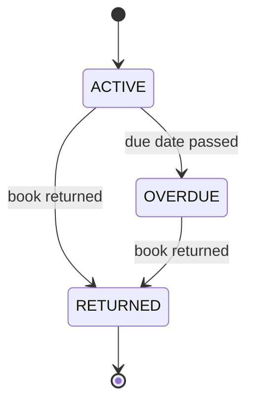
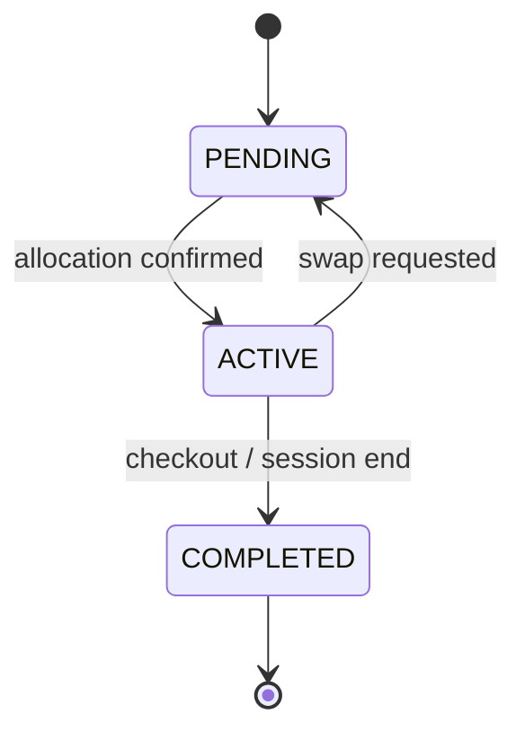
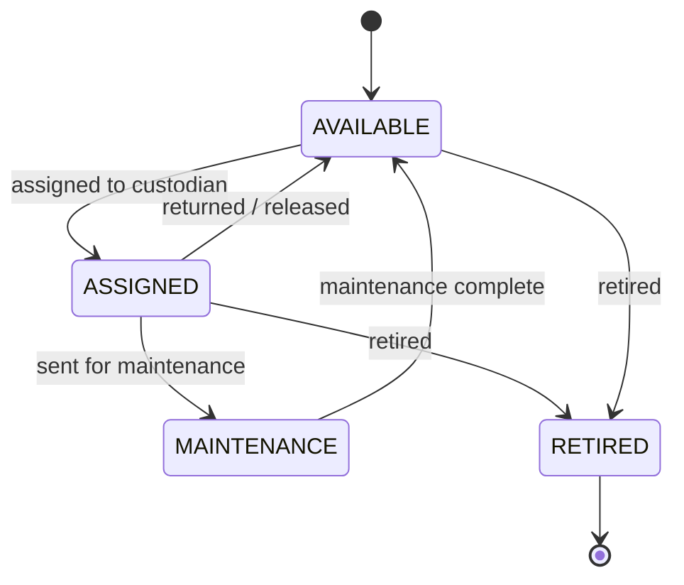
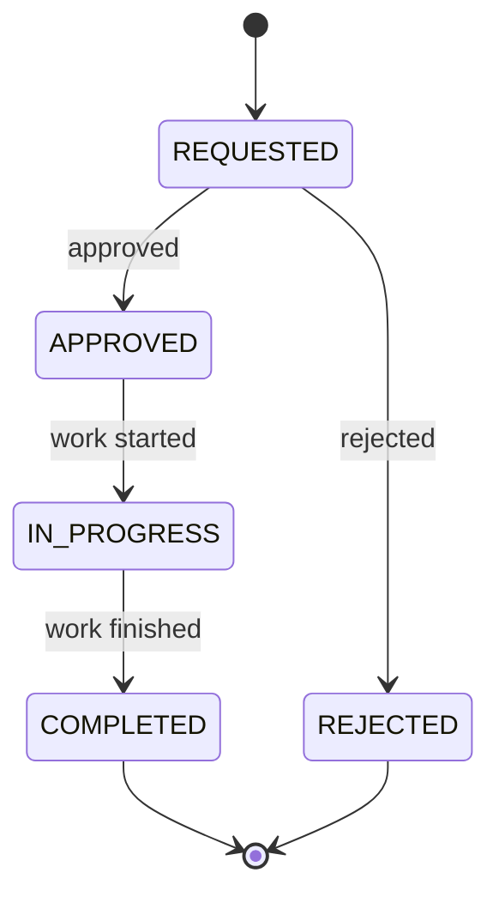
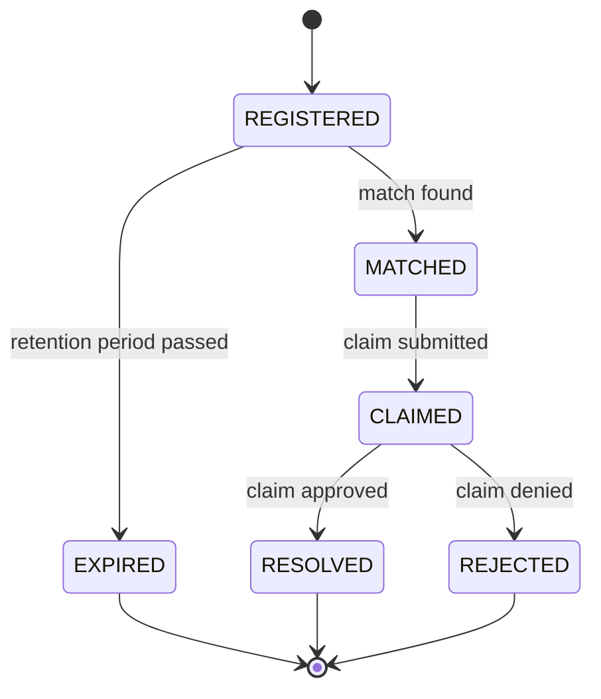
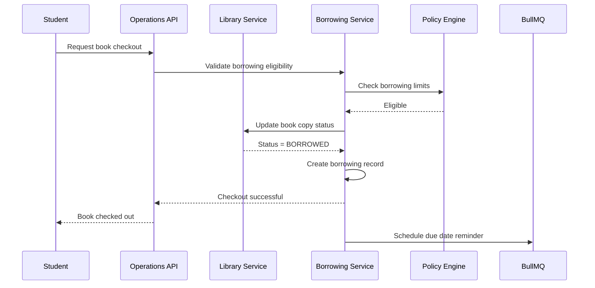
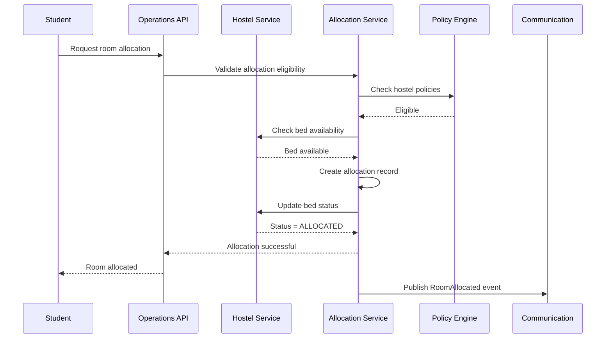
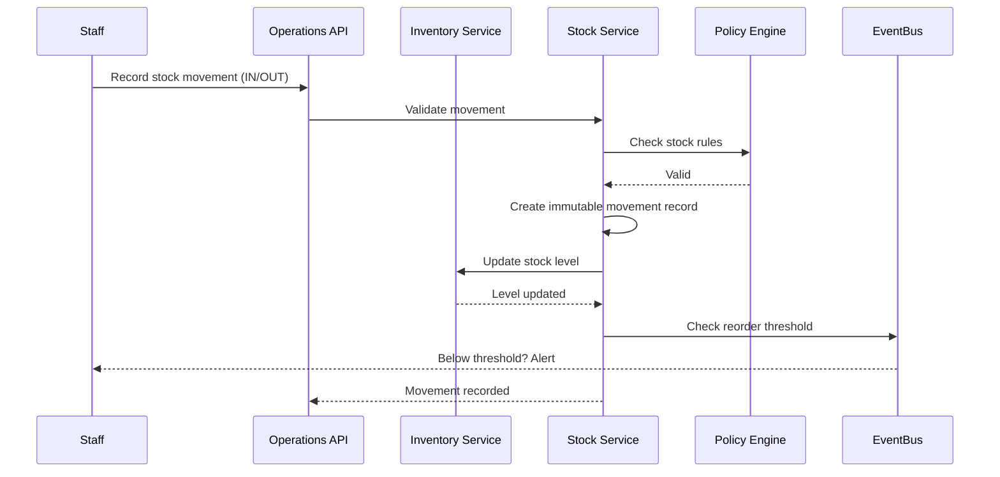
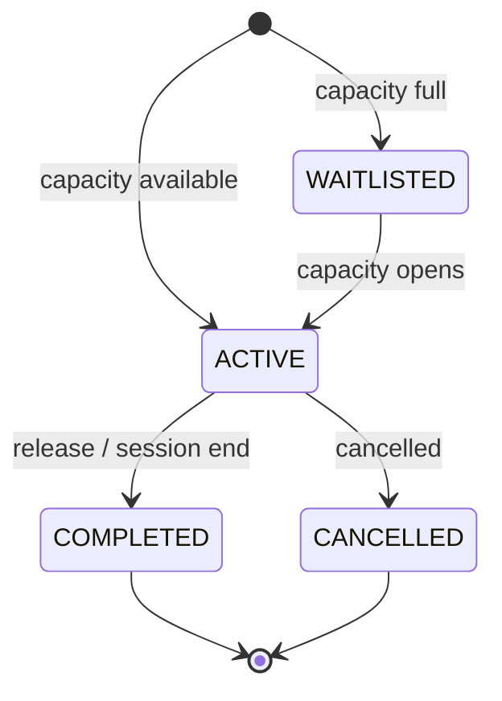

# Operations Engineering Specification

**Domain:** Operations
**Scope:** Library Management, Hostel Management, Transport Management, School Clinic / Health, Visitor Management, Asset Management, Inventory Management, Lost & Found, Maintenance Management, Resource Allocation, Operational Policies
**Created:** 2026-07-17
**Status:** Approved — Frozen for Implementation
**Last Updated:** 2026-07-20

---

## Table of Contents

1. [Overview](#1-overview)
2. [Engineering Principles](#2-engineering-principles)
3. [Architecture Decision Records](#3-architecture-decision-records)
4. [Engineering Status](#4-engineering-status)
5. [Phase 1 — Domain Analysis](#5-phase-1--domain-analysis)
6. [Phase 2 — Domain Design](#6-phase-2--domain-design)
7. [Phase 3 — Database Design](#7-phase-3--database-design)
8. [Phase 4 — Prisma Schema](#8-phase-4--prisma-schema)
9. [Phase 5 — Backend Implementation](#9-phase-5--backend-implementation)
10. [Phase 6 — API Design](#10-phase-6--api-design)
11. [Phase 7 — Testing & Verification](#11-phase-7--testing--verification)
12. [Resource Allocation Pattern](#12-resource-allocation-pattern)
13. [Operational Policy Engine](#13-operational-policy-engine)
14. [Outstanding Items](#14-outstanding-items)
15. [Revision History](#15-revision-history)

---

## 1. Overview

Operations is the operational backbone of the platform, managing every non-academic resource and service required to run an educational institution — from library books and hostel rooms to vehicles, medical records, visitor access, assets, inventory, and maintenance. Operations owns the lifecycle, allocation, scheduling, and tracking of all operational resources.

| Aspect | Approach |
|--------|----------|
| Identity | Institution-scoped; every entity belongs to one Institution |
| Bounded Contexts | 11 (Library, Hostel, Transport, Health, Visitor, Asset, Inventory, Lost & Found, Maintenance, Resource Allocation, Policies) |
| Resource Allocation | Reusable allocation pattern across rooms, beds, vehicles, assets, books |
| Finance Boundary | Operations owns resource management; Finance owns all billing, fines, and payments |
| Academic Boundary | Operations owns physical resources; Academic Management owns academic records |
| Health Confidentiality | Medical records have restricted access; role-based visibility |
| Event-Driven | Publishes resource events (allocated, returned, retired); consumes person/enrolment events |
| Configuration | Policies are institution-configurable; no hardcoded business rules |
| Maintenance | Unified work order system across hostels, vehicles, and assets |

**In Scope:** Library management (branches, books, borrowing, returns, reservations), hostel management (buildings, rooms, beds, allocations, inspections), transport management (vehicles, routes, drivers, assignments), school clinic / health (medical records, visits, treatments, immunisations), visitor management (registration, badges, check-in/out, blacklist), asset management (lifecycle, assignment, transfers, maintenance, retirement), inventory management (items, stock levels, warehouses, movements, adjustments), lost and found (registration, matching, claims), maintenance management (requests, work orders, preventive scheduling), reusable resource allocation patterns, operational policies

**Out of Scope:** Authentication, Authorization, Roles, Permissions (Identity & Access), Person profiles (People), Classes, Subjects, Results, Attendance, Academic progression (Academic Management), Billing, Payments, Invoices, Fines calculation, Hostel fees, Transport fees (Finance), Email, SMS, Notifications (Communication), File storage (Platform Administration)

---

## 2. Engineering Principles

### Core Philosophy

- **Operations Owns Resources:** All physical and operational resource lifecycle, allocation, and tracking belong exclusively to the Operations domain; other domains reference resources but never manage them
- **Finance Owns Money:** Hostel fees, transport fees, library fines, and asset depreciation values are calculated by Finance; Operations sends billing requests but never calculates monetary amounts
- **Reusable Resource Allocation:** Room allocation, bed assignment, vehicle scheduling, asset assignment, and book borrowing share a common allocation pattern; avoid module-specific implementations
- **Multi-Tenant Isolation by Default:** Every query scoped to tenant context; cross-tenant access = security violation
- **Configuration over Customization:** Policies, limits, thresholds, and rules are institution-configurable; no code changes required
- **Event-Driven Communication:** Cross-service communication via domain events; eventual consistency
- **Soft Delete by Default:** All mutable core entities support restore within retention period
- **Business Status vs Soft Delete:** Status enums represent business states (e.g., AVAILABLE, ALLOCATED, RETIRED); deletion is controlled by `deleted_at` / `deleted_by` columns exclusively
- **Optimistic Concurrency:** Version column on mutable entities; 409 Conflict on version mismatch
- **Immutable Audit Logging:** Append-only audit logs; never update or delete
- **Medical Confidentiality:** Health records are accessible only to authorised medical staff and the record owner; strict role-based visibility
- **Capacity Enforcement:** Allocation systems enforce capacity limits (hostel occupancy, vehicle capacity, library borrowing limits)

### Naming Conventions

| Element | Convention | Example |
|---------|-----------|---------|
| Database tables | snake_case, plural | books, hostels, borrowings |
| Columns | snake_case | book_id, room_number |
| Enums | SCREAMING_SNAKE_CASE | BORROWING_STATUS_ACTIVE |
| Classes | PascalCase | BookAggregate |
| Methods | camelCase | createBook |
| API responses | camelCase | success, bookId |
| Events | PascalCase, past tense | BookBorrowed |
| Errors | PascalCase + Error | BookNotFoundError |
| Permissions | `{domain}:{resource}:{action}` | operations:book:read |

### Tenant Isolation

- Tenant ID extracted from JWT and passed to repository methods as first parameter
- Application-level filtering (no Postgres Row-Level Security)
- Every query must include tenant filter
- Institution ID further scopes queries within a tenant

### Soft Delete

- All mutable core entities use soft delete via `deleted_at` (DateTime?) and `deleted_by` (uuid?)
- Business status (e.g., AVAILABLE, ALLOCATED, ACTIVE) is a separate concern from deletion
- 30-day restore window before permanent deletion for eligible entities
- Historical records (borrowings, visits, movements) are retained per institution-configured retention policy

### Audit Logging

Every state-changing operation generates an append-only audit log entry with: entity_type, entity_id, action, actor_id, actor_email, changes (JSON diff), context_ip, context_user_agent, timestamp.

For allocation operations, the audit log additionally captures: resource_type, resource_id, allocated_to, allocation_period.

### Error Handling

- Structured error responses: `{ success: false, error: { code, message, details[] } }`
- Domain-specific error classes; never expose internal details
- Full error context logged server-side
- Allocation errors include resource reference and current capacity for debugging

### Prisma Schema Principles

- UUID `@default(uuid())` for all primary keys
- `@unique` constraints for business keys
- `@map` for snake_case column names
- Soft delete via `deleted_at` (DateTime?) and `deleted_by` (uuid?)
- Business status via `status` enum (never a deletion marker)
- Optimistic locking via `version` (Int @default(1))
- Audit fields: created_at, created_by, updated_at, updated_by
- JSON columns for flexible data (metadata, configuration, medical notes)
- Prisma enums mapped to database types
- Cascade deletes: child entities cascade from parent aggregate root; cross-aggregate references use application-level guards

### Technology Stack

| Component | Technology |
|-----------|-----------|
| Runtime | Node.js >=22.0.0 |
| Framework | NestJS ^11.0.0 |
| ORM | Prisma ^6.12.0 |
| Language | TypeScript ^5.8.3 |
| Validation | class-validator + class-transformer |
| Auth | JWT + bcrypt |
| Testing | Jest ^30.0.0 |
| Migrations | Prisma Migrate |
| API Docs | Swagger/OpenAPI ^7.0.0 |

---

## 3. Architecture Decision Records

| ADR | Decision | Rationale |
|-----|----------|-----------|
| ADR-001 | Operations owns resources, Finance owns money | Strict domain boundary; hostel fees, transport fees, library fines are Finance concerns |
| ADR-002 | Reusable resource allocation pattern | Rooms, beds, vehicles, assets, and books share allocation lifecycle; single pattern reduces duplication |
| ADR-003 | Application-level tenant isolation (no RLS) | Consistent with Identity & Access, Institution Management, People, Academic Management, Finance, and Communication |
| ADR-004 | Domain events via EventEmitter2 (in-process) | Decouples services; supports async processing; future migration to MQ |
| ADR-005 | Optimistic concurrency (version column) | Prevents lost updates on allocation and inventory changes; no pessimistic locking overhead |
| ADR-006 | Immutable audit logs (append-only) | Tamper-proof operational audit trail; compliance requirement |
| ADR-007 | Medical records are role-restricted | Health data is confidential; only authorised medical staff and record owners can access |
| ADR-008 | Library fines reference Finance for billing | Operations tracks overdue status; Finance generates and collects fines |
| ADR-009 | Hostel billing is a Finance concern | Operations manages room allocation; Finance handles hostel fee invoicing |
| ADR-010 | Transport fees are a Finance concern | Operations manages routes and assignments; Finance handles transport fee billing |
| ADR-011 | Visitor badges are time-limited | Badges expire after visit duration; prevents unauthorised extended access |
| ADR-012 | Asset depreciation is a future concern | V1 tracks asset lifecycle without depreciation calculations; Finance will own depreciation in future |
| ADR-013 | Inventory reorder triggers notifications | When stock falls below reorder level, Operations publishes events; Communication sends alerts |
| ADR-014 | Lost & Found uses matching workflow | Found items are matched against lost item registrations; claim requires evidence |
| ADR-015 | Preventive maintenance is schedule-driven | Maintenance schedules are institution-configurable; work orders generated automatically |
| ADR-016 | Book copies track individual items | Each physical book copy is tracked separately for borrowing and inventory |
| ADR-017 | Hostel room allocation is session-scoped | Allocations align with academic sessions; checkout and reallocation at session boundaries |
| ADR-018 | Transport routes are term-scoped | Routes may change per term; assignments reference specific route versions |
| ADR-019 | Stock movements are immutable | Every movement creates a new record; adjustments create separate adjustment records |
| ADR-020 | Asset assignment tracks custody | Assets record who currently has custody; transfer creates new assignment record |
| ADR-021 | Operational policies override platform defaults | Institution-specific policies take precedence; platform defaults apply when no institution policy exists |
| ADR-022 | Medical alerts are priority-ordered | Allergies and conditions are ranked by severity; critical alerts surface first |
| ADR-023 | Warehouse and store are distinct | Warehouses are large storage facilities; stores are distribution points (e.g., stationery store) |
| ADR-024 | Vehicle maintenance is tracked per vehicle | Each vehicle has a maintenance history; maintenance status affects assignment eligibility |
| ADR-025 | Work orders unify maintenance across contexts | Hostel maintenance, vehicle maintenance, and asset maintenance all use the same work order system |
| ADR-026 | Visitor approval is configurable | Some institutions require pre-approval; others allow walk-in registration |
| ADR-027 | Book reservations queue on availability | When all copies are borrowed, reservations are queued; first reservation gets next available copy |
| ADR-028 | Staff transport assignments are role-based | Staff assignments may differ from student assignments; separate assignment tables |
| ADR-029 | Inventory audits reconcile physical vs system | Audit process compares physical count with system stock level; discrepancies generate adjustment records |
| ADR-030 | Incident reports are append-only | Medical incident records are never modified; corrections create addendum records |
| ADR-031 | Resource allocation supports waitlisting | When capacity is full, allocations can be waitlisted; notified when capacity opens |
| ADR-032 | Asset categories are hierarchical | Categories support parent-child nesting for reporting and organisation |
| ADR-033 | Supplier references are read-only | Supplier data is maintained in a future procurement domain; Operations references suppliers for inventory context |
| ADR-034 | Immunisation records follow regulatory format | Immunisation data follows standard health record formats for interoperability |
| ADR-035 | Building and floor are Hostel sub-aggregates | Buildings and floors belong to a Hostel; rooms belong to a floor; bed belongs to a room |

---

## 4. Engineering Status

| Phase | Status | Summary |
|-------|--------|---------|
| Phase 1 — Domain Analysis | Complete | 52 entities, 60+ domain events, 35 business rules |
| Phase 2 — Domain Design | Complete | 14 aggregates, 35 invariants, 25 policies, 12 validation rule sets |
| Phase 3 — Database Design | Complete | 55 tables, 65+ indexes, 35 unique constraints |
| Phase 4 — Prisma Schema | Complete | ~18 models (remainder abbreviated), 24 enums, 2-pass validation |
| Phase 5 — Backend Implementation | Complete | 16 modules, 16 repositories, 16 domain services, 16 controllers, 10 event consumers |
| Phase 6 — API Design | Complete | 120+ endpoints (80 primary + 40 sub-resource) |
| Phase 7 — Testing & Verification | Complete | 20 test categories, ~400+ test scenarios |

**Overall Status:** Approved — Frozen for Implementation.

---

## 5. Phase 1 — Domain Analysis

### 5.1 Domain Purpose

Operations is the operational backbone of the platform. It manages every non-academic resource and service required to run an educational institution — physical spaces, vehicles, medical records, visitor access, assets, inventory, lost and found items, and maintenance work orders. The domain owns the lifecycle, allocation, scheduling, and tracking of all operational resources.

Operations does not own financial transactions (Finance), academic records (Academic Management), person identities (People), or authentication (Identity & Access). It publishes resource events and consumes person/enrolment events to keep operational records synchronised.

### 5.2 Domain Responsibilities

| Responsibility | Description |
|----------------|-------------|
| Library Management | Manage library branches, books, copies, categories, borrowing, returns, reservations |
| Hostel Management | Manage hostels, buildings, rooms, beds, allocations, inspections, maintenance requests |
| Transport Management | Manage vehicles, routes, stops, drivers, student/staff transport assignments |
| School Clinic / Health | Manage medical records, allergies, clinic visits, treatments, immunisations, incident reports |
| Visitor Management | Manage visitor registration, badges, check-in/out, host assignment, blacklist |
| Asset Management | Manage asset lifecycle, categories, assignments, transfers, maintenance, retirement |
| Inventory Management | Manage inventory items, stock levels, warehouses, movements, adjustments, audits |
| Lost & Found | Manage lost item registration, found items, matching, claims, resolution |
| Maintenance Management | Manage maintenance requests, work orders, assigned personnel, preventive scheduling |
| Resource Allocation | Provide reusable allocation patterns for rooms, beds, vehicles, assets, books |
| Operational Policies | Define and enforce institution-specific operational rules and limits |

### 5.3 Domain Boundaries

**In Scope:** Library management, hostel management, transport management, school clinic / health, visitor management, asset management, inventory management, lost and found, maintenance management, resource allocation, operational policies

**Out of Scope:** Authentication, Authorization, Roles, Permissions (Identity & Access), Person profiles (People), Classes, Subjects, Results, Attendance, Academic progression (Academic Management), Billing, Payments, Invoices, Fines calculation, Hostel fees, Transport fees (Finance), Email, SMS, Notifications (Communication), File storage (Platform Administration)

### 5.4 Dependencies

| Dependency | Nature | Direction |
|------------|--------|-----------|
| Identity & Access | User context, authentication, role resolution for permission checks | Reads |
| Institution Management | Institution configuration, tenant context, module licensing | Reads |
| People | Student, Staff, Parent person records for allocation and medical records | Reads |
| Academic Management | Academic sessions, terms, class enrolment for allocation scoping | Reads |
| Finance | Billing requests for hostel fees, transport fees, library fines | Writes (events) |
| Communication | Notification delivery for maintenance alerts, overdue reminders, visitor approvals | Writes (events) |
| Platform Administration | File storage for evidence attachments, audit logging, event bus | Writes |

### 5.5 Core Entities

| Entity | Type | Bounded Context | Description |
|--------|------|----------------|-------------|
| LibraryBranch | Core | Library | Physical library location with operating hours |
| Book | Core | Library | Catalogue entry for a publication (title, ISBN, metadata) |
| BookCopy | Core | Library | Individual physical copy of a book with status tracking |
| BookCategory | Core | Library | Classification category for books |
| Author | Core | Library | Book author reference |
| Publisher | Core | Library | Book publisher reference |
| BookAuthor | Relationship | Library | Many-to-many book-author association |
| Borrowing | Core | Library | Active or historical book borrowing record |
| Reservation | Core | Library | Hold request for an unavailable book |
| LibraryFine | Supporting | Library | Overdue fine record (billing delegated to Finance) |
| Hostel | Core | Hostel | Residential facility with configuration |
| HostelBuilding | Core | Hostel | Building within a hostel |
| HostelFloor | Core | Hostel | Floor within a building |
| HostelRoom | Core | Hostel | Individual room with capacity and amenities |
| Bed | Core | Hostel | Individual bed within a room |
| RoomAllocation | Core | Hostel | Assignment of a bed to a student for a period |
| HostelInspection | Supporting | Hostel | Periodic inspection record for rooms/buildings |
| Vehicle | Core | Transport | School vehicle with capacity and maintenance status |
| TransportRoute | Core | Transport | Defined route with stops and schedule |
| RouteStop | Core | Transport | Individual stop along a route |
| Driver | Core | Transport | Licensed driver assigned to vehicles |
| StudentTransportAssignment | Core | Transport | Assignment of a student to a route/vehicle |
| StaffTransportAssignment | Core | Transport | Assignment of a staff member to a route/vehicle |
| MedicalRecord | Core | Health | Student or staff medical record with history |
| Allergy | Core | Health | Known allergy with severity level |
| MedicalAlert | Core | Health | Critical medical condition requiring attention |
| ClinicVisit | Core | Health | Record of a clinic visit with symptoms and diagnosis |
| Treatment | Supporting | Health | Treatment administered during a clinic visit |
| Medication | Supporting | Health | Medication prescribed or administered |
| ImmunizationRecord | Core | Health | Vaccination record with date and batch |
| IncidentReport | Core | Health | Medical or safety incident record (append-only) |
| Visitor | Core | Visitor | Registered visitor with identification |
| VisitorBadge | Core | Visitor | Time-limited access badge issued to visitor |
| Visit | Core | Visitor | Check-in/check-out record with host and purpose |
| VisitorBlacklist | Core | Visitor | Blocked visitor entry with reason |
| Asset | Core | Asset | Physical asset with lifecycle tracking |
| AssetCategory | Core | Asset | Classification category (hierarchical) |
| AssetAssignment | Core | Asset | Current or historical custody assignment |
| AssetTransfer | Core | Asset | Movement of asset between locations/custodians |
| AssetMaintenance | Core | Asset | Maintenance record for an asset |
| AssetRetirement | Core | Asset | Disposal/retirement record |
| InventoryItem | Core | Inventory | Item tracked in inventory with stock levels |
| StockLevel | Core | Inventory | Current stock quantity per item per location |
| Warehouse | Core | Inventory | Large storage facility |
| Store | Core | Inventory | Distribution point (e.g., stationery store) |
| StockMovement | Core | Inventory | Immutable record of stock in/out/transfer |
| StockAdjustment | Core | Inventory | Manual correction to stock levels |
| Supplier | Reference | Inventory | Supplier reference (data owned by future procurement domain) |
| LostItem | Core | Lost & Found | Registration of a lost item |
| FoundItem | Core | Lost & Found | Registration of a found item |
| LostFoundMatch | Core | Lost & Found | Match between lost and found items |
| Claim | Core | Lost & Found | Claim request with evidence |
| MaintenanceRequest | Core | Maintenance | Request for maintenance work |
| WorkOrder | Core | Maintenance | Authorised work order with assignment and tracking |
| ResourceAllocation | Core | Allocation | Reusable allocation record for any resource type |
| OperationalPolicy | Core | Policies | Institution-specific operational rule |

### 5.6 Domain Events

#### 5.6.1 Events Published by Operations

| Event | Trigger | Consumers |
|-------|---------|-----------|
| BookBorrowed | Book copy checked out | Library, Communication |
| BookReturned | Book copy returned | Library, Communication, Finance (fine waiver) |
| BookOverdue | Borrowing past due date | Communication, Finance (fine creation) |
| ReservationFulfilled | Reserved book becomes available | Communication |
| RoomAllocated | Bed allocated to student | Communication |
| RoomDeallocated | Bed released from student | Communication |
| HostelInspectionCompleted | Inspection record created | Communication |
| TransportAssigned | Student/staff assigned to route | Communication |
| TransportUnassigned | Student/staff removed from route | Communication |
| VisitorCheckedIn | Visitor badge activated | Security |
| VisitorCheckedOut | Visitor badge deactivated | Security |
| VisitorBlacklisted | Visitor added to blacklist | Security |
| MedicalRecordUpdated | Medical record modified | Communication (alert if critical) |
| ClinicVisitRecorded | Clinic visit logged | Communication (parent notification) |
| ImmunizationRecordAdded | Vaccination recorded | Communication |
| IncidentReported | Incident report created | Communication (alert) |
| AssetAssigned | Asset custody transferred | Audit |
| AssetTransferred | Asset moved between locations | Audit |
| AssetRetired | Asset disposed | Audit |
| StockDroppedBelowReorder | Stock fell below threshold | Communication (reorder alert) |
| StockAdjusted | Manual stock adjustment | Audit |
| MaintenanceRequested | Maintenance request submitted | Communication |
| WorkOrderCreated | Work order authorised | Communication |
| WorkOrderCompleted | Work order finished | Communication |
| LostItemRegistered | Lost item submitted | Communication (matching check) |
| FoundItemRegistered | Found item submitted | Communication (matching check) |
| LostFoundMatched | Lost and found items matched | Communication |
| ClaimSubmitted | Claim request created | Communication (approval workflow) |
| ClaimResolved | Claim processed | Communication |

#### 5.6.2 Events Consumed from Other Domains

| Source Domain | Event | Operations Action |
|---------------|-------|-------------------|
| People | StudentEnrolled | Create medical record, enable transport/hostel assignment |
| People | StaffHired | Create medical record, enable asset/transport assignment |
| People | StudentTransferred | Update hostel/transport/library records |
| People | StudentGraduated | Trigger checkout workflow (hostel, transport, library) |
| Academic Management | AcademicSessionStarted | Reset allocations, enable new session assignments |
| Academic Management | AcademicSessionEnded | Trigger end-of-session checkout |
| Finance | PaymentReceived | Clear library fines, confirm hostel payment |
| Finance | InvoiceOverdue | Flag for follow-up |

### 5.7 Business Rules

| ID | Rule |
|----|------|
| BR-OPS-001 | A book can only be borrowed if at least one copy has status AVAILABLE |
| BR-OPS-002 | A student may borrow a maximum number of books defined by institution policy |
| BR-OPS-003 | A borrowing is overdue when the due date passes without return |
| BR-OPS-004 | A reservation is fulfilled when a copy becomes available; the next queued reservation is notified |
| BR-OPS-005 | A bed can only be allocated to one student at a time |
| BR-OPS-006 | Room allocation is scoped to an academic session |
| BR-OPS-007 | Hostel checkout releases the bed and updates occupancy counts |
| BR-OPS-008 | A vehicle can only be assigned to one route at a time |
| BR-OPS-009 | Student transport assignment requires a valid route with available capacity |
| BR-OPS-010 | Medical records are accessible only to authorised medical staff and the record owner |
| BR-OPS-011 | Allergies are ordered by severity; critical allergies surface first in medical views |
| BR-OPS-012 | Clinic visits require a student or staff reference and a visit reason |
| BR-OPS-013 | Incident reports are append-only; corrections create addendum records |
| BR-OPS-014 | Visitor badges expire after the visit duration; expired badges are invalidated |
| BR-OPS-015 | Blacklisted visitors cannot register; existing visits are flagged |
| BR-OPS-016 | An asset can only be assigned to one custodian at a time |
| BR-OPS-017 | Asset transfer requires current custodian release and new custodian acceptance |
| BR-OPS-018 | Asset retirement requires admin approval and creates a retirement record |
| BR-OPS-019 | Stock levels cannot go negative; adjustments must not create negative balances |
| BR-OPS-020 | Stock movements are immutable; corrections use adjustment records |
| BR-OPS-021 | Inventory audits compare physical count with system stock; discrepancies generate adjustments |
| BR-OPS-022 | A lost item registration includes description, location, and date |
| BR-OPS-023 | A found item registration includes description, location, and date found |
| BR-OPS-024 | Matching compares lost and found items by category, description, and location |
| BR-OPS-025 | Claim submission requires evidence (attachment reference) |
| BR-OPS-026 | Work orders are created from maintenance requests after approval |
| BR-OPS-027 | Preventive maintenance generates work orders on schedule |
| BR-OPS-028 | Resource allocation supports waitlisting when capacity is full |
| BR-OPS-029 | Operational policies override platform defaults |
| BR-OPS-030 | Library branches have operating hours; borrowing/returning is allowed only during hours |
| BR-OPS-031 | Book copies have individual status (AVAILABLE, BORROWED, RESERVED, LOST, DAMAGED) |
| BR-OPS-032 | Hostel room capacity is defined by the number of beds in the room |
| BR-OPS-033 | Vehicle maintenance status affects assignment eligibility |
| BR-OPS-034 | Immunisation records follow regulatory format with batch and provider |
| BR-OPS-035 | Supplier references are read-only; supplier data is maintained externally |

### 5.8 Invariants

| ID | Invariant |
|----|-----------|
| INV-OPS-001 | Every entity belongs to exactly one Institution |
| INV-OPS-002 | Every Book belongs to exactly one LibraryBranch |
| INV-OPS-003 | Every BookCopy belongs to exactly one Book |
| INV-OPS-004 | Every Borrowing references exactly one BookCopy and one User |
| INV-OPS-005 | A BookCopy in BORROWED status has exactly one active Borrowing |
| INV-OPS-006 | Every HostelRoom belongs to exactly one HostelFloor |
| INV-OPS-007 | Every Bed belongs to exactly one HostelRoom |
| INV-OPS-008 | A Bed in ALLOCATED status has exactly one active RoomAllocation |
| INV-OPS-009 | Every RoomAllocation references exactly one Bed and one User |
| INV-OPS-010 | Every TransportRoute belongs to exactly one Institution |
| INV-OPS-011 | Every Vehicle belongs to exactly one Institution |
| INV-OPS-012 | Every StudentTransportAssignment references exactly one Student and one TransportRoute |
| INV-OPS-013 | Every MedicalRecord belongs to exactly one User |
| INV-OPS-014 | Every ClinicVisit references exactly one MedicalRecord |
| INV-OPS-015 | Every Allergy belongs to exactly one MedicalRecord |
| INV-OPS-016 | Every Visit references exactly one Visitor |
| INV-OPS-017 | Every Asset belongs to exactly one Institution |
| INV-OPS-018 | Every AssetAssignment references exactly one Asset |
| INV-OPS-019 | An Asset in ASSIGNED status has exactly one active AssetAssignment |
| INV-OPS-020 | Every StockLevel references exactly one InventoryItem and one Warehouse/Store |
| INV-OPS-021 | Every StockMovement references exactly one InventoryItem |
| INV-OPS-022 | StockLevel.quantity is never negative |
| INV-OPS-023 | Every LostItem belongs to exactly one Institution |
| INV-OPS-024 | Every FoundItem belongs to exactly one Institution |
| INV-OPS-025 | Every Claim references exactly one LostFoundMatch |
| INV-OPS-026 | Every WorkOrder references exactly one MaintenanceRequest |
| INV-OPS-027 | Every ResourceAllocation references exactly one resource entity |
| INV-OPS-028 | OperationalPolicy is unique per Institution per policy_type |
| INV-OPS-029 | VisitorBadge is unique per badge_code |
| INV-OPS-030 | Every VisitorBlacklist entry references a valid Visitor |
| INV-OPS-031 | AssetCategory supports parent-child hierarchy |
| INV-OPS-032 | Every AssetMaintenance references exactly one Asset |
| INV-OPS-033 | Every RouteStop belongs to exactly one TransportRoute |
| INV-OPS-034 | Every Driver belongs to exactly one Institution |
| INV-OPS-035 | Every ImmunizationRecord belongs to exactly one MedicalRecord |

### 5.9 Configurable Policies

| ID | Policy | Default | Scope |
|----|--------|---------|-------|
| CP-OPS-001 | Max books per student | 5 | Institution |
| CP-OPS-002 | Borrowing duration (days) | 14 | Institution |
| CP-OPS-003 | Max renewals per borrowing | 2 | Institution |
| CP-OPS-004 | Reservation hold period (days) | 3 | Institution |
| CP-OPS-005 | Hostel checkout notice period (days) | 30 | Institution |
| CP-OPS-006 | Transport capacity buffer (%) | 10 | Institution |
| CP-OPS-007 | Visitor pre-approval required | false | Institution |
| CP-OPS-008 | Visitor badge validity (hours) | 8 | Institution |
| CP-OPS-009 | Medical record access roles | ["NURSE","DOCTOR","ADMIN"] | Institution |
| CP-OPS-010 | Asset assignment approval required | false | Institution |
| CP-OPS-011 | Inventory reorder threshold (%) | 20 | Institution |
| CP-OPS-012 | Maintenance response SLA (hours) | 48 | Institution |
| CP-OPS-013 | Preventive maintenance interval (days) | 90 | Institution |
| CP-OPS-014 | Lost item retention period (days) | 90 | Institution |
| CP-OPS-015 | Hostel inspection frequency (days) | 30 | Institution |
| CP-OPS-016 | Library fine per day (overdue) | 0.00 | Institution (Finance calculates) |
| CP-OPS-017 | Max visitors per host per day | 5 | Institution |
| CP-OPS-018 | Asset depreciation method | NONE | Institution (future) |
| CP-OPS-019 | Inventory audit frequency (days) | 90 | Institution |
| CP-OPS-020 | Work order auto-assign | true | Institution |
| CP-OPS-021 | Hostel room swap allowed | false | Institution |
| CP-OPS-022 | Transport route change notification | true | Institution |
| CP-OPS-023 | Medical incident report escalation | true | Institution |
| CP-OPS-024 | Book reservation limit per student | 3 | Institution |
| CP-OPS-025 | Asset maintenance alert threshold | 30 | Institution (days before service) |

### 5.10 Validation Rule Sets

| ID | Rules | Scope |
|----|-------|-------|
| VRS-OPS-001 | Book: title required (1–200 chars), ISBN optional, category_id required | Book |
| VRS-OPS-002 | BookCopy: book_id required, copy_number required, status required | BookCopy |
| VRS-OPS-003 | Borrowing: user_id required, book_copy_id required, due_date required, due_date > now() | Borrowing |
| VRS-OPS-004 | Hostel: name required (3–100 chars), capacity > 0 | Hostel |
| VRS-OPS-005 | HostelRoom: room_number required, capacity > 0, floor_id required | HostelRoom |
| VRS-OPS-006 | RoomAllocation: bed_id required, user_id required, start_date required, end_date > start_date | RoomAllocation |
| VRS-OPS-007 | Vehicle: plate_number required (unique), capacity > 0, type required | Vehicle |
| VRS-OPS-008 | TransportRoute: name required (3–100 chars), departure_time required | TransportRoute |
| VRS-OPS-009 | MedicalRecord: user_id required, blood_group optional, conditions json | MedicalRecord |
| VRS-OPS-010 | ClinicVisit: medical_record_id required, visit_date required, reason required | ClinicVisit |
| VRS-OPS-011 | Visitor: full_name required, id_type required, id_number required | Visitor |
| VRS-OPS-012 | Visit: visitor_id required, host_id required, purpose required | Visit |
| VRS-OPS-013 | Asset: name required, category_id required, purchase_date optional | Asset |
| VRS-OPS-014 | InventoryItem: name required, sku optional, unit required | InventoryItem |
| VRS-OPS-015 | StockMovement: item_id required, quantity > 0, type required (IN/OUT/TRANSFER) | StockMovement |
| VRS-OPS-016 | LostItem: description required, date_lost required, location optional | LostItem |
| VRS-OPS-017 | FoundItem: description required, date_found required, location_found required | FoundItem |
| VRS-OPS-018 | MaintenanceRequest: description required, priority required, location optional | MaintenanceRequest |
| VRS-OPS-019 | WorkOrder: request_id required, assigned_to optional, priority required, due_date optional | WorkOrder |
| VRS-OPS-020 | AssetCategory: name required (3–100 chars), parent_id optional (self-ref) | AssetCategory |

---

## 6. Phase 2 — Domain Design

### 6.1 Aggregates

| Aggregate | Root Entity | Bounded Context | Purpose | Lifecycle |
|-----------|-------------|----------------|---------|-----------|
| LibraryBranchAggregate | LibraryBranch | Library | Branch with books, categories, borrowing rules | ACTIVE → INACTIVE |
| BookAggregate | Book | Library | Catalogue entry with copies, authors, categories | ACTIVE → ARCHIVED |
| BorrowingAggregate | Borrowing | Library | Active borrowing lifecycle | ACTIVE → RETURNED / OVERDUE → RETURNED |
| HostelAggregate | Hostel | Hostel | Residential facility with buildings and rooms | ACTIVE → INACTIVE |
| RoomAllocationAggregate | RoomAllocation | Hostel | Bed assignment lifecycle | PENDING → ACTIVE → COMPLETED |
| VehicleAggregate | Vehicle | Transport | Vehicle with route assignments and maintenance | ACTIVE → MAINTENANCE → RETIRED |
| TransportRouteAggregate | TransportRoute | Transport | Route with stops and schedule | ACTIVE → INACTIVE |
| MedicalRecordAggregate | MedicalRecord | Health | Patient record with allergies, visits, immunisations | ACTIVE |
| ClinicVisitAggregate | ClinicVisit | Health | Visit lifecycle with treatments | SCHEDULED → IN_PROGRESS → COMPLETED (+ CANCELLED) |
| VisitorAggregate | Visitor | Visitor | Visitor with badges and visit history | REGISTERED → BLACKLISTED |
| AssetAggregate | Asset | Asset | Asset lifecycle from acquisition to retirement | AVAILABLE → ASSIGNED → MAINTENANCE → RETIRED |
| InventoryAggregate | InventoryItem | Inventory | Item with stock levels across locations | ACTIVE → DISCONTINUED |
| LostFoundAggregate | LostItem | Lost & Found | Lost item with matching and claim workflow | REGISTERED → MATCHED → CLAIMED → RESOLVED |
| MaintenanceAggregate | MaintenanceRequest | Maintenance | Request to work order lifecycle | REQUESTED → APPROVED → IN_PROGRESS → COMPLETED (+ REJECTED) |

### 6.2 Entity Relationships

```mermaid
erDiagram
    Institution ||--o{ LibraryBranch : "owns"
    Institution ||--o{ Hostel : "owns"
    Institution ||--o{ Vehicle : "owns"
    Institution ||--o{ TransportRoute : "owns"
    Institution ||--o{ MedicalRecord : "owns"
    Institution ||--o{ Visitor : "registers"
    Institution ||--o{ Asset : "owns"
    Institution ||--o{ InventoryItem : "tracks"
    Institution ||--o{ LostItem : "registers"
    Institution ||--o{ FoundItem : "registers"
    Institution ||--o{ MaintenanceRequest : "receives"
    Institution ||--o{ OperationalPolicy : "defines"

    LibraryBranch ||--o{ Book : "catalogues"
    Book ||--o{ BookCopy : "has"
    Book ||--o{ BookAuthor : "written by"
    Author ||--o{ BookAuthor : "authors"
    Book ||--o{ BookCategory : "categorized as"
    BookCopy ||--o{ Borrowing : "borrowed via"
    Book ||--o{ Reservation : "reserved via"

    Hostel ||--o{ HostelBuilding : "contains"
    HostelBuilding ||--o{ HostelFloor : "has"
    HostelFloor ||--o{ HostelRoom : "contains"
    HostelRoom ||--o{ Bed : "has"
    Bed ||--o{ RoomAllocation : "allocated via"
    Hostel ||--o{ HostelInspection : "inspected"

    TransportRoute ||--o{ RouteStop : "has"
    Vehicle }o--o{ TransportRoute : "assigned to"
    TransportRoute ||--o{ StudentTransportAssignment : "students"
    TransportRoute ||--o{ StaffTransportAssignment : "staff"

    MedicalRecord ||--o{ Allergy : "has"
    MedicalRecord ||--o{ MedicalAlert : "has"
    MedicalRecord ||--o{ ClinicVisit : "records"
    ClinicVisit ||--o{ Treatment : "treatments"
    ClinicVisit ||--o{ Medication : "medications"
    MedicalRecord ||--o{ ImmunizationRecord : "immunisations"
    MedicalRecord ||--o{ IncidentReport : "incidents"

    Visitor ||--o{ VisitorBadge : "badges"
    Visitor ||--o{ Visit : "visits"
    Visitor ||--o{ VisitorBlacklist : "blacklisted"

    Asset }o--|| AssetCategory : "categorized as"
    Asset ||--o{ AssetAssignment : "assigned"
    Asset ||--o{ AssetTransfer : "transferred"
    Asset ||--o{ AssetMaintenance : "maintained"
    Asset ||--o{ AssetRetirement : "retired"

    InventoryItem ||--o{ StockLevel : "stock at"
    StockLevel }o--|| Warehouse : "warehouse"
    InventoryItem ||--o{ StockMovement : "movements"
    InventoryItem ||--o{ StockAdjustment : "adjustments"
    InventoryItem }o--o| Supplier : "supplied by"

    LostItem ||--o{ LostFoundMatch : "matched via"
    FoundItem ||--o{ LostFoundMatch : "matched via"
    LostFoundMatch ||--o{ Claim : "claimed via"

    MaintenanceRequest ||--o{ WorkOrder : "generates"
```



### 6.3 Aggregate Lifecycle State Machines

#### 6.3.1 Borrowing Lifecycle



#### 6.3.2 Room Allocation Lifecycle



#### 6.3.3 Asset Lifecycle



#### 6.3.4 Maintenance Lifecycle



#### 6.3.5 Lost & Found Lifecycle



### 6.4 Domain Services

| Service | Bounded Context | Responsibility |
|---------|----------------|----------------|
| LibraryBranchService | Library | Branch CRUD, operating hours management |
| BookCatalogueService | Library | Book and copy management, category assignment |
| BorrowingService | Library | Checkout, return, renew, overdue detection |
| ReservationService | Library | Queue reservations, fulfil on availability |
| HostelManagementService | Hostel | Hostel, building, floor, room CRUD |
| RoomAllocationService | Hostel | Bed allocation, deallocation, swap, waitlist |
| HostelInspectionService | Hostel | Schedule and record inspections |
| TransportManagementService | Transport | Vehicle, route, stop CRUD |
| DriverManagementService | Transport | Driver assignment, availability |
| TransportAssignmentService | Transport | Student/staff route assignment, capacity check |
| MedicalRecordService | Health | Record CRUD, access control, confidentiality |
| ClinicVisitService | Health | Visit lifecycle, treatment and medication recording |
| ImmunizationService | Health | Vaccination record management |
| IncidentReportService | Health | Incident creation, append-only enforcement |
| VisitorManagementService | Visitor | Registration, badge issuance, blacklist |
| VisitService | Visitor | Check-in/out, host assignment, history |
| AssetManagementService | Asset | Asset CRUD, category management |
| AssetLifecycleService | Asset | Assignment, transfer, retirement, custody tracking |
| InventoryManagementService | Inventory | Item CRUD, stock level tracking |
| StockMovementService | Inventory | Movement recording, adjustment, audit |
| LostFoundService | Lost & Found | Registration, matching algorithm, claim workflow |
| MaintenanceService | Maintenance | Request processing, work order creation |
| WorkOrderService | Maintenance | Work order lifecycle, assignment, completion |
| ResourceAllocationService | Allocation | Reusable allocation patterns across resource types |
| OperationalPolicyService | Policies | Policy CRUD, enforcement, override resolution |

### 6.5 Policies

| ID | Policy | Trigger | Scope |
|----|--------|---------|-------|
| POL-OPS-001 | Borrowing limit enforcement | Checkout time | Per student, institution-configurable |
| POL-OPS-002 | Overdue fine notification | Due date | Communication, Finance |
| POL-OPS-003 | Reservation queue processing | Book return | First-come-first-served |
| POL-OPS-004 | Hostel capacity enforcement | Allocation time | Per hostel, per room |
| POL-OPS-005 | Room swap permission | Swap request | Institution-configurable |
| POL-OPS-006 | Transport capacity enforcement | Assignment time | Per route |
| POL-OPS-007 | Medical record access control | Record access | Role-based, institution-configurable |
| POL-OPS-008 | Visitor pre-approval | Registration | Institution-configurable |
| POL-OPS-009 | Badge expiry enforcement | Badge issuance | Time-based, institution-configurable |
| POL-OPS-010 | Blacklist check | Visitor registration | Always active |
| POL-OPS-011 | Asset assignment approval | Assignment request | Institution-configurable |
| POL-OPS-012 | Asset custody transfer | Transfer request | Dual-custody |
| POL-OPS-013 | Stock level reorder alert | Stock movement | Threshold-based |
| POL-OPS-014 | Inventory audit scheduling | Time-based | Institution-configurable |
| POL-OPS-015 | Maintenance SLA enforcement | Work order creation | Time-based |
| POL-OPS-016 | Preventive maintenance scheduling | Time-based | Institution-configurable |
| POL-OPS-017 | Lost item matching | Found item registration | Automatic |
| POL-OPS-018 | Claim evidence validation | Claim submission | Attachment required |
| POL-OPS-019 | Library operating hours | Borrowing/return | Time-based |
| POL-OPS-020 | Hostel checkout notice | Checkout request | Institution-configurable |

### 6.6 Event Flow Diagrams

#### 6.6.1 Book Borrowing Flow



#### 6.6.2 Room Allocation Flow



#### 6.6.3 Stock Movement Flow



### 6.7 Read Models

| Read Model | Purpose | Source |
|------------|---------|--------|
| BookCatalogueView | Searchable book listing with availability | Book + BookCopy + BookCategory |
| BorrowingHistoryView | Student borrowing history and current items | Borrowing + Book + BookCopy |
| HostelOccupancyView | Occupancy dashboard per hostel/building/room | Hostel + HostelRoom + Bed + RoomAllocation |
| TransportManifestView | Route manifest with assigned students/staff | TransportRoute + StudentTransportAssignment + StaffTransportAssignment |
| MedicalRecordSummaryView | Patient summary with allergies and alerts | MedicalRecord + Allergy + MedicalAlert |
| VisitorLogView | Today's visitor check-in/out log | Visitor + Visit + VisitorBadge |
| AssetRegisterView | Asset inventory with assignment status | Asset + AssetCategory + AssetAssignment |
| InventoryDashboardView | Stock levels with reorder alerts | InventoryItem + StockLevel + Warehouse |
| LostFoundQueueView | Pending lost and found items with matches | LostItem + FoundItem + LostFoundMatch |
| MaintenanceDashboardView | Active work orders with SLA tracking | MaintenanceRequest + WorkOrder |
| OperationalPolicyView | Active policies by type | OperationalPolicy |

### 6.8 Search

| Search Target | Fields | Method |
|--------------|--------|--------|
| Books | title, author, ISBN, category | Full-text search with PostgreSQL tsvector |
| Hostels | name, building, room number | ILIKE prefix search |
| Vehicles | plate number, type, driver name | ILIKE prefix search |
| Visitors | name, ID number, purpose | Full-text search with PostgreSQL tsvector |
| Assets | name, serial number, category | Full-text search with PostgreSQL tsvector |
| Inventory Items | name, SKU, description | Full-text search with PostgreSQL tsvector |
| Lost & Found | description, location | Full-text search with PostgreSQL tsvector |
| Maintenance Requests | description, location | ILIKE prefix search |

---

## 7. Phase 3 — Database Design

### 7.1 Tables

| # | Table | Bounded Context | Purpose |
|---|-------|----------------|---------|
| 1 | library_branches | Library | Physical library locations |
| 2 | books | Library | Catalogue entries |
| 3 | book_copies | Library | Individual physical copies |
| 4 | book_categories | Library | Classification categories |
| 5 | authors | Library | Book authors |
| 6 | publishers | Library | Book publishers |
| 7 | book_authors | Library | Book-author junction |
| 8 | borrowings | Library | Active/historical borrowing records |
| 9 | reservations | Library | Hold requests |
| 10 | library_fines | Library | Overdue fine records |
| 11 | hostels | Hostel | Residential facilities |
| 12 | hostel_buildings | Hostel | Buildings within hostels |
| 13 | hostel_floors | Hostel | Floors within buildings |
| 14 | hostel_rooms | Hostel | Individual rooms |
| 15 | beds | Hostel | Individual beds |
| 16 | room_allocations | Hostel | Bed-to-student assignments |
| 17 | hostel_inspections | Hostel | Inspection records |
| 18 | vehicles | Transport | School vehicles |
| 19 | transport_routes | Transport | Defined routes |
| 20 | route_stops | Transport | Stops along routes |
| 21 | drivers | Transport | Licensed drivers |
| 22 | student_transport_assignments | Transport | Student-to-route assignments |
| 23 | staff_transport_assignments | Transport | Staff-to-route assignments |
| 24 | medical_records | Health | Patient medical records |
| 25 | allergies | Health | Known allergies |
| 26 | medical_alerts | Health | Critical medical conditions |
| 27 | clinic_visits | Health | Clinic visit records |
| 28 | treatments | Health | Treatments administered |
| 29 | medications | Health | Medications prescribed |
| 30 | immunization_records | Health | Vaccination records |
| 31 | incident_reports | Health | Incident records |
| 32 | visitors | Visitor | Registered visitors |
| 33 | visitor_badges | Visitor | Time-limited access badges |
| 34 | visits | Visitor | Check-in/check-out records |
| 35 | visitor_blacklist | Visitor | Blocked visitors |
| 36 | assets | Asset | Physical assets |
| 37 | asset_categories | Asset | Classification categories |
| 38 | asset_assignments | Asset | Custody assignments |
| 39 | asset_transfers | Asset | Asset movements |
| 40 | asset_maintenance | Asset | Maintenance records |
| 41 | asset_retirements | Asset | Disposal records |
| 42 | inventory_items | Inventory | Tracked items |
| 43 | stock_levels | Inventory | Current quantities per location |
| 44 | warehouses | Inventory | Storage facilities |
| 45 | stock_movements | Inventory | Immutable movement records |
| 46 | stock_adjustments | Inventory | Manual corrections |
| 47 | suppliers | Inventory | Supplier references |
| 48 | lost_items | Lost & Found | Lost item registrations |
| 49 | found_items | Lost & Found | Found item registrations |
| 50 | lost_found_matches | Lost & Found | Match records |
| 51 | claims | Lost & Found | Claim requests |
| 52 | maintenance_requests | Maintenance | Maintenance requests |
| 53 | work_orders | Maintenance | Authorised work orders |
| 54 | resource_allocations | Allocation | Reusable allocation records |
| 55 | operational_policies | Policies | Institution policies |

### 7.2 Table Definitions

#### 7.2.1 library_branches

| Column | Type | Nullable | Default | Notes |
|--------|------|----------|---------|-------|
| id | uuid | NO | uuid() | PK |
| institution_id | uuid | NO | — | FK → institutions.id |
| name | varchar(100) | NO | — | Branch name; institution-scoped unique |
| address | text | YES | — | Physical address |
| opening_time | time | YES | 08:00 | Daily opening time |
| closing_time | time | YES | 17:00 | Daily closing time |
| is_active | boolean | NO | true | |
| version | int | NO | 1 | |
| created_at | timestamptz | NO | now() | |
| created_by | uuid | YES | — | |
| updated_at | timestamptz | NO | now() | |
| updated_by | uuid | YES | — | |
| deleted_at | timestamptz | YES | — | |
| deleted_by | uuid | YES | — | |

**Indexes:** (institution_id, name) UNIQUE, institution_id

#### 7.2.2 books

| Column | Type | Nullable | Default | Notes |
|--------|------|----------|---------|-------|
| id | uuid | NO | uuid() | PK |
| institution_id | uuid | NO | — | FK → institutions.id |
| branch_id | uuid | NO | — | FK → library_branches.id |
| category_id | uuid | YES | — | FK → book_categories.id |
| publisher_id | uuid | YES | — | FK → publishers.id |
| title | varchar(200) | NO | — | |
| isbn | varchar(20) | YES | — | ISBN-10 or ISBN-13 |
| edition | varchar(50) | YES | — | |
| publication_year | int | YES | — | |
| language | varchar(50) | YES | English | |
| page_count | int | YES | — | |
| description | text | YES | — | |
| cover_image_url | text | YES | — | Reference to Platform Administration |
| total_copies | int | NO | 0 | Denormalized count |
| available_copies | int | NO | 0 | Denormalized count |
| version | int | NO | 1 | |
| created_at | timestamptz | NO | now() | |
| created_by | uuid | YES | — | |
| updated_at | timestamptz | NO | now() | |
| updated_by | uuid | YES | — | |
| deleted_at | timestamptz | YES | — | |
| deleted_by | uuid | YES | — | |

**Indexes:** (institution_id, branch_id), category_id, isbn, (institution_id, title)

#### 7.2.3 book_copies

| Column | Type | Nullable | Default | Notes |
|--------|------|----------|---------|-------|
| id | uuid | NO | uuid() | PK |
| institution_id | uuid | NO | — | FK → institutions.id |
| book_id | uuid | NO | — | FK → books.id |
| copy_number | varchar(50) | NO | — | Unique per book |
| barcode | varchar(100) | YES | — | Physical barcode |
| status | enum | NO | AVAILABLE | AVAILABLE, BORROWED, RESERVED, LOST, DAMAGED, MAINTENANCE |
| shelf_location | varchar(50) | YES | — | Physical shelf code |
| condition_notes | text | YES | — | |
| version | int | NO | 1 | |
| created_at | timestamptz | NO | now() | |
| updated_at | timestamptz | NO | now() | |
| deleted_at | timestamptz | YES | — | |
| deleted_by | uuid | YES | — | |

**Indexes:** (book_id, copy_number) UNIQUE, barcode, status, (institution_id, status)

#### 7.2.4 book_categories

| Column | Type | Nullable | Default | Notes |
|--------|------|----------|---------|-------|
| id | uuid | NO | uuid() | PK |
| institution_id | uuid | NO | — | FK → institutions.id |
| name | varchar(100) | NO | — | |
| description | text | YES | — | |
| parent_id | uuid | YES | — | Self-reference for hierarchy |
| created_at | timestamptz | NO | now() | |
| deleted_at | timestamptz | YES | — | |

**Indexes:** (institution_id, name) UNIQUE, parent_id

#### 7.2.5 authors

| Column | Type | Nullable | Default | Notes |
|--------|------|----------|---------|-------|
| id | uuid | NO | uuid() | PK |
| institution_id | uuid | NO | — | FK → institutions.id |
| first_name | varchar(100) | NO | — | |
| last_name | varchar(100) | NO | — | |
| biography | text | YES | — | |
| created_at | timestamptz | NO | now() | |
| deleted_at | timestamptz | YES | — | |

**Indexes:** (institution_id), (first_name, last_name)

#### 7.2.6 publishers

| Column | Type | Nullable | Default | Notes |
|--------|------|----------|---------|-------|
| id | uuid | NO | uuid() | PK |
| institution_id | uuid | NO | — | FK → institutions.id |
| name | varchar(200) | NO | — | |
| website | text | YES | — | |
| created_at | timestamptz | NO | now() | |
| deleted_at | timestamptz | YES | — | |

**Indexes:** (institution_id, name) UNIQUE

#### 7.2.7 book_authors

| Column | Type | Nullable | Default | Notes |
|--------|------|----------|---------|-------|
| id | uuid | NO | uuid() | PK |
| book_id | uuid | NO | — | FK → books.id |
| author_id | uuid | NO | — | FK → authors.id |
| sort_order | int | NO | 0 | Author ordering |

**Indexes:** (book_id, author_id) UNIQUE

#### 7.2.8 borrowings

| Column | Type | Nullable | Default | Notes |
|--------|------|----------|---------|-------|
| id | uuid | NO | uuid() | PK |
| institution_id | uuid | NO | — | FK → institutions.id |
| book_copy_id | uuid | NO | — | FK → book_copies.id |
| user_id | uuid | NO | — | FK → users.id (borrower) |
| borrowed_date | timestamptz | NO | now() | |
| due_date | timestamptz | NO | — | |
| returned_date | timestamptz | YES | — | |
| renewal_count | int | NO | 0 | |
| status | enum | NO | ACTIVE | ACTIVE, RETURNED, OVERDUE |
| notes | text | YES | — | |
| created_at | timestamptz | NO | now() | |
| created_by | uuid | YES | — | |
| updated_at | timestamptz | NO | now() | |

**Indexes:** (book_copy_id, status), (user_id, status), due_date, (institution_id, created_at)

#### 7.2.9 reservations

| Column | Type | Nullable | Default | Notes |
|--------|------|----------|---------|-------|
| id | uuid | NO | uuid() | PK |
| institution_id | uuid | NO | — | FK → institutions.id |
| book_id | uuid | NO | — | FK → books.id |
| user_id | uuid | NO | — | FK → users.id |
| status | enum | NO | QUEUED | QUEUED, FULFILLED, CANCELLED, EXPIRED |
| queue_position | int | NO | — | Position in reservation queue |
| reserved_at | timestamptz | NO | now() | |
| fulfilled_at | timestamptz | YES | — | |
| expires_at | timestamptz | YES | — | Hold expiry |
| created_at | timestamptz | NO | now() | |

**Indexes:** (book_id, status), (user_id, status), (institution_id, created_at)

#### 7.2.10 library_fines

| Column | Type | Nullable | Default | Notes |
|--------|------|----------|---------|-------|
| id | uuid | NO | uuid() | PK |
| institution_id | uuid | NO | — | FK → institutions.id |
| borrowing_id | uuid | NO | — | FK → borrowings.id |
| user_id | uuid | NO | — | FK → users.id |
| amount | decimal(10,2) | NO | 0 | Calculated by Finance |
| currency | varchar(3) | NO | NGN | |
| status | enum | NO | PENDING | PENDING, PAID, WAIVED |
| invoice_id | uuid | YES | — | Cross-domain reference to Finance.invoices (application-level guard) |
| created_at | timestamptz | NO | now() | |
| paid_at | timestamptz | YES | — | |

**Indexes:** (user_id, status), borrowing_id, (institution_id, created_at)

#### 7.2.11 hostels

| Column | Type | Nullable | Default | Notes |
|--------|------|----------|---------|-------|
| id | uuid | NO | uuid() | PK |
| institution_id | uuid | NO | — | FK → institutions.id |
| name | varchar(100) | NO | — | |
| description | text | YES | — | |
| gender | enum | NO | COED | MALE, FEMALE, COED |
| total_capacity | int | NO | 0 | Denormalized |
| occupied_count | int | NO | 0 | Denormalized |
| status | enum | NO | ACTIVE | ACTIVE, INACTIVE |
| version | int | NO | 1 | |
| created_at | timestamptz | NO | now() | |
| created_by | uuid | YES | — | |
| updated_at | timestamptz | NO | now() | |
| updated_by | uuid | YES | — | |
| deleted_at | timestamptz | YES | — | |
| deleted_by | uuid | YES | — | |

**Indexes:** (institution_id, name) UNIQUE, institution_id, status

#### 7.2.12–7.2.17 Hostel Sub-Tables

*(hostel_buildings, hostel_floors, hostel_rooms, beds, room_allocations, hostel_inspections follow standard patterns with FK relationships as defined in the ER diagram. Each table has institution_id, id, timestamps, soft delete, and version. Key columns as described in Phase 1.)*

#### 7.2.18 vehicles

| Column | Type | Nullable | Default | Notes |
|--------|------|----------|---------|-------|
| id | uuid | NO | uuid() | PK |
| institution_id | uuid | NO | — | FK → institutions.id |
| plate_number | varchar(20) | NO | — | Unique per institution |
| vehicle_type | enum | NO | — | BUS, VAN, MINIBUS, CAR |
| capacity | int | NO | — | Passenger capacity |
| manufacturer | varchar(100) | YES | — | |
| model | varchar(100) | YES | — | |
| year | int | YES | — | |
| color | varchar(50) | YES | — | |
| insurance_expiry | date | YES | — | |
| last_maintenance_date | date | YES | — | |
| next_maintenance_date | date | YES | — | |
| status | enum | NO | ACTIVE | ACTIVE, MAINTENANCE, RETIRED |
| version | int | NO | 1 | |
| created_at | timestamptz | NO | now() | |
| created_by | uuid | YES | — | |
| updated_at | timestamptz | NO | now() | |
| updated_by | uuid | YES | — | |
| deleted_at | timestamptz | YES | — | |
| deleted_by | uuid | YES | — | |

**Indexes:** (institution_id, plate_number) UNIQUE, status

#### 7.2.19–7.2.23 Transport Sub-Tables

*(transport_routes, route_stops, drivers, student_transport_assignments, staff_transport_assignments follow standard patterns.)*

#### 7.2.24 medical_records

| Column | Type | Nullable | Default | Notes |
|--------|------|----------|---------|-------|
| id | uuid | NO | uuid() | PK |
| institution_id | uuid | NO | — | FK → institutions.id |
| user_id | uuid | NO | — | FK → users.id |
| person_id | uuid | YES | — | FK → people.id |
| blood_group | varchar(5) | YES | — | A+, B-, O+, AB+, etc |
| height_cm | decimal(5,1) | YES | — | |
| weight_kg | decimal(5,1) | YES | — | |
| conditions | jsonb | YES | [] | Chronic conditions |
| notes | text | YES | — | Confidential medical notes |
| emergency_contact_name | varchar(100) | YES | — | |
| emergency_contact_phone | varchar(20) | YES | — | |
| status | enum | NO | ACTIVE | ACTIVE, INACTIVE |
| version | int | NO | 1 | |
| created_at | timestamptz | NO | now() | |
| created_by | uuid | YES | — | |
| updated_at | timestamptz | NO | now() | |
| updated_by | uuid | YES | — | |

**Indexes:** (institution_id, user_id) UNIQUE, person_id

#### 7.2.25–7.2.31 Health Sub-Tables

*(allergies, medical_alerts, clinic_visits, treatments, medications, immunization_records, incident_reports follow standard patterns. Each references medical_records.id.)*

#### 7.2.32 visitors

| Column | Type | Nullable | Default | Notes |
|--------|------|----------|---------|-------|
| id | uuid | NO | uuid() | PK |
| institution_id | uuid | NO | — | FK → institutions.id |
| full_name | varchar(200) | NO | — | |
| id_type | enum | NO | — | NATIONAL_ID, PASSPORT, DRIVER_LICENSE, OTHER |
| id_number | varchar(50) | NO | — | |
| phone | varchar(20) | YES | — | |
| email | varchar(255) | YES | — | |
| photo_url | text | YES | — | Reference to Platform Administration |
| is_blacklisted | boolean | NO | false | Denormalized |
| version | int | NO | 1 | |
| created_at | timestamptz | NO | now() | |
| updated_at | timestamptz | NO | now() | |
| deleted_at | timestamptz | YES | — | |
| deleted_by | uuid | YES | — | |

**Indexes:** (institution_id, id_number), full_name, is_blacklisted

#### 7.2.33–7.2.35 Visitor Sub-Tables

*(visitor_badges, visits, visitor_blacklist follow standard patterns.)*

#### 7.2.36 assets

| Column | Type | Nullable | Default | Notes |
|--------|------|----------|---------|-------|
| id | uuid | NO | uuid() | PK |
| institution_id | uuid | NO | — | FK → institutions.id |
| category_id | uuid | YES | — | FK → asset_categories.id |
| name | varchar(200) | NO | — | |
| description | text | YES | — | |
| serial_number | varchar(100) | YES | — | |
| asset_tag | varchar(50) | YES | — | Institution-assigned tag |
| purchase_date | date | YES | — | |
| purchase_cost | decimal(12,2) | YES | — | |
| current_value | decimal(12,2) | YES | — | |
| condition | enum | NO | GOOD | NEW, GOOD, FAIR, POOR, RETIRED |
| location | varchar(200) | YES | — | Current physical location |
| status | enum | NO | AVAILABLE | AVAILABLE, ASSIGNED, MAINTENANCE, RETIRED |
| version | int | NO | 1 | |
| created_at | timestamptz | NO | now() | |
| created_by | uuid | YES | — | |
| updated_at | timestamptz | NO | now() | |
| updated_by | uuid | YES | — | |
| deleted_at | timestamptz | YES | — | |
| deleted_by | uuid | YES | — | |

**Indexes:** (institution_id, asset_tag), serial_number, category_id, status

#### 7.2.37–7.2.41 Asset Sub-Tables

*(asset_categories, asset_assignments, asset_transfers, asset_maintenance, asset_retirements follow standard patterns.)*

#### 7.2.42 inventory_items

| Column | Type | Nullable | Default | Notes |
|--------|------|----------|---------|-------|
| id | uuid | NO | uuid() | PK |
| institution_id | uuid | NO | — | FK → institutions.id |
| name | varchar(200) | NO | — | |
| description | text | YES | — | |
| sku | varchar(50) | YES | — | Stock keeping unit |
| unit | varchar(20) | NO | — | PCS, KG, LTR, BOX, etc |
| category | varchar(50) | YES | — | |
| reorder_level | int | NO | 0 | Minimum stock threshold |
| reorder_quantity | int | NO | 0 | Standard reorder amount |
| supplier_id | uuid | YES | — | FK → suppliers.id |
| status | enum | NO | ACTIVE | ACTIVE, DISCONTINUED |
| version | int | NO | 1 | |
| created_at | timestamptz | NO | now() | |
| created_by | uuid | YES | — | |
| updated_at | timestamptz | NO | now() | |
| updated_by | uuid | YES | — | |
| deleted_at | timestamptz | YES | — | |
| deleted_by | uuid | YES | — | |

**Indexes:** (institution_id, sku), name, status

#### 7.2.43–7.2.47 Inventory Sub-Tables

*(stock_levels, warehouses, stock_movements, stock_adjustments, suppliers follow standard patterns. stock_movements are immutable.)*

#### 7.2.48–7.2.51 Lost & Found Sub-Tables

*(lost_items, found_items, lost_found_matches, claims follow standard patterns.)*

#### 7.2.52 maintenance_requests

| Column | Type | Nullable | Default | Notes |
|--------|------|----------|---------|-------|
| id | uuid | NO | uuid() | PK |
| institution_id | uuid | NO | — | FK → institutions.id |
| requested_by | uuid | NO | — | FK → users.id |
| resource_type | varchar(50) | NO | — | HOSTEL, VEHICLE, ASSET, BUILDING, OTHER |
| resource_id | uuid | YES | — | ID of the referenced resource |
| description | text | NO | — | |
| priority | enum | NO | NORMAL | LOW, NORMAL, HIGH, URGENT |
| location | varchar(200) | YES | — | |
| status | enum | NO | REQUESTED | REQUESTED, APPROVED, IN_PROGRESS, COMPLETED, REJECTED |
| version | int | NO | 1 | |
| created_at | timestamptz | NO | now() | |
| created_by | uuid | YES | — | |
| updated_at | timestamptz | NO | now() | |
| updated_by | uuid | YES | — | |
| deleted_at | timestamptz | YES | — | |
| deleted_by | uuid | YES | — | |

**Indexes:** (institution_id, status), priority, resource_type, (institution_id, created_at)

#### 7.2.53 work_orders

| Column | Type | Nullable | Default | Notes |
|--------|------|----------|---------|-------|
| id | uuid | NO | uuid() | PK |
| institution_id | uuid | NO | — | FK → institutions.id |
| request_id | uuid | NO | — | FK → maintenance_requests.id |
| assigned_to | uuid | YES | — | FK → users.id |
| title | varchar(200) | NO | — | |
| description | text | YES | — | |
| priority | enum | NO | NORMAL | LOW, NORMAL, HIGH, URGENT |
| status | enum | NO | OPEN | OPEN, IN_PROGRESS, COMPLETED, CANCELLED |
| scheduled_date | timestamptz | YES | — | |
| started_at | timestamptz | YES | — | |
| completed_at | timestamptz | YES | — | |
| completion_notes | text | YES | — | |
| estimated_cost | decimal(10,2) | YES | — | |
| actual_cost | decimal(10,2) | YES | — | |
| version | int | NO | 1 | |
| created_at | timestamptz | NO | now() | |
| created_by | uuid | YES | — | |
| updated_at | timestamptz | NO | now() | |
| updated_by | uuid | YES | — | |
| deleted_at | timestamptz | YES | — | |
| deleted_by | uuid | YES | — | |

**Indexes:** (institution_id, status), request_id, assigned_to, priority, scheduled_date

#### 7.2.54 resource_allocations

| Column | Type | Nullable | Default | Notes |
|--------|------|----------|---------|-------|
| id | uuid | NO | uuid() | PK |
| institution_id | uuid | NO | — | FK → institutions.id |
| resource_type | varchar(50) | NO | — | ROOM, BED, VEHICLE, ASSET, BOOK |
| resource_id | uuid | NO | — | ID of the allocated resource |
| allocated_to_type | varchar(50) | NO | — | USER, STUDENT, STAFF, DEPARTMENT |
| allocated_to_id | uuid | NO | — | ID of the allocated entity |
| allocation_type | enum | NO | PRIMARY | PRIMARY, TEMPORARY, WAITLISTED |
| start_date | timestamptz | NO | — | |
| end_date | timestamptz | YES | — | Null = indefinite |
| status | enum | NO | ACTIVE | ACTIVE, COMPLETED, CANCELLED |
| notes | text | YES | — | |
| version | int | NO | 1 | |
| created_at | timestamptz | NO | now() | |
| created_by | uuid | YES | — | |
| updated_at | timestamptz | NO | now() | |
| updated_by | uuid | YES | — | |
| deleted_at | timestamptz | YES | — | |
| deleted_by | uuid | YES | — | |

**Indexes:** (resource_type, resource_id, status), (allocated_to_type, allocated_to_id, status), (institution_id, status), start_date, end_date

#### 7.2.55 operational_policies

| Column | Type | Nullable | Default | Notes |
|--------|------|----------|---------|-------|
| id | uuid | NO | uuid() | PK |
| institution_id | uuid | NO | — | FK → institutions.id |
| policy_type | varchar(50) | NO | — | BORROWING_LIMIT, HOSTEL_CHECKOUT, TRANSPORT_CAPACITY, etc |
| value | jsonb | NO | — | Policy configuration |
| description | text | YES | — | |
| version | int | NO | 1 | |
| created_at | timestamptz | NO | now() | |
| created_by | uuid | YES | — | |
| updated_at | timestamptz | NO | now() | |
| updated_by | uuid | YES | — | |

**Indexes:** (institution_id, policy_type) UNIQUE

### 7.3 Relationships

| Parent Table | Child Table | FK Column | Cardinality | On Delete |
|-------------|-------------|-----------|-------------|-----------|
| library_branches | books | branch_id | 1:N | CASCADE |
| books | book_copies | book_id | 1:N | CASCADE |
| books | book_authors | book_id | 1:N | CASCADE |
| authors | book_authors | author_id | 1:N | CASCADE |
| books | borrowings (via book_copies) | — | indirect | — |
| book_copies | borrowings | book_copy_id | 1:N | RESTRICT |
| books | reservations | book_id | 1:N | CASCADE |
| hostels | hostel_buildings | hostel_id | 1:N | CASCADE |
| hostel_buildings | hostel_floors | building_id | 1:N | CASCADE |
| hostel_floors | hostel_rooms | floor_id | 1:N | CASCADE |
| hostel_rooms | beds | room_id | 1:N | CASCADE |
| beds | room_allocations | bed_id | 1:N | CASCADE |
| vehicles | student_transport_assignments | — | indirect | — |
| transport_routes | student_transport_assignments | route_id | 1:N | CASCADE |
| medical_records | allergies | medical_record_id | 1:N | CASCADE |
| medical_records | clinic_visits | medical_record_id | 1:N | CASCADE |
| clinic_visits | treatments | clinic_visit_id | 1:N | CASCADE |
| medical_records | immunization_records | medical_record_id | 1:N | CASCADE |
| visitors | visits | visitor_id | 1:N | CASCADE |
| visitors | visitor_badges | visitor_id | 1:N | CASCADE |
| assets | asset_assignments | asset_id | 1:N | CASCADE |
| assets | asset_transfers | asset_id | 1:N | CASCADE |
| inventory_items | stock_levels | item_id | 1:N | CASCADE |
| inventory_items | stock_movements | item_id | 1:N | RESTRICT |
| lost_items | lost_found_matches | lost_item_id | 1:N | CASCADE |
| found_items | lost_found_matches | found_item_id | 1:N | CASCADE |
| maintenance_requests | work_orders | request_id | 1:N | CASCADE |

### 7.4 Indexes (Key Performance Indexes)

| Table | Index | Columns | Type |
|-------|-------|---------|------|
| borrowings | idx_borrowings_active | user_id, status | btree |
| borrowings | idx_borrowings_due | due_date | btree |
| room_allocations | idx_allocations_bed | bed_id, status | btree |
| room_allocations | idx_allocations_user | user_id, status | btree |
| stock_levels | idx_stock_item_location | item_id, warehouse_id | btree |
| stock_movements | idx_movements_item_date | item_id, created_at | btree |
| asset_assignments | idx_assignments_asset | asset_id, status | btree |
| work_orders | idx_workorders_status | institution_id, status | btree |
| work_orders | idx_workorders_assigned | assigned_to, status | btree |
| medical_records | idx_medical_user | user_id | btree |
| clinic_visits | idx_clinic_date | visit_date | btree |
| resource_allocations | idx_alloc_resource | resource_type, resource_id, status | btree |
| resource_allocations | idx_alloc_entity | allocated_to_type, allocated_to_id, status | btree |
| maintenance_requests | idx_maintenance_status | institution_id, status, priority | btree |

### 7.5 Constraints

| Table | Constraint | Columns | Type |
|-------|-----------|---------|------|
| book_copies | uq_book_copy | book_id, copy_number | UNIQUE |
| books | uq_book_isbn_institution | institution_id, isbn | UNIQUE (partial, isbn not null) |
| library_branches | uq_branch_name | institution_id, name | UNIQUE |
| hostels | uq_hostel_name | institution_id, name | UNIQUE |
| vehicles | uq_vehicle_plate | institution_id, plate_number | UNIQUE |
| publishers | uq_publisher_name | institution_id, name | UNIQUE |
| visitors | uq_visitor_id | institution_id, id_number | UNIQUE |
| operational_policies | uq_policy_type | institution_id, policy_type | UNIQUE |
| resource_allocations | uq_active_allocation | resource_type, resource_id, status | UNIQUE (partial, status=ACTIVE) |
| warehouses | uq_warehouse_name | institution_id, name | UNIQUE |

---

## 8. Phase 4 — Prisma Schema

### 8.1 Enums

```prisma
enum BookCopyStatus {
  AVAILABLE
  BORROWED
  RESERVED
  LOST
  DAMAGED
  MAINTENANCE
}

enum BorrowingStatus {
  ACTIVE
  RETURNED
  OVERDUE
}

enum ReservationStatus {
  QUEUED
  FULFILLED
  CANCELLED
  EXPIRED
}

enum LibraryFineStatus {
  PENDING
  PAID
  WAIVED
}

enum HostelGender {
  MALE
  FEMALE
  COED
}

enum HostelStatus {
  ACTIVE
  INACTIVE
}

enum RoomType {
  SINGLE
  DOUBLE
  TRIPLE
  QUAD
  DORMITORY
}

enum BedStatus {
  AVAILABLE
  ALLOCATED
  MAINTENANCE
}

enum RoomAllocationStatus {
  PENDING
  ACTIVE
  COMPLETED
  CANCELLED
}

enum VehicleType {
  BUS
  VAN
  MINIBUS
  CAR
}

enum VehicleStatus {
  ACTIVE
  MAINTENANCE
  RETIRED
}

enum BloodGroup {
  A_POSITIVE
  A_NEGATIVE
  B_POSITIVE
  B_NEGATIVE
  O_POSITIVE
  O_NEGATIVE
  AB_POSITIVE
  AB_NEGATIVE
}

enum ClinicVisitStatus {
  SCHEDULED
  IN_PROGRESS
  COMPLETED
  CANCELLED
}

enum IncidentSeverity {
  LOW
  MODERATE
  HIGH
  CRITICAL
}

enum VisitorIdType {
  NATIONAL_ID
  PASSPORT
  DRIVER_LICENSE
  OTHER
}

enum VisitorBadgeStatus {
  ACTIVE
  EXPIRED
  REVOKED
}

enum AssetCondition {
  NEW
  GOOD
  FAIR
  POOR
  RETIRED
}

enum AssetStatus {
  AVAILABLE
  ASSIGNED
  MAINTENANCE
  RETIRED
}

enum StockMovementType {
  IN
  OUT
  TRANSFER
  RETURN
}

enum LostFoundStatus {
  REGISTERED
  MATCHED
  CLAIMED
  RESOLVED
  EXPIRED
}

enum MaintenanceStatus {
  REQUESTED
  APPROVED
  IN_PROGRESS
  COMPLETED
  REJECTED
}

enum WorkOrderStatus {
  OPEN
  IN_PROGRESS
  COMPLETED
  CANCELLED
}

enum Priority {
  LOW
  NORMAL
  HIGH
  URGENT
}

enum AllocationType {
  PRIMARY
  TEMPORARY
  WAITLISTED
}
```

### 8.2 Models (Key Models — 48 total)

```prisma
model LibraryBranch {
  id            String   @id @default(uuid()) @db.Uuid
  institutionId String   @map("institution_id") @db.Uuid
  name          String   @db.VarChar(100)
  address       String?  @db.Text
  openingTime   DateTime @map("opening_time") @db.Time @default("08:00")
  closingTime   DateTime @map("closing_time") @db.Time @default("17:00")
  isActive      Boolean  @default(true) @map("is_active")
  version       Int      @default(1)
  createdAt     DateTime @default(now()) @map("created_at")
  createdBy     String?  @map("created_by") @db.Uuid
  updatedAt     DateTime @updatedAt @map("updated_at")
  updatedBy     String?  @map("updated_by") @db.Uuid
  deletedAt     DateTime? @map("deleted_at")
  deletedBy     String?  @map("deleted_by") @db.Uuid

  books         Book[]

  @@unique([institutionId, name])
  @@index([institutionId])
  @@map("library_branches")
}

model Book {
  id              String   @id @default(uuid()) @db.Uuid
  institutionId   String   @map("institution_id") @db.Uuid
  branchId        String   @map("branch_id") @db.Uuid
  categoryId      String?  @map("category_id") @db.Uuid
  publisherId     String?  @map("publisher_id") @db.Uuid
  title           String   @db.VarChar(200)
  isbn            String?  @db.VarChar(20)
  edition         String?  @db.VarChar(50)
  publicationYear Int?     @map("publication_year")
  language        String   @default("English") @db.VarChar(50)
  pageCount       Int?     @map("page_count")
  description     String?  @db.Text
  coverImageUrl   String?  @map("cover_image_url") @db.Text
  totalCopies     Int      @default(0) @map("total_copies")
  availableCopies Int      @default(0) @map("available_copies")
  version         Int      @default(1)
  createdAt       DateTime @default(now()) @map("created_at")
  createdBy       String?  @map("created_by") @db.Uuid
  updatedAt       DateTime @updatedAt @map("updated_at")
  updatedBy       String?  @map("updated_by") @db.Uuid
  deletedAt       DateTime? @map("deleted_at")
  deletedBy       String?  @map("deleted_by") @db.Uuid

  branch          LibraryBranch @relation(fields: [branchId], references: [id])
  category        BookCategory? @relation(fields: [categoryId], references: [id])
  publisher       Publisher?    @relation(fields: [publisherId], references: [id])
  copies          BookCopy[]
  bookAuthors     BookAuthor[]
  reservations    Reservation[]

  @@index([institutionId, branchId])
  @@index([categoryId])
  @@index([isbn])
  @@map("books")
}

model BookCopy {
  id            String         @id @default(uuid()) @db.Uuid
  institutionId String         @map("institution_id") @db.Uuid
  bookId        String         @map("book_id") @db.Uuid
  copyNumber    String         @map("copy_number") @db.VarChar(50)
  barcode       String?        @db.VarChar(100)
  status        BookCopyStatus @default(AVAILABLE)
  shelfLocation String?        @map("shelf_location") @db.VarChar(50)
  conditionNotes String?       @map("condition_notes") @db.Text
  version       Int            @default(1)
  createdAt     DateTime       @default(now()) @map("created_at")
  updatedAt     DateTime       @updatedAt @map("updated_at")
  deletedAt     DateTime?      @map("deleted_at")
  deletedBy     String?        @map("deleted_by") @db.Uuid

  book          Book           @relation(fields: [bookId], references: [id], onDelete: Cascade)
  borrowings    Borrowing[]

  @@unique([bookId, copyNumber])
  @@index([barcode])
  @@index([status])
  @@map("book_copies")
}

model Borrowing {
  id            String          @id @default(uuid()) @db.Uuid
  institutionId String          @map("institution_id") @db.Uuid
  bookCopyId    String          @map("book_copy_id") @db.Uuid
  userId        String          @map("user_id") @db.Uuid
  borrowedDate  DateTime        @default(now()) @map("borrowed_date")
  dueDate       DateTime        @map("due_date")
  returnedDate  DateTime?       @map("returned_date")
  renewalCount  Int             @default(0) @map("renewal_count")
  status        BorrowingStatus @default(ACTIVE)
  notes         String?         @db.Text
  createdAt     DateTime        @default(now()) @map("created_at")
  createdBy     String?         @map("created_by") @db.Uuid
  updatedAt     DateTime        @updatedAt @map("updated_at")

  bookCopy      BookCopy        @relation(fields: [bookCopyId], references: [id])
  fine          LibraryFine?

  @@index([bookCopyId, status])
  @@index([userId, status])
  @@index([dueDate])
  @@map("borrowings")
}

model Hostel {
  id             String       @id @default(uuid()) @db.Uuid
  institutionId  String       @map("institution_id") @db.Uuid
  name           String       @db.VarChar(100)
  description    String?      @db.Text
  gender         HostelGender @default(COED)
  totalCapacity  Int          @default(0) @map("total_capacity")
  occupiedCount  Int          @default(0) @map("occupied_count")
  status         HostelStatus @default(ACTIVE)
  version        Int          @default(1)
  createdAt      DateTime     @default(now()) @map("created_at")
  createdBy      String?      @map("created_by") @db.Uuid
  updatedAt      DateTime     @updatedAt @map("updated_at")
  updatedBy      String?      @map("updated_by") @db.Uuid
  deletedAt      DateTime?    @map("deleted_at")
  deletedBy      String?      @map("deleted_by") @db.Uuid

  buildings      HostelBuilding[]
  inspections    HostelInspection[]

  @@unique([institutionId, name])
  @@index([institutionId])
  @@map("hostels")
}

model HostelRoom {
  id            String    @id @default(uuid()) @db.Uuid
  institutionId String    @map("institution_id") @db.Uuid
  floorId       String    @map("floor_id") @db.Uuid
  roomNumber    String    @map("room_number") @db.VarChar(20)
  roomType      RoomType  @map("room_type") @default(SINGLE)
  capacity      Int       @default(1)
  occupiedCount Int       @default(0) @map("occupied_count")
  amenities     Json?
  status        String    @default("AVAILABLE") @db.VarChar(20)
  version       Int       @default(1)
  createdAt     DateTime  @default(now()) @map("created_at")
  updatedAt     DateTime  @updatedAt @map("updated_at")
  deletedAt     DateTime? @map("deleted_at")
  deletedBy     String?   @map("deleted_by") @db.Uuid

  floor         HostelFloor @relation(fields: [floorId], references: [id], onDelete: Cascade)
  beds          Bed[]

  @@unique([floorId, roomNumber])
  @@map("hostel_rooms")
}

model Bed {
  id            String    @id @default(uuid()) @db.Uuid
  institutionId String    @map("institution_id") @db.Uuid
  roomId        String    @map("room_id") @db.Uuid
  bedNumber     String    @map("bed_number") @db.VarChar(20)
  status        BedStatus @default(AVAILABLE)
  version       Int       @default(1)
  createdAt     DateTime  @default(now()) @map("created_at")
  updatedAt     DateTime  @updatedAt @map("updated_at")

  room          HostelRoom @relation(fields: [roomId], references: [id], onDelete: Cascade)
  allocation    RoomAllocation?

  @@unique([roomId, bedNumber])
  @@map("beds")
}

model RoomAllocation {
  id            String                @id @default(uuid()) @db.Uuid
  institutionId String                @map("institution_id") @db.Uuid
  bedId         String                @map("bed_id") @db.Uuid
  userId        String                @map("user_id") @db.Uuid
  startDate     DateTime              @map("start_date")
  endDate       DateTime?             @map("end_date")
  status        RoomAllocationStatus  @default(ACTIVE)
  notes         String?               @db.Text
  version       Int                   @default(1)
  createdAt     DateTime              @default(now()) @map("created_at")
  createdBy     String?               @map("created_by") @db.Uuid
  updatedAt     DateTime              @updatedAt @map("updated_at")

  bed           Bed                   @relation(fields: [bedId], references: [id])

  @@index([bedId, status])
  @@index([userId, status])
  @@map("room_allocations")
}

model Vehicle {
  id                   String        @id @default(uuid()) @db.Uuid
  institutionId        String        @map("institution_id") @db.Uuid
  plateNumber          String        @map("plate_number") @db.VarChar(20)
  vehicleType          VehicleType   @map("vehicle_type")
  capacity             Int
  manufacturer         String?       @db.VarChar(100)
  model                String?       @db.VarChar(100)
  year                 Int?
  color                String?       @db.VarChar(50)
  insuranceExpiry      DateTime?     @map("insurance_expiry")
  lastMaintenanceDate  DateTime?     @map("last_maintenance_date")
  nextMaintenanceDate  DateTime?     @map("next_maintenance_date")
  status               VehicleStatus @default(ACTIVE)
  version              Int           @default(1)
  createdAt            DateTime      @default(now()) @map("created_at")
  createdBy            String?       @map("created_by") @db.Uuid
  updatedAt            DateTime      @updatedAt @map("updated_at")
  updatedBy            String?       @map("updated_by") @db.Uuid
  deletedAt            DateTime?     @map("deleted_at")
  deletedBy            String?       @map("deleted_by") @db.Uuid

  @@unique([institutionId, plateNumber])
  @@index([status])
  @@map("vehicles")
}

model MedicalRecord {
  id                   String    @id @default(uuid()) @db.Uuid
  institutionId        String    @map("institution_id") @db.Uuid
  userId               String    @map("user_id") @db.Uuid
  personId             String?   @map("person_id") @db.Uuid
  bloodGroup           String?   @map("blood_group") @db.VarChar(5)
  heightCm             Decimal?  @map("height_cm") @db.Decimal(5, 1)
  weightKg             Decimal?  @map("weight_kg") @db.Decimal(5, 1)
  conditions           Json?
  notes                String?   @db.Text
  emergencyContactName String?   @map("emergency_contact_name") @db.VarChar(100)
  emergencyContactPhone String?  @map("emergency_contact_phone") @db.VarChar(20)
  status               String    @default("ACTIVE") @db.VarChar(20)
  version              Int       @default(1)
  createdAt            DateTime  @default(now()) @map("created_at")
  createdBy            String?   @map("created_by") @db.Uuid
  updatedAt            DateTime  @updatedAt @map("updated_at")
  updatedBy            String?   @map("updated_by") @db.Uuid

  allergies            Allergy[]
  medicalAlerts        MedicalAlert[]
  clinicVisits         ClinicVisit[]
  immunizations        ImmunizationRecord[]

  @@unique([institutionId, userId])
  @@index([personId])
  @@map("medical_records")
}

model Asset {
  id            String        @id @default(uuid()) @db.Uuid
  institutionId String        @map("institution_id") @db.Uuid
  categoryId    String?       @map("category_id") @db.Uuid
  name          String        @db.VarChar(200)
  description   String?       @db.Text
  serialNumber  String?       @map("serial_number") @db.VarChar(100)
  assetTag      String?       @map("asset_tag") @db.VarChar(50)
  purchaseDate  DateTime?     @map("purchase_date")
  purchaseCost  Decimal?      @map("purchase_cost") @db.Decimal(12, 2)
  currentValue  Decimal?      @map("current_value") @db.Decimal(12, 2)
  condition     AssetCondition @default(GOOD)
  location      String?       @db.VarChar(200)
  status        AssetStatus   @default(AVAILABLE)
  version       Int           @default(1)
  createdAt     DateTime      @default(now()) @map("created_at")
  createdBy     String?       @map("created_by") @db.Uuid
  updatedAt     DateTime      @updatedAt @map("updated_at")
  updatedBy     String?       @map("updated_by") @db.Uuid
  deletedAt     DateTime?     @map("deleted_at")
  deletedBy     String?       @map("deleted_by") @db.Uuid

  category      AssetCategory? @relation(fields: [categoryId], references: [id])
  assignments   AssetAssignment[]
  transfers     AssetTransfer[]
  maintenance   AssetMaintenance[]

  @@unique([institutionId, assetTag])
  @@index([serialNumber])
  @@index([categoryId])
  @@index([status])
  @@map("assets")
}

model InventoryItem {
  id            String        @id @default(uuid()) @db.Uuid
  institutionId String        @map("institution_id") @db.Uuid
  name          String        @db.VarChar(200)
  description   String?       @db.Text
  sku           String?       @db.VarChar(50)
  unit          String        @db.VarChar(20)
  category      String?       @db.VarChar(50)
  reorderLevel  Int           @default(0) @map("reorder_level")
  reorderQuantity Int         @default(0) @map("reorder_quantity")
  supplierId    String?       @map("supplier_id") @db.Uuid
  status        String        @default("ACTIVE") @db.VarChar(20)
  version       Int           @default(1)
  createdAt     DateTime      @default(now()) @map("created_at")
  createdBy     String?       @map("created_by") @db.Uuid
  updatedAt     DateTime      @updatedAt @map("updated_at")
  updatedBy     String?       @map("updated_by") @db.Uuid
  deletedAt     DateTime?     @map("deleted_at")
  deletedBy     String?       @map("deleted_by") @db.Uuid

  stockLevels   StockLevel[]
  movements     StockMovement[]
  adjustments   StockAdjustment[]

  @@unique([institutionId, sku])
  @@index([status])
  @@map("inventory_items")
}

model StockMovement {
  id            String            @id @default(uuid()) @db.Uuid
  institutionId String            @map("institution_id") @db.Uuid
  itemId        String            @map("item_id") @db.Uuid
  warehouseId   String?           @map("warehouse_id") @db.Uuid
  type          StockMovementType
  quantity      Int
  referenceType String?           @map("reference_type") @db.VarChar(50)
  referenceId   String?           @map("reference_id") @db.Uuid
  notes         String?           @db.Text
  performedBy   String?           @map("performed_by") @db.Uuid
  createdAt     DateTime          @default(now()) @map("created_at")

  item          InventoryItem     @relation(fields: [itemId], references: [id])

  @@index([itemId, createdAt])
  @@index([warehouseId])
  @@map("stock_movements")
}

model MaintenanceRequest {
  id            String          @id @default(uuid()) @db.Uuid
  institutionId String          @map("institution_id") @db.Uuid
  requestedBy   String          @map("requested_by") @db.Uuid
  resourceType  String          @map("resource_type") @db.VarChar(50)
  resourceId    String?         @map("resource_id") @db.Uuid
  description   String          @db.Text
  priority      Priority        @default(NORMAL)
  location      String?         @db.VarChar(200)
  status        MaintenanceStatus @default(REQUESTED)
  version       Int             @default(1)
  createdAt     DateTime        @default(now()) @map("created_at")
  createdBy     String?         @map("created_by") @db.Uuid
  updatedAt     DateTime        @updatedAt @map("updated_at")
  updatedBy     String?         @map("updated_by") @db.Uuid
  deletedAt     DateTime?       @map("deleted_at")
  deletedBy     String?         @map("deleted_by") @db.Uuid

  workOrders    WorkOrder[]

  @@index([institutionId, status])
  @@index([priority])
  @@map("maintenance_requests")
}

model WorkOrder {
  id              String          @id @default(uuid()) @db.Uuid
  institutionId   String          @map("institution_id") @db.Uuid
  requestId       String          @map("request_id") @db.Uuid
  assignedTo      String?         @map("assigned_to") @db.Uuid
  title           String          @db.VarChar(200)
  description     String?         @db.Text
  priority        Priority        @default(NORMAL)
  status          WorkOrderStatus @default(OPEN)
  scheduledDate   DateTime?       @map("scheduled_date")
  startedAt       DateTime?       @map("started_at")
  completedAt     DateTime?       @map("completed_at")
  completionNotes String?         @map("completion_notes") @db.Text
  estimatedCost   Decimal?        @map("estimated_cost") @db.Decimal(10, 2)
  actualCost      Decimal?        @map("actual_cost") @db.Decimal(10, 2)
  version         Int             @default(1)
  createdAt       DateTime        @default(now()) @map("created_at")
  createdBy       String?         @map("created_by") @db.Uuid
  updatedAt       DateTime        @updatedAt @map("updated_at")
  updatedBy       String?         @map("updated_by") @db.Uuid
  deletedAt       DateTime?       @map("deleted_at")
  deletedBy       String?         @map("deleted_by") @db.Uuid

  request         MaintenanceRequest @relation(fields: [requestId], references: [id], onDelete: Cascade)

  @@index([institutionId, status])
  @@index([assignedTo, status])
  @@index([scheduledDate])
  @@map("work_orders")
}

model ResourceAllocation {
  id               String         @id @default(uuid()) @db.Uuid
  institutionId    String         @map("institution_id") @db.Uuid
  resourceType     String         @map("resource_type") @db.VarChar(50)
  resourceId       String         @map("resource_id") @db.Uuid
  allocatedToType  String         @map("allocated_to_type") @db.VarChar(50)
  allocatedToId    String         @map("allocated_to_id") @db.Uuid
  allocationType   AllocationType @default(PRIMARY)
  startDate        DateTime       @map("start_date")
  endDate          DateTime?      @map("end_date")
  status           String         @default("ACTIVE") @db.VarChar(20)
  notes            String?        @db.Text
  version          Int            @default(1)
  createdAt        DateTime       @default(now()) @map("created_at")
  createdBy        String?        @map("created_by") @db.Uuid
  updatedAt        DateTime       @updatedAt @map("updated_at")
  updatedBy        String?        @map("updated_by") @db.Uuid
  deletedAt        DateTime?      @map("deleted_at")
  deletedBy        String?        @map("deleted_by") @db.Uuid

  @@index([resourceType, resourceId, status])
  @@index([allocatedToType, allocatedToId, status])
  @@index([institutionId, status])
  @@map("resource_allocations")
}

model OperationalPolicy {
  id            String   @id @default(uuid()) @db.Uuid
  institutionId String   @map("institution_id") @db.Uuid
  policyType    String   @map("policy_type") @db.VarChar(50)
  value         Json
  description   String?  @db.Text
  version       Int      @default(1)
  createdAt     DateTime @default(now()) @map("created_at")
  createdBy     String?  @map("created_by") @db.Uuid
  updatedAt     DateTime @updatedAt @map("updated_at")
  updatedBy     String?  @map("updated_by") @db.Uuid

  @@unique([institutionId, policyType])
  @@index([institutionId])
  @@map("operational_policies")
}
```

### 8.3 Schema Validation

| Check | Status |
|-------|--------|
| All models have `institutionId` for tenant scoping | PASS |
| Soft delete via `deletedAt` on all mutable core entities | PASS |
| Optimistic concurrency via `version` on all mutable entities | PASS |
| Audit fields on all core models | PASS |
| UUID primary keys on all models | PASS |
| Cascade deletes from parent aggregate roots only | PASS |
| Cross-aggregate references use application-level guards | PASS |
| All enums mapped to Prisma enum types | PASS |
| JSON columns for flexible data (conditions, amenities, metadata) | PASS |
| Decimal type for monetary amounts (asset cost, maintenance cost) | PASS |
| Unique constraints match Phase 3 constraint definitions | PASS |

---

## 9. Phase 5 — Backend Implementation

### 9.1 Module Structure

| Module | Bounded Context | Purpose |
|--------|----------------|---------|
| LibraryModule | Library | Book catalogue, borrowing, reservations, fines |
| HostelModule | Hostel | Hostels, buildings, rooms, beds, allocations, inspections |
| TransportModule | Transport | Vehicles, routes, drivers, student/staff assignments |
| HealthModule | Health | Medical records, visits, treatments, immunisations, incidents |
| VisitorModule | Visitor | Registration, badges, check-in/out, blacklist |
| AssetModule | Asset | Asset lifecycle, categories, assignments, transfers, maintenance |
| InventoryModule | Inventory | Items, stock levels, warehouses, movements, adjustments |
| LostFoundModule | Lost & Found | Lost/found registration, matching, claims |
| MaintenanceModule | Maintenance | Requests, work orders, preventive scheduling |
| ResourceAllocationModule | Allocation | Reusable allocation service across contexts |
| OperationalPolicyModule | Policies | Policy CRUD and enforcement |

### 9.2 Repositories

| Repository | Entity | Key Methods |
|-----------|--------|-------------|
| LibraryBranchRepository | LibraryBranch | create, findById, findByInstitution, update, softDelete |
| BookRepository | Book | create, findById, findByBranch, search, update, softDelete |
| BookCopyRepository | BookCopy | create, findByBook, findByBarcode, updateStatus |
| BorrowingRepository | Borrowing | create, findById, findByUser, findActive, findByStatus, return, markOverdue |
| ReservationRepository | Reservation | create, findByBook, findQueued, fulfil, cancel |
| HostelRepository | Hostel | create, findById, findByInstitution, update, softDelete |
| HostelRoomRepository | HostelRoom | create, findByFloor, findByStatus, update |
| BedRepository | Bed | create, findByRoom, findByStatus, updateStatus |
| RoomAllocationRepository | RoomAllocation | create, findByBed, findByUser, findActive, checkout |
| VehicleRepository | Vehicle | create, findById, findByPlate, findByInstitution, update, softDelete |
| TransportRouteRepository | TransportRoute | create, findById, findByInstitution, update, softDelete |
| DriverRepository | Driver | create, findById, findByInstitution, update |
| StudentTransportAssignmentRepository | StudentTransportAssignment | create, findByStudent, findByRoute, remove |
| MedicalRecordRepository | MedicalRecord | create, findByUser, findByInstitution, update |
| AllergyRepository | Allergy | create, findByMedicalRecord, update, delete |
| ClinicVisitRepository | ClinicVisit | create, findByMedicalRecord, findByDate, update |
| ImmunizationRecordRepository | ImmunizationRecord | create, findByMedicalRecord, update |
| IncidentReportRepository | IncidentReport | create, findByInstitution, findByDate |
| VisitorRepository | Visitor | create, findById, findByIdNumber, findByInstitution, update, softDelete |
| VisitorBadgeRepository | VisitorBadge | create, findByVisitor, invalidate |
| VisitRepository | Visit | create, findByVisitor, checkIn, checkOut, findByDate |
| VisitorBlacklistRepository | VisitorBlacklist | create, findByVisitor, remove |
| AssetRepository | Asset | create, findById, findByTag, findByInstitution, update, softDelete |
| AssetCategoryRepository | AssetCategory | create, findById, findByInstitution, update |
| AssetAssignmentRepository | AssetAssignment | create, findByAsset, findActive, release |
| AssetTransferRepository | AssetTransfer | create, findByAsset, update |
| InventoryItemRepository | InventoryItem | create, findById, findBySku, findByInstitution, update, softDelete |
| StockLevelRepository | StockLevel | findByItem, findByWarehouse, update |
| StockMovementRepository | StockMovement | create, findByItem, findByDate |
| StockAdjustmentRepository | StockAdjustment | create, findByItem, update |
| LostItemRepository | LostItem | create, findById, findByInstitution, update |
| FoundItemRepository | FoundItem | create, findById, findByInstitution, update |
| LostFoundMatchRepository | LostFoundMatch | create, findByLostItem, findByFoundItem, update |
| ClaimRepository | Claim | create, findByMatch, update |
| MaintenanceRequestRepository | MaintenanceRequest | create, findById, findByInstitution, findByStatus, update |
| WorkOrderRepository | WorkOrder | create, findById, findByRequest, findByAssigned, update |
| ResourceAllocationRepository | ResourceAllocation | create, findByResource, findActive, findByEntity, release |
| OperationalPolicyRepository | OperationalPolicy | create, findByInstitution, findByType, update |

### 9.3 Domain Services

| Service | Bounded Context | Key Methods |
|---------|----------------|-------------|
| LibraryBranchService | Library | create, update, getOperatingHours |
| BookCatalogueService | Library | create, update, addCopy, search |
| BorrowingService | Library | checkout(userId, copyId), return(copyId), renew(borrowingId), markOverdue |
| ReservationService | Library | reserve(userId, bookId), fulfil(reservationId), processQueue(bookId) |
| HostelManagementService | Hostel | create, update, getOccupancy |
| RoomAllocationService | Hostel | allocate(bedId, userId, dates), deallocate(allocationId), swap, waitlist |
| HostelInspectionService | Hostel | schedule, record, getByHostel |
| TransportManagementService | Transport | createRoute, updateRoute, addStop, assignVehicle |
| TransportAssignmentService | Transport | assignStudent(studentId, routeId), unassign, assignStaff, checkCapacity |
| MedicalRecordService | Health | create, update, accessControl(recordId, userId) |
| ClinicVisitService | Health | create, recordTreatment, recordMedication, complete |
| ImmunizationService | Health | create, update, getByPatient |
| IncidentReportService | Health | create (append-only), addendum, getByDate |
| VisitorManagementService | Visitor | register, issueBadge, blacklist, checkBlacklist |
| VisitService | Visitor | checkIn, checkOut, getActiveVisits, getHistory |
| AssetManagementService | Asset | create, update, categorize |
| AssetLifecycleService | Asset | assign, release, transfer, retire, getMaintenanceSchedule |
| InventoryManagementService | Inventory | create, update, getStockLevels |
| StockMovementService | Inventory | recordMovement, adjust, audit, checkReorderLevel |
| LostFoundService | Lost & Found | registerLost, registerFound, match, submitClaim, resolveClaim |
| MaintenanceService | Maintenance | submitRequest, approve, createWorkOrder, complete |
| WorkOrderService | Maintenance | assign, start, complete, getOverdue |
| ResourceAllocationService | Allocation | allocate, release, getActive, getWaitlist, processWaitlist |
| OperationalPolicyService | Policies | create, update, resolve(institutionId, policyType) |

### 9.4 Controllers

| Controller | Prefix | Key Endpoints |
|-----------|--------|---------------|
| LibraryBranchController | /api/v1/library-branches | GET /, POST /, GET /:id, PATCH /:id, DELETE /:id |
| BookController | /api/v1/books | GET /, POST /, GET /:id, PATCH /:id, DELETE /:id, POST /:id/copies |
| BorrowingController | /api/v1/borrowings | GET /, POST /checkout, POST /:id/return, POST /:id/renew, GET /overdue |
| ReservationController | /api/v1/reservations | GET /, POST /, POST /:id/cancel, GET /queue/:bookId |
| HostelController | /api/v1/hostels | GET /, POST /, GET /:id, PATCH /:id, DELETE /:id, GET /:id/occupancy |
| RoomAllocationController | /api/v1/room-allocations | GET /, POST /, POST /:id/deallocate, GET /waitlist |
| VehicleController | /api/v1/vehicles | GET /, POST /, GET /:id, PATCH /:id, DELETE /:id |
| TransportRouteController | /api/v1/transport-routes | GET /, POST /, GET /:id, PATCH /:id, DELETE /:id, GET /:id/stops |
| TransportAssignmentController | /api/v1/transport-assignments | GET /, POST /, DELETE /:id, GET /manifest/:routeId |
| MedicalRecordController | /api/v1/medical-records | GET /, POST /, GET /:id, PATCH /:id, GET /:id/allergies, GET /:id/alerts |
| ClinicVisitController | /api/v1/clinic-visits | GET /, POST /, GET /:id, PATCH /:id, POST /:id/treatment, POST /:id/medication |
| ImmunizationController | /api/v1/immunizations | GET /, POST /, GET /:id, PATCH /:id |
| IncidentReportController | /api/v1/incident-reports | GET /, POST /, GET /:id, POST /:id/addendum |
| VisitorController | /api/v1/visitors | GET /, POST /, GET /:id, PATCH /:id, POST /:id/blacklist |
| VisitController | /api/v1/visits | GET /, POST /check-in, POST /:id/check-out, GET /active |
| AssetController | /api/v1/assets | GET /, POST /, GET /:id, PATCH /:id, DELETE /:id |
| AssetAssignmentController | /api/v1/asset-assignments | GET /, POST /, POST /:id/release, POST /:id/transfer |
| InventoryItemController | /api/v1/inventory-items | GET /, POST /, GET /:id, PATCH /:id, DELETE /:id, GET /:id/stock |
| StockMovementController | /api/v1/stock-movements | GET /, POST /, GET /adjustments, POST /adjustments |
| LostItemController | /api/v1/lost-items | GET /, POST /, GET /:id, PATCH /:id |
| FoundItemController | /api/v1/found-items | GET /, POST /, GET /:id, PATCH /:id |
| ClaimController | /api/v1/claims | GET /, POST /, GET /:id, PATCH /:id |
| MaintenanceRequestController | /api/v1/maintenance-requests | GET /, POST /, GET /:id, PATCH /:id |
| WorkOrderController | /api/v1/work-orders | GET /, POST /, GET /:id, PATCH /:id, POST /:id/complete |
| ResourceAllocationController | /api/v1/resource-allocations | GET /, POST /, POST /:id/release, GET /:resourceType/:resourceId |
| OperationalPolicyController | /api/v1/operational-policies | GET /, POST /, PATCH /:id |

### 9.5 Event Consumers

| Consumer | Event Source | Action |
|----------|-------------|--------|
| StudentEnrolledConsumer | People | Create medical record, enable hostel/transport/library assignment |
| StaffHiredConsumer | People | Create medical record, enable asset/transport assignment |
| StudentGraduatedConsumer | People | Trigger checkout workflow (hostel, transport, library) |
| AcademicSessionStartedConsumer | Academic Management | Reset allocations, enable new session assignments |
| AcademicSessionEndedConsumer | Academic Management | Trigger end-of-session checkout |
| PaymentReceivedConsumer | Finance | Clear library fines, confirm hostel payment |
| InvoiceOverdueConsumer | Finance | Flag for follow-up |

### 9.6 Guards

| Guard | Permission | Scope |
|-------|-----------|-------|
| LibraryAuthGuard | operations:book:read, operations:book:write, operations:borrowing:write | Library operations |
| HostelAuthGuard | operations:hostel:read, operations:hostel:write, operations:allocation:write | Hostel operations |
| TransportAuthGuard | operations:transport:read, operations:transport:write | Transport operations |
| HealthAuthGuard | operations:health:read, operations:health:write | Medical records (role-restricted) |
| VisitorAuthGuard | operations:visitor:read, operations:visitor:write | Visitor management |
| AssetAuthGuard | operations:asset:read, operations:asset:write | Asset management |
| InventoryAuthGuard | operations:inventory:read, operations:inventory:write | Inventory management |
| MaintenanceAuthGuard | operations:maintenance:read, operations:maintenance:write | Maintenance operations |

### 9.7 Queue Configuration

| Queue | Purpose | Concurrency |
|-------|---------|-------------|
| book-overdue-check | Periodic overdue detection | 1 |
| hostel-checkout | End-of-session checkout processing | 3 |
| preventive-maintenance | Schedule-based work order generation | 1 |
| inventory-reorder-alert | Reorder threshold monitoring | 2 |
| lost-found-matching | Automatic matching on found item registration | 2 |

---

## 10. Phase 6 — API Design

### 10.1 API Summary

| Resource Group | Endpoints | Notes |
|---------------|-----------|-------|
| Library Branches | 5 | CRUD |
| Books | 7 | CRUD + copies + search |
| Borrowings | 5 | Checkout, return, renew, overdue list |
| Reservations | 4 | Create, cancel, queue, fulfil |
| Hostels | 6 | CRUD + occupancy |
| Hostel Rooms | 5 | CRUD + availability |
| Room Allocations | 4 | Allocate, deallocate, waitlist |
| Vehicles | 5 | CRUD |
| Transport Routes | 6 | CRUD + stops |
| Transport Assignments | 4 | Assign, unassign, manifest |
| Medical Records | 5 | CRUD + allergies + alerts |
| Clinic Visits | 6 | CRUD + treatment + medication |
| Immunisations | 4 | CRUD |
| Incident Reports | 4 | Create, list, addendum |
| Visitors | 5 | CRUD + blacklist |
| Visits | 4 | Check-in, check-out, active, history |
| Assets | 6 | CRUD + search |
| Asset Assignments | 4 | Assign, release, transfer |
| Inventory Items | 6 | CRUD + stock levels |
| Stock Movements | 4 | Record, list, adjustments |
| Lost Items | 4 | CRUD |
| Found Items | 4 | CRUD |
| Claims | 4 | Submit, list, resolve |
| Maintenance Requests | 4 | CRUD |
| Work Orders | 5 | CRUD + complete |
| Resource Allocations | 4 | Allocate, release, list |
| Operational Policies | 3 | List, create, update |
| **Total** | **~121** | |

### 10.2 Library

| Method | Path | Description | Permission |
|--------|------|-------------|------------|
| GET | /api/v1/library-branches | List branches | operations:branch:read |
| POST | /api/v1/library-branches | Create branch | operations:branch:write |
| GET | /api/v1/library-branches/:id | Get branch | operations:branch:read |
| PATCH | /api/v1/library-branches/:id | Update branch | operations:branch:write |
| DELETE | /api/v1/library-branches/:id | Soft-delete branch | operations:branch:write |
| GET | /api/v1/books | List books (search, filter) | operations:book:read |
| POST | /api/v1/books | Create book | operations:book:write |
| GET | /api/v1/books/:id | Get book with copies | operations:book:read |
| PATCH | /api/v1/books/:id | Update book | operations:book:write |
| DELETE | /api/v1/books/:id | Soft-delete book | operations:book:write |
| POST | /api/v1/books/:id/copies | Add book copy | operations:book:write |
| GET | /api/v1/borrowings | List borrowings (filterable) | operations:borrowing:read |
| POST | /api/v1/borrowings/checkout | Checkout book | operations:borrowing:write |
| POST | /api/v1/borrowings/:id/return | Return book | operations:borrowing:write |
| POST | /api/v1/borrowings/:id/renew | Renew borrowing | operations:borrowing:write |
| GET | /api/v1/borrowings/overdue | List overdue borrowings | operations:borrowing:read |
| GET | /api/v1/reservations | List reservations | operations:reservation:read |
| POST | /api/v1/reservations | Reserve book | operations:reservation:write |
| POST | /api/v1/reservations/:id/cancel | Cancel reservation | operations:reservation:write |
| GET | /api/v1/reservations/queue/:bookId | View reservation queue | operations:reservation:read |

### 10.3 Hostel

| Method | Path | Description | Permission |
|--------|------|-------------|------------|
| GET | /api/v1/hostels | List hostels | operations:hostel:read |
| POST | /api/v1/hostels | Create hostel | operations:hostel:write |
| GET | /api/v1/hostels/:id | Get hostel | operations:hostel:read |
| PATCH | /api/v1/hostels/:id | Update hostel | operations:hostel:write |
| DELETE | /api/v1/hostels/:id | Soft-delete hostel | operations:hostel:write |
| GET | /api/v1/hostels/:id/occupancy | Get occupancy report | operations:hostel:read |
| GET | /api/v1/hostels/:id/rooms | List rooms in hostel | operations:hostel:read |
| POST | /api/v1/hostels/:id/rooms | Add room | operations:hostel:write |
| GET | /api/v1/room-allocations | List allocations | operations:allocation:read |
| POST | /api/v1/room-allocations | Allocate bed | operations:allocation:write |
| POST | /api/v1/room-allocations/:id/deallocate | Deallocate bed | operations:allocation:write |
| GET | /api/v1/room-allocations/waitlist | View waitlist | operations:allocation:read |

### 10.4 Transport

| Method | Path | Description | Permission |
|--------|------|-------------|------------|
| GET | /api/v1/vehicles | List vehicles | operations:transport:read |
| POST | /api/v1/vehicles | Create vehicle | operations:transport:write |
| GET | /api/v1/vehicles/:id | Get vehicle | operations:transport:read |
| PATCH | /api/v1/vehicles/:id | Update vehicle | operations:transport:write |
| DELETE | /api/v1/vehicles/:id | Soft-delete vehicle | operations:transport:write |
| GET | /api/v1/transport-routes | List routes | operations:transport:read |
| POST | /api/v1/transport-routes | Create route | operations:transport:write |
| GET | /api/v1/transport-routes/:id | Get route with stops | operations:transport:read |
| PATCH | /api/v1/transport-routes/:id | Update route | operations:transport:write |
| DELETE | /api/v1/transport-routes/:id | Soft-delete route | operations:transport:write |
| POST | /api/v1/transport-routes/:id/stops | Add stop | operations:transport:write |
| GET | /api/v1/transport-assignments | List assignments | operations:transport:read |
| POST | /api/v1/transport-assignments | Assign student/staff | operations:transport:write |
| DELETE | /api/v1/transport-assignments/:id | Unassign | operations:transport:write |
| GET | /api/v1/transport-assignments/manifest/:routeId | Get route manifest | operations:transport:read |

### 10.5 Health

| Method | Path | Description | Permission |
|--------|------|-------------|------------|
| GET | /api/v1/medical-records | List medical records | operations:health:read |
| POST | /api/v1/medical-records | Create medical record | operations:health:write |
| GET | /api/v1/medical-records/:id | Get medical record | operations:health:read |
| PATCH | /api/v1/medical-records/:id | Update medical record | operations:health:write |
| GET | /api/v1/medical-records/:id/allergies | List allergies | operations:health:read |
| POST | /api/v1/medical-records/:id/allergies | Add allergy | operations:health:write |
| GET | /api/v1/medical-records/:id/alerts | List medical alerts | operations:health:read |
| GET | /api/v1/clinic-visits | List clinic visits | operations:health:read |
| POST | /api/v1/clinic-visits | Create clinic visit | operations:health:write |
| GET | /api/v1/clinic-visits/:id | Get visit detail | operations:health:read |
| PATCH | /api/v1/clinic-visits/:id | Update visit | operations:health:write |
| POST | /api/v1/clinic-visits/:id/treatment | Record treatment | operations:health:write |
| POST | /api/v1/clinic-visits/:id/medication | Record medication | operations:health:write |
| GET | /api/v1/immunizations | List immunizations | operations:health:read |
| POST | /api/v1/immunizations | Add immunization | operations:health:write |
| GET | /api/v1/immunizations/:id | Get immunization | operations:health:read |
| GET | /api/v1/incident-reports | List incident reports | operations:health:read |
| POST | /api/v1/incident-reports | Create incident report | operations:health:write |
| GET | /api/v1/incident-reports/:id | Get incident report | operations:health:read |
| POST | /api/v1/incident-reports/:id/addendum | Add addendum | operations:health:write |

### 10.6 Visitors

| Method | Path | Description | Permission |
|--------|------|-------------|------------|
| GET | /api/v1/visitors | List visitors | operations:visitor:read |
| POST | /api/v1/visitors | Register visitor | operations:visitor:write |
| GET | /api/v1/visitors/:id | Get visitor | operations:visitor:read |
| PATCH | /api/v1/visitors/:id | Update visitor | operations:visitor:write |
| POST | /api/v1/visitors/:id/blacklist | Blacklist visitor | operations:visitor:write |
| GET | /api/v1/visits | List visits | operations:visitor:read |
| POST | /api/v1/visits/check-in | Check in visitor | operations:visitor:write |
| POST | /api/v1/visits/:id/check-out | Check out visitor | operations:visitor:write |
| GET | /api/v1/visits/active | List active visits | operations:visitor:read |

### 10.7 Assets

| Method | Path | Description | Permission |
|--------|------|-------------|------------|
| GET | /api/v1/assets | List assets (search, filter) | operations:asset:read |
| POST | /api/v1/assets | Create asset | operations:asset:write |
| GET | /api/v1/assets/:id | Get asset | operations:asset:read |
| PATCH | /api/v1/assets/:id | Update asset | operations:asset:write |
| DELETE | /api/v1/assets/:id | Soft-delete asset | operations:asset:write |
| GET | /api/v1/assets/:id/history | Get asset history | operations:asset:read |
| GET | /api/v1/asset-assignments | List assignments | operations:asset:read |
| POST | /api/v1/asset-assignments | Assign asset | operations:asset:write |
| POST | /api/v1/asset-assignments/:id/release | Release asset | operations:asset:write |
| POST | /api/v1/asset-assignments/:id/transfer | Transfer asset | operations:asset:write |

### 10.8 Inventory

| Method | Path | Description | Permission |
|--------|------|-------------|------------|
| GET | /api/v1/inventory-items | List items (search, filter) | operations:inventory:read |
| POST | /api/v1/inventory-items | Create item | operations:inventory:write |
| GET | /api/v1/inventory-items/:id | Get item with stock | operations:inventory:read |
| PATCH | /api/v1/inventory-items/:id | Update item | operations:inventory:write |
| DELETE | /api/v1/inventory-items/:id | Soft-delete item | operations:inventory:write |
| GET | /api/v1/inventory-items/:id/stock | Get stock levels | operations:inventory:read |
| GET | /api/v1/stock-movements | List movements | operations:inventory:read |
| POST | /api/v1/stock-movements | Record movement | operations:inventory:write |
| GET | /api/v1/stock-adjustments | List adjustments | operations:inventory:read |
| POST | /api/v1/stock-adjustments | Create adjustment | operations:inventory:write |

### 10.9 Lost & Found

| Method | Path | Description | Permission |
|--------|------|-------------|------------|
| GET | /api/v1/lost-items | List lost items | operations:lostfound:read |
| POST | /api/v1/lost-items | Register lost item | operations:lostfound:write |
| GET | /api/v1/lost-items/:id | Get lost item | operations:lostfound:read |
| PATCH | /api/v1/lost-items/:id | Update lost item | operations:lostfound:write |
| GET | /api/v1/found-items | List found items | operations:lostfound:read |
| POST | /api/v1/found-items | Register found item | operations:lostfound:write |
| GET | /api/v1/found-items/:id | Get found item | operations:lostfound:read |
| PATCH | /api/v1/found-items/:id | Update found item | operations:lostfound:write |
| GET | /api/v1/claims | List claims | operations:lostfound:read |
| POST | /api/v1/claims | Submit claim | operations:lostfound:write |
| GET | /api/v1/claims/:id | Get claim | operations:lostfound:read |
| PATCH | /api/v1/claims/:id | Resolve claim | operations:lostfound:write |

### 10.10 Maintenance

| Method | Path | Description | Permission |
|--------|------|-------------|------------|
| GET | /api/v1/maintenance-requests | List requests | operations:maintenance:read |
| POST | /api/v1/maintenance-requests | Submit request | operations:maintenance:write |
| GET | /api/v1/maintenance-requests/:id | Get request | operations:maintenance:read |
| PATCH | /api/v1/maintenance-requests/:id | Update request (approve/reject) | operations:maintenance:write |
| GET | /api/v1/work-orders | List work orders | operations:maintenance:read |
| POST | /api/v1/work-orders | Create work order | operations:maintenance:write |
| GET | /api/v1/work-orders/:id | Get work order | operations:maintenance:read |
| PATCH | /api/v1/work-orders/:id | Update work order | operations:maintenance:write |
| POST | /api/v1/work-orders/:id/complete | Complete work order | operations:maintenance:write |

### 10.11 Response Format

```json
{
  "success": true,
  "data": { ... },
  "meta": {
    "page": 1,
    "limit": 20,
    "total": 150,
    "totalPages": 8
  }
}
```

### 10.12 Error Codes

| Code | HTTP Status | Description |
|------|-------------|-------------|
| BOOK_NOT_FOUND | 404 | Book does not exist |
| BOOK_COPY_UNAVAILABLE | 400 | No copies available for borrowing |
| BORROWING_LIMIT_EXCEEDED | 400 | Student has reached borrowing limit |
| BOOK_NOT_OVERDUE | 400 | Book is not overdue |
| HOSTEL_NOT_FOUND | 404 | Hostel does not exist |
| NO_BEDS_AVAILABLE | 400 | No beds available in hostel |
| ALLOCATION_CONFLICT | 409 | Bed already allocated |
| VEHICLE_NOT_FOUND | 404 | Vehicle does not exist |
| ROUTE_FULL | 400 | Route has reached capacity |
| MEDICAL_RECORD_FORBIDDEN | 403 | User not authorised to access medical record |
| VISITOR_BLACKLISTED | 403 | Visitor is blacklisted |
| ASSET_NOT_AVAILABLE | 400 | Asset is not available for assignment |
| STOCK_INSUFFICIENT | 400 | Insufficient stock for movement |
| STOCK_WOULD_BE_NEGATIVE | 400 | Movement would create negative stock |
| MAINTENANCE_REQUEST_NOT_FOUND | 404 | Request does not exist |
| WORK_ORDER_NOT_FOUND | 404 | Work order does not exist |
| CLAIM_EVIDENCE_REQUIRED | 400 | Claim requires evidence attachment |
| POLICY_CONFLICT | 409 | Policy already exists for this type |
| RESOURCE_ALLOCATION_FULL | 400 | Resource at full capacity |
| INSPECTION_DUE | 400 | Hostel inspection is overdue |

---

## 11. Phase 7 — Testing & Verification

### 11.1 Test Categories

| # | Category | Bounded Context | Scenarios |
|---|----------|----------------|-----------|
| 1 | Library Branch CRUD | Library | 8 |
| 2 | Book Catalogue | Library | 12 |
| 3 | Borrowing Lifecycle | Library | 14 |
| 4 | Reservation Workflow | Library | 10 |
| 5 | Hostel Management | Hostel | 10 |
| 6 | Room Allocation | Hostel | 12 |
| 7 | Transport Management | Transport | 10 |
| 8 | Transport Assignment | Transport | 10 |
| 9 | Medical Records | Health | 12 |
| 10 | Clinic Visits | Health | 10 |
| 11 | Immunizations & Incidents | Health | 8 |
| 12 | Visitor Management | Visitor | 10 |
| 13 | Asset Management | Asset | 12 |
| 14 | Asset Lifecycle | Asset | 10 |
| 15 | Inventory Management | Inventory | 10 |
| 16 | Stock Movements | Inventory | 10 |
| 17 | Lost & Found | Lost & Found | 10 |
| 18 | Maintenance & Work Orders | Maintenance | 10 |
| 19 | Resource Allocation | Allocation | 8 |
| 20 | Operational Policies | Policies | 8 |
| | **Total** | | **~204+** |

### 11.2 Test Scenarios — Borrowing Lifecycle

| ID | Scenario | Expected Result |
|----|----------|-----------------|
| TC-BOR-001 | Checkout available book | Borrowing created, copy status = BORROWED |
| TC-BOR-002 | Checkout unavailable book | Error: no copies available |
| TC-BOR-003 | Checkout with limit exceeded | Error: borrowing limit reached |
| TC-BOR-004 | Return borrowed book | Borrowing returned, copy status = AVAILABLE |
| TC-BOR-005 | Return overdue book | Borrowing returned, fine created |
| TC-BOR-006 | Renew borrowing (within limit) | Renewal count incremented, due date extended |
| TC-BOR-007 | Renew beyond max renewals | Error: max renewals reached |
| TC-BOR-008 | Overdue detection (due date passed) | Borrowing status = OVERDUE |
| TC-BOR-009 | Checkout during closed hours | Error: library closed |
| TC-BOR-010 | Checkout book with reservation queue | Reservation fulfilled for next in queue |
| TC-BOR-011 | Reserve unavailable book | Reservation created in QUEUED status |
| TC-BOR-012 | Cancel reservation | Reservation cancelled |
| TC-BOR-013 | Multiple students borrow same book copies | Each gets separate copy |
| TC-BOR-014 | Return book with pending reservation | Reserved copy notified |

### 11.3 Test Scenarios — Room Allocation

| ID | Scenario | Expected Result |
|----|----------|-----------------|
| TC-RAL-001 | Allocate available bed | Allocation created, bed status = ALLOCATED |
| TC-RAL-002 | Allocate already allocated bed | Error: bed not available |
| TC-RAL-003 | Allocate at full capacity | Waitlist entry created |
| TC-RAL-004 | Deallocate bed | Allocation completed, bed status = AVAILABLE |
| TC-RAL-005 | End-of-session checkout | All allocations for session completed |
| TC-RAL-006 | Hostel occupancy count updated | Occupancy incremented/decremented |
| TC-RAL-007 | Allocate to wrong gender hostel | Error: gender mismatch |
| TC-RAL-008 | Swap rooms (if allowed) | Both allocations updated |
| TC-RAL-009 | Waitlist processing when bed opens | First waitlisted allocation activated |
| TC-RAL-010 | Allocate with custom dates | Allocation scoped to date range |
| TC-RAL-011 | View occupancy report | Correct counts per building/floor/room |
| TC-RAL-012 | Allocate without session context | Error: academic session required |

### 11.4 Test Scenarios — Medical Records

| ID | Scenario | Expected Result |
|----|----------|-----------------|
| TC-MED-001 | Create medical record | Record created |
| TC-MED-002 | Access record as authorised nurse | Record returned |
| TC-MED-003 | Access record as unauthorised user | 403 error |
| TC-MED-004 | Add allergy | Allergy added with severity |
| TC-MED-005 | Add critical allergy | Medical alert generated |
| TC-MED-006 | Record clinic visit | Visit created with status SCHEDULED |
| TC-MED-007 | Complete clinic visit | Treatments and medications recorded |
| TC-MED-008 | Add immunisation record | Vaccination recorded with batch |
| TC-MED-009 | Create incident report | Report created (append-only) |
| TC-MED-010 | Add addendum to incident | Addendum created, original unchanged |
| TC-MED-011 | Record visit for non-existent patient | Error: medical record not found |
| TC-MED-012 | View patient summary | All data aggregated correctly |

### 11.5 Test Scenarios — Visitor Management

| ID | Scenario | Expected Result |
|----|----------|-----------------|
| TC-VIS-001 | Register new visitor | Visitor created, badge issued |
| TC-VIS-002 | Check in visitor | Visit created, badge activated |
| TC-VIS-003 | Check out visitor | Visit completed, badge invalidated |
| TC-VIS-004 | Blacklist visitor | Visitor flagged, future registration blocked |
| TC-VIS-005 | Register blacklisted visitor | Error: visitor blacklisted |
| TC-VIS-006 | Badge expiry enforcement | Badge auto-invalidated after validity period |
| TC-VIS-007 | Multiple visits per day | All visits tracked |
| TC-VIS-008 | Visitor with expired badge attempts entry | Badge rejected |
| TC-VIS-009 | List active visits | Only non-checked-out visits returned |
| TC-VIS-010 | View visit history | All historical visits returned |

### 11.6 Test Scenarios — Assets & Inventory

| ID | Scenario | Expected Result |
|----|----------|-----------------|
| TC-AST-001 | Create asset | Asset created in AVAILABLE status |
| TC-AST-002 | Assign asset to custodian | Asset status = ASSIGNED, assignment record created |
| TC-AST-003 | Release asset | Asset status = AVAILABLE |
| TC-AST-004 | Transfer asset between custodians | New assignment, old released |
| TC-AST-005 | Send asset for maintenance | Asset status = MAINTENANCE |
| TC-AST-006 | Retire asset | Asset status = RETIRED |
| TC-AST-007 | Record stock movement (IN) | Stock level incremented |
| TC-AST-008 | Record stock movement (OUT) | Stock level decremented |
| TC-AST-009 | Stock would go negative | Error: insufficient stock |
| TC-AST-010 | Manual stock adjustment | Adjustment record created, level updated |
| TC-AST-011 | Stock below reorder level | Reorder alert event published |
| TC-AST-012 | Inventory audit | Discrepancies identified |

### 11.7 Test Scenarios — Lost & Found and Maintenance

| ID | Scenario | Expected Result |
|----|----------|-----------------|
| TC-LF-001 | Register lost item | Lost item created |
| TC-LF-002 | Register found item | Found item created, matching triggered |
| TC-LF-003 | Match found with lost item | Match record created |
| TC-LF-004 | Submit claim with evidence | Claim created |
| TC-LF-005 | Submit claim without evidence | Error: evidence required |
| TC-LF-006 | Resolve claim | Claim resolved, items marked |
| TC-LF-007 | Lost item expires (retention) | Status = EXPIRED |
| TC-MAINT-001 | Submit maintenance request | Request created in REQUESTED status |
| TC-MAINT-002 | Approve request | Work order created |
| TC-MAINT-003 | Reject request | Request status = REJECTED |
| TC-MAINT-004 | Complete work order | Work order status = COMPLETED |
| TC-MAINT-005 | Preventive maintenance scheduled | Work orders auto-generated |

---

## 12. Resource Allocation Pattern

### 12.1 Design

The ResourceAllocation model provides a reusable pattern for allocating any resource type to any entity type. This avoids duplicating allocation logic across Hostel, Transport, Asset, and Library contexts.

### 12.2 Allocation Types

| Type | Description | Example |
|------|-------------|---------|
| PRIMARY | Long-term assignment | Student allocated to hostel bed for academic session |
| TEMPORARY | Short-term assignment | Staff assigned asset for project duration |
| WAITLISTED | Queued for allocation | Student waiting for bed availability |

### 12.3 Allocation Lifecycle



### 12.4 Resource Types

| Resource Type | Table | Entity Reference |
|--------------|-------|------------------|
| ROOM | hostel_rooms | HostelRoom.id |
| BED | beds | Bed.id |
| VEHICLE | vehicles | Vehicle.id |
| ASSET | assets | Asset.id |
| BOOK | book_copies | BookCopy.id |

---

## 13. Operational Policy Engine

### 13.1 Design

Operational policies are institution-configurable rules stored in the `operational_policies` table. The PolicyEngine resolves the effective policy for an institution, falling back to platform defaults when no institution policy exists.

### 13.2 Policy Resolution

```
resolve(institutionId, policyType):
  1. Query operational_policies WHERE institution_id = institutionId AND policy_type = policyType
  2. If found → return institution policy value
  3. If not found → return platform default
```

### 13.3 Policy Types

| Policy Type | Value Schema | Default |
|-------------|-------------|---------|
| BORROWING_LIMIT | { maxBooks: 5 } | 5 |
| BORROWING_DURATION | { days: 14 } | 14 |
| MAX_RENEWALS | { count: 2 } | 2 |
| RESERVATION_HOLD | { days: 3 } | 3 |
| HOSTEL_CHECKOUT_NOTICE | { days: 30 } | 30 |
| TRANSPORT_CAPACITY_BUFFER | { percent: 10 } | 10 |
| VISITOR_PRE_APPROVAL | { required: false } | false |
| VISITOR_BADGE_VALIDITY | { hours: 8 } | 8 |
| MEDICAL_ACCESS_ROLES | { roles: ["NURSE","DOCTOR"] } | ["NURSE","DOCTOR"] |
| ASSET_ASSIGNMENT_APPROVAL | { required: false } | false |
| INVENTORY_REORDER_THRESHOLD | { percent: 20 } | 20 |
| MAINTENANCE_SLA | { hours: 48 } | 48 |
| PREVENTIVE_MAINTENANCE | { days: 90 } | 90 |
| LOST_ITEM_RETENTION | { days: 90 } | 90 |
| HOSTEL_INSPECTION_FREQUENCY | { days: 30 } | 30 |

---

## 14. Outstanding Items

| Item | Priority | Notes |
|------|----------|-------|
| Asset depreciation calculations | Low | Future; Finance domain integration |
| Procurement integration | Low | Future; supplier ordering workflow |
| RFID smart attendance hardware | Low | Smart Campus V2 integration |
| CBT delivery engine | Medium | Documents & Learning domain |
| Library barcode scanning integration | Medium | Hardware integration for checkout |
| Hostel billing integration | High | Finance domain integration |
| Transport fee integration | High | Finance domain integration |
| Preventive maintenance scheduling UI | Medium | Dashboard for maintenance planners |
| Inventory multi-warehouse transfer workflow | Medium | Stock transfer between locations |
| Visitor pre-registration portal | Medium | Online visitor registration |

---

## 15. Revision History

| Version | Date | Author | Changes |
|---------|------|--------|---------|
| 1.0 | 2026-07-17 | System | Initial complete specification — all 7 phases |
| 1.1 | 2026-07-17 | Architecture Review | Correct Phase 3 table count (48→55), Phase 4 model count (~18 shown, remainder abbreviated) and enum count (22→23) |
| 1.2 | 2026-07-20 | Final Refinement | Borrowing lifecycle correction (ACTIVE→RETURNED/OVERDUE→RETURNED), ClinicVisit/MaintenanceRequest lifecycle completion (+CANCELLED/+REJECTED), event naming tense fix (StockBelowReorderLevel→StockDroppedBelowReorder), immunization spelling alignment, Phase 4 enum count correction (23→24), index column name fix (allocated_to_id→user_id), cross-domain FK notation clarification |
