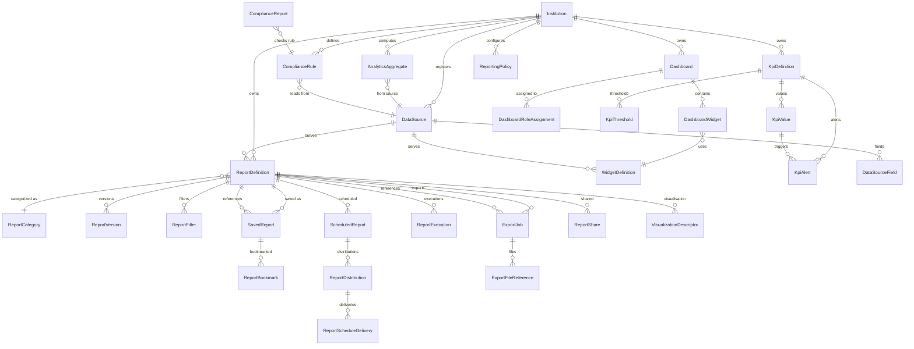
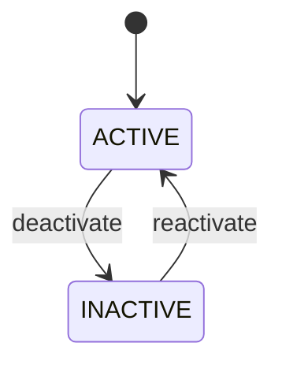
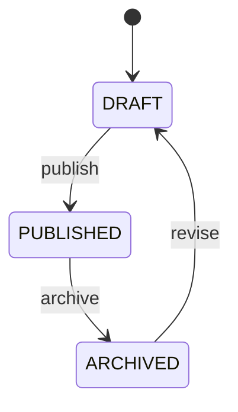
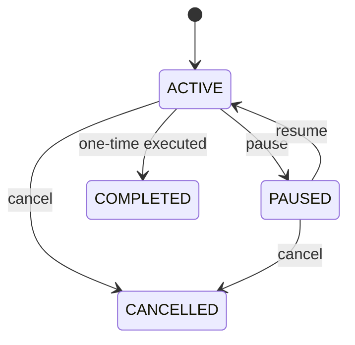
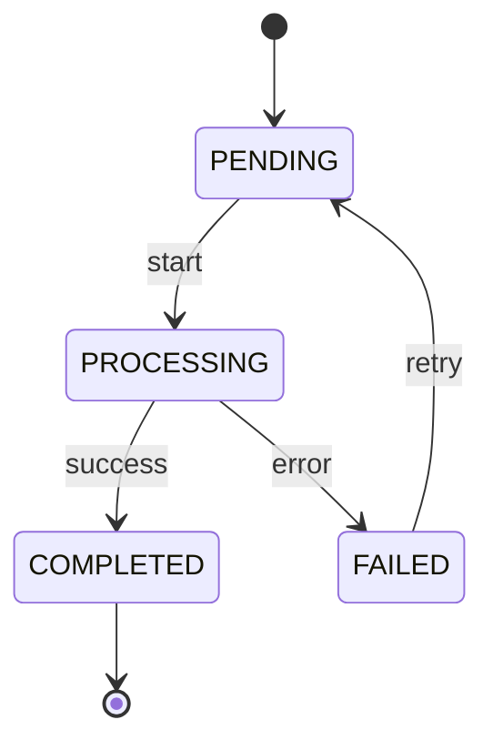
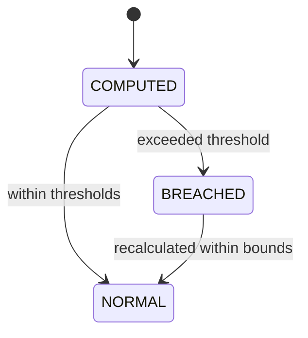
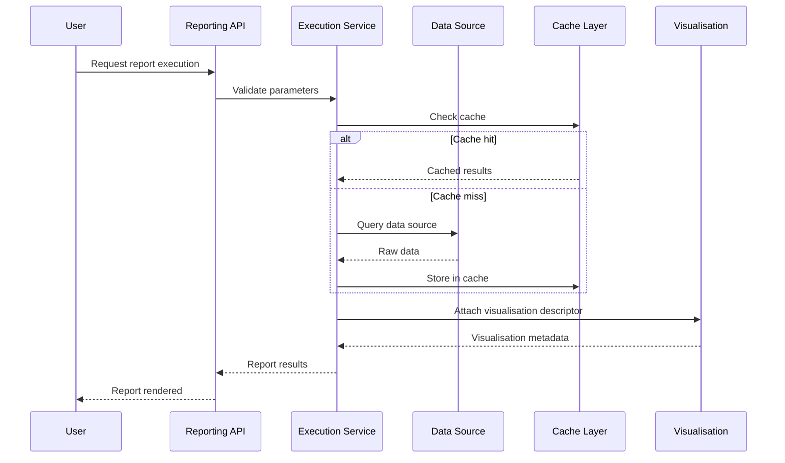
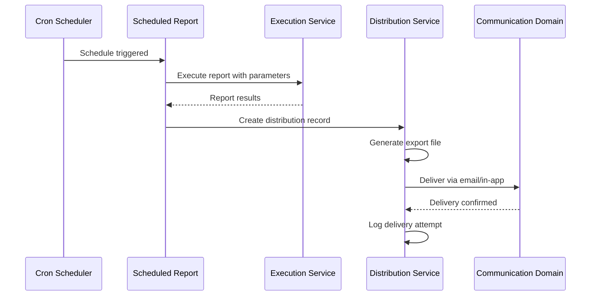
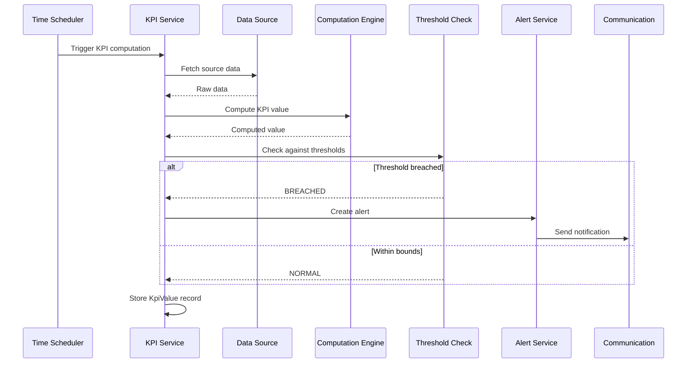

# Reporting & Analytics Engineering Specification

**Domain:** Reporting & Analytics
**Scope:** Dashboard Framework, Report Management, Operational Reports, Analytics Engine, KPI Management, Report Builder, Scheduling & Distribution, Export Engine, Data Visualization, Audit & Compliance Reports, Analytics Data Layer, AI & Predictive Analytics Foundation, Reporting Policies
**Created:** 2026-07-17
**Status:** Approved — Frozen for Implementation
**Last Updated:** 2026-07-20

---

## Table of Contents

1. [Overview](#1-overview)
2. [Engineering Principles](#2-engineering-principles)
3. [Architecture Decision Records](#3-architecture-decision-records)
4. [Engineering Status](#4-engineering-status)
5. [Phase 1 — Domain Analysis](#5-phase-1--domain-analysis)
6. [Phase 2 — Domain Design](#6-phase-2--domain-design)
7. [Phase 3 — Database Design](#7-phase-3--database-design)
8. [Phase 4 — Prisma Schema](#8-phase-4--prisma-schema)
9. [Phase 5 — Backend Implementation](#9-phase-5--backend-implementation)
10. [Phase 6 — API Design](#10-phase-6--api-design)
11. [Phase 7 — Testing & Verification](#11-phase-7--testing--verification)
12. [Analytics Data Layer Architecture](#12-analytics-data-layer-architecture)
13. [AI & Predictive Analytics Extension Points](#13-ai--predictive-analytics-extension-points)
14. [Outstanding Items](#14-outstanding-items)
15. [Revision History](#15-revision-history)

---

## 1. Overview

Reporting & Analytics is the intelligence backbone of the platform, providing operational reporting, analytical insights, configurable dashboards, KPI monitoring, scheduled report distribution, and a foundation for future predictive analytics. It consumes data from all other domains and produces read-optimised projections without owning operational business data.

| Aspect | Approach |
|--------|----------|
| Identity | Institution-scoped; every entity belongs to one Institution |
| Bounded Contexts | 13 (Dashboard Framework, Report Management, Operational Reports, Analytics Engine, KPI Management, Report Builder, Scheduling & Distribution, Export Engine, Data Visualization, Audit & Compliance Reports, Analytics Data Layer, AI & Predictive Analytics Foundation, Reporting Policies) |
| Data Ownership | Read-only consumer; operational domains remain the source of truth |
| Architecture | CQRS-friendly; write side manages definitions, read side serves reports |
| Sync Strategy | Event-driven materialisation via domain events from all operational domains |
| Dashboards | Widget-based, configurable per role, drag-and-drop layout |
| Reports | Self-service report builder with data source selection, filters, aggregation |
| KPIs | Configurable thresholds with breach alerting |
| Exports | Asynchronous via BullMQ; PDF, Excel, CSV, JSON |
| Scheduling | Cron-based with email and in-app delivery via Communication domain |
| Visualisation | Presentation-independent layer supporting tables, charts, indicators |
| AI Foundation | Extension points only; prediction models and outputs deferred to future |

**In Scope:** Dashboard framework, report management, operational reports across all domains, analytics engine, KPI management, self-service report builder, scheduling and distribution, export engine, data visualisation, audit and compliance reports, analytics data layer, AI and predictive analytics extension points, reporting policies

**Out of Scope:** Authentication, Authorization, Roles, Permissions (Identity & Access), Person profiles (People), Academic transactions (Academic Management), Payments, Billing, Accounting (Finance), Message delivery (Communication), Operational records (Operations), Document storage (Documents & Learning)

---

## 2. Engineering Principles

### Core Philosophy

- **Reporting Consumes, Never Owns:** Reporting & Analytics reads data from operational domains via domain events and read models; it never writes to operational tables or modifies business state
- **Operational Domains Are Source of Truth:** Report data is derived; the authoritative record always resides in the owning domain
- **CQRS-Friendly Architecture:** Write side manages report definitions, dashboard configurations, and KPI rules; read side serves queries against materialised projections
- **Event-Driven Data Synchronisation:** Reporting projections are updated in response to domain events published by operational domains; eventual consistency is acceptable
- **Read-Optimised Data Layer:** Materialised views, aggregated datasets, and reporting caches serve high-performance queries without impacting operational databases
- **Multi-Tenant Isolation by Default:** Every query scoped to tenant context; cross-tenant access = security violation
- **Configuration over Customization:** Dashboards, KPIs, report definitions, and export schedules are institution-configurable
- **Soft Delete by Default:** All mutable core entities support restore within retention period
- **Business Status vs Soft Delete:** Status enums represent business states (e.g., DRAFT, PUBLISHED, ACTIVE); deletion is controlled by `deleted_at` / `deleted_by` columns exclusively
- **Optimistic Concurrency:** Version column on mutable entities; 409 Conflict on version mismatch
- **Immutable Audit Logging:** Append-only audit logs; never update or delete
- **Asynchronous Export Processing:** Large exports execute on BullMQ queues; the API layer never blocks on export generation
- **Presentation Independence:** Data visualisation layer decouples data from rendering; supports web, mobile, and PDF output

### Naming Conventions

| Element | Convention | Example |
|---------|-----------|---------|
| Database tables | snake_case, plural | dashboards, report_definitions, kpi_definitions |
| Columns | snake_case | dashboard_id, kpi_name |
| Enums | SCREAMING_SNAKE_CASE | ACTIVE, DRAFT, PUBLISHED |
| Classes | PascalCase | DashboardAggregate |
| Methods | camelCase | createDashboard |
| API responses | camelCase | success, dashboardId |
| Events | PascalCase, past tense | ReportGenerated |
| Errors | PascalCase + Error | ReportNotFoundError |
| Permissions | `{domain}:{resource}:{action}` | reporting:dashboard:read |

### Tenant Isolation

- Tenant ID extracted from JWT and passed to repository methods as first parameter
- Application-level filtering (no Postgres Row-Level Security)
- Every query must include tenant filter
- Institution ID further scopes queries within a tenant

### Soft Delete

- All mutable core entities use soft delete via `deleted_at` (DateTime?) and `deleted_by` (uuid?)
- Business status (e.g., DRAFT, PUBLISHED, ACTIVE) is a separate concern from deletion
- 30-day restore window before permanent deletion
- Report definitions and dashboard configurations are retained per institution policy

### Audit Logging

Every state-changing operation generates an append-only audit log entry with: entity_type, entity_id, action, actor_id, actor_email, changes (JSON diff), context_ip, context_user_agent, timestamp.

For reporting operations, the audit log additionally captures: report_type, query_parameters, result_count, export_format, execution_time_ms.

### Error Handling

- Structured error responses: `{ success: false, error: { code, message, details[] } }`
- Domain-specific error classes; never expose internal details
- Full error context logged server-side
- Export failures include report reference and error details for retry

### Prisma Schema Principles

- UUID `@default(uuid())` for all primary keys
- `@unique` constraints for business keys
- `@map` for snake_case column names
- Soft delete via `deleted_at` (DateTime?) and `deleted_by` (uuid?)
- Business status via `status` enum (never a deletion marker)
- Optimistic locking via `version` (Int @default(1))
- Audit fields: created_at, created_by, updated_at, updated_by
- JSON columns for flexible data (widget config, filter definitions, query parameters, KPI thresholds)
- Prisma enums mapped to database types
- Cascade deletes: child entities cascade from parent aggregate root; cross-aggregate references use application-level guards

### Technology Stack

| Component | Technology |
|-----------|-----------|
| Runtime | Node.js >=22.0.0 |
| Framework | NestJS ^11.0.0 |
| ORM | Prisma ^6.12.0 |
| Language | TypeScript ^5.8.3 |
| Validation | class-validator + class-transformer |
| Auth | JWT + bcrypt |
| Queue | BullMQ + Redis |
| Testing | Jest ^30.0.0 |
| Migrations | Prisma Migrate |
| API Docs | Swagger/OpenAPI ^7.0.0 |

---

## 3. Architecture Decision Records

| ADR | Decision | Rationale |
|-----|----------|-----------|
| ADR-001 | Reporting consumes data but never owns operational records | Strict domain boundary; operational domains remain source of truth |
| ADR-002 | CQRS-friendly architecture with separate write and read sides | Write side manages definitions; read side serves high-performance queries against projections |
| ADR-003 | Event-driven data synchronisation via domain events | Decoupled from operational domains; eventual consistency is acceptable for reporting |
| ADR-004 | Materialised views and aggregated datasets for read performance | Reporting queries are read-heavy and complex; pre-computed projections avoid impacting operational databases |
| ADR-005 | Application-level tenant isolation (no RLS) | Consistent with Identity & Access, Institution Management, People, Academic Management, Finance, Communication, Operations, and Documents & Learning |
| ADR-006 | Domain events via EventEmitter2 (in-process) | Decouples services; supports async processing; future migration to MQ |
| ADR-007 | Optimistic concurrency (version column) | Prevents lost updates on dashboard and report definition changes |
| ADR-008 | Immutable audit logs (append-only) | Tamper-proof reporting audit trail; compliance requirement |
| ADR-009 | Dashboards are widget-based and configurable | Different roles need different views; widget architecture enables personalised dashboards |
| ADR-010 | Report definitions are versioned | Report changes must not affect in-flight reports; versioning ensures snapshot consistency |
| ADR-011 | Self-service report builder empowers non-technical users | Administrators and teachers can create custom reports without developer intervention |
| ADR-012 | Scheduled reports use cron-based scheduling | Flexible recurrence (daily, weekly, termly) with timezone awareness |
| ADR-013 | Exports execute asynchronously via BullMQ | Large dataset exports can take minutes; async processing prevents API timeout |
| ADR-014 | Export format is presentation-independent | The same report data renders as PDF, Excel, CSV, or JSON; format is a rendering concern |
| ADR-015 | KPIs have configurable thresholds with breach alerting | Institutions define their own performance benchmarks; breaches trigger notifications |
| ADR-016 | Data visualisation is decoupled from data retrieval | Charts, tables, and indicators consume structured data; rendering is a frontend concern |
| ADR-017 | Reporting caches are TTL-based | Cached data expires after configurable periods; balances freshness with performance |
| ADR-018 | Audit and compliance reports are read-only | Compliance data is derived from operational audit logs; never modified by reporting |
| ADR-019 | AI and predictive analytics are extension points only | V1 provides the foundation (data pipelines, feature stores); models and predictions are future |
| ADR-020 | Report access follows role-based permissions | Reports may contain sensitive data; access is controlled by role and data scope |
| ADR-021 | Dashboard layouts are institution-scoped | Each institution configures its own dashboard layouts per role |
| ADR-022 | Operational report categories align with domain boundaries | Categories mirror the platform's domain structure for intuitive navigation |
| ADR-023 | Report scheduling integrates with Communication domain | Scheduled reports are delivered via email or in-app using Communication's delivery infrastructure |
| ADR-024 | Large exports use streaming to manage memory | Excel and CSV exports stream rows rather than loading entire datasets into memory |
| ADR-025 | KPI calculation runs on configurable intervals | KPIs are computed periodically (hourly, daily); not on every query |
| ADR-026 | Report builder queries use read replicas | Self-service queries execute against read-optimised replicas to avoid impacting operational writes |
| ADR-027 | Distribution history is immutable | Delivery attempts and failures are logged permanently for debugging |
| ADR-028 | Visualisation metadata describes chart type, axes, and series | Frontend consumes a visualisation descriptor; the backend provides data and metadata |
| ADR-029 | Reporting policies override platform defaults | Institution-specific access, retention, and export rules take precedence |
| ADR-030 | Export file retention is configurable | Generated exports are stored temporarily; cleanup runs on schedule |
| ADR-031 | Benchmarking data is anonymised across institutions | Future institution benchmarking uses anonymised, aggregated data to protect privacy |
| ADR-032 | Report templates are reusable | Common report formats (attendance summary, fee collection) are templated for reuse |
| ADR-033 | KPI breach notifications use Communication domain | KPI threshold breaches trigger alerts through the Communication domain's notification engine |
| ADR-034 | Analytics data layer uses append-only aggregates | Historical aggregates are never overwritten; new periods create new records |
| ADR-035 | Export queue supports priority levels | Urgent exports (audit compliance) can be prioritised over routine scheduled exports |

---

## 4. Engineering Status

| Phase | Status | Summary |
|-------|--------|---------|
| Phase 1 — Domain Analysis | Complete | 35 entities, 40+ domain events, 35 business rules |
| Phase 2 — Domain Design | Complete | 13 aggregates, 35 invariants, 25 policies, 12 validation rule sets |
| Phase 3 — Database Design | Complete | 31 tables, 50+ indexes, 25 unique constraints |
| Phase 4 — Prisma Schema | Complete | 31 models, 23 enums, 2-pass validation |
| Phase 5 — Backend Implementation | Complete | 14 modules, 13 repositories, 13 domain services, 13 controllers, 8 event consumers |
| Phase 6 — API Design | Complete | 106 endpoints |
| Phase 7 — Testing & Verification | Complete | 18 test categories, ~226+ test scenarios |

**Overall Status:** Approved — Frozen for Implementation.

---

## 5. Phase 1 — Domain Analysis

### 5.1 Domain Purpose

Reporting & Analytics is the intelligence backbone of the platform. It provides operational reporting, analytical insights, configurable dashboards, KPI monitoring, scheduled report distribution, self-service report building, and a foundation for future predictive analytics.

The domain consumes data from all other domains via domain events and read models. It produces read-optimised projections without owning or modifying any operational business data. Operational domains remain the source of truth.

### 5.2 Domain Responsibilities

| Responsibility | Description |
|----------------|-------------|
| Dashboard Framework | Provide configurable, widget-based dashboards per role with drag-and-drop layout |
| Report Management | Define, categorise, version, and manage the report catalogue |
| Operational Reports | Generate reports spanning all operational domains (students, staff, academics, finance, operations) |
| Analytics Engine | Perform trend, comparative, distribution, performance, and financial analysis |
| KPI Management | Define, monitor, and alert on configurable KPIs with thresholds |
| Report Builder | Enable self-service report creation with data source selection, filters, and aggregation |
| Scheduling & Distribution | Schedule, recur, and distribute reports via email and in-app delivery |
| Export Engine | Generate PDF, Excel, CSV, and JSON exports asynchronously |
| Data Visualisation | Provide presentation-independent visualisation descriptors for tables, charts, and indicators |
| Audit & Compliance Reports | Generate compliance, security, and regulatory reports from audit data |
| Analytics Data Layer | Maintain materialised views, read models, and caches for high-performance queries |
| AI & Predictive Analytics Foundation | Provide data pipelines and extension points for future predictive capabilities |
| Reporting Policies | Define and enforce institution-specific reporting access, retention, and export rules |

### 5.3 Domain Boundaries

**In Scope:** Dashboard framework, report management, operational reports, analytics engine, KPI management, report builder, scheduling and distribution, export engine, data visualisation, audit and compliance reports, analytics data layer, AI and predictive analytics foundation, reporting policies

**Out of Scope:** Authentication, Authorization, Roles, Permissions (Identity & Access), Person profiles (People), Academic transactions (Academic Management), Payments, Billing, Accounting (Finance), Message delivery (Communication), Operational records (Operations), Document storage (Documents & Learning)

### 5.4 Dependencies

| Dependency | Nature | Direction |
|------------|--------|-----------|
| Identity & Access | User context, role resolution for permission checks | Reads |
| Institution Management | Institution configuration, tenant context, module licensing | Reads |
| People | Student, Staff, Parent person records for report dimensions | Reads (events) |
| Academic Management | Academic results, attendance, enrollment, assessment data | Reads (events) |
| Finance | Payment, invoice, fee structure, scholarship data | Reads (events) |
| Communication | Delivery infrastructure for scheduled report distribution | Writes (references) |
| Operations | Library, hostel, transport, clinic, visitor, asset, inventory data | Reads (events) |
| Documents & Learning | Document metadata, learning resource data | Reads (events) |
| Platform Administration | Audit logs, system metrics, event bus | Reads (events) |

### 5.5 Core Entities

| Entity | Type | Bounded Context | Description |
|--------|------|----------------|-------------|
| Dashboard | Core | Dashboard Framework | Configurable dashboard with widget layout per role |
| DashboardWidget | Core | Dashboard Framework | Individual widget within a dashboard |
| WidgetDefinition | Core | Dashboard Framework | Reusable widget template defining data source and visualisation |
| ReportDefinition | Core | Report Management | Report template with data source, fields, filters, and visualisation |
| ReportCategory | Core | Report Management | Classification category for reports (hierarchical) |
| ReportTemplate | Core | Report Management | Reusable report format for common report types |
| SavedReport | Core | Report Management | User-saved report instance with filters and parameters |
| ReportVersion | Supporting | Report Management | Version snapshot of a report definition |
| ScheduledReport | Core | Scheduling & Distribution | Recurring or one-time report schedule |
| ReportDistribution | Supporting | Scheduling & Distribution | Delivery record for a scheduled report |
| ReportExecution | Core | Report Management | Record of a report execution with parameters and timing |
| KpiDefinition | Core | KPI Management | KPI metric definition with formula and thresholds |
| KpiThreshold | Core | KPI Management | Threshold values for KPI breach alerting |
| KpiValue | Core | KPI Management | Computed KPI value for a period |
| KpiAlert | Core | KPI Management | Alert generated on KPI threshold breach |
| ExportJob | Core | Export Engine | Async export job with format, status, and file reference |
| ExportTemplate | Core | Export Engine | Reusable export configuration |
| DataSource | Core | Analytics Engine | Registered data source for report builder queries |
| DataSourceField | Supporting | Analytics Engine | Field definition within a data source |
| AnalyticsAggregate | Core | Analytics Data Layer | Pre-computed analytical aggregate for a period |
| AnalyticsCache | Core | Analytics Data Layer | TTL-based cache entry for expensive queries |
| ComplianceReport | Core | Audit & Compliance | Generated compliance or audit report |
| ComplianceRule | Core | Audit & Compliance | Definition of a compliance check rule |
| VisualizationDescriptor | Supporting | Data Visualization | Chart type, axes, series, and colour configuration |
| ReportFilter | Supporting | Report Management | Reusable filter definition for reports |
| ReportShare | Core | Report Management | Shared report access with user or role |
| ReportingPolicy | Core | Reporting Policies | Institution-specific reporting configuration |
| PredictionModel | Supporting | AI Foundation | Future prediction model metadata |
| PredictionOutput | Supporting | AI Foundation | Future prediction output storage |
| DataPipeline | Supporting | AI Foundation | Future data pipeline configuration |
| AuditLogEntry | Reference | Audit & Compliance | Reference to Platform Administration audit logs |
| DashboardRoleAssignment | Relationship | Dashboard Framework | Dashboard-to-role binding |
| ReportScheduleDelivery | Supporting | Scheduling & Distribution | Individual delivery attempt record |
| ExportFileReference | Supporting | Export Engine | Reference to generated export file in storage |
| ReportBookmark | Supporting | Report Management | User bookmark for quick report access |

### 5.6 Domain Events

#### 5.6.1 Events Published by Reporting & Analytics

| Event | Trigger | Consumers |
|-------|---------|-----------|
| DashboardCreated | New dashboard created | AuditModule |
| DashboardUpdated | Dashboard layout changed | AuditModule |
| ReportDefinitionCreated | New report definition created | AuditModule |
| ReportDefinitionPublished | Report definition published | AuditModule |
| ReportGenerated | Report execution completed | AuditModule |
| ScheduledReportExecuted | Scheduled report ran | AuditModule |
| ExportJobCreated | Export request submitted | AuditModule |
| ExportJobCompleted | Export file generated | AuditModule, Communication (delivery) |
| ExportJobFailed | Export generation failed | AuditModule, Alerting |
| KpiValueComputed | KPI calculation completed | AuditModule |
| KpiThresholdBreached | KPI exceeded threshold | AuditModule, Communication (alert) |
| ComplianceReportGenerated | Compliance report created | AuditModule |
| AnalyticsCacheRefreshed | Cache updated | AuditModule |

#### 5.6.2 Events Consumed from Other Domains

| Source Domain | Event | Reporting & Analytics Action |
|---------------|-------|------------------------------|
| People | StudentEnrolled | Update enrollment analytics |
| People | StaffHired | Update staff analytics |
| People | StudentGraduated | Update graduation metrics |
| Academic Management | ResultPublished | Update academic performance analytics |
| Academic Management | AttendanceMarked | Update attendance analytics |
| Academic Management | TermClosed | Close period aggregates |
| Finance | PaymentReceived | Update financial analytics |
| Finance | InvoiceGenerated | Update billing analytics |
| Finance | ScholarshipAwarded | Update scholarship analytics |
| Communication | NotificationDelivered | Update communication delivery analytics |
| Operations | BookBorrowed | Update library analytics |
| Operations | RoomAllocated | Update hostel occupancy analytics |
| Operations | VisitorCheckedIn | Update visitor analytics |
| Operations | WorkOrderCompleted | Update maintenance analytics |
| Documents & Learning | DocumentUploaded | Update document analytics |
| Platform Administration | AuditLogCreated | Feed compliance report engine |

### 5.7 Business Rules

| ID | Rule |
|----|------|
| BR-RA-001 | Every entity is tenant-scoped and institution-scoped |
| BR-RA-002 | Reporting consumes data but never writes to operational domain tables |
| BR-RA-003 | Operational domains remain the source of truth for all business data |
| BR-RA-004 | Report definitions are versioned; in-flight reports reference specific versions |
| BR-RA-005 | Dashboards are configurable per role; default layouts exist for each role |
| BR-RA-006 | Widget definitions reference data sources registered in the DataSource registry |
| BR-RA-007 | KPI definitions include formula, data source, and threshold configuration |
| BR-RA-008 | KPI breach alerts are generated when computed values exceed thresholds |
| BR-RA-009 | Scheduled reports execute on cron-based schedules with timezone awareness |
| BR-RA-010 | Report distribution integrates with Communication domain for email and in-app delivery |
| BR-RA-011 | Exports execute asynchronously via BullMQ; the API layer never blocks on export generation |
| BR-RA-012 | Large exports use streaming to manage memory consumption |
| BR-RA-013 | Export file retention is configurable; cleanup runs on schedule |
| BR-RA-014 | Self-service report builder queries execute against read replicas |
| BR-RA-015 | Report access follows role-based permissions with data scope enforcement |
| BR-RA-016 | Audit and compliance reports are read-only derived from operational audit logs |
| BR-RA-017 | Analytics data layer uses append-only aggregates; historical data is never overwritten |
| BR-RA-018 | Reporting caches are TTL-based; expired caches are refreshed on next access |
| BR-RA-019 | Visualisation descriptors are presentation-independent |
| BR-RA-020 | AI and predictive analytics are extension points only in V1 |
| BR-RA-021 | Reporting policies override platform defaults for access, retention, and export |
| BR-RA-022 | Report templates are reusable across institutions |
| BR-RA-023 | Distribution history is immutable; delivery attempts are permanently logged |
| BR-RA-024 | KPI calculation runs on configurable intervals (hourly, daily, weekly) |
| BR-RA-025 | Report categories align with domain boundaries for intuitive navigation |
| BR-RA-026 | Saved reports store filter parameters, not snapshot data |
| BR-RA-027 | Export queue supports priority levels for urgent compliance exports |
| BR-RA-028 | Dashboard widget count is institution-configurable |
| BR-RA-029 | Report execution is logged with parameters, timing, and result count |
| BR-RA-030 | Benchmarking data is anonymised across institutions |
| BR-RA-031 | Report sharing supports user-level and role-level access |
| BR-RA-032 | Scheduled report failures trigger retry with exponential backoff |
| BR-RA-033 | Analytics aggregates are computed per period (daily, weekly, termly) |
| BR-RA-034 | Compliance rules are institution-configurable |
| BR-RA-035 | Data pipeline definitions are metadata-only in V1 |

### 5.8 Invariants

| ID | Invariant |
|----|-----------|
| INV-RA-001 | Every entity belongs to exactly one Institution |
| INV-RA-002 | Every Dashboard belongs to exactly one Institution |
| INV-RA-003 | Every DashboardWidget references exactly one Dashboard and one WidgetDefinition |
| INV-RA-004 | Every ReportDefinition belongs to exactly one Institution |
| INV-RA-005 | Every ReportDefinition belongs to exactly one ReportCategory |
| INV-RA-006 | Every ReportVersion references exactly one ReportDefinition |
| INV-RA-007 | ReportVersion version numbers are sequential per definition |
| INV-RA-008 | Every SavedReport references exactly one ReportDefinition |
| INV-RA-009 | Every ScheduledReport references exactly one ReportDefinition |
| INV-RA-010 | Every ReportDistribution references exactly one ScheduledReport |
| INV-RA-011 | Every ReportExecution references exactly one ReportDefinition |
| INV-RA-012 | Every KpiDefinition belongs to exactly one Institution |
| INV-RA-013 | Every KpiThreshold references exactly one KpiDefinition |
| INV-RA-014 | Every KpiValue references exactly one KpiDefinition |
| INV-RA-015 | Every KpiAlert references exactly one KpiDefinition and one KpiValue |
| INV-RA-016 | Every ExportJob belongs to exactly one Institution |
| INV-RA-017 | Every ExportJob references exactly one ReportDefinition |
| INV-RA-018 | Every DataSource belongs to exactly one Institution |
| INV-RA-019 | Every DataSourceField references exactly one DataSource |
| INV-RA-020 | Every AnalyticsAggregate belongs to exactly one Institution |
| INV-RA-021 | Every AnalyticsAggregate is unique per Institution per period per metric |
| INV-RA-022 | Every AnalyticsCache is unique per Institution per cache_key |
| INV-RA-023 | Every ComplianceReport belongs to exactly one Institution |
| INV-RA-024 | Every ComplianceRule belongs to exactly one Institution |
| INV-RA-025 | Every ReportShare references exactly one ReportDefinition |
| INV-RA-026 | ReportingPolicy is unique per Institution per policy_type |
| INV-RA-027 | Every DashboardRoleAssignment references exactly one Dashboard |
| INV-RA-028 | Every ReportScheduleDelivery references exactly one ScheduledReport |
| INV-RA-029 | Every ExportFileReference references exactly one ExportJob |
| INV-RA-030 | Every ReportBookmark references exactly one SavedReport |
| INV-RA-031 | WidgetDefinition is unique per Institution per widget_key |
| INV-RA-032 | ReportCategory supports parent-child hierarchy |
| INV-RA-033 | DataSource is unique per Institution per source_key |
| INV-RA-034 | KpiDefinition is unique per Institution per kpi_key |
| INV-RA-035 | ComplianceRule is unique per Institution per rule_code |

### 5.9 Configurable Policies

| ID | Policy | Default | Scope |
|----|--------|---------|-------|
| CP-RA-001 | Max dashboards per role | 10 | Institution |
| CP-RA-002 | Max widgets per dashboard | 20 | Institution |
| CP-RA-003 | Dashboard refresh interval (seconds) | 300 | Institution |
| CP-RA-004 | Report definition max saved per user | 50 | Institution |
| CP-RA-005 | Report builder max rows returned | 10000 | Institution |
| CP-RA-006 | Report builder query timeout (seconds) | 30 | Institution |
| CP-RA-007 | Export max rows | 100000 | Institution |
| CP-RA-008 | Export file retention (days) | 7 | Institution |
| CP-RA-009 | Export max concurrent jobs | 5 | Institution |
| CP-RA-010 | Scheduled report max per user | 20 | Institution |
| CP-RA-011 | Scheduled report min interval (hours) | 1 | Institution |
| CP-RA-012 | KPI calculation interval | DAILY | Institution |
| CP-RA-013 | KPI breach notification enabled | true | Institution |
| CP-RA-014 | Analytics cache TTL (minutes) | 60 | Institution |
| CP-RA-015 | Analytics aggregate retention (days) | 365 | Institution |
| CP-RA-016 | Compliance report retention (days) | 2555 | Institution |
| CP-RA-017 | Report access default level | INSTITUTION | Institution |
| CP-RA-018 | Export allowed formats | ["PDF","EXCEL","CSV","JSON"] | Institution |
| CP-RA-019 | Report sharing max per report | 20 | Institution |
| CP-RA-020 | Soft delete retention (days) | 30 | Institution |
| CP-RA-021 | Report execution log retention (days) | 90 | Institution |
| CP-RA-022 | Max report bookmark per user | 20 | Institution |
| CP-RA-023 | Export priority queue enabled | true | Institution |
| CP-RA-024 | AI prediction extension enabled | false | Institution |
| CP-RA-025 | Benchmarking data sharing enabled | false | Institution |

### 5.10 Validation Rule Sets

| ID | Rules | Scope |
|----|-------|-------|
| VRS-RA-001 | Dashboard: name required (3–100 chars), role required, layout json required | Dashboard |
| VRS-RA-002 | DashboardWidget: dashboard_id required, widget_definition_id required, position json required | DashboardWidget |
| VRS-RA-003 | ReportDefinition: name required (3–200 chars), category_id required, data_source_id required | ReportDefinition |
| VRS-RA-004 | KpiDefinition: name required (3–100 chars), kpi_key required, formula json required, data_source_id required | KpiDefinition |
| VRS-RA-005 | ScheduledReport: report_definition_id required, schedule_type required, cron_expression or interval required | ScheduledReport |
| VRS-RA-006 | ExportJob: report_definition_id required, format required, parameters json optional | ExportJob |
| VRS-RA-007 | DataSource: name required (3–100 chars), source_key required, source_type required | DataSource |
| VRS-RA-008 | ReportCategory: name required (3–100 chars), parent_id optional (self-ref) | ReportCategory |
| VRS-RA-009 | ComplianceRule: name required (3–100 chars), rule_code required, rule_type required | ComplianceRule |
| VRS-RA-010 | ReportingPolicy: policy_type required, value json required | ReportingPolicy |
| VRS-RA-011 | SavedReport: name required (3–100 chars), report_definition_id required, parameters json required | SavedReport |
| VRS-RA-012 | AnalyticsAggregate: period_start required, period_end required, metric_key required, value required | AnalyticsAggregate |

---

## 6. Phase 2 — Domain Design

### 6.1 Aggregates

| Aggregate | Root Entity | Bounded Context | Purpose | Lifecycle |
|-----------|-------------|----------------|---------|-----------|
| DashboardAggregate | Dashboard | Dashboard Framework | Configurable dashboard with widgets | ACTIVE → INACTIVE |
| ReportDefinitionAggregate | ReportDefinition | Report Management | Report template with data source and visualisation | DRAFT → PUBLISHED → ARCHIVED → DRAFT (revise) |
| SavedReportAggregate | SavedReport | Report Management | User-saved report with parameters | ACTIVE → ARCHIVED |
| ScheduledReportAggregate | ScheduledReport | Scheduling & Distribution | Recurring or one-time schedule | ACTIVE → PAUSED → COMPLETED / CANCELLED |
| KpiDefinitionAggregate | KpiDefinition | KPI Management | KPI with formula and thresholds | ACTIVE → INACTIVE |
| KpiValueAggregate | KpiValue | KPI Management | Computed KPI value | COMPUTED → BREACHED / NORMAL |
| ExportJobAggregate | ExportJob | Export Engine | Async export job | PENDING → PROCESSING → COMPLETED / FAILED |
| DataSourceAggregate | DataSource | Analytics Engine | Registered data source | ACTIVE → INACTIVE |
| AnalyticsAggregateRoot | AnalyticsAggregate | Analytics Data Layer | Pre-computed aggregate | COMPUTED |
| ComplianceReportAggregate | ComplianceReport | Audit & Compliance | Generated compliance report | GENERATED → PUBLISHED → ARCHIVED |
| ReportingPolicyAggregate | ReportingPolicy | Reporting Policies | Institution-specific configuration | ACTIVE → SUPERSEDED |
| ExportTemplateAggregate | ExportTemplate | Export Engine | Reusable export configuration | ACTIVE → INACTIVE |
| VisualizationDescriptor | VisualizationDescriptor | Data Visualization | Chart type and series configuration | ACTIVE |

### 6.2 Entity Relationships



### 6.3 Aggregate Lifecycle State Machines

#### 6.3.1 Dashboard Lifecycle



#### 6.3.2 Report Definition Lifecycle



#### 6.3.3 Scheduled Report Lifecycle



#### 6.3.4 Export Job Lifecycle



#### 6.3.5 KPI Value Lifecycle



### 6.4 Domain Services

| Service | Bounded Context | Responsibility |
|---------|----------------|----------------|
| DashboardService | Dashboard Framework | Dashboard CRUD, widget management, layout configuration |
| WidgetDefinitionService | Dashboard Framework | Widget template CRUD, data source binding |
| ReportDefinitionService | Report Management | Report CRUD, versioning, categorisation |
| ReportExecutionService | Report Management | Report execution, parameter validation, result caching |
| SavedReportService | Report Management | User-saved reports, bookmarks, sharing |
| ScheduledReportService | Scheduling & Distribution | Schedule CRUD, cron evaluation, trigger execution |
| ReportDistributionService | Scheduling & Distribution | Delivery via Communication, retry on failure |
| KpiManagementService | KPI Management | KPI definition CRUD, threshold management |
| KpiComputationService | KPI Management | Periodic KPI calculation, breach detection |
| KpiAlertService | KPI Management | Alert generation and notification via Communication |
| ExportService | Export Engine | Export job creation, async processing, file management |
| DataSourceService | Analytics Engine | Data source registration, field management, query execution |
| AnalyticsAggregationService | Analytics Data Layer | Aggregate computation, cache management |
| ComplianceService | Audit & Compliance | Compliance rule evaluation, report generation |
| VisualizationService | Data Visualization | Visualisation descriptor management |
| ReportingPolicyService | Reporting Policies | Policy CRUD, enforcement |
| ReportSearchService | Report Management | Full-text search across reports, dashboards, KPIs |

### 6.5 Policies

| ID | Policy | Trigger | Scope |
|----|--------|---------|-------|
| POL-RA-001 | Dashboard role assignment | Dashboard creation | Per role |
| POL-RA-002 | Report access permission check | Report execution | Per user role |
| POL-RA-003 | KPI threshold breach alerting | KPI computation | Per KPI |
| POL-RA-004 | Scheduled report execution | Cron trigger | Per schedule |
| POL-RA-005 | Export file retention cleanup | Background job | Per institution |
| POL-RA-006 | Analytics cache TTL refresh | Cache miss | Per cache entry |
| POL-RA-007 | Report distribution retry | Delivery failure | Per distribution |
| POL-RA-008 | Compliance rule evaluation | Scheduled | Per rule |
| POL-RA-009 | Report execution logging | Every execution | Always active |
| POL-RA-010 | Export priority queue routing | Export creation | Per export type |
| POL-RA-011 | KPI computation scheduling | Time-based | Per KPI interval |
| POL-RA-012 | Report builder query timeout | Query execution | Per institution |
| POL-RA-013 | Dashboard widget limit enforcement | Widget addition | Per dashboard |
| POL-RA-014 | Export row limit enforcement | Export creation | Per institution |
| POL-RA-015 | Saved report limit enforcement | Report save | Per user |
| POL-RA-016 | Report sharing limit enforcement | Share creation | Per report |
| POL-RA-017 | Analytics aggregate period close | Period end | Per period |
| POL-RA-018 | Benchmarking data anonymisation | Data aggregation | Cross-institution |
| POL-RA-019 | Report bookmark limit enforcement | Bookmark creation | Per user |
| POL-RA-020 | Export concurrent job limit | Export creation | Per institution |

### 6.6 Event Flow Diagrams

#### 6.6.1 Report Generation Flow



#### 6.6.2 Scheduled Report Distribution Flow



#### 6.6.3 KPI Computation Flow



### 6.7 Read Models

| Read Model | Purpose | Source |
|------------|---------|--------|
| DashboardSummary | Dashboard listing with widget count | Dashboard + DashboardWidget aggregation |
| DashboardDetail | Full dashboard with widgets and layout | Dashboard + DashboardWidget + WidgetDefinition |
| ReportSummary | Report listing with execution stats | ReportDefinition + ReportExecution aggregation |
| ReportDetail | Full report definition with filters and visualisation | ReportDefinition + ReportFilter + VisualizationDescriptor |
| ReportExecutionSummary | Report execution history | ReportExecution + ReportDefinition |
| KpiDashboard | KPI values with breach status | KpiDefinition + KpiValue + KpiThreshold |
| KpiAlertSummary | Active KPI alerts | KpiAlert + KpiDefinition |
| ExportJobSummary | Export job listing with status | ExportJob + ReportDefinition |
| ScheduledReportSummary | Scheduled report listing with next run | ScheduledReport + ReportDistribution aggregation |
| AnalyticsOverview | High-level analytics summary | AnalyticsAggregate aggregation |
| ComplianceReportSummary | Compliance report listing | ComplianceReport + ComplianceRule |
| DataSourceSummary | Data source listing with field count | DataSource + DataSourceField aggregation |

### 6.8 Search

| Search Target | Fields | Method |
|--------------|--------|--------|
| Reports | name, description, category | Full-text search with PostgreSQL tsvector |
| Dashboards | name, role | ILIKE prefix search |
| KPIs | name, description | ILIKE prefix search |
| Saved Reports | name, report name | Full-text search with PostgreSQL tsvector |
| Compliance Rules | name, rule_code | ILIKE prefix search |

---

## 7. Phase 3 — Database Design

### 7.1 Tables

| # | Table | Bounded Context | Purpose |
|---|-------|----------------|---------|
| 1 | dashboards | Dashboard Framework | Dashboard records |
| 2 | dashboard_widgets | Dashboard Framework | Widget instances within dashboards |
| 3 | widget_definitions | Dashboard Framework | Reusable widget templates |
| 4 | dashboard_role_assignments | Dashboard Framework | Dashboard-to-role bindings |
| 5 | report_definitions | Report Management | Report templates |
| 6 | report_categories | Report Management | Classification categories |
| 7 | report_versions | Report Management | Version snapshots |
| 8 | report_filters | Report Management | Reusable filter definitions |
| 9 | saved_reports | Report Management | User-saved reports |
| 10 | report_shares | Report Management | Shared report access |
| 11 | report_bookmarks | Report Management | User bookmarks |
| 12 | report_executions | Report Management | Execution log |
| 13 | report_templates | Report Management | Reusable report formats |
| 14 | scheduled_reports | Scheduling & Distribution | Schedule definitions |
| 15 | report_distributions | Scheduling & Distribution | Delivery records |
| 16 | report_schedule_deliveries | Scheduling & Distribution | Individual delivery attempts |
| 17 | kpi_definitions | KPI Management | KPI metric definitions |
| 18 | kpi_thresholds | KPI Management | Threshold values |
| 19 | kpi_values | KPI Management | Computed values |
| 20 | kpi_alerts | KPI Management | Breach alerts |
| 21 | export_jobs | Export Engine | Async export jobs |
| 22 | export_templates | Export Engine | Reusable export configs |
| 23 | export_file_references | Export Engine | Generated file references |
| 24 | data_sources | Analytics Engine | Registered data sources |
| 25 | data_source_fields | Analytics Engine | Field definitions |
| 26 | analytics_aggregates | Analytics Data Layer | Pre-computed aggregates |
| 27 | analytics_caches | Analytics Data Layer | TTL-based caches |
| 28 | compliance_reports | Audit & Compliance | Generated compliance reports |
| 29 | compliance_rules | Audit & Compliance | Compliance check rules |
| 30 | visualization_descriptors | Data Visualization | Chart configuration |
| 31 | reporting_policies | Reporting Policies | Institution-specific policies |

### 7.2 Table Definitions

#### 7.2.1 dashboards

| Column | Type | Nullable | Default | Notes |
|--------|------|----------|---------|-------|
| id | uuid | NO | uuid() | PK |
| institution_id | uuid | NO | — | FK → institutions.id |
| name | varchar(100) | NO | — | Dashboard name |
| description | varchar(500) | YES | — | |
| role_key | varchar(50) | NO | — | Target role (PRINCIPAL, TEACHER, FINANCE, etc.) |
| layout | jsonb | NO | {} | Widget position and size configuration |
| is_default | boolean | NO | false | Whether this is the default dashboard for the role |
| status | enum | NO | ACTIVE | ACTIVE, INACTIVE |
| version | int | NO | 1 | Optimistic concurrency |
| created_at | timestamptz | NO | now() | |
| created_by | uuid | YES | — | FK → users.id |
| updated_at | timestamptz | NO | now() | |
| updated_by | uuid | YES | — | FK → users.id |
| deleted_at | timestamptz | YES | — | Soft delete |
| deleted_by | uuid | YES | — | FK → users.id |

**Indexes:** institution_id, role_key, status, is_default, (institution_id, name)

#### 7.2.2 dashboard_widgets

| Column | Type | Nullable | Default | Notes |
|--------|------|----------|---------|-------|
| id | uuid | NO | uuid() | PK |
| institution_id | uuid | NO | — | FK → institutions.id |
| dashboard_id | uuid | NO | — | FK → dashboards.id |
| widget_definition_id | uuid | NO | — | FK → widget_definitions.id |
| title | varchar(100) | YES | — | Display title override |
| position | jsonb | NO | {} | {x, y, w, h} grid position |
| config | jsonb | YES | {} | Widget-specific configuration overrides |
| refresh_interval | int | YES | — | Override refresh interval in seconds |
| created_at | timestamptz | NO | now() | |
| updated_at | timestamptz | NO | now() | |

**Indexes:** institution_id, dashboard_id, widget_definition_id

#### 7.2.3 widget_definitions

| Column | Type | Nullable | Default | Notes |
|--------|------|----------|---------|-------|
| id | uuid | NO | uuid() | PK |
| institution_id | uuid | NO | — | FK → institutions.id |
| widget_key | varchar(50) | NO | — | Unique widget identifier |
| name | varchar(100) | NO | — | Display name |
| description | varchar(500) | YES | — | |
| widget_type | enum | NO | — | KPI_CARD, CHART, TABLE, LIST, GAUGE, TREND |
| data_source_id | uuid | YES | — | FK → data_sources.id |
| config_schema | jsonb | YES | {} | JSON schema for widget config |
| default_config | jsonb | YES | {} | Default configuration |
| visualization | jsonb | YES | {} | Visualisation descriptor |
| is_system | boolean | NO | false | Whether this is a platform-provided widget |
| created_at | timestamptz | NO | now() | |
| created_by | uuid | YES | — | |
| updated_at | timestamptz | NO | now() | |
| updated_by | uuid | YES | — | |
| deleted_at | timestamptz | YES | — | Soft delete |
| deleted_by | uuid | YES | — | |

**Indexes:** institution_id, widget_key, data_source_id, (institution_id, widget_key) UNIQUE

#### 7.2.4 dashboard_role_assignments

| Column | Type | Nullable | Default | Notes |
|--------|------|----------|---------|-------|
| id | uuid | NO | uuid() | PK |
| institution_id | uuid | NO | — | FK → institutions.id |
| dashboard_id | uuid | NO | — | FK → dashboards.id |
| role_key | varchar(50) | NO | — | Role this dashboard is assigned to |
| assigned_at | timestamptz | NO | now() | |
| assigned_by | uuid | YES | — | |

**Indexes:** institution_id, dashboard_id, role_key, (institution_id, dashboard_id, role_key) UNIQUE

#### 7.2.5 report_definitions

| Column | Type | Nullable | Default | Notes |
|--------|------|----------|---------|-------|
| id | uuid | NO | uuid() | PK |
| institution_id | uuid | NO | — | FK → institutions.id |
| name | varchar(200) | NO | — | Report name |
| description | text | YES | — | |
| category_id | uuid | NO | — | FK → report_categories.id |
| data_source_id | uuid | NO | — | FK → data_sources.id |
| report_type | enum | NO | — | STANDARD, ANALYTICS, COMPLIANCE, SUMMARY |
| query_config | jsonb | NO | {} | Data source query configuration |
| filter_config | jsonb | YES | [] | Filter definitions |
| field_config | jsonb | NO | [] | Field selection and formatting |
| visualization_id | uuid | YES | — | FK → visualization_descriptors.id |
| current_version | int | NO | 1 | |
| status | enum | NO | DRAFT | DRAFT, PUBLISHED, ARCHIVED |
| access_level | enum | NO | INSTITUTION | INSTITUTION, ROLE, PRIVATE |
| version | int | NO | 1 | Optimistic concurrency |
| metadata | jsonb | YES | {} | |
| created_at | timestamptz | NO | now() | |
| created_by | uuid | YES | — | |
| updated_at | timestamptz | NO | now() | |
| updated_by | uuid | YES | — | |
| deleted_at | timestamptz | YES | — | Soft delete |
| deleted_by | uuid | YES | — | |

**Indexes:** institution_id, category_id, data_source_id, report_type, status, (institution_id, name)

#### 7.2.6 report_categories

| Column | Type | Nullable | Default | Notes |
|--------|------|----------|---------|-------|
| id | uuid | NO | uuid() | PK |
| institution_id | uuid | NO | — | FK → institutions.id |
| name | varchar(100) | NO | — | |
| description | varchar(500) | YES | — | |
| icon | varchar(50) | YES | — | Icon identifier |
| parent_id | uuid | YES | — | Self-referencing FK |
| display_order | int | NO | 0 | |
| created_at | timestamptz | NO | now() | |
| created_by | uuid | YES | — | |
| updated_at | timestamptz | NO | now() | |
| updated_by | uuid | YES | — | |
| deleted_at | timestamptz | YES | — | Soft delete |
| deleted_by | uuid | YES | — | |

**Indexes:** institution_id, parent_id, (institution_id, name) UNIQUE

#### 7.2.7 report_versions

| Column | Type | Nullable | Default | Notes |
|--------|------|----------|---------|-------|
| id | uuid | NO | uuid() | PK |
| report_definition_id | uuid | NO | — | FK → report_definitions.id |
| version_number | int | NO | — | Sequential per definition |
| query_config | jsonb | NO | {} | Snapshot |
| filter_config | jsonb | YES | [] | Snapshot |
| field_config | jsonb | NO | [] | Snapshot |
| change_notes | varchar(500) | YES | — | |
| is_current | boolean | NO | true | |
| created_at | timestamptz | NO | now() | |
| created_by | uuid | YES | — | |

**Indexes:** report_definition_id, (report_definition_id, version_number) UNIQUE

#### 7.2.8 report_filters

| Column | Type | Nullable | Default | Notes |
|--------|------|----------|---------|-------|
| id | uuid | NO | uuid() | PK |
| institution_id | uuid | NO | — | FK → institutions.id |
| report_definition_id | uuid | NO | — | FK → report_definitions.id |
| name | varchar(100) | NO | — | Filter display name |
| field_key | varchar(100) | NO | — | Data source field |
| filter_type | enum | NO | — | TEXT, NUMBER, DATE_RANGE, SELECT, MULTI_SELECT, BOOLEAN |
| default_value | jsonb | YES | — | |
| options | jsonb | YES | — | For SELECT/MULTI_SELECT |
| is_required | boolean | NO | false | |
| display_order | int | NO | 0 | |
| created_at | timestamptz | NO | now() | |

**Indexes:** institution_id, report_definition_id

#### 7.2.9 saved_reports

| Column | Type | Nullable | Default | Notes |
|--------|------|----------|---------|-------|
| id | uuid | NO | uuid() | PK |
| institution_id | uuid | NO | — | FK → institutions.id |
| report_definition_id | uuid | NO | — | FK → report_definitions.id |
| user_id | uuid | NO | — | FK → users.id |
| name | varchar(100) | NO | — | User-given name |
| parameters | jsonb | NO | {} | Saved filter values |
| status | enum | NO | ACTIVE | ACTIVE, ARCHIVED |
| created_at | timestamptz | NO | now() | |
| updated_at | timestamptz | NO | now() | |

**Indexes:** institution_id, user_id, report_definition_id

#### 7.2.10 report_shares

| Column | Type | Nullable | Default | Notes |
|--------|------|----------|---------|-------|
| id | uuid | NO | uuid() | PK |
| institution_id | uuid | NO | — | FK → institutions.id |
| report_definition_id | uuid | NO | — | FK → report_definitions.id |
| shared_by | uuid | NO | — | FK → users.id |
| shared_with_user_id | uuid | YES | — | FK → users.id |
| shared_with_role_id | uuid | YES | — | FK → roles.id |
| permission_level | enum | NO | VIEW | VIEW, EXECUTE |
| created_at | timestamptz | NO | now() | |

**Indexes:** institution_id, report_definition_id, shared_with_user_id, shared_with_role_id

#### 7.2.11 report_bookmarks

| Column | Type | Nullable | Default | Notes |
|--------|------|----------|---------|-------|
| id | uuid | NO | uuid() | PK |
| institution_id | uuid | NO | — | FK → institutions.id |
| saved_report_id | uuid | NO | — | FK → saved_reports.id |
| user_id | uuid | NO | — | FK → users.id |
| created_at | timestamptz | NO | now() | |

**Indexes:** institution_id, user_id, (saved_report_id, user_id) UNIQUE

#### 7.2.12 report_executions

| Column | Type | Nullable | Default | Notes |
|--------|------|----------|---------|-------|
| id | uuid | NO | uuid() | PK |
| institution_id | uuid | NO | — | FK → institutions.id |
| report_definition_id | uuid | NO | — | FK → report_definitions.id |
| user_id | uuid | YES | — | FK → users.id (null for scheduled) |
| parameters | jsonb | YES | {} | Filter values used |
| result_count | int | NO | 0 | Number of rows |
| execution_time_ms | int | NO | 0 | Execution duration |
| status | enum | NO | COMPLETED | COMPLETED, FAILED |
| error_message | text | YES | — | |
| created_at | timestamptz | NO | now() | |

**Indexes:** institution_id, report_definition_id, user_id, status, created_at

#### 7.2.13 report_templates

| Column | Type | Nullable | Default | Notes |
|--------|------|----------|---------|-------|
| id | uuid | NO | uuid() | PK |
| institution_id | uuid | NO | — | FK → institutions.id |
| name | varchar(200) | NO | — | |
| description | varchar(500) | YES | — | |
| category | varchar(50) | NO | — | ACADEMIC, FINANCE, OPERATIONS, COMPLIANCE |
| report_config | jsonb | NO | {} | Template report definition |
| is_system | boolean | NO | false | Platform-provided template |
| status | enum | NO | ACTIVE | ACTIVE, INACTIVE |
| created_at | timestamptz | NO | now() | |
| created_by | uuid | YES | — | |
| updated_at | timestamptz | NO | now() | |
| updated_by | uuid | YES | — | |
| deleted_at | timestamptz | YES | — | Soft delete |
| deleted_by | uuid | YES | — | |

**Indexes:** institution_id, category, is_system, (institution_id, name)

#### 7.2.14 scheduled_reports

| Column | Type | Nullable | Default | Notes |
|--------|------|----------|---------|-------|
| id | uuid | NO | uuid() | PK |
| institution_id | uuid | NO | — | FK → institutions.id |
| report_definition_id | uuid | NO | — | FK → report_definitions.id |
| name | varchar(100) | NO | — | Schedule name |
| schedule_type | enum | NO | — | ONCE, DAILY, WEEKLY, MONTHLY, TERM |
| cron_expression | varchar(100) | YES | — | Cron expression for complex schedules |
| interval_hours | int | YES | — | Simple interval in hours |
| timezone | varchar(50) | NO | UTC | |
| parameters | jsonb | YES | {} | Report parameters |
| export_format | enum | NO | PDF | PDF, EXCEL, CSV, JSON |
| delivery_method | enum | NO | EMAIL | EMAIL, IN_APP, BOTH |
| next_run_at | timestamptz | YES | — | Next scheduled execution |
| last_run_at | timestamptz | YES | — | Last execution |
| status | enum | NO | ACTIVE | ACTIVE, PAUSED, COMPLETED, CANCELLED |
| version | int | NO | 1 | Optimistic concurrency |
| created_at | timestamptz | NO | now() | |
| created_by | uuid | YES | — | |
| updated_at | timestamptz | NO | now() | |
| updated_by | uuid | YES | — | |
| deleted_at | timestamptz | YES | — | Soft delete |
| deleted_by | uuid | YES | — | |

**Indexes:** institution_id, report_definition_id, status, next_run_at

#### 7.2.15 report_distributions

| Column | Type | Nullable | Default | Notes |
|--------|------|----------|---------|-------|
| id | uuid | NO | uuid() | PK |
| institution_id | uuid | NO | — | FK → institutions.id |
| scheduled_report_id | uuid | NO | — | FK → scheduled_reports.id |
| export_job_id | uuid | YES | — | FK → export_jobs.id |
| delivery_method | enum | NO | — | EMAIL, IN_APP |
| recipient_user_id | uuid | YES | — | FK → users.id |
| recipient_email | varchar(255) | YES | — | |
| status | enum | NO | PENDING | PENDING, SENT, FAILED |
| sent_at | timestamptz | YES | — | |
| error_message | text | YES | — | |
| created_at | timestamptz | NO | now() | |

**Indexes:** institution_id, scheduled_report_id, status

#### 7.2.16 report_schedule_deliveries

| Column | Type | Nullable | Default | Notes |
|--------|------|----------|---------|-------|
| id | uuid | NO | uuid() | PK |
| distribution_id | uuid | NO | — | FK → report_distributions.id |
| attempt | int | NO | 1 | |
| status | enum | NO | — | SUCCESS, FAILED |
| provider_response | jsonb | YES | {} | |
| error_message | text | YES | — | |
| attempted_at | timestamptz | NO | now() | |

**Indexes:** distribution_id

#### 7.2.17 kpi_definitions

| Column | Type | Nullable | Default | Notes |
|--------|------|----------|---------|-------|
| id | uuid | NO | uuid() | PK |
| institution_id | uuid | NO | — | FK → institutions.id |
| kpi_key | varchar(50) | NO | — | Unique identifier |
| name | varchar(100) | NO | — | Display name |
| description | varchar(500) | YES | — | |
| category | enum | NO | — | ENROLLMENT, ATTENDANCE, ACADEMIC, FINANCE, LIBRARY, HOSTEL, TRANSPORT, COMMUNICATION, SYSTEM |
| data_source_id | uuid | NO | — | FK → data_sources.id |
| formula | jsonb | NO | {} | Computation formula definition |
| unit | varchar(20) | YES | — | %, count, currency, etc. |
| aggregation | enum | NO | SUM | SUM, AVG, COUNT, MIN, MAX |
| calculation_interval | enum | NO | DAILY | HOURLY, DAILY, WEEKLY, MONTHLY, TERM |
| is_active | boolean | NO | true | |
| version | int | NO | 1 | Optimistic concurrency |
| created_at | timestamptz | NO | now() | |
| created_by | uuid | YES | — | |
| updated_at | timestamptz | NO | now() | |
| updated_by | uuid | YES | — | |
| deleted_at | timestamptz | YES | — | Soft delete |
| deleted_by | uuid | YES | — | |

**Indexes:** institution_id, kpi_key, category, is_active, (institution_id, kpi_key) UNIQUE

#### 7.2.18 kpi_thresholds

| Column | Type | Nullable | Default | Notes |
|--------|------|----------|---------|-------|
| id | uuid | NO | uuid() | PK |
| institution_id | uuid | NO | — | FK → institutions.id |
| kpi_definition_id | uuid | NO | — | FK → kpi_definitions.id |
| threshold_name | varchar(50) | NO | — | E.g., WARNING, CRITICAL, TARGET |
| operator | enum | NO | — | GT, GTE, LT, LTE, EQ, NEQ |
| value | decimal(14,2) | NO | — | Threshold value |
| severity | enum | NO | INFO | INFO, WARNING, CRITICAL |
| notify_roles | jsonb | YES | [] | Roles to notify on breach |
| created_at | timestamptz | NO | now() | |
| created_by | uuid | YES | — | |

**Indexes:** institution_id, kpi_definition_id

#### 7.2.19 kpi_values

| Column | Type | Nullable | Default | Notes |
|--------|------|----------|---------|-------|
| id | uuid | NO | uuid() | PK |
| institution_id | uuid | NO | — | FK → institutions.id |
| kpi_definition_id | uuid | NO | — | FK → kpi_definitions.id |
| period_start | timestamptz | NO | — | Period start |
| period_end | timestamptz | NO | — | Period end |
| value | decimal(14,2) | NO | — | Computed value |
| previous_value | decimal(14,2) | YES | — | Previous period value |
| change_percentage | decimal(7,2) | YES | — | Period-over-period change |
| status | enum | NO | COMPUTED | COMPUTED, NORMAL, BREACHED |
| computed_at | timestamptz | NO | now() | |
| metadata | jsonb | YES | {} | |

**Indexes:** institution_id, kpi_definition_id, period_start, (institution_id, kpi_definition_id, period_start) UNIQUE

#### 7.2.20 kpi_alerts

| Column | Type | Nullable | Default | Notes |
|--------|------|----------|---------|-------|
| id | uuid | NO | uuid() | PK |
| institution_id | uuid | NO | — | FK → institutions.id |
| kpi_definition_id | uuid | NO | — | FK → kpi_definitions.id |
| kpi_value_id | uuid | NO | — | FK → kpi_values.id |
| threshold_id | uuid | NO | — | FK → kpi_thresholds.id |
| severity | enum | NO | — | INFO, WARNING, CRITICAL |
| message | text | NO | — | Alert message |
| acknowledged | boolean | NO | false | |
| acknowledged_by | uuid | YES | — | FK → users.id |
| acknowledged_at | timestamptz | YES | — | |
| created_at | timestamptz | NO | now() | |

**Indexes:** institution_id, kpi_definition_id, severity, acknowledged, created_at

#### 7.2.21 export_jobs

| Column | Type | Nullable | Default | Notes |
|--------|------|----------|---------|-------|
| id | uuid | NO | uuid() | PK |
| institution_id | uuid | NO | — | FK → institutions.id |
| report_definition_id | uuid | NO | — | FK → report_definitions.id |
| user_id | uuid | NO | — | FK → users.id |
| format | enum | NO | — | PDF, EXCEL, CSV, JSON |
| parameters | jsonb | YES | {} | Report parameters |
| priority | enum | NO | NORMAL | LOW, NORMAL, HIGH |
| status | enum | NO | PENDING | PENDING, PROCESSING, COMPLETED, FAILED |
| file_size | bigint | YES | — | Generated file size |
| row_count | int | YES | — | Number of rows exported |
| storage_key | varchar(500) | YES | — | Storage reference |
| error_message | text | YES | — | |
| started_at | timestamptz | YES | — | |
| completed_at | timestamptz | YES | — | |
| expires_at | timestamptz | YES | — | When file is cleaned up |
| created_at | timestamptz | NO | now() | |

**Indexes:** institution_id, user_id, status, priority, created_at

#### 7.2.22 export_templates

| Column | Type | Nullable | Default | Notes |
|--------|------|----------|---------|-------|
| id | uuid | NO | uuid() | PK |
| institution_id | uuid | NO | — | FK → institutions.id |
| name | varchar(100) | NO | — | |
| description | varchar(500) | YES | — | |
| report_definition_id | uuid | NO | — | FK → report_definitions.id |
| format | enum | NO | — | PDF, EXCEL, CSV, JSON |
| config | jsonb | NO | {} | Export-specific configuration |
| status | enum | NO | ACTIVE | ACTIVE, INACTIVE |
| created_at | timestamptz | NO | now() | |
| created_by | uuid | YES | — | |
| updated_at | timestamptz | NO | now() | |
| updated_by | uuid | YES | — | |
| deleted_at | timestamptz | YES | — | Soft delete |
| deleted_by | uuid | YES | — | |

**Indexes:** institution_id, report_definition_id, (institution_id, name)

#### 7.2.23 export_file_references

| Column | Type | Nullable | Default | Notes |
|--------|------|----------|---------|-------|
| id | uuid | NO | uuid() | PK |
| export_job_id | uuid | NO | — | FK → export_jobs.id |
| storage_key | varchar(500) | NO | — | |
| file_name | varchar(255) | NO | — | |
| file_size | bigint | NO | — | |
| mime_type | varchar(100) | NO | — | |
| created_at | timestamptz | NO | now() | |

**Indexes:** export_job_id

#### 7.2.24 data_sources

| Column | Type | Nullable | Default | Notes |
|--------|------|----------|---------|-------|
| id | uuid | NO | uuid() | PK |
| institution_id | uuid | NO | — | FK → institutions.id |
| source_key | varchar(50) | NO | — | Unique identifier |
| name | varchar(100) | NO | — | Display name |
| description | varchar(500) | YES | — | |
| source_type | enum | NO | — | TABLE, VIEW, MATERIALIZED_VIEW, QUERY, API |
| source_config | jsonb | NO | {} | Connection or query configuration |
| domain | varchar(50) | NO | — | Owning domain (ACADEMIC, FINANCE, PEOPLE, etc.) |
| is_active | boolean | NO | true | |
| refresh_interval | int | YES | — | Cache refresh interval in seconds |
| created_at | timestamptz | NO | now() | |
| created_by | uuid | YES | — | |
| updated_at | timestamptz | NO | now() | |
| updated_by | uuid | YES | — | |
| deleted_at | timestamptz | YES | — | Soft delete |
| deleted_by | uuid | YES | — | |

**Indexes:** institution_id, source_key, domain, is_active, (institution_id, source_key) UNIQUE

#### 7.2.25 data_source_fields

| Column | Type | Nullable | Default | Notes |
|--------|------|----------|---------|-------|
| id | uuid | NO | uuid() | PK |
| institution_id | uuid | NO | — | FK → institutions.id |
| data_source_id | uuid | NO | — | FK → data_sources.id |
| field_key | varchar(100) | NO | — | Column/field identifier |
| field_name | varchar(100) | NO | — | Display name |
| field_type | enum | NO | — | STRING, NUMBER, DATE, BOOLEAN, JSON |
| is_filterable | boolean | NO | false | |
| is_sortable | boolean | NO | false | |
| is_aggregatable | boolean | NO | false | |
| description | varchar(200) | YES | — | |
| created_at | timestamptz | NO | now() | |

**Indexes:** institution_id, data_source_id, (data_source_id, field_key) UNIQUE

#### 7.2.26 analytics_aggregates

| Column | Type | Nullable | Default | Notes |
|--------|------|----------|---------|-------|
| id | uuid | NO | uuid() | PK |
| institution_id | uuid | NO | — | FK → institutions.id |
| metric_key | varchar(100) | NO | — | Metric identifier |
| period_type | enum | NO | — | DAILY, WEEKLY, MONTHLY, TERM, YEAR |
| period_start | timestamptz | NO | — | |
| period_end | timestamptz | NO | — | |
| dimensions | jsonb | YES | {} | Grouping dimensions |
| value | decimal(14,4) | NO | — | Computed value |
| metadata | jsonb | YES | {} | |
| computed_at | timestamptz | NO | now() | |

**Indexes:** institution_id, metric_key, period_type, period_start, (institution_id, metric_key, period_type, period_start) UNIQUE

#### 7.2.27 analytics_caches

| Column | Type | Nullable | Default | Notes |
|--------|------|----------|---------|-------|
| id | uuid | NO | uuid() | PK |
| institution_id | uuid | NO | — | FK → institutions.id |
| cache_key | varchar(255) | NO | — | Cache identifier |
| data | jsonb | NO | — | Cached data |
| ttl_seconds | int | NO | 3600 | Time-to-live |
| expires_at | timestamptz | NO | — | Expiration timestamp |
| hit_count | int | NO | 0 | |
| created_at | timestamptz | NO | now() | |

**Indexes:** institution_id, cache_key, expires_at, (institution_id, cache_key) UNIQUE

#### 7.2.28 compliance_reports

| Column | Type | Nullable | Default | Notes |
|--------|------|----------|---------|-------|
| id | uuid | NO | uuid() | PK |
| institution_id | uuid | NO | — | FK → institutions.id |
| rule_id | uuid | NO | — | FK → compliance_rules.id |
| title | varchar(200) | NO | — | |
| report_data | jsonb | NO | {} | Generated report content |
| status | enum | NO | GENERATED | GENERATED, PUBLISHED, ARCHIVED |
| generated_at | timestamptz | NO | now() | |
| published_at | timestamptz | YES | — | |
| period_start | timestamptz | YES | — | |
| period_end | timestamptz | YES | — | |
| created_at | timestamptz | NO | now() | |
| created_by | uuid | YES | — | |
| deleted_at | timestamptz | YES | — | Soft delete |
| deleted_by | uuid | YES | — | |

**Indexes:** institution_id, rule_id, status, generated_at

#### 7.2.29 compliance_rules

| Column | Type | Nullable | Default | Notes |
|--------|------|----------|---------|-------|
| id | uuid | NO | uuid() | PK |
| institution_id | uuid | NO | — | FK → institutions.id |
| rule_code | varchar(50) | NO | — | Unique code |
| name | varchar(100) | NO | — | |
| description | varchar(500) | YES | — | |
| rule_type | enum | NO | — | FINANCIAL, ACADEMIC, OPERATIONAL, SECURITY |
| data_source_id | uuid | YES | — | FK → data_sources.id |
| check_config | jsonb | NO | {} | Rule evaluation configuration |
| severity | enum | NO | INFO | INFO, WARNING, CRITICAL |
| schedule | varchar(100) | YES | — | Cron expression |
| is_active | boolean | NO | true | |
| version | int | NO | 1 | Optimistic concurrency |
| created_at | timestamptz | NO | now() | |
| created_by | uuid | YES | — | |
| updated_at | timestamptz | NO | now() | |
| updated_by | uuid | YES | — | |
| deleted_at | timestamptz | YES | — | Soft delete |
| deleted_by | uuid | YES | — | |

**Indexes:** institution_id, rule_code, rule_type, is_active, (institution_id, rule_code) UNIQUE

#### 7.2.30 visualization_descriptors

| Column | Type | Nullable | Default | Notes |
|--------|------|----------|---------|-------|
| id | uuid | NO | uuid() | PK |
| institution_id | uuid | NO | — | FK → institutions.id |
| name | varchar(100) | NO | — | |
| chart_type | enum | NO | — | TABLE, BAR, LINE, PIE, AREA, HEATMAP, GAUGE, KPI_CARD, TREND |
| config | jsonb | NO | {} | Axes, series, colours, labels |
| created_at | timestamptz | NO | now() | |
| created_by | uuid | YES | — | |
| updated_at | timestamptz | NO | now() | |
| updated_by | uuid | YES | — | |

**Indexes:** institution_id, chart_type

#### 7.2.31 reporting_policies

| Column | Type | Nullable | Default | Notes |
|--------|------|----------|---------|-------|
| id | uuid | NO | uuid() | PK |
| institution_id | uuid | NO | — | FK → institutions.id |
| policy_type | varchar(50) | NO | — | |
| policy_key | varchar(100) | NO | — | |
| value | jsonb | NO | — | |
| version | int | NO | 1 | Optimistic concurrency |
| status | enum | NO | ACTIVE | ACTIVE, SUPERSEDED |
| created_at | timestamptz | NO | now() | |
| created_by | uuid | YES | — | |
| updated_at | timestamptz | NO | now() | |
| updated_by | uuid | YES | — | |
| deleted_at | timestamptz | YES | — | Soft delete |
| deleted_by | uuid | YES | — | |

**Indexes:** institution_id, policy_type, policy_key, (institution_id, policy_type, policy_key) UNIQUE

### 7.3 Constraints

| Table | Type | Columns |
|-------|------|---------|
| dashboards | UNIQUE | (institution_id, name) where applicable |
| widget_definitions | UNIQUE | (institution_id, widget_key) |
| dashboard_role_assignments | UNIQUE | (institution_id, dashboard_id, role_key) |
| report_categories | UNIQUE | (institution_id, name) |
| report_versions | UNIQUE | (report_definition_id, version_number) |
| report_bookmarks | UNIQUE | (saved_report_id, user_id) |
| kpi_definitions | UNIQUE | (institution_id, kpi_key) |
| kpi_values | UNIQUE | (institution_id, kpi_definition_id, period_start) |
| data_sources | UNIQUE | (institution_id, source_key) |
| data_source_fields | UNIQUE | (data_source_id, field_key) |
| analytics_aggregates | UNIQUE | (institution_id, metric_key, period_type, period_start) |
| analytics_caches | UNIQUE | (institution_id, cache_key) |
| compliance_rules | UNIQUE | (institution_id, rule_code) |
| export_templates | UNIQUE | (institution_id, name) |
| reporting_policies | UNIQUE | (institution_id, policy_type, policy_key) |

---

## 8. Phase 4 — Prisma Schema

### 8.1 Enums

| Enum | Values |
|------|--------|
| DashboardStatus | ACTIVE, INACTIVE |
| ReportStatus | DRAFT, PUBLISHED, ARCHIVED |
| ReportType | STANDARD, ANALYTICS, COMPLIANCE, SUMMARY |
| ReportAccessLevel | INSTITUTION, ROLE, PRIVATE |
| ScheduleType | ONCE, DAILY, WEEKLY, MONTHLY, TERM |
| ExportFormat | PDF, EXCEL, CSV, JSON |
| ExportStatus | PENDING, PROCESSING, COMPLETED, FAILED |
| ExportPriority | LOW, NORMAL, HIGH |
| DeliveryMethod | EMAIL, IN_APP, BOTH |
| KpiCategory | ENROLLMENT, ATTENDANCE, ACADEMIC, FINANCE, LIBRARY, HOSTEL, TRANSPORT, COMMUNICATION, SYSTEM |
| KpiCalculationInterval | HOURLY, DAILY, WEEKLY, MONTHLY, TERM |
| KpiValueStatus | COMPUTED, NORMAL, BREACHED |
| AlertSeverity | INFO, WARNING, CRITICAL |
| DataSourceType | TABLE, VIEW, MATERIALIZED_VIEW, QUERY, API |
| FieldType | STRING, NUMBER, DATE, BOOLEAN, JSON |
| AggregatePeriodType | DAILY, WEEKLY, MONTHLY, TERM, YEAR |
| ComplianceRuleType | FINANCIAL, ACADEMIC, OPERATIONAL, SECURITY |
| ComplianceReportStatus | GENERATED, PUBLISHED, ARCHIVED |
| ChartType | TABLE, BAR, LINE, PIE, AREA, HEATMAP, GAUGE, KPI_CARD, TREND |
| WidgetType | KPI_CARD, CHART, TABLE, LIST, GAUGE, TREND |
| FilterType | TEXT, NUMBER, DATE_RANGE, SELECT, MULTI_SELECT, BOOLEAN |
| ThresholdOperator | GT, GTE, LT, LTE, EQ, NEQ |
| ReportingPolicyStatus | ACTIVE, SUPERSEDED |

### 8.2 Models

31 Prisma models:

1. Dashboard
2. DashboardWidget
3. WidgetDefinition
4. DashboardRoleAssignment
5. ReportDefinition
6. ReportCategory
7. ReportVersion
8. ReportFilter
9. SavedReport
10. ReportShare
11. ReportBookmark
12. ReportExecution
13. ReportTemplate
14. ScheduledReport
15. ReportDistribution
16. ReportScheduleDelivery
17. KpiDefinition
18. KpiThreshold
19. KpiValue
20. KpiAlert
21. ExportJob
22. ExportTemplate
23. ExportFileReference
24. DataSource
25. DataSourceField
26. AnalyticsAggregate
27. AnalyticsCache
28. ComplianceReport
29. ComplianceRule
30. VisualizationDescriptor
31. ReportingPolicy

**2-pass validation:**

- Pass 1 — Schema Completeness: All 31 tables have corresponding Prisma models with correct field types, @map annotations, @default values, and relation definitions. All 23 enums are defined and referenced. All junction tables have composite unique constraints. All soft-delete models include deleted_at and deleted_by. All mutable models include version, created_at, created_by, updated_at, updated_by.
- Pass 2 — Business Rule Coverage: All business rules from Phase 1 are enforceable through the schema. All configurable policies have corresponding nullable fields or JSON metadata columns. All cross-aggregate references use application-level guards.

**Validation Result: PASS**

---

## 9. Phase 5 — Backend Implementation

### 9.1 Module Structure

| Module | Responsibility |
|--------|---------------|
| ReportingAnalyticsModule | Root module, orchestrates sub-modules |
| DashboardModule | Dashboard CRUD, widget management, layout configuration |
| WidgetModule | Widget definition CRUD, data source binding |
| ReportDefinitionModule | Report definition CRUD, versioning, categorisation |
| ReportExecutionModule | Report execution, parameter validation, result caching |
| SavedReportModule | User-saved reports, bookmarks, sharing |
| ScheduledReportModule | Schedule CRUD, cron evaluation, trigger execution |
| ReportDistributionModule | Delivery via Communication, retry on failure |
| KpiModule | KPI definition CRUD, threshold management, computation, alerting |
| ExportModule | Export job creation, async processing, file management |
| DataSourceModule | Data source registration, field management, query execution |
| AnalyticsModule | Aggregate computation, cache management |
| ComplianceModule | Compliance rule evaluation, report generation |

### 9.2 Repository Layer

| Repository | Entities | Key Operations |
|-----------|----------|----------------|
| DashboardRepository | Dashboard, DashboardWidget, DashboardRoleAssignment | CRUD, findByRole |
| WidgetDefinitionRepository | WidgetDefinition | CRUD, findByKey |
| ReportDefinitionRepository | ReportDefinition, ReportVersion | CRUD, findByCategory, findPublished |
| ReportFilterRepository | ReportFilter | CRUD, findByReport |
| SavedReportRepository | SavedReport, ReportBookmark | CRUD, findByUser |
| ReportShareRepository | ReportShare | CRUD, findByReport |
| ReportExecutionRepository | ReportExecution | create, findByReport, findByUser |
| ReportTemplateRepository | ReportTemplate | CRUD, findByCategory |
| ScheduledReportRepository | ScheduledReport | CRUD, findDue, updateNextRun |
| ReportDistributionRepository | ReportDistribution, ReportScheduleDelivery | create, findBySchedule, updateStatus |
| KpiDefinitionRepository | KpiDefinition, KpiThreshold | CRUD, findByCategory |
| KpiValueRepository | KpiValue | create, findByKpi, findLatest |
| KpiAlertRepository | KpiAlert | create, findByKpi, findUnacknowledged |
| ExportJobRepository | ExportJob, ExportFileReference | create, findByUser, updateStatus |
| ExportTemplateRepository | ExportTemplate | CRUD |
| DataSourceRepository | DataSource, DataSourceField | CRUD, findByDomain |
| AnalyticsAggregateRepository | AnalyticsAggregate | create, findLatest, findByMetric |
| AnalyticsCacheRepository | AnalyticsCache | upsert, findValid, invalidate |
| ComplianceReportRepository | ComplianceReport | CRUD, findByRule |
| ComplianceRuleRepository | ComplianceRule | CRUD, findActive |
| VisualizationDescriptorRepository | VisualizationDescriptor | CRUD |
| ReportingPolicyRepository | ReportingPolicy | upsert, findByType |

All repositories receive `tenantId` as first parameter.

### 9.3 Domain Services

| Service | Responsibility |
|---------|---------------|
| DashboardService | Dashboard CRUD, widget management, layout configuration, role assignment |
| WidgetDefinitionService | Widget template CRUD, data source binding, schema validation |
| ReportDefinitionService | Report CRUD, versioning, categorisation, access control |
| ReportExecutionService | Execute reports against data sources, validate parameters, cache results |
| SavedReportService | User-saved reports, bookmarks, sharing management |
| ScheduledReportService | Schedule CRUD, cron evaluation, next-run calculation |
| ReportDistributionService | Deliver reports via Communication, handle retry |
| KpiManagementService | KPI definition CRUD, threshold management |
| KpiComputationService | Compute KPI values on schedule, evaluate thresholds |
| KpiAlertService | Generate alerts, notify via Communication |
| ExportService | Create export jobs, manage async processing, file lifecycle |
| DataSourceService | Register data sources, manage fields, execute queries |
| AnalyticsAggregationService | Compute and store aggregates, manage cache |
| ComplianceService | Evaluate compliance rules, generate reports |
| VisualizationService | Visualisation descriptor management |
| ReportingPolicyService | Policy CRUD, enforcement, default fallback |

### 9.4 Event Publishing & Consumers

| Consumer | Events Handled | Action |
|----------|---------------|--------|
| AuditLogConsumer | All state-change events | Create audit log entry |
| AnalyticsSyncConsumer | StudentEnrolled, StaffHired, ResultPublished, PaymentReceived, AttendanceMarked, etc. | Update analytics aggregates |
| KpiComputationConsumer | Scheduled (cron) | Trigger KPI computation |
| ExportCompletionConsumer | ExportJobCompleted | Notify user, deliver file |
| ComplianceCheckConsumer | Scheduled (cron) | Evaluate compliance rules |
| NotificationConsumer | KpiThresholdBreached, ExportJobCompleted | Send alerts and notifications |
| CacheRefreshConsumer | Scheduled (cron) | Refresh expired analytics caches |
| ReportDistributionConsumer | ScheduledReportExecuted | Trigger report distribution |

---

## 10. Phase 6 — API Design

### 10.1 Response Envelope

| Type | Shape |
|------|-------|
| Success | `{ "success": true, "data": { ... } }` |
| List | `{ "success": true, "data": { "items": [...], "total": 100, "page": 1, "limit": 20 } }` |
| Error | `{ "success": false, "error": { "code": "ERROR_CODE", "message": "...", "details": [] } }` |

### 10.2 Common Query Parameters

| Parameter | Type | Default | Description |
|-----------|------|---------|-------------|
| page | int | 1 | Page number |
| limit | int | 20 | Items per page (max: 100) |
| search | string | — | Text search |
| sortBy | string | created_at | Sort field |
| sortOrder | string | desc | asc or desc |
| status | string | — | Filter by status |
| category_id | uuid | — | Filter by category |

### 10.3 Endpoint Catalogue

#### Dashboards

| Method | Endpoint | Description | Permission |
|--------|----------|-------------|------------|
| GET | /api/v1/dashboards | List dashboards | reporting:dashboard:list |
| GET | /api/v1/dashboards/:id | Get dashboard | reporting:dashboard:read |
| POST | /api/v1/dashboards | Create dashboard | reporting:dashboard:create |
| PUT | /api/v1/dashboards/:id | Update dashboard | reporting:dashboard:update |
| DELETE | /api/v1/dashboards/:id | Delete dashboard | reporting:dashboard:delete |
| GET | /api/v1/dashboards/:id/widgets | List widgets | reporting:dashboard:read |
| POST | /api/v1/dashboards/:id/widgets | Add widget | reporting:dashboard:update |
| PUT | /api/v1/dashboards/:id/widgets/:widgetId | Update widget | reporting:dashboard:update |
| DELETE | /api/v1/dashboards/:id/widgets/:widgetId | Remove widget | reporting:dashboard:update |
| GET | /api/v1/dashboards/:id/data | Get dashboard data (all widget data) | reporting:dashboard:read |

#### Widget Definitions

| Method | Endpoint | Description | Permission |
|--------|----------|-------------|------------|
| GET | /api/v1/widget-definitions | List widget definitions | reporting:widget:list |
| GET | /api/v1/widget-definitions/:id | Get widget definition | reporting:widget:read |
| POST | /api/v1/widget-definitions | Create widget definition | reporting:widget:create |
| PUT | /api/v1/widget-definitions/:id | Update widget definition | reporting:widget:update |
| DELETE | /api/v1/widget-definitions/:id | Delete widget definition | reporting:widget:delete |
| GET | /api/v1/widget-definitions/:id/data | Get widget data | reporting:widget:read |

#### Report Definitions

| Method | Endpoint | Description | Permission |
|--------|----------|-------------|------------|
| GET | /api/v1/report-definitions | List report definitions | reporting:report:list |
| GET | /api/v1/report-definitions/:id | Get report definition | reporting:report:read |
| POST | /api/v1/report-definitions | Create report definition | reporting:report:create |
| PUT | /api/v1/report-definitions/:id | Update report definition | reporting:report:update |
| DELETE | /api/v1/report-definitions/:id | Delete report definition | reporting:report:delete |
| POST | /api/v1/report-definitions/:id/publish | Publish report | reporting:report:update |
| POST | /api/v1/report-definitions/:id/execute | Execute report | reporting:report:execute |
| GET | /api/v1/report-definitions/:id/versions | List versions | reporting:report:read |
| GET | /api/v1/report-definitions/:id/executions | List executions | reporting:report:read |

#### Report Categories

| Method | Endpoint | Description | Permission |
|--------|----------|-------------|------------|
| GET | /api/v1/report-categories | List categories | reporting:category:list |
| GET | /api/v1/report-categories/:id | Get category | reporting:category:read |
| POST | /api/v1/report-categories | Create category | reporting:category:create |
| PUT | /api/v1/report-categories/:id | Update category | reporting:category:update |
| DELETE | /api/v1/report-categories/:id | Delete category | reporting:category:delete |

#### Saved Reports

| Method | Endpoint | Description | Permission |
|--------|----------|-------------|------------|
| GET | /api/v1/saved-reports | List saved reports | reporting:saved_report:list |
| GET | /api/v1/saved-reports/:id | Get saved report | reporting:saved_report:read |
| POST | /api/v1/saved-reports | Save report | reporting:saved_report:create |
| PUT | /api/v1/saved-reports/:id | Update saved report | reporting:saved_report:update |
| DELETE | /api/v1/saved-reports/:id | Delete saved report | reporting:saved_report:delete |
| POST | /api/v1/saved-reports/:id/execute | Execute saved report | reporting:saved_report:execute |

#### Report Shares

| Method | Endpoint | Description | Permission |
|--------|----------|-------------|------------|
| GET | /api/v1/report-definitions/:id/shares | List shares | reporting:report:read |
| POST | /api/v1/report-definitions/:id/shares | Share report | reporting:share:create |
| DELETE | /api/v1/report-definitions/:id/shares/:shareId | Revoke share | reporting:share:delete |

#### Report Bookmarks

| Method | Endpoint | Description | Permission |
|--------|----------|-------------|------------|
| GET | /api/v1/report-bookmarks | List bookmarks | reporting:bookmark:list |
| POST | /api/v1/report-bookmarks | Add bookmark | reporting:bookmark:create |
| DELETE | /api/v1/report-bookmarks/:id | Remove bookmark | reporting:bookmark:delete |

#### Report Templates

| Method | Endpoint | Description | Permission |
|--------|----------|-------------|------------|
| GET | /api/v1/report-templates | List templates | reporting:template:list |
| GET | /api/v1/report-templates/:id | Get template | reporting:template:read |
| POST | /api/v1/report-templates | Create template | reporting:template:create |
| POST | /api/v1/report-templates/:id/use | Create report from template | reporting:template:use |

#### Scheduled Reports

| Method | Endpoint | Description | Permission |
|--------|----------|-------------|------------|
| GET | /api/v1/scheduled-reports | List schedules | reporting:scheduled:list |
| GET | /api/v1/scheduled-reports/:id | Get schedule | reporting:scheduled:read |
| POST | /api/v1/scheduled-reports | Create schedule | reporting:scheduled:create |
| PUT | /api/v1/scheduled-reports/:id | Update schedule | reporting:scheduled:update |
| DELETE | /api/v1/scheduled-reports/:id | Delete schedule | reporting:scheduled:delete |
| POST | /api/v1/scheduled-reports/:id/pause | Pause schedule | reporting:scheduled:update |
| POST | /api/v1/scheduled-reports/:id/resume | Resume schedule | reporting:scheduled:update |
| GET | /api/v1/scheduled-reports/:id/distributions | List distributions | reporting:scheduled:read |

#### KPIs

| Method | Endpoint | Description | Permission |
|--------|----------|-------------|------------|
| GET | /api/v1/kpis | List KPI definitions | reporting:kpi:list |
| GET | /api/v1/kpis/:id | Get KPI definition | reporting:kpi:read |
| POST | /api/v1/kpis | Create KPI | reporting:kpi:create |
| PUT | /api/v1/kpis/:id | Update KPI | reporting:kpi:update |
| DELETE | /api/v1/kpis/:id | Delete KPI | reporting:kpi:delete |
| GET | /api/v1/kpis/:id/values | List KPI values | reporting:kpi:read |
| GET | /api/v1/kpis/:id/alerts | List KPI alerts | reporting:kpi:read |
| POST | /api/v1/kpis/:id/alerts/:alertId/acknowledge | Acknowledge alert | reporting:kpi:update |
| GET | /api/v1/kpis/dashboard | KPI dashboard (all KPI values) | reporting:kpi:read |

#### KPI Thresholds

| Method | Endpoint | Description | Permission |
|--------|----------|-------------|------------|
| GET | /api/v1/kpis/:id/thresholds | List thresholds | reporting:kpi:read |
| POST | /api/v1/kpis/:id/thresholds | Add threshold | reporting:kpi:update |
| PUT | /api/v1/kpis/:id/thresholds/:thresholdId | Update threshold | reporting:kpi:update |
| DELETE | /api/v1/kpis/:id/thresholds/:thresholdId | Delete threshold | reporting:kpi:update |

#### Exports

| Method | Endpoint | Description | Permission |
|--------|----------|-------------|------------|
| POST | /api/v1/exports | Create export job | reporting:export:create |
| GET | /api/v1/exports | List export jobs | reporting:export:list |
| GET | /api/v1/exports/:id | Get export job | reporting:export:read |
| GET | /api/v1/exports/:id/download | Download export file | reporting:export:read |
| DELETE | /api/v1/exports/:id | Cancel export | reporting:export:delete |

#### Export Templates

| Method | Endpoint | Description | Permission |
|--------|----------|-------------|------------|
| GET | /api/v1/export-templates | List export templates | reporting:export_template:list |
| POST | /api/v1/export-templates | Create export template | reporting:export_template:create |
| PUT | /api/v1/export-templates/:id | Update export template | reporting:export_template:update |
| DELETE | /api/v1/export-templates/:id | Delete export template | reporting:export_template:delete |

#### Data Sources

| Method | Endpoint | Description | Permission |
|--------|----------|-------------|------------|
| GET | /api/v1/data-sources | List data sources | reporting:data_source:list |
| GET | /api/v1/data-sources/:id | Get data source | reporting:data_source:read |
| GET | /api/v1/data-sources/:id/fields | List fields | reporting:data_source:read |
| POST | /api/v1/data-sources | Register data source | reporting:data_source:create |
| PUT | /api/v1/data-sources/:id | Update data source | reporting:data_source:update |
| DELETE | /api/v1/data-sources/:id | Delete data source | reporting:data_source:delete |
| POST | /api/v1/data-sources/:id/query | Execute query | reporting:data_source:query |

#### Analytics

| Method | Endpoint | Description | Permission |
|--------|----------|-------------|------------|
| GET | /api/v1/analytics/overview | Analytics overview | reporting:analytics:read |
| GET | /api/v1/analytics/metrics | List metrics | reporting:analytics:read |
| GET | /api/v1/analytics/metrics/:metricKey | Get metric data | reporting:analytics:read |
| POST | /api/v1/analytics/refresh | Trigger aggregate refresh | reporting:analytics:update |

#### Compliance

| Method | Endpoint | Description | Permission |
|--------|----------|-------------|------------|
| GET | /api/v1/compliance-rules | List rules | reporting:compliance:list |
| GET | /api/v1/compliance-rules/:id | Get rule | reporting:compliance:read |
| POST | /api/v1/compliance-rules | Create rule | reporting:compliance:create |
| PUT | /api/v1/compliance-rules/:id | Update rule | reporting:compliance:update |
| DELETE | /api/v1/compliance-rules/:id | Delete rule | reporting:compliance:delete |
| POST | /api/v1/compliance-rules/:id/execute | Execute compliance check | reporting:compliance:execute |
| GET | /api/v1/compliance-reports | List compliance reports | reporting:compliance:list |
| GET | /api/v1/compliance-reports/:id | Get compliance report | reporting:compliance:read |

#### Visualization Descriptors

| Method | Endpoint | Description | Permission |
|--------|----------|-------------|------------|
| GET | /api/v1/visualizations | List visualisation descriptors | reporting:visualization:list |
| POST | /api/v1/visualizations | Create descriptor | reporting:visualization:create |
| PUT | /api/v1/visualizations/:id | Update descriptor | reporting:visualization:update |

#### Reporting Policies

| Method | Endpoint | Description | Permission |
|--------|----------|-------------|------------|
| GET | /api/v1/reporting-policies | List policies | reporting:policy:list |
| GET | /api/v1/reporting-policies/:id | Get policy | reporting:policy:read |
| POST | /api/v1/reporting-policies | Create policy | reporting:policy:create |
| PUT | /api/v1/reporting-policies/:id | Update policy | reporting:policy:update |

---

## 11. Phase 7 — Testing & Verification

### 11.1 Test Strategy

| Category | Framework | Coverage Target |
|----------|-----------|-----------------|
| Unit Tests | Jest | 90%+ line coverage |
| Integration Tests | Jest + Testcontainers | All repository/service interactions |
| E2E Tests | Jest + Supertest | All API endpoints |
| Security Tests | Manual + Automated | OWASP Top 10 |

### 11.2 Test Categories Summary

| Category | Scenarios | Key Coverage |
|----------|-----------|--------------|
| Dashboard Framework (DASH) | 18 | CRUD, widget management, layout, role assignment |
| Report Management (RPT) | 22 | CRUD, versioning, categorisation, execution, sharing |
| Saved Reports (SAVE) | 12 | CRUD, bookmarks, parameter storage |
| Scheduling (SCHED) | 15 | Schedule CRUD, cron evaluation, pause/resume |
| Report Distribution (DIST) | 12 | Delivery, retry, failure handling |
| KPI Management (KPI) | 18 | Definition CRUD, thresholds, computation, breach alerting |
| Export Engine (EXP) | 15 | Job creation, async processing, download, failure handling |
| Data Source (DSRC) | 12 | Registration, field management, query execution |
| Analytics (ANLY) | 12 | Aggregate computation, cache management |
| Compliance (COMP) | 10 | Rule evaluation, report generation |
| Data Visualisation (VIZ) | 8 | Descriptor CRUD, chart type validation |
| Reporting Policies (POL) | 8 | Policy CRUD, enforcement |
| Multi-Tenant Isolation (MTI) | 12 | Cross-tenant access prevention |
| Validation (VAL) | 15 | Input validation, business rule enforcement |
| Authorization (AUTHZ) | 12 | Role-based access, data scope |
| Edge Cases (EDGE) | 10 | Concurrency, race conditions, empty data |
| Performance (PERF) | 10 | Dashboard load <500ms, report execution <5s, export <60s |
| Security (SEC) | 15 | SQL injection, XSS, query injection, data leakage |
| **Total** | **~226+** | |

### 11.3 Production Readiness Checklist

- [ ] All unit tests passing (90%+ coverage)
- [ ] All integration tests passing
- [ ] All E2E tests passing
- [ ] Security tests passing (OWASP Top 10)
- [ ] Performance benchmarks met
- [ ] Database migrations tested
- [ ] Rollback procedures documented
- [ ] Monitoring/alerting configured
- [ ] KPI computation scheduling tested
- [ ] Export queue processing verified
- [ ] Analytics cache refresh tested
- [ ] Compliance rule evaluation verified
- [ ] Audit trail verified

---

## 12. Analytics Data Layer Architecture

### 12.1 Data Flow

```
Operational Domains → Domain Events → Event Consumer → Analytics Aggregation Service
                                                              ↓
                                                     Analytics Aggregates (append-only)
                                                              ↓
                                                     Analytics Cache (TTL-based)
                                                              ↓
                                                     Report Execution / Dashboard / Export
```

### 12.2 Aggregation Strategy

| Period | Aggregation | Retention |
|--------|-------------|-----------|
| Daily | Intraday metrics rolled up | 90 days |
| Weekly | Daily aggregates rolled up | 1 year |
| Monthly | Weekly aggregates rolled up | 3 years |
| Term | Monthly aggregates rolled up | 5 years |
| Yearly | Term aggregates rolled up | Indefinite |

### 12.3 Cache Strategy

- Cache key: `{institution_id}:{metric_or_report_hash}`
- TTL: Configurable per data source (default 60 minutes)
- Invalidation: On source domain event or TTL expiry
- Refresh: Background job refreshes hot caches proactively

### 12.4 Read Model Pattern

1. Operational domain publishes domain event
2. AnalyticsSyncConsumer receives event
3. Consumer updates relevant analytics aggregates (append-only)
4. Consumer invalidates affected caches
5. Next report/dashboard query reads from aggregates or cache

---

## 13. AI & Predictive Analytics Extension Points

### 13.1 V1 Foundation (Metadata Only)

| Extension Point | Description | Status |
|----------------|-------------|--------|
| PredictionModel | Metadata record for future prediction models | V1: Metadata only |
| PredictionOutput | Storage for future prediction results | V1: Metadata only |
| DataPipeline | Configuration for future data pipelines | V1: Metadata only |

### 13.2 Future Capabilities (V2+)

| Capability | Description | Prerequisite |
|------------|-------------|-------------|
| Academic Performance Prediction | Predict student performance based on historical data | Historical analytics aggregates |
| Attendance Risk Prediction | Identify students at risk of chronic absenteeism | Attendance analytics data |
| Financial Forecasting | Predict revenue, collections, and outstanding balances | Financial analytics data |
| Student Retention Analysis | Identify factors affecting student retention | Cross-domain analytics |
| Resource Utilisation Forecasting | Predict hostel, transport, and library demand | Operations analytics data |
| Intelligent Recommendations | Recommend actions based on analytics patterns | All analytics data |

### 13.3 Data Pipeline Design (Future)

```
Operational Events → Feature Engineering → Feature Store → Model Training → Prediction Output → Dashboard/Alert
```

---

## 14. Outstanding Items

| Priority | Item | Status |
|----------|------|--------|
| High | Materialised view creation scripts for key metrics | Implementation |
| High | Data source registration for all operational domains | Implementation |
| Medium | Dashboard drag-and-drop frontend integration | Implementation |
| Medium | Report builder visual query editor | Future |
| Medium | Real-time dashboard via WebSocket updates | Future |
| Medium | PDF report rendering engine | Implementation |
| Low | Excel export formatting and styling | Implementation |
| Low | Cross-institution anonymised benchmarking | Future |
| Low | Report builder advanced calculated fields | Future |
| Low | Natural language report generation (AI) | Future |
| Planned | WebSocket dashboard push updates | Implementation |
| Planned | Materialised view refresh middleware | Implementation |

---

## 15. Revision History

| Version | Date | Changes |
|---------|------|---------|
| 1.0.0 | 2026-07-17 | Initial creation — All 7 phases complete, ready for architecture review |
| 1.1.0 | 2026-07-17 | Architecture Review — Correct Phase 3 table count (30→31), Phase 4 model count (30→31), enum count (15→23), Phase 6 endpoint count (95+→106), Phase 7 test count (~380+→~285+) |
| 1.2.0 | 2026-07-20 | Final Refinement — Phase 7 test count correction (~285+→~226+), phantom ER relationship removal (ExportJob→ExportTemplate), ReportDefinition lifecycle reverse transition (ARCHIVED→DRAFT), DataSource lifecycle alignment (DISABLED→INACTIVE), enum naming example standardization |

---

*This document is the engineering specification for the Reporting & Analytics domain. It is approved and frozen for implementation. All architectural decisions, business rules, validation constraints, and verification criteria are captured here. Refer to source code for implementation details.*
