# OpenSchool ERP — Cross-Domain Integration Specification

**Platform-Wide Integration Reference**

| Aspect | Detail |
|--------|--------|
| Document | Cross-Domain Integration Specification |
| Scope | All domain-to-domain communication, event flows, workflows, and boundary rules |
| Status | Approved — Frozen for Implementation |
| Version | 1.0.0 |
| Effective Date | 2026-07-20 |
| Authority | Derived from 10 approved V1 domain specifications and Engineering Standards |
| Governing Standard | 01 Engineering Standards.md |

---

## Table of Contents

1. [Scope](#1-scope)
2. [Integration Principles](#2-integration-principles)
3. [Domain Ownership Matrix](#3-domain-ownership-matrix)
4. [Domain Dependency Matrix](#4-domain-dependency-matrix)
5. [Integration Patterns](#5-integration-patterns)
6. [Event-Driven Communication](#6-event-driven-communication)
7. [Transaction Boundaries](#7-transaction-boundaries)
8. [Cross-Domain Workflows](#8-cross-domain-workflows)
9. [Read Models & Reporting](#9-read-models--reporting)
10. [Failure Handling](#10-failure-handling)
11. [External Integrations](#11-external-integrations)
12. [Security](#12-security)
13. [Performance](#13-performance)
14. [Architecture Decision Records](#14-architecture-decision-records)
15. [Integration Review Checklist](#15-integration-review-checklist)
16. [Future Expansion](#16-future-expansion)
17. [Revision History](#17-revision-history)

---

## 1. Scope

### 1.1 Purpose

This document is the single authoritative reference for all domain-to-domain communication in the OpenSchool ERP platform. It defines how the 10 V1 domains interact, which events flow between them, what data references cross domain boundaries, and how cross-domain workflows maintain consistency without violating domain boundaries.

### 1.2 Applicability

This specification applies to:

- All 10 approved V1 domain engineering specifications
- All future V2, V3, and V4 domain specifications
- All implementation code involving cross-domain communication
- All event producers and consumers
- All cross-domain foreign key references
- All cross-domain workflow implementations

### 1.3 Relationship to Domain Specifications

Domain engineering specifications define **what** each domain does — its entities, business rules, aggregates, and APIs. This document defines **how** domains talk to each other — the contracts, events, data references, and workflows that connect them.

When this document conflicts with a domain specification regarding integration behavior, this document takes precedence.

### 1.4 Relationship to Engineering Standards

This document complies with and extends `01 Engineering Standards.md`. It does not duplicate standards already defined there (naming conventions, entity standards, audit standards, event envelope format, etc.). Instead, it focuses exclusively on cross-domain concerns.

---

## 2. Integration Principles

### 2.1 Core Integration Rules

| Rule | Description |
|------|-------------|
| **No cross-domain DB queries** | Domains never query each other's database tables directly. All cross-domain data access uses domain events or application-level guards. |
| **No shared mutable tables** | No table is owned by more than one domain. Each table has exactly one owning domain. |
| **No distributed transactions** | Cross-domain consistency is achieved through eventual consistency via domain events, not two-phase commit. |
| **Events are the integration bus** | All cross-domain communication flows through domain events published via EventEmitter2. |
| **Consumer idempotency** | Every event consumer must be idempotent — processing the same event twice must produce the same result. |
| **Tenant isolation is absolute** | No cross-tenant data access, event consumption, or API calls under any circumstances. |
| **Domain ownership is sacred** | Each domain owns its data, its business rules, and its calculations. Finance owns all financial calculation. Communication owns all delivery. People owns all identity. |

### 2.2 Integration Architecture Overview

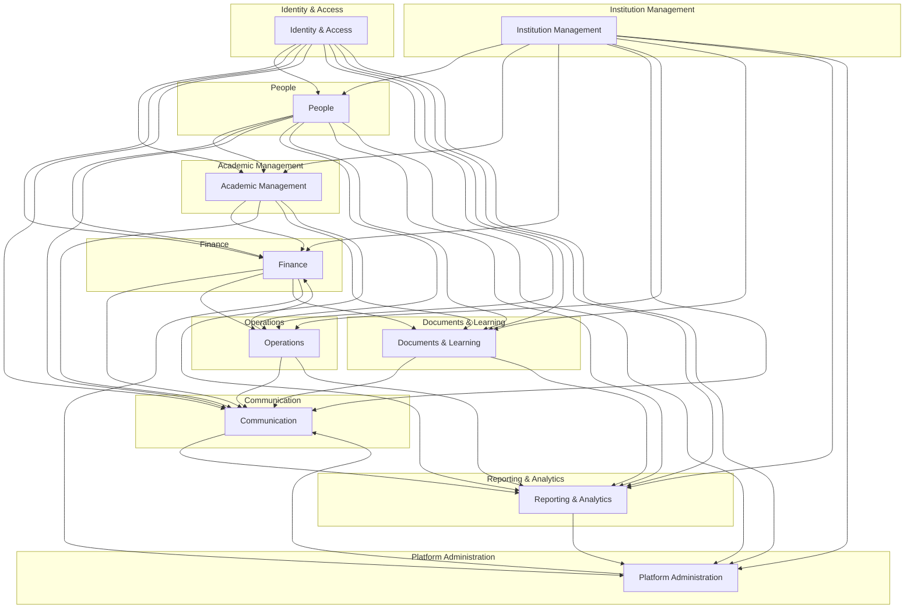

### 2.3 Domain Role Classification

| Role | Domains | Description |
|------|---------|-------------|
| **Foundation** | Identity & Access, Institution Management | Provides authentication, authorization, tenant context, and institution configuration. All other domains depend on these. |
| **Core** | People, Academic Management, Finance | Manages the primary school operations: people, academics, and money. These are the most interconnected domains. |
| **Service** | Communication, Operations, Documents & Learning | Provides supporting services: messaging, logistics, and document management. Heavily consume events from core domains. |
| **Insight** | Reporting & Analytics, Platform Administration | Aggregates data from all domains for analytics, monitoring, and platform management. Read-only consumers of most domain data. |

---

## 3. Domain Ownership Matrix

### 3.1 Entity Ownership

Each entity is owned by exactly one domain. No entity may be shared or duplicated across domains.

| Domain | Owned Entities | Total |
|--------|---------------|-------|
| **Identity & Access** | users, roles, permissions, permission_groups, sessions, refresh_tokens, mfa_settings, audit_logs, api_keys, permission_groups_api_keys | 10 |
| **Institution Management** | institutions, organization_users, academic_calendars, institution_modules, module_licenses, institution_branding, domain_whitelists, institution_feature_flags | 8 |
| **People** | persons, person_institutions, students, student_enrollments, staff, staff_assignments, parents, parent_student_links, guardians, guardian_student_links, student_transfers | 11 |
| **Academic Management** | academic_years, academic_sessions, terms, grade_levels, departments, subjects, subject_groups, arms, student_class_enrollments, teaching_assignments, timetable_slots, attendance, academic_progression, assessment_types, assessments, assessment_scores, results, result_publishing_rules, report_card_templates, report_cards, summer_school_programs, summer_school_registrations, summer_school_results | 23 |
| **Finance** | financial_periods, fee_schedules, fee_schedule_items, fee_categories, bills, bill_items, invoices, invoice_items, payments, payment_allocations, discounts, discount_applications, overpayments, scholarships, scholarship_awards, scholarship_criteria, refunds, refund_items, installment_plans, installment_plan_items | 20 |
| **Communication** | notifications, notification_preferences, notification_templates, notification_groups, recipient_group_members, messages, conversations, conversation_members, campaigns, campaign_recipients, announcements, announcement_recipients, delivery_logs, digest_schedules | 14 |
| **Operations** | library_books, book_copies, borrowings, reservations, hostel_buildings, hostel_rooms, hostel_beds, hostel_room_allocations, transport_routes, transport_stops, transport_vehicles, transport_assignments, medical_records, clinic_visits, clinic_medications, incidents, incident_witnesses, incident_attachments, assets, asset_maintenance, inventory_items, inventory_transactions, maintenance_requests, work_orders | 24 |
| **Documents & Learning** | documents, document_versions, document_shares, document_permissions, document_access_logs, templates, generated_documents, learning_resources, learning_resource_links, assessment_contents, retention_policies, document_retention_schedules | 12 |
| **Reporting & Analytics** | report_definitions, report_executions, report_schedules, report_shares, report_bookmarks, dashboards, dashboard_widgets, dashboard_shares, kpi_definitions, kpi_alerts, analytics_snapshots, export_jobs | 12 |
| **Platform Administration** | tenants, tenant_subscriptions, licenses, license_usage, license_entitlements, feature_flags, feature_flag_overrides, integration_registries, integration_providers, tenant_integrations, api_keys, webhook_registrations, webhook_event_subscriptions, webhook_delivery_logs, platform_policies, policy_exceptions, policy_versions, automation_templates, automation_definitions, automation_executions | 20 |

### 3.2 Data Ownership Boundaries

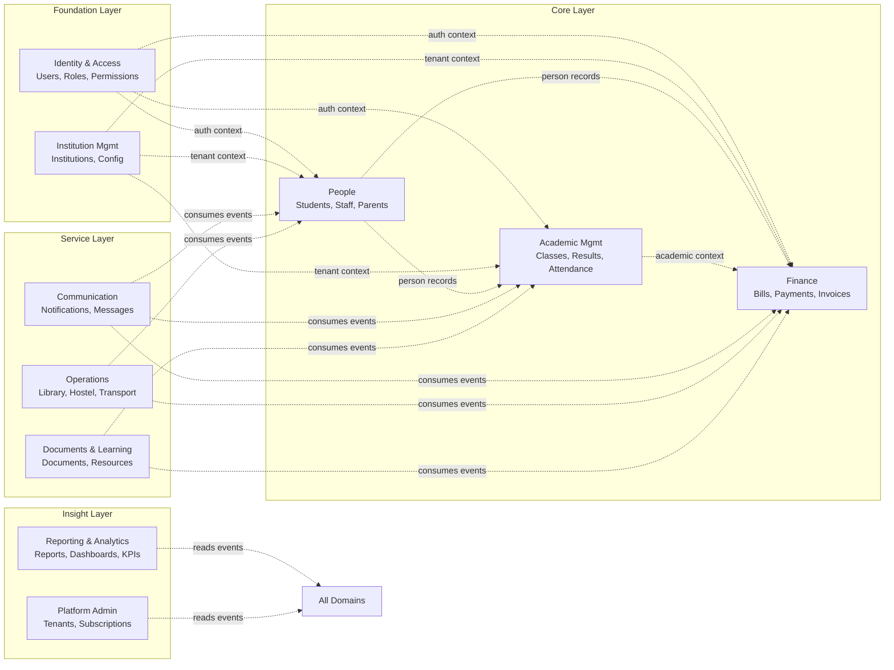

---

## 4. Domain Dependency Matrix

### 4.1 Dependency Summary

| Dependent Domain | Depends On |
|-----------------|------------|
| **Identity & Access** | — (foundation) |
| **Institution Management** | Identity & Access |
| **People** | Identity & Access, Institution Management |
| **Academic Management** | Identity & Access, Institution Management, People, Finance (billing) |
| **Finance** | Identity & Access, Institution Management, People, Academic Management (sessions, terms) |
| **Communication** | Identity & Access, Institution Management, People, Academic Management (events), Finance (events) |
| **Operations** | Identity & Access, Institution Management, People, Academic Management (sessions), Finance (billing), Communication (notifications) |
| **Documents & Learning** | Identity & Access, Institution Management, People, Academic Management (subjects, results), Finance (invoices, payments) |
| **Reporting & Analytics** | Identity & Access, Institution Management, People (events), Academic Management (events), Finance (events), Communication (events), Operations (events), Documents & Learning (events), Platform Administration (events) |
| **Platform Administration** | Identity & Access, Institution Management, People (license counts), Finance (subscriptions), Communication (delivery) |

### 4.2 Dependency Depth

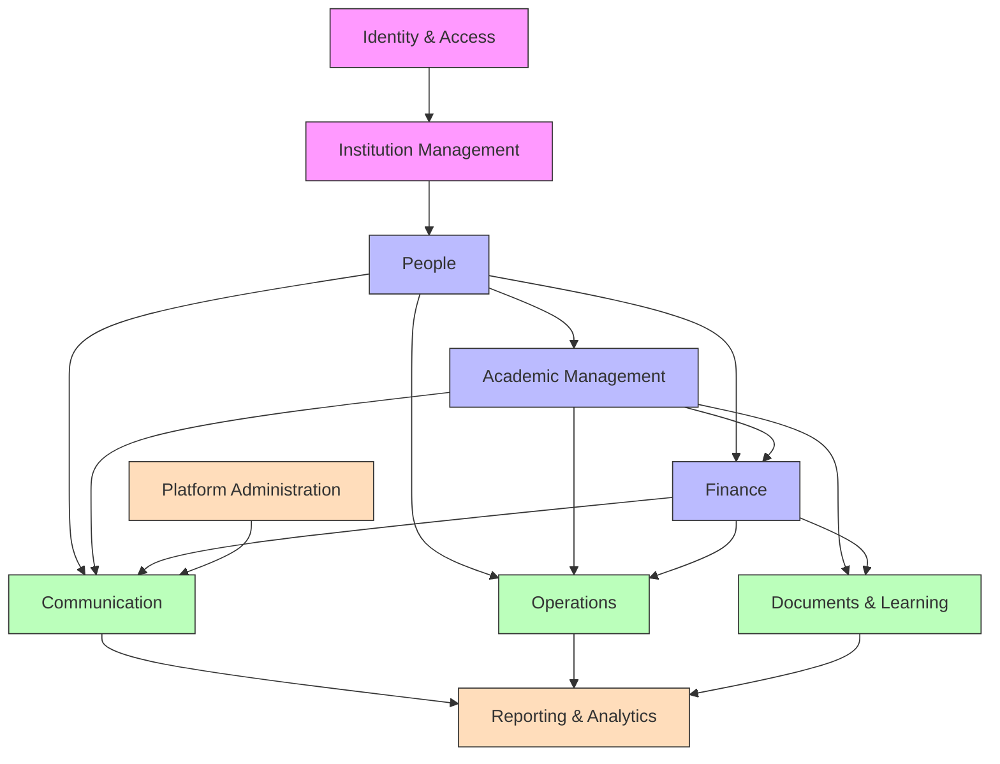

### 4.3 Most-Referenced External Tables

| Table | Referencing Domains | Count |
|-------|-------------------|-------|
| `institutions` | People, Academic Management, Finance, Communication, Operations, Documents & Learning, Reporting & Analytics, Platform Administration | 9 |
| `students` | Academic Management, Finance, Communication, Documents & Learning | 4 |
| `staff` | Academic Management, Communication | 2 |
| `parents` | Finance, Communication | 2 |
| `users` | Operations, Communication | 2 |
| `academic_sessions` | Finance, Documents & Learning | 2 |
| `terms` | Finance | 1 |
| `subjects` | Documents & Learning | 2 |
| `roles` | Reporting & Analytics | 1 |

---

## 5. Integration Patterns

### 5.1 Pattern Catalog

| Pattern | Description | When to Use |
|---------|-------------|-------------|
| **Domain Event Publishing** | Publisher emits an event after transaction commit; consumers react asynchronously | When a domain state change needs to trigger action in another domain |
| **Event Consumer** | Consumer class subscribes to specific events; processes them idempotently | When a domain needs to react to another domain's state changes |
| **Cross-Domain FK Reference** | Foreign key references a table in another domain; application-level guard prevents orphaned references | When a domain entity must reference a person, institution, or academic entity |
| **Read Model Projection** | Reporting & Analytics consumes events to build denormalized read models | When cross-domain queries would otherwise be required |
| **Application-Level Guard** | Service validates referenced entity exists and is in valid state before persistence | When creating or updating entities with cross-domain FK references |
| **Saga (Choreography)** | Multi-step workflow coordinated through event chains without a central coordinator | When a business process spans 3+ domains and requires sequential steps |

### 5.2 Pattern: Domain Event Publishing

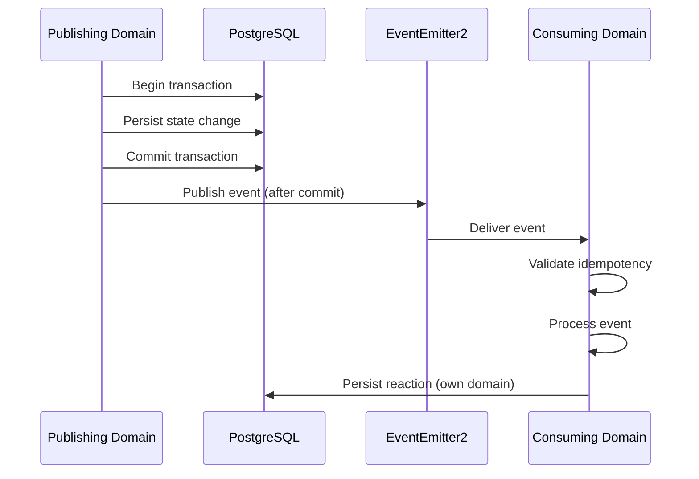

### 5.3 Pattern: Cross-Domain FK with Application Guard

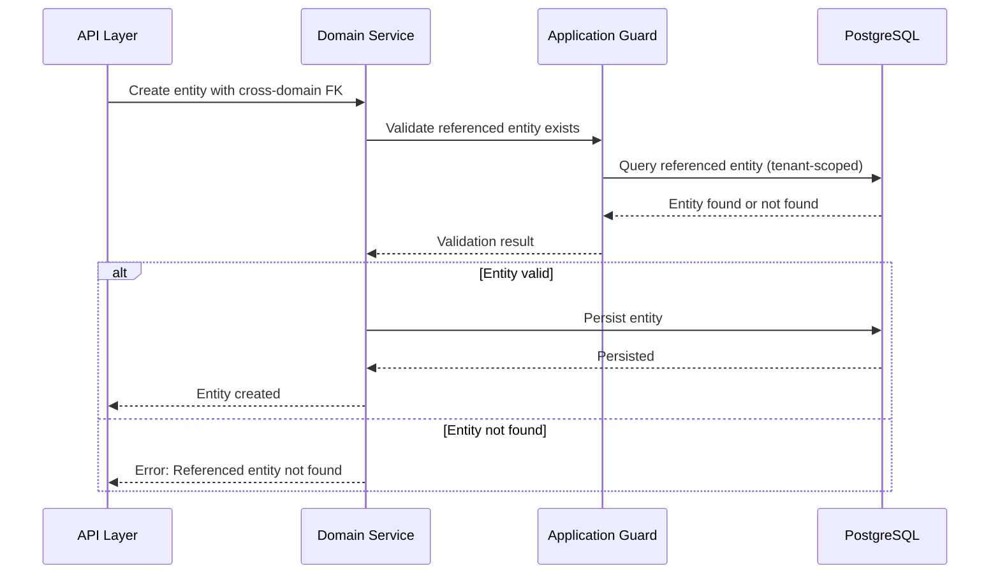

### 5.4 Pattern: Saga (Choreography)

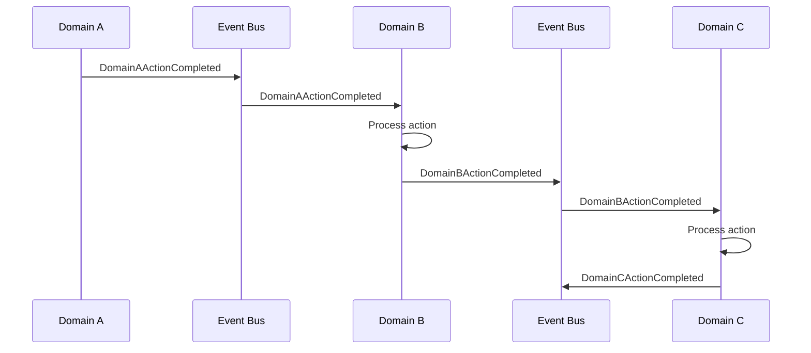

---

## 6. Event-Driven Communication

### 6.1 Event Infrastructure

All cross-domain events use the standard event envelope defined in `01 Engineering Standards.md` Section 7.2:

| Field | Type | Description |
|-------|------|-------------|
| eventId | uuid | Unique event identifier; deduplication key |
| eventVersion | int | Monotonically increasing per event type |
| schemaVersion | string | Payload schema version |
| occurredAt | timestamptz | When the event occurred |
| correlationId | uuid | Groups related events across a single user action |
| causationId | uuid | ID of the event or command that caused this event |
| tenantId | uuid | Tenant context |
| actorId | uuid | User who triggered the event |
| payload | jsonb | Event-specific data |

### 6.2 Event Publishing Rules

1. Events are published **after transaction commit**, never inside the transaction
2. Events are published **synchronously within the process** via EventEmitter2
3. Events carry **tenant context** in the envelope; consumers must respect tenant boundaries
4. Events carry **actor context**; consumers may log the original actor for audit purposes
5. Future migration to BullMQ/Redis is anticipated but not yet required

### 6.3 Event Consumer Rules

1. Consumers must be **idempotent** — check `eventId` before processing
2. Processed `eventId` values stored with minimum **72-hour TTL**
3. Consumers **may not query** the publisher's domain tables
4. Consumers **may read** data from their own domain that was previously populated by events
5. Consumers **must handle** out-of-order delivery (no ordering guarantee across aggregates)
6. Failed processing is retried with **exponential backoff** (max 3 retries)

### 6.4 Complete Event Catalog

#### 6.4.1 Identity & Access — Published Events

| Event | Trigger | Cross-Domain Consumers |
|-------|---------|----------------------|
| UserCreated | New user account created | Communication (welcome email), People (person record sync) |
| UserUpdated | User profile updated | People (person sync) |
| UserDeactivated | User account deactivated | People (person status sync), Operations (asset return trigger) |
| PasswordResetRequested | Password reset requested | Communication (reset email) |
| MFAEnabled | MFA enabled on account | Communication (security notification) |
| AccountLocked | Account locked due to failed attempts | Communication (security alert) |
| PlatformAdminLogin | Platform admin logged in | Platform Administration (audit) |
| PlatformAdminLogout | Platform admin logged out | Platform Administration (audit) |

#### 6.4.2 Institution Management — Published Events

| Event | Trigger | Cross-Domain Consumers |
|-------|---------|----------------------|
| InstitutionCreated | New institution provisioned | Communication (setup welcome), Documents & Learning (default templates) |
| AcademicCalendarConfigured | Academic calendar set up | Academic Management (session/term creation trigger) |
| UserInvited | User invited to institution | Communication (invitation email) |
| InstitutionSettingsUpdated | Institution settings changed | Communication (settings sync), Reporting & Analytics (cache refresh) |
| ModuleActivated | Institution module activated | Academic Management, Finance, Operations (enable module features) |
| ModuleDeactivated | Institution module deactivated | Academic Management, Finance, Operations (disable module features) |

#### 6.4.3 People — Published Events

| Event | Trigger | Cross-Domain Consumers |
|-------|---------|----------------------|
| StudentEnrolled | Student enrollment created | Academic Management (class enrollment), Finance (fee assignment), Communication (welcome), Operations (medical record), Documents & Learning (document setup), Reporting & Analytics (enrollment count), Platform Administration (license count) |
| StudentTransferred | Student transferred between institutions | Academic Management (enrollment sync), Finance (billing adjustment), Communication (notification) |
| StudentWithdrawn | Student withdrawn from institution | Academic Management (enrollment removal), Finance (final billing), Communication (notification), Operations (checkout trigger), Documents & Learning (archival), Platform Administration (license count) |
| StudentGraduated | Student graduated | Academic Management (progression), Communication (notification), Operations (checkout trigger), Documents & Learning (archival) |
| StaffHired | Staff member hired | Academic Management (teaching assignment), Communication (onboarding), Operations (medical record, asset assignment), Reporting & Analytics (staff count), Platform Administration (license count) |
| StaffSeparated | Staff member separated | Academic Management (teaching assignment removal), Communication (notification), Operations (asset return), Documents & Learning (archival), Platform Administration (license count) |
| ParentLinked | Parent linked to student | Communication (notification) |

#### 6.4.4 Academic Management — Published Events

| Event | Trigger | Cross-Domain Consumers |
|-------|---------|----------------------|
| TermActivated | Term status → Active | Communication (term start notification) |
| TermClosed | Term status → Closed | Documents & Learning (retention trigger), Reporting & Analytics (term metrics) |
| StudentClassEnrolled | Student enrolled in class | People (enrollment sync) |
| StudentClassTransferred | Student transferred between classes | People (enrollment sync) |
| AssignmentPublished | Assignment published to students | Communication (notification) |
| AssignmentSubmitted | Student submitted assignment | Communication (notification) |
| AssignmentReturned | Assignment returned with feedback | Communication (notification) |
| AssessmentPublished | Assessment published | Communication (notification) |
| ResultPublished | Results published to students | Communication (notification), Documents & Learning (report card), Reporting & Analytics (result metrics) |
| ReportCardGenerated | Report card generated | Communication (notification) |
| ReportCardPublished | Report card published | Communication (notification) |
| StudentPromoted | Student promoted to next grade | People (progression sync), Communication (notification) |
| StudentRetained | Student retained in current grade | Communication (notification) |
| StudentGraduated | Student graduated | People (graduation sync), Communication (notification), Documents & Learning (archival), Operations (checkout) |
| StudentWithdrawn | Student withdrawn from institution | People (withdrawal sync), Communication (notification) |
| StudentPlacedOnProbation | Student placed on academic probation | Communication (notification) |
| SummerSchoolRegistered | Student registered for Summer School | Communication (notification), Finance (billing trigger) |
| SummerSchoolResultPublished | Summer School result published | People (result sync), Communication (notification) |

#### 6.4.5 Finance — Published Events

| Event | Trigger | Cross-Domain Consumers |
|-------|---------|----------------------|
| BillGenerated | Bill generated for student | Communication (notification) |
| InvoiceGenerated | Invoice created from bill | Communication (notification), Documents & Learning (invoice document) |
| InvoicePublished | Invoice finalized and sent | Communication (notification) |
| InvoiceOverdue | Invoice past due date | Communication (reminder), Operations (follow-up flag) |
| PaymentConfirmed | Payment verified and confirmed | Communication (receipt), Documents & Learning (receipt document), Operations (fine clearance) |
| PaymentFailed | Payment failed | Communication (alert) |
| OverpaymentCreated | Excess payment received | Communication (notification) |
| RefundProcessed | Refund completed | Communication (confirmation) |
| RefundRequested | Refund submitted | Communication (notification) |
| RefundRejected | Refund rejected | Communication (notification) |
| ScholarshipAwarded | Scholarship awarded to student | Communication (notification) |
| InstallmentOverdue | Installment past due | Communication (reminder) |
| SummerSchoolBillingRequested | Billing request from Academic Management | — |
| SummerSchoolInvoiceGenerated | Summer School invoice created | Communication (notification) |

#### 6.4.6 Communication — Published Events

| Event | Trigger | Cross-Domain Consumers |
|-------|---------|----------------------|
| NotificationDispatched | Notification queued for delivery | Reporting & Analytics (delivery metrics) |
| NotificationDelivered | Provider confirms delivery | Reporting & Analytics (delivery metrics) |
| NotificationRead | Recipient opens in-app notification | Reporting & Analytics |
| NotificationFailed | All delivery attempts exhausted | Platform Administration (alerting) |
| CampaignCompleted | All campaign notifications delivered | Reporting & Analytics |
| AnnouncementPublished | Announcement made active | — |
| MessageSent | Conversation message delivered | — |

#### 6.4.7 Operations — Published Events

| Event | Trigger | Cross-Domain Consumers |
|-------|---------|----------------------|
| BookBorrowed | Book copy checked out | Reporting & Analytics (library analytics) |
| BookReturned | Book copy returned | Finance (fine waiver), Reporting & Analytics |
| BookOverdue | Borrowing past due date | Communication (overdue reminder), Finance (fine creation) |
| RoomAllocated | Bed allocated to student | Communication (notification), Reporting & Analytics |
| RoomDeallocated | Bed released from student | Communication (notification) |
| TransportAssigned | Student/staff assigned to route | Communication (notification) |
| VisitorCheckedIn | Visitor badge activated | Reporting & Analytics (visitor analytics) |
| MedicalRecordUpdated | Medical record modified | Communication (alert if critical) |
| ClinicVisitRecorded | Clinic visit logged | Communication (parent notification) |
| IncidentReported | Incident report created | Communication (alert) |
| WorkOrderCompleted | Work order finished | Communication (notification), Reporting & Analytics |
| StockDroppedBelowReorder | Stock fell below threshold | Communication (reorder alert) |
| MaintenanceRequested | Maintenance request submitted | Communication (notification) |
| WorkOrderCreated | Work order authorised | Communication (notification) |

#### 6.4.8 Documents & Learning — Published Events

| Event | Trigger | Cross-Domain Consumers |
|-------|---------|----------------------|
| DocumentPublished | Document status → PUBLISHED | Communication (notification) |
| DocumentShared | Share record created | Communication (notification) |
| TemplatePublished | Template approved and published | Communication |
| GeneratedDocumentCreated | Document generated from template | Communication (delivery) |
| LearningResourcePublished | Resource published to students | Communication (notification) |
| AssessmentContentPublished | Assessment content published | Communication (notification) |
| RetentionEnforced | Background job enforced retention | — |

#### 6.4.9 Reporting & Analytics — Published Events

| Event | Trigger | Cross-Domain Consumers |
|-------|---------|----------------------|
| ExportJobCompleted | Export file generated | Communication (delivery) |
| KpiThresholdBreached | KPI exceeded threshold | Communication (alert) |

#### 6.4.10 Platform Administration — Published Events

| Event | Trigger | Cross-Domain Consumers |
|-------|---------|----------------------|
| TenantProvisioned | Tenant successfully provisioned | Communication (welcome), Reporting & Analytics (analytics) |
| TenantActivated | Tenant transitions to ACTIVE | Communication (notification) |
| TenantSuspended | Tenant transitions to SUSPENDED | Communication (alert) |
| TenantArchived | Tenant transitions to ARCHIVED | Communication (alert) |
| TenantRestored | Tenant restored from ARCHIVED | Communication (notification) |
| TenantDeleted | Tenant permanently deleted | All domains (cleanup) |
| SubscriptionCreated | New subscription created | Finance (billing) |
| SubscriptionRenewed | Subscription renewed | Finance (billing) |
| SubscriptionExpired | Subscription past expiration date | Communication (alert) |
| LicenseLimitExceeded | Tenant exceeds license limit | Communication (alert) |
| SecurityAlertTriggered | Security event detected | Communication (urgent alert) |
| MaintenanceScheduled | Maintenance window scheduled | Communication (all tenants) |
| MaintenanceStarted | Maintenance window began | Communication (all tenants) |
| MaintenanceCompleted | Maintenance window ended | Communication (all tenants) |
| WebhookDeliveryFailed | Webhook delivery exhausted retries | Communication (alert) |
| PlatformPolicyChanged | Platform policy version updated | All domains (re-evaluate) |

### 6.5 Event Flow Matrix

The following matrix shows which domains consume events from which publishers:

| Consumer ↓ \ Publisher → | IA | IM | P | AM | F | C | O | DL | RA | PA |
|--------------------------|----|----|---|----|----|----|----|-----|----|----|
| **Communication** | ✓ | ✓ | ✓ | ✓ | ✓ | — | — | — | — | ✓ |
| **Academic Management** | — | ✓ | ✓ | — | — | — | — | — | — | — |
| **Finance** | — | — | ✓ | ✓ | — | — | — | — | — | ✓ |
| **People** | — | — | — | ✓ | — | — | — | — | — | — |
| **Operations** | — | — | ✓ | ✓ | ✓ | — | — | — | — | — |
| **Documents & Learning** | — | ✓ | ✓ | ✓ | ✓ | — | — | — | — | — |
| **Reporting & Analytics** | — | — | ✓ | ✓ | ✓ | ✓ | ✓ | ✓ | — | ✓ |
| **Platform Administration** | — | — | ✓ | — | ✓ | ✓ | — | — | — | — |

### 6.6 Event Count Summary

| Domain | Events Published | Events Consumed (unique bindings) |
|--------|-----------------|----------------------------------|
| Identity & Access | 8 | 0 |
| Institution Management | 6 | 0 |
| People | 7 | 1 (Identity & Access: UserCreated) |
| Academic Management | 18 | 5 (Institution, People, Finance, Academic self-consumers) |
| Finance | 14 | 4 (People, Academic, Finance self-consumers, Platform Admin) |
| Communication | 7 | 8 (Identity, Institution, People, Academic, Finance, Operations, Documents, Platform Admin) |
| Operations | 14 | 4 (People, Academic, Finance, Platform Admin) |
| Documents & Learning | 7 | 5 (Institution, People, Academic, Finance, Documents self-consumers) |
| Reporting & Analytics | 2 | 8 (all domains except Communication self-consumers) |
| Platform Administration | 16 | 4 (People, Finance, Communication, Platform Admin self-consumers) |

---

## 7. Transaction Boundaries

### 7.1 Single-Domain Transactions

Each domain operation executes within a single database transaction scoped to that domain. No operation spans multiple domain transactions.

```
Domain A Transaction:
  BEGIN
    -- Domain A state changes
    -- Domain A entity persistence
  COMMIT
  -- Events published AFTER commit
  EventBus.emit(EventA)
```

### 7.2 Cross-Domain Consistency

Cross-domain consistency is **eventually consistent** via domain events. There is no two-phase commit or distributed transaction.

| Consistency Level | Description | Example |
|-------------------|-------------|---------|
| **Strong** | Within a single aggregate, within a single domain | Student enrollment and class assignment in Academic Management |
| **Eventual** | Across domains, via event consumption | Student enrollment in People → fee assignment in Finance |
| **Deferred** | Multi-step saga via event chains | Student graduation → checkout (Finance → Operations → Communication → Documents) |

### 7.3 Transaction Scope Rules

| Rule | Description |
|------|-------------|
| **One domain per transaction** | A single database transaction must not span multiple domain boundaries |
| **Events after commit** | Domain events are published only after the transaction commits successfully |
| **Consumer transactions are independent** | Each consumer processes events within its own transaction |
| **No event-driven rollback** | If a consumer fails, the publisher's transaction is not affected |
| **Idempotency over atomicity** | Cross-domain consistency is achieved through idempotent consumers, not distributed locks |

### 7.4 Compensation Pattern

When a downstream consumer cannot process an event (e.g., business rule violation), the consumer logs the failure and the publishing domain is not affected. Compensation is handled at the application level:

```
Consumer receives EventA
  → Validates business rules
  → If valid: processes and persists
  → If invalid: logs failure, emits CompensationNeeded event
  → Compensation handler notifies admin or triggers manual review
```

---

## 8. Cross-Domain Workflows

### 8.1 Workflow Index

| # | Workflow | Domains Involved | Trigger |
|---|----------|-----------------|---------|
| 1 | New Student Enrollment → Fee Generation | People → Finance → Communication | StudentEnrolled event |
| 2 | Result Publication → Report Card → Notification | Academic → Documents & Learning → Communication | ResultPublished event |
| 3 | Payment Confirmation → Receipt → Notification | Finance → Documents & Learning → Communication | PaymentConfirmed event |
| 4 | Summer School Registration → Billing → Invoice | Academic → Finance → Communication | SummerSchoolRegistered event |
| 5 | Staff Hiring → Onboarding Cascade | People → Academic, Communication, Operations, Platform Admin | StaffHired event |
| 6 | Student Graduation → Checkout Cascade | People → Academic, Finance, Operations, Communication, Documents & Learning | StudentGraduated event |
| 7 | Book Borrowing → Fine → Payment → Clearance | Operations → Finance → Operations | BookOverdue → PaymentConfirmed |
| 8 | Hostel Allocation → Billing → Confirmation | Operations → Finance → Communication | RoomAllocated event |
| 9 | Maintenance Request → Work Order → Completion | Operations → Communication | MaintenanceRequested event |
| 10 | Incident Report → Alert → Follow-up | Operations → Communication | IncidentReported event |
| 11 | Invoice Overdue → Reminder → Payment | Finance → Communication | InvoiceOverdue event |
| 12 | Scholarship Award → Fee Adjustment → Notification | Finance → Communication | ScholarshipAwarded event |
| 13 | Attendance Recording → Analytics → Alert | Academic → Reporting & Analytics → Communication | AttendanceRecorded event |
| 14 | Term Closure → Report Card → Analytics | Academic → Documents & Learning, Reporting & Analytics, Communication | TermClosed event |
| 15 | Tenant Provisioning → Setup → Welcome | Platform Administration → Communication, all domains | TenantProvisioned event |

### 8.2 Workflow 1: New Student Enrollment → Fee Generation

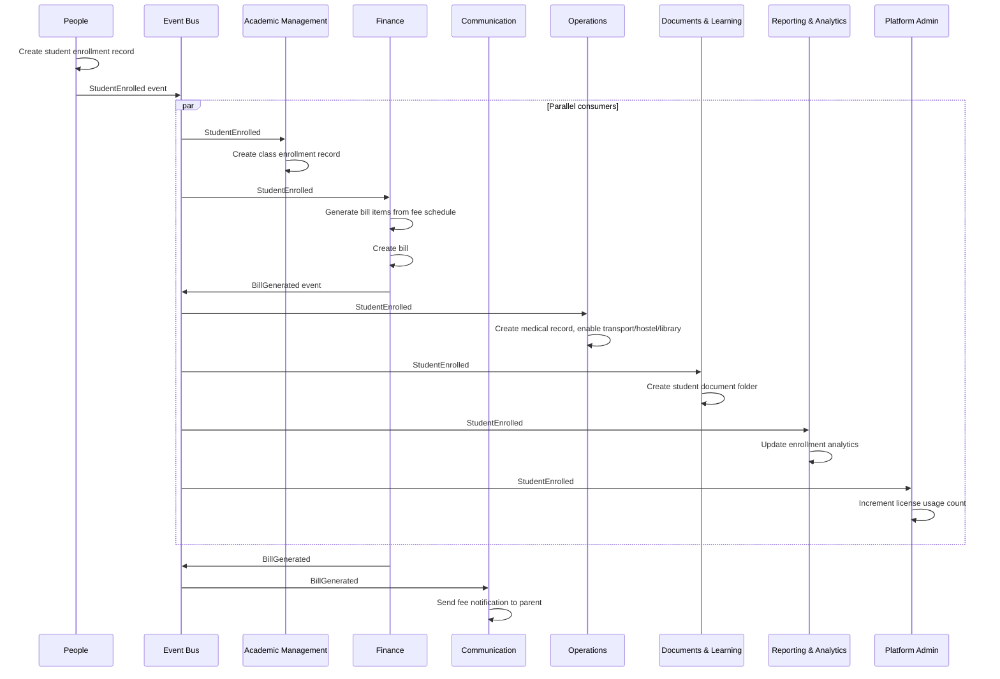

### 8.3 Workflow 2: Result Publication → Report Card → Notification

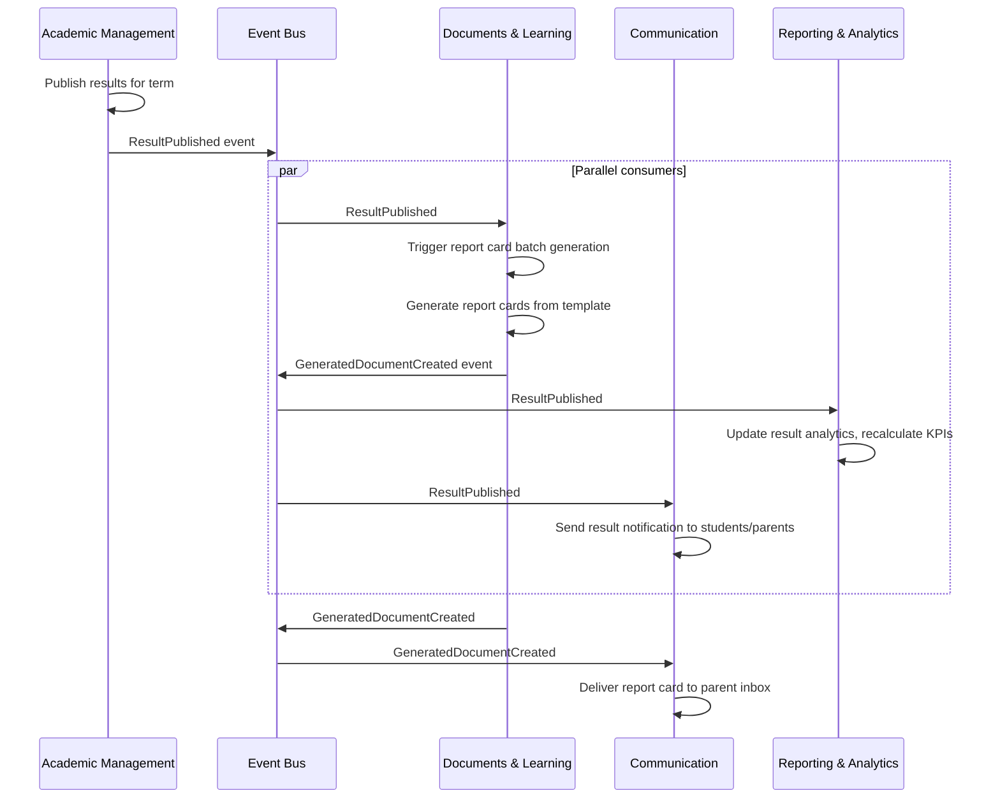

### 8.4 Workflow 3: Payment Confirmation → Receipt → Notification

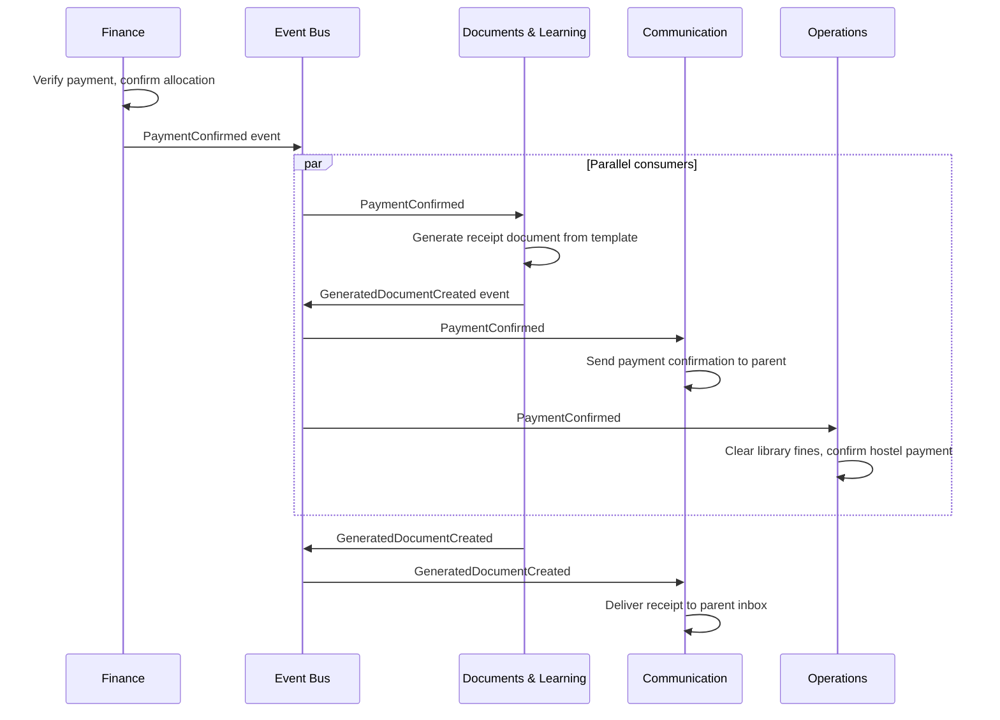

### 8.5 Workflow 4: Summer School Registration → Billing → Invoice

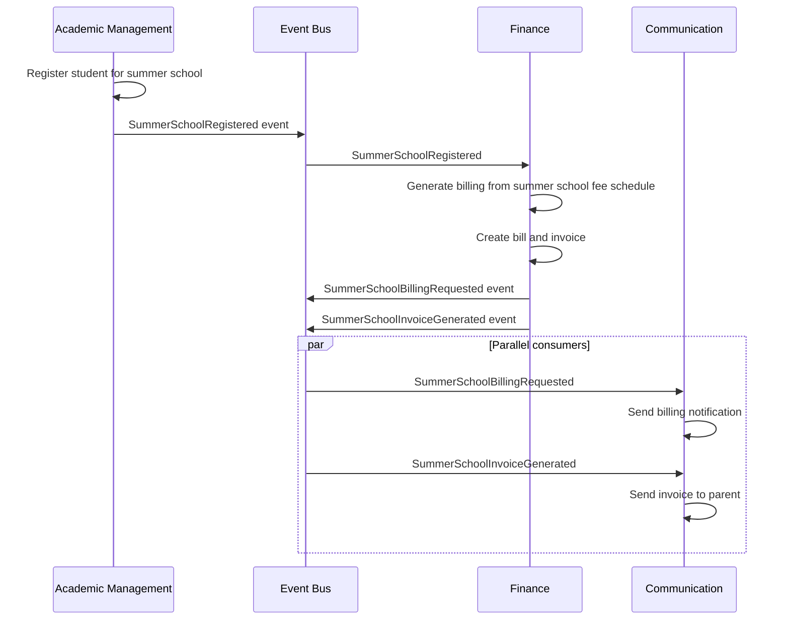

### 8.6 Workflow 5: Staff Hiring → Onboarding Cascade

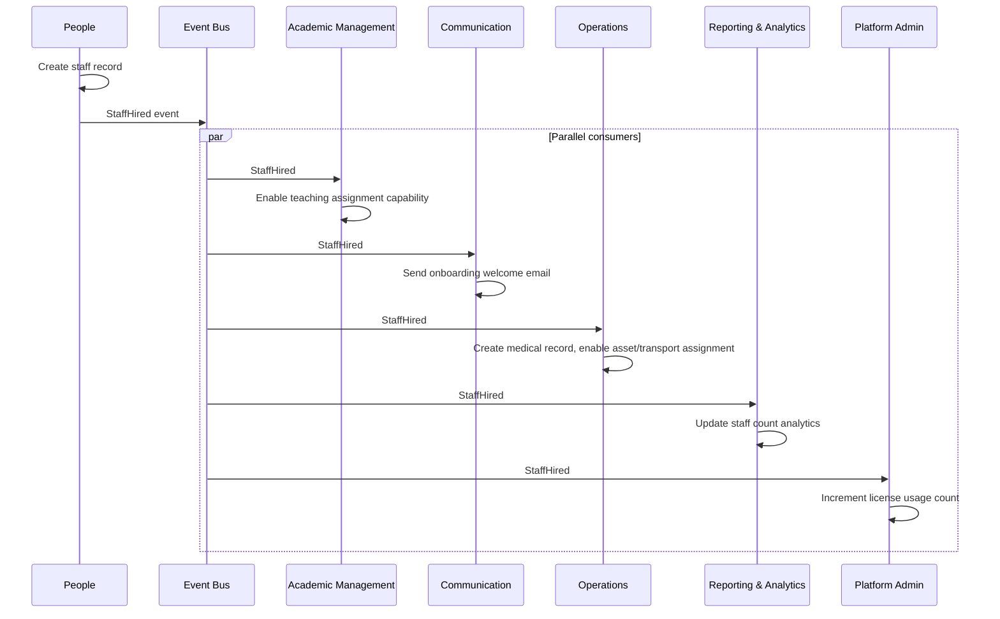

### 8.7 Workflow 6: Student Graduation → Checkout Cascade

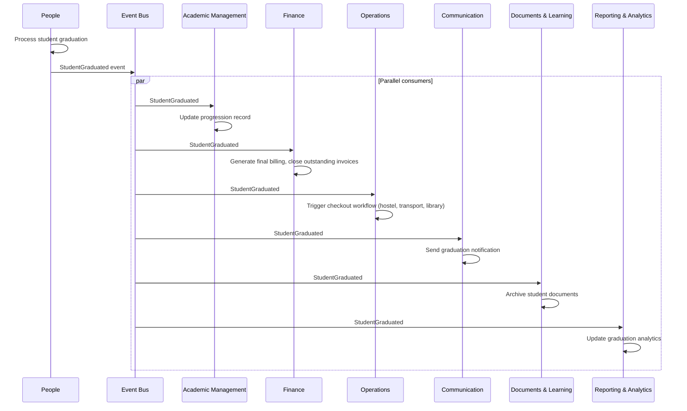

### 8.8 Workflow 7: Book Borrowing → Fine → Payment → Clearance

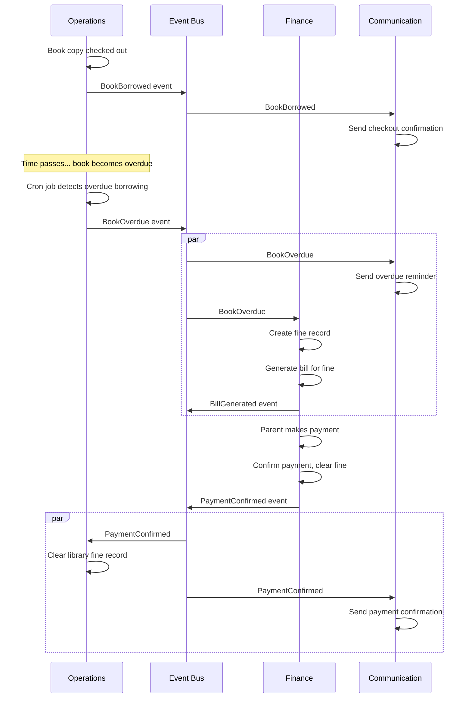

### 8.9 Workflow 8: Hostel Allocation → Billing → Confirmation

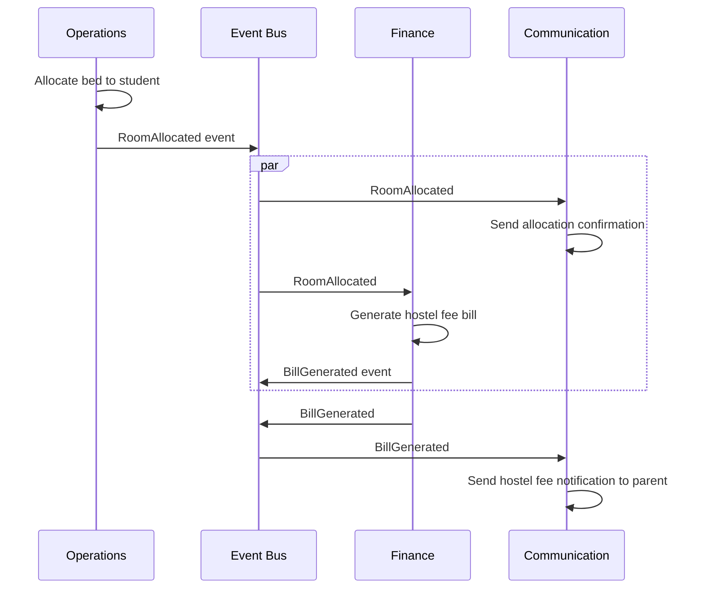

### 8.10 Workflow 9: Maintenance Request → Work Order → Completion

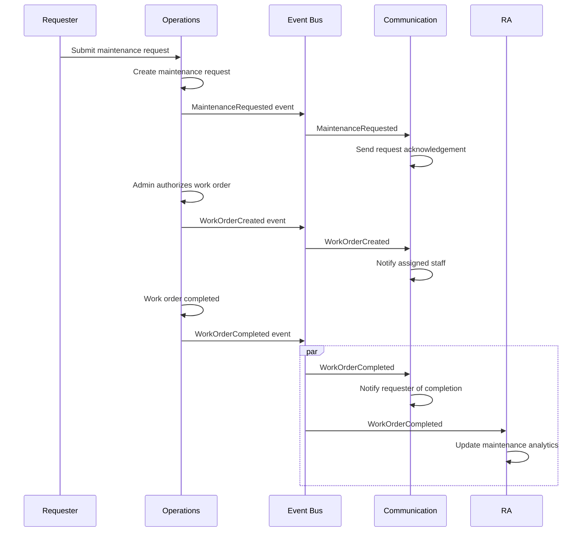

### 8.11 Workflow 10: Incident Report → Alert → Follow-up

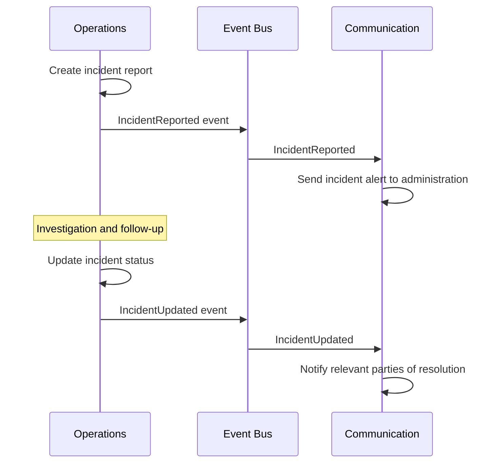

### 8.12 Workflow 11: Invoice Overdue → Reminder → Payment

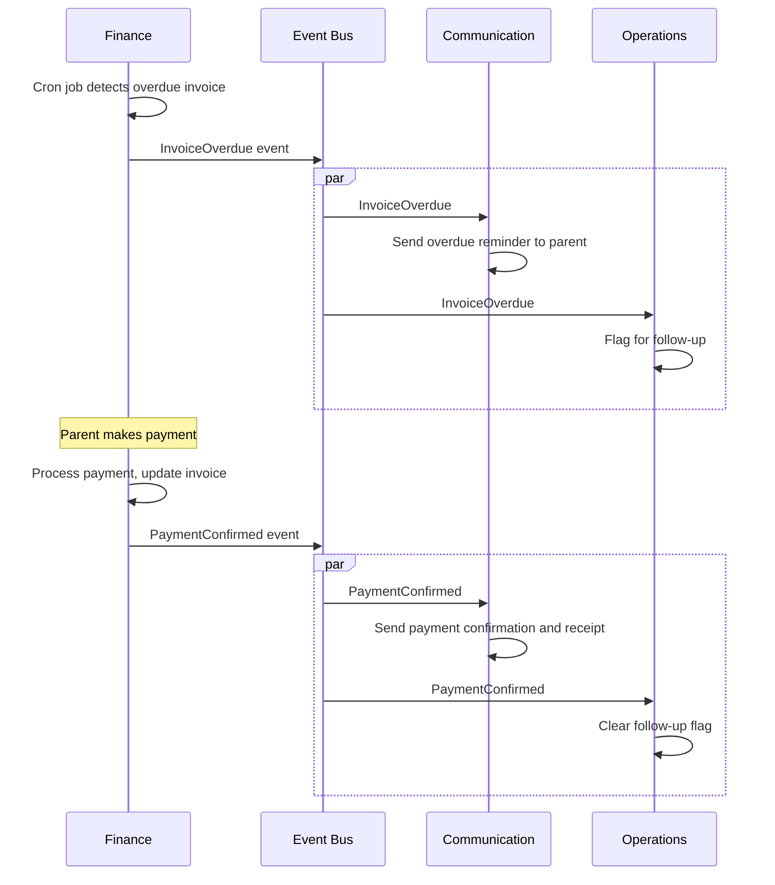

### 8.13 Workflow 12: Scholarship Award → Fee Adjustment → Notification

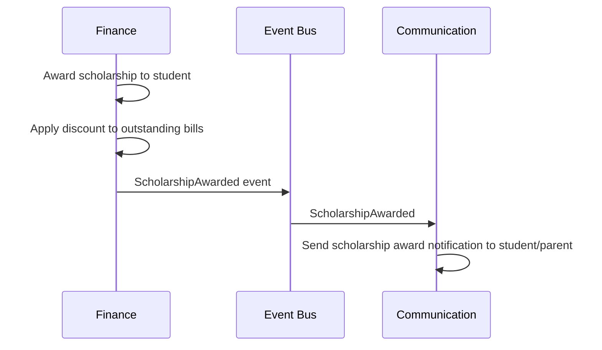

### 8.14 Workflow 13: Attendance Recording → Analytics → Alert

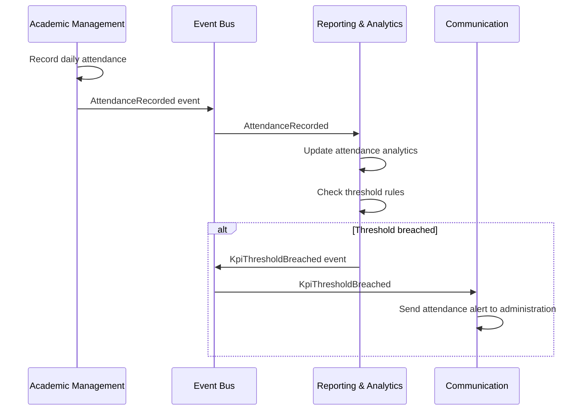

### 8.15 Workflow 14: Term Closure → Report Card → Analytics

```mermaid
sequenceDiagram
    participant AM as Academic Management
    participant EB as Event Bus
    participant DL as Documents & Learning
    participant RA as Reporting & Analytics
    participant C as Communication

    AM->>Close term and finalize results
    AM->>EB: TermClosed event

    par Parallel consumers
        EB->>DL: TermClosed
        DL->>DL: Trigger report card batch generation
        DL->>DL: Generate report cards
        DL->>EB: GeneratedDocumentCreated event

        EB->>RA: TermClosed
        RA->>RA: Snapshot term analytics
        RA->>RA: Recalculate KPIs

        EB->>C: TermClosed
        C->>C: Send term closure notification
    end

    DL->>EB: GeneratedDocumentCreated
    EB->>C: GeneratedDocumentCreated
    C->>C: Deliver report cards to parents
```

### 8.16 Workflow 15: Tenant Provisioning → Setup → Welcome

```mermaid
sequenceDiagram
    participant PA as Platform Administration
    participant EB as Event Bus
    participant C as Communication
    participant RA as Reporting & Analytics
    participant IM as Institution Management

    PA->>PA: Provision new tenant
    PA->>EB: TenantProvisioned event

    par Parallel consumers
        EB->>C: TenantProvisioned
        C->>C: Send platform welcome email

        EB->>RA: TenantProvisioned
        RA->>RA: Initialize analytics schema
    end

    PA->>PA: Activate tenant
    PA->>EB: TenantActivated event
    EB->>C: TenantActivated
    C->>C: Send activation confirmation
```

---

## 9. Read Models & Reporting

### 9.1 Reporting & Analytics as a Read Model

Reporting & Analytics is the primary consumer of cross-domain data for analytics purposes. It does not own entity data; instead, it consumes events from all domains to build denormalized read models.

| Source Domain | Events Consumed | Read Model Updated |
|---------------|----------------|-------------------|
| People | StudentEnrolled, StaffHired, StudentGraduated | Enrollment counts, staff counts, graduation metrics |
| Academic Management | ResultPublished, AttendanceMarked, TermClosed | Academic performance, attendance rates, term metrics |
| Finance | PaymentReceived, InvoiceGenerated, ScholarshipAwarded | Revenue, billing, scholarship metrics |
| Communication | NotificationDelivered | Delivery metrics, campaign effectiveness |
| Operations | BookBorrowed, RoomAllocated, VisitorCheckedIn, WorkOrderCompleted | Library, hostel, visitor, maintenance metrics |
| Documents & Learning | DocumentUploaded | Document usage metrics |
| Platform Administration | AuditLogCreated | Compliance metrics |

### 9.2 Reporting Query Pattern

```mermaid
graph LR
    A[API Request] --> B[Report Definition]
    B --> C{Report Type}
    C -->|Real-time| D[Query Source Domain API]
    C -->|Cached| E[Query Analytics Snapshot]
    C -->|Scheduled| F[Pre-computed Snapshot]

    D --> G[Format & Return]
    E --> G
    F --> G
```

### 9.3 Report Distribution

Reports can be distributed via Communication domain:
- Scheduled reports trigger ReportDistributionConsumer
- Export jobs trigger ExportJobCompleted event
- Communication delivers reports via email, in-app notification, or file download

### 9.4 Cross-Domain Data Access for Reporting

| Reporting Need | Data Source | Access Pattern |
|----------------|-------------|---------------|
| Student enrollment trends | People + Academic Management | Event consumption → analytics snapshot |
| Financial performance | Finance | Event consumption → analytics snapshot |
| Attendance analytics | Academic Management | Event consumption → analytics snapshot |
| Library usage | Operations | Event consumption → analytics snapshot |
| Communication delivery | Communication | Event consumption → analytics snapshot |
| Platform health | All domains | Event consumption → analytics snapshot |

---

## 10. Failure Handling

### 10.1 Failure Categories

| Category | Description | Impact | Recovery |
|----------|-------------|--------|----------|
| **Event Publishing Failure** | Publisher fails to emit event after commit | Downstream consumers never receive event | Retry with exponential backoff; dead letter queue |
| **Event Consumer Failure** | Consumer fails to process event | Domain state not updated | Retry with exponential backoff; manual compensation |
| **Cross-Domain FK Violation** | Referenced entity deleted or not found | Creating entity fails | Application guard prevents creation; admin notification |
| **Timeout** | Consumer takes too long to process | Event processing delayed | Timeout handling; async retry |
| **Duplicate Event** | Same event delivered twice | Potential duplicate processing | Idempotency check via eventId |

### 10.2 Retry Strategy

| Attempt | Delay | Description |
|---------|-------|-------------|
| 1 | Immediate | First processing attempt |
| 2 | 1 second | First retry |
| 3 | 5 seconds | Second retry |
| 4 | 30 seconds | Third retry (final) |
| Dead Letter | — | After max retries, event moved to dead letter queue |

### 10.3 Dead Letter Queue

Failed events that exhaust all retries are moved to a dead letter queue for:
- Manual inspection and resolution
- Replay capability (re-process from dead letter)
- Alerting (platform administrators notified)
- Audit trail (failure reason logged)

### 10.4 Compensation Workflows

| Failure Scenario | Compensation |
|-----------------|--------------|
| Finance fails to generate bill after StudentEnrolled | Admin notification; manual bill creation |
| Communication fails to send notification after PaymentConfirmed | Retry; fallback to in-app notification only |
| Operations fails to create medical record after StaffHired | Admin notification; manual record creation |
| Documents & Learning fails to generate report card after ResultPublished | Retry; manual report card generation |
| Reporting & Analytics fails to update snapshot | Next scheduled refresh corrects the data |

### 10.5 Circuit Breaker Pattern

For high-volume event consumers, circuit breaker pattern prevents cascade failures:

| State | Description |
|-------|-------------|
| Closed | Normal operation; events processed normally |
| Open | Too many failures; events queued for later processing |
| Half-Open | Testing if downstream is recovered; limited event processing |

---

## 11. External Integrations

### 11.1 External System Categories

| Category | Systems | Integration Pattern |
|----------|---------|-------------------|
| **Payment Gateways** | Paystack, Flutterwave | Webhook callbacks → Finance domain |
| **SMS Providers** | Termii, Africa's Talking | API calls from Communication domain |
| **Email Providers** | SendGrid, AWS SES | API calls from Communication domain |
| **Push Notification** | Firebase Cloud Messaging | API calls from Communication domain |
| **File Storage** | AWS S3, MinIO | SDK calls from Platform Administration |
| **Authentication** | Google OAuth, Microsoft Entra | OAuth2 flows in Identity & Access |
| **Government Systems** | National ID verification | API calls from People domain |

### 11.2 External Integration Rules

1. **Communication owns all external messaging** — No domain sends emails, SMS, or push notifications directly
2. **Finance owns all payment processing** — No domain processes payments directly
3. **Platform Administration owns all storage** — No domain manages S3 buckets directly
4. **Identity & Access owns all authentication** — No domain handles OAuth flows directly
5. **Webhook callbacks are processed by the owning domain** — Payment webhooks → Finance, SMS webhooks → Communication

### 11.3 External Integration Event Flow

```mermaid
graph LR
    subgraph "External Systems"
        PG[Payment Gateway]
        SMS[SMS Provider]
        EM[Email Provider]
        FCM[Push Notifications]
        S3[File Storage]
    end

    subgraph "OpenSchool ERP"
        F[Finance]
        C[Communication]
        PA[Platform Administration]
        IA[Identity & Access]
    end

    PG -->|webhook| F
    F -->|API call| PG
    C -->|API call| SMS
    C -->|API call| EM
    C -->|API call| FCM
    PA -->|SDK call| S3
    IA -->|OAuth2| External[OAuth Provider]
```

---

## 12. Security

### 12.1 Cross-Domain Security Rules

| Rule | Description |
|------|-------------|
| **Tenant isolation** | No cross-tenant data access, event consumption, or API calls |
| **Event tenant scoping** | Events carry tenantId in envelope; consumers must validate tenant context |
| **Actor traceability** | Events carry actorId; consumers may log original actor for audit |
| **No credential sharing** | Domains never share API keys, tokens, or credentials |
| **Encrypted cross-domain data** | Sensitive data in event payloads is encrypted at rest |
| **Authorization at domain boundary** | Each domain validates authorization independently; no delegated auth |

### 12.2 Event Security

| Aspect | Implementation |
|--------|---------------|
| **Event integrity** | EventEmitter2 in-process delivery; no network interception |
| **Tenant isolation** | Events carry tenantId; consumers filter by tenant |
| **Payload sensitivity** | Sensitive fields encrypted in event payload |
| **Dead letter access** | Dead letter queue accessible only to platform administrators |
| **Replay security** | Replay operations require admin authorization and are logged |

### 12.3 Cross-Domain FK Security

| Aspect | Implementation |
|--------|---------------|
| **Tenant scoping** | All FK references validated within tenant scope |
| **Authorization check** | Application guard validates actor has permission to reference target entity |
| **Audit logging** | Cross-domain FK creation logged in audit trail |
| **Orphan prevention** | Application guards prevent orphaned references on entity deletion |

---

## 13. Performance

### 13.1 Event Processing Performance

| Metric | Target |
|--------|--------|
| Event publishing latency | < 100ms after transaction commit |
| Event consumer processing time | < 500ms per event |
| Event consumer throughput | > 1000 events/second per consumer |
| Dead letter queue processing | < 1 hour for manual review |

### 13.2 Cross-Domain Query Performance

| Pattern | Performance Target |
|---------|-------------------|
| Event consumption (in-process) | < 10ms |
| Application guard (FK validation) | < 50ms |
| Read model query (analytics snapshot) | < 200ms |
| Report generation | < 5 seconds |

### 13.3 Caching Strategy for Cross-Domain Data

| Data Type | Cache Strategy | TTL |
|-----------|---------------|-----|
| Person records (for FK validation) | Read-through cache | 5 minutes |
| Institution configuration | Read-through cache | 5 minutes |
| Academic calendar data | Read-through cache | 10 minutes |
| Analytics snapshots | Scheduled refresh | 15 minutes |
| Report definitions | Read-through cache | 30 minutes |

### 13.4 Index Strategy for Cross-Domain References

All cross-domain FK columns must be indexed. The complete index list is in the Cross-Domain FK Reference Summary (Section 4.3).

| Index Pattern | Purpose |
|--------------|---------|
| `idx_{table}_{fk_column}` | FK lookups for application guards |
| `idx_{table}_tenant_{fk_column}` | Tenant-scoped FK lookups |
| `idx_{table}_tenant_status` | Common query pattern for filtered queries |

---

## 14. Architecture Decision Records

### 14.1 Platform-Wide Integration ADRs

| ADR | Decision | Rationale |
|-----|----------|-----------|
| ADR-INT-01 | Cross-domain communication via domain events only | Prevents tight coupling; enables async processing; supports future migration to message queue |
| ADR-INT-02 | No cross-domain database queries | Enforces domain boundaries; prevents data leakage; simplifies tenant isolation |
| ADR-INT-03 | EventEmitter2 in-process events (V1) | Simpler than message queue for V1; sufficient for single-instance deployment; migration path defined |
| ADR-INT-04 | Eventual consistency for cross-domain data | Acceptable for school management use cases; no financial transaction requires sub-second cross-domain consistency |
| ADR-INT-05 | Consumer idempotency via eventId | Prevents duplicate processing; enables safe retries; 72-hour TTL sufficient |
| ADR-INT-06 | Application-level guards for cross-domain FK | No database-level cascade across domains; application validates reference existence and tenant scope |
| ADR-INT-07 | Communication domain owns all external messaging | Single point of integration for SMS, email, push; simplifies provider management; enables unified delivery tracking |
| ADR-INT-08 | Finance domain owns all financial calculation | No domain computes fees, bills, payments, or discounts; Finance is the single source of financial truth |
| ADR-INT-09 | Reporting & Analytics reads from events only | No direct cross-domain DB queries for analytics; event consumption provides audit trail; eventual consistency acceptable |
| ADR-INT-10 | Cross-domain FK references use RESTRICT on delete | Prevents accidental data loss; requires explicit cleanup before entity deletion |

### 14.2 Event Design ADRs

| ADR | Decision | Rationale |
|-----|----------|-----------|
| ADR-INT-11 | Events published after transaction commit | Prevents phantom events on rollback; consumers never see events for rolled-back transactions |
| ADR-INT-12 | Events carry tenantId and actorId in envelope | Enables tenant-scoped consumption; maintains actor traceability across domain boundaries |
| ADR-INT-13 | Event versioning via eventVersion and schemaVersion | Enables payload evolution without breaking consumers; consumers check schemaVersion for compatibility |
| ADR-INT-14 | No global event ordering guarantee | In-process EventEmitter2 does not guarantee cross-aggregate ordering; consumers must handle out-of-order delivery |

---

## 15. Integration Review Checklist

Use this checklist when reviewing any cross-domain integration point.

### 15.1 Event Design Review

- [ ] Event name follows `{Entity}{PastTenseVerb}` convention
- [ ] Event payload contains all data needed by consumers (no follow-up queries to publisher)
- [ ] Event envelope includes tenantId, actorId, correlationId, causationId
- [ ] Event is published AFTER transaction commit
- [ ] Event has at least one consumer (no orphan events)
- [ ] Event schema is versioned

### 15.2 Consumer Design Review

- [ ] Consumer is idempotent (checks eventId before processing)
- [ ] Consumer does not query publisher's domain tables
- [ ] Consumer handles out-of-order delivery
- [ ] Consumer has retry logic with exponential backoff
- [ ] Consumer logs failures for debugging
- [ ] Consumer respects tenant isolation (filters by tenantId)

### 15.3 Cross-Domain FK Review

- [ ] FK column is indexed
- [ ] Application guard validates referenced entity exists and is tenant-scoped
- [ ] Application guard validates actor authorization
- [ ] FK uses RESTRICT on delete (not CASCADE)
- [ ] FK creation is logged in audit trail
- [ ] Orphan prevention logic exists for entity deletion

### 15.4 Workflow Review

- [ ] Workflow steps are documented with event names
- [ ] Workflow has clear start trigger and end conditions
- [ ] Workflow handles partial failures (compensation)
- [ ] Workflow does not span multiple domain transactions
- [ ] Workflow is testable end-to-end
- [ ] Workflow has monitoring and alerting

### 15.5 Security Review

- [ ] Tenant isolation verified (events carry tenantId)
- [ ] Actor traceability maintained (events carry actorId)
- [ ] No cross-tenant data access in consumers
- [ ] Sensitive data encrypted in event payloads
- [ ] Cross-domain FK references are tenant-scoped
- [ ] Dead letter queue access is restricted to admins

### 15.6 Performance Review

- [ ] Event publishing latency < 100ms
- [ ] Consumer processing time < 500ms
- [ ] No N+1 query patterns in consumers
- [ ] Caching strategy documented for cross-domain reads
- [ ] Indexes cover all cross-domain FK lookups

---

## 16. Future Expansion

### 16.1 V2 Integration Enhancements

| Enhancement | Description | Prerequisite |
|-------------|-------------|--------------|
| **Message Queue Migration** | Replace EventEmitter2 with BullMQ/Redis for reliable, distributed event delivery | Single-instance deployment validated |
| **Event Sourcing** | Store all events in event store for audit, replay, and CQRS | Message queue migration complete |
| **CQRS Pattern** | Separate read and write models for high-traffic domains | Event sourcing implemented |
| **Saga Orchestrator** | Centralized saga coordination for complex multi-domain workflows | Message queue migration complete |

### 16.2 V3 Integration Enhancements

| Enhancement | Description | Prerequisite |
|-------------|-------------|--------------|
| **API Gateway** | Centralized API gateway for external integrations | All V1 domains implemented |
| **Webhook System** | Configurable webhooks for external system notifications | Platform Administration webhook infrastructure |
| **Integration Marketplace** | Third-party integration registration and management | Webhook system implemented |
| **Real-time Events** | WebSocket-based real-time event delivery to frontend | Message queue migration complete |

### 16.3 V4 Integration Enhancements

| Enhancement | Description | Prerequisite |
|-------------|-------------|--------------|
| **Cross-Tenant Analytics** | Aggregated, anonymized analytics across tenants | Platform Administration analytics infrastructure |
| **Multi-Region** | Multi-region deployment with event replication | Message queue migration complete |
| **Event Schema Registry** | Centralized schema registry for event version management | Event sourcing implemented |

---

## 17. Revision History

| Version | Date | Changes |
|---------|------|---------|
| 1.0.0 | 2026-07-20 | Initial creation — Cross-domain integration specification derived from 10 approved V1 domain specifications |

---

*This document is the authoritative reference for all domain-to-domain communication in OpenSchool ERP. All cross-domain integration points must comply with this specification. Changes require architecture review.*
