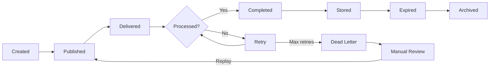

# OpenSchool ERP — Platform Event Catalogue

**Authoritative Reference for All Domain Events**

| Aspect | Detail |
|--------|--------|
| Document | Platform Event Catalogue |
| Scope | All domain events across 10 V1 engineering specifications |
| Status | Approved — Frozen for Implementation |
| Version | 1.0.0 |
| Effective Date | 2026-07-20 |
| Authority | Derived from 10 approved V1 domain specifications |
| Governing Standards | 01 Engineering Standards.md, 02 Cross-Domain Integration Specification.md |

---

## Table of Contents

1. [Purpose](#1-purpose)
2. [Scope](#2-scope)
3. [Event Principles](#3-event-principles)
4. [Event Naming Standards](#4-event-naming-standards)
5. [Event Metadata Standard](#5-event-metadata-standard)
6. [Event Lifecycle](#6-event-lifecycle)
7. [Domain Event Catalogue](#7-domain-event-catalogue)
   - 7.1 [Identity and Access](#71-identity--access)
   - 7.2 [Institution Management](#72-institution-management)
   - 7.3 [People](#73-people)
   - 7.4 [Academic Management](#74-academic-management)
   - 7.5 [Finance](#75-finance)
   - 7.6 [Communication](#76-communication)
   - 7.7 [Operations](#77-operations)
   - 7.8 [Documents and Learning](#78-documents-and-learning)
   - 7.9 [Reporting and Analytics](#79-reporting-and-analytics)
   - 7.10 [Platform Administration](#710-platform-administration)
8. [Event Categories](#8-event-categories)
9. [Event Ordering](#9-event-ordering)
10. [Event Versioning](#10-event-versioning)
11. [Event Delivery](#11-event-delivery)
12. [Event Consumer Matrix](#12-event-consumer-matrix)
13. [Event Security](#13-event-security)
14. [Event Monitoring](#14-event-monitoring)
15. [Integration Rules](#15-integration-rules)
16. [Architecture Decision Records](#16-architecture-decision-records)
17. [Event Review Checklist](#17-event-review-checklist)
18. [Future Expansion](#18-future-expansion)
19. [Revision History](#19-revision-history)

---

## 1. Purpose

This document is the single authoritative catalogue for every domain event in the OpenSchool ERP platform. It defines all published business events, their ownership, payload contracts, consumers, lifecycle, and versioning strategy.

### 1.1 Intended Audience

| Audience | Use |
|----------|-----|
| **Developers** | Implement event publishers and consumers correctly |
| **Architects** | Review event design, coupling, and boundary compliance |
| **Integration Engineers** | Build external integrations that consume or produce events |
| **Event Consumers** | Understand payload contracts, idempotency, and retry behavior |
| **Background Workers** | Implement async processing triggered by events |
| **Reporting Projections** | Build analytics read models from event streams |
| **Future Smart Campus** | Extend the event catalogue for IoT and campus automation |
| **Future AI Services** | Consume event streams for predictive analytics and automation |

### 1.2 Relationship to Other Standards

| Document | Relationship |
|----------|-------------|
| 01 Engineering Standards.md | Defines event envelope, naming, publishing, and consumer standards. This catalogue applies those standards to every event. |
| 02 Cross-Domain Integration Specification.md | Defines how domains communicate. This catalogue documents every individual event that flows through those channels. |
| Domain Engineering Specifications | Define business rules, entities, and aggregates. This catalogue documents the events those domains publish and consume. |

---

## 2. Scope

### 2.1 In Scope

- All domain events published by the 10 V1 engineering specifications
- All cross-domain event consumers and their processing logic
- Event metadata, payload contracts, and versioning
- Event lifecycle from creation to archival
- Event delivery guarantees and failure handling
- Event security and tenant isolation

### 2.2 Out of Scope

- Internal domain events that do not cross domain boundaries (documented in domain specs)
- Database triggers and PostgreSQL notification channels
- Infrastructure events (server health, container restarts)
- Frontend state management events

### 2.3 Event Count Summary

| Domain | Events Published | Primary Consumers |
|--------|-----------------|-------------------|
| Identity and Access | 8 | Communication, People, Platform Administration |
| Institution Management | 6 | Academic Management, Communication, Documents and Learning, Reporting and Analytics |
| People | 7 | Academic Management, Finance, Communication, Operations, Documents and Learning, Reporting and Analytics, Platform Administration |
| Academic Management | 18 | People, Finance, Communication, Documents and Learning, Reporting and Analytics |
| Finance | 14 | Communication, Documents and Learning, Operations, Reporting and Analytics |
| Communication | 7 | Reporting and Analytics, Platform Administration |
| Operations | 14 | Finance, Communication, Reporting and Analytics |
| Documents and Learning | 7 | Communication |
| Reporting and Analytics | 2 | Communication |
| Platform Administration | 16 | Communication, Finance, Reporting and Analytics, all domains |
| **Total** | **99** | |

---

## 3. Event Principles

### 3.1 Event Types

| Type | Definition | Scope | Example |
|------|-----------|-------|---------|
| **Domain Event** | A fact about something that happened in the domain, expressed in business language | Cross-domain | StudentEnrolled, PaymentConfirmed |
| **Integration Event** | A domain event specifically designed for cross-domain consumption, carrying a defined payload contract | Cross-domain | All events in this catalogue |
| **Internal Event** | An event that stays within a single domain and does not cross domain boundaries | Intra-domain | GradingRuleEvaluated, TimetableConflictDetected |
| **External Event** | An event representing a state change in an external system, or an event published to an external system | External | PaymentWebhookReceived, SmsDeliveryReport |

### 3.2 Principles

| Principle | Description |
|-----------|-------------|
| **Events are facts** | Events describe something that already happened. They are not commands, requests, or intentions. |
| **One owner per event** | Each event has exactly one owning domain. Only the owning domain may publish that event. |
| **Business language** | Event names express business concepts, not technical implementation details. |
| **Minimal payload** | Events carry only the data consumers need. No excessive nesting or unnecessary fields. |
| **Idempotent consumers** | Every consumer must handle duplicate delivery gracefully. |
| **Eventually consistent** | Cross-domain consistency is achieved through events, not distributed transactions. |
| **After-commit delivery** | Events are published only after the publishing transaction commits successfully. |
| **Tenant-scoped** | Every event carries tenant context. Consumers must respect tenant boundaries. |

---

## 4. Event Naming Standards

### 4.1 Naming Convention

| Element | Convention | Example |
|---------|-----------|---------|
| Event Name | PascalCase, past tense | StudentEnrolled, InvoicePublished |
| Pattern | `{Entity}{PastTenseVerb}` | PaymentConfirmed, TermClosed |
| Prefix | Entity or aggregate name | Student, Invoice, Book, Notification |
| Verb | Past tense, business-focused | Enrolled, Promoted, Graduated, Published |

### 4.2 Naming Rules

1. Events use **past tense** because they describe something that already happened
2. Events include the **entity name as a prefix** for discoverability
3. Multi-word verbs use **clean past tense**: `StudentConditionallyPromoted` (not `ConditionalPromotion`)
4. Parallel entities use **consistent verbs**: `AcademicYearActivated` and `AcademicSessionActivated` (not `Opened` vs `Activated`)
5. Avoid abbreviations in event names: use `StudentGraduated` not `StudentGrad`
6. Avoid prefixes like `On`, `Before`, `After` -- events describe facts, not timing

### 4.3 Standard Verb Catalogue

| Verb | Usage | Examples |
|------|-------|---------|
| Created | Entity persisted for the first time | UserCreated, InstitutionCreated, BillGenerated |
| Updated | Entity data modified | UserUpdated, InstitutionSettingsUpdated |
| Activated | Entity transitioned to active state | TermActivated, ModuleActivated, TenantActivated |
| Deactivated | Entity transitioned from active state | ModuleDeactivated, UserDeactivated |
| Published | Content made visible or finalized | ResultPublished, ReportCardPublished, DocumentPublished |
| Generated | System-produced artifact created | BillGenerated, InvoiceGenerated, ReportCardGenerated |
| Confirmed | Verification or approval completed | PaymentConfirmed |
| Assigned | Resource linked to another entity | TransportAssigned, TeachingAssigned |
| Allocated | Resource reserved or assigned | RoomAllocated |
| Deallocated | Resource released | RoomDeallocated |
| Enrolled | Student registered in a context | StudentEnrolled, StudentClassEnrolled |
| Withdrawn | Student removed from a context | StudentWithdrawn |
| Promoted | Student advanced to next level | StudentPromoted |
| Retained | Student kept at current level | StudentRetained |
| Graduated | Student completed program | StudentGraduated |
| Transferred | Entity moved between contexts | StudentTransferred, StudentClassTransferred |
| Submitted | Work turned in | AssignmentSubmitted |
| Returned | Work returned with feedback | AssignmentReturned |
| Delivered | Communication successfully delivered | NotificationDelivered |
| Failed | Operation failed | PaymentFailed, NotificationFailed, WebhookDeliveryFailed |
| Requested | Action requested by user | PasswordResetRequested, MaintenanceRequested, RefundRequested |
| Processed | Action completed | RefundProcessed |
| Overdue | Deadline exceeded | InvoiceOverdue, BookOverdue, InstallmentOverdue |
| Awarded | Grant or scholarship given | ScholarshipAwarded |
| Reported | Incident or issue logged | IncidentReported |
| Completed | Work finished | WorkOrderCompleted |
| Scheduled | Future event planned | MaintenanceScheduled |
| Exceeded | Threshold crossed | LicenseLimitExceeded, KpiThresholdBreached |
| Read | Recipient opens notification | NotificationRead |
| Sent | Message dispatched | MessageSent, NotificationDispatched |

### 4.4 Ownership

- Each event is owned by exactly one domain
- Only the owning domain may publish the event
- Consumer domains may not modify the event payload or semantics
- Event ownership is documented in the catalogue entry and cannot be transferred without architecture review

---

## 5. Event Metadata Standard

### 5.1 Envelope Fields

Every domain event carries a versioned envelope as defined in `01 Engineering Standards.md` Section 7.2:

| Field | Type | Required | Description |
|-------|------|----------|-------------|
| eventId | uuid | Yes | Unique event identifier; primary deduplication key |
| eventName | string | Yes | Fully qualified event name (e.g., `academic.StudentEnrolled`) |
| eventVersion | int | Yes | Monotonically increasing per event type; incremented on payload schema changes |
| schemaVersion | string | Yes | Payload schema version (e.g., "1.0.0") |
| occurredAt | timestamptz | Yes | When the event occurred |
| correlationId | uuid | Yes | Groups related events across a single user action |
| causationId | uuid | Yes | ID of the event or command that caused this event |
| tenantId | uuid | Yes | Tenant context |
| institutionId | uuid | Yes | Institution context within the tenant |
| aggregateId | uuid | Yes | ID of the aggregate root that produced the event |
| aggregateType | string | Yes | Type of the aggregate root (e.g., "Student", "Invoice") |
| sourceDomain | string | Yes | Domain that published the event |
| actorId | uuid | Yes | User who triggered the event (system events use system actor UUID) |
| payload | jsonb | Yes | Event-specific data |

### 5.2 Event Name Format

Event names follow the pattern `{domain}.{EntityPastTenseVerb}`:

```
identity.UserCreated
institution.InstitutionCreated
people.StudentEnrolled
academic.ResultPublished
finance.PaymentConfirmed
communication.NotificationDelivered
operations.BookBorrowed
documents.DocumentPublished
reporting.ExportJobCompleted
platform.TenantProvisioned
```

### 5.3 Correlation and Causation

| Field | Purpose | Example |
|-------|---------|---------|
| correlationId | Groups all events produced by a single user action | User clicks "Enroll Student" and StudentEnrolled + BillGenerated share the same correlationId |
| causationId | Points to the event or command that caused this event | BillGenerated has causationId = StudentEnrolled.eventId |

---

## 6. Event Lifecycle

### 6.1 Lifecycle Stages



### 6.2 Stage Definitions

| Stage | Description | Duration |
|-------|-------------|----------|
| **Created** | Event entity persisted in event store after transaction commit | Immediate |
| **Published** | Event emitted via EventEmitter2 to registered consumers | Less than 100ms after commit |
| **Delivered** | Event received by consumer event handler | Less than 10ms in-process |
| **Processed** | Consumer successfully processed the event | Less than 500ms |
| **Completed** | Event marked as successfully processed | Immediate after processing |
| **Retry** | Consumer failed; event queued for retry | Exponential backoff (1s, 5s, 30s) |
| **Dead Letter** | Maximum retries exhausted; event moved to dead letter queue | After 4 attempts |
| **Manual Review** | Platform admin inspects and resolves dead-lettered events | Best effort |
| **Replayed** | Dead-lettered event reprocessed after resolution | On demand |
| **Stored** | Event retained for audit and replay | 72-hour minimum TTL |
| **Expired** | Event past retention period; eligible for cleanup | After 72 hours |
| **Archived** | Event moved to long-term storage for compliance | Optional |

### 6.3 Lifecycle Rules

1. Events are **never deleted** before retention expiry
2. Events in **Dead Letter** state require platform admin intervention
3. **Replay** must be idempotent -- same result as original processing
4. **Expired** events may be purged by background job after configurable TTL
5. **Archived** events are retained for compliance and audit purposes

---

## 7. Domain Event Catalogue

This section documents every cross-domain event published by each of the 10 V1 engineering domains.

### 7.1 Identity and Access

**Domain:** Identity and Access
**Aggregate:** User, Role, Permission, Session
**Specification Reference:** Identity and Access Engineering.md

---

#### 7.1.1 UserCreated

| Field | Value |
|-------|-------|
| **Owning Domain** | Identity and Access |
| **Aggregate** | User |
| **Trigger** | New user account created via registration, admin creation, or SSO provisioning |
| **Business Purpose** | Notifies downstream domains that a new user identity exists and may need person records, welcome communications, or license tracking |
| **Payload Summary** | userId, email, firstName, lastName, roleIds, institutionId, createdAt |
| **Event Version** | 1 |
| **Publisher** | UserService |
| **Consumers** | Communication (welcome email), People (person record sync) |
| **Ordering Requirements** | Must be processed after UserCreated completes; no ordering dependency with other events |
| **Idempotency Requirements** | Consumer must check eventId; duplicate delivery must not create duplicate person records or send duplicate welcome emails |
| **Retry Strategy** | Exponential backoff (1s, 5s, 30s, 120s); max 4 attempts |
| **Dead Letter Queue Behaviour** | Alert platform admin; manual review required; person record creation may be deferred |
| **Security Considerations** | Payload contains email (PII); transmit over internal event bus only; no external exposure |
| **Audit Requirements** | Log event receipt in consumer audit trail; log original actorId |

---

#### 7.1.2 UserUpdated

| Field | Value |
|-------|-------|
| **Owning Domain** | Identity and Access |
| **Aggregate** | User |
| **Trigger** | User profile fields updated (name, email, phone) |
| **Business Purpose** | Synchronizes user profile changes to downstream person records |
| **Payload Summary** | userId, changedFields (array), previousValues, newValues, updatedAt |
| **Event Version** | 1 |
| **Publisher** | UserService |
| **Consumers** | People (person record sync) |
| **Ordering Requirements** | Out-of-order delivery acceptable; consumer applies latest state |
| **Idempotency Requirements** | Consumer must check eventId; version-based conflict resolution for person records |
| **Retry Strategy** | Exponential backoff; max 4 attempts |
| **Dead Letter Queue Behaviour** | Alert platform admin; profile sync deferred |
| **Security Considerations** | Payload contains PII (email, name); internal event bus only |
| **Audit Requirements** | Log event receipt; log field changes |

---

#### 7.1.3 UserDeactivated

| Field | Value |
|-------|-------|
| **Owning Domain** | Identity and Access |
| **Aggregate** | User |
| **Trigger** | User account deactivated by admin or automated policy |
| **Business Purpose** | Triggers downstream cleanup: asset return, status sync, access revocation |
| **Payload Summary** | userId, deactivatedBy, reason, deactivatedAt |
| **Event Version** | 1 |
| **Publisher** | UserService |
| **Consumers** | People (person status sync), Operations (asset return trigger) |
| **Ordering Requirements** | Must be processed after deactivation is committed |
| **Idempotency Requirements** | Consumer must check eventId; duplicate delivery must not trigger duplicate asset returns |
| **Retry Strategy** | Exponential backoff; max 4 attempts |
| **Dead Letter Queue Behaviour** | Alert platform admin and institution admin; manual asset return may be required |
| **Security Considerations** | Payload contains userId; internal event bus only |
| **Audit Requirements** | Log event receipt; log deactivation reason |

---

#### 7.1.4 PasswordResetRequested

| Field | Value |
|-------|-------|
| **Owning Domain** | Identity and Access |
| **Aggregate** | User |
| **Trigger** | User or admin requests password reset |
| **Business Purpose** | Triggers password reset email delivery via Communication |
| **Payload Summary** | userId, email, resetToken, expiresAt, requestedAt |
| **Event Version** | 1 |
| **Publisher** | AuthenticationService |
| **Consumers** | Communication (reset email) |
| **Ordering Requirements** | Independent; no ordering dependency |
| **Idempotency Requirements** | Consumer must check eventId; duplicate delivery must not send duplicate reset emails |
| **Retry Strategy** | Immediate retry; max 3 attempts |
| **Dead Letter Queue Behaviour** | Alert platform admin; user may retry reset request |
| **Security Considerations** | Payload contains resetToken (sensitive); encrypt at rest; never log token in plaintext |
| **Audit Requirements** | Log event receipt; log email delivery status |

---

#### 7.1.5 MFAEnabled

| Field | Value |
|-------|-------|
| **Owning Domain** | Identity and Access |
| **Aggregate** | User |
| **Trigger** | User enables multi-factor authentication |
| **Business Purpose** | Sends security notification confirming MFA activation |
| **Payload Summary** | userId, email, mfaMethod, enabledAt |
| **Event Version** | 1 |
| **Publisher** | AuthenticationService |
| **Consumers** | Communication (security notification) |
| **Ordering Requirements** | Independent |
| **Idempotency Requirements** | Standard eventId check |
| **Retry Strategy** | Exponential backoff; max 3 attempts |
| **Dead Letter Queue Behaviour** | Alert platform admin; notification may be deferred |
| **Security Considerations** | Payload contains email (PII); internal bus only |
| **Audit Requirements** | Log event receipt |

---

#### 7.1.6 AccountLocked

| Field | Value |
|-------|-------|
| **Owning Domain** | Identity and Access |
| **Aggregate** | User |
| **Trigger** | Account locked due to excessive failed login attempts |
| **Business Purpose** | Sends urgent security alert to user and platform admin |
| **Payload Summary** | userId, email, lockedAt, failedAttemptCount, lockDuration |
| **Event Version** | 1 |
| **Publisher** | AuthenticationService |
| **Consumers** | Communication (security alert) |
| **Ordering Requirements** | Independent |
| **Idempotency Requirements** | Standard eventId check |
| **Retry Strategy** | Immediate retry; max 3 attempts |
| **Dead Letter Queue Behaviour** | Alert platform admin directly via monitoring |
| **Security Considerations** | Payload contains email and security event data; high-priority delivery |
| **Audit Requirements** | Log event receipt; log security event |

---

#### 7.1.7 PlatformAdminLogin

| Field | Value |
|-------|-------|
| **Owning Domain** | Identity and Access |
| **Aggregate** | Session |
| **Trigger** | Platform super admin successfully authenticated |
| **Business Purpose** | Platform audit trail for administrative access |
| **Payload Summary** | adminUserId, email, ipAddress, userAgent, loginAt |
| **Event Version** | 1 |
| **Publisher** | AuthenticationService |
| **Consumers** | Platform Administration (audit logging) |
| **Ordering Requirements** | Independent |
| **Idempotency Requirements** | Standard eventId check |
| **Retry Strategy** | Best effort; non-critical |
| **Dead Letter Queue Behaviour** | Log warning; do not block admin login |
| **Security Considerations** | Payload contains IP address and user agent; store in audit log only |
| **Audit Requirements** | This event IS the audit record; store in append-only audit log |

---

#### 7.1.8 PlatformAdminLogout

| Field | Value |
|-------|-------|
| **Owning Domain** | Identity and Access |
| **Aggregate** | Session |
| **Trigger** | Platform super admin session terminated |
| **Business Purpose** | Platform audit trail for administrative access |
| **Payload Summary** | adminUserId, email, sessionDuration, logoutAt |
| **Event Version** | 1 |
| **Publisher** | AuthenticationService |
| **Consumers** | Platform Administration (audit logging) |
| **Ordering Requirements** | Independent |
| **Idempotency Requirements** | Standard eventId check |
| **Retry Strategy** | Best effort; non-critical |
| **Dead Letter Queue Behaviour** | Log warning |
| **Security Considerations** | Low sensitivity; audit log only |
| **Audit Requirements** | This event IS the audit record |

---

### 7.2 Institution Management

**Domain:** Institution Management
**Aggregate:** Institution, AcademicCalendar, ModuleLicense
**Specification Reference:** Institution Management Engineering.md

---

#### 7.2.1 InstitutionCreated

| Field | Value |
|-------|-------|
| **Owning Domain** | Institution Management |
| **Aggregate** | Institution |
| **Trigger** | New institution provisioned within a tenant |
| **Business Purpose** | Triggers setup welcome, default template creation, and analytics initialization |
| **Payload Summary** | institutionId, institutionName, tenantId, adminUserId, createdAt |
| **Event Version** | 1 |
| **Publisher** | InstitutionService |
| **Consumers** | Communication (setup welcome), Documents and Learning (default templates) |
| **Ordering Requirements** | Must be first event for the institution; all subsequent institution events depend on this |
| **Idempotency Requirements** | Consumer must check eventId; duplicate delivery must not create duplicate templates |
| **Retry Strategy** | Exponential backoff; max 4 attempts |
| **Dead Letter Queue Behaviour** | Alert platform admin; manual setup may be required |
| **Security Considerations** | Payload contains institution name; internal bus only |
| **Audit Requirements** | Log event receipt; log template creation |

---

#### 7.2.2 AcademicCalendarConfigured

| Field | Value |
|-------|-------|
| **Owning Domain** | Institution Management |
| **Aggregate** | AcademicCalendar |
| **Trigger** | Academic calendar configured with sessions and terms |
| **Business Purpose** | Triggers Academic Management to create session and term records |
| **Payload Summary** | institutionId, calendarId, sessions (array), configuredAt |
| **Event Version** | 1 |
| **Publisher** | AcademicCalendarService |
| **Consumers** | Academic Management (session and term creation) |
| **Ordering Requirements** | Must be processed after institution setup is complete |
| **Idempotency Requirements** | Consumer must check eventId and calendarId; duplicate delivery must not create duplicate sessions |
| **Retry Strategy** | Exponential backoff; max 4 attempts |
| **Dead Letter Queue Behaviour** | Alert institution admin; academic setup may be deferred |
| **Security Considerations** | Low sensitivity; academic configuration data |
| **Audit Requirements** | Log event receipt; log session creation |

---

#### 7.2.3 UserInvited

| Field | Value |
|-------|-------|
| **Owning Domain** | Institution Management |
| **Aggregate** | OrganizationUser |
| **Trigger** | Institution admin invites a user to join the institution |
| **Business Purpose** | Sends invitation email with activation link |
| **Payload Summary** | institutionId, inviteeEmail, invitedBy, role, invitationToken, expiresAt |
| **Event Version** | 1 |
| **Publisher** | OrganizationUserService |
| **Consumers** | Communication (invitation email) |
| **Ordering Requirements** | Independent |
| **Idempotency Requirements** | Standard eventId check; duplicate delivery must not send duplicate invitations |
| **Retry Strategy** | Exponential backoff; max 3 attempts |
| **Dead Letter Queue Behaviour** | Alert institution admin; user may be re-invited |
| **Security Considerations** | Payload contains email and invitation token (sensitive); encrypt token at rest |
| **Audit Requirements** | Log event receipt; log email delivery status |

---

#### 7.2.4 InstitutionSettingsUpdated

| Field | Value |
|-------|-------|
| **Owning Domain** | Institution Management |
| **Aggregate** | Institution |
| **Trigger** | Institution settings changed (name, timezone, locale, branding) |
| **Business Purpose** | Synchronizes settings to caches and triggers analytics refresh |
| **Payload Summary** | institutionId, changedFields, previousValues, newValues, updatedAt |
| **Event Version** | 1 |
| **Publisher** | InstitutionService |
| **Consumers** | Communication (settings sync), Reporting and Analytics (cache refresh) |
| **Ordering Requirements** | Out-of-order acceptable; consumer applies latest state |
| **Idempotency Requirements** | Standard eventId check; version-based conflict resolution |
| **Retry Strategy** | Exponential backoff; max 3 attempts |
| **Dead Letter Queue Behaviour** | Alert platform admin |
| **Security Considerations** | Low sensitivity; institution configuration |
| **Audit Requirements** | Log event receipt; log settings changes |

---

#### 7.2.5 ModuleActivated

| Field | Value |
|-------|-------|
| **Owning Domain** | Institution Management |
| **Aggregate** | InstitutionModule |
| **Trigger** | Institution activates a licensed module |
| **Business Purpose** | Enables module-specific features in downstream domains |
| **Payload Summary** | institutionId, moduleId, moduleKey, activatedAt |
| **Event Version** | 1 |
| **Publisher** | ModuleLicenseService |
| **Consumers** | Academic Management, Finance, Operations (enable module features) |
| **Ordering Requirements** | Must be processed after module license is validated |
| **Idempotency Requirements** | Standard eventId check; duplicate delivery must not re-enable already-enabled features |
| **Retry Strategy** | Exponential backoff; max 4 attempts |
| **Dead Letter Queue Behaviour** | Alert institution admin and platform admin |
| **Security Considerations** | Low sensitivity; module activation status |
| **Audit Requirements** | Log event receipt; log feature enablement |

---

#### 7.2.6 ModuleDeactivated

| Field | Value |
|-------|-------|
| **Owning Domain** | Institution Management |
| **Aggregate** | InstitutionModule |
| **Trigger** | Institution deactivates a module or license expires |
| **Business Purpose** | Disables module-specific features in downstream domains |
| **Payload Summary** | institutionId, moduleId, moduleKey, deactivatedAt, reason |
| **Event Version** | 1 |
| **Publisher** | ModuleLicenseService |
| **Consumers** | Academic Management, Finance, Operations (disable module features) |
| **Ordering Requirements** | Must be processed after deactivation is committed |
| **Idempotency Requirements** | Standard eventId check; duplicate must not re-disable already-disabled features |
| **Retry Strategy** | Exponential backoff; max 4 attempts |
| **Dead Letter Queue Behaviour** | Alert platform admin |
| **Security Considerations** | Low sensitivity; module deactivation status |
| **Audit Requirements** | Log event receipt; log feature disablement |

---

### 7.3 People

**Domain:** People
**Aggregate:** Person, Student, Staff, Parent, Guardian
**Specification Reference:** People Engineering.md

---

#### 7.3.1 StudentEnrolled

| Field | Value |
|-------|-------|
| **Owning Domain** | People |
| **Aggregate** | Student |
| **Trigger** | Student enrollment record created within an institution |
| **Business Purpose** | Core enrollment event; triggers class enrollment, fee assignment, medical record creation, document setup, analytics, and license counting across 7 domains |
| **Payload Summary** | studentId, personId, institutionId, academicSessionId, enrollmentType, enrollmentDate, gradeLevelId |
| **Event Version** | 1 |
| **Publisher** | StudentEnrollmentService |
| **Consumers** | Academic Management (class enrollment), Finance (fee assignment), Communication (welcome notification), Operations (medical record), Documents and Learning (document setup), Reporting and Analytics (enrollment count), Platform Administration (license count) |
| **Ordering Requirements** | Must be processed before any academic or financial operations on the student |
| **Idempotency Requirements** | Critical: 7 consumers. Each must check eventId. Duplicate delivery must not create duplicate records in any domain |
| **Retry Strategy** | Exponential backoff (1s, 5s, 30s, 120s); max 4 attempts |
| **Dead Letter Queue Behaviour** | Alert platform admin and institution admin; manual intervention required for each failed consumer |
| **Security Considerations** | Payload contains student PII (personId, name); internal bus only; tenant-scoped |
| **Audit Requirements** | Log event receipt in all 7 consumer domains; log original actorId |

---

#### 7.3.2 StudentTransferred

| Field | Value |
|-------|-------|
| **Owning Domain** | People |
| **Aggregate** | StudentTransfer |
| **Trigger** | Student transferred between institutions |
| **Business Purpose** | Adjusts enrollment and billing in source and destination institutions |
| **Payload Summary** | studentId, sourceInstitutionId, destinationInstitutionId, transferDate, reason |
| **Event Version** | 1 |
| **Publisher** | StudentTransferService |
| **Consumers** | Academic Management (enrollment sync), Finance (billing adjustment), Communication (notification) |
| **Ordering Requirements** | Must be processed after transfer record is committed |
| **Idempotency Requirements** | Standard eventId check |
| **Retry Strategy** | Exponential backoff; max 4 attempts |
| **Dead Letter Queue Behaviour** | Alert institution admin in both institutions |
| **Security Considerations** | Payload contains cross-institution data; tenant-scoped validation required |
| **Audit Requirements** | Log event receipt in all consumer domains |

---

#### 7.3.3 StudentWithdrawn

| Field | Value |
|-------|-------|
| **Owning Domain** | People |
| **Aggregate** | Student |
| **Trigger** | Student withdrawn from institution (voluntary or administrative) |
| **Business Purpose** | Triggers enrollment removal, final billing, checkout, document archival, and license count update across 6 domains |
| **Payload Summary** | studentId, institutionId, withdrawnBy, reason, withdrawalDate |
| **Event Version** | 1 |
| **Publisher** | StudentEnrollmentService |
| **Consumers** | Academic Management (enrollment removal), Finance (final billing), Communication (notification), Operations (checkout trigger), Documents and Learning (archival), Platform Administration (license count) |
| **Ordering Requirements** | Must be processed after withdrawal is committed; triggers checkout saga |
| **Idempotency Requirements** | Critical: 6 consumers. Each must check eventId. Duplicate delivery must not trigger duplicate checkouts |
| **Retry Strategy** | Exponential backoff; max 4 attempts |
| **Dead Letter Queue Behaviour** | Alert platform admin and institution admin; manual checkout may be required |
| **Security Considerations** | Payload contains student PII; internal bus only |
| **Audit Requirements** | Log event receipt in all consumer domains |

---

#### 7.3.4 StudentGraduated

| Field | Value |
|-------|-------|
| **Owning Domain** | People |
| **Aggregate** | Student |
| **Trigger** | Student graduation confirmed |
| **Business Purpose** | Triggers progression, notification, checkout, document archival across 4+ domains |
| **Payload Summary** | studentId, institutionId, graduationDate, finalGrade, diplomaNumber |
| **Event Version** | 1 |
| **Publisher** | StudentEnrollmentService |
| **Consumers** | Academic Management (progression), Communication (notification), Operations (checkout trigger), Documents and Learning (archival) |
| **Ordering Requirements** | Must be processed after graduation record is committed |
| **Idempotency Requirements** | Critical: multiple consumers. Standard idempotency for each |
| **Retry Strategy** | Exponential backoff; max 4 attempts |
| **Dead Letter Queue Behaviour** | Alert institution admin; manual graduation processing |
| **Security Considerations** | Payload contains student PII and academic data; internal bus only |
| **Audit Requirements** | Log event receipt in all consumer domains |

---

#### 7.3.5 StaffHired

| Field | Value |
|-------|-------|
| **Owning Domain** | People |
| **Aggregate** | Staff |
| **Trigger** | Staff member hired and record created |
| **Business Purpose** | Triggers onboarding cascade: teaching assignment, welcome email, medical record, asset assignment, analytics, license count across 6 domains |
| **Payload Summary** | staffId, personId, institutionId, hireDate, department, position |
| **Event Version** | 1 |
| **Publisher** | StaffService |
| **Consumers** | Academic Management (teaching assignment), Communication (onboarding welcome), Operations (medical record, asset assignment), Reporting and Analytics (staff count), Platform Administration (license count) |
| **Ordering Requirements** | Must be processed after staff record is committed |
| **Idempotency Requirements** | Critical: 5+ consumers. Each must check eventId |
| **Retry Strategy** | Exponential backoff; max 4 attempts |
| **Dead Letter Queue Behaviour** | Alert institution admin; manual onboarding may be required |
| **Security Considerations** | Payload contains staff PII; internal bus only |
| **Audit Requirements** | Log event receipt in all consumer domains |

---

#### 7.3.6 StaffSeparated

| Field | Value |
|-------|-------|
| **Owning Domain** | People |
| **Aggregate** | Staff |
| **Trigger** | Staff member separated from institution |
| **Business Purpose** | Triggers teaching assignment removal, notification, asset return, document archival, license count update across 5 domains |
| **Payload Summary** | staffId, institutionId, separatedBy, reason, separationDate |
| **Event Version** | 1 |
| **Publisher** | StaffService |
| **Consumers** | Academic Management (teaching assignment removal), Communication (notification), Operations (asset return), Documents and Learning (archival), Platform Administration (license count) |
| **Ordering Requirements** | Must be processed after separation is committed |
| **Idempotency Requirements** | Standard eventId check across all consumers |
| **Retry Strategy** | Exponential backoff; max 4 attempts |
| **Dead Letter Queue Behaviour** | Alert institution admin; manual separation processing |
| **Security Considerations** | Payload contains staff PII; internal bus only |
| **Audit Requirements** | Log event receipt in all consumer domains |

---

#### 7.3.7 ParentLinked

| Field | Value |
|-------|-------|
| **Owning Domain** | People |
| **Aggregate** | ParentStudentLink |
| **Trigger** | Parent or guardian linked to a student record |
| **Business Purpose** | Notifies Communication to send parent onboarding notification |
| **Payload Summary** | parentId, studentId, institutionId, linkType, linkedAt |
| **Event Version** | 1 |
| **Publisher** | ParentService |
| **Consumers** | Communication (notification) |
| **Ordering Requirements** | Independent |
| **Idempotency Requirements** | Standard eventId check |
| **Retry Strategy** | Exponential backoff; max 3 attempts |
| **Dead Letter Queue Behaviour** | Log warning; notification may be deferred |
| **Security Considerations** | Payload contains parent and student IDs; internal bus only |
| **Audit Requirements** | Log event receipt |

---

### 7.4 Academic Management

**Domain:** Academic Management
**Aggregate:** Term, StudentClassEnrollment, Assignment, Assessment, Result, ReportCard, SummerSchool
**Specification Reference:** Academic Management Engineering.md

---

#### 7.4.1 TermActivated

| Field | Value |
|-------|-------|
| **Owning Domain** | Academic Management |
| **Aggregate** | Term |
| **Trigger** | Term status transitions to ACTIVE |
| **Business Purpose** | Notifies Communication to send term start notification |
| **Payload Summary** | termId, academicSessionId, name, startDate, institutionId |
| **Event Version** | 1 |
| **Publisher** | AcademicCalendarService |
| **Consumers** | Communication (term start notification) |
| **Ordering Requirements** | Must be processed after term activation is committed |
| **Idempotency Requirements** | Standard eventId check |
| **Retry Strategy** | Exponential backoff; max 3 attempts |
| **Dead Letter Queue Behaviour** | Log warning; notification may be deferred |
| **Security Considerations** | Low sensitivity; academic calendar data |
| **Audit Requirements** | Log event receipt |

---

#### 7.4.2 TermClosed

| Field | Value |
|-------|-------|
| **Owning Domain** | Academic Management |
| **Aggregate** | Term |
| **Trigger** | Term status transitions to CLOSED |
| **Business Purpose** | Triggers report card generation, analytics snapshot, and term closure notification across 3 domains |
| **Payload Summary** | termId, academicSessionId, name, closedAt, institutionId |
| **Event Version** | 1 |
| **Publisher** | AcademicCalendarService |
| **Consumers** | Documents and Learning (report card generation), Reporting and Analytics (term metrics), Communication (term closure notification) |
| **Ordering Requirements** | Must be processed after all results for the term are finalized |
| **Idempotency Requirements** | Standard eventId check across all consumers |
| **Retry Strategy** | Exponential backoff; max 4 attempts |
| **Dead Letter Queue Behaviour** | Alert institution admin; report card generation may be deferred |
| **Security Considerations** | Low sensitivity; academic calendar data |
| **Audit Requirements** | Log event receipt in all consumer domains |

---

#### 7.4.3 StudentClassEnrolled

| Field | Value |
|-------|-------|
| **Owning Domain** | Academic Management |
| **Aggregate** | StudentClassEnrollment |
| **Trigger** | Student enrolled in a specific class/arm |
| **Business Purpose** | Synchronizes enrollment state back to People domain |
| **Payload Summary** | enrollmentId, studentPersonId, classId, armId, academicSessionId, enrolledAt |
| **Event Version** | 1 |
| **Publisher** | ClassEnrollmentService |
| **Consumers** | People (enrollment sync) |
| **Ordering Requirements** | Must follow StudentEnrolled event from People |
| **Idempotency Requirements** | Standard eventId check; duplicate must not create duplicate enrollment in People |
| **Retry Strategy** | Exponential backoff; max 3 attempts |
| **Dead Letter Queue Behaviour** | Alert academic admin |
| **Security Considerations** | Contains student ID; internal bus only |
| **Audit Requirements** | Log event receipt |

---

#### 7.4.4 StudentClassTransferred

| Field | Value |
|-------|-------|
| **Owning Domain** | Academic Management |
| **Aggregate** | StudentClassEnrollment |
| **Trigger** | Student transferred between classes |
| **Business Purpose** | Synchronizes transfer state back to People domain |
| **Payload Summary** | enrollmentId, studentPersonId, sourceClassId, destinationClassId, transferredAt |
| **Event Version** | 1 |
| **Publisher** | ClassEnrollmentService |
| **Consumers** | People (enrollment sync) |
| **Ordering Requirements** | Independent; out-of-order acceptable |
| **Idempotency Requirements** | Standard eventId check |
| **Retry Strategy** | Exponential backoff; max 3 attempts |
| **Dead Letter Queue Behaviour** | Alert academic admin |
| **Security Considerations** | Contains student ID; internal bus only |
| **Audit Requirements** | Log event receipt |

---

#### 7.4.5 AssignmentPublished

| Field | Value |
|-------|-------|
| **Owning Domain** | Academic Management |
| **Aggregate** | Assignment |
| **Trigger** | Teacher publishes assignment to students |
| **Business Purpose** | Sends notification to students and parents about new assignment |
| **Payload Summary** | assignmentId, title, subjectId, classId, dueDate, publishedAt |
| **Event Version** | 1 |
| **Publisher** | AssignmentService |
| **Consumers** | Communication (notification) |
| **Ordering Requirements** | Independent |
| **Idempotency Requirements** | Standard eventId check |
| **Retry Strategy** | Exponential backoff; max 3 attempts |
| **Dead Letter Queue Behaviour** | Log warning |
| **Security Considerations** | Low sensitivity; academic content metadata |
| **Audit Requirements** | Log event receipt |

---

#### 7.4.6 AssignmentSubmitted

| Field | Value |
|-------|-------|
| **Owning Domain** | Academic Management |
| **Aggregate** | Assignment |
| **Trigger** | Student submits assignment |
| **Business Purpose** | Notifies teacher of submission |
| **Payload Summary** | assignmentId, studentPersonId, submittedAt |
| **Event Version** | 1 |
| **Publisher** | AssignmentService |
| **Consumers** | Communication (notification to teacher) |
| **Ordering Requirements** | Must follow AssignmentPublished |
| **Idempotency Requirements** | Standard eventId check |
| **Retry Strategy** | Exponential backoff; max 3 attempts |
| **Dead Letter Queue Behaviour** | Log warning |
| **Security Considerations** | Contains student ID; internal bus only |
| **Audit Requirements** | Log event receipt |

---

#### 7.4.7 AssignmentReturned

| Field | Value |
|-------|-------|
| **Owning Domain** | Academic Management |
| **Aggregate** | Assignment |
| **Trigger** | Teacher returns graded assignment with feedback |
| **Business Purpose** | Notifies student of graded assignment |
| **Payload Summary** | assignmentId, studentPersonId, score, feedback, returnedAt |
| **Event Version** | 1 |
| **Publisher** | AssignmentService |
| **Consumers** | Communication (notification to student) |
| **Ordering Requirements** | Must follow AssignmentSubmitted |
| **Idempotency Requirements** | Standard eventId check |
| **Retry Strategy** | Exponential backoff; max 3 attempts |
| **Dead Letter Queue Behaviour** | Log warning |
| **Security Considerations** | Contains student ID and grade data; internal bus only |
| **Audit Requirements** | Log event receipt |

---

#### 7.4.8 AssessmentPublished

| Field | Value |
|-------|-------|
| **Owning Domain** | Academic Management |
| **Aggregate** | Assessment |
| **Trigger** | Assessment published for student participation |
| **Business Purpose** | Sends notification to students and parents about upcoming assessment |
| **Payload Summary** | assessmentId, title, type, subjectId, classId, scheduledDate, publishedAt |
| **Event Version** | 1 |
| **Publisher** | AssessmentService |
| **Consumers** | Communication (notification) |
| **Ordering Requirements** | Independent |
| **Idempotency Requirements** | Standard eventId check |
| **Retry Strategy** | Exponential backoff; max 3 attempts |
| **Dead Letter Queue Behaviour** | Log warning |
| **Security Considerations** | Low sensitivity; academic content metadata |
| **Audit Requirements** | Log event receipt |

---

#### 7.4.9 ResultPublished

| Field | Value |
|-------|-------|
| **Owning Domain** | Academic Management |
| **Aggregate** | Result |
| **Trigger** | Results published to students and parents |
| **Business Purpose** | Triggers report card generation, result notifications, and analytics update across 3 domains |
| **Payload Summary** | resultId, studentPersonId, termId, academicSessionId, totalScore, averageScore, position, publishedAt |
| **Event Version** | 1 |
| **Publisher** | ResultService |
| **Consumers** | Communication (result notification), Documents and Learning (report card generation), Reporting and Analytics (result metrics) |
| **Ordering Requirements** | Must be processed after result approval |
| **Idempotency Requirements** | Critical: 3 consumers. Standard idempotency for each |
| **Retry Strategy** | Exponential backoff; max 4 attempts |
| **Dead Letter Queue Behaviour** | Alert academic admin and institution admin |
| **Security Considerations** | Contains student grades (sensitive academic data); internal bus only |
| **Audit Requirements** | Log event receipt in all consumer domains |

---

#### 7.4.10 ReportCardGenerated

| Field | Value |
|-------|-------|
| **Owning Domain** | Academic Management |
| **Aggregate** | ReportCard |
| **Trigger** | Report card document generated from template |
| **Business Purpose** | Notifies parents that report card is ready for review |
| **Payload Summary** | reportCardId, studentPersonId, termId, generatedAt |
| **Event Version** | 1 |
| **Publisher** | ReportCardService |
| **Consumers** | Communication (notification) |
| **Ordering Requirements** | Must follow ResultPublished |
| **Idempotency Requirements** | Standard eventId check |
| **Retry Strategy** | Exponential backoff; max 3 attempts |
| **Dead Letter Queue Behaviour** | Log warning |
| **Security Considerations** | Contains student academic data; internal bus only |
| **Audit Requirements** | Log event receipt |

---

#### 7.4.11 ReportCardPublished

| Field | Value |
|-------|-------|
| **Owning Domain** | Academic Management |
| **Aggregate** | ReportCard |
| **Trigger** | Report card made visible to parents and students |
| **Business Purpose** | Sends final report card notification |
| **Payload Summary** | reportCardId, studentPersonId, termId, publishedAt |
| **Event Version** | 1 |
| **Publisher** | ReportCardService |
| **Consumers** | Communication (notification) |
| **Ordering Requirements** | Must follow ReportCardGenerated |
| **Idempotency Requirements** | Standard eventId check |
| **Retry Strategy** | Exponential backoff; max 3 attempts |
| **Dead Letter Queue Behaviour** | Log warning |
| **Security Considerations** | Contains student academic data; internal bus only |
| **Audit Requirements** | Log event receipt |

---

#### 7.4.12 StudentPromoted

| Field | Value |
|-------|-------|
| **Owning Domain** | Academic Management |
| **Aggregate** | AcademicProgression |
| **Trigger** | Student promoted to next grade level |
| **Business Purpose** | Synchronizes progression to People and sends notification |
| **Payload Summary** | studentPersonId, sourceGradeLevelId, destinationGradeLevelId, academicSessionId, promotedAt |
| **Event Version** | 1 |
| **Publisher** | AcademicProgressionService |
| **Consumers** | People (progression sync), Communication (notification) |
| **Ordering Requirements** | Must follow end-of-term processing |
| **Idempotency Requirements** | Standard eventId check |
| **Retry Strategy** | Exponential backoff; max 4 attempts |
| **Dead Letter Queue Behaviour** | Alert academic admin |
| **Security Considerations** | Contains student academic data; internal bus only |
| **Audit Requirements** | Log event receipt |

---

#### 7.4.13 StudentRetained

| Field | Value |
|-------|-------|
| **Owning Domain** | Academic Management |
| **Aggregate** | AcademicProgression |
| **Trigger** | Student retained in current grade level |
| **Business Purpose** | Sends notification to parents about retention decision |
| **Payload Summary** | studentPersonId, gradeLevelId, academicSessionId, reason, retainedAt |
| **Event Version** | 1 |
| **Publisher** | AcademicProgressionService |
| **Consumers** | Communication (notification) |
| **Ordering Requirements** | Must follow end-of-term processing |
| **Idempotency Requirements** | Standard eventId check |
| **Retry Strategy** | Exponential backoff; max 3 attempts |
| **Dead Letter Queue Behaviour** | Log warning |
| **Security Considerations** | Contains student academic data and retention reason (sensitive); internal bus only |
| **Audit Requirements** | Log event receipt |

---

#### 7.4.14 StudentGraduated

| Field | Value |
|-------|-------|
| **Owning Domain** | Academic Management |
| **Aggregate** | AcademicProgression |
| **Trigger** | Student graduation confirmed by academic system |
| **Business Purpose** | Synchronizes graduation to People and triggers checkout cascade |
| **Payload Summary** | studentPersonId, institutionId, finalGradeLevelId, graduationDate |
| **Event Version** | 1 |
| **Publisher** | AcademicProgressionService |
| **Consumers** | People (graduation sync), Communication (notification), Documents and Learning (archival), Operations (checkout) |
| **Ordering Requirements** | Must follow end-of-term processing; coordinates with People graduation event |
| **Idempotency Requirements** | Standard eventId check across all consumers |
| **Retry Strategy** | Exponential backoff; max 4 attempts |
| **Dead Letter Queue Behaviour** | Alert academic and institution admin |
| **Security Considerations** | Contains student academic data; internal bus only |
| **Audit Requirements** | Log event receipt |

---

#### 7.4.15 StudentWithdrawn

| Field | Value |
|-------|-------|
| **Owning Domain** | Academic Management |
| **Aggregate** | StudentClassEnrollment |
| **Trigger** | Student withdrawn from academic enrollment |
| **Business Purpose** | Synchronizes withdrawal to People and sends notification |
| **Payload Summary** | studentPersonId, classId, reason, withdrawnAt |
| **Event Version** | 1 |
| **Publisher** | ClassEnrollmentService |
| **Consumers** | People (withdrawal sync), Communication (notification) |
| **Ordering Requirements** | Coordinates with People withdrawal event |
| **Idempotency Requirements** | Standard eventId check |
| **Retry Strategy** | Exponential backoff; max 3 attempts |
| **Dead Letter Queue Behaviour** | Alert academic admin |
| **Security Considerations** | Contains student data and withdrawal reason; internal bus only |
| **Audit Requirements** | Log event receipt |

---

#### 7.4.16 StudentPlacedOnProbation

| Field | Value |
|-------|-------|
| **Owning Domain** | Academic Management |
| **Aggregate** | AcademicProgression |
| **Trigger** | Student placed on academic probation based on performance criteria |
| **Business Purpose** | Sends notification to parents and student about probation status |
| **Payload Summary** | studentPersonId, reason, criteria, placedAt |
| **Event Version** | 1 |
| **Publisher** | AcademicProgressionService |
| **Consumers** | Communication (notification) |
| **Ordering Requirements** | Independent |
| **Idempotency Requirements** | Standard eventId check |
| **Retry Strategy** | Exponential backoff; max 3 attempts |
| **Dead Letter Queue Behaviour** | Log warning |
| **Security Considerations** | Contains student academic data and probation reason (sensitive); internal bus only |
| **Audit Requirements** | Log event receipt |

---

#### 7.4.17 SummerSchoolRegistered

| Field | Value |
|-------|-------|
| **Owning Domain** | Academic Management |
| **Aggregate** | SummerSchoolRegistration |
| **Trigger** | Student registered for summer school program |
| **Business Purpose** | Sends notification and triggers Finance billing for summer school fees |
| **Payload Summary** | registrationId, studentPersonId, programId, courses (array), registeredAt |
| **Event Version** | 1 |
| **Publisher** | SummerSchoolService |
| **Consumers** | Communication (notification), Finance (billing trigger) |
| **Ordering Requirements** | Must be processed before summer school session begins |
| **Idempotency Requirements** | Standard eventId check; duplicate must not create duplicate billing |
| **Retry Strategy** | Exponential backoff; max 4 attempts |
| **Dead Letter Queue Behaviour** | Alert academic and finance admin |
| **Security Considerations** | Contains student data; internal bus only |
| **Audit Requirements** | Log event receipt |

---

#### 7.4.18 SummerSchoolResultPublished

| Field | Value |
|-------|-------|
| **Owning Domain** | Academic Management |
| **Aggregate** | SummerSchoolResult |
| **Trigger** | Summer school results published |
| **Business Purpose** | Synchronizes result to People and sends notification |
| **Payload Summary** | resultId, studentPersonId, programId, scores, publishedAt |
| **Event Version** | 1 |
| **Publisher** | SummerSchoolService |
| **Consumers** | People (result sync), Communication (notification) |
| **Ordering Requirements** | Independent |
| **Idempotency Requirements** | Standard eventId check |
| **Retry Strategy** | Exponential backoff; max 3 attempts |
| **Dead Letter Queue Behaviour** | Log warning |
| **Security Considerations** | Contains student grades; internal bus only |
| **Audit Requirements** | Log event receipt |

---

### 7.5 Finance

**Domain:** Finance
**Aggregate:** Bill, Invoice, Payment, Refund, Scholarship, Discount
**Specification Reference:** Finance Engineering.md

---

#### 7.5.1 BillGenerated

| Field | Value |
|-------|-------|
| **Owning Domain** | Finance |
| **Aggregate** | Bill |
| **Trigger** | Bill created for student (from fee schedule, summer school, or fine) |
| **Business Purpose** | Notifies Communication to send bill notification to parent |
| **Payload Summary** | billId, studentPersonId, parentPersonId, totalAmount, currency, dueDate, items (array), generatedAt |
| **Event Version** | 1 |
| **Publisher** | BillingService |
| **Consumers** | Communication (bill notification) |
| **Ordering Requirements** | Must be processed after bill is committed |
| **Idempotency Requirements** | Standard eventId check |
| **Retry Strategy** | Exponential backoff; max 3 attempts |
| **Dead Letter Queue Behaviour** | Alert finance admin |
| **Security Considerations** | Contains financial data (amounts); internal bus only; tenant-scoped |
| **Audit Requirements** | Log event receipt |

---

#### 7.5.2 InvoiceGenerated

| Field | Value |
|-------|-------|
| **Owning Domain** | Finance |
| **Aggregate** | Invoice |
| **Trigger** | Invoice created from bill, ready for payment |
| **Business Purpose** | Sends invoice notification and triggers invoice document generation in Documents and Learning |
| **Payload Summary** | invoiceId, billId, studentPersonId, parentPersonId, totalAmount, currency, dueDate, lineItems (array), generatedAt |
| **Event Version** | 1 |
| **Publisher** | InvoiceService |
| **Consumers** | Communication (invoice notification), Documents and Learning (invoice document generation) |
| **Ordering Requirements** | Must follow BillGenerated |
| **Idempotency Requirements** | Standard eventId check; duplicate must not create duplicate invoice documents |
| **Retry Strategy** | Exponential backoff; max 4 attempts |
| **Dead Letter Queue Behaviour** | Alert finance admin |
| **Security Considerations** | Contains financial data (amounts, line items); internal bus only |
| **Audit Requirements** | Log event receipt |

---

#### 7.5.3 InvoicePublished

| Field | Value |
|-------|-------|
| **Owning Domain** | Finance |
| **Aggregate** | Invoice |
| **Trigger** | Invoice finalized and sent to parent |
| **Business Purpose** | Sends final invoice notification to parent |
| **Payload Summary** | invoiceId, studentPersonId, parentPersonId, totalAmount, publishedAt |
| **Event Version** | 1 |
| **Publisher** | InvoiceService |
| **Consumers** | Communication (invoice notification) |
| **Ordering Requirements** | Must follow InvoiceGenerated |
| **Idempotency Requirements** | Standard eventId check |
| **Retry Strategy** | Exponential backoff; max 3 attempts |
| **Dead Letter Queue Behaviour** | Log warning |
| **Security Considerations** | Contains financial data; internal bus only |
| **Audit Requirements** | Log event receipt |

---

#### 7.5.4 InvoiceOverdue

| Field | Value |
|-------|-------|
| **Owning Domain** | Finance |
| **Aggregate** | Invoice |
| **Trigger** | Cron job detects invoice past due date |
| **Business Purpose** | Sends overdue reminder and flags for Operations follow-up |
| **Payload Summary** | invoiceId, studentPersonId, parentPersonId, totalAmount, dueDate, daysOverdue |
| **Event Version** | 1 |
| **Publisher** | InvoiceService |
| **Consumers** | Communication (overdue reminder), Operations (follow-up flag) |
| **Ordering Requirements** | Independent; triggered by cron |
| **Idempotency Requirements** | Standard eventId check; must not send duplicate reminders for same overdue period |
| **Retry Strategy** | Exponential backoff; max 3 attempts |
| **Dead Letter Queue Behaviour** | Alert finance admin |
| **Security Considerations** | Contains financial data and parent contact reference; internal bus only |
| **Audit Requirements** | Log event receipt |

---

#### 7.5.5 PaymentConfirmed

| Field | Value |
|-------|-------|
| **Owning Domain** | Finance |
| **Aggregate** | Payment |
| **Trigger** | Payment verified and confirmed by finance system or payment gateway |
| **Business Purpose** | Triggers receipt generation, payment confirmation, and fine clearance across 4 domains |
| **Payload Summary** | paymentId, invoiceId, studentPersonId, amount, currency, paymentMethod, confirmedAt |
| **Event Version** | 1 |
| **Publisher** | PaymentService |
| **Consumers** | Communication (receipt and confirmation), Documents and Learning (receipt document), Operations (fine clearance) |
| **Ordering Requirements** | Must be processed after payment allocation is committed |
| **Idempotency Requirements** | Critical: 3 consumers. Standard idempotency for each |
| **Retry Strategy** | Exponential backoff; max 4 attempts |
| **Dead Letter Queue Behaviour** | Alert finance admin and institution admin; payment received but downstream processing failed |
| **Security Considerations** | Contains payment data (amount, method); sensitive financial data; internal bus only |
| **Audit Requirements** | Log event receipt in all consumer domains; log payment details |

---

#### 7.5.6 PaymentFailed

| Field | Value |
|-------|-------|
| **Owning Domain** | Finance |
| **Aggregate** | Payment |
| **Trigger** | Payment attempt failed (gateway rejection, insufficient funds, etc.) |
| **Business Purpose** | Sends payment failure alert to parent and finance admin |
| **Payload Summary** | paymentId, invoiceId, studentPersonId, amount, failureReason, failedAt |
| **Event Version** | 1 |
| **Publisher** | PaymentService |
| **Consumers** | Communication (failure alert) |
| **Ordering Requirements** | Independent |
| **Idempotency Requirements** | Standard eventId check |
| **Retry Strategy** | Exponential backoff; max 3 attempts |
| **Dead Letter Queue Behaviour** | Alert finance admin directly |
| **Security Considerations** | Contains payment data and failure reason; internal bus only |
| **Audit Requirements** | Log event receipt |

---

#### 7.5.7 OverpaymentCreated

| Field | Value |
|-------|-------|
| **Owning Domain** | Finance |
| **Aggregate** | Overpayment |
| **Trigger** | Payment exceeds outstanding invoice balance |
| **Business Purpose** | Notifies parent of overpayment and available credit |
| **Payload Summary** | overpaymentId, studentPersonId, amount, currency, invoiceId, createdAt |
| **Event Version** | 1 |
| **Publisher** | PaymentService |
| **Consumers** | Communication (notification) |
| **Ordering Requirements** | Must follow PaymentConfirmed |
| **Idempotency Requirements** | Standard eventId check |
| **Retry Strategy** | Exponential backoff; max 3 attempts |
| **Dead Letter Queue Behaviour** | Log warning |
| **Security Considerations** | Contains financial data; internal bus only |
| **Audit Requirements** | Log event receipt |

---

#### 7.5.8 RefundProcessed

| Field | Value |
|-------|-------|
| **Owning Domain** | Finance |
| **Aggregate** | Refund |
| **Trigger** | Refund completed and funds returned to parent |
| **Business Purpose** | Sends refund confirmation to parent |
| **Payload Summary** | refundId, studentPersonId, amount, currency, refundMethod, processedAt |
| **Event Version** | 1 |
| **Publisher** | RefundService |
| **Consumers** | Communication (refund confirmation) |
| **Ordering Requirements** | Must follow RefundRequested |
| **Idempotency Requirements** | Standard eventId check |
| **Retry Strategy** | Exponential backoff; max 3 attempts |
| **Dead Letter Queue Behaviour** | Alert finance admin |
| **Security Considerations** | Contains refund data; sensitive financial data; internal bus only |
| **Audit Requirements** | Log event receipt |

---

#### 7.5.9 RefundRequested

| Field | Value |
|-------|-------|
| **Owning Domain** | Finance |
| **Aggregate** | Refund |
| **Trigger** | Parent or admin submits refund request |
| **Business Purpose** | Notifies finance admin of refund request for review |
| **Payload Summary** | refundId, studentPersonId, amount, reason, requestedBy, requestedAt |
| **Event Version** | 1 |
| **Publisher** | RefundService |
| **Consumers** | Communication (notification to finance admin) |
| **Ordering Requirements** | Independent |
| **Idempotency Requirements** | Standard eventId check |
| **Retry Strategy** | Exponential backoff; max 3 attempts |
| **Dead Letter Queue Behaviour** | Alert finance admin directly |
| **Security Considerations** | Contains refund data and reason; internal bus only |
| **Audit Requirements** | Log event receipt |

---

#### 7.5.10 RefundRejected

| Field | Value |
|-------|-------|
| **Owning Domain** | Finance |
| **Aggregate** | Refund |
| **Trigger** | Refund request rejected by finance admin |
| **Business Purpose** | Notifies parent of refund rejection with reason |
| **Payload Summary** | refundId, studentPersonId, rejectionReason, rejectedBy, rejectedAt |
| **Event Version** | 1 |
| **Publisher** | RefundService |
| **Consumers** | Communication (rejection notification) |
| **Ordering Requirements** | Must follow RefundRequested |
| **Idempotency Requirements** | Standard eventId check |
| **Retry Strategy** | Exponential backoff; max 3 attempts |
| **Dead Letter Queue Behaviour** | Log warning |
| **Security Considerations** | Contains rejection reason; internal bus only |
| **Audit Requirements** | Log event receipt |

---

#### 7.5.11 ScholarshipAwarded

| Field | Value |
|-------|-------|
| **Owning Domain** | Finance |
| **Aggregate** | ScholarshipAward |
| **Trigger** | Scholarship awarded to student |
| **Business Purpose** | Sends scholarship award notification and applies fee discount |
| **Payload Summary** | scholarshipAwardId, studentPersonId, scholarshipId, amount, discountPercentage, awardedAt |
| **Event Version** | 1 |
| **Publisher** | ScholarshipService |
| **Consumers** | Communication (award notification) |
| **Ordering Requirements** | Independent |
| **Idempotency Requirements** | Standard eventId check |
| **Retry Strategy** | Exponential backoff; max 3 attempts |
| **Dead Letter Queue Behaviour** | Alert finance admin |
| **Security Considerations** | Contains scholarship and financial data; internal bus only |
| **Audit Requirements** | Log event receipt |

---

#### 7.5.12 InstallmentOverdue

| Field | Value |
|-------|-------|
| **Owning Domain** | Finance |
| **Aggregate** | InstallmentPlan |
| **Trigger** | Installment payment past due date |
| **Business Purpose** | Sends installment overdue reminder to parent |
| **Payload Summary** | installmentId, planId, studentPersonId, amount, dueDate, daysOverdue |
| **Event Version** | 1 |
| **Publisher** | InstallmentPlanService |
| **Consumers** | Communication (overdue reminder) |
| **Ordering Requirements** | Independent; triggered by cron |
| **Idempotency Requirements** | Standard eventId check; must not send duplicate reminders |
| **Retry Strategy** | Exponential backoff; max 3 attempts |
| **Dead Letter Queue Behaviour** | Alert finance admin |
| **Security Considerations** | Contains financial data; internal bus only |
| **Audit Requirements** | Log event receipt |

---

#### 7.5.13 SummerSchoolBillingRequested

| Field | Value |
|-------|-------|
| **Owning Domain** | Finance |
| **Aggregate** | Bill |
| **Trigger** | Billing request received from Academic Management for summer school |
| **Business Purpose** | Internal Finance acknowledgment of billing request (no cross-domain consumers) |
| **Payload Summary** | registrationId, studentPersonId, programId, courses, requestedAt |
| **Event Version** | 1 |
| **Publisher** | BillingService |
| **Consumers** | None (Finance internal acknowledgment) |
| **Ordering Requirements** | Must follow SummerSchoolRegistered from Academic Management |
| **Idempotency Requirements** | Standard eventId check |
| **Retry Strategy** | N/A (no external consumers) |
| **Dead Letter Queue Behaviour** | N/A |
| **Security Considerations** | Internal Finance event |
| **Audit Requirements** | Log event receipt |

---

#### 7.5.14 SummerSchoolInvoiceGenerated

| Field | Value |
|-------|-------|
| **Owning Domain** | Finance |
| **Aggregate** | Invoice |
| **Trigger** | Invoice generated for summer school enrollment |
| **Business Purpose** | Sends summer school invoice notification to parent |
| **Payload Summary** | invoiceId, studentPersonId, parentPersonId, programId, totalAmount, generatedAt |
| **Event Version** | 1 |
| **Publisher** | InvoiceService |
| **Consumers** | Communication (invoice notification) |
| **Ordering Requirements** | Must follow SummerSchoolBillingRequested |
| **Idempotency Requirements** | Standard eventId check |
| **Retry Strategy** | Exponential backoff; max 3 attempts |
| **Dead Letter Queue Behaviour** | Alert finance admin |
| **Security Considerations** | Contains financial data; internal bus only |
| **Audit Requirements** | Log event receipt |

---

### 7.6 Communication

**Domain:** Communication
**Aggregate:** Notification, Campaign, Announcement, Message
**Specification Reference:** Communication Engineering.md

---

#### 7.6.1 NotificationDispatched

| Field | Value |
|-------|-------|
| **Owning Domain** | Communication |
| **Aggregate** | Notification |
| **Trigger** | Notification queued for delivery to provider (SMS, email, push) |
| **Business Purpose** | Tracks delivery pipeline metrics for Reporting and Analytics |
| **Payload Summary** | notificationId, channel, recipientCount, templateId, dispatchedAt |
| **Event Version** | 1 |
| **Publisher** | NotificationService |
| **Consumers** | Reporting and Analytics (delivery metrics) |
| **Ordering Requirements** | Must precede NotificationDelivered or NotificationFailed |
| **Idempotency Requirements** | Standard eventId check |
| **Retry Strategy** | Best effort; non-critical for analytics |
| **Dead Letter Queue Behaviour** | Log warning; analytics may have slight delay |
| **Security Considerations** | Low sensitivity; delivery metadata |
| **Audit Requirements** | Log event receipt |

---

#### 7.6.2 NotificationDelivered

| Field | Value |
|-------|-------|
| **Owning Domain** | Communication |
| **Aggregate** | Notification |
| **Trigger** | Provider confirms successful delivery (email opened, SMS delivered, push received) |
| **Business Purpose** | Updates delivery metrics in Reporting and Analytics |
| **Payload Summary** | notificationId, channel, recipientId, deliveredAt, providerMessageId |
| **Event Version** | 1 |
| **Publisher** | DeliveryTrackerService |
| **Consumers** | Reporting and Analytics (delivery metrics) |
| **Ordering Requirements** | Must follow NotificationDispatched |
| **Idempotency Requirements** | Standard eventId check |
| **Retry Strategy** | Best effort |
| **Dead Letter Queue Behaviour** | Log warning |
| **Security Considerations** | Low sensitivity; delivery metadata |
| **Audit Requirements** | Log event receipt |

---

#### 7.6.3 NotificationRead

| Field | Value |
|-------|-------|
| **Owning Domain** | Communication |
| **Aggregate** | Notification |
| **Trigger** | Recipient opens in-app notification |
| **Business Purpose** | Tracks read rates for analytics |
| **Payload Summary** | notificationId, recipientId, readAt |
| **Event Version** | 1 |
| **Publisher** | NotificationService |
| **Consumers** | Reporting and Analytics |
| **Ordering Requirements** | Must follow NotificationDelivered |
| **Idempotency Requirements** | Standard eventId check |
| **Retry Strategy** | Best effort |
| **Dead Letter Queue Behaviour** | Log warning |
| **Security Considerations** | Low sensitivity |
| **Audit Requirements** | Log event receipt |

---

#### 7.6.4 NotificationFailed

| Field | Value |
|-------|-------|
| **Owning Domain** | Communication |
| **Aggregate** | Notification |
| **Trigger** | All delivery attempts exhausted without success |
| **Business Purpose** | Alerts Platform Administration of persistent delivery failures |
| **Payload Summary** | notificationId, channel, recipientId, failureReason, attemptCount, failedAt |
| **Event Version** | 1 |
| **Publisher** | DeliveryTrackerService |
| **Consumers** | Platform Administration (alerting) |
| **Ordering Requirements** | Must follow final retry attempt |
| **Idempotency Requirements** | Standard eventId check |
| **Retry Strategy** | N/A (this IS the failure endpoint) |
| **Dead Letter Queue Behaviour** | Alert platform admin; manual investigation required |
| **Security Considerations** | Contains failure reason; internal bus only |
| **Audit Requirements** | Log event receipt; log in delivery audit trail |

---

#### 7.6.5 CampaignCompleted

| Field | Value |
|-------|-------|
| **Owning Domain** | Communication |
| **Aggregate** | Campaign |
| **Trigger** | All campaign notifications delivered or failed |
| **Business Purpose** | Reports campaign completion metrics to Reporting and Analytics |
| **Payload Summary** | campaignId, totalRecipients, deliveredCount, failedCount, completedAt |
| **Event Version** | 1 |
| **Publisher** | CampaignService |
| **Consumers** | Reporting and Analytics (campaign metrics) |
| **Ordering Requirements** | Must follow all NotificationDelivered/NotificationFailed for the campaign |
| **Idempotency Requirements** | Standard eventId check |
| **Retry Strategy** | Best effort |
| **Dead Letter Queue Behaviour** | Log warning |
| **Security Considerations** | Low sensitivity; aggregate campaign data |
| **Audit Requirements** | Log event receipt |

---

#### 7.6.6 AnnouncementPublished

| Field | Value |
|-------|-------|
| **Owning Domain** | Communication |
| **Aggregate** | Announcement |
| **Trigger** | Announcement made active and visible to recipients |
| **Business Purpose** | Marks announcement as live (no cross-domain consumers required) |
| **Payload Summary** | announcementId, title, targetAudience, publishedAt |
| **Event Version** | 1 |
| **Publisher** | AnnouncementService |
| **Consumers** | None (Communication internal) |
| **Ordering Requirements** | Independent |
| **Idempotency Requirements** | Standard eventId check |
| **Retry Strategy** | N/A |
| **Dead Letter Queue Behaviour** | N/A |
| **Security Considerations** | Low sensitivity |
| **Audit Requirements** | Log event receipt |

---

#### 7.6.7 MessageSent

| Field | Value |
|-------|-------|
| **Owning Domain** | Communication |
| **Aggregate** | Message |
| **Trigger** | Conversation message delivered to recipient(s) |
| **Business Purpose** | Records message delivery for audit (no cross-domain consumers) |
| **Payload Summary** | messageId, conversationId, senderId, deliveredAt |
| **Event Version** | 1 |
| **Publisher** | MessageService |
| **Consumers** | None (Communication internal) |
| **Ordering Requirements** | Independent |
| **Idempotency Requirements** | Standard eventId check |
| **Retry Strategy** | N/A |
| **Dead Letter Queue Behaviour** | N/A |
| **Security Considerations** | Contains message metadata; internal bus only |
| **Audit Requirements** | Log event receipt |

---

### 7.7 Operations

**Domain:** Operations
**Aggregate:** Borrowing, RoomAllocation, Transport, MedicalRecord, Incident, WorkOrder, Stock
**Specification Reference:** Operations Engineering.md

---

#### 7.7.1 BookBorrowed

| Field | Value |
|-------|-------|
| **Owning Domain** | Operations |
| **Aggregate** | Borrowing |
| **Trigger** | Book copy checked out from library |
| **Business Purpose** | Updates library analytics in Reporting and Analytics |
| **Payload Summary** | borrowingId, bookCopyId, bookTitle, userId, dueDate, borrowedAt |
| **Event Version** | 1 |
| **Publisher** | LibraryService |
| **Consumers** | Reporting and Analytics (library analytics) |
| **Ordering Requirements** | Independent |
| **Idempotency Requirements** | Standard eventId check |
| **Retry Strategy** | Best effort; non-critical |
| **Dead Letter Queue Behaviour** | Log warning |
| **Security Considerations** | Contains user ID; internal bus only |
| **Audit Requirements** | Log event receipt |

---

#### 7.7.2 BookReturned

| Field | Value |
|-------|-------|
| **Owning Domain** | Operations |
| **Aggregate** | Borrowing |
| **Trigger** | Book copy returned to library |
| **Business Purpose** | Triggers fine waiver in Finance and updates analytics |
| **Payload Summary** | borrowingId, bookCopyId, userId, returnedAt, wasOverdue, fineWaived |
| **Event Version** | 1 |
| **Publisher** | LibraryService |
| **Consumers** | Finance (fine waiver), Reporting and Analytics |
| **Ordering Requirements** | Must follow BookBorrowed |
| **Idempotency Requirements** | Standard eventId check |
| **Retry Strategy** | Exponential backoff; max 3 attempts |
| **Dead Letter Queue Behaviour** | Alert operations admin |
| **Security Considerations** | Contains user ID and fine data; internal bus only |
| **Audit Requirements** | Log event receipt |

---

#### 7.7.3 BookOverdue

| Field | Value |
|-------|-------|
| **Owning Domain** | Operations |
| **Aggregate** | Borrowing |
| **Trigger** | Cron job detects book past due date |
| **Business Purpose** | Sends overdue reminder and triggers fine creation in Finance |
| **Payload Summary** | borrowingId, bookCopyId, bookTitle, userId, dueDate, daysOverdue |
| **Event Version** | 1 |
| **Publisher** | LibraryService |
| **Consumers** | Communication (overdue reminder), Finance (fine creation) |
| **Ordering Requirements** | Independent; triggered by cron |
| **Idempotency Requirements** | Standard eventId check; must not send duplicate reminders |
| **Retry Strategy** | Exponential backoff; max 3 attempts |
| **Dead Letter Queue Behaviour** | Alert operations admin |
| **Security Considerations** | Contains user ID; internal bus only |
| **Audit Requirements** | Log event receipt |

---

#### 7.7.4 RoomAllocated

| Field | Value |
|-------|-------|
| **Owning Domain** | Operations |
| **Aggregate** | HostelRoomAllocation |
| **Trigger** | Bed allocated to student in hostel |
| **Business Purpose** | Sends allocation confirmation and triggers hostel fee billing |
| **Payload Summary** | allocationId, studentPersonId, hostelId, roomId, bedId, allocatedAt |
| **Event Version** | 1 |
| **Publisher** | HostelService |
| **Consumers** | Communication (allocation confirmation), Reporting and Analytics |
| **Ordering Requirements** | Independent |
| **Idempotency Requirements** | Standard eventId check |
| **Retry Strategy** | Exponential backoff; max 3 attempts |
| **Dead Letter Queue Behaviour** | Alert operations admin |
| **Security Considerations** | Contains student ID and hostel data; internal bus only |
| **Audit Requirements** | Log event receipt |

---

#### 7.7.5 RoomDeallocated

| Field | Value |
|-------|-------|
| **Owning Domain** | Operations |
| **Aggregate** | HostelRoomAllocation |
| **Trigger** | Bed released from student (checkout, transfer, or withdrawal) |
| **Business Purpose** | Sends deallocation notification |
| **Payload Summary** | allocationId, studentPersonId, roomId, bedId, deallocatedAt, reason |
| **Event Version** | 1 |
| **Publisher** | HostelService |
| **Consumers** | Communication (notification) |
| **Ordering Requirements** | Must follow RoomAllocated |
| **Idempotency Requirements** | Standard eventId check |
| **Retry Strategy** | Exponential backoff; max 3 attempts |
| **Dead Letter Queue Behaviour** | Log warning |
| **Security Considerations** | Contains student ID; internal bus only |
| **Audit Requirements** | Log event receipt |

---

#### 7.7.6 TransportAssigned

| Field | Value |
|-------|-------|
| **Owning Domain** | Operations |
| **Aggregate** | TransportAssignment |
| **Trigger** | Student or staff assigned to transport route |
| **Business Purpose** | Sends transport assignment notification |
| **Payload Summary** | assignmentId, personId, routeId, routeName, stopName, assignedAt |
| **Event Version** | 1 |
| **Publisher** | TransportService |
| **Consumers** | Communication (notification) |
| **Ordering Requirements** | Independent |
| **Idempotency Requirements** | Standard eventId check |
| **Retry Strategy** | Exponential backoff; max 3 attempts |
| **Dead Letter Queue Behaviour** | Log warning |
| **Security Considerations** | Contains person ID and route data; internal bus only |
| **Audit Requirements** | Log event receipt |

---

#### 7.7.7 VisitorCheckedIn

| Field | Value |
|-------|-------|
| **Owning Domain** | Operations |
| **Aggregate** | Visitor |
| **Trigger** | Visitor badge activated at reception |
| **Business Purpose** | Updates visitor analytics in Reporting and Analytics |
| **Payload Summary** | visitorId, visitorName, visitingStudentId, purpose, checkedInAt |
| **Event Version** | 1 |
| **Publisher** | VisitorService |
| **Consumers** | Reporting and Analytics (visitor analytics) |
| **Ordering Requirements** | Independent |
| **Idempotency Requirements** | Standard eventId check |
| **Retry Strategy** | Best effort |
| **Dead Letter Queue Behaviour** | Log warning |
| **Security Considerations** | Contains visitor PII (name); internal bus only |
| **Audit Requirements** | Log event receipt |

---

#### 7.7.8 MedicalRecordUpdated

| Field | Value |
|-------|-------|
| **Owning Domain** | Operations |
| **Aggregate** | MedicalRecord |
| **Trigger** | Medical record modified (new condition, medication update) |
| **Business Purpose** | Sends alert if update involves critical condition |
| **Payload Summary** | medicalRecordId, personId, updateType, isCritical, updatedAt |
| **Event Version** | 1 |
| **Publisher** | ClinicService |
| **Consumers** | Communication (alert if critical) |
| **Ordering Requirements** | Independent |
| **Idempotency Requirements** | Standard eventId check |
| **Retry Strategy** | Immediate retry for critical alerts; max 3 attempts |
| **Dead Letter Queue Behaviour** | Alert operations and medical admin |
| **Security Considerations** | Contains medical data (sensitive PII); encrypted at rest; internal bus only; strict tenant isolation |
| **Audit Requirements** | Log event receipt; log medical record access |

---

#### 7.7.9 ClinicVisitRecorded

| Field | Value |
|-------|-------|
| **Owning Domain** | Operations |
| **Aggregate** | ClinicVisit |
| **Trigger** | Clinic visit logged for student or staff |
| **Business Purpose** | Sends parent notification for student clinic visits |
| **Payload Summary** | visitId, personId, isStudent, diagnosis, treatment, visitedAt |
| **Event Version** | 1 |
| **Publisher** | ClinicService |
| **Consumers** | Communication (parent notification) |
| **Ordering Requirements** | Independent |
| **Idempotency Requirements** | Standard eventId check |
| **Retry Strategy** | Exponential backoff; max 3 attempts |
| **Dead Letter Queue Behaviour** | Log warning |
| **Security Considerations** | Contains medical data (sensitive PII); encrypted at rest; internal bus only |
| **Audit Requirements** | Log event receipt; log medical data access |

---

#### 7.7.10 IncidentReported

| Field | Value |
|-------|-------|
| **Owning Domain** | Operations |
| **Aggregate** | Incident |
| **Trigger** | Incident report created (safety, discipline, or emergency) |
| **Business Purpose** | Sends urgent alert to administration |
| **Payload Summary** | incidentId, type, severity, location, description, reportedBy, reportedAt |
| **Event Version** | 1 |
| **Publisher** | IncidentService |
| **Consumers** | Communication (alert) |
| **Ordering Requirements** | Independent |
| **Idempotency Requirements** | Standard eventId check |
| **Retry Strategy** | Immediate retry for high-severity; max 4 attempts |
| **Dead Letter Queue Behaviour** | Alert operations and institution admin directly |
| **Security Considerations** | Contains incident details (potentially sensitive); internal bus only |
| **Audit Requirements** | Log event receipt; log in incident audit trail |

---

#### 7.7.11 WorkOrderCompleted

| Field | Value |
|-------|-------|
| **Owning Domain** | Operations |
| **Aggregate** | WorkOrder |
| **Trigger** | Work order finished and verified |
| **Business Purpose** | Sends completion notification and updates analytics |
| **Payload Summary** | workOrderId, maintenanceRequestId, assignedTo, completedAt, notes |
| **Event Version** | 1 |
| **Publisher** | MaintenanceService |
| **Consumers** | Communication (notification), Reporting and Analytics |
| **Ordering Requirements** | Must follow WorkOrderCreated |
| **Idempotency Requirements** | Standard eventId check |
| **Retry Strategy** | Exponential backoff; max 3 attempts |
| **Dead Letter Queue Behaviour** | Log warning |
| **Security Considerations** | Low sensitivity; operations data |
| **Audit Requirements** | Log event receipt |

---

#### 7.7.12 StockDroppedBelowReorder

| Field | Value |
|-------|-------|
| **Owning Domain** | Operations |
| **Aggregate** | InventoryItem |
| **Trigger** | Stock level fell below reorder threshold |
| **Business Purpose** | Sends reorder alert to operations admin |
| **Payload Summary** | itemId, itemName, currentQuantity, reorderThreshold, droppedAt |
| **Event Version** | 1 |
| **Publisher** | InventoryService |
| **Consumers** | Communication (reorder alert) |
| **Ordering Requirements** | Independent; triggered by inventory transaction |
| **Idempotency Requirements** | Standard eventId check; must not send duplicate alerts for same threshold breach |
| **Retry Strategy** | Exponential backoff; max 3 attempts |
| **Dead Letter Queue Behaviour** | Alert operations admin directly |
| **Security Considerations** | Low sensitivity; inventory data |
| **Audit Requirements** | Log event receipt |

---

#### 7.7.13 MaintenanceRequested

| Field | Value |
|-------|-------|
| **Owning Domain** | Operations |
| **Aggregate** | MaintenanceRequest |
| **Trigger** | Maintenance request submitted by user |
| **Business Purpose** | Sends request acknowledgement to requester |
| **Payload Summary** | requestId, requestedBy, category, description, priority, requestedAt |
| **Event Version** | 1 |
| **Publisher** | MaintenanceService |
| **Consumers** | Communication (acknowledgement notification) |
| **Ordering Requirements** | Independent |
| **Idempotency Requirements** | Standard eventId check |
| **Retry Strategy** | Exponential backoff; max 3 attempts |
| **Dead Letter Queue Behaviour** | Log warning |
| **Security Considerations** | Contains requester ID; internal bus only |
| **Audit Requirements** | Log event receipt |

---

#### 7.7.14 WorkOrderCreated

| Field | Value |
|-------|-------|
| **Owning Domain** | Operations |
| **Aggregate** | WorkOrder |
| **Trigger** | Work order authorized by admin for maintenance request |
| **Business Purpose** | Notifies assigned staff of new work order |
| **Payload Summary** | workOrderId, maintenanceRequestId, assignedTo, priority, createdAt |
| **Event Version** | 1 |
| **Publisher** | MaintenanceService |
| **Consumers** | Communication (assignment notification) |
| **Ordering Requirements** | Must follow MaintenanceRequested |
| **Idempotency Requirements** | Standard eventId check |
| **Retry Strategy** | Exponential backoff; max 3 attempts |
| **Dead Letter Queue Behaviour** | Log warning |
| **Security Considerations** | Contains assignee ID; internal bus only |
| **Audit Requirements** | Log event receipt |

---

### 7.8 Documents and Learning

**Domain:** Documents and Learning
**Aggregate:** Document, Template, LearningResource, GeneratedDocument
**Specification Reference:** Documents and Learning Engineering.md

---

#### 7.8.1 DocumentPublished

| Field | Value |
|-------|-------|
| **Owning Domain** | Documents and Learning |
| **Aggregate** | Document |
| **Trigger** | Document status transitions to PUBLISHED |
| **Business Purpose** | Sends notification that document is available |
| **Payload Summary** | documentId, title, type, publishedBy, publishedAt |
| **Event Version** | 1 |
| **Publisher** | DocumentService |
| **Consumers** | Communication (notification) |
| **Ordering Requirements** | Independent |
| **Idempotency Requirements** | Standard eventId check |
| **Retry Strategy** | Exponential backoff; max 3 attempts |
| **Dead Letter Queue Behaviour** | Log warning |
| **Security Considerations** | Contains document metadata; internal bus only |
| **Audit Requirements** | Log event receipt |

---

#### 7.8.2 DocumentShared

| Field | Value |
|-------|-------|
| **Owning Domain** | Documents and Learning |
| **Aggregate** | DocumentShare |
| **Trigger** | Share record created for document |
| **Business Purpose** | Sends share notification to recipient |
| **Payload Summary** | shareId, documentId, sharedWithUserId, permission, sharedAt |
| **Event Version** | 1 |
| **Publisher** | DocumentShareService |
| **Consumers** | Communication (share notification) |
| **Ordering Requirements** | Must follow DocumentPublished |
| **Idempotency Requirements** | Standard eventId check |
| **Retry Strategy** | Exponential backoff; max 3 attempts |
| **Dead Letter Queue Behaviour** | Log warning |
| **Security Considerations** | Contains share recipient ID; internal bus only |
| **Audit Requirements** | Log event receipt |

---

#### 7.8.3 TemplatePublished

| Field | Value |
|-------|-------|
| **Owning Domain** | Documents and Learning |
| **Aggregate** | Template |
| **Trigger** | Template approved and published for use |
| **Business Purpose** | Notifies Communication that new template is available |
| **Payload Summary** | templateId, name, type, publishedBy, publishedAt |
| **Event Version** | 1 |
| **Publisher** | TemplateService |
| **Consumers** | Communication |
| **Ordering Requirements** | Independent |
| **Idempotency Requirements** | Standard eventId check |
| **Retry Strategy** | Best effort |
| **Dead Letter Queue behaviour** | Log warning |
| **Security Considerations** | Low sensitivity; template metadata |
| **Audit Requirements** | Log event receipt |

---

#### 7.8.4 GeneratedDocumentCreated

| Field | Value |
|-------|-------|
| **Owning Domain** | Documents and Learning |
| **Aggregate** | GeneratedDocument |
| **Trigger** | Document generated from template (invoice, receipt, report card) |
| **Business Purpose** | Delivers generated document to Communication for delivery |
| **Payload Summary** | generatedDocumentId, templateId, documentType, referenceId, fileUrl, generatedAt |
| **Event Version** | 1 |
| **Publisher** | DocumentGenerationService |
| **Consumers** | Communication (document delivery) |
| **Ordering Requirements** | Must follow the triggering event (InvoiceGenerated, PaymentConfirmed, ResultPublished) |
| **Idempotency Requirements** | Standard eventId check; duplicate must not create duplicate delivery |
| **Retry Strategy** | Exponential backoff; max 4 attempts |
| **Dead Letter Queue behaviour** | Alert institution admin; document generated but not delivered |
| **Security Considerations** | May contain financial or academic data; encrypted at rest; internal bus only |
| **Audit Requirements** | Log event receipt; log delivery status |

---

#### 7.8.5 LearningResourcePublished

| Field | Value |
|-------|-------|
| **Owning Domain** | Documents and Learning |
| **Aggregate** | LearningResource |
| **Trigger** | Learning resource published to students |
| **Business Purpose** | Sends notification about new learning resource |
| **Payload Summary** | resourceId, title, subjectId, classId, publishedBy, publishedAt |
| **Event Version** | 1 |
| **Publisher** | LearningResourceService |
| **Consumers** | Communication (notification) |
| **Ordering Requirements** | Independent |
| **Idempotency Requirements** | Standard eventId check |
| **Retry Strategy** | Exponential backoff; max 3 attempts |
| **Dead Letter Queue behaviour** | Log warning |
| **Security Considerations** | Low sensitivity; academic content metadata |
| **Audit Requirements** | Log event receipt |

---

#### 7.8.6 AssessmentContentPublished

| Field | Value |
|-------|-------|
| **Owning Domain** | Documents and Learning |
| **Aggregate** | AssessmentContent |
| **Trigger** | Assessment content published for student access |
| **Business Purpose** | Sends notification about available assessment content |
| **Payload Summary** | contentId, assessmentId, title, publishedBy, publishedAt |
| **Event Version** | 1 |
| **Publisher** | AssessmentContentService |
| **Consumers** | Communication (notification) |
| **Ordering Requirements** | Independent |
| **Idempotency Requirements** | Standard eventId check |
| **Retry Strategy** | Exponential backoff; max 3 attempts |
| **Dead Letter Queue behaviour** | Log warning |
| **Security Considerations** | Low sensitivity; academic content metadata |
| **Audit Requirements** | Log event receipt |

---

#### 7.8.7 RetentionEnforced

| Field | Value |
|-------|-------|
| **Owning Domain** | Documents and Learning |
| **Aggregate** | RetentionPolicy |
| **Trigger** | Background job enforced retention policy on documents |
| **Business Purpose** | Records retention enforcement for compliance audit |
| **Payload Summary** | policyId, documentsArchived, documentsDeleted, enforcedAt |
| **Event Version** | 1 |
| **Publisher** | RetentionEnforcementService |
| **Consumers** | None (compliance record) |
| **Ordering Requirements** | Independent; triggered by cron |
| **Idempotency Requirements** | Standard eventId check |
| **Retry Strategy** | N/A |
| **Dead Letter Queue behaviour** | N/A |
| **Security Considerations** | Internal compliance event |
| **Audit Requirements** | This event IS the audit record |

---

### 7.9 Reporting and Analytics

**Domain:** Reporting and Analytics
**Aggregate:** ExportJob, KpiAlert
**Specification Reference:** Reporting and Analytics Engineering.md

---

#### 7.9.1 ExportJobCompleted

| Field | Value |
|-------|-------|
| **Owning Domain** | Reporting and Analytics |
| **Aggregate** | ExportJob |
| **Trigger** | Export file generated and ready for download |
| **Business Purpose** | Delivers export file via Communication |
| **Payload Summary** | exportJobId, fileType, fileSize, downloadUrl, completedAt |
| **Event Version** | 1 |
| **Publisher** | ExportService |
| **Consumers** | Communication (file delivery) |
| **Ordering Requirements** | Independent |
| **Idempotency Requirements** | Standard eventId check |
| **Retry Strategy** | Exponential backoff; max 3 attempts |
| **Dead Letter Queue behaviour** | Alert reporting admin |
| **Security Considerations** | Contains download URL (time-limited, signed); internal bus only |
| **Audit Requirements** | Log event receipt; log file access |

---

#### 7.9.2 KpiThresholdBreached

| Field | Value |
|-------|-------|
| **Owning Domain** | Reporting and Analytics |
| **Aggregate** | KpiAlert |
| **Trigger** | KPI metric exceeded configured threshold |
| **Business Purpose** | Sends alert to administration about threshold breach |
| **Payload Summary** | kpiId, kpiName, currentValue, thresholdValue, breachType, breachedAt |
| **Event Version** | 1 |
| **Publisher** | KpiMonitoringService |
| **Consumers** | Communication (alert) |
| **Ordering Requirements** | Independent |
| **Idempotency Requirements** | Standard eventId check; must not send duplicate alerts for same breach within cooldown period |
| **Retry Strategy** | Exponential backoff; max 3 attempts |
| **Dead Letter Queue behaviour** | Alert reporting admin directly |
| **Security Considerations** | Contains KPI data; internal bus only |
| **Audit Requirements** | Log event receipt |

---

### 7.10 Platform Administration

**Domain:** Platform Administration
**Aggregate:** Tenant, Subscription, License, Webhook, Policy, Automation
**Specification Reference:** Platform Administration Engineering.md

---

#### 7.10.1 TenantProvisioned

| Field | Value |
|-------|-------|
| **Owning Domain** | Platform Administration |
| **Aggregate** | Tenant |
| **Trigger** | New tenant successfully provisioned |
| **Business Purpose** | Sends welcome email and initializes analytics |
| **Payload Summary** | tenantId, tenantName, adminEmail, planType, provisionedAt |
| **Event Version** | 1 |
| **Publisher** | TenantProvisioningService |
| **Consumers** | Communication (welcome email), Reporting and Analytics (analytics init) |
| **Ordering Requirements** | Must be first event for the tenant |
| **Idempotency Requirements** | Standard eventId check |
| **Retry Strategy** | Exponential backoff; max 4 attempts |
| **Dead Letter Queue behaviour** | Alert platform admin; manual provisioning may be required |
| **Security Considerations** | Contains admin email (PII); internal bus only |
| **Audit Requirements** | Log event receipt |

---

#### 7.10.2 TenantActivated

| Field | Value |
|-------|-------|
| **Owning Domain** | Platform Administration |
| **Aggregate** | Tenant |
| **Trigger** | Tenant transitions to ACTIVE status |
| **Business Purpose** | Sends activation confirmation |
| **Payload Summary** | tenantId, previousStatus, activatedAt |
| **Event Version** | 1 |
| **Publisher** | TenantLifecycleService |
| **Consumers** | Communication (notification) |
| **Ordering Requirements** | Must follow TenantProvisioned |
| **Idempotency Requirements** | Standard eventId check |
| **Retry Strategy** | Exponential backoff; max 3 attempts |
| **Dead Letter Queue behaviour** | Alert platform admin |
| **Security Considerations** | Low sensitivity; tenant status |
| **Audit Requirements** | Log event receipt |

---

#### 7.10.3 TenantSuspended

| Field | Value |
|-------|-------|
| **Owning Domain** | Platform Administration |
| **Aggregate** | Tenant |
| **Trigger** | Tenant transitions to SUSPENDED status |
| **Business Purpose** | Sends suspension alert to tenant admin |
| **Payload Summary** | tenantId, reason, suspendedAt |
| **Event Version** | 1 |
| **Publisher** | TenantLifecycleService |
| **Consumers** | Communication (alert) |
| **Ordering Requirements** | Independent |
| **Idempotency Requirements** | Standard eventId check |
| **Retry Strategy** | Exponential backoff; max 3 attempts |
| **Dead Letter Queue behaviour** | Alert platform admin |
| **Security Considerations** | Contains suspension reason; internal bus only |
| **Audit Requirements** | Log event receipt |

---

#### 7.10.4 TenantArchived

| Field | Value |
|-------|-------|
| **Owning Domain** | Platform Administration |
| **Aggregate** | Tenant |
| **Trigger** | Tenant transitions to ARCHIVED status |
| **Business Purpose** | Sends archival alert |
| **Payload Summary** | tenantId, archivedBy, reason, archivedAt |
| **Event Version** | 1 |
| **Publisher** | TenantLifecycleService |
| **Consumers** | Communication (alert) |
| **Ordering Requirements** | Independent |
| **Idempotency Requirements** | Standard eventId check |
| **Retry Strategy** | Exponential backoff; max 3 attempts |
| **Dead Letter Queue behaviour** | Alert platform admin |
| **Security Considerations** | Contains archival reason; internal bus only |
| **Audit Requirements** | Log event receipt |

---

#### 7.10.5 TenantRestored

| Field | Value |
|-------|-------|
| **Owning Domain** | Platform Administration |
| **Aggregate** | Tenant |
| **Trigger** | Tenant restored from ARCHIVED status |
| **Business Purpose** | Sends restoration notification |
| **Payload Summary** | tenantId, restoredBy, restoredAt |
| **Event Version** | 1 |
| **Publisher** | TenantLifecycleService |
| **Consumers** | Communication (notification) |
| **Ordering Requirements** | Must follow TenantArchived |
| **Idempotency Requirements** | Standard eventId check |
| **Retry Strategy** | Exponential backoff; max 3 attempts |
| **Dead Letter Queue behaviour** | Alert platform admin |
| **Security Considerations** | Low sensitivity |
| **Audit Requirements** | Log event receipt |

---

#### 7.10.6 TenantDeleted

| Field | Value |
|-------|-------|
| **Owning Domain** | Platform Administration |
| **Aggregate** | Tenant |
| **Trigger** | Tenant permanently deleted |
| **Business Purpose** | Triggers cleanup across all domains |
| **Payload Summary** | tenantId, deletedBy, reason, deletedAt |
| **Event Version** | 1 |
| **Publisher** | TenantLifecycleService |
| **Consumers** | All domains (cleanup) |
| **Ordering Requirements** | Must be final event for the tenant |
| **Idempotency Requirements** | Critical: all domains. Standard idempotency |
| **Retry Strategy** | Exponential backoff; max 4 attempts |
| **Dead Letter Queue behaviour** | Alert platform admin; manual cleanup may be required |
| **Security Considerations** | Contains deletion reason; critical audit event |
| **Audit Requirements** | Log event receipt in ALL domains |

---

#### 7.10.7 SubscriptionCreated

| Field | Value |
|-------|-------|
| **Owning Domain** | Platform Administration |
| **Aggregate** | TenantSubscription |
| **Trigger** | New subscription created for tenant |
| **Business Purpose** | Triggers billing setup in Finance |
| **Payload Summary** | subscriptionId, tenantId, planType, billingCycle, startDate, amount |
| **Event Version** | 1 |
| **Publisher** | SubscriptionService |
| **Consumers** | Finance (billing setup) |
| **Ordering Requirements** | Independent |
| **Idempotency Requirements** | Standard eventId check |
| **Retry Strategy** | Exponential backoff; max 4 attempts |
| **Dead Letter Queue behaviour** | Alert platform admin |
| **Security Considerations** | Contains subscription and billing data; internal bus only |
| **Audit Requirements** | Log event receipt |

---

#### 7.10.8 SubscriptionRenewed

| Field | Value |
|-------|-------|
| **Owning Domain** | Platform Administration |
| **Aggregate** | TenantSubscription |
| **Trigger** | Subscription renewed for next billing period |
| **Business Purpose** | Triggers renewal billing in Finance |
| **Payload Summary** | subscriptionId, tenantId, renewalDate, newEndDate, amount |
| **Event Version** | 1 |
| **Publisher** | SubscriptionService |
| **Consumers** | Finance (renewal billing) |
| **Ordering Requirements** | Must follow SubscriptionCreated |
| **Idempotency Requirements** | Standard eventId check |
| **Retry Strategy** | Exponential backoff; max 4 attempts |
| **Dead Letter Queue behaviour** | Alert platform admin |
| **Security Considerations** | Contains billing data; internal bus only |
| **Audit Requirements** | Log event receipt |

---

#### 7.10.9 SubscriptionExpired

| Field | Value |
|-------|-------|
| **Owning Domain** | Platform Administration |
| **Aggregate** | TenantSubscription |
| **Trigger** | Subscription past expiration date |
| **Business Purpose** | Sends expiration alert to tenant admin |
| **Payload Summary** | subscriptionId, tenantId, expiredAt, gracePeriodEndsAt |
| **Event Version** | 1 |
| **Publisher** | SubscriptionService |
| **Consumers** | Communication (alert) |
| **Ordering Requirements** | Independent; triggered by cron |
| **Idempotency Requirements** | Standard eventId check |
| **Retry Strategy** | Exponential backoff; max 3 attempts |
| **Dead Letter Queue behaviour** | Alert platform admin |
| **Security Considerations** | Contains subscription data; internal bus only |
| **Audit Requirements** | Log event receipt |

---

#### 7.10.10 LicenseLimitExceeded

| Field | Value |
|-------|-------|
| **Owning Domain** | Platform Administration |
| **Aggregate** | License |
| **Trigger** | Tenant exceeds licensed user limit |
| **Business Purpose** | Sends urgent alert to tenant admin about license overage |
| **Payload Summary** | licenseId, tenantId, currentUsage, limit, exceededAt |
| **Event Version** | 1 |
| **Publisher** | LicenseService |
| **Consumers** | Communication (alert) |
| **Ordering Requirements** | Independent |
| **Idempotency Requirements** | Standard eventId check; must not send duplicate alerts within cooldown |
| **Retry Strategy** | Exponential backoff; max 3 attempts |
| **Dead Letter Queue behaviour** | Alert platform admin |
| **Security Considerations** | Contains license usage data; internal bus only |
| **Audit Requirements** | Log event receipt |

---

#### 7.10.11 SecurityAlertTriggered

| Field | Value |
|-------|-------|
| **Owning Domain** | Platform Administration |
| **Aggregate** | SecurityAlert |
| **Trigger** | Security event detected (brute force, unusual access, etc.) |
| **Business Purpose** | Sends urgent security alert to platform admins |
| **Payload Summary** | alertId, alertType, severity, affectedTenantId, details, triggeredAt |
| **Event Version** | 1 |
| **Publisher** | SecurityMonitoringService |
| **Consumers** | Communication (urgent alert) |
| **Ordering Requirements** | Independent |
| **Idempotency Requirements** | Standard eventId check |
| **Retry Strategy** | Immediate retry; max 4 attempts |
| **Dead Letter Queue behaviour** | Alert platform admin directly via monitoring system |
| **Security Considerations** | Contains security event details; high-priority; restricted access |
| **Audit Requirements** | Log event receipt; log in security audit trail |

---

#### 7.10.12 MaintenanceScheduled

| Field | Value |
|-------|-------|
| **Owning Domain** | Platform Administration |
| **Aggregate** | MaintenanceWindow |
| **Trigger** | Maintenance window scheduled |
| **Business Purpose** | Notifies all tenants of upcoming maintenance |
| **Payload Summary** | maintenanceId, scheduledStart, scheduledEnd, description, affectedServices |
| **Event Version** | 1 |
| **Publisher** | PlatformMaintenanceService |
| **Consumers** | Communication (all tenants notification) |
| **Ordering Requirements** | Independent |
| **Idempotency Requirements** | Standard eventId check |
| **Retry Strategy** | Exponential backoff; max 3 attempts |
| **Dead Letter Queue behaviour** | Alert platform admin |
| **Security Considerations** | Low sensitivity; maintenance schedule |
| **Audit Requirements** | Log event receipt |

---

#### 7.10.13 MaintenanceStarted

| Field | Value |
|-------|-------|
| **Owning Domain** | Platform Administration |
| **Aggregate** | MaintenanceWindow |
| **Trigger** | Maintenance window began |
| **Business Purpose** | Notifies all tenants that maintenance is in progress |
| **Payload Summary** | maintenanceId, startedAt |
| **Event Version** | 1 |
| **Publisher** | PlatformMaintenanceService |
| **Consumers** | Communication (all tenants notification) |
| **Ordering Requirements** | Must follow MaintenanceScheduled |
| **Idempotency Requirements** | Standard eventId check |
| **Retry Strategy** | Exponential backoff; max 3 attempts |
| **Dead Letter Queue behaviour** | Alert platform admin |
| **Security Considerations** | Low sensitivity |
| **Audit Requirements** | Log event receipt |

---

#### 7.10.14 MaintenanceCompleted

| Field | Value |
|-------|-------|
| **Owning Domain** | Platform Administration |
| **Aggregate** | MaintenanceWindow |
| **Trigger** | Maintenance window ended |
| **Business Purpose** | Notifies all tenants that maintenance is complete |
| **Payload Summary** | maintenanceId, completedAt, duration |
| **Event Version** | 1 |
| **Publisher** | PlatformMaintenanceService |
| **Consumers** | Communication (all tenants notification) |
| **Ordering Requirements** | Must follow MaintenanceStarted |
| **Idempotency Requirements** | Standard eventId check |
| **Retry Strategy** | Exponential backoff; max 3 attempts |
| **Dead Letter Queue behaviour** | Alert platform admin |
| **Security Considerations** | Low sensitivity |
| **Audit Requirements** | Log event receipt |

---

#### 7.10.15 WebhookDeliveryFailed

| Field | Value |
|-------|-------|
| **Owning Domain** | Platform Administration |
| **Aggregate** | WebhookDeliveryLog |
| **Trigger** | Webhook delivery exhausted all retries |
| **Business Purpose** | Alerts platform admin of failed webhook delivery |
| **Payload Summary** | webhookId, eventType, targetUrl, failureReason, attemptCount, failedAt |
| **Event Version** | 1 |
| **Publisher** | WebhookDispatchService |
| **Consumers** | Communication (alert) |
| **Ordering Requirements** | Must follow final retry attempt |
| **Idempotency Requirements** | Standard eventId check |
| **Retry Strategy** | N/A (this IS the failure endpoint) |
| **Dead Letter Queue behaviour** | Alert platform admin; manual webhook investigation |
| **Security Considerations** | Contains webhook URL; internal bus only |
| **Audit Requirements** | Log event receipt |

---

#### 7.10.16 PlatformPolicyChanged

| Field | Value |
|-------|-------|
| **Owning Domain** | Platform Administration |
| **Aggregate** | PlatformPolicy |
| **Trigger** | Platform policy version updated |
| **Business Purpose** | Triggers policy re-evaluation across all domains |
| **Payload Summary** | policyId, policyType, previousVersion, newVersion, changedAt |
| **Event Version** | 1 |
| **Publisher** | PolicyService |
| **Consumers** | All domains (re-evaluate policy) |
| **Ordering Requirements** | Independent |
| **Idempotency Requirements** | Standard eventId check; each domain must handle gracefully |
| **Retry Strategy** | Exponential backoff; max 4 attempts |
| **Dead Letter Queue behaviour** | Alert platform admin; policy may not be applied in all domains |
| **Security Considerations** | Contains policy data; internal bus only |
| **Audit Requirements** | Log event receipt in all domains |

---

## 8. Event Categories

Events are classified into the following categories for organizational and filtering purposes.

### 8.1 Category Definitions

| Category | Description | Example Events |
|----------|-------------|---------------|
| **Lifecycle Events** | Entity state transitions (created, activated, archived, deleted) | UserCreated, InstitutionCreated, TenantProvisioned, TenantSuspended |
| **Academic Events** | Academic operations (enrollment, results, progression, assessments) | StudentEnrolled, ResultPublished, StudentPromoted, TermClosed |
| **Finance Events** | Financial operations (billing, payments, refunds, scholarships) | BillGenerated, PaymentConfirmed, RefundProcessed, ScholarshipAwarded |
| **Communication Events** | Message delivery lifecycle (dispatched, delivered, read, failed) | NotificationDelivered, NotificationFailed, CampaignCompleted |
| **Operational Events** | Operational resource management (library, hostel, transport, medical) | BookBorrowed, RoomAllocated, TransportAssigned, ClinicVisitRecorded |
| **Administrative Events** | Administrative operations (tenants, subscriptions, licenses, policies) | TenantProvisioned, SubscriptionCreated, LicenseLimitExceeded |
| **Integration Events** | External system integration (webhooks, API keys, third-party) | WebhookDeliveryFailed, ModuleActivated |
| **Reporting Events** | Analytics and reporting operations (exports, KPIs, snapshots) | ExportJobCompleted, KpiThresholdBreached |
| **Security Events** | Security-related operations (login, lock, MFA, alerts) | AccountLocked, MFAEnabled, SecurityAlertTriggered |
| **Platform Events** | Platform-wide operations (maintenance, policy changes) | MaintenanceScheduled, PlatformPolicyChanged |

### 8.2 Category Assignment Matrix

| Event | Category |
|-------|----------|
| UserCreated | Lifecycle |
| UserUpdated | Lifecycle |
| UserDeactivated | Lifecycle |
| PasswordResetRequested | Security |
| MFAEnabled | Security |
| AccountLocked | Security |
| PlatformAdminLogin | Security |
| PlatformAdminLogout | Security |
| InstitutionCreated | Lifecycle |
| AcademicCalendarConfigured | Academic |
| UserInvited | Lifecycle |
| InstitutionSettingsUpdated | Lifecycle |
| ModuleActivated | Integration |
| ModuleDeactivated | Integration |
| StudentEnrolled | Academic |
| StudentTransferred | Academic |
| StudentWithdrawn | Academic |
| StudentGraduated | Academic |
| StaffHired | Lifecycle |
| StaffSeparated | Lifecycle |
| ParentLinked | Academic |
| TermActivated | Academic |
| TermClosed | Academic |
| StudentClassEnrolled | Academic |
| StudentClassTransferred | Academic |
| AssignmentPublished | Academic |
| AssignmentSubmitted | Academic |
| AssignmentReturned | Academic |
| AssessmentPublished | Academic |
| ResultPublished | Academic |
| ReportCardGenerated | Academic |
| ReportCardPublished | Academic |
| StudentPromoted | Academic |
| StudentRetained | Academic |
| StudentPlacedOnProbation | Academic |
| SummerSchoolRegistered | Academic |
| SummerSchoolResultPublished | Academic |
| BillGenerated | Finance |
| InvoiceGenerated | Finance |
| InvoicePublished | Finance |
| InvoiceOverdue | Finance |
| PaymentConfirmed | Finance |
| PaymentFailed | Finance |
| OverpaymentCreated | Finance |
| RefundProcessed | Finance |
| RefundRequested | Finance |
| RefundRejected | Finance |
| ScholarshipAwarded | Finance |
| InstallmentOverdue | Finance |
| SummerSchoolBillingRequested | Finance |
| SummerSchoolInvoiceGenerated | Finance |
| NotificationDispatched | Communication |
| NotificationDelivered | Communication |
| NotificationRead | Communication |
| NotificationFailed | Communication |
| CampaignCompleted | Communication |
| AnnouncementPublished | Communication |
| MessageSent | Communication |
| BookBorrowed | Operational |
| BookReturned | Operational |
| BookOverdue | Operational |
| RoomAllocated | Operational |
| RoomDeallocated | Operational |
| TransportAssigned | Operational |
| VisitorCheckedIn | Operational |
| MedicalRecordUpdated | Operational |
| ClinicVisitRecorded | Operational |
| IncidentReported | Operational |
| WorkOrderCompleted | Operational |
| StockDroppedBelowReorder | Operational |
| MaintenanceRequested | Operational |
| WorkOrderCreated | Operational |
| DocumentPublished | Lifecycle |
| DocumentShared | Lifecycle |
| TemplatePublished | Lifecycle |
| GeneratedDocumentCreated | Integration |
| LearningResourcePublished | Academic |
| AssessmentContentPublished | Academic |
| RetentionEnforced | Lifecycle |
| ExportJobCompleted | Reporting |
| KpiThresholdBreached | Reporting |
| TenantProvisioned | Administrative |
| TenantActivated | Administrative |
| TenantSuspended | Administrative |
| TenantArchived | Administrative |
| TenantRestored | Administrative |
| TenantDeleted | Administrative |
| SubscriptionCreated | Administrative |
| SubscriptionRenewed | Administrative |
| SubscriptionExpired | Administrative |
| LicenseLimitExceeded | Administrative |
| SecurityAlertTriggered | Security |
| MaintenanceScheduled | Platform |
| MaintenanceStarted | Platform |
| MaintenanceCompleted | Platform |
| WebhookDeliveryFailed | Integration |
| PlatformPolicyChanged | Platform |

---

## 9. Event Ordering

### 9.1 Ordering Guarantees

| Level | Description | Scope |
|-------|-------------|-------|
| **Strict** | Events within a single aggregate are published in transaction order | Within one aggregate, one domain |
| **Best Effort** | Events from the same aggregate may arrive slightly out of order due to async processing | Across consumers of same aggregate |
| **Independent** | Events with no causal relationship may arrive in any order | Across aggregates, across domains |

### 9.2 Ordering Rules

1. Events within a **single aggregate** are published in **transaction order** -- strict guarantee
2. Events across **different aggregates** may arrive **out of order** -- consumers must handle this
3. Events across **different domains** have **no ordering guarantee** -- eventual consistency
4. Consumers **must not depend** on event ordering unless explicitly documented
5. Where ordering matters, the event entry documents the dependency (e.g., "Must follow InvoiceGenerated")

### 9.3 Event Dependency Chains

| Chain | Events | Dependency |
|-------|--------|-----------|
| **Enrollment to Billing** | StudentEnrolled -> BillGenerated -> InvoiceGenerated -> InvoicePublished | Each must follow the previous |
| **Payment to Receipt** | PaymentConfirmed -> GeneratedDocumentCreated | Receipt follows payment |
| **Result to Report Card** | ResultPublished -> ReportCardGenerated -> ReportCardPublished -> GeneratedDocumentCreated | Each must follow the previous |
| **Term Lifecycle** | TermActivated -> TermClosed | Activation precedes closure |
| **Summer School** | SummerSchoolRegistered -> SummerSchoolBillingRequested -> SummerSchoolInvoiceGenerated | Registration precedes billing |
| **Borrowing to Fine** | BookBorrowed -> BookOverdue -> BillGenerated | Borrowing precedes overdue |
| **Maintenance** | MaintenanceRequested -> WorkOrderCreated -> WorkOrderCompleted | Request precedes work order |
| **Tenant Lifecycle** | TenantProvisioned -> TenantActivated -> TenantSuspended -> TenantArchived | Sequential lifecycle |
| **Subscription** | SubscriptionCreated -> SubscriptionRenewed -> SubscriptionExpired | Sequential lifecycle |
| **Security** | MFAEnabled, AccountLocked (independent) | No dependency |

---

## 10. Event Versioning

### 10.1 Version Numbering

| Field | Format | Description |
|-------|--------|-------------|
| eventVersion | Integer (1, 2, 3...) | Monotonically increasing per event type; incremented on payload schema changes |
| schemaVersion | Semantic (MAJOR.MINOR.PATCH) | Payload schema version following semver conventions |

### 10.2 SchemaVersion Conventions

| Change Type | Version Bump | Example |
|-------------|-------------|---------|
| New event type | 1.0.0 | Initial publication |
| Optional field added | MINOR bump (1.1.0) | Adding optional metadata field |
| Required field added | MAJOR bump (2.0.0) | Adding required field to payload |
| Field removed | MAJOR bump (2.0.0) | Removing deprecated field |
| Field renamed | MAJOR bump (2.0.0) | Renaming payload field |
| Field type changed | MAJOR bump (2.0.0) | Changing string to UUID |
| Documentation update | PATCH bump (1.0.1) | Clarifying field description |

### 10.3 Backward Compatibility Rules

1. **Consumers must tolerate unknown fields** -- new fields added by publisher must not break existing consumers
2. **Consumers must tolerate missing fields** -- fields removed by publisher must not break existing consumers (after deprecation period)
3. **MAJOR version changes** require consumer updates before the new version is deployed
4. **MINOR version changes** are backward-compatible; consumers may ignore new fields
5. **PATCH version changes** are documentation-only; no consumer impact

### 10.4 Deprecation Process

| Step | Action | Timeline |
|------|--------|----------|
| 1 | Mark field or event as deprecated in schema | Day 0 |
| 2 | Deploy new version alongside old version | Day 0 |
| 3 | Monitor consumer adoption of new version | Day 0-30 |
| 4 | Notify consumers of upcoming removal | Day 30 |
| 5 | Remove deprecated version | Day 60 |

### 10.5 Consumer Compatibility

- Consumers must check `schemaVersion` before processing
- Consumers must handle both current and previous major version during migration
- Consumers must not fail on unknown payload fields
- Consumers must log a warning for unknown fields (for future cleanup)

---

## 11. Event Delivery

### 11.1 Delivery Guarantee

| Guarantee | Level | Description |
|-----------|-------|-------------|
| **At-least-once** | V1 Default | Every event is delivered at least once; duplicates are possible |
| **At-most-once** | Not supported | Would require transactional outbox; not implemented in V1 |
| **Exactly-once** | Not supported | Would require idempotent writes + deduplication; approximated via consumer idempotency |

### 11.2 Duplicate Handling

- Consumers **must** be idempotent -- check `eventId` before processing
- Processed `eventId` values stored with **72-hour minimum TTL**
- Idempotency is enforced at the **consumer level**, not the publisher level
- Duplicate events are silently discarded after idempotency check

### 11.3 Retry Policy

| Attempt | Delay | Description |
|---------|-------|-------------|
| 1 | Immediate | First processing attempt |
| 2 | 1 second | First retry |
| 3 | 5 seconds | Second retry |
| 4 | 30 seconds | Third retry (final for standard events) |
| Dead Letter | -- | After max retries; moved to dead letter queue |

### 11.4 Dead Letter Queue

- Failed events that exhaust all retries are moved to a dead letter queue
- Dead letter queue is inspected by platform administrators
- Events in dead letter queue retain full envelope and payload
- Dead letter events may be replayed after issue resolution
- Dead letter queue has no automatic expiration (retained for debugging)

### 11.5 Replay Support

- All events are stored and can be replayed for debugging or recovery
- Replay must be **idempotent** -- same result as original processing
- Replay requires platform admin authorization
- Replay operations are logged in audit trail
- Replay may be partial (specific event) or batch (time range)

### 11.6 Event Retention

| Retention Period | Description |
|-----------------|-------------|
| **Active** | 72 hours -- events available for consumer retry and idempotency |
| **Extended** | 30 days -- events available for debugging and replay |
| **Archive** | 1 year -- events retained for compliance and audit |
| **Permanent** | Audit logs and security events -- never deleted |

---

## 12. Event Consumer Matrix

### 12.1 Full Consumer Matrix

| Event | Publisher Domain | Consumer Domains | Purpose |
|-------|-----------------|------------------|---------|
| UserCreated | Identity and Access | Communication, People | Welcome email, person sync |
| UserUpdated | Identity and Access | People | Profile sync |
| UserDeactivated | Identity and Access | People, Operations | Status sync, asset return |
| PasswordResetRequested | Identity and Access | Communication | Reset email |
| MFAEnabled | Identity and Access | Communication | Security notification |
| AccountLocked | Identity and Access | Communication | Security alert |
| PlatformAdminLogin | Identity and Access | Platform Administration | Audit logging |
| PlatformAdminLogout | Identity and Access | Platform Administration | Audit logging |
| InstitutionCreated | Institution Management | Communication, Documents and Learning | Welcome, default templates |
| AcademicCalendarConfigured | Institution Management | Academic Management | Session/term creation |
| UserInvited | Institution Management | Communication | Invitation email |
| InstitutionSettingsUpdated | Institution Management | Communication, Reporting and Analytics | Settings sync, cache refresh |
| ModuleActivated | Institution Management | Academic Management, Finance, Operations | Enable features |
| ModuleDeactivated | Institution Management | Academic Management, Finance, Operations | Disable features |
| StudentEnrolled | People | Academic Management, Finance, Communication, Operations, Documents and Learning, Reporting and Analytics, Platform Administration | Enrollment cascade (7 consumers) |
| StudentTransferred | People | Academic Management, Finance, Communication | Transfer sync |
| StudentWithdrawn | People | Academic Management, Finance, Communication, Operations, Documents and Learning, Platform Administration | Withdrawal cascade (6 consumers) |
| StudentGraduated | People | Academic Management, Communication, Operations, Documents and Learning | Graduation cascade (4 consumers) |
| StaffHired | People | Academic Management, Communication, Operations, Reporting and Analytics, Platform Administration | Onboarding cascade (5 consumers) |
| StaffSeparated | People | Academic Management, Communication, Operations, Documents and Learning, Platform Administration | Separation cascade (5 consumers) |
| ParentLinked | People | Communication | Notification |
| TermActivated | Academic Management | Communication | Term start notification |
| TermClosed | Academic Management | Documents and Learning, Reporting and Analytics, Communication | Report card, analytics, notification |
| StudentClassEnrolled | Academic Management | People | Enrollment sync |
| StudentClassTransferred | Academic Management | People | Transfer sync |
| AssignmentPublished | Academic Management | Communication | Notification |
| AssignmentSubmitted | Academic Management | Communication | Notification |
| AssignmentReturned | Academic Management | Communication | Notification |
| AssessmentPublished | Academic Management | Communication | Notification |
| ResultPublished | Academic Management | Communication, Documents and Learning, Reporting and Analytics | Report card, notification, analytics |
| ReportCardGenerated | Academic Management | Communication | Notification |
| ReportCardPublished | Academic Management | Communication | Notification |
| StudentPromoted | Academic Management | People, Communication | Progression sync, notification |
| StudentRetained | Academic Management | Communication | Notification |
| StudentGraduated | Academic Management | People, Communication, Documents and Learning, Operations | Graduation cascade |
| StudentWithdrawn | Academic Management | People, Communication | Withdrawal sync |
| StudentPlacedOnProbation | Academic Management | Communication | Notification |
| SummerSchoolRegistered | Academic Management | Communication, Finance | Notification, billing |
| SummerSchoolResultPublished | Academic Management | People, Communication | Result sync, notification |
| BillGenerated | Finance | Communication | Bill notification |
| InvoiceGenerated | Finance | Communication, Documents and Learning | Invoice notification, document |
| InvoicePublished | Finance | Communication | Invoice notification |
| InvoiceOverdue | Finance | Communication, Operations | Reminder, follow-up |
| PaymentConfirmed | Finance | Communication, Documents and Learning, Operations | Receipt, confirmation, fine clearance |
| PaymentFailed | Finance | Communication | Failure alert |
| OverpaymentCreated | Finance | Communication | Notification |
| RefundProcessed | Finance | Communication | Confirmation |
| RefundRequested | Finance | Communication | Notification |
| RefundRejected | Finance | Communication | Notification |
| ScholarshipAwarded | Finance | Communication | Notification |
| InstallmentOverdue | Finance | Communication | Reminder |
| SummerSchoolBillingRequested | Finance | None | Internal acknowledgment |
| SummerSchoolInvoiceGenerated | Finance | Communication | Notification |
| NotificationDispatched | Communication | Reporting and Analytics | Delivery metrics |
| NotificationDelivered | Communication | Reporting and Analytics | Delivery metrics |
| NotificationRead | Communication | Reporting and Analytics | Read metrics |
| NotificationFailed | Communication | Platform Administration | Alerting |
| CampaignCompleted | Communication | Reporting and Analytics | Campaign metrics |
| AnnouncementPublished | Communication | None | Internal |
| MessageSent | Communication | None | Internal |
| BookBorrowed | Operations | Reporting and Analytics | Library analytics |
| BookReturned | Operations | Finance, Reporting and Analytics | Fine waiver, analytics |
| BookOverdue | Operations | Communication, Finance | Reminder, fine creation |
| RoomAllocated | Operations | Communication, Reporting and Analytics | Notification, analytics |
| RoomDeallocated | Operations | Communication | Notification |
| TransportAssigned | Operations | Communication | Notification |
| VisitorCheckedIn | Operations | Reporting and Analytics | Visitor analytics |
| MedicalRecordUpdated | Operations | Communication | Alert if critical |
| ClinicVisitRecorded | Operations | Communication | Parent notification |
| IncidentReported | Operations | Communication | Alert |
| WorkOrderCompleted | Operations | Communication, Reporting and Analytics | Notification, analytics |
| StockDroppedBelowReorder | Operations | Communication | Reorder alert |
| MaintenanceRequested | Operations | Communication | Acknowledgement |
| WorkOrderCreated | Operations | Communication | Assignment notification |
| DocumentPublished | Documents and Learning | Communication | Notification |
| DocumentShared | Documents and Learning | Communication | Share notification |
| TemplatePublished | Documents and Learning | Communication | Notification |
| GeneratedDocumentCreated | Documents and Learning | Communication | Document delivery |
| LearningResourcePublished | Documents and Learning | Communication | Notification |
| AssessmentContentPublished | Documents and Learning | Communication | Notification |
| RetentionEnforced | Documents and Learning | None | Compliance record |
| ExportJobCompleted | Reporting and Analytics | Communication | File delivery |
| KpiThresholdBreached | Reporting and Analytics | Communication | Alert |
| TenantProvisioned | Platform Administration | Communication, Reporting and Analytics | Welcome, analytics init |
| TenantActivated | Platform Administration | Communication | Notification |
| TenantSuspended | Platform Administration | Communication | Alert |
| TenantArchived | Platform Administration | Communication | Alert |
| TenantRestored | Platform Administration | Communication | Notification |
| TenantDeleted | Platform Administration | All domains | Cleanup |
| SubscriptionCreated | Platform Administration | Finance | Billing setup |
| SubscriptionRenewed | Platform Administration | Finance | Renewal billing |
| SubscriptionExpired | Platform Administration | Communication | Alert |
| LicenseLimitExceeded | Platform Administration | Communication | Alert |
| SecurityAlertTriggered | Platform Administration | Communication | Urgent alert |
| MaintenanceScheduled | Platform Administration | Communication | All tenants notification |
| MaintenanceStarted | Platform Administration | Communication | All tenants notification |
| MaintenanceCompleted | Platform Administration | Communication | All tenants notification |
| WebhookDeliveryFailed | Platform Administration | Communication | Alert |
| PlatformPolicyChanged | Platform Administration | All domains | Policy re-evaluation |

### 12.2 Most Active Consumers

| Consumer Domain | Events Consumed | Description |
|----------------|----------------|-------------|
| **Communication** | 52 | Primary notification domain; consumes events from all other domains |
| **Reporting and Analytics** | 18 | Primary analytics domain; consumes events for read model projections |
| **People** | 7 | Syncs academic progression and enrollment changes |
| **Finance** | 5 | Handles billing triggers from Operations and Platform Administration |
| **Operations** | 3 | Handles follow-up flags and fine clearance |
| **Documents and Learning** | 5 | Generates documents from template triggers |
| **Academic Management** | 5 | Handles enrollment and calendar setup events |
| **Platform Administration** | 3 | Handles security alerts and audit logging |
| **All domains** | 2 | TenantDeleted, PlatformPolicyChanged |

---

## 13. Event Security

### 13.1 Sensitive Payload Classification

| Sensitivity Level | Description | Examples | Handling |
|-------------------|-------------|---------|----------|
| **Critical** | Payment data, medical data, security tokens | PaymentConfirmed, MedicalRecordUpdated, PasswordResetRequested | Encrypted at rest; no plaintext logging; strict tenant isolation |
| **Sensitive** | PII (names, emails, student IDs), academic grades | StudentEnrolled, ResultPublished, InvoiceGenerated | Encrypted at rest; masked in logs; tenant-scoped |
| **Internal** | System metadata, operational data | ModuleActivated, TermClosed, BookBorrowed | Standard encryption; internal bus only |
| **Public** | Non-sensitive aggregate data | KpiThresholdBreached, CampaignCompleted | Standard handling |

### 13.2 PII in Event Payloads

| Field | Classification | Events Containing |
|-------|---------------|-------------------|
| Email | Sensitive | UserCreated, UserUpdated, PasswordResetRequested, MFAEnabled |
| Student Name | Sensitive | StudentEnrolled, StudentTransferred, StudentWithdrawn |
| Staff Name | Sensitive | StaffHired, StaffSeparated |
| Payment Amount | Critical | BillGenerated, InvoiceGenerated, PaymentConfirmed, RefundProcessed |
| Medical Data | Critical | MedicalRecordUpdated, ClinicVisitRecorded |
| Reset Token | Critical | PasswordResetRequested |
| IP Address | Sensitive | PlatformAdminLogin |
| Incident Details | Sensitive | IncidentReported |

### 13.3 Encryption Requirements

| Requirement | Implementation |
|-------------|---------------|
| Payload encryption at rest | AES-256-GCM for Critical and Sensitive payloads |
| Transport encryption | EventEmitter2 in-process; no network transport in V1 |
| Token masking | PasswordResetRequested tokens encrypted at rest; never logged in plaintext |
| Medical data | MedicalRecordUpdated and ClinicVisitRecorded payloads encrypted at rest |

### 13.4 Tenant Isolation

- Every event carries `tenantId` in the envelope
- Consumers must validate `tenantId` before processing
- Cross-tenant event delivery is treated as a security violation
- Event store queries are always tenant-scoped

### 13.5 Access Restrictions

| Access Level | Description |
|-------------|-------------|
| **Event Publishing** | Only the owning domain may publish events |
| **Event Consumption** | Only registered consumers may receive events |
| **Event Store Access** | Platform administrators only for debugging |
| **Dead Letter Queue** | Platform administrators only |
| **Event Replay** | Platform administrators only; logged in audit trail |

---

## 14. Event Monitoring

### 14.1 Metrics

| Metric | Description | Alert Threshold |
|--------|-------------|----------------|
| **Event Published Count** | Total events published per domain per hour | Deviation > 50% from baseline |
| **Event Processed Count** | Total events consumed per domain per hour | Deviation > 50% from baseline |
| **Event Processing Latency** | Time from publish to consumer completion | > 500ms average |
| **Event Failure Count** | Total events moved to dead letter queue | > 0 per hour |
| **Event Retry Count** | Total retry attempts across all consumers | > 10 per hour |
| **Dead Letter Queue Depth** | Number of events in dead letter queue | > 0 |
| **Idempotency Rejection Count** | Duplicate events detected and discarded | Log for analysis |

### 14.2 Failed Delivery Monitoring

- Failed event deliveries trigger alerts to platform administrators
- Dead letter queue depth is monitored continuously
- Events in dead letter queue are categorized by domain and event type
- Failed deliveries are logged with full context (event, consumer, error, stack trace)

### 14.3 Consumer Lag

- Consumer processing time is tracked per consumer per event type
- Consumer lag (time between event publication and consumer processing) is monitored
- High consumer lag triggers warnings to platform administrators
- Consumer lag metrics are available on the platform health dashboard

### 14.4 Replay Tracking

- All replay operations are logged with actor, timestamp, and event range
- Replay operations generate audit trail entries
- Replay metrics include count of events replayed, success rate, and duration

### 14.5 Throughput

- Event throughput (events per second) is tracked per domain
- Throughput metrics are available for capacity planning
- Throughput anomalies trigger alerts

### 14.6 Alerting

| Alert | Condition | Severity | Recipient |
|-------|-----------|----------|-----------|
| Dead Letter Queue Not Empty | Any event in DLQ | High | Platform Admin |
| Consumer Processing Time > 5s | Latency threshold exceeded | Medium | Platform Admin |
| Event Publishing Failure | Event not published after commit | Critical | Platform Admin + Domain Admin |
| Consumer Crash | Consumer throws unhandled exception | Critical | Platform Admin |
| Idempotency Violation | Duplicate event processed (should not happen) | Critical | Platform Admin |
| Throughput Anomaly | > 200% or < 50% of baseline | Medium | Platform Admin |
| Consumer Lag > 30s | Consumer falling behind | Medium | Platform Admin |

---

## 15. Integration Rules

### 15.1 Publishing Rules

1. Events are published **after transaction commit**, never inside the transaction
2. Events are published **synchronously within the process** via EventEmitter2
3. Events carry **tenant context** in the envelope; consumers must respect tenant boundaries
4. Events carry **actor context**; consumers may log the original actor for audit
5. Future migration to BullMQ/Redis is anticipated but not yet required

### 15.2 Consumer Rules

1. Consumers must be **idempotent** -- check `eventId` before processing
2. Processed `eventId` values stored with minimum **72-hour TTL**
3. Consumers **may not query** the publisher's domain tables
4. Consumers **may read** data from their own domain that was previously populated by events
5. Consumers **must handle** out-of-order delivery (no ordering guarantee across aggregates)
6. Failed processing is retried with **exponential backoff** (max 3 retries)

### 15.3 Event Bus Rules

1. EventEmitter2 is the **sole integration mechanism** for cross-domain communication
2. No domain may bypass the event bus for cross-domain data access
3. No domain may query another domain's database directly
4. Events are **never filtered or modified** by the event bus
5. All events are delivered to **all registered consumers** (no selective routing in V1)

### 15.4 Cross-Domain Reference Rules

1. Cross-domain FK references use **application-level guards** (not database constraints)
2. Application guards validate referenced entity exists and is tenant-scoped
3. Application guards validate actor authorization
4. Cross-domain FK references use `RESTRICT` on delete (not CASCADE)
5. Orphan prevention logic is required for entity deletion

---

## 16. Architecture Decision Records

### 16.1 Platform-Wide Event ADRs

| ADR | Decision | Rationale |
|-----|----------|-----------|
| ADR-EVT-01 | Events use past-tense PascalCase naming | Events describe facts that already happened; consistent with business language |
| ADR-EVT-02 | One owner per event; only the owning domain publishes | Prevents conflicting event semantics; clear accountability |
| ADR-EVT-03 | Event envelope carries tenantId and actorId | Enables tenant-scoped consumption; maintains actor traceability |
| ADR-EVT-04 | Events published after transaction commit | Prevents phantom events on rollback; consumers never see rolled-back events |
| ADR-EVT-05 | Consumer idempotency via eventId deduplication | Enables safe at-least-once delivery without exactly-once infrastructure |
| ADR-EVT-06 | 72-hour minimum TTL for processed eventId storage | Balances idempotency coverage with storage cost |
| ADR-EVT-07 | No global event ordering guarantee | EventEmitter2 does not guarantee cross-aggregate ordering; eventual consistency is acceptable |
| ADR-EVT-08 | Dead letter queue retains events indefinitely | Enables debugging and replay without time pressure |
| ADR-EVT-09 | Schema versioning follows semver conventions | MAJOR for breaking changes, MINOR for additions, PATCH for documentation |
| ADR-EVT-10 | Communication is the primary consumer of most domain events | Single notification domain simplifies integration; consumers emit events rather than sending messages directly |

### 16.2 Event Ownership ADRs

| ADR | Decision | Rationale |
|-----|----------|-----------|
| ADR-EVT-11 | Event ownership is documented per catalogue entry | Clear accountability for event design, payload, and consumer management |
| ADR-EVT-12 | Event ownership cannot be transferred without architecture review | Prevents ownership drift and ensures consumer compatibility |
| ADR-EVT-13 | Events without consumers are still catalogued | Maintains complete event inventory; consumers may be added later |
| ADR-EVT-14 | Internal events are not catalogued in this document | Reduces noise; internal events documented in domain specs |

### 16.3 Event Metadata ADRs

| ADR | Decision | Rationale |
|-----|----------|-----------|
| ADR-EVT-15 | correlationId groups events from a single user action | Enables end-to-end tracing of cross-domain workflows |
| ADR-EVT-16 | causationId points to the triggering event | Enables event chain reconstruction for debugging |
| ADR-EVT-17 | aggregateId and aggregateType included in envelope | Enables aggregate-level event filtering and replay |
| ADR-EVT-18 | sourceDomain included in envelope | Enables consumer validation of event source |

### 16.4 Delivery Guarantee ADRs

| ADR | Decision | Rationale |
|-----|----------|-----------|
| ADR-EVT-19 | At-least-once delivery is the V1 default | Simpler than exactly-once; consumer idempotency provides equivalent behavior |
| ADR-EVT-20 | Consumer idempotency is enforced at consumer level, not publisher level | Publisher cannot know all consumers; each consumer manages its own deduplication |
| ADR-EVT-21 | Retry uses exponential backoff with configurable max attempts | Prevents thundering herd; configurable per consumer criticality |
| ADR-EVT-22 | Dead letter queue has no automatic expiration | Events may need replay at any time; manual cleanup only |

### 16.5 Dead Letter Queue Strategy ADRs

| ADR | Decision | Rationale |
|-----|----------|-----------|
| ADR-EVT-23 | DLQ events retain full envelope and payload | Enables complete debugging without replay |
| ADR-EVT-24 | DLQ events are categorized by domain and event type | Enables prioritized resolution |
| ADR-EVT-25 | DLQ requires manual resolution by platform admin | Automated retry may cause cascading failures; human judgment required |

### 16.6 Replay Strategy ADRs

| ADR | Decision | Rationale |
|-----|----------|-----------|
| ADR-EVT-26 | Replay must be idempotent | Same result as original processing; no side effects |
| ADR-EVT-27 | Replay requires platform admin authorization | Prevents accidental or malicious event replay |
| ADR-EVT-28 | Replay operations are logged in audit trail | Full accountability for replay actions |

---

## 17. Event Review Checklist

Use this checklist when reviewing any new or modified platform event.

### 17.1 Event Design Review

- [ ] Event name follows `{Entity}{PastTenseVerb}` convention
- [ ] Event is owned by exactly one domain
- [ ] Event has clear business purpose (not technical artifact)
- [ ] Event payload contains all data consumers need (no follow-up queries to publisher)
- [ ] Event payload does not contain excessive or unnecessary fields
- [ ] Event is classified into correct category (Lifecycle, Academic, Finance, etc.)
- [ ] Event is catalogued in this document before implementation

### 17.2 Event Metadata Review

- [ ] Event envelope includes all required fields (eventId, eventName, eventVersion, schemaVersion, occurredAt, correlationId, causationId, tenantId, institutionId, aggregateId, aggregateType, sourceDomain, actorId, payload)
- [ ] eventVersion is set to 1 for new events
- [ ] schemaVersion follows semver conventions
- [ ] eventName follows `{domain}.{EntityPastTenseVerb}` format

### 17.3 Consumer Review

- [ ] All consumers are documented in catalogue entry
- [ ] Each consumer has idempotency check implemented
- [ ] Each consumer handles out-of-order delivery
- [ ] Each consumer has retry logic with exponential backoff
- [ ] Each consumer logs failures for debugging
- [ ] Each consumer respects tenant isolation (filters by tenantId)
- [ ] No consumer queries the publisher's domain tables

### 17.4 Security Review

- [ ] Payload sensitivity classified (Critical, Sensitive, Internal, Public)
- [ ] PII fields identified and encrypted at rest
- [ ] Sensitive tokens (reset tokens, invitation tokens) never logged in plaintext
- [ ] Medical data payloads encrypted at rest
- [ ] Tenant isolation verified (events carry tenantId)
- [ ] Actor traceability maintained (events carry actorId)

### 17.5 Performance Review

- [ ] Event publishing latency < 100ms after commit
- [ ] Consumer processing time < 500ms
- [ ] No N+1 query patterns in consumers
- [ ] Event payload size is reasonable (< 10KB)
- [ ] No unnecessary data in payload

### 17.6 Ordering Review

- [ ] Event ordering dependencies documented
- [ ] Events that must follow other events have ordering requirements specified
- [ ] Events with no ordering dependency marked as Independent
- [ ] Consumer handles out-of-order delivery where applicable

### 17.7 Versioning Review

- [ ] schemaVersion follows semver conventions
- [ ] Backward compatibility maintained
- [ ] Deprecation process documented for breaking changes
- [ ] Consumer migration path documented

---

## 18. Future Expansion

### 18.1 Reserved Event Categories

| Category | Description | Status |
|----------|-------------|--------|
| **Smart Campus Events** | IoT sensor data, campus automation, environmental monitoring | Reserved for V2 |
| **AI Events** | Predictive analytics, automated recommendations, anomaly detection | Reserved for V3 |
| **Enterprise Events** | Multi-tenant federation, cross-organization data sharing | Reserved for V4 |
| **Marketplace Events** | Third-party integration registration, marketplace transactions | Reserved for V2 |
| **Public API Events** | External API consumer events, webhook subscriptions | Reserved for V2 |

### 18.2 Extensibility Strategy

1. The event catalogue is designed to be **extended without breaking compatibility**
2. New event types can be added by any domain with architecture review
3. New consumer domains can subscribe to existing events without modification
4. Event payload fields can be added (MINOR version bump) without breaking consumers
5. Event payload fields can be removed only after deprecation period (MAJOR version bump)

### 18.3 Future Infrastructure Enhancements

| Enhancement | Description | Prerequisite |
|-------------|-------------|--------------|
| **Message Queue Migration** | Replace EventEmitter2 with BullMQ/Redis for reliable, distributed delivery | Single-instance deployment validated |
| **Event Sourcing** | Store all events in event store for audit, replay, and CQRS | Message queue migration complete |
| **Event Schema Registry** | Centralized schema registry for event version management | Event sourcing implemented |
| **Event Replay Dashboard** | Web UI for event replay and dead letter queue management | Platform Administration UI implemented |

---

## 19. Revision History

| Version | Date | Changes |
|---------|------|---------|
| 1.0.0 | 2026-07-20 | Initial creation -- Platform event catalogue derived from 10 approved V1 domain specifications |

---

*This document is the authoritative reference for all domain events in OpenSchool ERP. All event publishers and consumers must comply with this catalogue. Changes require architecture review.*
